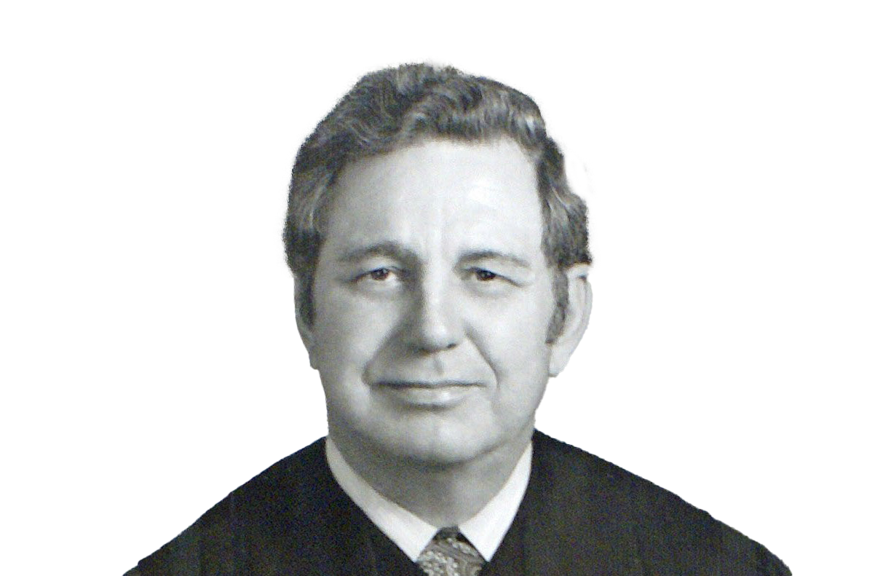
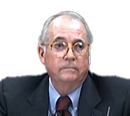
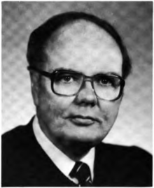
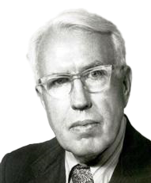
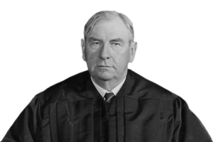
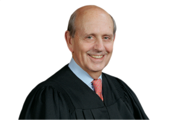
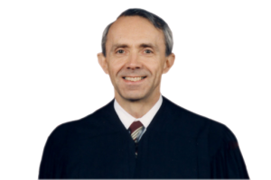

# Aggregation {#sec-aggregation}

## Joinder

So far we have focused primarily on the simplest form of adversarial
litigation: one plaintiff sues one defendant. And we have primarily been
concerned with cases in which only the plaintiff asserts claims. But the
most interesting kinds of litigations concern multiple claims, multiple
parties, or both. This chapter therefore begins to explore *complex
litigation*.

We begin by investigating counterclaims, which are governed by Rule 13.
As the next case shows, counterclaims come in two flavors: compulsory
and permissive. You'll notice that the line between the two tracks one
of the elements of claim preclusion. This is no accident. See if you can
figure out why it is so.

### Cordero v. Voltaire, LLC

**AUSTIN, M.J.** [2013 WL 6415667 (W.D. Tex. Dec. 6, 2013)]{.aside}

**Report and Recommendation of the United States Magistrate Judge**

**TO: THE HONORABLE LEE YEAKEL UNITED STATES DISTRICT JUDGE**

\[...\]

**I. General Background**

Plaintiffs Carlos Cordero, Omar Benitez, Cory Harvey, Remi Harvey and
Toby Marrujo sue their former employer, Defendant Voltaire, LLC, a
construction company, to recover unpaid overtime wages allegedly due
under the Fair Labor Standards Act ("FLSA"), 29 U.S.C. § 201 et seq.
Plaintiffs Cory Harvey, Toby Marrujo, Remi Harvey and Omar Benitez were
employed as laborers with Defendant, while Carlos Cordero was employed
as Vice President of Construction. Plaintiffs allege that Defendant
willfully failed to pay them at least one and one-half times their
regular rate of pay for overtime hours worked as is required under the
FLSA.

In response, Defendant alleges that Plaintiffs cannot recover under the
FLSA, or that any recovery should be reduced, because Plaintiffs have
falsified and inflated the hours they allegedly worked. Specifically,
Defendant alleges that "\[Plaintiff-Laborers\] and numerous other
contractors working at Defendant's job sites would provide their time to
Carlos Cordero who would then accumulate that time and provide it to
Defendant. Cordero was involved in a scheme to defraud and steal from
Defendant which included falsifying and inflating the time \[they\]
claimed to work for Defendant and also conspiring with the other workers
to falsify and inflate their time that was turned in to Defendant." In
addition, Defendant alleges that Plaintiffs took valuable materials and
equipment from it. Based upon the foregoing, Defendant has asserted
\[...\] counterclaims for fraud, theft, conversion and breach of
fiduciary duty. \[...\]

**II. Analysis**

Cordero, Remi Harvey, Corey Harvey, and Marrujo have each moved to
dismiss the counterclaims \[...\] pursuant to Federal Rules of Civil
Procedure 12(b)(1). \[...\]

**A. Plaintiffs' Rule 12(b)(1) Motion to Dismiss Defendant's Counterclaims**

Cordero argues that the counterclaims for theft, conversion, fraud and
breach of fiduciary duty are permissive counterclaims under Federal Rule
of Civil Procedure 13(b) and, therefore, must "be supported by
independent grounds of federal jurisdiction." \[...\] Although the Court
disagrees with some of the legal reasoning, it agrees that some of
Voltaire's counterclaims should be dismissed for lack of jurisdiction.
\[...\]

**2. Supplemental Jurisdiction and Rule 13**

\[The court concluded that there could be jurisdiction over Voltaire's
counterclaims only if they were compulsory rather than permissive.\]

**3. Are Defendant's Counterclaims Compulsory?** \[...\]

\[I\]t appears that the only counterclaim which is compulsory in this
case is the counterclaim against Cordero for fraud. Voltaire alleges
that Cordero committed fraud by submitting work statements to it with
"falsified and inflated hours," and that he submitted bills for time and
expenses that were expended on personal and private projects. \[...\] To
prove his FLSA claim, Cordero will have to present evidence showing how
many hours he worked, how much he was paid for those hours and how much
he should have been paid for those hours. Similarly, to prove its fraud
counterclaim, Voltaire will have to present evidence showing that
Cordero billed it for false and/or inflated hours and for work expended
on personal and private projects. Thus, both claims focus on whether
Cordero is owed overtime compensation under the Act and if so, the
amount actually owed. \[...\] Based upon the foregoing, the Court
recommends that the District Court deny Plaintiff Cordero's Motion to
Dismiss Defendant's fraud counterclaim for lack of jurisdiction.

In contrast to the fraud counterclaim, the evidence needed to prove
Defendant's counterclaims for theft, conversion, and breach of fiduciary
duty is entirely different than the evidence needed to prove Plaintiffs'
FLSA claim. Defendant's allegations that Plaintiffs committed theft and
conversion by unlawfully taking valuable equipment and materials and the
resulting breach of their fiduciary duties plainly does not rest on the
same operative facts as Plaintiffs' FLSA claim that Defendant failed to
pay them overtime wages. \[...\]

\[...\]

\[...\] The Court therefore recommends that the District Court grant
Plaintiff Cordero's Motion to Dismiss Defendant's counterclaims for
theft, conversion, and breach of fiduciary duty under Rule 12(b)(1), but
deny the Motion with regard to Voltaire's fraud counterclaim. The Court
further recommends that the District Court grant Plaintiffs Remi Harvey,
Cory Harvey, and Marrujo's Motion to Dismiss Defendant's counterclaims
for theft and conversion under Rule 12(b)(1). \[...\]

#### Notes & Questions

1.  What distinguishes compulsory and permissive counterclaims?

2.  Based on what you know about the law of former adjudication, what
    other consequences flow from a counterclaim's classification as
    compulsory? In other words, what is the implicit penalty for failing
    to raise a compulsory counterclaim?

The next several cases shift gears from additional claims to additional
parties. Rules 19 and 20, respectively, govern whom a plaintiff must or
may join as additional parties. Rule 14 controls whom a *defendant* may
name as an additional party by filing a third-party complaint, also
known as impleader. Finally, Rule 24 regulates when strangers may force
their way into an existing case through a mechanism known as
intervention.

### Mosley v. General Motors Corp.

**ROSS, J.** [497 F.2d 1330 (8th Cir. 1974)]{.aside}

::: {.column-margin}

{width=150}

:::

Nathaniel Mosley and nine other persons joined in bringing this action
individually and as class representatives alleging that their rights
guaranteed under 42 U.S.C. § 2000e *et seq.* and 42 U.S.C. § 1981 were
denied by General Motors and Local 25, United Automobile, Aerospace and
Agriculture Implement Workers of America \[Union\] by reason of their
color and race. \[...\] Each of the ten named plaintiffs had, prior to
the filing of the complaint, filed a charge with the Equal Employment
Opportunity Commission \[EEOC\] asserting the facts underlying these
claims. Pursuant thereto, the EEOC made a reasonable cause finding that
General Motors, Fisher Body Division and Chevrolet Division, and the
Union had engaged in unlawful employment practices in violation of Title
VII of the Civil Rights Act of 1964. Accordingly, the charging parties
were notified by EEOC of their right to institute a civil action in the
appropriate federal district court. \[...\]

In each of the first eight counts of the twelve-count complaint, eight
of the ten plaintiffs alleged that General Motors, Chevrolet Division,
had engaged in unlawful employment practices by: "discriminating against
Negroes as regards promotions, terms and conditions of employment";
"retaliating against Negro employees who protested actions made unlawful
by Title VII of the Act and by discharging some because they protested
said unlawful acts"; "failing to hire Negro employees as a class on the
basis of race"; "failing to hire females as a class on the basis of
sex"; "discharging Negro employees on the basis of race"; and
"discriminating against Negroes and females in the granting of relief
time." Each additionally charged that the defendant Union had engaged in
unlawful employment practices "with respect to the granting of relief
time to Negro and female employees" and "by failing to pursue ...
grievances." The remaining two plaintiffs made similar allegations
against General Motors, Fisher Body Division. All of the individual
plaintiffs requested injunctive relief, back pay, attorneys' fees and
costs. Counts XI and XII of the complaint were class action counts
against the two individual divisions of General Motors. They also sought
declaratory and injunctive relief, back pay, attorneys' fees and costs.
\[...\]

The district court ordered that "insofar as the first ten counts are
concerned, those ten counts shall be severed into ten separate causes of
action," and each plaintiff was directed to bring a separate action
based upon his complaint, duly and separately filed. The court also
ordered that the class action would not be dismissed, but rather would
be left open "to each of the plaintiffs herein, individually or
collectively ... to allege a separate cause of action on behalf of any
class of persons which such plaintiff or plaintiffs may separately or
individually represent."

In reaching this conclusion on joinder, the district court followed the
reasoning of *Smith v. North American Rockwell Corp.*, which, in a
somewhat analogous situation, found there was no right to relief arising
out of the same transaction, occurrence or series of transactions or
occurrences, and that there was no question of law or fact common to all
plaintiffs sufficient to sustain joinder under Federal Rule of Civil
Procedure 20(a). Similarly, the district court here felt that the
plaintiffs' joint actions against General Motors and the Union presented
a variety of issues having little relationship to one another; that they
had only one common problem, *i.e.*, the defendant; and that as pleaded
the joint actions were completely unmanageable. Upon entering the order,
and upon application of the plaintiffs, the district court found that
its decision involved a controlling question of law as to which there is
a substantial ground for difference of opinion and that any of the
parties might make application for appeal under 28 U.S.C. § 1292(b). We
granted the application to permit this interlocutory appeal and for the
following reasons we affirm in part and reverse in part.

Rule 20(a) of the Federal Rules of Civil Procedure provides:

> \[(1) Plaintiffs. Persons may join in one action as plaintiffs if:
>
> > \(A\) they assert any right to relief jointly, severally, or in the
alternative with respect to or arising out of the same transaction,
occurrence, or series of transactions or occurrences; and
> >
> > \(B\) any question of law or fact common to all plaintiffs will
arise in the action.\]

Additionally, Rule 20(b) and Rule 42(b) vest in the district court the
discretion to order separate trials or make such other orders as will
prevent delay or prejudice. In this manner, the scope of the civil
action is made a matter for the discretion of the district court, and a
determination on the question of joinder of parties will be reversed on
appeal only upon a showing of abuse of that discretion. To determine
whether the district court's order was proper herein, we must look to
the policy and law that have developed around the operation of Rule 20.

The purpose of the rule is to promote trial convenience and expedite the
final determination of disputes, thereby preventing multiple lawsuits.
Single trials generally tend to lessen the delay, expense and
inconvenience to all concerned. Reflecting this policy, the Supreme
Court has said: "Under the Rules, the impulse is toward entertaining the
broadest possible scope of action consistent with fairness to the
parties; joinder of claims, parties and remedies is strongly
encouraged."

Permissive joinder is not, however, applicable in all cases. The rule
imposes two specific requisites to the joinder of parties: (1) a right
to relief must be asserted by, or against, each plaintiff or defendant
relating to or arising out of the same transaction or occurrence, or
series of transactions or occurrences; and (2) some question of law or
fact common to all the parties must arise in the action.

In ascertaining whether a particular factual situation constitutes a
single transaction or occurrence for purposes of Rule 20, a case by case
approach is generally pursued. No hard and fast rules have been
established under the rule. However, construction of the terms
"transaction or occurrence" as used in the context of Rule 13(a)
counterclaims offers some guide to the application of this test. For the
purposes of the latter rule, "'Transaction' is a word of flexible
meaning. It may comprehend a series of many occurrences, depending not
so much upon the immediateness of their connection as upon their logical
relationship." Accordingly, all "logically related" events entitling a
person to institute a legal action against another generally are
regarded as comprising a transaction or occurrence. The analogous
interpretation of the terms as used in Rule 20 would permit all
reasonably related claims for relief by or against different parties to
be tried in a single proceeding. Absolute identity of all events is
unnecessary.

This construction accords with the result reached in *United States v.
Mississippi*, 380 U.S. 128 (1965), a suit brought by the United States
against the State of Mississippi, the election commissioners, and six
voting registrars of the State, charging them with engaging in acts and
practices hampering and destroying the right of black citizens of
Mississippi to vote. The district court concluded that the complaint
improperly attempted to hold the six county registrars jointly liable
for what amounted to nothing more than individual torts committed by
them separately against separate applicants. In reversing, the Supreme
Court said:

> But the complaint charged that the registrars had acted and were
continuing to act as part of a state-wide system designed to enforce
the registration laws in a way that would inevitably deprive colored
people of the right to vote solely because of their color. On such an
allegation the joinder of all the registrars as defendants in a single
suit is authorized by Rule 20(a) of the Federal Rules of Civil
Procedure. \[...\] These registrars were alleged to be carrying on
activities which were part of a series of transactions or occurrences
the validity of which depended to a large extent upon "question\[s\]
of law or fact common to all of them."

Here too, then, the plaintiffs have asserted a right to relief arising
out of the same transactions or occurrences. Each of the ten plaintiffs
alleged that he had been injured by the same general policy of
discrimination on the part of General Motors and the Union. Since a
"state-wide system designed to enforce the registration laws in a way
that would inevitably deprive colored people of the right to vote" was
determined to arise out of the same series of transactions or
occurrences, we conclude that a company-wide policy purportedly designed
to discriminate against blacks in employment similarly arises out of the
same series of transactions or occurrences. Thus the plaintiffs meet the
first requisite for joinder under Rule 20(a).

The second requisite necessary to sustain a permissive joinder under the
rule is that a question of law or fact common to all the parties will
arise in the action. The rule does not require that all questions of law
and fact raised by the dispute be common. Yet, neither does it establish
any qualitative or quantitative test of commonality. For this reason,
cases construing the parallel requirement under Federal Rule of Civil
Procedure 23(a) provide a helpful framework for construction of the
commonality required by Rule 20. In general, those cases that have
focused on Rule 23(a)(2) have given it a permissive application so that
common questions have been found to exist in a wide range of contexts.
Specifically, with respect to employment discrimination cases under
Title VII, courts have found that the discriminatory character of a
defendant's conduct is basic to the class, and the fact that the
individual class members may have suffered different effects from the
alleged discrimination is immaterial for the purposes of the
prerequisite. In this vein, one court has said:

> \[A\]lthough the actual effects of a discriminatory policy may thus
vary throughout the class, the existence of the discriminatory policy
threatens the entire class. And whether the Damoclean threat of a
racially discriminatory policy hangs over the racial class is a
question of fact common to all the members of the class.

The right to relief here depends on the ability to demonstrate that each
of the plaintiffs was wronged by racially discriminatory policies on the
part of the defendants General Motors and the Union. The discriminatory
character of the defendants' conduct is thus basic to each plaintiff's
recovery. The fact that each plaintiff may have suffered different
effects from the alleged discrimination is immaterial for the purposes
of determining the common question of law or fact. Thus, we conclude
that the second requisite for joinder under Rule 20(a) is also met by
the complaint.

For the reasons set forth above, we conclude that the district court
abused its discretion in severing the joined actions. The difficulties
in ultimately adjudicating damages to the various plaintiffs are not so
overwhelming as to require such severance. If appropriate, separate
trials may be granted as to any particular issue after the determination
of common questions.

The judgment of the district court disallowing joinder of the
plaintiffs' individual actions is reversed and remanded with directions
to permit the plaintiffs to proceed jointly. \[...\]

#### Notes & Questions

1.  What is the test under Rule 20 for whether multiple plaintiffs may
    join together in a single lawsuit?

2.  Why might multiple plaintiffs want to do so? Why might a defendant
    want to stop them from doing so?

3.  If permissive joinder is denied, what are the would-be plaintiffs'
    options?

### Price v. CTB, Inc.

**DE MENT, J.** [168 F. Supp. 2d 1299 (M.D. Ala. 2001)]{.aside}

::: {.column-margin}

{width=150}

:::

\[Price, a chicken farmer, hired Latco to build a new chicken house.
After it was built, Price sued\] Latco\[, among others, over\] \[...\]
the quality of its workmanship when it constructed chicken houses for
various Alabama farmers. The causes of action against Latco include
breach of the construction contract, fraudulent misrepresentation of the
caliber of materials to be used, and negligence and wantonness in the
construction. Latco moved to file a Third Party Complaint against, inter
alios, ITW \[...\]. \[...\] In the Third Party Complaint, Latco alleges
that ITW, a nail manufacturer, defectively designed the nails used in
the construction of the chicken houses. The specific causes of action
include breach of warranty, violation of the Alabama Extended
Manufacturer's Liability Doctrine, and common law indemnity. ITW argues
that it was improperly impleaded under Rule 14 of the Federal Rules of
Civil Procedure, or, alternatively, that the Third Party Complaint is
barred by the equitable doctrine of laches.

Under Rule 14(a), a defendant may assert a claim against anyone not a
party to the original action if that third party's liability is in some
way dependent upon the outcome of the original action. There is a
limitation on this general statement, however. Even though it may arise
out of the same general set of facts as the main claim, a third party
claim will not be permitted when it is based upon a separate and
independent claim. Rather, the third party liability must in some way be
derivative of the original claim; a third party may be impleaded only
when the original defendant is trying to pass all or part of the
liability onto that third party.

Latco argues that ITW is the prototypical third party defendant under
Rule 14. It asserts that ITW can be found liable for the warranty
surrounding its products if Latco is first found liable for faulty
construction. Furthermore, insists Latco, this derivative liability
merely involves a shift in the overall responsibility of the allegedly
defective chicken houses. ITW contends, however, that because Rule 14 is
merely a procedural rule, the propriety of its application depends upon
the existence of a right to indemnity under the substantive law. ITW
accurately states the law in this regard, but its conclusion that there
is no viable substantive claim under Alabama law is incorrect.

Conceding that Alabama does not recognize a right to contribution among
joint tortfeasors, Latco directs the court's attention to the concept of
implied contractual indemnity. Under this doctrine, Alabama courts
recognize that a manufacturer of a product has impliedly agreed to
indemnify the seller when 1) the seller is without fault, 2) the
manufacturer is responsible, and 3) the seller has been required to pay
a monetary judgment. Under Latco's theory, should it be found liable for
its construction of the chicken houses, it can demonstrate that the true
fault lies with the nail guns and the nails manufactured by ITW.

Alabama case law, not to mention the parties' briefs, is especially
sparse with respect to the contours of the doctrine of implied
indemnity. \[...\] \[However, t\]he court finds that Alabama law
provides Latco a cause of action under common law indemnity against ITW.

It must be noted, however, that, under Alabama law, the doctrine permits
recovery only when the party to be indemnified is "without fault."
Whether, in fact, such a factual scenario will be proven at trial is
irrelevant for present purposes. The only issue before the court is
whether there exists a legal basis to implead ITW, not whether ITW is,
in fact, liable to Latco. Since Rule 14 permits Latco to implead any
party who "may be liable," Fed. R. Civ. P. 14(a), it follows that the
court must permit development of the factual record so the extent of
that liability may be determined. \[...\]

Furthermore, since Latco has established a basis upon which it may
properly implead ITW, the court need not address the applicability of
Rule 14 to the other claims in Latco's Third Party Complaint. It is well
established that a properly impleaded claim may serve as an anchor for
separate and independent claims under Rule 18(a).^3^ \[...\] In short,
the court finds that Latco has properly impleaded ITW under Rule 14(a). 

Accordingly, it is CONSIDERED and ORDERED that ITW's Motion to Dismiss
be and the same is hereby DENIED.

#### Notes & Questions

1.  An important lesson of *Price* is that defendants are not usually
    allowed to bring additional parties into an existing suit. Instead,
    the default rule is that a defendant who has claims against a third
    party must file a separate suit to recover his own damages.

2.  Rule 14, however, provides a narrow path for complaints against
    third parties "who is or may be liable to \[the defendant\] for all
    or part of the claim against it." Rule 14(a)(1). *Price* explains
    that the liability required to invoke Rule 14 is a particular kind:
    it must be derivative. In other words, a defendant must show that
    the third party would be liable, on a dollar-for-dollar basis, to
    the defendant for at least some of the plaintiff's damages against
    the defendant.

While Rule 20 governs permissive joinder of parties, Rule 19 controls
*required* joinder of parties. A "required party," under Rule 19, is one
in whose absence "the court cannot accord complete relief among existing
parties," or one who claims an interest in the subject of the action
such that adjudicating the case without them would impair that person or
other parties from being able to protect their interests. Rule 19(a)(1).
The next case discusses what it takes for a party to be "required."

### Temple v. Synthes Corp.

**PER CURIAM.** [498 U.S. 5 (1990)]{.aside}

Petitioner Temple, a Mississippi resident, underwent surgery in October
1986 in which a "plate and screw device" was implanted in his lower
spine. The device was manufactured by respondent Synthes, Ltd. (U.S.A.)
(Synthes), a Pennsylvania corporation. Dr. S. Henry LaRocca performed
the surgery at St. Charles General Hospital in New Orleans, Louisiana.
Following surgery, the device's screws broke off inside Temple's back.

Temple filed suit against Synthes in the United States District Court
for the Eastern District of Louisiana. The suit, which rested on
diversity jurisdiction, alleged defective design and manufacture of the
device. At the same time, Temple filed a state administrative proceeding
against Dr. LaRocca and the hospital for malpractice and negligence. At
the conclusion of the administrative proceeding, Temple filed suit
against the doctor and the hospital in Louisiana state court.

Synthes did not attempt to bring the doctor and the hospital into the
federal action by means of a third-party complaint, as provided in
Federal Rule of Civil Procedure 14(a). Instead, Synthes filed a motion
to dismiss Temple's federal suit for failure to join necessary parties
pursuant to Federal Rule of Civil Procedure 19. Following a hearing, the
District Court ordered Temple to join the doctor and the hospital as
defendants within twenty days or risk dismissal of the lawsuit.
According to the court, the most significant reason for requiring
joinder was the interest of judicial economy. The court relied on this
Court's decision in *Provident Tradesmens Bank & Trust Co. v.
Patterson*, 390 U.S. 102 (1968), wherein we recognized that one focus of
Rule 19 is "the interest of the courts and the public in complete,
consistent, and efficient settlement of controversies." When Temple
failed to join the doctor and the hospital, the court dismissed the suit
with prejudice.

Temple appealed, and the United States Court of Appeals for the Fifth
Circuit affirmed. The court deemed it "obviously prejudicial to the
defendants to have the separate litigations being carried on," because
Synthes' defense might be that the plate was not defective but that the
doctor and the hospital were negligent, while the doctor and hospital,
on the other hand, might claim that they were not negligent but that the
plate was defective. The Court of Appeals found that claims overlapped
and that the District Court therefore had not abused its discretion in
ordering joinder under Rule 19. A petition for rehearing was denied.

In his petition for certiorari to this Court, Temple contends that it
was error to label joint tortfeasors as indispensable parties under Rule
19(b) and to dismiss the lawsuit with prejudice for failure to join
those parties. We agree. Synthes does not deny that it, the doctor, and
the hospital are potential joint tortfeasors. It has long been the rule
that it is not necessary for all joint tortfeasors to be named as
defendants in a single lawsuit. Nothing in the 1966 revision of Rule 19
changed that principle. The Advisory Committee Notes to Rule 19(a)
explicitly state that "a tortfeasor with the usual 'joint-and-several'
liability is merely a permissive party to an action against another with
like liability." Advisory Committee's Notes on Fed. Rule Civ. Proc. 19.
There is nothing in Louisiana tort law to the contrary.

The opinion in *Provident Bank*, *supra*, does speak of the public
interest in limiting multiple litigation, but that case is not
controlling here. There, the estate of a tort victim brought a
declaratory judgment action against an insurance company. We assumed
that the policyholder was a person "who, under ... \[Rule 19\](a),
should be joined if 'feasible'" and went on to discuss the appropriate
analysis under Rule 19(b), because the policyholder could not be joined
without destroying diversity. After examining the factors set forth in
Rule 19(b), we determined that the action could proceed without the
policyholder; he therefore was not an indispensable party whose absence
required dismissal of the suit.

Here, no inquiry under Rule 19(b) is necessary, because the threshold
requirements of Rule 19(a) have not been satisfied. As potential joint
tortfeasors with Synthes, Dr. LaRocca and the hospital were merely
permissive parties. The Court of Appeals erred by failing to hold that
the District Court abused its discretion in ordering them joined as
defendants and in dismissing the action when Temple failed to comply
with the court's order. For these reasons, we grant the petition for
certiorari, reverse the judgment of the Court of Appeals for the Fifth
Circuit, and remand for further proceedings consistent with this
opinion.

It is so ordered.

#### Notes & Questions

1.  There are at least three separate proceedings discussed in this
    case. Identify each, its parties, and its procedural history.

2.  Why did the courts below think that the doctor and the hospital were
    required parties? What interest led them to that conclusion?

3.  Why did the Supreme Court disagree that the doctor and the hospital
    were required parties?

4.  Finally, the Court notes that, because the doctor and the hospital
    were not required parties, there was no need to conduct an inquiry
    under Rule 19(b). That provision specifies what the consequences are
    when a party is required but unable to be joined. The next case
    takes up those rules.

### Helzberg's Diamond Shops v. Valley West Des Moines Shopping Center

**ALSOP, J.** [564 F.2d 816 (8th Cir. 1977)]{.aside}

::: {.column-margin}

{width=150}

:::

On February 3, 1975, Helzberg's Diamond Shops, Inc. (Helzberg), a
Missouri corporation, and Valley West Des Moines Shopping Center, Inc.
(Valley West), an Iowa corporation, executed a written Lease Agreement.
The Lease Agreement granted Helzberg the right to operate a full line
jewelry store at space 254 in the Valley West Mall in West Des Moines,
Iowa. Section 6 of Article V of the Lease Agreement provides:

> \[Valley West\] agrees it will not lease premises in the shopping
center for use as a catalog jewelry store nor lease premises for more
than two full line jewelry stores in the shopping center in addition
to the leased premises. This clause shall not prohibit other stores
such as department stores from selling jewelry from catalogs or in any
way restrict the shopping center department stores.

Subsequently, Helzberg commenced operation of a full line jewelry store
in the Valley West Mall.

Between February 3, 1975 and November 2, 1976 Valley West and two other
corporations entered into leases for spaces in the Valley West Mall for
use as full line jewelry stores. Pursuant to those leases the two
corporations also initiated actual operation of full line jewelry
stores. On November 2, 1976, Valley West and Kirk's Incorporated,
Jewelers, an Iowa corporation, doing business as Lord's Jewelers
(Lord's), entered into a written Lease Agreement. The Lease Agreement
granted Lord's the right to occupy space 261 in the Valley West Mall.
Section I of Article V of the Lease Agreement provides that Lord's will
use space 261

> ... only as a retail specialty jewelry store (and not as a catalogue
or full line jewelry store) featuring watches, jewelry (and the repair
of same) and incidental better gift items.

However, Lord's intended to open and operate what constituted a full
line jewelry store at space 261.

In an attempt to avoid the opening of a fourth full line jewelry store
in the Valley West Mall and the resulting breach of the Helzberg-Valley
West Lease Agreement, Helzberg instituted suit seeking preliminary and
permanent injunctive relief restraining Valley West's breach of the
Lease Agreement. The suit was filed in the United States District Court
for the Western District of Missouri. Subject matter jurisdiction was
invoked pursuant to 28 U.S.C. § 1332 based upon diversity of citizenship
between the parties and an amount in controversy which exceeded \[the
statutory amount\]. Personal jurisdiction was established by service of
process on Valley West pursuant to the Missouri "long arm" statute, Rev.
Stat. Mo. § 506.500 et seq. (1977). Rule 4(e), Fed. R. Civ. P.

Valley West moved to dismiss pursuant to Rule 19 because Helzberg had
failed to join Lord's as a party defendant. That motion was denied. The
district court went on to order that

> pending the determination of \[the\] action on the merits, that
\[Valley West\] be, and it is hereby, enjoined and restrained from
allowing, and shall take all necessary steps to prevent, any other
tenant in its Valley West Mall (including but not limited to Kirk's
Incorporated, Jewelers, d/ b/a Lord's Jewelers) to open and operate on
March 30, 1977, or at any other time, or to be operated during the
term of \[Helzberg's\] present leasehold, a fourth full line jewelry
store meaning a jewelry store offering for sale at retail a broad
range of jewelry items at various prices such as diamonds and diamond
jewelry, precious and semi-precious stones, watches, rings, gold
jewelry, costume jewelry, gold chains, pendants, bracelets, belt
buckles, tie tacs, tie slides and earrings, provided, however, nothing
contained herein shall be construed to enjoin \[Valley West\] from
allowing the opening in said Valley West Mall of a small store, known
by \[Valley West\] as a boutique, which sells limited items such as
only Indian jewelry, only watches, only earrings, or only pearls.

From this order Valley West appeals.

It is clear that Valley West is entitled to appeal from the order
granting preliminary injunctive relief. 28 U.S.C. § 1292(a)(1). However,
Valley West does not attack the propriety of the issuance of a
preliminary injunction directly; instead, it challenges the District
Court's denial of its motion to dismiss for failure to join an
indispensable party and argues that the District Court's order fails for
lack of specificity in describing the acts of Valley West to be
restrained. \[...\]

Because Helzberg was seeking and the District Court ordered injunctive
relief which may prevent Lord's from operating its jewelry store in the
Valley West Mall in the manner in which Lord's originally intended, the
District Court correctly concluded that Lord's was a party to be joined
if feasible. *See* Rule 19(a)\[(1)(b)\](i), Fed. R. Civ. P. Therefore,
because Lord's was not and is not subject to personal jurisdiction in
the Western District of Missouri, the District Court was required to
determine whether or not Lord's should be regarded as indispensable.
After considering the factors which Rule 19(b) mandates be considered,
the District Court concluded that Lord's was not to be regarded as
indispensable. We agree. \[...\]

Rule 19(b) requires the court to look first to the extent to which a
judgment rendered in Lord's absence might be prejudicial to Lord's or to
Valley West. Valley West argues that the District Court's order granting
preliminary injunctive relief does prejudice Lord's and may prejudice
Valley West. We do not agree.

It seems axiomatic that none of Lord's rights or obligations will be
ultimately determined in a suit to which it is not a party. Even if, as
a result of the District Court's granting of the preliminary injunction,
Valley West should attempt to terminate Lord's leasehold interest in
space 261 in the Valley West Mall, Lord's will retain all of its rights
under its Lease Agreement with Valley West. None of its rights or
obligations will have been adjudicated as a result of the present
proceedings, proceedings to which it is not a party. Therefore, we
conclude that Lord's will not be prejudiced in a way contemplated by
Rule 19(b) as a result of this action.

Likewise, we think that Lord's absence will not prejudice Valley West in
a way contemplated by Rule 19(b). Valley West contends that it may be
subjected to inconsistent obligations as a result of a determination in
this action and a determination in another forum that Valley West should
proceed in a fashion contrary to what has been ordered in these
proceedings.

It is true that the obligations of Valley West to Helzberg, as
determined in these proceedings, may be inconsistent with Valley West's
obligations to Lord's. However, we are of the opinion that any
inconsistency in those obligations will result from Valley West's
voluntary execution of two Lease Agreements which impose inconsistent
obligations rather than from Lord's absence from the present
proceedings.

Helzberg seeks only to restrain Valley West's breach of the Lease
Agreement to which Helzberg and Valley West were the sole parties.
Certainly, all of the rights and obligations arising under a lease can
be adjudicated where all of the parties to the lease are before the
court. Thus, in the context of these proceedings the District Court can
determine all of the rights and obligations of both Helzberg and Valley
West based upon the Lease Agreement between them, even though Lord's is
not a party to the proceedings.

Valley West's contention that it may be subjected to inconsistent
judgments if Lord's should choose to file suit elsewhere and be awarded
judgment is speculative at best. In the first place, Lord's has not
filed such a suit. Secondly, there is no showing that another court is
likely to interpret the language of the two Lease Agreements differently
from the way in which the District Court would. Therefore, we also
conclude that Valley West will suffer no prejudice as a result of the
District Court's proceeding in Lord's absence. Any prejudice which
Valley West may suffer by way of inconsistent judgments would be the
result of Valley West's execution of Lease Agreements which impose
inconsistent obligations and not the result of the proceedings in the
District Court.

Rule 19(b) also requires the court to consider ways in which prejudice
to the absent party can be lessened or avoided. The District Court
afforded Lord's an opportunity to intervene in order to protect any
interest it might have in the outcome of this litigation. Lord's chose
not to do so. In light of Lord's decision not to intervene we conclude
that the District Court acted in such a way as to sufficiently protect
Lord's interests.

Similarly, we also conclude that the District Court's determinations
that a judgment rendered in Lord's absence would be adequate and that
there is no controlling significance to the fact that Helzberg would
have an adequate remedy in the Iowa courts were not erroneous. It
follows that the District Court's conclusion that in equity and good
conscience the action should be allowed to proceed was a correct one.

In sum, it is generally recognized that a person does not become
indispensable to an action to determine rights under a contract simply
because that person's rights or obligations under an entirely separate
contract will be affected by the result of the action. This principle
applies to an action against a lessor who has entered into other leases
which also may be affected by the result in the action in which the
other lessees are argued to be indispensable parties. We conclude that
the District Court properly denied the motion to dismiss for failure to
join an indispensable party. \[...\]

In view of the foregoing, it follows that the judgment of the District
Court is affirmed.

#### Notes & Questions

1.  Follow the logic of Rule 19 closely. Helzberg's sued Valley West.
    Valley West moved to dismiss for lack of a required party, Lord's.
    The court concluded, applying Rule 19(a) that Lord's was in fact a
    required party. (Why?) Then the court proceeded to determine, under
    Rule 19(b), what to do in Lord's absence (for jurisdictional
    reasons, Lord's could not be added to the case). The court then
    balanced a series of factors to conclude that dismissal was not
    appropriate, notwithstanding Lord's absence. (What were the factors
    considered?)

2.  Whose fault was it that there were two jewelry stores in the Valley
    West mall? Who would have benefited most from dismissal of
    Helzberg's suit? Do the answers to those two questions help explain
    why the case turned out as it did?

Rule 24 allows non-parties to a case an opportunity to join the case
(usually, but not always, as a plaintiff). Just as Rule 19 distinguishes
between permissive joinder and required joinder, Rule 24 distinguishes
between permissive intervention (Rule 24(b)) and intervention as of
right (Rule 24(a)). The next case examines these two bases of
intervention.

### Natural Resources Defense Council v. United States Nuclear Regulatory Commission

**DOYLE, J.** [578 F.2d 1341 (10th Cir. 1978)]{.aside}

::: {.column-margin}

{width=150}

:::

The American Mining Congress and Kerr-McGee Nuclear Corporation seek
review of the order of the United States District Court for the District
of New Mexico denying their motions to intervene \[as\] a matter of
right or on a permissive basis, pursuant to Rule 24(a)(2) and (b), Fed.
R. Civil Proc.

The underlying action in which the movants requested intervention was
instituted by the Natural Resources Defense Council, Inc., and others.
In the action, declaratory and injunctive relief is directed to the
United States Nuclear Regulatory Commission (NRC) and the New Mexico
Environmental Improvement Agency (NMEIA), prohibiting those agencies
from issuing licenses for the operation of uranium mills in New Mexico
without first preparing environmental impact statements. Kerr-McGee and
United Nuclear are potential recipients of the licenses.

Congress, in the Atomic Energy Act of 1954, has authorized the NRC to
issue such licenses. NMEIA is involved because under § 274(b) of the
Act, the NRC is authorized to enter into agreements with the states
allowing the states to issue licenses. Such agreements have been made
with about 25 states including New Mexico. Thus, the action below in
effect seeks to prevent the use of § 274(b) of the Act so as to avoid
the requirement of an impact statement for which provision is made in
the National Environmental Policy Act. \[...\]

The relief sought by the plaintiffs' complaint is, first, that NRC's
involvement in the licensing procedure in New Mexico is, notwithstanding
the delegation to the state, sufficient to constitute major federal
action, whereby the impact statement requirement is not eliminated.
Second, that if an impact statement is not required in connection with
the granting of licenses, the New Mexico program is in conflict with
§ 274(d)(2) of the Atomic Energy Act of 1954.

The motion of United Nuclear Corporation to intervene is not opposed by
the parties and was granted. On May 3, 1977, the date that the complaint
herein was filed, NMEIA granted a license to United Nuclear to operate a
uranium mill at Church Rock, New Mexico. The complaint seeks to enjoin
the issuance of the license thus granted.

It was after that that Kerr-McGee Nuclear Corporation, Anaconda Company,
Gulf Oil Corporation, Phillips Petroleum Company, and the American
Mining Congress filed motions to intervene. These motions, insofar as
they sought intervention as of right, were denied on the ground that the
interests of the parties or movants would be adequately represented by
United Nuclear. Permissive intervention was also denied. Kerr-McGee and
the American Mining Congress both appeal denial of both intervention as
of right and permissive intervention.

Our issue is a limited one. We merely construe and weigh Rule 24(a) of
the Fed. R. Civ. P. (intervention as of right) and decide in light of
the facts and considerations presented whether the denial of
intervention was correct. \[The court quoted Rule 24(a).\] We do not
have a subsection (1) situation involving a statutory conferring of
right to intervene. Accordingly, we must consider the standards set
forth in subsection (2), which are:

> 1\. Whether the applicant claims an interest relating to the property
or transaction which is the subject of the action.
>
> 2\. Whether the claimants are so situated that the disposition of the
action may as a practical matter impair or impede their ability to
protect that interest.
>
> 3\. Whether their interest is not adequately represented by existing

\[...\] Our conclusion is that the interests of movants in the subject
matter is sufficient to satisfy the requirements of Rule 24 and that the
threat of loss of their interest and inability to participate is of such
magnitude as to impair their ability to advance their interest.

**I**

\[...\] Strictly to require that the movant in intervention have a
direct interest in the outcome of the lawsuit strikes us as being too
narrow a construction of Rule 24(a)(2). \[...\]

In our case the matter of immediate interest is, of course, the issuance
and delivery of the license sought by United Nuclear. However, the
consequence of the litigation could well be the imposition of the
requirement that an environmental impact statement be prepared before
granting any uranium mill license in New Mexico, or, secondly, it could
result in an injunction terminating or suspending the agreement between
NRC and NMEIA. Either consequence would be felt by United Nuclear and to
some degree, of course, by Kerr-McGee, which is said to be one of the
largest holders of uranium properties in New Mexico. It operates a
uranium mill in Grants, New Mexico, pursuant to an NMEIA license, which
application for renewal is pending. A decision in favor of the
plaintiffs, which is not unlikely, could have a profound effect upon
Kerr-McGee. Hence, it does have an interest within the meaning of Rule
24(a)(2). This interest of Kerr-McGee is in sharp contrast to the
minimal interest which was present in Allard, wherein it was an interest
of environmental groups in the protection of living birds. This was
considered insufficient to justify intervention in a case involving
feathers which are part of Indian artifacts. Their interest was said to
be limited to a general interest in the public. The interest asserted on
behalf of Kerr-McGee and the American Mining Congress is one which is a
genuine threat to Kerr-McGee and the members of the American Mining
Congress to a substantial degree.

We do not suggest that Kerr-McGee could expect better treatment from
state authorities than federal. We do recognize that a change in
procedure would produce impairing complications.

**II**

The next question is whether, assuming the existence of an interest, the
chance of impairment is sufficient to fulfill the requirement of Rule
24(a)(2).

\[...\] If the relief sought by the plaintiffs is granted, there can be
little question but that the interests of the American Mining Congress
and of Kerr-McGee would be affected. Plaintiffs contend, however, that
appellants would not be bound by such a result if they are not
participants. Kerr-McGee points out that even though it may not be res
judicata, still it would have a stare decisis effect. Moreover, with NRC
and NMEIA as parties, the result might be more profound than stare
decisis.

It should be pointed out that the Rule refers to impairment "as a
practical matter." Thus, the court is not limited to consequences of a
strictly legal nature. The court may consider any significant legal
effect in the applicant's interest and it is not restricted to a rigid
res judicata test. Hence, the stare decisis effect might be sufficient
to satisfy the requirement. It is said that where, as here, the case is
of first impression, the stare decisis effect would be important.

Finally, the considerations for requiring an environmental impact
statement will be relatively the same in respect to the issuance of a
uranium mining license in every instance. Hence, to say that it can be
repeatedly litigated is not an answer, for the chance of getting a
contrary result in a case which is substantially similar on its facts to
one previously adjudicated seems remote.

We are of the opinion, therefore, that appellants have satisfied the
impairment criterion.

**III**

The final question is whether the trial court was correct in its
conclusion that United Nuclear would adequately represent Kerr-McGee and
the American Mining Congress.

The finding and conclusion was that the representation would be adequate
because United Nuclear, a fellow member of the industry, has interests
which were the same as those of the appellants and possessed the same
level of knowledge and experience with the ability and willingness to
pursue the matter and could adequately represent Kerr-McGee and the
members of the American Mining Congress. \[...\]

United Nuclear is situated somewhat differently in this case than are
the other members of the industry since it has been granted its license.
From this it is urged by Kerr-McGee that United Nuclear may be ready to
compromise the case by obtaining a mere declaration that while
environmental impact statements should be issued, this requirement need
be prospective only, whereby it would not affect them. While we see this
as a remote possibility, we gravely doubt that United Nuclear would opt
for such a result. It is true, however, that United Nuclear has a
defense of laches that is not available to Kerr-McGee or the others.

7A C. Wright & A. Miller, Federal Practice & Procedure, § 1909, at 524
(1972), says:

> \[I\]f \[an applicant's\] interest is similar to, but not identical
with, that of one of the parties, a discriminating judgment is
required on the circumstances of the particular case, but he
ordinarily should be allowed to intervene unless it is clear that the
party will provide adequate representation for the absentee.

While the interest of the two applicants may appear similar, there is no
way to say that there is no possibility that they will not be different
and the possibility of divergence of interest need not be great in order
to satisfy the burden of the applicants under National Farm Lines.

There are other reasons for allowing intervention. There is some value
in having the parties before the court so that they will be bound by the
result. American Mining Congress represents a number of companies having
a wide variety of interests. This can, therefore, provide a useful
supplement to the defense of the case. The same can be said of
Kerr-McGee.

The trial court was concerned that the addition of these movants would
make the litigation unwieldy. If the intervenors are limited to this
group, unwieldiness does not become a problem which the trial court
cannot control. It does not appear that there would be a need for
additional parties in view of the presence of the American Mining
Congress. While we do not express an opinion on the possibilities of
further additions, we wish to make clear that the present holdings that
the two applicants should be allowed to intervene does not say that
others should be added.

The order of the district court is reversed and the cause is remanded
with instructions to the trial court to grant the appellants,
Kerr-McGee's and American Mining Congress', motions to intervene.

#### Notes & Questions

1.  As the court notes, in the absence of a statutory right to
    intervene, intervention as of right requires three showings: (1) an
    interest relating to the case; (2) the disposition of which would
    impair the movant's ability to protect its interest; and (3) there
    is no party who would adequately represent the would-be intervenor's
    interest. The court proceeds through these three requirements in
    turn. Follow closely its analysis at each stage to get a sense of
    what each requirement demands.

2.  What happened to the argument that the intervenors should be
    permitted to intervene? Why didn't the court discuss that aspect of
    the movants' appeal in detail?
    
## Non-Parties & Judgments

So far we have spoken of aggregation in terms of addition. Instead of
one party, twenty. Instead of one claim going one direction, several
claims traced by arrows pointing in many directions. But lurking
unassuming in the Federal Rules of Civil Procedure is mechanism for
aggregation by multiplication. Rule 23 authorizes class
actions---representative suits that combine the claims (or defenses) of
potentially thousands or even millions of people.

Class actions are important for many reasons, but the chief one is
probably economic. By banding together the claims of many in one case,
both the litigants and courts can unlock massive economies of scale. For
that reason, class actions promise to make the civil litigation system
more efficient and, we might therefore say, fairer.

But there is a risk with class actions. Because they litigate the claims
of people who are not present before the court but rather are
represented by a lead plaintiff or defendant, they threaten to
extinguish individual's rights without affording them notice and an
opportunity to be heard. If you've made it this far, your due process
alarm is sounding. So too does that alarm sound at the Supreme Court.

The next case sets the stage, by reminding us of a fact already learned
from *Taylor v. Sturgell*: those who are not parties to a case cannot be
bound by a judgment rendered in it. The flip side of that insight, as
the remainder of the chapter will show, is that the class action offers
a way to bring non-parties into a case, and thereby bind them---win *or*
lose.

### Martin v. Wilks

**REHNQUIST, C.J., delivered the opinion of the Court.** [490 U.S. 755 (1989)]{.aside}

::: {.column-margin}

{width=150}

:::

A group of white firefighters sued the city of Birmingham, Alabama
(City), and the Jefferson County Personnel Board (Board) alleging that
they were being denied promotions in favor of less qualified black
firefighters. They claimed that the City and the Board were making
promotion decisions on the basis of race in reliance on certain consent
decrees, and that these decisions constituted impermissible racial
discrimination in violation of the Constitution and federal statutes.
The District Court held that the white firefighters were precluded from
challenging employment decisions taken pursuant to the decrees, even
though these firefighters had not been parties to the proceedings in
which the decrees were entered. We think this holding contravenes the
general rule that a person cannot be deprived of his legal rights in a
proceeding to which he is not a party.

The \[initial\] litigation \[...\] began in 1974, when the Ensley Branch
of the NAACP and seven black individuals filed separate class-action
complaints against the City \[of Birmingham\] and the Board. They
alleged that both had engaged in racially discriminatory hiring and
promotion practices in various public service jobs in violation of Title
VII of the Civil Rights Act of 1964 and other federal law. After a bench
trial on some issues, but before judgment, the parties entered into two
consent decrees, one between the black individuals and the City and the
other between them and the Board. These proposed decrees set forth an
extensive remedial scheme, including long-term and interim annual goals
for the hiring of blacks as firefighters. The decrees also provided for
goals for promotion of blacks within the department. The District Court
entered an order provisionally approving the decrees and directing
publication of notice of the upcoming fairness hearings. Notice of the
hearings, with a reference to the general nature of the decrees, was
published in two local newspapers. At that hearing, the Birmingham
Firefighters Association (BFA) appeared and filed objections as amicus
curiae. After the hearing, but before final approval of the decrees, the
BFA and two of its members also moved to intervene on the ground that
the decrees would adversely affect their rights. The District Court
denied the motions as untimely and approved the decrees. Seven white
firefighters, all members of the BFA, then filed a complaint against the
City and the Board seeking injunctive relief against enforcement of the
decrees. The seven argued that the decrees would operate to illegally
discriminate against them; the District Court denied relief. \[...\]

A new group of white firefighters, the Wilks respondents, then brought
suit against the City and the Board in District Court. They too alleged
that, because of their race, they were being denied promotions in favor
of less qualified blacks in violation of federal law. The Board and the
City admitted to making race conscious employment decisions, but argued
the decisions were unassailable because they were made pursuant to the
consent decrees. A group of black individuals, the Martin petitioners,
were allowed to intervene in their individual capacities to defend the
decrees.

The defendants moved to dismiss the reverse discrimination cases as
impermissible collateral attacks on the consent decrees. \[...\] After
trial the District Court granted the motion to dismiss. \[...\]

On appeal, the Eleventh Circuit reversed. It held that "\[b\]ecause ...
\[the Wilks respondents\] were neither parties nor privies to the
consent decrees, ... their independent claims of unlawful discrimination
are not precluded." \[...\]

We granted certiorari and now affirm the Eleventh Circuit's judgment.
All agree that "\[i\]t is a principle of general application in
Anglo-American jurisprudence that one is not bound by a judgment in
personam in a litigation in which he is not designated as a party or to
which he has not been made a party by service of process." *Hansberry v.
Lee*, 311 U.S. 32, 40 (1940) \[*see* *infra*\]. This rule is part of our
"deep-rooted historic tradition that everyone should have his own day in
court." 18 C. Wright, A. Miller & E. Cooper, Federal Practice and
Procedure § 4449, p. 417 (1981) (18 Wright). A judgment or decree among
parties to a lawsuit resolves issues as among them, but it does not
conclude the rights of strangers to those proceedings.^2^ [ ^2^ We have recognized an exception to the general rule when, in
    certain limited circumstances, a person, although not a party, has
    his interests adequately represented by someone with the same
    interests who is a party. *See Hansberry v. Lee*, 311 U.S. 32,
    41--42 (1940) ("class" or "representative" suits); Fed. Rule Civ.
    Proc. 23 (same). Additionally, where a special remedial scheme
    exists expressly foreclosing successive litigation by nonlitigants,
    as for example in bankruptcy or probate, legal proceedings may
    terminate pre-existing rights if the scheme is otherwise consistent
    with due process. Neither of these exceptions, however, applies in
    these cases.\
    ]{.aside}
Petitioners argue that, because respondents failed to timely intervene in the
initial proceedings, their current challenge to actions taken under the
consent decree constitutes an impermissible "collateral attack." They
argue that respondents were aware that the underlying suit might affect
them and if they chose to pass up an opportunity to intervene, they
should not be permitted to later litigate the issues in a new action.
The position has sufficient appeal to have commanded the approval of the
great majority of the Federal Courts of Appeals, but we agree with the
contrary view expressed by the Court of Appeals for the Eleventh Circuit
in this case. 

We begin with the words of Justice Brandeis in *Chase National Bank v.
Norwalk*, 291 U.S. 431 (1934):

> The law does not impose upon any person absolutely entitled to a
hearing the burden of voluntary intervention in a suit to which he is
a stranger. ... Unless duly summoned to appear in a legal proceeding,
a person not a privy may rest assured that a judgment recovered
therein will not affect his legal rights.

While these words were written before the adoption of the Federal Rules
of Civil Procedure, we think the Rules incorporate the same principle; a
party seeking a judgment binding on another cannot obligate that person
to intervene; he must be joined. \[...\] Against the background of
permissive intervention set forth in Chase National Bank, the drafters
cast Rule 24, governing intervention, in permissive terms. *See* Fed.
Rule Civ. Proc. 24(a) (intervention as of right) ("\[on timely motion,
the court must permit anyone to intervene"\]); Fed. Rule Civ. Proc.
24(b) (permissive intervention) (\["on timely motion, the court may
permit anyone to intervene"\]). They determined that the concern for
finality and completeness of judgments would be "better \[served\] by
mandatory joinder procedures." 18 Wright § 4452, p. 453. [ ^6^ The dissent argues, on the one hand, that respondents have
not been "bound" by the decree but, rather, that they are only
suffering practical adverse effects from the consent decree. On the
other hand, the dissent characterizes respondents' suit not as an
assertion of their own independent rights, but as a collateral
attack on the consent decrees which, it is said, can only proceed on
very limited grounds. Respondents in their suit have alleged that
they are being racially discriminated against by their employer in
violation of Title VII: either the fact that the disputed employment
decisions are being made pursuant to a consent decree is a defense
to respondents' Title VII claims or it is not. If it is a defense to
challenges to employment practices which would otherwise violate
Title VII, it is very difficult to see why respondents are not being
"bound" by the decree.\
]{.aside} Accordingly, Rule 19(a) provides for mandatory joinder in circumstances where a
judgment rendered in the absence of a person may "leave \[an existing
party\] subject to a substantial risk of incurring ... inconsistent
obligations ... ." Rule 19(b) sets forth the factors to be considered by
a court in deciding whether to allow an action to proceed in the absence
of an interested party.

Joinder as a party, rather than knowledge of a lawsuit and an
opportunity to intervene, is the method by which potential parties are
subjected to the jurisdiction of the court and bound by a judgment or
decree.^6^ The parties to a lawsuit presumably know better than anyone
else the nature and scope of relief sought in the action, and at whose
expense such relief might be granted. It makes sense, therefore, to
place on them a burden of bringing in additional parties where such a
step is indicated, rather than placing on potential additional parties a
duty to intervene when they acquire knowledge of the lawsuit. The
linchpin of the "impermissible collateral attack" doctrine---the
attribution of preclusive effect to a failure to intervene---is
therefore quite inconsistent with Rule 19 and Rule 24. \[...\] 

Petitioners \[...\] rely on our decision in *Provident Tradesmans Bank*
as authority for the view which they espouse. In that case we discussed
Rule 19 shortly after parts of it had been substantially revised, but we
expressly left open the question of whether preclusive effect might be
attributed to a failure to intervene.

Petitioners contend that a different result should be reached because
the need to join affected parties will be burdensome and ultimately
discouraging to civil rights litigation. Potential adverse claimants may
be numerous and difficult to identify; if they are not joined, the
possibility for inconsistent judgments exists. Judicial resources will
be needlessly consumed in relitigation of the same question.

Even if we were wholly persuaded by these arguments as a matter of
policy, acceptance of them would require a rewriting rather than an
interpretation of the relevant Rules. But we are not persuaded that
their acceptance would lead to a more satisfactory method of handling
cases like this one. It must be remembered that the alternatives are a
duty to intervene based on knowledge, on the one hand, and some form of
joinder, as the Rules presently provide, on the other. No one can
seriously contend that an employer might successfully defend against a
Title VII claim by one group of employees on the ground that its actions
were required by an earlier decree entered in a suit brought against it
by another, if the later group did not have adequate notice or knowledge
of the earlier suit.

The difficulties petitioners foresee in identifying those who could be
adversely affected by a decree granting broad remedial relief are
undoubtedly present, but they arise from the nature of the relief sought
and not because of any choice between mandatory intervention and
joinder. Rule 19's provisions for joining interested parties are
designed to accommodate the sort of complexities that may arise from a
decree affecting numerous people in various ways. We doubt that a
mandatory intervention rule would be any less awkward. As mentioned,
plaintiffs who seek the aid of the courts to alter existing employment
policies, or the employer who might be subject to conflicting decrees,
are best able to bear the burden of designating those who would be
adversely affected if plaintiffs prevail; these parties will generally
have a better understanding of the scope of likely relief than employees
who are not named but might be affected. Petitioners' alternative does
not eliminate the need for, or difficulty of, identifying persons who,
because of their interests, should be included in a lawsuit. It merely
shifts that responsibility to less able shoulders.

Nor do we think that the system of joinder called for by the Rules is
likely to produce more relitigation of issues than the converse rule.
The breadth of a lawsuit and concomitant relief may be at least
partially shaped in advance through Rule 19 to avoid needless clashes
with future litigation. And even under a regime of mandatory
intervention, parties who did not have adequate knowledge of the suit
would relitigate issues. Additional questions about the adequacy and
timeliness of knowledge would inevitably crop up. We think that the
system of joinder presently contemplated by the Rules best serves the
many interests involved in the run of litigated cases, including cases
like the present one. \[...\]

**STEVENS, J., with whom BRENNAN, J., MARSHALL, J., and BLACKMUN, J.,
join, dissenting.**

::: {.column-margin}

{width=150}

:::

As a matter of a law there is a vast difference between persons who are
actual parties to litigation and persons who merely have the kind of
interest that may as a practical matter be impaired by the outcome of a
case. Persons in the first category have a right to participate in a
trial and to appeal from an adverse judgment; depending on whether they
win or lose, their legal rights may be enhanced or impaired. Persons in
the latter category have a right to intervene in the action in a timely
fashion, or they may be joined as parties against their will. But if
they remain on the sidelines, they may be harmed as a practical matter
even though their legal rights are unaffected. One of the disadvantages
of sideline-sitting is that the bystander has no right to appeal from a
judgment no matter how harmful it may be.

In this case the Court quite rightly concludes that the white
firefighters who brought the second series of Title VII cases could not
be deprived of their legal rights in the first series of cases because
they had neither intervened nor been joined as parties. The consent
decrees obviously could not deprive them of any contractual rights, such
as seniority or accrued vacation pay, or of any other legal rights, such
as the right to have their employer comply with federal statutes like
Title VII. There is no reason, however, why the consent decrees might
not produce changes in conditions at the white firefighters' place of
employment that, as a practical matter, may have a serious effect on
their opportunities for employment or promotion even though they are not
bound by the decrees in any legal sense. The fact that one of the
effects of a decree is to curtail the job opportunities of nonparties
does not mean that the non-parties have been deprived of legal rights or
that they have standing to appeal from that decree without becoming
parties. \[...\]

Notes & Questions

(@)  Start by focusing on the various stages of litigation discussed in
    the Court's opinion. In the first, the NAACP and a group of Black
    firefighters filed class action suits against the City and Board for
    racially discriminatory hiring practices in violation of federal
    law. That first round of litigation resulted in a pair of consent
    decrees (essentially court-enforced settlements) setting benchmarks
    for the future hiring and promotion of Black firefighters. As is
    required with class-action settlements (*see Amchem v. Ortiz*,
    *infra*), the court conducted a hearing to determine whether the
    consent decrees were fair. At the fairness hearing, the Birmingham
    Firefighters Association---representing mostly white
    firefighters---objected to the consent decrees as unfair to white
    firefighters. The BFA and two individual white firefighters also
    sought to intervene in the original litigation to argue against the
    consent decrees. The court rejected both the objections and the
    motion to intervene, and approved the consent decrees, which went
    into effect.
\
\
Next, a new group of seven white firefighters---all members of the BFA
but none of whom had appeared in the earlier litigation---filed a new
lawsuit against the City and Board arguing that the consent decrees
caused the hiring process to be illegally biased against *them*. The
court dismissed that suit.
\
\
Finally, *another* set of white firefighters (led by Wilks, respondent
in the Supreme Court) filed *another* lawsuit raising essentially the
same arguments as the prior suit. Then, a group of Black firefighters
(led by Martin, the petitioner in the Supreme Court) moved for, and were
granted, leave to intervene to defend the legality of the consent
decrees. As part of their defense of the consent decrees, Martin and the
Black firefighters argued that Wilks and the white firefighters were
seeking to relitigate that which had already been decided against them
in the earlier litigation.

(@)  Part of the reason why this case is perplexing is because the Wilks
    firefighters had turned down so many opportunities to raise their
    arguments earlier in the litigation: They could have objected to the
    fairness of the consent decrees, as the BFA did; they could have
    moved to intervene in the original suit; or they could have joined
    the subsequent suit on behalf of the seven white firefighters.
    Instead, they stayed on the sidelines, waiting to see what would
    happen at those earlier stages. Only when their interests weren't
    vindicated by others did they file their own suit. At a certain
    level, that seems wasteful of judicial resources and unfair to the
    parties to the earlier litigation.

(@)  At the same time, the Court's opinion in *Martin v. Wilks* simply
    insists on the same principle that animated *Taylor v. Sturgell*:
    each person is entitled to his own day in court---even if similarly
    situated litigants have already litigated similar claims or
    arguments. *Martin* makes this point by emphasizing the voluntary
    nature of intervention under Rule 24. Simply because a litigant
    declines the opportunity to intervene in an earlier suit does not
    mean that he has forfeited his right to his day in court.

(@)  What if anything could the NAACP and the original Black plaintiffs
    have done to ensure no future suits would be possible?

## Class Actions

### Hansberry v. Lee

**STONE, J., delivered the opinion of the Court.** [311 U.S. 32 (1940)]{.aside}

::: {.column-margin}

{width=150}

^\*^ \[Such covenants were held unenforceable eight years later
in *Shelley v. Kraemer*, 334 U.S. 1 (1948). *--Ed*.\]

:::

The question is whether the Supreme Court of Illinois, by its
adjudication that petitioners in this case are bound to a judgment
rendered in an earlier litigation to which they were not parties, has
deprived them of the due process of law guaranteed by the Fourteenth
Amendment. \[...\]

\[The Hansberrys, a black family, bought a house in an area of Chicago
allegedly covered by a racially restrictive covenant.^\*^ The covenant
at issue had been recognized as valid and binding in an earlier suit,
*Burke v. Kleiman*, filed in Illinois state court. In *Burke*, a
property owner filed a class action "on behalf of herself and other
property owners in like situation" sued four named individuals allegedly
in violation of the covenant. The covenant by its terms could not take
effect unless signed by owners of 95 percent of the covered property.
Burke was litigated in the Illinois courts, where the parties had
stipulated (falsely) that the requisite 95 percent had signed. (In fact,
the signers represented only 54 percent.) Nevertheless, the *Burke*
court adopted the stipulation in its findings and therefore upheld the
covenant. 

In the instant action, Lee sued both the Hansberrys and the family who
had sold the property to them seeking an injunction to halt breach of
the covenant. The Hansberrys resisted the suit by arguing that the
covenant was not valid because too few owners had signed it. Lee
countered by pointing to *Burke v. Kleiman* and arguing that the
Hansberrys were bound by the judgment in that earlier suit. The Supreme
Court of Illinois determined that the earlier *Burke* case had been a
class action, that the Hansberrys and the family who sold to them were
members of the class of plaintiffs in *Burke*, and that they were
therefore bound by the findings in the previous action even though those
findings were factually erroneous.\]

To the defense that the agreement had never become effective because
owners of 95 per cent of the frontage had not signed it, respondents
pleaded that that issue was res judicata by the decree in an earlier
suit. To this petitioners pleaded, by way of rejoinder, that they were
not parties to that suit or bound by its decree, and that denial of
their right to litigate, in the present suit, the issue of performance
of the condition precedent to the validity of the agreement would be a
denial of due process of law guaranteed by the Fourteenth Amendment. It
does not appear, nor is it contended that any of petitioners is the
successor in interest to or in privity with any of the parties in the
earlier suit.

The \[state\] \[...\] court, after a trial on the merits, found that
owners of only about 54 per cent of the frontage had signed the
agreement, and that the only support of the judgment in the Burke case
was a false and fraudulent stipulation of the parties that owners of 95
per cent had signed. But it ruled that the issue of performance of the
condition precedent to the validity of the agreement was res judicata as
alleged and entered a decree for respondents. \[...\]

From this the Supreme Court of Illinois concluded in the present case
that *Burke v. Kleiman* was a "class" or "representative" suit, and that
in such a suit, "where the remedy is pursued by a plaintiff who has the
right to represent the class to which he belongs, other members of the
class are bound by the results in the case unless it is reversed or set
aside on direct proceedings"; that petitioners in the present suit were
members of the class represented by the plaintiffs in the earlier suit
and consequently were bound by its decree. \[...\]

State courts are free to attach such descriptive labels to litigations
before them as they may choose and to attribute to them such
consequences as they think appropriate under state constitutions and
laws, subject only to the requirements of the Constitution of the United
States. But when the judgment of a state court, ascribing to the
judgment of another court the binding force and effect of res judicata,
is challenged for want of due process it becomes the duty of this Court
to examine the course of procedure in both litigations to ascertain
whether the litigant whose rights have thus been adjudicated has been
afforded such notice and opportunity to be heard as are requisite to the
due process which the Constitution prescribes.

It is a principle of general application in Anglo-American jurisprudence
that one is not bound by a judgment in personam in a litigation in which
he is not designated as a party or to which he has not been made a party
by service of process. *Pennoyer v. Neff.* A judgment rendered in such
circumstances is not entitled to the full faith and credit which the
Constitution and statutes of the United States prescribe, *Pennoyer v.
Neff*; and judicial action enforcing it against the person or property
of the absent party is not that due process which the Fifth and
Fourteenth Amendments require.

To these general rules there is a recognized exception that, to an
extent not precisely defined by judicial opinion, the judgment in a
"class" or "representative" suit, to which some members of the class are
parties, may bind members of the class or those represented who were not
made parties to it.

The class suit was an invention of equity to enable it to proceed to a
decree in suits where the number of those interested in the subject of
the litigation is so great that their joinder as parties in conformity
to the usual rules of procedure is impracticable. Courts are not
infrequently called upon to proceed with causes in which the number of
those interested in the litigation is so great as to make difficult or
impossible the joinder of all because some are not within the
jurisdiction or because their whereabouts is unknown or where if all
were made parties to the suit its continued abatement by the death of
some would prevent or unduly delay a decree. In such cases where the
interests of those not joined are of the same class as the interests of
those who are, and where it is considered that the latter fairly
represent the former in the prosecution of the litigation of the issues
in which all have a common interest, the court will proceed to a decree.
\[...\]

\[T\]here is scope within the framework of the Constitution for holding
in appropriate cases that a judgment rendered in a class suit is res
judicata as to members of the class who are not formal parties to the
suit. Here, as elsewhere, the Fourteenth Amendment does not compel state
courts or legislatures to adopt any particular rule for establishing the
conclusiveness of judgments in class suits, nor does it compel the
adoption of the particular rules thought by this Court to be appropriate
for the federal courts. With a proper regard for divergent local
institutions and interests, this Court is justified in saying that there
has been a failure of due process only in those cases where it cannot be
said that the procedure adopted, fairly insures the protection of the
interests of absent parties who are to be bound by it.

It is familiar doctrine of the federal courts that members of a class
not present as parties to the litigation may be bound by the judgment
where they are in fact adequately represented by parties who are
present, or where they actually participate in the conduct of the
litigation in which members of the class are present as parties, or
where the interest of the members of the class, some of whom are present
as parties, is joint, or where for any other reason the relationship
between the parties present and those who are absent is such as legally
to entitle the former to stand in judgment for the latter.

In all such cases, so far as it can be said that the members of the
class who are present are, by generally recognized rules of law,
entitled to stand in judgment for those who are not, we may assume for
present purposes that such procedure affords a protection to the parties
who are represented, though absent, which would satisfy the requirements
of due process and full faith and credit. Nor do we find it necessary
for the decision of this case to say that, when the only circumstance
defining the class is that the determination of the rights of its
members turns upon a single issue of fact or law, a state could not
constitutionally adopt a procedure whereby some of the members of the
class could stand in judgment for all, provided that the procedure were
so devised and applied as to insure that those present are of the same
class as those absent and that the litigation is so conducted as to
insure the full and fair consideration of the common issue. We decide
only that the procedure and the course of litigation sustained here by
the plea of res judicata do not satisfy these requirements.

The restrictive agreement did not purport to create a joint obligation
or liability. If valid and effective its promises were the several
obligations of the signers and those claiming under them. The promises
ran severally to every other signer. It is plain that in such
circumstances all those alleged to be bound by the agreement would not
constitute a single class in any litigation brought to enforce it. Those
who sought to secure its benefits by enforcing it could not be said to
be in the same class with or represent those whose interest was in
resisting performance, for the agreement by its terms imposes
obligations and confers rights on the owner of each plot of land who
signs it. If those who thus seek to secure the benefits of the agreement
were rightly regarded by the state Supreme Court as constituting a
class, it is evident that those signers or their successors who are
interested in challenging the validity of the agreement and resisting
its performance are not of the same class in the sense that their
interests are identical so that any group who had elected to enforce
rights conferred by the agreement could be said to be acting in the
interest of any others who were free to deny its obligation.

Because of the dual and potentially conflicting interests of those who
are putative parties to the agreement in compelling or resisting its
performance, it is impossible to say, solely because they are parties to
it, that any two of them are of the same class. Nor without more, and
with the due regard for the protection of the rights of absent parties
which due process exacts, can some be permitted to stand in judgment for
all.

It is one thing to say that some members of a class may represent other
members in a litigation where the sole and common interest of the class
in the litigation, is either to assert a common right or to challenge an
asserted obligation. It is quite another to hold that all those who are
free alternatively either to assert rights or to challenge them are of a
single class, so that any group, merely because it is of the class so
constituted, may be deemed adequately to represent any others of the
class in litigating their interests in either alternative. Such a
selection of representatives for purposes of litigation, whose
substantial interests are not necessarily or even probably the same as
those whom they are deemed to represent, does not afford that protection
to absent parties which due process requires. The doctrine of
representation of absent parties in a class suit has not hitherto been
thought to go so far. Apart from the opportunities it would afford for
the fraudulent and collusive sacrifice of the rights of absent parties,
we think that the representation in this case no more satisfies the
requirements of due process than a trial by a judicial officer who is in
such situation that he may have an interest in the outcome of the
litigation in conflict with that of the litigants.

The plaintiffs in the Burke case sought to compel performance of the
agreement in behalf of themselves and all others similarly situated.
They did not designate the defendants in the suit as a class or seek any
injunction or other relief against others than the named defendants, and
the decree which was entered did not purport to bind others. In seeking
to enforce the agreement the plaintiffs in that suit were not
representing the petitioners here whose substantial interest is in
resisting performance. The defendants in the first suit were not treated
by the pleadings or decree as representing others or as foreclosing by
their defense the rights of others; and, even though nominal defendants,
it does not appear that their interest in defeating the contract
outweighed their interest in establishing its validity. For a court in
this situation to ascribe to either the plaintiffs or defendants the
performance of such functions on behalf of petitioners here, is to
attribute to them a power that it cannot be said that they had assumed
to exercise, and a responsibility which, in view of their dual interests
it does not appear that they could rightly discharge.

Reversed.

**MCREYNOLDS, J., ROBERTS, J., and REED, J., concur in the result.**

#### Notes & Questions

1.  *Hansberry* sets important limits on the degree to which non-parties
    can be bound by judgments in class-action suits. The source of this
    limitation is constitutional due process, which as you know by now
    guarantees, at a minimum, notice and an opportunity to be heard.
    *See, e.g.*, *Mullane v. Central Hanover Bank & Trust*, *supra*.

2.  Compare *Hansberry* with *Taylor v. Sturgell* and *Martin v. Wilks*,
    *supra*. In all three cases, it was argued that people who were not
    parties to an earlier suit were nevertheless bound by the judgment
    in that suit. In all three cases, the Supreme Court rejected the
    argument, recognizing instead the "deep-rooted historic tradition
    that everyone should have his own day in court." *Martin*, 490 U.S.
    at 752.

3.  On the other side of the same coin, *Hansberry* also has important
    consequences for the finality of judgments. Because the Hansberrys
    were not adequately represented in the *Burke* case, they had the
    power to "collaterally attack" the earlier judgment. In other words,
    due process limits the doctrines of claim and issue preclusion. As a
    result, parties are almost always free to challenge prior judgments
    on due process grounds. Keep this in mind when you learn about
    personal jurisdiction and read *Pennoyer v. Neff*.

4.  Of course, the stakes of *Hansberry* were more significant than just
    the preclusive effect of class-action judgments. The case concerned
    a type of legal arrangement that was a key building block in edifice
    of de jure racism in the early twentieth century United States. But
    you would hardly know that from reading the case, which is silent on
    the underlying questions of racial segregation. Why do you think
    that is?

5.  The youngest daughter of the Hansberry family, Lorraine, was a
    pathbreaking playwright. Her most famous play, *A Raisin in the
    Sun*, became the longest-running Black-written play in Broadway
    history (530 performances), the first Broadway show ever written by
    a Black woman, and the first Broadway play with a Black director.
    The production starred Sidney Poitier and Ruby Dee in the leading
    roles of Walter and Ruth Younger---roles those two reprised one year
    later in a celebrated film adaptation.
\
\
The play tells the story of a poor Black family living on Chicago's
South Side who, with a \$10,000 life-insurance payment, buy a house in
an all-white neighborhood. Much of the play's drama is precipitated by
efforts by white residents to stop the family from moving in. Sound
familiar?
\
\
Given the fact that the Hansberrys won at the Supreme Court, it is
natural to assume the ending is a happy one. But Lorraine Hansberry
wasn't so sure. Shortly before her death from cancer at the young age of
34, Hansberry remembered the litigation as quixotic and cruel:

> My father was typical of a generation of Negroes who believed that the
"American way" could successfully be made to work to democratize the
United States. Thus, twenty-five years ago, he spent a small personal
fortune, his considerable talents, and many years of his life
fighting, in association with NAACP attorneys, Chicago's "restrictive
covenants" in one of this nation's ugliest ghettoes.
>
> That fight also required that our family occupy the disputed property
in a hellishly hostile "white neighborhood" in which, literally,
howling mobs surrounded our house. One of their missiles almost took
the life of the then eight-year-old signer of this letter. My memories
of this "correct" way of fighting white supremacy in America include
being spat at, cursed and pummeled in the daily trek to and from
school. And I also remember my desperate and courageous mother,
patrolling our house all night with a loaded German luger, doggedly
guarding her four children, while my father fought the respectable
part of the battle in the Washington court.
>
> The fact that my father and the NAACP "won" a Supreme Court decision,
in a now famous case which bears his name in the lawbooks,
is---ironically---the sort of "progress" our satisfied friends allude
to when they presume to deride the more radical means of struggle.
>
> \[...\] The entire situation suggests that the nation be reminded of
the too little noted final lines of Langston Hughes' mighty poem:
>
>> What happens to a dream deferred\
Does it dry up\
Like a raisin in the sun?\
Or fester like a sore---\
And then run?\
Does it stink like rotten meat?\
Or crust and sugar over---\
Like a syrupy sweet?
>>
>> Maybe it just sags\
Like a heavy load.
>>
>> *Or does it explode?*
>
> Lorraine Hansberry, To Be Young, Gifted and Black 51--52
(Robert Nemiroff ed. 1969).

### Wal-Mart Stores, Inc. v. Dukes

**SCALIA, J., delivered the opinion of the Court.** [564 U.S. 338 (2011)]{.aside}

::: {.column-margin}

{width=150}

:::

We are presented with one of the most expansive class actions ever. The
District Court and the Court of Appeals approved the certification of a
class comprising about one and a half million plaintiffs, current and
former female employees of petitioner Wal-Mart who allege that the
discretion exercised by their local supervisors over pay and promotion
matters violates Title VII by discriminating against women. In addition
to injunctive and declaratory relief, the plaintiffs seek an award of
backpay. We consider whether the certification of the plaintiff class
was consistent with Federal Rules of Civil Procedure 23(a) and (b)(2).

**I**

**A**

Petitioner Wal-Mart is the Nation's largest private employer. It
operates four types of retail stores throughout the country: Discount
Stores, Supercenters, Neighborhood Markets, and Sam's Clubs. Those
stores are divided into seven nationwide divisions, which in turn
comprise 41 regions of 80 to 85 stores apiece. Each store has between 40
and 53 separate departments and 80 to 500 staff positions. In all,
Wal-Mart operates approximately 3,400 stores and employs more than one
million people.

Pay and promotion decisions at Wal-Mart are generally committed to local
managers' broad discretion, which is exercised "in a largely subjective
manner." Local store managers may increase the wages of hourly employees
(within limits) with only limited corporate oversight. As for salaried
employees, such as store managers and their deputies, higher corporate
authorities have discretion to set their pay within preestablished
ranges.

Promotions work in a similar fashion. Wal-Mart permits store managers to
apply their own subjective criteria when selecting candidates as
"support managers," which is the first step on the path to management.
Admission to Wal-Mart's management training program, however, does
require that a candidate meet certain objective criteria, including an
above-average performance rating, at least one year's tenure in the
applicant's current position, and a willingness to relocate. But except
for those requirements, regional and district managers have discretion
to use their own judgment when selecting candidates for management
training. Promotion to higher office---*e.g.*, assistant manager,
co-manager, or store manager---is similarly at the discretion of the
employee's superiors after prescribed objective factors are satisfied.

**B**

The named plaintiffs in this lawsuit, representing the 1.5 million
members of the certified class, are three current or former Wal-Mart
employees who allege that the company discriminated against them on the
basis of their sex by denying them equal pay or promotions, in violation
of Title VII of the Civil Rights Act of 1964. \[...\]

These plaintiffs, respondents here, do not allege that Wal-Mart has any
express corporate policy against the advancement of women. Rather, they
claim that their local managers' discretion over pay and promotions is
exercised disproportionately in favor of men, leading to an unlawful
disparate impact on female employees. And, respondents say, because
Wal-Mart is aware of this effect, its refusal to cabin its managers'
authority amounts to disparate treatment. Their complaint seeks
injunctive and declaratory relief, punitive damages, and backpay. It
does not ask for compensatory damages.

Importantly for our purposes, respondents claim that the discrimination
to which they have been subjected is common to all Wal-Mart's female
employees. The basic theory of their case is that a strong and uniform
"corporate culture" permits bias against women to infect, perhaps
subconsciously, the discretionary decision-making of each one of
Wal-Mart's thousands of managers---thereby making every woman at the
company the victim of one common discriminatory practice. Respondents
therefore wish to litigate the Title VII claims of all female employees
at Wal-Mart's stores in a nationwide class action.

**C**

Class certification is governed by Federal Rule of Civil Procedure 23.
\[The opinion quoted Rule 23(a), noting that all class actions must
satisfy those requirements.\]

\[T\]he proposed class must satisfy at least one of the three
requirements listed in Rule 23(b). Respondents rely on Rule 23(b)(2),
which applies when "the party opposing the class has acted or refused to
act on grounds that apply generally to the class, so that final
injunctive relief or corresponding declaratory relief is appropriate
respecting the class as a whole."^2^ [ ^2^ Rule 23(b)(1) allows a class to be maintained where
    "prosecuting separate actions by or against individual class members
    would create a risk of" either "(A) inconsistent or varying
    adjudications," or "(B) adjudications ... that, as a practical
    matter, would be dispositive of the interests of the other members
    not parties to the individual adjudications or would substantially
    impair or impede their ability to protect their interests." Rule
    23(b)(3) states that a class may be maintained where "questions of
    law or fact common to class members predominate over any questions
    affecting only individual members," and a class action would be
    "superior to other available methods for fairly and efficiently
    adjudicating the controversy." The applicability of these provisions
    to the plaintiff class is not before us.\
    ]{.aside}

Invoking these provisions, respondents moved the District Court to
certify a plaintiff class consisting of "'\[a\]ll women employed at any
Wal-Mart domestic retail store at any time since December 26, 1998, who
have been or may be subjected to Wal-Mart's challenged pay and
management track promotions policies and practices.'" As evidence that
there were indeed "questions of law or fact common to" all the women of
Wal-Mart, as Rule 23(a)(2) requires, respondents relied chiefly on three
forms of proof: statistical evidence about pay and promotion disparities
between men and women at the company, anecdotal reports of
discrimination from about 120 of Wal-Mart's female employees, and the
testimony of a sociologist, Dr. William Bielby, who conducted a "social
framework analysis" of Wal-Mart's "culture" and personnel practices, and
concluded that the company was "vulnerable" to gender discrimination.

Wal-Mart unsuccessfully moved to strike much of this evidence. It also
offered its own countervailing statistical and other proof in an effort
to defeat Rule 23(a)'s requirements of commonality, typicality, and
adequate representation. Wal-Mart further contended that respondents'
monetary claims for backpay could not be certified under Rule 23(b)(2),
first because that Rule refers only to injunctive and declaratory
relief, and second because the backpay claims could not be manageably
tried as a class without depriving Wal-Mart of its right to present
certain statutory defenses. With one limitation not relevant here, the
District Court granted respondents' motion and certified their proposed
class. \[Wal-Mart appealed, relying on Rule 23(f), which permits a Court
of Appeals to accept an appeal from an order "granting or denying
class-action certification."\]

**D**

A divided en banc Court of Appeals substantially affirmed the District
Court's certification order. \[...\]

\[As part of its ruling,\] the Court of Appeals determined that the
action could be manageably tried as a class action because the District
Court could adopt the approach the Ninth Circuit approved in *Hilao v.
Estate of Marcos*, 103 F.3d 767, 782--787 (1996). There compensatory
damages for some 9,541 class members were calculated by selecting 137
claims at random, referring those claims to a special master for
valuation, and then extrapolating the validity and value of the untested
claims from the sample set. \[...\]

**II**

The class action is "an exception to the usual rule that litigation is
conducted by and on behalf of the individual named parties only." In
order to justify a departure from that rule, "a class representative
must be part of the class and 'possess the same interest and suffer the
same injury' as the class members." Rule 23(a) ensures that the named
plaintiffs are appropriate representatives of the class whose claims
they wish to litigate. The Rule's four requirements---numerosity,
commonality, typicality, and adequate representation---"effectively
'limit the class claims to those fairly encompassed by the named
plaintiff's claims.'"

**A**

The crux of this case is commonality---the rule requiring a plaintiff to
show that "there are questions of law or fact common to the class." Rule
23(a)(2).^5^ [ ^5^ We have previously stated in this context that "\[t\]he
    commonality and typicality requirements of Rule 23(a) tend to merge.
    Both serve as guideposts for determining whether under the
    particular circumstances maintenance of a class action is economical
    and whether the named plaintiff's claim and the class claims are so
    interrelated that the interests of the class members will be fairly
    and adequately protected in their absence. Those requirements
    therefore also tend to merge with the adequacy-of-representation
    requirement, although the latter requirement also raises concerns
    about the competency of class counsel and conflicts of interest."
    *General Telephone Co. of Southwest v. Falcon*, 457 U.S. 147,
    157--158, n.13 (1982). In light of our disposition of the
    commonality question, however, it is unnecessary to resolve whether
    respondents have satisfied the typicality and
    adequate-representation requirements of Rule 23(a).\
    ]{.aside} That language is easy to misread, since "\[a\]ny
competently crafted class complaint literally raises common
'questions.'" Nagareda, Class Certification in the Age of Aggregate
Proof, 84 N.Y.U. L. Rev. 97, 131--132 (2009). For example: Do all of us
plaintiffs indeed work for Wal-Mart? Do our managers have discretion
over pay? Is that an unlawful employment practice? What remedies should
we get? Reciting these questions is not sufficient to obtain class
certification. Commonality requires the plaintiff to demonstrate that
the class members "have suffered the same injury." This does not mean
merely that they have all suffered a violation of the same provision of
law. Title VII, for example, can be violated in many ways---by
intentional discrimination, or by hiring and promotion criteria that
result in disparate impact, and by the use of these practices on the
part of many different superiors in a single company. Quite obviously,
the mere claim by employees of the same company that they have suffered
a Title VII injury, or even a disparate-impact Title VII injury, gives
no cause to believe that all their claims can productively be litigated
at once. Their claims must depend upon a common contention---for
example, the assertion of discriminatory bias on the part of the same
supervisor. That common contention, moreover, must be of such a nature
that it is capable of classwide resolution---which means that
determination of its truth or falsity will resolve an issue that is
central to the validity of each one of the claims in one stroke. 

> "What matters to class certification ... is not the raising of common
'questions'---even in droves---but, rather the capacity of a classwide
proceeding to generate common answers apt to drive the resolution of
the litigation. Dissimilarities within the proposed class are what
have the potential to impede the generation of common answers."

Nagareda, *supra*, at 132.

::: {.column-margin}

^6^ A statement in one of our prior cases, *Eisen v. Carlisle &
    Jacquelin*, 417 U.S. 156, 177 (1974), is sometimes mistakenly cited
    to the contrary: "We find nothing in either the language or history
    of Rule 23 that gives a court any authority to conduct a preliminary
    inquiry into the merits of a suit in order to determine whether it
    may be maintained as a class action." But in that case, the judge
    had conducted a preliminary inquiry into the merits of a suit, not
    in order to determine the propriety of certification under Rules
    23(a) and (b) (he had already done that, *see id.*, at 165), but in
    order to shift the cost of notice required by Rule 23(c)(2) from the
    plaintiff to the defendants. To the extent the quoted statement goes
    beyond the permissibility of a merits inquiry for any other pretrial
    purpose, it is the purest dictum and is contradicted by our other
    cases.
    
^7^ In a pattern-or-practice case, the plaintiff tries to
    "establish by a preponderance of the evidence that ...
    discrimination was the company's standard operating procedure\[,\]
    the regular rather than the unusual practice." If he succeeds, that
    showing will support a rebuttable inference that all class members
    were victims of the discriminatory practice, and will justify "an
    award of prospective relief," such as "an injunctive order against
    continuation of the discriminatory practice."
    
:::

Rule 23 does not set forth a mere pleading standard. A party seeking
class certification must affirmatively demonstrate his compliance with
the Rule---that is, he must be prepared to prove that there are in fact
sufficiently numerous parties, common questions of law or fact, etc. We
recognized in Falcon that "sometimes it may be necessary for the court
to probe behind the pleadings before coming to rest on the certification
question," and that certification is proper only if "the trial court is
satisfied, after a rigorous analysis, that the prerequisites of Rule
23(a) have been satisfied." Frequently that "rigorous analysis" will
entail some overlap with the merits of the plaintiff's underlying claim.
That cannot be helped. "'\[T\]he class determination generally involves
considerations that are enmeshed in the factual and legal issues
comprising the plaintiff's cause of action.'" *Falcon*.^6^ Nor is
there anything unusual about that consequence: The necessity of touching
aspects of the merits in order to resolve preliminary matters, *e.g.*,
jurisdiction and venue, is a familiar feature of litigation. 

In this case, proof of commonality necessarily overlaps with
respondents' merits contention that Wal-Mart engages in a pattern or
practice of discrimination.^7^ That is so because, in resolving an
individual's Title VII claim, the crux of the inquiry is "the reason for
a particular employment decision." Here respondents wish to sue about
literally millions of employment decisions at once. Without some glue
holding the alleged reasons for all those decisions together, it will be
impossible to say that examination of all the class members' claims for
relief will produce a common answer to the crucial question why was I
disfavored. 

**B**

This Court's opinion in *Falcon* describes how the commonality issue
must be approached\[:\]

> "Conceptually, there is a wide gap between (a) an individual's claim
that he has been denied a promotion \[or higher pay\] on
discriminatory grounds, and his otherwise unsupported allegation that
the company has a policy of discrimination, and (b) the existence of a
class of persons who have suffered the same injury as that individual,
such that the individual's claim and the class claim will share common
questions of law or fact and that the individual's claim will be
typical of the class claims."

*Falcon* suggested two ways in which that conceptual gap might be
bridged. First, if the employer "used a biased testing procedure to
evaluate both applicants for employment and incumbent employees, a class
action on behalf of every applicant or employee who might have been
prejudiced by the test clearly would satisfy the commonality and
typicality requirements of Rule 23(a)." Second, "\[s\]ignificant proof
that an employer operated under a general policy of discrimination
conceivably could justify a class of both applicants and employees if
the discrimination manifested itself in hiring and promotion practices
in the same general fashion, such as through entirely subjective
decisionmaking processes." We think that statement precisely describes
respondents' burden in this case. The first manner of bridging the gap
obviously has no application here; Wal-Mart has no testing procedure or
other company-wide evaluation method that can be charged with bias. The
whole point of permitting discretionary decisionmaking is to avoid
evaluating employees under a common standard.

The second manner of bridging the gap requires "significant proof" that
Wal-Mart "operated under a general policy of discrimination." That is
entirely absent here. Wal-Mart's announced policy forbids sex
discrimination, and as the District Court recognized the company imposes
penalties for denials of equal employment opportunity. The only evidence
of a "general policy of discrimination" respondents produced was the
testimony of Dr. William Bielby, their sociological expert. Relying on
"social framework" analysis, Bielby testified that Wal-Mart has a
"strong corporate culture," that makes it "'vulnerable'" to "gender
bias." He could not, however, "determine with any specificity how
regularly stereotypes play a meaningful role in employment decisions at
Wal-Mart. At his deposition \[...\] Dr. Bielby conceded that he could
not calculate whether 0.5 percent or 95 percent of the employment
decisions at Wal-Mart might be determined by stereotyped thinking.
\[...\] Bielby\['s testimony\] is worlds away from "significant proof"
that Wal-Mart "operated under a general policy of discrimination."

**C**

The only corporate policy that the plaintiffs' evidence convincingly
establishes is Wal-Mart's "policy" of allowing discretion by local
supervisors over employment matters. On its face, of course, that is
just the opposite of a uniform employment practice that would provide
the commonality needed for a class action. \[...\]

To be sure, we have recognized that, "in appropriate cases," giving
discretion to lower-level supervisors can be the basis of Title VII
liability under a disparate-impact theory---since "an employer's
undisciplined system of subjective decisionmaking \[can have\] precisely
the same effects as a system pervaded by impermissible intentional
discrimination." But the recognition that this type of Title VII claim
"can" exist does not lead to the conclusion that every employee in a
company using a system of discretion has such a claim in common. \[...\]

Respondents have not identified a common mode of exercising discretion
that pervades the entire company---aside from their reliance on Dr.
Bielby's social frameworks analysis that we have rejected. In a company
of Wal-Mart's size and geographical scope, it is quite unbelievable that
all managers would exercise their discretion in a common way without
some common direction. Respondents attempt to make that showing by means
of statistical and anecdotal evidence, but their evidence falls well
short.

The statistical evidence consists primarily of regression analyses
performed by Dr. Richard Drogin, a statistician, and Dr. Marc Bendick, a
labor economist. After considering regional and national data, Drogin
concluded that "there are statistically significant disparities between
men and women at Wal-Mart ... \[and\] these disparities ... can be
explained only by gender discrimination." Bendick compared workforce
data from Wal-Mart and competitive retailers and concluded that Wal-Mart
"promotes a lower percentage of women than its competitors."

Even if they are taken at face value, these studies are insufficient to
establish that respondents' theory can be proved on a classwide basis.
\[...\] As Judge Ikuta observed in her dissent, "\[i\]nformation about
disparities at the regional and national level does not establish the
existence of disparities at individual stores, let alone raise the
inference that a companywide policy of discrimination is implemented by
discretionary decisions at the store and district level." A regional pay
disparity, for example, may be attributable to only a small set of
Wal-Mart stores, and cannot by itself establish the uniform,
store-by-store disparity upon which the plaintiffs' theory of
commonality depends. \[...\]

Respondents' anecdotal evidence suffers from the same defects, and in
addition is too weak to raise any inference that all the individual,
discretionary personnel decisions are discriminatory. \[...\] Here
\[...\] respondents filed some 120 affidavits reporting experiences of
discrimination---about 1 for every 12,500 class members---relating to
only some 235 out of Wal-Mart's 3,400 stores. \[...\] Even if every
single one of these accounts is true, that would not demonstrate that
the entire company "operate\[s\] under a general policy of
discrimination." \[...\]

In sum, we agree with Chief Judge Kozinski that the members of the
class:

> "held a multitude of different jobs, at different levels of Wal-Mart's
hierarchy, for variable lengths of time, in 3,400 stores, sprinkled
across 50 states, with a kaleidoscope of supervisors (male and
female), subject to a variety of regional policies that all differed.
... Some thrived while others did poorly. They have little in common
but their sex and this lawsuit." (dissenting opinion).

**III**

We also conclude that respondents' claims for backpay were improperly
certified under Federal Rule of Civil Procedure 23(b)(2). Our opinion in
*Ticor Title Ins. Co. v. Brown*, 511 U.S. 117, 121 (1994) (per curiam)
expressed serious doubt about whether claims for monetary relief may be
certified under that provision. We now hold that they may not, at least
where (as here) the monetary relief is not incidental to the injunctive
or declaratory relief.

**A**

Rule 23(b)(2) allows class treatment when "the party opposing the class
has acted or refused to act on grounds that apply generally to the
class, so that final injunctive relief or corresponding declaratory
relief is appropriate respecting the class as a whole." One possible
reading of this provision is that it applies only to requests for such
injunctive or declaratory relief and does not authorize the class
certification of monetary claims at all. We need not reach that broader
question in this case, because we think that, at a minimum, claims for
individualized relief (like the backpay at issue here) do not satisfy
the Rule. The key to the (b)(2) class is "the indivisible nature of the
injunctive or declaratory remedy warranted---the notion that the conduct
is such that it can be enjoined or declared unlawful only as to all of
the class members or as to none of them." Nagareda, 84 N.Y.U. L. Rev. at
132. In other words, Rule 23(b)(2) applies only when a single injunction
or declaratory judgment would provide relief to each member of the
class. It does not authorize class certification when each individual
class member would be entitled to a different injunction or declaratory
judgment against the defendant. Similarly, it does not authorize class
certification when each class member would be entitled to an
individualized award of monetary damages.

That interpretation accords with the history of the Rule. Because Rule
23 "stems from equity practice" that predated its codification, in
determining its meaning we have previously looked to the historical
models on which the Rule was based. As we observed in *Amchem*,
"\[c\]ivil rights cases against parties charged with unlawful,
class-based discrimination are prime examples" of what (b)(2) is meant
to capture. In particular, the Rule reflects a series of decisions
involving challenges to racial segregation---conduct that was remedied
by a single classwide order. In none of the cases cited by the Advisory
Committee as examples of (b)(2)'s antecedents did the plaintiffs combine
any claim for individualized relief with their classwide injunction.

::: {.column-margin}

^11^ Rule 23(b)(1) applies where separate actions by or against
    individual class members would create a risk of "establish\[ing\]
    incompatible standards of conduct for the party opposing the class,"
    Rule 23(b)(1)(A), such as "where the party is obliged by law to
    treat the members of the class alike," or where individual
    adjudications "as a practical matter, would be dispositive of the
    interests of the other members not parties to the individual
    adjudications or would substantially impair or impede their ability
    to protect their interests," Rule 23(b)(1)(B), such as in "'limited
    fund' cases, ... in which numerous persons make claims against a
    fund insufficient to satisfy all claims."
    
:::

Permitting the combination of individualized and classwide relief in a
(b)(2) class is also inconsistent with the structure of Rule 23(b).
Classes certified under (b)(1) and (b)(2) share the most traditional
justifications for class treatment---that individual adjudications would
be impossible or unworkable, as in a (b)(1) class,^11^ or that the
relief sought must perforce affect the entire class at once, as in a
(b)(2) class. For that reason these are also mandatory classes: The Rule
provides no opportunity for (b)(1) or (b)(2) class members to opt out,
and does not even oblige the District Court to afford them notice of the
action. Rule 23(b)(3), by contrast, is an "adventuresome innovation" of
the 1966 amendments, framed for situations "in which 'class-action
treatment is not as clearly called for'" (quoting Advisory Committee's
Notes, 28 U.S.C. App., p. 697 (1994 ed.)). It allows class certification
in a much wider set of circumstances but with greater procedural
protections. Its only prerequisites are that "the questions of law or
fact common to class members predominate over any questions affecting
only individual members, and that a class action is superior to other
available methods for fairly and efficiently adjudicating the
controversy." Rule 23(b)(3). And unlike (b)(1) and (b)(2) classes, the
(b)(3) class is not mandatory; class members are entitled to receive
"the best notice that is practicable under the circumstances" and to
withdraw from the class at their option. *See* Rule 23(c)(2)(B). 

Given that structure, we think it clear that individualized monetary
claims belong in Rule 23(b)(3). The procedural protections attending the
(b)(3) class---predominance, superiority, mandatory notice, and the
right to opt out---are missing from (b)(2) not because the Rule
considers them unnecessary, but because it considers them unnecessary to
a (b)(2) class. When a class seeks an indivisible injunction benefiting
all its members at once, there is no reason to undertake a case-specific
inquiry into whether class issues predominate or whether class action is
a superior method of adjudicating the dispute. Predominance and
superiority are self-evident. But with respect to each class member's
individualized claim for money, that is not so---which is precisely why
(b)(3) requires the judge to make findings about predominance and
superiority before allowing the class. Similarly, (b)(2) does not
require that class members be given notice and opt-out rights,
presumably because it is thought (rightly or wrongly) that notice has no
purpose when the class is mandatory, and that depriving people of their
right to sue in this manner complies with the Due Process Clause. In the
context of a class action predominantly for money damages we have held
that absence of notice and opt-out violates due process. While we have
never held that to be so where the monetary claims do not predominate,
the serious possibility that it may be so provides an additional reason
not to read Rule 23(b)(2) to include the monetary claims here. \[...\]

**B**

Against that conclusion, respondents argue that their claims for backpay
were appropriately certified as part of a class under Rule 23(b)(2)
because those claims do not "predominate" over their requests for
injunctive and declaratory relief. They rely upon the Advisory
Committee's statement that Rule 23(b)(2) "does not extend to cases in
which the appropriate final relief relates exclusively or predominantly
to money damages." \[...\]

Respondents' predominance test \[...\] creates perverse incentives for
class representatives to place at risk potentially valid claims for
monetary relief. In this case, for example, the named plaintiffs
declined to include employees' claims for compensatory damages in their
complaint. That strategy of including only backpay claims made it more
likely that monetary relief would not "predominate." But it also created
the possibility (if the predominance test were correct) that individual
class members' compensatory-damages claims would be precluded by
litigation they had no power to hold themselves apart from. If it were
determined, for example, that a particular class member is not entitled
to backpay because her denial of increased pay or a promotion was not
the product of discrimination, that employee might be collaterally
estopped from independently seeking compensatory damages based on that
same denial. That possibility underscores the need for plaintiffs with
individual monetary claims to decide for themselves whether to tie their
fates to the class representatives' or go it alone---a choice Rule
23(b)(2) does not ensure that they have. \[...\]

**C**

The Court of Appeals believed that it was possible to replace such
proceedings with Trial by Formula. A sample set of the class members
would be selected, as to whom liability for sex discrimination and the
backpay owing as a result would be determined in depositions supervised
by a master. The percentage of claims determined to be valid would then
be applied to the entire remaining class, and the number of
(presumptively) valid claims thus derived would be multiplied by the
average backpay award in the sample set to arrive at the entire class
recovery---without further individualized proceedings. We disapprove
that novel project. Because the Rules Enabling Act forbids interpreting
Rule 23 to "abridge, enlarge or modify any substantive right," 28 U.S.C.
§ 2072(b); a class cannot be certified on the premise that Wal-Mart will
not be entitled to litigate its statutory defenses to individual claims.
And because the necessity of that litigation will prevent backpay from
being "incidental" to the classwide injunction, respondents' class could
not be certified even assuming, arguendo, that "incidental" monetary
relief can be awarded to a 23(b)(2) class.

**\* \* \***

The judgment of the Court of Appeals is Reversed.

**GINSBURG, J., with whom BREYER, J., SOTOMAYOR, J., and KAGAN, J., join,
concurring in part and dissenting in part.**

::: {.column-margin}

{width=150}

:::

The class in this case, I agree with the Court, should not have been
certified under Federal Rule of Civil Procedure 23(b)(2). The
plaintiffs, alleging discrimination in violation of Title VII, seek
monetary relief that is not merely incidental to any injunctive or
declaratory relief that might be available. A putative class of this
type may be certifiable under Rule 23(b)(3), if the plaintiffs show that
common class questions "predominate" over issues affecting
individuals---*e.g.*, qualification for, and the amount of, backpay or
compensatory damages---and that a class action is "superior" to other
modes of adjudication

Whether the class the plaintiffs describe meets the specific
requirements of Rule 23(b)(3) is not before the Court, and I would
reserve that matter for consideration and decision on remand.^1^ [ ^1^ The plaintiffs requested Rule 23(b)(3) certification as an alternative, should their request for (b)(2) certification fail.\
]{.aside} The
Court, however, disqualifies the class at the starting gate, holding
that the plaintiffs cannot cross the "commonality" line set by Rule
23(a)(2). In so ruling, the Court imports into the Rule 23(a)
determination concerns properly addressed in a Rule 23(b)(3) assessment.
\[...\] 

**\* \* \***

The Court errs in importing a "dissimilarities" notion suited to Rule
23(b)(3) into the Rule 23(a) commonality inquiry. I therefore cannot
join Part II of the Court's opinion.

#### Notes & Questions

1.  Rule 23 governs class actions in federal court. It both states the
    criteria that must be met before a class may be certified and lays
    down special procedures that apply in class-action cases. To certify
    a class, a court must find both that: the four elements of Rule
    23(a)---numerosity, commonality, representativeness, and adequacy of
    representation---are satisfied; *and* that one of the three elements
    of Rule 23(b) are satisfied.

2.  *Wal-Mart* speaks to both Rule 23(a) and Rule 23(b). First, all nine
    members of the Court agreed that the plaintiffs had failed to
    satisfy the requirements of Rule 23(b). The case was litigated as a
    "(b)(2)" class, meaning that was the only of three Rule 23(b) paths
    chosen by the plaintiffs. Rule 23(b)(2) (sometimes referred to
    simply as a "civil-rights class") typically applies when the party
    is seeking injunctive relief. The full Court said that, because the
    class was seeking back pay, it could not qualify as a (b)(2) class.

3.  Second, by a vote of 5--4, the Court also held that the plaintiffs
    failed to satisfy the requirements of Rule 23(a). In particular, the
    Court held that the plaintiffs had failed to show *commonality*
    under Rule 23(a)(2). The Court explained that, because the class was
    so numerous and geographically dispersed, and because the methods
    for hiring and promotion in Wal-Mart stores, there were no
    "questions of law or fact common to the class." Is that conclusion
    consistent with *Mosley v. General Motors*, *supra*, which held
    (under Rule 20) that employees alleging discrimination by the same
    employer at different plants could join together in a single suit?
    Key to the Court's analysis is an insistence, which it credits to
    Professor Richard Nagareda, that commonality requires not just
    common questions but in fact common answers.

4.  Perhaps some of the Court's resistance to the class in *Wal-Mart*
    has to do with its size. As certified, the class contained more than
    1.5 million members. Certification alone dramatically shifts the
    balance of power in litigation, as Judge Posner has explained, even
    if a defendant has defenses to class claims, even a small risk of
    losing---and the potentially ruinous liability that would
    attach---means that defendants "may not wish to roll the\[\] dice.
    That is putting it mildly. They will be under intense pressure to
    settle." *In re Rhone-Poulenc*, 51 F.3d 1293, 1298 (7th Cir. 1995).
    If that was true of the 5,000 class members from *Rhone-Poulenc*, it
    is true many times over for a class of 1.5 million.

5.  The size of the class points to a larger issue with classwide
    litigation. There are problems in our economy and society that
    affect thousands or millions of people: things like unfair workplace
    practices, unsafe products, anticompetitive business practices. Each
    of these kinds of harms can give rise to individual lawsuits. But if
    every suit had to be litigated individually, the sheer volume of
    cases would grind the courts to a halt. In the absence of an
    administrative scheme to resolve these cases *en masse*, class
    actions offer one of the only paths out of a decades-long morass.

Asbestos caused the first, and probably still the paradigmatic, wave of
mass torts that threatened to overwhelm the courts. Used for millennia
because of its fire resistance and quality as an insulator, asbestos
exploded in industrial popularity in the early 20th century. It was used
in everything from pipes to home appliances to athletic clothing.
Unfortunately, it eventually became clear that asbestos is toxic to
humans, causing a variety of ailments. The most serious ailments are
asbestosis, which can lead to things like lung cancer and heart disease,
and mesothelioma, a cancer that is highly correlated (80% or more) with
asbestos exposure. Most relevant to our inquiry is the fact that injury
from asbestos exposure has a very long incubation period: a typical case
of mesothelioma will not manifest for 40 years after exposure to
asbestos. But once it takes hold, it is deadly: mesothelioma has low
survival rates even among cancers.

These features of asbestos posed significant problems for courts trying
to adjudicate asbestos lawsuits, which began appearing on dockets in
large numbers in the 1970s. Because the producers of asbestos were not
making much money selling asbestos products anymore (it was banned for
most uses by that time), there was a limited amount of money to go
around to those injured by asbestos. Yet it was clear that a large
number of as-yet unidentified plaintiffs would come forward in the
future, once injuries manifested from their past asbestos exposure. How
could a court ensure everyone was treated equally across decades? Trying
to solve this problem has been one of the great engines of creativity in
complex litigation for the last 50 years, as the next case shows.

### Amchem Products, Inc. v. Windsor

**GINSBURG, J., delivered the opinion of the Court.** [521 U.S. 591 (1997)]{.aside}

::: {.column-margin}

{width=150}

:::

This case concerns the legitimacy under Rule 23 of the Federal Rules of
Civil Procedure of a class-action certification sought to achieve global
settlement of current and future asbestos-related claims. The class
proposed for certification potentially encompasses hundreds of
thousands, perhaps millions, of individuals tied together by this
commonality: each was, or some day may be, adversely affected by past
exposure to asbestos products manufactured by one or more of 20
companies. Those companies, defendants in the lower courts, are
petitioners here. \[...\]

**I**

**A**

The settlement-class certification we confront evolved in response to an
asbestos-litigation crisis. A United States Judicial Conference Ad Hoc
Committee on Asbestos Litigation, appointed by The Chief Justice in
September 1990, described facets of the problem in a 1991 report:

> \[This\] is a tale of danger known in the 1930s, exposure inflicted
upon millions of Americans in the 1940s and 1950s, injuries that began
to take their toll in the 1960s, and a flood of lawsuits beginning in
the 1970s. On the basis of past and current filing data, and because
of latency period that may last as long as 40 years for some asbestos
related diseases, a continuing stream of claims can be expected. The
final toll of asbestos related injuries is unknown. Predictions have
been made of 200,000 asbestos disease deaths before the year 2000 and
as many as 265,000 by the year 2015.
>
> The most objectionable aspects of asbestos litigation can be briefly
summarized: dockets in both federal and state courts continue to grow;
long delays are routine; trials are too long; the same issues are
litigated over and over; transaction costs exceed the victims'
recovery by nearly two to one; exhaustion of assets threatens and
distorts the process; and future claimants may lose altogether.

Report of the Judicial Conference Ad Hoc Committee on Asbestos
Litigation 2--3 (Mar. 1991).

Real reform, the report concluded, required federal legislation creating
a national asbestos dispute-resolution scheme. \[...\] To this date, no
congressional response has emerged.

In the face of legislative inaction, the federal courts---lacking
authority to replace state tort systems with a national toxic tort
compensation regime---endeavored to work with the procedural tools
available to improve management of federal asbestos litigation. Eight
federal judges, experienced in the superintendence of asbestos cases,
urged the Judicial Panel on Multidistrict Litigation (MDL Panel), to
consolidate in a single district all asbestos complaints then pending in
federal courts. Accepting the recommendation, the MDL Panel transferred
all asbestos cases then filed, but not yet on trial in federal courts to
a single district, the United States District Court for the Eastern
District of Pennsylvania; pursuant to the transfer order, the collected
cases were consolidated for pretrial proceedings before Judge Weiner.
The order aggregated pending cases only; no authority resides in the MDL
Panel to license for consolidated proceedings claims not yet filed.

**B**

After the consolidation, attorneys for plaintiffs and defendants formed
separate steering committees and began settlement negotiations. \[...\]
Settlement talks \[...\] concentrated on devising an administrative
scheme for disposition of asbestos claims not yet in litigation. In
these negotiations, counsel for masses of inventory
plaintiffs^\*^ endeavored to represent the interests of the anticipated
future claimants, although those lawyers then had no attorney-client
relationship with such claimants. [ ^\*^ \[The settlement divided class members into two groups:
    "inventory" and "exposure-only" plaintiffs. The former were those
    who had already filed claims; the latter were those who had neither
    experienced illness nor filed claims. --*Ed.*\]\
    ]{.aside}

Once negotiations seemed likely to produce an agreement purporting to
bind potential plaintiffs, CCR\[, a group of defendants,\] agreed to
settle, through separate agreements, the claims of plaintiffs who had
already filed asbestos-related lawsuits. \[...\] After settling the
inventory claims, CCR, together with the plaintiffs' lawyers CCR had
approached, launched this case, exclusively involving persons outside
the MDL Panel's province---plaintiffs without already pending
lawsuits.^3^ [ ^3^ It is basic to comprehension of this proceeding to notice
    that no transferred case is included in the settlement at issue, and
    no case covered by the settlement existed as a civil action at the
    time of the MDL Panel transfer. \
    ]{.aside}

**C**

The class action thus instituted was not intended to be litigated.
Rather, within the space of a single day, January 15, 1993, the settling
parties---CCR defendants and the representatives of the plaintiff class
described below---presented to the District Court a complaint, an
answer, a proposed settlement agreement, and a joint motion for
conditional class certification.

The complaint identified nine lead plaintiffs, designating them and
members of their families as representatives of a class comprising all
persons who had not filed an asbestos-related lawsuit against a CCR
defendant as of the date the class action commenced, but who (1) had
been exposed---occupationally or through the occupational exposure of a
spouse or household member---to asbestos or products containing asbestos
attributable to a CCR defendant, or (2) whose spouse or family member
had been so exposed. Untold numbers of individuals may fall within this
description. All named plaintiffs alleged that they or a member of their
family had been exposed to asbestos-containing products of CCR
defendants. More than half of the named plaintiffs alleged that they or
their family members had already suffered various physical injuries as a
result of the exposure. The others alleged that they had not yet
manifested any asbestos-related condition. The complaint delineated no
subclasses; all named plaintiffs were designated as representatives of
the class as a whole.

\[...\]

A stipulation of settlement accompanied the pleadings; it proposed to
settle, and to preclude nearly all class members from litigating against
CCR companies, all claims not filed before January 15, 1993, involving
compensation for present and future asbestos-related personal injury or
death. An exhaustive document exceeding 100 pages, the stipulation
presents in detail an administrative mechanism and a schedule of
payments to compensate class members who meet defined asbestos-exposure
and medical requirements. The stipulation describes four categories of
compensable disease: mesothelioma; lung cancer; certain "other cancers"
(colon-rectal, laryngeal, esophageal, and stomach cancer); and
"non-malignant conditions" (asbestosis and bilateral pleural
thickening). Persons with "exceptional" medical claims---claims that do
not fall within the four described diagnostic categories---may in some
instances qualify for compensation, but the settlement caps the number
of "exceptional" claims CCR must cover. \[...\]

For each qualifying disease category, the stipulation specifies the
range of damages CCR will pay to qualifying claimants. Payments under
the settlement are not adjustable for inflation. Mesothelioma
claimants---the most highly compensated category---are scheduled to
receive between \$20,000 and \$200,000. The stipulation provides that
CCR is to propose the level of compensation within the prescribed
ranges; it also establishes procedures to resolve disputes over medical
diagnoses and levels of compensation.

Class members are to receive no compensation for certain kinds of
claims, even if otherwise applicable state law recognizes such claims.
\[...\] Although not entitled to present compensation, exposure-only
claimants and pleural claimants may qualify for benefits when and if
they develop a compensable disease and meet the relevant exposure and
medical criteria. Defendants forgo defenses to liability, including
statute of limitations pleas.

Class members, in the main, are bound by the settlement in perpetuity,
while CCR defendants may choose to withdraw from the settlement after
ten years. A small number of class members---only a few per year---may
reject the settlement and pursue their claims in court. Those permitted
to exercise this option, however, may not assert any punitive damages
claim or any claim for increased risk of cancer. Aspects of the
administration of the settlement are to be monitored by the AFL-CIO and
class counsel. Class counsel are to receive attorneys' fees in an amount
to be approved by the District Court.

**D**

On January 29, 1993, as requested by the settling parties, the District
Court conditionally certified, under Federal Rule of Civil Procedure
23(b)(3), an encompassing opt-out class. \[...\] Judge Weiner assigned
to Judge Reed, also of the Eastern District of Pennsylvania, "the task
of conducting fairness proceedings and of determining whether the
proposed settlement is fair to the class." \[The district court approved
the settlement.\]

**E**

The Court of Appeals \[reversing\] \[...\] found that "serious
intra-class conflicts precluded the class from meeting the adequacy of
representation requirement" of Rule 23(a)(4). \[...\]

**III**

To place this controversy in context, we briefly describe the
characteristics of class actions for which the Federal Rules provide.
Rule 23, governing federal-court class actions, stems from equity
practice and gained its current shape in an innovative 1966 revision.
\[...\]

In the decades since the 1966 revision of Rule 23, class action practice
has become ever more "adventuresome" as a means of coping with claims
too numerous to secure their "just, speedy, and inexpensive
determination" one by one. *See* Fed. Rule Civ. Proc. 1. The development
reflects concerns about the efficient use of court resources and the
conservation of funds to compensate claimants who do not line up early
in a litigation queue. \[...\]

Among current applications of Rule 23(b)(3), the "settlement only" class
has become a stock device. Although all Federal Circuits recognize the
utility of Rule 23(b)(3) settlement classes, courts have divided on the
extent to which a proffered settlement affects court surveillance under
Rule 23's certification criteria. \[...\]

**IV**

We granted review to decide the role settlement may play, under existing
Rule 23, in determining the propriety of class certification. \[...\]

Confronted with a request for settlement-only class certification, a
district court need not inquire whether the case, if tried, would
present intractable management problems, *see* Fed. Rule Civ. Proc.
23(b)(3)(D), for the proposal is that there be no trial. But other
specifications of the rule---those designed to protect absentees by
blocking unwarranted or overbroad class definitions---demand undiluted,
even heightened, attention in the settlement context. Such attention is
of vital importance, for a court asked to certify a settlement class
will lack the opportunity, present when a case is litigated, to adjust
the class, informed by the proceedings as they unfold. *See* Fed. Rule
Civ. Proc. 23(c), (d).^16^ [ ^16^ Portions of the opinion dissenting in part appear to assume
    that settlement counts only one way---in favor of certification. To
    the extent that is the dissent's meaning, we disagree. Settlement,
    though a relevant factor, does not inevitably signal that class
    action certification should be granted more readily than it would be
    were the case to be litigated. For reasons the Third Circuit aired,
    proposed settlement classes sometimes warrant more, not less caution
    on the question of certification.\
    ]{.aside}
And, of overriding importance, courts must
be mindful that the rule as now composed sets the requirements they are
bound to enforce. Federal Rules take effect after an extensive
deliberative process involving many reviewers: a Rules Advisory
Committee, public commenters, the Judicial Conference, this Court, the
Congress. The text of a rule thus proposed and reviewed limits judicial
inventiveness. Courts are not free to amend a rule outside the process
Congress ordered, a process properly tuned to the instruction that rules
of procedure "shall not abridge ... any substantive right." 28 U.S.C.
§ 2072(b). 

Rule 23(e) \[at the time of the decision,\] on settlement of class
actions, read\[\] in its entirety: "A class action shall not be
dismissed or compromised without the approval of the court, and notice
of the proposed dismissal or compromise shall be given to all members of
the class in such manner as the court directs." This prescription was
designed to function as an additional requirement, not a superseding
direction, for the "class action" to which Rule 23(e) refers is one
qualified for certification under Rule 23(a) and (b). The safeguards
provided by the Rule 23(a) and (b) class-qualifying criteria, we
emphasize, are not impractical impediments---checks shorn of
utility---in the settlement class context. \[...\]

Federal courts, in any case, lack authority to substitute for Rule 23's
certification criteria a standard never adopted---that if a settlement
is "fair," then certification is proper. Applying to this case criteria
the rulemakers set, we conclude that the Third Circuit's appraisal is
essentially correct. Although that court should have acknowledged that
settlement is a factor in the calculus, a remand is not warranted on
that account. The Court of Appeals' opinion amply demonstrates
why---with or without a settlement on the table---the sprawling class
the District Court certified does not satisfy Rule 23's requirements.
\[...\]

**A**

We address first the requirement of Rule 23(b)(3) that "\[common\]
questions of law or fact \[...\] predominate over any questions
affecting only individual members." The District Court concluded that
predominance was satisfied based on two factors: class members' shared
experience of asbestos exposure and their common "interest in receiving
prompt and fair compensation for their claims, while minimizing the
risks and transaction costs inherent in the asbestos litigation process
as it occurs presently in the tort system." \[...\]

The predominance requirement stated in Rule 23(b)(3), we hold, is not
met by the factors on which the District Court relied. The benefits
asbestos-exposed persons might gain from the establishment of a
grand-scale compensation scheme is a matter fit for legislative
consideration, but it is not pertinent to the predominance inquiry. That
inquiry trains on the legal or factual questions that qualify each class
member's case as a genuine controversy, questions that preexist any
settlement. \[...\]

**B**

Nor can the class approved by the District Court satisfy Rule 23(a)(4)'s
requirement that the named parties "will fairly and adequately protect
the interests of the class." The adequacy inquiry under Rule 23(a)(4)
serves to uncover conflicts of interest between named parties and the
class they seek to represent. \[...\]

As the Third Circuit pointed out, named parties with diverse medical
conditions sought to act on behalf of a single giant class rather than
on behalf of discrete subclasses. In significant respects, the interests
of those within the single class are not aligned. Most saliently, for
the currently injured, the critical goal is generous immediate payments.
That goal tugs against the interest of exposure-only plaintiffs in
ensuring an ample, inflation-protected fund for the future. \[...\]

The settling parties, in sum, achieved a global compromise with no
structural assurance of fair and adequate representation for the diverse
groups and individuals affected. Although the named parties alleged a
range of complaints, each served generally as representative for the
whole, not for a separate constituency. \[...\]

The Third Circuit found no assurance here---either in the terms of the
settlement or in the structure of the negotiations---that the named
plaintiffs operated under a proper understanding of their
representational responsibilities. That assessment, we conclude, is on
the mark.

**C**

Because we have concluded that the class in this case cannot satisfy the
requirements of common issue predominance and adequacy of
representation, we need not rule, definitively, on the notice given
here. In accord with the Third Circuit, however, we recognize the
gravity of the question whether class action notice sufficient under the
Constitution and Rule 23 could ever be given to legions so
unselfconscious and amorphous.

**V**

The argument is sensibly made that a nationwide administrative claims
processing regime would provide the most secure, fair, and efficient
means of compensating victims of asbestos exposure. Congress, however,
has not adopted such a solution. And Rule 23, which must be interpreted
with fidelity to the Rules Enabling Act and applied with the interests
of absent class members in close view, cannot carry the large load CCR,
class counsel, and the District Court heaped upon it. As this case
exemplifies, the rulemakers' prescriptions for class actions may be
endangered by "those who embrace \[Rule 23\] too enthusiastically just
as \[they are by\] those who approach \[the rule\] with distaste." C.
Wright, Law of Federal Courts 508 (5th ed. 1994). \[...\]

**O'CONNOR, J., took no part in the consideration or decision of this
case.**

**BREYER, J., with whom STEVENS, J., joins, concurring in part and
dissenting in part.**

::: {.column-margin}

{width=150}

:::

Although I agree with the Court's basic holding that "settlement is
relevant to a class certification," I find several problems in its
approach that lead me to a different conclusion. First, I believe that
the need for settlement in this mass tort case, with hundreds of
thousands of lawsuits, is greater than the Court's opinion suggests.
Second, I would give more weight than would the majority to
settlement-related issues for purposes of determining whether common
issues predominate. Third, I am uncertain about the Court's
determination of adequacy of representation, and do not believe it
appropriate for this Court to second-guess the District Court on the
matter without first having the Court of Appeals consider it. Fourth, I
am uncertain about the tenor of an opinion that seems to suggest the
settlement is unfair. And fifth, in the absence of further review by the
Court of Appeals, I cannot accept the majority's suggestions that
"notice" is inadequate. \[...\]

#### Notes & Questions

1.  *Amchem* says that even classes proposed to be certified solely for
    the purposes of settlement must satisfy the requirements of Rule 23,
    including both Rule 23(a) & (b). Rule 23(b)'s requirement of
    predominance proved fatal to the proposed class in *Amchem*. See if
    you can explain why.

2.  On one level, this makes sense. Rule 23 contains certain
    requirements, and those requirements are there to ensure that the
    due process rights of absent class members are not trampled upon.
    *See, e.g.*, *Hansberry v. Lee*, *supra*. But on another level,
    *Amchem* is madness. By 1997, hundreds of thousands of suits had
    been filed. Even at that time, it was estimated that the total
    number of claimants would exceed one million. Asbestos litigation
    has bankrupt *multiple* Fortune 500 companies. Total liability has
    now reached roughly a quarter *trillion* dollars. Yet only a
    fraction of the money generated by asbestos litigation was actually
    paid to victims. The rest is paid to lawyers on both sides trying to
    identify, manage, and litigate the unending stream of cases. The
    possibility of a global settlement would have stopped the flow of
    cases, reduced litigation costs, and perhaps brought some sense to
    the problem.

3.  After *Amchem*, the next major attempt at a global asbestos
    settlement came in *Ortiz v. Fibreboard Corp.*, 527 U.S. 815 (1999).
    In that case, one asbestos manufacturer entered a deal with a group
    of plaintiffs' lawyers in a coffee shop in Tyler, Texas to settle
    all asbestos claims against it for \$1.535 billion. To ensure global
    repose, the parties structured the settlement by creating a fixed
    fund to pay out claims (\$1.525 billion of the fund came from
    insurance companies; the other \$10 million came from Fibreboard
    itself). Then, after the agreement was struck, a group of plaintiffs
    filed suit in federal court seeking to certify a class of all
    present and future claimants against Fibreboard. The lead plaintiffs
    invoked Rule 23(b)(1)(B)---the provision for so-called "limited
    fund" classes.
    /
    /
    The Supreme Court rejected the proposed class and thus doomed the
settlement. The Court held that the proposed settlement stretched the
bounds of the "limited fund" beyond recognition, because the only limit
on the settlement fund was how much Fibreboard and its insurers were
willing to give up.

4.  Both *Amchem* and *Ortiz* represent one of the chief concerns with
    class action litigation. Because it is typically driven not by
    clients but by lawyers, and because plaintiffs' attorneys typically
    work on contingency, there is an incentive for the lawyers to settle
    even if it is not in the best interests of some (or all) of the
    proposed class. Making this problem worse, defense attorneys
    understand this dynamic and go shopping for plaintiffs' lawyers who
    will cut the best deal that still offers global repose. Viewed from
    this angle, the Court's interventions in *Amchem* and *Ortiz*
    protect absent class members' due process rights against the threat
    of being sold out by attorneys on both sides. Yet it is worth
    pausing to ask whether those same absent class members any better
    off as asbestos litigation drags into its sixth decade?

## Multidistrict Litigation

Class actions are not the only way to aggregate and manage large volumes
of mass tort cases. In 1968, just two years after Rule 23(b)(3) damages
classes were added to the Federal Rules, Congress enacted the first
multidistrict litigation (MDL) statute, 28 U.S.C. § 1407. The statute
authorizes a special panel of federal judges---the Judicial Panel on
Multidistrict Litigation---to transfer and consolidate (for pretrial
purposes only) cases that concern similar subject matter. To date, the
JPML has created more than 1800 MDLs comprising more than 1 million
cases (many of them putative class actions). Today, the biggest MDLs
concern such topics as earplugs, talc, hernia mesh, heartburn
medication, nicotine vape products, weed killers, and PFAS. Though MDLs
are most common for products liability mass torts, they can involve any
subject matter, as the following case shows.

### Lexecon Inc. v. Milberg Weiss Bershad Hynes & Lerach

**Justice Souter** [523 U.S. 26 (1998)]{.aside} **delivered the opinion of the Court, which was unanimous
except insofar as Scalia, J., did not join Part II---C.** 

::: {.column-margin}

{width=150}

:::

Title 28 U.S.C. § 1407(a) authorizes the Judicial Panel on Multidistrict
Litigation to transfer civil actions with common issues of fact "to any
district for coordinated or consolidated pretrial proceedings," but
imposes a duty on the Panel to remand any such action to the original
district "at or before the conclusion of such pretrial proceedings." The
issue here is whether a district court conducting such "pretrial
proceedings" may invoke § 1404(a) to assign a transferred case to itself
for trial. We hold it has no such authority.

**I**

In 1992, petitioners, Lexecon Inc., a law and economics consulting firm,
and one of its principals (collectively, Lexecon), brought this
diversity action in the Northern District of Illinois against
respondents, the law firms of Milberg Weiss Bershad Hynes & Lerach
(Milberg) and Cotchett, Illston & Pitre (Cotchett), claiming malicious
prosecution, abuse of process, tortious interference, commercial
disparagement, and defamation. The suit arose out of the firms' conduct
as counsel in a prior class action brought against Charles Keating and
the American Continental Corporation for violations of the securities
and racketeering laws. Lexecon also was a defendant, charged with giving
federal and state banking regulators inaccurate and misleading reports
about the financial condition of the American Continental Corporation
and its subsidiary Lincoln Savings and Loan. Along with other actions
arising out of the failure of Lincoln Savings, the case against Lexecon
was transferred under § 1407(a)^\*^ [ ^\*^ \[Section 1407(a) authorizes consolidation of "civil actions
    involving one or more common questions of fact ... pending in
    different districts" before a single judge "for coordinated or
    consolidated pretrial proceedings." The statute also provides that
    "\[e\]ach action so transferred shall be remanded by the panel at or
    before the conclusion of such pretrial proceedings to the district
    from which it was transferred." --*Ed.*\]\
    ]{.aside} for pretrial proceedings before
Judge Bilby in the District of Arizona, where the matters so
consolidated were known as the Lincoln Savings litigation. Before those
proceedings were over, the class-action plaintiffs and Lexecon reached
what they termed a "resolution," under which the claims against Lexecon
were dismissed in August 1992. 

Lexecon then filed this case in the Northern District of Illinois
charging that the prior class action terminated in its favor when the
respondent law firms' clients voluntarily dismissed their claims against
Lexecon as meritless, amounting to nothing more, according to Lexecon,
than a vendetta. When these allegations came to the attention of Judge
Bilby, he issued an order stating his understanding of the terms of the
resolution agreement between Lexecon and the class-action plaintiffs.
Judge Bilby's characterization of the agreement being markedly at odds
with the allegations in the instant action, Lexecon appealed his order
to the Ninth Circuit.

Milberg, joined by Cotchett, then filed a motion under § 1407(a) with
the Judicial Panel on Multidistrict Litigation seeking transfer of
\[Lexecon's case originally filed in Illinois\] to Judge Bilby for
consolidation with the Lincoln Savings litigation. Although the judge
entered a recusal because of the order he had taken it upon himself to
issue, the law firms nonetheless renewed their motion for a § 1407(a)
transfer.

The Panel ordered a transfer in early June 1993 and assigned the case to
Judge Roll, noting that Lexecon's claims "share questions of fact with
an as yet unapproved settlement involving Touche Ross, Lexecon, Inc. and
the investor plaintiffs in the Lincoln Savings investor class actions in
MDL-834." The Panel observed that "i) a massive document depository is
located in the District of Arizona and ii) the Ninth Circuit has before
it an appeal of an order \[describing the terms of Lexecon's dismissal
from the Lincoln Savings litigation\] in MDL-834 which may be relevant
to the *Lexecon* claims." Prior to any dispositive action on Lexecon's
instant claims in the District of Arizona, the Ninth Circuit appeal
mentioned by the Panel was dismissed, and the document depository was
closed down.

In November 1993, Judge Roll dismissed Lexecon's state-law malicious
prosecution and abuse of process claims, applying a "heightened pleading
standard," Although the law firms then moved for summary judgment on the
claims remaining, the judge deferred action pending completion of
discovery, during which time the remaining parties to the Lincoln
Savings litigation reached a final settlement, on which judgment was
entered in March 1994.

In August 1994, Lexecon moved that the District Court refer the case
back to the Panel for remand to the Northern District of Illinois, thus
heeding the point of Multidistrict Litigation Rule 14(d), which provides
that "\[t\]he Panel is reluctant to order remand absent a suggestion of
remand from the transferee district court." The law firms opposed a
remand because discovery was still incomplete and filed a counter motion
under § 1404(a)^\*^[ ^\*^ \[Section 1404(a) provides that, "\[f\]or the convenience of
    parties and witnesses, in the interest of justice, a district court
    may transfer any civil action to any other district or division
    where it might have been brought or to any district or division to
    which all parties have consented." --*Ed.*\]\
    ]{.aside} requesting the District of Arizona to "transfer"
the case to itself for trial. Judge Roll deferred decision on these
motions as well. 

In November 1994, Lexecon again asked the District Court to request the
Panel to remand the case to the Northern District of Illinois. Again the
law firms objected and requested a § 1404 transfer, and Judge Roll
deferred ruling once more. On April 24, 1995, however, he granted
summary judgment in favor of the law firms on all remaining claims
except one in defamation brought against Milberg, and at the same time
he dismissed Milberg's counterclaims. Cotchett then made a request for
judgment under Federal Rule of Civil Procedure 54(b). Lexecon objected
to the exercise of Rule 54(b) discretion, but did not contest the
authority of the District Court in Arizona to enter a final judgment in
Cotchett's favor. On June 7, 1995, the court granted respondent
Cotchett's Rule 54(b) request.

In the meantime, the Arizona court had granted the law firms' § 1404(a)
motions to assign the case to itself for trial, and simultaneously had
denied Lexecon's motions to request the Panel to remand under § 1407(a).
Lexecon sought immediate review of these last two rulings by filing a
petition for mandamus in the Ninth Circuit. \[The Ninth Circuit denied
relief.\]

Trial on the surviving defamation claim then went forward in the
District of Arizona, ending in judgment for Milberg, from which Lexecon
appealed to the Ninth Circuit. \[The Ninth Circuit again affirmed,
holding in relevant part that a transferee court had the power to
transfer a case to itself for trial.\] We granted certiorari to decide
whether § 1407(a) does permit a transferee court to entertain a
§ 1404(a) transfer motion to keep the case for trial.

**II**

**A**

In defending the Ninth Circuit majority, Milberg may claim ostensible
support from two quarters. First, the Panel has itself sanctioned such
assignments in \[its own Rule\] 14(b)\[, which\] provides that "\[e\]ach
transferred action that has not been terminated in the transferee
district court shall be remanded by the Panel to the transferor district
for trial, unless ordered transferred by the transferee judge to the
transferee or other district under 28 U.S.C. § 1404(a) or 28 U.S.C.
§ 1406." Thus, out of the 39,228 cases transferred under § 1407 and
terminated as of September 30, 1995, 279 of the 3,787 ultimately
requiring trial were retained by the courts to which the Panel had
transferred them. Although the Panel's rule and the practice of
self-assignment have not gone without challenge, federal courts have
treated such transfers with approval \[...\].

The second source of ostensible authority for Milberg's espousal of the
self-assignment power here is a portion of text of the multidistrict
litigation statute itself:

> "When civil actions involving one or more common questions of fact are
pending in different districts, such actions may be transferred to any
district for coordinated or consolidated pretrial proceedings." 28
U.S.C. § 1407(a).

Although the statute limits a transferee court's authority to the
conduct of "coordinated or consolidated" proceedings and to those that
are "pretrial," these limitations alone raise no obvious bar to a
transferee's retention of a case under § 1404. If "consolidated"
proceedings alone were authorized, there would be an argument that
self-assignment of one or some cases out of many was not contemplated,
but because the proceedings need only be "coordinated," no such narrow
limitation is apparent. While it is certainly true that the instant case
was not "consolidated" with any other for the purpose literally of
litigating identical issues on common evidence, it is fair to say that
proceedings to resolve pretrial matters were "coordinated" with the
conduct of earlier cases sharing the common core of the Lincoln Savings
debacle, if only by being brought before judges in a district where much
of the evidence was to be found and overlapping issues had been
considered. Judge Bilby's recusal following his decision to respond to
Lexecon's Illinois pleadings may have limited the prospects for
coordination, but it surely did not eliminate them. Hence, the
requirement that a transferee court conduct "coordinated or
consolidated" proceedings did not preclude the transferee Arizona court
from ruling on a motion (like the § 1404 request) that affects only one
of the cases before it.

Likewise, at first blush, the statutory limitation to "pretrial"
proceedings suggests no reason that a § 1407 transferor court could not
entertain a § 1404(a) motion. Section 1404(a) authorizes a district
court to transfer a case in the interest of justice and for the
convenience of the parties and witnesses. *See* § 1404(a). Such transfer
requests are typically resolved prior to discovery and thus are classic
"pretrial" motions.

Beyond this point, however, the textual pointers reverse direction, for
§ 1407 not only authorizes the Panel to transfer for coordinated or
consolidated pretrial proceedings, but obligates the Panel to remand any
pending case to its originating court when, at the latest, those
pretrial proceedings have run their course.

"Each action so transferred shall be remanded by the panel at or before
the conclusion of such pretrial proceedings to the district from which
it was transferred unless it shall have been previously terminated."
§ 1407(a) (proviso without application here omitted). The Panel's
instruction comes in terms of the mandatory "shall," which normally
creates an obligation impervious to judicial discretion. In the absence
of any indication that there might be circumstances in which a
transferred case would be neither "terminated" nor subject to the remand
obligation, then, the statutory instruction stands flatly at odds with
reading the phrase "coordinated or consolidated pretrial proceedings" so
broadly as to reach its literal limits, allowing a transferee court's
self-assignment to trump the provision imposing the Panel's remand duty.
If we do our job of reading the statute whole, we have to give effect to
this plain command, even if doing that will reverse the longstanding
practice under the statute and the rule.

As the Ninth Circuit panel majority saw it, however, the inconsistency
between an expansive view of "coordinated or consolidated pretrial"
proceedings and the uncompromising terms of the Panel's remand
obligation disappeared as merely an apparent conflict, not a real one.
The "focus" of § 1407 was said to be constituting the Panel and defining
its authority, not circumscribing the powers of district courts under
§ 1404(a). Milberg presses this point in observing that § 1407(a) does
not, indeed, even apply to transferee courts, being concerned solely
with the Panel's duties, whereas § 1407(b), addressed to the transferee
courts, says nothing about the Panel's obligation to remand. But this
analysis fails to persuade, for the very reason that it rejects that
central tenet of interpretation, that a statute is to be considered in
all its parts when construing any one of them. To emphasize that
§ 1407(b) says nothing about the Panel's obligation when addressing a
transferee court's powers is simply to ignore the necessary consequence
of self-assignment by a transferee court: it conclusively thwarts the
Panel's capacity to obey the unconditional command of § 1407(a).

A like use of blinders underlies the Circuit majority's conclusion that
the Panel was not even authorized to remand the case under its Rule
14(c), the terms of which condition the remand responsibility on a
suggestion of the transferee court, a motion filed directly with the
Panel, or the Panel's *sua sponte* decision to remand. None of these
conditions was fulfilled, according to the Court of Appeals, which
particularly faulted Lexecon for failing to file a remand motion
directly with the Panel, as distinct from the transferee court. This
analysis, too, is unpersuasive; it just ignores the fact that the
statute places an obligation on the Panel to remand no later than the
conclusion of pretrial proceedings in the transferee court, and no
exercise in rule making can read that obligation out of the statute.
*See* 28 U.S.C. § 1407(f) (express requirement that rules be consistent
with statute).

**B**

Milberg proffers two further arguments for overlooking the tension
between a broad reading of a court's pretrial authority and the Panel's
remand obligation. First, it relies on a subtle reading of the provision
of § 1407(a) limiting the Panel's remand obligation to cases not
"previously terminated" during the pretrial period. To be sure, this
exception to the Panel's remand obligation indicates that the Panel is
not meant to issue ceremonial remand orders in cases already concluded
by summary judgment, say, or dismissal. But according to Milberg, the
imperative to remand is also inapplicable to cases self-assigned under
§ 1404, because the self-assignment "terminates" the case insofar as its
venue depends on § 1407. When the § 1407 character of the action
disappears, Milberg argues, the strictures of § 1407 fall away as well,
relieving the Panel of any further duty in the case. The trouble with
this creative argument, though, is that the statute manifests no such
subtlety. Section 1407(a) speaks not in terms of imbuing transferred
actions with some new and distinctive venue character, but simply in
terms of "civil actions" or "actions." It says that such an action, not
its acquired personality, must be terminated before the Panel is excused
from ordering remand. The language is straightforward, and with a
straightforward application ready to hand, statutory interpretation has
no business getting metaphysical.

Second, Milberg tries to draw an inference in its favor from the one
subsection of § 1407 that does authorize the Panel to transfer a case
for trial as well as pretrial proceedings. Subsection (h) provides that,

> "\[n\]otwithstanding the provisions of section 1404 or subsection (f)
of this section, the judicial panel on multidistrict litigation may
consolidate and transfer with or without the consent of the parties,
for both pretrial purposes and for trial, any action brought under
section 4C of the Clayton Act."

Milberg fastens on the introductory language explicitly overriding the
"provisions of section 1404 or subsection (f)," which would otherwise,
respectively, limit a district court to transferring a case "to any
other district or division where it might have been brought," § 1404(a),
and limit the Panel to prescribing rules "not inconsistent with Acts of
Congress," § 1407(f). On Milberg's reasoning, these overrides are
required because the cited provisions would otherwise conflict with the
remainder of subsection (h) authorizing the Panel to order trial of
certain Clayton Act cases in the transferee court. The argument then
runs that since there is no override of subsection (a) of § 1407,
subsection (a) must be consistent with a transfer for trial as well as
pretrial matters. This reasoning is fallacious, however. Subsections (a)
and (h) are independent sources of transfer authority in the Panel; each
is apparently written to stand on its own feet. Subsection (h) need not
exclude the application of subsection (a), because nothing in (a) would
by its terms limit any provision of (h).

Subsection (h) is not merely valueless to Milberg, however; it is
ammunition for Lexecon. For the one point that subsection (h) does
demonstrate is that Congress knew how to distinguish between trial
assignments and pretrial proceedings in cases subject to § 1407.
Although the enactment of subsection (a) preceded the enactment of
subsection (h), the fact that the later section distinguishes trial
assignments from pretrial proceedings generally is certainly some
confirmation for our conclusion, on independent grounds, that the
subjects of pretrial proceedings in subsections (a) and (b) do not
include self-assignment orders.

**C**

There is, finally, nothing left of Milberg's position beyond an appeal
to legislative history, some of which turns out to ignore the question
before us, and some of which may support Lexecon. Milberg cites a House
Report on the bill that became § 1407, which addresses the question of
trial transfer in multidistrict litigation cases by saying that, "\[o\]f
course, 28 U.S.C. 1404, providing for changes of venue generally, is
available in those instances where transfer of a case for all purposes
is desirable." H. R. Rep. No. 1130, 90th Cong., 2d Sess., p. 4 (1968).
But the question is not whether a change of venue may be ordered in a
case consolidated under § 1407(a); on any view of § 1407(a), if an order
may be made under § 1404(a), it may be made after remand of the case to
the originating district court. The relevant question for our purposes
is whether a transferee court, and not a transferor court, may grant
such a motion, and on this point, the language cited by Milberg provides
no guidance.

If it has anything to say to us here, the legislative history tends to
confirm that self-assignment is beyond the scope of the transferee
court's authority. The same House Report that spoke of the continued
vitality of § 1404 in § 1407 cases also said this:

> "The proposed statute affects only the pretrial stages in
multidistrict litigation. It would not affect the place of trial in
any case or exclude the possibility of transfer under other Federal
statutes. \[...\]
>
> "The subsection requires that transferred cases be remanded to the
originating district at the close of coordinated pretrial proceedings.
The bill does not, therefore, include the trial of cases in the
consolidated proceedings." H. R. Rep., at 3--4.

The comments of the bill's sponsors further suggest that application of
§ 1407 (before the addition of subsection (h)) would not affect the
place of trial. See, *e.g.,* Multidistrict Litigation: Hearings on S.
3815 and S. 159 before the Subcommittee on Improvements in Judicial
Machinery of the Senate Comm. on the Judiciary, 90th Cong., 1st Sess.,
pt. 2, p. 110 (1967) (Sen. Tydings) ("\[W\]hen the deposition and
discovery is completed, then the original litigation is remanded to the
transferor district for the trial"). Both the House and the Senate
Reports stated that Congress would have to amend the statute if it
determined that multidistrict litigation cases should be consolidated
for trial.

**D**

In sum, none of the arguments raised can unsettle the straightforward
language imposing the Panel's responsibility to remand, which bars
recognizing any self-assignment power in a transferee court and
consequently entails the invalidity of the Panel's Rule 14(b). *See* 28
U.S.C. § 1407(f). Milberg may or may not be correct that permitting
transferee courts to make self-assignments would be more desirable than
preserving a plaintiff's choice of venue (to the degree that § 1407(a)
does so), but the proper venue for resolving that issue remains the
floor of Congress. *See* *Amchem Products, Inc. v. Windsor*.

**III**

The remaining question goes to the remedy, which Milberg argues may be
omitted under the harmless-error doctrine. Milberg posits a distinction
between a first category of cases erroneously litigated in a district in
which (absent waiver) venue may never be laid under the governing
statute, and a second category, in which the plaintiff might originally
have chosen to litigate in the trial forum to which it was unwillingly
and erroneously carried, as by a transfer under § 1404. In the first,
reversal is necessary; in the second, affirmance is possible if no
independent and substantial right was violated in a trial whose venue
was determined by a discretionary decision. Since Lexecon could have
brought suit in the Arizona district consistently with the general venue
requirements of 28 U.S.C. § 1391, and since the transfer for trial was
made on the authority of § 1404(a), Milberg argues, this case falls
within the second category and should escape reversal because none of
Lexecon's substantial rights was prejudicially affected. Assuming the
distinction may be drawn, however, we think this case bears closer
analogy to those in the first category, in which reversal with new trial
is required because venue is precluded by the governing statute.

Milberg's argument assumes the only kind of statute entitled to respect
in accordance with its uncompromising terms is a statute that
categorically limits a plaintiff's initial choice of forum. But there is
no apparent reason why courts should not be equally bound by a venue
statute that just as categorically limits the authority of courts (and
special panels) to override a plaintiff's choice. If the former statute
creates interests too substantial to be denied without a remedy, the
latter statute ought to be recognized as creating interests equally
substantial. In each instance the substantiality of the protected
interest is attested by a congressional judgment that in the
circumstances described in the statute no discretion is to be left to a
court faced with an objection to a statutory violation. To render relief
discretionary in either instance would be to allow uncorrected defiance
of a categorical congressional judgment to become its own justification.
Accordingly, just as we agree with Milberg that the strict limitation on
venue under, say, § 1391(a) (diversity action "may ... be brought only
...") is sufficient to establish the substantial character of any
violation, the equally strict remand requirement contained in § 1407
should suffice to establish the substantial significance of any denial
of a plaintiff's right to a remand once the pretrial stage has been
completed.

\[...\]

Accordingly, the judgment of the Court of Appeals is reversed, and the
case is remanded for further proceedings consistent with this opinion.
