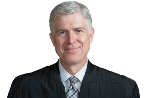
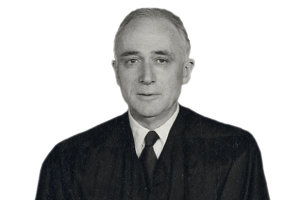
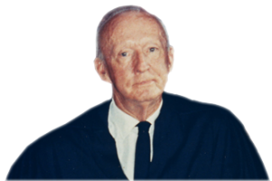
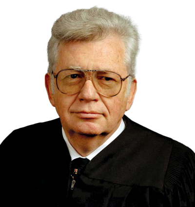

# Avoiding Trial {#sec-avoiding-trial}

## Arbitration

### Kalinauskas v. Wong

**JOHNSTON, M.J.** [151 F.R.D. 363 (D. Nev. 1993)]{.aside}

This matter was submitted to the undersigned Magistrate Judge on a
Motion for a Protective Order filed by defendant Desert Palace, Inc.,
doing business as Caesars Palace Hotel & Casino (Caesars). \[...\]

The plaintiff, Ms. Lin T. Kalinauskas (Kalinauskas), a former employee
of Caesars, has sued Caesars for sexual discrimination in the instant
case. As part of discovery Kalinauskas seeks to depose Donna R. Thomas,
a former Caesars employee who filed a sexual harassment suit against
Caesars last year. Ms. Thomas's suit settled without trial pursuant to a
confidential settlement agreement\[,\] which the court sealed upon the
stipulated agreement of the parties.

This court has examined, in camera, sealed materials relating to Ms.
Thomas's case and settlement. The in camera submission included:
Stipulation for & Order for Dismissal, Protective Order and
Confidentiality Order, Stipulation for Protective Order and
Confidentiality Order, and Settlement Agreement. \[The Stipulation for a
Protective Order provided\] that the plaintiff "shall not discuss any
aspect of plaintiff's employment at Caesars other than to state the
dates of her employment and her job title." Identical language appears
in the Protective Order and Confidentiality Order. \[...\]

**Discussion**

In general, the scope of discovery is very broad. "Parties may obtain
discovery regarding *any \[unprivileged matter that is relevant to any
party's claim or defense*\]" Fed. R. Civ. P. 26(b)(1) (emphasis added).
The primary goal of the court and discovery is "to secure the just,
speedy, and inexpensive determination of every action." Fed. R. Civ. P.
1.

The public interest favors judicial policies which promote the
completion of litigation. Public interest also seeks to protect the
finality of prior suits and the secrecy of settlements when desired by
the settling parties. However, the courts also serve society by
providing a public forum for issues of general concern. The case at bar
presents a direct conflict between these crucial public and private
interests.

To allow full discovery into all aspects of Ms. Thomas's case could
discourage similar settlements. Confidential settlements benefit society
and the parties involved by resolving disputes relatively quickly, with
slight judicial intervention, and presumably result in greater
satisfaction to the parties. Sound judicial policy fosters and protects
this form of alternative dispute resolution. *See, e.g.*, Fed. R. Evid.
408 which protects compromises and offers to compromise by rendering
them inadmissible to prove liability. The secrecy of a settlement
agreement and the contractual rights of the parties thereunder deserve
court protection.

On the other hand, to prevent any discovery into Ms. Thomas's case based
upon the settlement agreement results in disturbing consequences. First,
as pointed out by Kalinauskas, preventing the deposition of Ms. Thomas
would condone the practice of "buy\[ing\] the silence of a witness with
a settlement agreement." This court harbors little doubt that preventing
the dissemination of the underlying facts which prompted Ms. Thomas to
file suit is in Caesars's interest, and formed an important part of the
agreement to Caesars. Caesars avers that without the confidentiality
order the Thomas case would not have settled. Yet despite this freedom
to contract, the courts must carefully police the circumstances under
which litigants seek to protect their interests while concealing
legitimate areas of public concern. This concern grows more pressing as
additional individuals are harmed by identical or similar action.

Second, the deposition of Ms. Thomas is likely to lead to relevant
evidence. Preventing the deposition of Ms. Thomas or the discovery of
documents created in her case could lead to wasteful efforts to generate
discovery already in existence. \[...\]

Caesars\['s\] motion for a protective order preventing the deposition of
Ms. Thomas rests entirely upon the confidential settlement agreement.
Caesars ... maintains that it should be able to rely upon the
confidentiality order to protect against \[disclosure to\] third
parties, unless extraordinary circumstances or compelling need justifies
some breach of secrecy. \[...\]

\[Caesars's\] argument that Kalinauskas must show a compelling need to
obtain discovery applies to discovery of the specific terms of the
settlement agreement (*i.e.*, the amount and conditions of the
agreement), not \[to\] factual information surrounding Thomas's case.
Caesars should not be able to conceal basic facts of concern to
Kalinauskas in her case, and of legitimate public concern, regarding
employment at its place of business.

Accordingly, keeping in mind the liberal nature of discovery, this court
will allow the deposition of Ms. Thomas. \[...\] The deposition of Ms.
Thomas and any further discovery into the Thomas case must not, however,
disclose any substantive terms of the Caesars-Thomas settlement
agreement. Naturally, Ms. Thomas may answer questions regarding her
employment at Caesars and any knowledge of sexual harassment.

Although the terms of the confidential settlement agreement impose
penalties upon Ms. Thomas for discussing her past employment at Caesars,
those penalties shall not apply to the disclosure of information for
discovery purposes in furtherance of Kalinauskas's case. Indeed, the
settlement agreement itself makes exception for court ordered release of
information.

While settlement is an important objective, an overzealous quest for
alternative dispute resolution can distort the proper role of the court.
Furthermore, settlement agreements which suppress evidence violate the
greater public policy. \[...\]

Based on the foregoing \[...\] IT IS HEREBY ORDERED \[...\] that the
Defendant's Motion for Protective Order is granted to the extent that
during the deposition of Ms. Donna R. Thomas, no information regarding
the settlement agreement itself shall come forth \[and\] that the
Defendant's Motion for Protective Order is denied as to all other
requests. \[...\]

#### Notes & Questions

1.  Why did Kalinauskas want to depose Ms. Thomas?

2.  Why didn't Caesars want that to happen?

3.  What was Caesars' argument?

4.  Why do you think the settlement between Caesars and Ms. Thomas was
    confidential?

5.  What was the Court's holding?

### Ferguson v. Countrywide Credit Industries, Inc.

**PREGERSON, J.** [298 F.3d 778 (9th Cir. 2002)]{.aside}

::: {.column-margin}

{width=150}

:::

Misty Ferguson filed a complaint against Countrywide Credit Industries,
Inc. and her supervisor, Leo DeLeon, alleging causes of action under
federal and state law for sexual harassment, retaliation, and hostile
work environment. Countrywide filed a petition for an order compelling
arbitration of Ferguson's claims. The district court denied
Countrywide's petition on the grounds that Countrywide's arbitration
agreement is unenforceable based on the doctrine of unconscionability.

**I. Factual and Procedural History**

When Ferguson was hired she was required to sign Countrywide's
Conditions of Employment, which states in relevant part: "I understand
that in order to work at Countrywide I must execute an arbitration
agreement."

The district court denied Countrywide's petition to compel arbitration.
It ruled that the arbitration agreement is unenforceable because it is
unconscionable under *Armendariz v. Foundation Health Psychcare
Services, Inc.*, 24 Cal. 4th 83 (2000).

**II. Unconscionability**

The FAA compels judicial enforcement of a wide range of written
arbitration agreements. Section 2 of the FAA provides, in relevant part,
that arbitration agreements "shall be valid, irrevocable, and
enforceable, save upon such grounds that exist at law or in equity for
the revocation of any contract." 9 U.S.C. § 2. In determining the
validity of an agreement to arbitrate, federal courts "should apply
ordinary state-law principles that govern the formation of contracts."
"Thus, generally applicable defenses, such as unconscionability, may be
applied to invalidate arbitration agreements without contravening the
FAA." California courts may invalidate an arbitration clause under the
doctrine of unconscionability. This doctrine, codified by the California
Legislature in California Civil Code 1670.5(a), provides:

> if the court as a matter of law finds the contract or any clause of
the contract to have been unconscionable at the time it was made, the
court may refuse to enforce the contract, or may enforce the remainder
of the contract without the unconscionable clause, or it may so limit
the application of any unconscionable clause as to avoid any
unconscionable result.

This statute, however, does not define unconscionability. Instead, we
look to the California Supreme Court's decision in Armendariz, which
provides the definitive pronouncement of California law on
unconscionability to be applied to mandatory arbitration agreements,
such as the one at issue in this case. In order to render a contract
unenforceable under the doctrine of unconscionability, there must be
both a procedural and substantive element of unconscionability. These
two elements, however, need not both be present in the same degree.
Thus, for example, the more substantively oppressive the contract term,
the less evidence of procedural unconscionability is required to come to
the conclusion that the term is unenforceable.

**1. Procedural Unconscionability**

Procedural unconscionability concerns the manner in which the contract
was negotiated and the circumstances of the parties at that time. A
determination of whether a contract is procedurally unconscionable
focuses on two factors: oppression and surprise. Oppression arises from
an inequality of bargaining power which results in no real negotiation
and an absence of meaningful choice. Surprise involves the extent to
which the supposedly agreed-upon terms of the bargain are hidden in the
prolix printed form drafted by the party seeking to enforce the disputed
terms.

In *Circuit City Stores, Inc. v. Adams*, 279 F.3d 889, 892 (9th Cir.
2002), we held that the arbitration agreement at issue satisfied the
elements of procedural unconscionability under California law. We found
the agreement to be procedurally unconscionable because Circuit City,
which possesses considerably more bargaining power than nearly all of
its employees or applicants, drafted the contract and uses it as its
standard arbitration agreement for all of its new employees. The
agreement is a prerequisite to employment, and job applicants are not
permitted to modify the agreement's terms---they must take the contract
or leave it.

**2. Substantive Unconscionability**

Substantive unconscionability focuses on the terms of the agreement and
whether those terms are so one-sided as to shock the conscience. Just
before oral argument was heard in this case, the California Court of
Appeal held in another case that Countrywide's arbitration agreement was
unconscionable. *See Mercuro v. Superior Court*, 96 Cal. App. 4th 167
(2002).

**a. One-Sided Coverage of Arbitration Agreement**

Countrywide's arbitration agreement specifically covers claims for
breach of express or implied contracts or covenants, tort claims, claims
of discrimination or harassment based on race, sex, age, or disability,
and claims for violation of any federal, state, or other governmental
constitution, statute, ordinance, regulation, or public policy. On the
other hand, the arbitration agreement specifically excludes claims for
workers' compensation or unemployment compensation benefits, injunctive
and/ or other equitable relief for intellectual property violations,
unfair competition and/or the use and/or unauthorized disclosure of
trade secrets or confidential information. We adopt the California
appellate court's holding in Mercuro, that Countrywide's arbitration
agreement was unfairly one-sided and, therefore, substantively
unconscionable because the agreement "compels arbitration of the claims
employees are most likely to bring against Countrywide ... \[but\]
exempts from arbitration the claims Countrywide is most likely to bring
against its employees."

\[...\]

**b. Arbitration Fees**

In *Armendariz*, the California Supreme Court held that:

> when an employer imposes mandatory arbitration as a condition of
employment, the arbitration agreement or arbitration process cannot
generally require the employee to bear any type of expense that the
employee would not be required to bear if he or she were free to bring
the action in court. This rule will ensure that employees bringing
\[discrimination\] claims will not be deterred by costs greater than
the usual costs incurred during litigation, costs that are essentially
imposed on an employee by the employer.

Countrywide's arbitration agreement has a provision that requires the
employee to "pay to NAF \[National Arbitration Forum\] its filing fee up
to a maximum of \$125.00 when the Claim is filed. The Company shall pay
for the first hearing day. All other arbitration costs shall be shared
equally by the Company and the Employee." Countrywide argues that this
provision is not so one-sided as to "shock the conscience" and,
therefore, is enforceable.

However, *Armendariz* holds that a fee provision is unenforceable when
the employee bears any expense beyond the usual costs associated with
bringing an action in court. NAF imposes multiple fees which would bring
the cost of arbitration for Ferguson into the thousands of dollars.

Because the only valid fee provision is one in which an employee is not
required to bear any expense beyond what would be required to bring the
action in court, we affirm the district court's conclusion that "the
original fee provision ... appears clearly to violate the Armendariz
standard."

**c. One-Sided Discovery Provision**

Ferguson also argues that the discovery provision in the arbitration
agreement is one-sided and, therefore, unconscionable. The discovery
provision states that "a deposition of a corporate representative shall
be limited to no more than four designated subjects," but does not
impose a similar limitation on depositions of employees. Ferguson also
notes that the arbitration agreement sets mutual limitations (*e.g.*, no
more than three depositions) and mutual advantages (*e.g.*, unlimited
expert witnesses) which favor Countrywide because it is in a superior
position to gather information regarding its business practices and
employees' conduct, and has greater access to funds to pay for expensive
expert witnesses.

Ferguson urges this court to affirm the district court's ruling that the
discovery provision is unconscionable on the ground that the limitations
and mutual advantages on discovery are unfairly one-sided and have no
commercial justification other than "maximizing employer advantage,"
which is an improper basis for such differences under *Armendariz*.
Countrywide argues to the contrary that the arbitration agreement
provides for ample discovery by employees.

In *Armendariz*, the California Supreme Court held that employees are
"at least entitled to discovery sufficient to adequately arbitrate their
statutory claims, including access to essential documents and
witnesses." Adequate discovery, however, does not mean unfettered
discovery. As Armendariz recognized, an arbitration agreement might
specify "something less than the full panoply of discovery provided in
the California Code of Civil Procedure."

In *Mercuro*, the California Court of Appeals applied the parameters set
forth in Armendariz to Countrywide's discovery provisions. It concluded
that "without evidence showing how these discovery provisions are
applied in practice, we are not prepared to say they would not
necessarily prevent Mercuro from vindicating his statutory rights."
*Mercuro* relied heavily on the ability of the arbitrator to extend the
discovery limits for "good cause." In fact, *Mercuro* ultimately left it
up to the arbitrator to balance the need for simplicity in arbitration
with the discovery necessary for a party to vindicate her claims.
Following the Court in *Mercuro*, we too find that Countrywide's
discovery provisions may afford Ferguson adequate discovery to vindicate
her claims.

Nevertheless, we recognize an insidious pattern in Countrywide's
arbitration agreement. Not only do these discovery provisions appear to
favor Countrywide at the expense of its employees, but the entire
agreement seems drawn to provide Countrywide with undue advantages
should an employment-related dispute arise. Aside from merely availing
itself of the cost-saving benefits of arbitration, Countrywide has
sought to advantage itself substantively by tilting the playing field.

While many of its arbitration provisions appear equally applicable to
both parties, these provisions may work to curtail the employee's
ability to substantiate any claim against the employer. We follow
*Mercuro* in holding that the discovery provisions alone are not
unconscionable, but in the context of an arbitration agreement which
unduly favors Countrywide at every turn, we find that their inclusion
reaffirms our belief that the arbitration agreement as a whole is
substantively unconscionable.

**Conclusion**

The district court's denial of Countrywide's petition to compel
arbitration on the ground that Countrywide's arbitration agreement is
unenforceable under the doctrine of unconscionability is AFFIRMED.

#### Notes & Questions

1.  What kind of motion did Countrywide file seeking to force Ferguson
    to arbitrate her claims? What legal authority did they rely on for
    doing so?

2.  What are the two aspects (and their subparts) of the law of
    unconscionability under California law? Is it enough for either one
    to be satisfied, or must both be met?

3.  Note that *Ferguson* is an outlier case. Other cases considering
    whether to enforce similar arbitration clauses have come out the
    other way. *See, e.g.*, *Carter v. Countrywide Credit Industries,
    Inc.*, 362 F.3d 294 (5th Cir. 2004).

### Epic Systems v. Lewis

**GORSUCH, J., delivered the opinion of the Court.** [138 S. Ct. 1612 (2018)]{.aside}

::: {.column-margin}

{width=150}

:::

Should employees and employers be allowed to agree that any disputes
between them will be resolved through one-on-one arbitration? Or should
employees always be permitted to bring their claims in class or
collective actions, no matter what they agreed with their employers?

As a matter of policy these questions are surely debatable. But as a
matter of law the answer is clear. In the Federal Arbitration Act,
Congress has instructed federal courts to enforce arbitration agreements
according to their terms---including terms providing for individualized
proceedings. Nor can we agree with the employees' suggestion that the
National Labor Relations Act (NLRA) offers a conflicting command. It is
this Court's duty to interpret Congress's statutes as a harmonious whole
rather than at war with one another. And abiding that duty here leads to
an unmistakable conclusion. The NLRA secures to employees rights to
organize unions and bargain collectively, but it says nothing about how
judges and arbitrators must try legal disputes that leave the workplace
and enter the courtroom or arbitral forum. This Court has never read a
right to class actions into the NLRA---and for three quarters of a
century neither did the National Labor Relations Board. Far from
conflicting, the Arbitration Act and the NLRA have long enjoyed separate
spheres of influence and neither permits this Court to declare the
parties' agreements unlawful.

**I**

The three cases before us differ in detail but not in substance. Take
*Ernst & Young LLP v. Morris*. There Ernst & Young and one of its junior
accountants, Stephen Morris, entered into an agreement providing that
they would arbitrate any disputes that might arise between them. The
agreement stated that the employee could choose the arbitration provider
and that the arbitrator could "grant any relief that could be granted by
... a court" in the relevant jurisdiction. The agreement also specified
individualized arbitration, with claims "pertaining to different
\[e\]mployees \[to\] be heard in separate proceedings."

After his employment ended, and despite having agreed to arbitrate
claims against the firm, Mr. Morris sued Ernst & Young in federal court.
He alleged that the firm had misclassified its junior accountants as
professional employees and violated the federal Fair Labor Standards Act
(FLSA) and California law by paying them salaries without overtime pay.
Although the arbitration agreement provided for individualized
proceedings, Mr. Morris sought to litigate the federal claim on behalf
of a nationwide class under the FLSA's collective action provision, 29
U.S.C. \§ 216(b). He sought to pursue the state law claim as a class
action under Federal Rule of Civil Procedure 23.

Ernst & Young replied with a motion to compel arbitration. The district
court granted the request, but the Ninth Circuit reversed this judgment.
The Ninth Circuit recognized that the Arbitration Act generally requires
courts to enforce arbitration agreements as written. But the court
reasoned that the statute's "saving clause," *see* 9 U.S.C. \§ 2, removes
this obligation if an arbitration agreement violates some other federal
law. And the court concluded that an agreement requiring individualized
arbitration proceedings violates the NLRA by barring employees from
engaging in the "concerted activit\[y\]," of pursuing claims as a class
or collective action. \[...\]

Although the Arbitration Act and the NLRA have long coexisted---they
date from 1925 and 1935, respectively---the suggestion they might
conflict is something quite new. Until a couple of years ago, courts
more or less agreed that arbitration agreements like those before us
must be enforced according to their terms. \[...\]

**II**

We begin with the Arbitration Act and the question of its saving clause.

Congress adopted the Arbitration Act in 1925 in response to a perception
that courts were unduly hostile to arbitration. No doubt there was much
to that perception. Before 1925, English and American common law courts
routinely refused to enforce agreements to arbitrate disputes. But in
Congress's judgment arbitration had more to offer than courts
recognized---not least the promise of quicker, more informal, and often
cheaper resolutions for everyone involved. So Congress directed courts
to abandon their hostility and instead treat arbitration agreements as
"valid, irrevocable, and enforceable." 9 U.S.C. § 2. The Act, this Court
has said, establishes "a liberal federal policy favoring arbitration
agreements."

Not only did Congress require courts to respect and enforce agreements
to arbitrate; it also specifically directed them to respect and enforce
the parties' chosen arbitration procedures.

On first blush, these emphatic directions would seem to resolve any
argument under the Arbitration Act. The parties before us contracted for
arbitration. They proceeded to specify the rules that would govern their
arbitrations, indicating their intention to use individualized rather
than class or collective action procedures. And this much the
Arbitration Act seems to protect pretty absolutely. *See AT&T Mobility
LLC v. Concepcion*, 563 U.S. 333 (2011). You might wonder if the balance
Congress struck in 1925 between arbitration and litigation should be
revisited in light of more contemporary developments. You might even ask
if the Act was good policy when enacted. But all the same you might find
it difficult to see how to avoid the statute's application.

Still, the employees suggest the Arbitration Act's saving clause creates
an exception for cases like theirs. By its terms, the saving clause
allows courts to refuse to enforce arbitration agreements "upon such
grounds as exist at law or in equity for the revocation of any
contract." § 2. That provision applies here, the employees tell us,
because the NLRA renders their particular class and collective action
waivers illegal. In their view, illegality under the NLRA is a "ground"
that "exists at law ... for the revocation" of their arbitration
agreements, at least to the extent those agreements prohibit class or
collective action proceedings.

The problem with this line of argument is fundamental. \[...\]

\[The clause\] can't \[apply\] because the saving clause recognizes only
defenses that apply to "any" contract. In this way the clause
establishes a sort of "equal-treatment" rule for arbitration contracts.
The clause "permits agreements to arbitrate to be invalidated by
'generally applicable contract defenses, such as fraud, duress, or
unconscionability.'" *Concepcion*. At the same time, the clause offers
no refuge for "defenses that apply only to arbitration or that derive
their meaning from the fact that an agreement to arbitrate is at issue."
Under our precedent, this means the saving clause does not save defenses
that target arbitration either by name or by more subtle methods, such
as by "interfer\[ing\] with fundamental attributes of arbitration."

This is where the employees' argument stumbles. They don't suggest that
their arbitration agreements were extracted, say, by an act of fraud or
duress or in some other unconscionable way that would render any
contract unenforceable. Instead, they object to their agreements
precisely because they require individualized arbitration proceedings
instead of class or collective ones. And by attacking (only) the
individualized nature of the arbitration proceedings, the employees'
argument seeks to interfere with one of arbitration's fundamental
attributes.

We know this much because of *Concepcion*. There this Court faced a
state law defense that prohibited as unconscionable class action waivers
in consumer contracts. The Court readily acknowledged that the defense
formally applied in both the litigation and the arbitration context.
But, the Court held, the defense failed to qualify for protection under
the saving clause because it interfered with a fundamental attribute of
arbitration all the same. It did so by effectively permitting any party
in arbitration to demand classwide proceedings despite the traditionally
individualized and informal nature of arbitration. This "fundamental"
change to the traditional arbitration process, the Court said, would
"sacrific\[e\] the principal advantage of arbitration---its
informality---and mak\[e\] the process slower, more costly, and more
likely to generate procedural morass than final judgment." \[...\]

Of course, *Concepcion* has its limits. The Court recognized that
parties remain free to alter arbitration procedures to suit their
tastes, and in recent years some parties have sometimes chosen to
arbitrate on a classwide basis. But *Concepcion*'s essential insight
remains: courts may not allow a contract defense to reshape traditional
individualized arbitration by mandating classwide arbitration procedures
without the parties' consent. Just as judicial antagonism toward
arbitration before the Arbitration Act's enactment "manifested itself in
a great variety of devices and formulas declaring arbitration against
public policy," Concepcion teaches that we must be alert to new devices
and formulas that would achieve much the same result today. And a rule
seeking to declare individualized arbitration proceedings off limits is,
the Court held, just such a device. \[...\]

Illegality\[, as the term is used in the NLRA\], like unconscionability,
may be a traditional, generally applicable contract defense in many
cases, including arbitration cases. But an argument that a contract is
unenforceable just because it requires bilateral arbitration is a
different creature. A defense of that kind, Concepcion tells us, is one
that impermissibly disfavors arbitration whether it sounds in illegality
or unconscionability. The law of precedent teaches that like cases
should generally be treated alike, and appropriate respect for that
principle means the Arbitration Act's saving clause can no more save the
defense at issue in these cases than it did the defense at issue in
Concepcion. At the end of our encounter with the Arbitration Act, then,
it appears just as it did at the beginning: a congressional command
requiring us to enforce, not override, the terms of the arbitration
agreements before us.

\[...\]

**IV**

The dissent sees things a little bit differently. In its view, today's
decision ushers us back to the Lochner era when this Court regularly
overrode legislative policy judgments. The dissent even suggests we have
resurrected the long-dead "yellow dog" contract. But like most
apocalyptic warnings, this one proves a false alarm. \[...\]

Our decision does nothing to override Congress's policy judgments. As
the dissent recognizes, the legislative policy embodied in the NLRA is
aimed at "safeguard\[ing\], first and foremost, workers' rights to join
unions and to engage in collective bargaining." Those rights stand every
bit as strong today as they did yesterday. And rather than revive
"yellow dog" contracts against union organizing that the NLRA outlawed
back in 1935, today's decision merely declines to read into the NLRA a
novel right to class action procedures that the Board's own general
counsel disclaimed as recently as 2010. \[...\]

**\* \* \***

The policy may be debatable but the law is clear: Congress has
instructed that arbitration agreements like those before us must be
enforced as written. While Congress is of course always free to amend
this judgment, we see nothing suggesting it did so in the NLRA---much
less that it manifested a clear intention to displace the Arbitration
Act. Because we can easily read Congress's statutes to work in harmony,
that is where our duty lies. \[...\]

So ordered.

**GINSBURG, J., with whom BREYER, J., SOTOMAYOR, J., and KAGAN, J., join,
dissenting.**

::: {.column-margin}

{width=150}

:::

The employees in these cases complain that their employers have
underpaid them in violation of the wage and hours prescriptions of the
Fair Labor Standards Act of 1938 (FLSA) and analogous state laws.
Individually, their claims are small, scarcely of a size warranting the
expense of seeking redress alone. But by joining together with others
similarly circumstanced, employees can gain effective redress for wage
underpayment commonly experienced. To block such concerted action, their
employers required them to sign, as a condition of employment,
arbitration agreements banning collective judicial and arbitral
proceedings of any kind. The question presented: Does the Federal
Arbitration Act permit employers to insist that their employees,
whenever seeking redress for commonly experienced wage loss, go it
alone, never mind the right secured to employees by the National Labor
Relations Act (NLRA) "to engage in ... concerted activities" for their
"mutual aid or protection"? The answer should be a resounding "No."

In the NLRA and its forerunner, the Norris-LaGuardia Act (NLGA), 29
U.S.C. § 101 *et seq.*, Congress acted on an acute awareness: For
workers striving to gain from their employers decent terms and
conditions of employment, there is strength in numbers. A single
employee, Congress understood, is disarmed in dealing with an employer.
The Court today subordinates employee-protective labor legislation to
the Arbitration Act. In so doing, the Court forgets the labor market
imbalance that gave rise to the NLGA and the NLRA, and ignores the
destructive consequences of diminishing the right of employees "to band
together in confronting an employer." Congressional correction of the
Court's elevation of the FAA over workers' rights to act in concert is
urgently in order.

To explain why the Court's decision is egregiously wrong, I first refer
to the extreme imbalance once prevalent in our Nation's workplaces, and
Congress' aim in the NLGA and the NLRA to place employers and employees
on a more equal footing. I then explain why the Arbitration Act,
sensibly read, does not shrink the NLRA's protective sphere. \[...\]

The end of the 19th century and beginning of the 20th was a tumultuous
era in the history of our Nation's labor relations. Under economic
conditions then prevailing, workers often had to accept employment on
whatever terms employers dictated. Aiming to secure better pay, shorter
workdays, and safer workplaces, workers increasingly sought to band
together to make their demands effective. \[...\]

Early legislative efforts to protect workers' rights to band together
were unavailing. \[...\]

In the 1930's, legislative efforts to safeguard vulnerable workers found
more receptive audiences. As the Great Depression shifted political
winds further in favor of worker-protective laws, Congress passed two
statutes aimed at protecting employees' associational rights. First, in
1932, Congress passed the NLGA, which regulates the employer-employee
relationship indirectly. Section 2 of the Act declares:

> "Whereas ... the individual unorganized worker is commonly helpless to
exercise actual liberty of contract and to protect his freedom of
labor, ... it is necessary that he have full freedom of association,
self-organization, and designation of representatives of his own
choosing, ... and that he shall be free from the interference,
restraint, or coercion of employers ... in the designation of such
representatives or in self-organization or in other concerted
activities for the purpose of collective bargaining or other mutual
aid or protection." 29 U.S.C. § 102. ...

But Congress did so three years later, in 1935, when it enacted the
NLRA. Relevant here, § 7 of the NLRA guarantees employees "the right to
self-organization, to form, join, or assist labor organizations, to
bargain collectively through representatives of their own choosing, and
to engage in other concerted activities for the purpose of collective
bargaining or other mutual aid or protection." 29 U.S.C. § 157 (emphasis
added). Section 8(a)(1) safeguards those rights by making it an "unfair
labor practice" for an employer to "interfere with, restrain, or coerce
employees in the exercise of the rights guaranteed in \[§ 7\]."
§ 158(a)(1). \[...\]

Despite the NLRA's prohibitions, the employers in the cases now before
the Court required their employees to sign contracts stipulating to
submission of wage and hours claims to binding arbitration, and to do so
only one-by-one. When employees subsequently filed wage and hours claims
in federal court and sought to invoke the collective-litigation
procedures provided for in the FLSA and Federal Rules of Civil
Procedure, the employers moved to compel individual arbitration. The
Arbitration Act, in their view, requires courts to enforce their
take-it-or-leave-it arbitration agreements as written, including the
collective-litigation abstinence demanded therein.

In resisting enforcement of the group-action foreclosures, the employees
involved in this litigation do not urge that they must have access to a
judicial forum. They argue only that the NLRA prohibits their employers
from denying them the right to pursue work-related claims in concert in
any forum. If they may be stopped by employer-dictated terms from
pursuing collective procedures in court, they maintain, they must at
least have access to similar procedures in an arbitral forum. \[...\]

Suits to enforce workplace rights collectively fit comfortably under the
umbrella "concerted activities for the purpose of ... mutual aid or
protection." 29 U.S.C. § 157. "Concerted" means "\[p\]lanned or
accomplished together; combined." American Heritage Dictionary 381 (5th
ed. 2011). "Mutual" means "reciprocal." *Id.*, at 1163. When employees
meet the requirements for litigation of shared legal claims in joint,
collective, and class proceedings, the litigation of their claims is
undoubtedly "accomplished together." By joining hands in litigation,
workers can spread the costs of litigation and reduce the risk of
employer retaliation. \[...\]

In face of the NLRA's text, history, purposes, and longstanding
construction, the Court nevertheless concludes that collective
proceedings do not fall within the scope of \§ 7. None of the Court's
reasons for diminishing \§ 7 should carry the day. \[...\]

The inevitable result of today's decision will be the underenforcement
of federal and state statutes designed to advance the well-being of
vulnerable workers. \[...\]

**\* \* \***

If these untoward consequences stemmed from legislative choices, I would
be obliged to accede to them. But the edict that employees with wage and
hours claims may seek relief only one-by-one does not come from
Congress. It is the result of take-it-or-leave-it labor contracts
harking back to the type called "yellow dog," and of the readiness of
this Court to enforce those unbargained-for agreements. The FAA demands
no such suppression of the right of workers to take concerted action for
their "mutual aid or protection." \[...\]

#### Notes & Questions

1.  *Epic Systems* involves a purported clash between two federal
    statutes: the Federal Arbitration Act and the National Labor
    Relations Act. The Court held that the FAA applies unless there is a
    generally applicable defense (such as unconscionability, the
    doctrine at issue in *Ferguson*). What did the employees argue was
    their generally applicable defense?

2.  The Court held that the employees' defense was contract-specific
    rather than general. Why?
    
## Summary Judgment

At the close of discovery, the parties have another chance to dispose of
the case without the need for a jury: summary judgment. Rule 56(a)
provides that either party may move for summary judgment by showing
"that there is no genuine dispute as to any material fact" and therefore
that "the movant is entitled to judgment as a matter of law."

In many ways, summary judgment is a later-in-time version of a motion to
dismiss for failure to state a claim under Rule 12(b)(6). Both motions
ask the court to take the facts as the non-moving party has presented
them and then determine whether the case can survive as a legal matter.
The key difference between a summary judgment motion and Rule 12(b)(6)
motion is that the latter is tested against the allegations in the
complaint, while the former is tested against evidence, which must be
submitted to the court as part of the briefing on the motion. *See* Rule
56(c).

Like the Rule 12(b)(6) motion, the standards governing Rule 56 have
changed more dramatically than the text of the Rule has. The cases that
follow trace the development of summary judgment procedure in federal
court. As you read them, pay close attention to (1) the evidence adduced
by the non-moving party; and (2) the arguments made by the party seeking
summary judgment.

### Adickes v. S.H. Kress & Co.

**MR. JUSTICE HARLAN delivered the opinion of the Court.** [398 U.S. 144 (1970)]{.aside}

::: {.column-margin}

{width=150}

^1^ Rev. Stat. § 1979, 42 U.S.C. § 1983 provides:

"Every person who, under color of any statute, ordinance,
regulation, custom, or usage, of any State or Territory, subjects,
or causes to be subjected, any citizen of the United States or other
person within the jurisdiction thereof to the deprivation of any
rights, privileges, or immunities secured by the Constitution and
laws, shall be liable to the party injured in an action at law, suit
in equity, or other proper proceeding for redress."

:::

Petitioner, Sandra Adickes, a white school teacher from New York,
brought this suit in the United States District Court for the Southern
District of New York against respondent S. H. Kress & Co. ("Kress") to
recover damages under 42 U.S.C. § 1983^1^ for an alleged violation of
her constitutional rights under the Equal Protection Clause of the
Fourteenth Amendment. The suit arises out of Kress' refusal to serve
lunch to Miss Adickes at its restaurant facilities in its Hattiesburg,
Mississippi, store on August 14, 1964, and Miss Adickes' subsequent
arrest upon her departure from the store by the Hattiesburg police on a
charge of vagrancy. At the time of both the refusal to serve and the
arrest, Miss Adickes was with six young people, all Negroes, who were
her students in a Mississippi "Freedom School" where she was teaching
that summer. Unlike Miss Adickes, the students were offered service, and
were not arrested. 

Petitioner's complaint had two counts, each bottomed on § 1983, and each
alleging that Kress had deprived her of the right under the Equal
Protection Clause of the Fourteenth Amendment not to be discriminated
against on the basis of race. \[...\]

The second count of her complaint, alleging that both the refusal of
service and her subsequent arrest were the product of a conspiracy
between Kress and the Hattiesburg police, was dismissed before trial on
a motion for summary judgment. The District Court ruled that petitioner
had "failed to allege any facts from which a conspiracy might be
inferred." This determination was unanimously affirmed by the Court of
Appeals.

Miss Adickes, in seeking review here, claims that the District Court
erred \[...\] in granting summary judgment on the conspiracy count.
\[W\]e now reverse and remand for further proceedings on each of the two
counts.

As explained in Part I, because the respondent failed to show the
absence of any disputed material fact, we think the District Court erred
in granting summary judgment. \[...\]

**I**

Briefly stated, the conspiracy count of petitioner's complaint made the
following allegations: While serving as a volunteer teacher at a
"Freedom School" for Negro children in Hattiesburg, Mississippi,
petitioner went with six of her students to the Hattiesburg Public
Library at about noon on August 14, 1964. The librarian refused to allow
the Negro students to use the library, and asked them to leave. Because
they did not leave, the librarian called the Hattiesburg chief of police
who told petitioner and her students that the library was closed, and
ordered them to leave. From the library, petitioner and the students
proceeded to respondent's store where they wished to eat lunch.
According to the complaint, after the group sat down to eat, a policeman
came into the store "and observed \[Miss Adickes\] in the company of the
Negro students." A waitress then came to the booth where petitioner was
sitting, took the orders of the Negro students, but refused to serve
petitioner because she was a white person "in the company of Negroes."
The complaint goes on to allege that after this refusal of service,
petitioner and her students left the Kress store. When the group reached
the sidewalk outside the store, "the Officer of the Law who had
previously entered \[the\] store" arrested petitioner on a groundless
charge of vagrancy and took her into custody.

On the basis of these underlying facts petitioner alleged that Kress and
the Hattiesburg police had conspired (1) "to deprive \[her\] of her
right to enjoy equal treatment and service in a place of public
accommodation"; and (2) to cause her arrest "on the false charge of
vagrancy."

\[...\]

**SUMMARY JUDGMENT**

We now proceed to consider whether the District Court erred in granting
summary judgment on the conspiracy count. In granting respondent's
motion, the District Court simply stated that there was "no evidence in
the complaint or in the affidavits and other papers from which a
'reasonably-minded person' might draw an inference of conspiracy." Our
own scrutiny of the factual allegations of petitioner's complaint, as
well as the material found in the affidavits and depositions presented
by Kress to the District Court, however, convinces us that summary
judgment was improper here, for we think respondent failed to carry its
burden of showing the absence of any genuine issue of fact. Before
explaining why this is so, it is useful to state the factual arguments,
made by the parties concerning summary judgment, and the reasoning of
the courts below.

In moving for summary judgment, Kress argued that "uncontested facts"
established that no conspiracy existed between any Kress employee and
the police. To support this assertion, Kress pointed first to the
statements in the deposition of the store manager (Mr. Powell) that (a)
he had not communicated with the police, and that (b) he had, by a
prearranged tacit signal, ordered the food counter supervisor to see
that Miss Adickes was refused service only because he was fearful of a
riot in the store by customers angered at seeing a "mixed group" of
whites and blacks eating together. Kress also relied on affidavits from
the Hattiesburg chief of police, and the two arresting officers, to the
effect that store manager Powell had not requested that petitioner be
arrested. Finally, Kress pointed to the statements in petitioner's own
deposition that she had no knowledge of any communication between any
Kress employee and any member of the Hattiesburg police, and was relying
on circumstantial evidence to support her contention that there was an
arrangement between Kress and the police.

Petitioner, in opposing summary judgment, pointed out that respondent
had failed in its moving papers to dispute the allegation in
petitioner's complaint, a statement at her deposition, and an unsworn
statement by a Kress employee, all to the effect that there was a
policeman in the store at the time of the refusal to serve her, and that
this was the policeman who subsequently arrested her. Petitioner argued
that although she had no knowledge of an agreement between Kress and the
police, the sequence of events created a substantial enough possibility
of a conspiracy to allow her to proceed to trial, especially given the
fact that the non-circumstantial evidence of the conspiracy could only
come from adverse witnesses. Further, she submitted an affidavit
specifically disputing the manager's assertion that the situation in the
store at the time of the refusal was "explosive," thus creating an issue
of fact as to what his motives might have been in ordering the refusal
of service.

We think that on the basis of this record, it was error to grant summary
judgment. As the moving party, respondent had the burden of showing the
absence of a genuine issue as to any material fact, and for these
purposes the material it lodged must be viewed in the light most
favorable to the opposing party. Respondent here did not carry its
burden because of its failure to foreclose the possibility that there
was a policeman in the Kress store while petitioner was awaiting
service, and that this policeman reached an understanding with some
Kress employee that petitioner not be served.

It is true that Mr. Powell, the store manager, claimed in his deposition
that he had not seen or communicated with a policeman prior to his tacit
signal to Miss Baggett, the supervisor of the food counter. But
respondent did not submit any affidavits from Miss Baggett, or from Miss
Freeman, the waitress who actually refused petitioner service, either of
whom might well have seen and communicated with a policeman in the
store. Further, we find it particularly noteworthy that the two officers
involved in the arrest each failed in his affidavit to foreclose the
possibility (1) that he was in the store while petitioner was there; and
(2) that, upon seeing petitioner with Negroes, he communicated his
disapproval to a Kress employee, thereby influencing the decision not to
serve petitioner.

Given these unexplained gaps in the materials submitted by respondent,
we conclude that respondent failed to fulfill its initial burden of
demonstrating what is a critical element in this aspect of the
case---that there was no policeman in the store. If a policeman were
present, we think it would be open to a jury, in light of the sequence
that followed, to infer from the circumstances that the policeman and a
Kress employee had a "meeting of the minds" and thus reached an
understanding that petitioner should be refused service. Because "\[o\]n
summary judgment the inferences to be drawn from the underlying facts
contained in \[the moving party's\] materials must be viewed in the
light most favorable to the party opposing the motion," we think
respondent's failure to show there was no policeman in the store
requires reversal.

::: {.column-margin}

^18^ The amendment added the following to Rule 56(e):

"When a motion for summary judgment is made and supported as
provided in this rule, an adverse party may not rest upon the mere
allegations or denials of his pleading, but his response, by
affidavits or as otherwise provided in this rule, must set forth
specific facts showing that there is a genuine issue for trial. If
he does not so respond, summary judgment, if appropriate, shall be
entered against him."

*\[Ed. note: the 2010 amendments moved the substance of this part of
Rule 56(e) to Rule 56(c)(1).\]*

^20^ The purpose of the 1963 amendment was to overturn a line of cases, primarily in the Third Circuit, that had held that a party opposing summary judgment could successfully create a dispute as to a material fact asserted in an affidavit by the moving party simply by relying on a contrary allegation in a well-pleaded complaint. *E.g.*, *Frederick Hart & Co. v. Recordgraph Corp.*, 169 F.2d 580 (\[3d Cir.\] 1948); *United States ex rel. Kolton v. Halpern*, 260 F.2d 590 (\[3d Cir.\] 1958). *See* Advisory Committee Note on 1963 Amendment to subdivision (e) of Rule 56.

:::

Pointing to Rule 56(e), as amended in 1963,^18^ respondent argues that
it was incumbent on petitioner to come forward with an affidavit
properly asserting the presence of the policeman in the store, if she
were to rely on that fact to avoid summary judgment. Respondent notes in
this regard that none of the materials upon which petitioner relied met
the requirements of Rule 56(e).

This argument does not withstand scrutiny, however, for both the
commentary on and background of the 1963 amendment conclusively show
that it was not intended to modify the burden of the moving party under
Rule 56(\[a\]) to show initially the absence of a genuine issue
concerning any material fact.^20^ The Advisory Committee note on the
amendment states that the changes were not designed to "affect the
ordinary standards applicable to the summary judgment." And, in a
comment directed specifically to a contention like respondent's the
Committee stated that "\[w\]here the evidentiary matter in support of
the motion does not establish the absence of a genuine issue, summary
judgment must be denied even if no opposing evidentiary matter is
presented." Because respondent did not meet its initial burden of
establishing the absence of a policeman in the store, petitioner here
was not required to come forward with suitable opposing affidavits.

If respondent had met its initial burden by, for example, submitting
affidavits from the policemen denying their presence in the store at the
time in question, Rule 56(e) would then have required petitioner to have
done more than simply rely on the contrary allegation in her complaint.
To have avoided conceding this fact for purposes of summary judgment,
petitioner would have had to come forward with either (1) the affidavit
of someone who saw the policeman in the store or (2) an affidavit under
Rule 56(\[d\]) explaining why at that time it was impractical to do so.
Even though not essential here to defeat respondent's motion, the
submission of such an affidavit would have been the preferable course
for petitioner's counsel to have followed. As one commentator has said:

> "It has always been perilous for the opposing party neither to proffer
any countering evidentiary materials nor file a 56(\[d\]) affidavit.
And the peril rightly continues \[after the amendment to Rule 56(e)\].
Yet the party moving for summary judgment has the burden to show that
he is entitled to judgment under established principles; and if he
does not discharge that burden then he is not entitled to judgment. No
defense to an insufficient showing is required."

6 J. Moore, Federal Practice ¶ 56.22 \[2\], pp. 2824--2825 (2d ed.
1966).

\[...\]

The judgment of the Court of Appeals is reversed, and the case is
remanded to that court for further proceedings consistent with this
opinion.

*It is so ordered.*

**MR. JUSTICE MARSHALL took no part in the decision of this case.**

**MR. JUSTICE BLACK, concurring in the judgment.**

::: {.column-margin}

{width=150}

:::

The petitioner, Sandra Adickes, brought suit against the respondent, S.
H. Kress & Co., to recover damages for alleged violations of 42 U.S.C.
§ 1983. In one count of her complaint she alleged that a police officer
of the City of Hattiesburg, Mississippi, had conspired with employees of
Kress to deprive her of rights secured by the Constitution and that this
joint action of a state official and private individuals was sufficient
to constitute a violation of § 1983. \[...\] The trial judge granted a
motion for summary judgment in favor of Kress on the conspiracy
allegation \[...\]. \[That decision\] rested on \[the\] conclusion\[\]
that there were no issues of fact supported by sufficient evidence to
require a jury trial. I think the trial court and the Court of Appeals
which affirmed were wrong in allowing summary judgment on the conspiracy
allegation. \[...\] In my judgment, on this record, petitioner should
have been permitted to have the jury consider \[...\] her claims.

Summary judgments may be granted only when "the pleadings, depositions,
answers to interrogatories, and admissions on file, together with the
affidavits, if any, show that there is no genuine issue as to any
material fact ... ." Fed. Rule Civ. Proc. 56(\[a\]). Petitioner in this
case alleged that she went into Kress in the company of Negroes and that
the waitress refused to serve her, stating "\[w\]e have to serve the
colored, but we are not going to serve the whites that come in with
them." Petitioner then alleged that she left the store with her friends
and as soon as she stepped outside a policeman arrested her and charged
her with vagrancy. On the basis of these facts she argued that there was
a conspiracy between the store and the officer to deprive her of
federally protected rights. The store filed affidavits denying any such
conspiracy and the trial court granted the motion for summary judgment,
concluding that petitioner had not alleged any basic facts sufficient to
support a finding of conspiracy.

The existence or nonexistence of a conspiracy is essentially a factual
issue that the jury, not the trial judge, should decide. In this case
petitioner may have had to prove her case by impeaching the store's
witnesses and appealing to the jury to disbelieve all that they said was
true in the affidavits. The right to confront, cross-examine and impeach
adverse witnesses is one of the most fundamental rights sought to be
preserved by the Seventh Amendment provision for jury trials in civil
cases. The advantages of trial before a live jury with live witnesses,
and all the possibilities of considering the human factors, should not
be eliminated by substituting trial by affidavit and the sterile
bareness of summary judgment. "It is only when the witnesses are present
and subject to cross-examination that their credibility and the weight
to be given their testimony can be appraised. Trial by affidavit is no
substitute for trial by jury which so long has been the hallmark of
'even handed justice.'"

#### Notes & Questions

1.  What was S.H. Kress's argument for why there was no genuine dispute
    as to any material fact? Did Kress rely on its own evidence or legal
    argument?

2.  What evidence did Adickes present to resist summary judgment?

3.  Did the Court find that there was an agreement between the police
    and the store employees? If not, why did the Court hold that summary
    judgment was not appropriate?

4.  With summary judgment motions, as with all motions, the party filing
    the motion has the burden of persuasion. If the moving party can't
    convince the court to grant summary judgment, it will lose. But
    there is another kind of burden: a burden of production. And unlike
    the burden of persuasion, the burden of production can shift from
    the moving party to the nonmoving party. It does so when the moving
    party has made a *prima facie* showing that there is no genuine
    dispute as to any material fact. At that point, the burden of
    production shifts to the non-moving party, who then must come
    forward with evidence of her own showing that there is, in material
    fact, a genuine dispute. The next case, which stands in significant
    tension with *Adickes*, explores what Rule 56 demands of a party
    seeking summary judgment before the burden of production will shift.

### Celotex Corp. v. Catrett

**JUSTICE REHNQUIST delivered the opinion of the Court.** [477 U.S. 317 (1986)]{.aside}

::: {.column-margin}

{width=150}

:::

\[...\] Respondent commenced this lawsuit in September 1980, alleging
that the death in 1979 of her husband, Louis H. Catrett, resulted from
his exposure to products containing asbestos manufactured or distributed
by 15 named corporations. Respondent's complaint sounded in negligence,
breach of warranty, and strict liability. \[...\] Petitioner's motion
\[for summary judgment\] \[...\] argued that summary judgment was proper
because respondent had "failed to produce evidence that any \[Celotex\]
product ... was the proximate cause of the injuries alleged \[...\]." In
particular, petitioner noted that respondent had failed to identify, in
answering interrogatories specifically requesting such information, any
witnesses who could testify about the decedent's exposure to
petitioner's asbestos products. In response to petitioner's summary
judgment motion, respondent then produced three documents which she
claimed "demonstrate that there is a genuine material factual dispute"
as to whether the decedent had ever been exposed to petitioner's
asbestos products. The three documents included a transcript of a
deposition of the decedent, a letter from an official of one of the
decedent's former employers whom petitioner planned to call as a trial
witness, and a letter from an insurance company to respondent's
attorney, all tending to establish that the decedent had been exposed to
petitioner's asbestos products in Chicago during 1970--1971. Petitioner,
in turn, argued that the three documents were inadmissible hearsay and
thus could not be considered in opposition to the summary judgment
motion.

\[...\] \[T\]he District Court granted \[...\] \[the\] motion because
"there \[was\] no showing that the plaintiff was exposed to the
defendant Celotex's product in the District of Columbia or elsewhere
within the statutory period." \[The court of appeals reversed.\]
According to the majority, Rule 56(e) of the Federal Rules of Civil
Procedure, and this Court's decision in *Adickes v. S.H. Kress &
Co.*, 398 U.S. 144, 159 (1970), establish that "the party opposing the
motion for summary judgment bears the burden of responding *only after*
the moving party has met its burden of coming forward with proof of the
absence of any genuine issues of material fact." The majority therefore
declined to consider petitioner's argument that none of the evidence
produced by respondent in opposition to the motion for summary judgment
would have been admissible at trial. \[...\]

We think that the position taken by the majority of the Court of Appeals
is inconsistent with the standard for summary judgment set forth in Rule
56(\[a\]) of the Federal Rules of Civil Procedure. \[...\] In our view,
the plain language of Rule 56(\[a\]) mandates the entry of summary
judgment, after adequate time for discovery \[...\] against a party who
fails to make a showing sufficient to establish the existence of an
element essential to that party's case, and on which that party will
bear the burden of proof at trial. In such a situation, there can be "no
genuine issue as to any material fact," since a complete failure of
proof concerning an essential element of the nonmoving party's case
necessarily renders all other facts immaterial. The moving party is
"entitled to a judgment as a matter of law" because the nonmoving party
has failed to make a sufficient showing on an essential element of her
case with respect to which she has the burden of proof. "\[The\]
standard \[for granting summary judgment\] mirrors the standard for a
directed verdict under Federal Rule of Civil Procedure 50(a) ... ."
*Anderson v. Liberty Lobby, Inc.*, 477 U.S. 242, 250 (1986).

::: {.column-margin}

^\*^ \[Quoting the text of rule 56(c) at the time. *--Ed.*\]

:::

Of course, a party seeking summary judgment always bears the initial
responsibility of informing the district court of the basis for its
motion, and identifying those portions of \["particular parts of
materials in the record, including depositions, documents,
electronically stored information, affidavits or declarations,
stipulations ... admissions, interrogatory answers \[quoting Rule
56(c)(1)\]"\] which it believes demonstrate the absence of a genuine
issue of material \[dispute\]. But unlike the Court of Appeals, we find
no express or implied requirement in Rule 56 that the moving party
support its motion with affidavits or other similar materials *negating*
the opponent's claim. On the contrary, Rule 56(c), which refers to "the
affidavits, *if any*"^\*^ (emphasis added), suggests the absence of
such a requirement. And if there were any doubt about the meaning of
Rule 56(c) in this regard, such doubt is clearly removed by Rules 56(a)
and (b), which provide that claimants and defendants, respectively, may
move for summary judgment "*with or without supporting affidavits*"
(emphasis added). The import of these subsections is that, regardless of
whether the moving party accompanies its summary judgment motion with
affidavits, the motion may, and should, be granted so long as whatever
is before the district court demonstrates that the standard for the
entry of summary judgment, as set forth in Rule 56(c), is satisfied. One
of the principal purposes of the summary judgment rule is to isolate and
dispose of factually unsupported claims or defenses, and we think it
should be interpreted in a way that allows it to accomplish this
purpose.

\[...\]

We do not mean that the nonmoving party must produce evidence in a form
that would be admissible at trial in order to avoid summary judgment.
Obviously, Rule 56 does not require the nonmoving party to depose her
own witnesses. Rule 56(e) permits a proper summary judgment motion to be
opposed by any of the kinds of evidentiary materials listed in Rule
56(c), except the mere pleadings themselves \[...\].

The Court of Appeals in this case felt itself constrained, however, by
language in our decision in *Adickes*. There we held that summary
judgment had been improperly entered in favor of the defendant
restaurant in an action brought under 42 U.S.C. § 1983. In the course of
its opinion, the *Adickes* Court said that "both the commentary on and
the background of the 1963 amendment conclusively show that it was not
intended to modify the burden of the moving party ... to show initially
the absence of a genuine issue concerning any material fact." We think
that this statement is accurate in a literal sense \[...\]. But we do
not think the *Adickes* language quoted above should be construed to
mean that the burden is on the party moving for summary judgment to
produce evidence showing the absence of a genuine issue of material
fact, even with respect to an issue on which the nonmoving party bears
the burden of proof. Instead, as we have explained, the burden on the
moving party may be discharged by "showing"---that is, pointing out to
the district court---that there is an absence of evidence to support the
nonmoving party's case.

\[...\]

Our conclusion is bolstered by the fact that district courts are widely
acknowledged to possess the power to enter summary judgments *sua
sponte,* so long as the losing party was on notice that she had to come
forward with all of her evidence. It would surely defy common sense to
hold that the District Court could have entered summary judgment *sua
sponte* in favor of petitioner in the instant case, but that
petitioner's filing of a motion requesting such a disposition precluded
the District Court from ordering it.

Respondent commenced this action in September 1980, and petitioner's
motion was filed in September 1981. The parties had conducted discovery,
and no serious claim can be made that respondent was in any sense
"railroaded" by a premature motion for summary judgment. Any potential
problem with such premature motions can be adequately dealt with under
Rule 56(f), which allows a summary judgment motion to be denied, or the
hearing on the motion to be continued, if the nonmoving party has not
had an opportunity to make full discovery.

In this Court, respondent's brief and oral argument have been devoted as
much to the proposition that an adequate showing of exposure to
petitioner's asbestos products was made as to the proposition that no
such showing should have been required. But the Court of Appeals
declined to address either \[...\]. We think the Court of Appeals with
its superior knowledge of local law is better suited than we are to make
these determinations in the first instance.

\[...\] Summary judgment procedure is properly regarded not as a
disfavored procedural shortcut, but rather as an integral part of the
Federal Rules as a whole, which are designed "to secure the just, speedy
and inexpensive determination of every action." Fed. Rule Civ. Proc. 1.
Before the shift to "notice pleading" accomplished by the Federal Rules,
motions to dismiss a complaint or to strike a defense were the principal
tools by which factually insufficient claims or defenses could be
isolated and prevented from going to trial with the attendant
unwarranted consumption of public and private resources. But with the
advent of "notice pleading," the motion to dismiss seldom fulfills this
function any more, and its place has been taken by the motion for
summary judgment. Rule 56 must be construed with due regard not only for
the rights of persons asserting claims and defenses that are adequately
based in fact to have those claims and defenses tried to a jury, but
also for the rights of persons opposing such claims and defenses to
demonstrate in the manner provided by the Rule, prior to trial, that the
claims and defenses have no factual basis.

The judgment of the Court of Appeals is accordingly reversed, and the
case is remanded for further proceedings consistent with this opinion.

*It is so ordered.*

**JUSTICE WHITE, concurring.**

::: {.column-margin}

{width=150}

:::

\[I agree with the Court's holding, but write separately to emphasize
that\] the movant must discharge the burden the Rules place upon him: It
is not enough to move for summary judgment without supporting the motion
in any way or with a conclusory assertion that the plaintiff has no
evidence to prove his case.

\[...\] Celotex does not dispute that if respondent has named a witness
to support her claim, summary judgment should not be granted without
Celotex\['s\] somehow showing that the named witness' possible testimony
raises no genuine issue of material fact. It asserts, however, that
respondent has failed on request to produce any basis for her case.
Respondent, on the other hand, does not contend that she was not
obligated to reveal her witnesses and evidence but insists that she has
revealed enough to defeat the motion for summary judgment. Because the
Court of Appeals found it unnecessary to address this aspect of the
case, I agree that the case should be remanded for further proceedings.

**JUSTICE BRENNAN, with whom THE CHIEF JUSTICE and JUSTICE BLACKMUN join,
dissenting.**

\[...\]

#### Notes & Questions

1.  What was Celotex's argument for why there was no genuine dispute as
    to any material fact? Did Celotex rely on its own evidence or legal
    argument?

2.  What evidence did Catrett present to resist summary judgment? What
    did the Court say was wrong with that evidence? Why wasn't it enough
    to defeat summary judgment?

3.  *Celotex* was one of a trilogy of summary judgment cases decided by
    the Supreme Court in 1986. Each is important.

    - *Matsushita Electric Industrial Co. v. Zenith Radio Corp.*, 475
        U.S. 574 (1986), is to summary judgment as *Bell Atlantic
        Corp. v. Twombly* is to the motion to dismiss for failure to
        state a claim. Both cases held, in their respective procedural
        postures, that only a *plausible* showing of conspiracy will be
        enough to survive dismissal. In *Matsushita*, the plaintiffs
        offered circumstantial evidence of a conspiracy, which the court
        rejected because the same evidence was consistent with parallel
        conduct, which is lawful.

    - *Anderson v. Liberty Lobby, Inc.*, 477 U.S. 242 (1986),
        clarified that courts ruling on a motion for summary judgment
        must apply the standard of proof that would apply at trial. The
        claims in *Anderson* sounded in libel, which carries a heightened
        burden of proof on the plaintiff: clear and convincing evidence.
        The Court held that a plaintiff held to such a standard of proof
        must satisfy it to win summary judgment.

### Tolan v. Cotton

**PER CURIAM.** [572 U.S. 650 (2014)]{.aside}

During the early morning hours of New Year's Eve, 2008, police sergeant
Jeffrey Cotton fired three bullets at Robert Tolan; one of those bullets
hit its target and punctured Tolan's right lung. At the time of the
shooting, Tolan was unarmed on his parents' front porch about 15 to 20
feet away from Cotton. Tolan sued, alleging that Cotton had exercised
excessive force in violation of the Fourth Amendment. The District Court
granted summary judgment to Cotton. In articulating the factual context
of the case, the Fifth Circuit failed to adhere to the axiom that in
ruling on a motion for summary judgment, "\[t\]he evidence of the
nonmovant is to be believed, and all justifiable inferences are to be
drawn in his favor." *Anderson v. Liberty Lobby, Inc.*, 477 U.S. 242,
255 (1986). For that reason, we vacate its decision and remand the case
for further proceedings consistent with this opinion.

**I**

**A**

The following facts, which we view in the light most favorable to Tolan,
are taken from the record evidence and the opinions below. At around
2:00 on the morning of December 31, 2008, John Edwards, a police
officer, was on patrol in Bellaire, Texas, when he noticed a black
Nissan sport utility vehicle turning quickly onto a residential
street. The officer watched the vehicle park on the side of the
street in front of a house. Two men exited: Tolan and his cousin,
Anthony Cooper.

Edwards attempted to enter the license plate number of the vehicle into
a computer in his squad car. But he keyed an incorrect character;
instead of entering plate number 696BGK, he entered 695BGK. That
incorrect number matched a stolen vehicle of the same color and make.
This match caused the squad car's computer to send an automatic message
to other police units, informing them that Edwards had found a stolen
vehicle.

Edwards exited his cruiser, drew his service pistol and ordered Tolan
and Cooper to the ground. He accused Tolan and Cooper of having stolen
the car. Cooper responded, "That's not true." And Tolan explained,
"That's my car." Tolan then complied with the officer's demand to lie
face-down on the home's front porch.

As it turned out, Tolan and Cooper were at the home where Tolan lived
with his parents. Hearing the commotion, Tolan's parents exited the
front door in their pajamas. In an attempt to keep the misunderstanding
from escalating into something more, Tolan's father instructed Cooper to
lie down, and instructed Tolan and Cooper to say nothing. Tolan and
Cooper then remained face-down.

Edwards told Tolan's parents that he believed Tolan and Cooper had
stolen the vehicle. In response, Tolan's father identified Tolan as his
son, and Tolan's mother explained that the vehicle belonged to the
family and that no crime had been committed. Tolan's father explained,
with his hands in the air, "\[T\]his is my nephew. This is my son. We
live here. This is my house." Tolan's mother similarly offered, "\[S\]ir
this is a big mistake. This car is not stolen. ... That's our car."

While Tolan and Cooper continued to lie on the ground in silence,
Edwards radioed for assistance. Shortly thereafter, Sergeant Jeffrey
Cotton arrived on the scene and drew his pistol. Edwards told Cotton
that Cooper and Tolan had exited a stolen vehicle. Tolan's mother
reiterated that she and her husband owned both the car Tolan had been
driving and the home where these events were unfolding. Cotton then
ordered her to stand against the family's garage door. In response to
Cotton's order, Tolan's mother asked, "\[A\]re you kidding me? We've
lived her\[e\] 15 years. We've never had anything like this happen
before."

The parties disagree as to what happened next. Tolan's mother and Cooper
testified during Cotton's criminal trial that Cotton grabbed her arm and
slammed her against the garage door with such force that she fell to the
ground. Tolan similarly testified that Cotton pushed his mother against
the garage door. In addition, Tolan offered testimony from his mother
and photographic evidence to demonstrate that Cotton used enough force
to leave bruises on her arms and back that lasted for days. By contrast,
Cotton testified in his deposition that when he was escorting the mother
to the garage, she flipped her arm up and told him to get his hands off
her. He also testified that he did not know whether he left bruises but
believed that he had not.

The parties also dispute the manner in which Tolan responded. Tolan
testified in his deposition and during the criminal trial that upon
seeing his mother being pushed, he rose to his knees. Edwards and Cotton
testified that Tolan rose to his feet.

Both parties agree that Tolan then exclaimed, from roughly 15 to 20 feet
away, "\[G\]et your fucking hands off my mom." The parties also agree
that Cotton then drew his pistol and fired three shots at Tolan.
Tolan and his mother testified that these shots came with no verbal
warning. One of the bullets entered Tolan's chest, collapsing his right
lung and piercing his liver. While Tolan survived, he suffered a
life-altering injury that disrupted his budding professional baseball
career and causes him to experience pain on a daily basis.

**B**

In May 2009, Cooper, Tolan, and Tolan's parents filed this suit in the
Southern District of Texas, alleging claims under Rev. Stat. § 1979, 42
U.S.C. § 1983. Tolan claimed, among other things, that Cotton had used
excessive force against him in violation of the Fourth Amendment. After
discovery, Cotton moved for summary judgment.

The District Court granted summary judgment to Cotton. \[...\] The Fifth
Circuit affirmed \[...\]. \[...\]

In reaching this conclusion, the Fifth Circuit began by noting that at
the time Cotton shot Tolan, "it was ... clearly established that an
officer had the right to use deadly force if that officer harbored an
objective and reasonable belief that a suspect presented an 'immediate
threat to \[his\] safety.'" The Court of Appeals reasoned that Tolan
failed to overcome th\[at\] bar because "an objectively-reasonable
officer in Sergeant Cotton's position could have ... believed" that
Tolan "presented an 'immediate threat to the safety of the officers.'"
In support of this conclusion, the court relied on the following facts:
the front porch had been "dimly-lit"; Tolan's mother had "refus\[ed\]
orders to remain quiet and calm"; and Tolan's words had amounted to a
"verba\[l\] threa\[t\]." Most critically, the court also relied on the
purported fact that Tolan was "moving to intervene in" Cotton's handling
of his mother, and that Cotton therefore could reasonably have feared
for his life. Accordingly, the court held, Cotton did not violate
clearly established law in shooting Tolan. \[...\]

**II**

\[...\]

**B**

In holding that Cotton's actions did not violate clearly established
law, the Fifth Circuit failed to view the evidence at summary judgment
in the light most favorable to Tolan with respect to the central facts
of this case. By failing to credit evidence that contradicted some of
its key factual conclusions, the court improperly "weigh\[ed\] the
evidence" and resolved disputed issues in favor of the moving party,
*Anderson*, 477 U.S., at 249.

First, the court relied on its view that at the time of the shooting,
the Tolans' front porch was "dimly-lit." The court appears to have drawn
this assessment from Cotton's statements in a deposition that when he
fired at Tolan, the porch was "'fairly dark,'" and lit by a gas lamp
that was "'decorative.'" In his own deposition, however, Tolan's father
was asked whether the gas lamp was in fact "more decorative than
illuminating." He said that it was not. Moreover, Tolan stated in his
deposition that two floodlights shone on the driveway during the
incident, and Cotton acknowledged that there were two motion-activated
lights in front of the house. And Tolan confirmed that at the time of
the shooting, he was "not in darkness."

Second, the Fifth Circuit stated that Tolan's mother "refus\[ed\] orders
to remain quiet and calm," thereby "compound\[ing\]" Cotton's belief
that Tolan "presented an immediate threat to the safety of the
officers." But here, too, the court did not credit directly
contradictory evidence. Although the parties agree that Tolan's mother
repeatedly informed officers that Tolan was her son, that she lived in
the home in front of which he had parked, and that the vehicle he had
been driving belonged to her and her husband, there is a dispute as to
how calmly she provided this information. Cotton stated during his
deposition that Tolan's mother was "very agitated" when she spoke to the
officers. By contrast, Tolan's mother testified at Cotton's criminal
trial that she was neither "aggravated" nor "agitated."

Third, the Court concluded that Tolan was "shouting," and "verbally
threatening" the officer, in the moments before the shooting. The court
noted, and the parties agree, that while Cotton was grabbing the arm of
his mother, Tolan told Cotton, "\[G\]et your fucking hands off my mom."
But Tolan testified that he "was not screaming." And a jury could
reasonably infer that his words, in context, did not amount to a
statement of intent to inflict harm. Tolan's mother testified in
Cotton's criminal trial that he slammed her against a garage door with
enough force to cause bruising that lasted for days. A jury could well
have concluded that a reasonable officer would have heard Tolan's words
not as a threat, but as a son's plea not to continue any assault of his
mother.

Fourth, the Fifth Circuit inferred that at the time of the shooting,
Tolan was "moving to intervene in Sergeant Cotton's" interaction with
his mother. The court appears to have credited Edwards' account that at
the time of the shooting, Tolan was on both feet "\[i\]n a crouch" or a
"charging position" looking as if he was going to move forward. Tolan
testified at trial, however, that he was on his knees when Cotton shot
him, a fact corroborated by his mother. Tolan also testified in his
deposition that he "wasn't going anywhere," and emphasized that he did
not "jump up."

Considered together, these facts lead to the inescapable conclusion that
the court below credited the evidence of the party seeking summary
judgment and failed properly to acknowledge key evidence offered by the
party opposing that motion. And while "this Court is not equipped to
correct every perceived error coming from the lower federal courts," we
intervene here because the opinion below reflects a clear
misapprehension of summary judgment standards in light of our
precedents.

The witnesses on both sides come to this case with their own
perceptions, recollections, and even potential biases. It is in part for
that reason that genuine disputes are generally resolved by juries in
our adversarial system. By weighing the evidence and reaching factual
inferences contrary to Tolan's competent evidence, the court below
neglected to adhere to the fundamental principle that at the summary
judgment stage, reasonable inferences should be drawn in favor of the
non-moving party.

Applying that principle here, the court should have acknowledged and
credited Tolan's evidence with regard to the lighting, his mother's
demeanor, whether he shouted words that were an overt threat, and his
positioning during the shooting. \[...\]

The judgment of the United States Court of Appeals for the Fifth Circuit
is vacated, and the case is remanded for further proceedings consistent
with this opinion.

**Justice ALITO, with whom Justice SCALIA joins, concurring in the
judgment.**

\[Omitted.\]

#### Notes & Questions

1.  According to the Court, what was the problem with the Fifth
    Circuit's analysis? Which evidence did the Fifth Circuit improperly
    consider?

2.  The *Tolan* case illustrates how fact-bound summary judgment motions
    can be. Nearly all of the testimony at issue in the case was
    elicited during depositions that were taken during the discovery
    process. Consider how numerous and detailed the questions must have
    been in order to draw out the key testimony.

### Bias v. Advantage Int'l, Inc.

**SENTELLE, Circuit Judge:** [905 F.2d 1558 (D.C. Cir. 1990)]{.aside}

::: {.column-margin}

{width=150}

:::

This case arises out of the tragic death from cocaine intoxication of
University of Maryland basketball star Leonard K. Bias ("Bias"). James
Bias, as Personal Representative of the Estate of Leonard K. Bias,
deceased ("the Estate"), appeals an order of the District Court for the
District of Columbia which granted summary judgment to defendants
Advantage International, Inc. ("Advantage") and A. Lee Fentress \[...\].
\[...\] For the reasons which follow, we affirm \[...\]. \[...\]

**I. Background**

On April 7, 1986, after the close of his college basketball career, Bias
entered into a representation agreement with Advantage whereby Advantage
agreed to advise and represent Bias in his affairs. Fentress was the
particular Advantage representative servicing the Bias account. On June
17 of that year Bias was picked by the Boston Celtics in the first round
of the National Basketball Association draft. On the morning of June
19, 1986, Bias died of cocaine intoxication. The Estate sued Advantage
and Fentress for \[...\] injuries allegedly arising out of the
representation arrangement between Bias and the defendants.

\[T\]he Estate alleges that, prior to Bias's death, Bias and his parents
directed Fentress to obtain a one-million dollar life insurance policy
on Bias's life, that Fentress represented to Bias and Bias's parents
that he had secured such a policy, and that in reliance on Fentress's
assurances, Bias's parents did not independently seek to buy an
insurance policy on Bias's life. \[...\] \[D\]efendants \[...\] did not
secure any life insurance coverage for Bias prior to his death.

\[...\]

The District Court awarded the defendants summary judgment \[...\]. With
respect to the \[life insurance\] claim, the District Court held, in
effect, that the Estate did not suffer any damage from the defendants'
alleged failure to obtain life insurance for Bias because, even if the
defendants had tried to obtain a one-million dollar policy on Bias's
life, they would not have been able to do so. The District Court based
this conclusion on the facts, about which it found no genuine issue,
that Bias was a cocaine user and that no insurer in 1986 would have
issued a one-million dollar life insurance policy, or "jumbo" policy, to
a cocaine user unless the applicant made a misrepresentation regarding
the applicant's use of drugs, thereby rendering the insurance policy
void.

\[...\]

The Estate appeals \[...\] the District Court's conclusions, arguing
that there is a genuine issue as to Bias's insurability \[...\].

**II. Summary Judgment Standard**

\[...\] The Supreme Court has stated that the moving party always bears
the initial responsibility of informing the district court of the basis
for its motion and identifying those portions of the record which it
believes demonstrate the absence of a genuine issue of material fact.
*Celotex Corp. v. Catrett*. The Supreme Court also explained that
summary judgment is appropriate, no matter which party is the moving
party, where a party fails to make a showing sufficient to establish the
existence of an element essential to that party's case, and on which
that party will bear the burden of proof at trial. Thus, the moving
party must explain its reasons for concluding that the record does not
reveal any genuine issues of material fact, and must make a showing
supporting its claims insofar as those claims involve issues on which it
will bear the burden at trial.

Once the moving party has carried its burden, the responsibility then
shifts to the nonmoving party to show that there is, in fact, a genuine
issue of material fact. The Supreme Court has directed that the
nonmoving party "must do more than simply show that there is some
metaphysical doubt as to the material facts." *Matsushita Elec.
Industrial Co. v. Zenith Radio*, 475 U.S. 574, 586 (1986). The nonmoving
party "must come forward with 'specific facts showing that there is a
*genuine issue for trial.*'" (emphasis in original). In evaluating the
nonmovant's proffer, a court must of course draw from the evidence all
justifiable inferences in favor of the nonmovant. *Anderson v. Liberty
Lobby, Inc.*, 477 U.S. 242, 255 (1986).

**III. The Insurance Issue**

The District Court's determination that there was no genuine issue
involving Bias's insurability rests on two subsidiary conclusions:
First, the District Court concluded that there was no genuine issue as
to the fact that Bias was a drug user. Second, the District Court held
that there was no dispute about the fact that as a drug user, Bias could
not have obtained a jumbo life insurance policy. We can only affirm the
District Court's award of summary judgment to the defendants on the
insurance issue if both of these conclusions were correct.

**A. Bias's Prior Drug Use**

The defendants in this case offered the eyewitness testimony of two
former teammates of Bias, Terry Long and David Gregg, in order to show
that Bias was a cocaine user during the period prior to his death. Long
and Gregg both described numerous occasions when they saw Bias ingest
cocaine, and Long testified that he was introduced to cocaine by Bias
and that Bias sometimes supplied others with cocaine.

Although on appeal the Estate attempts to discredit the testimony of
Long and Gregg, the Estate did not seek to impeach the testimony of
these witnesses before the District Court, and the Estate made no effort
to depose these witnesses. Instead, the Estate offered affidavits from
each of Bias's parents stating that Bias was not a drug user; the
deposition testimony of Bias's basketball coach, Charles "Lefty"
Driesell, who testified that he knew Bias well for four years and never
knew Bias to be a user of drugs at any time prior to his death; and the
results of several drug tests administered to Bias during the four years
prior to his death which may have shown that, on the occasions when the
tests were administered, there were no traces in Bias's system of the
drugs for which he was tested.

Because the Estate's generalized evidence that Bias was not a drug user
did not contradict the more specific testimony of teammates who knew
Bias well and had seen him use cocaine on particular occasions, the
District Court determined that there was no genuine issue as to the fact
that Bias was a drug user. We agree.

There is no question that the defendants satisfied their initial burden
on the issue of Bias's drug use. The testimony of Long and Gregg clearly
tends to show that Bias was a cocaine user. We also agree with the
District Court that the Estate did not rebut the defendants' showing.
The testimony of Bias's parents to the effect that they knew Bias well
and did not know him to be a drug user does not rebut the Long and Gregg
testimony about Bias's drug use on particular occasions. The District
Court properly held that rebuttal testimony either must come from
persons familiar with the particular events to which the defendants'
witnesses testified or must otherwise cast more than metaphysical doubt
on the credibility of that testimony. Bias's parents and coach did not
have personal knowledge of Bias's activities at the sorts of parties and
gatherings about which Long and Gregg testified. The drug test results
offered by the Estate may show that Bias had no cocaine in his system on
the dates when the tests were administered, but, as the District Court
correctly noted, these tests speak only to Bias's abstention during the
periods preceding the tests. The tests do not rebut the Long and Gregg
testimony that on a number of occasions Bias ingested cocaine in their
presence.

The Estate could have deposed Long and Gregg, or otherwise attempted to
impeach their testimony. The Estate also could have offered the
testimony of other friends or teammates of Bias who were present at some
of the gatherings described by Long and Gregg, who went out with Bias
frequently, or who were otherwise familiar with his social habits. The
Estate did none of these things. The Estate is not entitled to reach the
jury merely on the supposition that the jury might not believe the
defendants' witnesses. We thus agree with the District Court that there
was no genuine issue of fact concerning Bias's status as a cocaine user.

**B. The Availability of a Jumbo Policy in Light of Bias's Prior Drug Use**

The defendants offered evidence that *every* insurance company inquires
about the prior drug use of an applicant for a jumbo policy at *some
point* in the application process \[...\].

\[...\]

The Estate's evidence that some insurance companies existed in 1986
which did not inquire about prior drug use at certain particular stages
in the application process does not undermine the defendant's claim that
at *some* point in the process *every* insurance company did inquire
about drug use, particularly where a jumbo policy was involved. The
Estate failed to name a single particular company or provide other
evidence that a single company existed which would have issued a jumbo
policy in 1986 without inquiring about the applicant's drug use. Because
the Estate has failed to do more than show that there is "some
metaphysical doubt as to the material facts," *Matsushita Elec.*, the
District Court properly concluded that there was no genuine issue of
material fact as to the insurability of a drug user.

\[...\]

In order to withstand a summary judgment motion once the moving party
has made a prima facie showing to support its claims, the nonmoving
party must come forward with specific facts showing that there is a
genuine issue for trial. Fed. R. Civ. P. 56(e). The Estate has failed to
come forward with such facts in this case, relying instead on bare
arguments and allegations or on evidence which does not actually create
a genuine issue for trial. For this reason, we affirm the District
Court's award of summary judgment to the defendants in this case.

#### Notes & Questions

1.  Which element of the Biases' case did Advantage target with its
    summary judgment motion?

2.  Why did the court say that the Biases' evidence was not enough to
    create a genuine dispute as to a material fact? What evidence might
    have helped the Biases' argument? How could they have gotten that
    evidence?

### Scott v. Harris

**Justice Scalia delivered the opinion of the Court.** [550 U.S. 372 (2007)]{.aside}

::: {.column-margin}

{width=150}

:::

We consider whether a law enforcement official can, consistent with the
Fourth Amendment, attempt to stop a fleeing motorist from continuing his
public-endangering flight by ramming the motorist's car from behind. Put
another way: Can an officer take actions that place a fleeing motorist
at risk of serious injury or death in order to stop the motorist's
flight from endangering the lives of innocent bystanders?

**I**

In March 2001, a Georgia county deputy clocked respondent's vehicle
traveling at 73 miles per hour on a road with a 55-mile-per-hour speed
limit. The deputy activated his blue flashing lights indicating that
respondent should pull over. Instead, respondent sped away, initiating a
chase down what is in most portions a two-lane road, at speeds exceeding
85 miles per hour. The deputy radioed his dispatch to report that he was
pursuing a fleeing vehicle, and broadcast its license plate number.
Petitioner, Deputy Timothy Scott, heard the radio communication and
joined the pursuit along with other officers. In the midst of the chase,
respondent pulled into the parking lot of a shopping center and was
nearly boxed in by the various police vehicles. Respondent evaded the
trap by making a sharp turn, colliding with Scott's police car, exiting
the parking lot, and speeding off once again down a two-lane highway.

Following respondent's shopping center maneuvering, which resulted in
slight damage to Scott's police car, Scott took over as the lead pursuit
vehicle. Six minutes and nearly 10 miles after the chase had begun,
Scott decided to attempt to terminate the episode by employing a
"Precision Intervention Technique ('PIT') maneuver, which causes the
fleeing vehicle to spin to a stop." Having radioed his supervisor for
permission, Scott was told to "'\[g\]o ahead and take him out.'"
Instead, Scott applied his push bumper to the rear of respondent's
vehicle. As a result, respondent lost control of his vehicle, which left
the roadway, ran down an embankment, overturned, and crashed. Respondent
was badly injured and was rendered a quadriplegic.

Respondent filed suit against Deputy Scott and others under Rev. Stat.
§ 1979, 42 U.S.C. § 1983, alleging, *inter alia*, a violation of his
federal constitutional rights, viz. use of excessive force resulting in
an unreasonable seizure under the Fourth Amendment. In response, Scott
filed a motion for summary judgment based on an assertion of qualified
immunity. The District Court denied the motion, finding that "there are
material issues of fact on which the issue of qualified immunity turns
which present sufficient disagreement to require submission to a jury."
On interlocutory appeal, the United States Court of Appeals for the
Eleventh Circuit affirmed the District Court's decision to allow
respondent's Fourth Amendment claim against Scott to proceed to trial.
Taking respondent's view of the facts as given, the Court of Appeals
concluded that Scott's actions could constitute "deadly force" under
*Tennessee v. Garner*, and that the use of such force in this context
"would violate \[respondent's\] constitutional right to be free from
excessive force during a seizure. Accordingly, a reasonable jury could
find that Scott violated \[respondent's\] Fourth Amendment rights." The
Court of Appeals further concluded that "the law as it existed \[at the
time of the incident\], was sufficiently clear to give reasonable law
enforcement officers 'fair notice' that ramming a vehicle under these
circumstances was unlawful." The Court of Appeals thus concluded that
Scott was not entitled to qualified immunity. We granted certiorari and
now reverse.

\[...\]

**III**

**A**

The first step in assessing the constitutionality of Scott's actions is
to determine the relevant facts. As this case was decided on summary
judgment, there have not yet been factual findings by a judge or jury,
and respondent's version of events (unsurprisingly) differs
substantially from Scott's version. When things are in such a posture,
courts are required to view the facts and draw reasonable inferences "in
the light most favorable to the party opposing the \[summary judgment\]
motion." In qualified immunity cases, this usually means adopting (as
the Court of Appeals did here) the plaintiff's version of the facts.

::: {.column-margin}

^5^ Justice Stevens suggests that our reaction to the videotape is somehow idiosyncratic, and seems to believe we are misrepresenting its contents. *See* post, at 392 (dissenting opinion) ("In sum, the factual statements by the Court of Appeals quoted by the Court ... were entirely accurate"). We are happy to allow the videotape to speak for itself See Record 36, Exh. A, available at [http://www.supremecourtus.gov/opinions/video/scott_v_harris.html](https://web.archive.org/web/20090117060952/http://www.supremecourtus.gov/opinions/video/scott_v_harris.html) and in Clerk of Court's case file. *\[Ed. note: That page is no longer online; the link above goes to an archived copy. The video is now available from the Supreme Court at <https://www.supremecourt.gov/media/video/mp4files/scott_v_harris.mp4> and is embedded below.\]*



:::

There is, however, an added wrinkle in this case: existence in the
record of a videotape capturing the events in question. There are no
allegations or indications that this videotape was doctored or altered
in any way, nor any contention that what it depicts differs from what
actually happened. The videotape quite clearly contradicts the version
of the story told by respondent and adopted by the Court of
Appeals.^5^ For example, the Court of Appeals adopted respondent's
assertions that, during the chase, "there was little, if any, actual
threat to pedestrians or other motorists, as the roads were mostly empty
and \[respondent\] remained in control of his vehicle." Indeed, reading
the lower court's opinion, one gets the impression that respondent,
rather than fleeing from police, was attempting to pass his driving
test: 

> \[T\]aking the facts from the non-movant's viewpoint, \[respondent\]
remained in control of his vehicle, slowed for turns and
intersections, and typically used his indicators for turns. He did not
run any motorists off the road. Nor was he a threat to pedestrians in
the shopping center parking lot, which was free from pedestrian and
vehicular traffic as the center was closed. Significantly, by the time
the parties were back on the highway and Scott rammed \[respondent\],
the motorway had been cleared of motorists and pedestrians allegedly
because of police blockades of the nearby intersections.

The videotape tells quite a different story. There we see respondent's
vehicle racing down narrow, two-lane roads in the dead of night at
speeds that are shockingly fast. We see it swerve around more than a
dozen other cars, cross the double-yellow line, and force cars traveling
in both directions to their respective shoulders to avoid being hit. We
see it run multiple red lights and travel for considerable periods of
time in the occasional center left-turn-only lane, chased by numerous
police cars forced to engage in the same hazardous maneuvers just to
keep up. Far from being the cautious and controlled driver the lower
court depicts, what we see on the video more closely resembles a
Hollywood-style car chase of the most frightening sort, placing police
officers and innocent bystanders alike at great risk of serious injury.

At the summary judgment stage, facts must be viewed in the light most
favorable to the nonmoving party only if there is a "genuine" dispute as
to those facts. Fed. Rule Civ. Proc. 56(\[a\]). As we have emphasized,
"\[w\]hen the moving party has carried its burden under Rule 56(\[a\]),
its opponent must do more than simply show that there is some
metaphysical doubt as to the material facts... . Where the record taken
as a whole could not lead a rational trier of fact to find for the
nonmoving party, there is no 'genuine issue for trial.'" *Matsushita
Elec. Industrial Co. v. Zenith Radio Corp.* "\[T\]he mere existence of
some alleged factual dispute between the parties will not defeat an
otherwise properly supported motion for summary judgment; the
requirement is that there be no genuine issue of material fact."
*Anderson v. Liberty Lobby, Inc.* When opposing parties tell two
different stories, one of which is blatantly contradicted by the record,
so that no reasonable jury could believe it, a court should not adopt
that version of the facts for purposes of ruling on a motion for summary
judgment.

That was the case here with regard to the factual issue whether
respondent was driving in such fashion as to endanger human life.
Respondent's version of events is so utterly discredited by the record
that no reasonable jury could have believed him. The Court of Appeals
should not have relied on such visible fiction; it should have viewed
the facts in the light depicted by the videotape.

**B**

Judging the matter on that basis, we think it is quite clear that Deputy
Scott did not violate the Fourth Amendment. \[...\]

**\* \* \***

The car chase that respondent initiated in this case posed a substantial
and immediate risk of serious physical injury to others; no reasonable
jury could conclude otherwise. Scott's attempt to terminate the chase by
forcing respondent off the road was reasonable, and Scott is entitled to
summary judgment. The Court of Appeals' judgment to the contrary is
reversed.

*It is so ordered.*

**Justice Stevens, dissenting.**

::: {.column-margin}

{width=150}

:::

\[...\]

Relying on a *de novo* review of a videotape of a portion of a nighttime
chase on a lightly traveled road in Georgia where no pedestrians or
other "bystanders" were present, buttressed by uninformed speculation
about the possible consequences of discontinuing the chase, eight of the
jurors on this Court reach a verdict that differs from the views of the
judges on both the District Court and the Court of Appeals who are
surely more familiar with the hazards of driving on Georgia roads than
we are. The Court's justification for this unprecedented departure from
our well-settled standard of review of factual determinations made by a
district court and affirmed by a court of appeals is based on its
mistaken view that the Court of Appeals' description of the facts was
"blatantly contradicted by the record" and that respondent's version of
the events was "so utterly discredited by the record that no reasonable
jury could have believed him."

::: {.column-margin}

^1^ I can only conclude that my colleagues were unduly frightened by two or three images on the tape that looked like bursts of lightning or explosions, but were in fact merely the headlights of vehicles zooming by in the opposite lane. Had they learned to drive when most high-speed driving took place on two-lane roads rather than on superhighways---when split-second judgments about the risk of passing a slowpoke in the face of oncoming traffic were routine---they might well have reacted to the videotape more dispassionately.
    
:::

Rather than supporting the conclusion that what we see on the video
"resembles a Hollywood-style car chase of the most frightening
sort,"^1^ the tape actually confirms, rather than contradicts, the
lower courts' appraisal of the factual questions at issue. More
importantly, it surely does not provide a principled basis for depriving
the respondent of his right to have a jury evaluate the question whether
the police officers' decision to use deadly force to bring the chase to
an end was reasonable. 

\[...\]

My colleagues on the jury saw respondent "swerve around more than a
dozen other cars," and "force cars traveling in both directions to their
respective shoulders," but they apparently discounted the possibility
that those cars were already out of the pursuit's path as a result of
hearing the sirens. Even if that were not so, passing a slower vehicle
on a two-lane road always involves some degree of swerving and is not
especially dangerous if there are no cars coming from the opposite
direction. At no point during the chase did respondent pull into the
opposite lane other than to pass a car in front of him; he did the
latter no more than five times and, on most of those occasions, used his
turn signal. On none of these occasions was there a car traveling in the
opposite direction. In fact, at one point, when respondent found himself
behind a car in his own lane and there were cars traveling in the other
direction, he slowed and waited for the cars traveling in the other
direction to pass before overtaking the car in front of him while using
his turn signal to do so. This is hardly the stuff of Hollywood. To the
contrary, the video does not reveal any incidents that could even be
remotely characterized as "close calls."

\[...\]

Whether a person's actions have risen to a level warranting deadly force
is a question of fact best reserved for a jury. Here, the Court has
usurped the jury's factfinding function and, in doing so, implicitly
labeled the four other judges to review the case unreasonable. It
chastises the Court of Appeals for failing to "vie\[w\] the facts in the
light depicted by the videotape" and implies that no reasonable person
could view the videotape and come to the conclusion that deadly force
was unjustified. However, the three judges on the Court of Appeals panel
apparently did view the videotapes entered into evidence and described a
very different version of events:

> At the time of the ramming, apart from speeding and running two red
lights, Harris was driving in a non-aggressive fashion (*i.e.*,
without trying to ram or run into the officers). Moreover, ... Scott's
path on the open highway was largely clear. The videos introduced into
evidence show little to no vehicular (or pedestrian) traffic,
allegedly because of the late hour and the police blockade of the
nearby intersections. Finally, Scott issued absolutely no warning
(*e.g.*, over the loudspeaker or otherwise) prior to using deadly
force.

If two groups of judges can disagree so vehemently about the nature of
the pursuit and the circumstances surrounding that pursuit, it seems
eminently likely that a reasonable juror could disagree with this
Court's characterization of events. \[...\]

In my judgment, jurors in Georgia should be allowed to evaluate the
reasonableness of the decision to ram respondent's speeding vehicle in a
manner that created an obvious risk of death and has in fact made him a
quadriplegic at the age of 19.

I respectfully dissent.

#### Notes & Questions

1.  The typical rule on summary judgment is that the court must take the
    non-moving party's evidence as true and make all reasonable
    inferences therefrom in the non-moving party's favor. How does
    *Scott v. Harris* change that rule? On what basis does it do so?

2.  Justice Stevens was the lone dissenter. What do you think he meant
    by referring to the majority as "\[m\]y colleagues on the jury"? His
    dissent notes that all three judges on the Court of Appeals agreed
    with him about what the video depicted. If so, couldn't a reasonable
    jury do so as well? For some eye-opening reasons to think the answer
    is yes, see Dan M. Kahan, David A. Hoffman, & Donald Braman, *Whose
    Eyes Are You Going to Believe?* Scott v. Harris *and the Perils of
    Cognitive Illiberalism*, [122 Harv. L. Rev.]{.smallcaps} 837,
    866 (2009) (finding that 26% of people who viewed the video
    recording thought deadly force was not justified in the case).

3.  Is the holding in *Scott v. Harris* unique to video evidence? Would
    it apply to other kinds of audiovisual evidence? In other words,
    what kind of evidence is enough to "blatantly contradict\[\]"
    evidence to the contrary?
