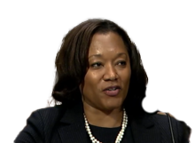
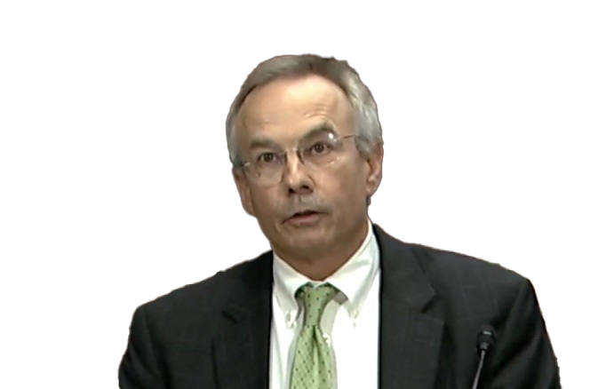
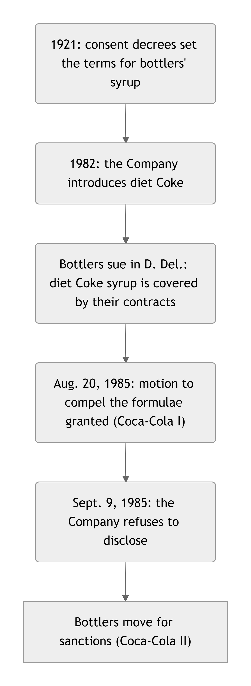
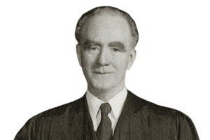
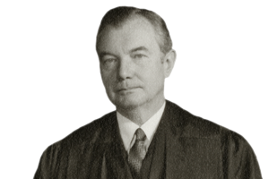
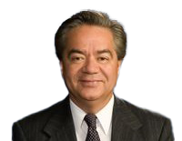

# Discovery {#sec-discovery}

## Introduction

Discovery is both the most distinctive and one of the most expensive
aspects of American civil litigation. This phase of litigation most
commonly begins after the defendant has answered the complaint (whether
or not a motion to dismiss was filed). It consists of a formalized
exchange of documents, information, and testimony between the parties
and, occasionally, from third parties. Gaining information in discovery
is often a pivotal moment in a case. Incriminating emails, telling
admissions, and smoking-gun evidence are the needles lawyers seek in the
haystack of discovery. Even when evidence revealed in discovery doesn't
force parties into a settlement, it often plays a starring role at
trial.

## Timing and Types of Discovery {#sec-timing-types}

[Rule 26](#sec-frcp26) sets out the general rules of, and timeline for, discovery. That
timeline looks roughly as follows, with specific dates to be set by the
judge in consultation with the parties:

1.  First, "as soon as practicable," the parties must confer with each
    other to "consider the nature and basis of their claims and defenses
    and the possibilities for promptly settling or resolving the case."
    Rule 26(f)(2). They must also "develop a proposed discovery plan,"
    including how they will "preserv\[e\] discoverable information."

2.  Next, the parties must exchange their initial disclosures, which are
    basic information about the parties' claims, as well as potential
    witnesses and evidence. *See* Rule 26(a)(1)(A). Failing to disclose
    information required at this stage can result in witnesses or
    evidence being barred from being used in the case. *See* Rule
    37(c)(1).

3.  After the Rule 26(f) conference, the judge must issue a scheduling
    order. *See* Rule 16(b). The scheduling order "must limit the time
    to join other parties, amend the pleadings, complete discovery, and
    file motions." Rule 16(b)(3)(A). It may also set the limits of
    discovery, govern how electronically stored information should be
    shared, and set dates for future conferences and trial. Rule
    16(b)(3)(B).

4.  With the scheduling order in place, the parties may begin exchanging
    discovery requests. There are three major types of discovery
    requests:

    - Requests for Production ([Rule 34](#sec-frcp34)): at this point, the
        parties may ask each other for documents or any other tangible
        or electronic item that is relevant, proportional and
        nonprivileged. A typical case will involve thousands and
        sometimes millions of pages of documents and communications.

    - Interrogatories and Requests for Admissions ([Rules 33](#sec-frcp33) and [36](#sec-frcp36)):
        As the parties are exchanging documents, they can also pose
        written questions directly to each other. However, each pair of
        parties may pose only 25 interrogatories (including sub-parts of
        questions) to each other, limiting their overall value.
        Relatedly, under Rule 36, parties may request that other parties
        admit certain facts not in dispute. Unlike interrogatories,
        requests for admissions are unlimited in number.

    - Depositions ([Rule 30](#sec-frcp30)) and Examinations ([Rule 35](#sec-frcp35)): Finally, the
        parties may depose witnesses who may have knowledge of the case.
        Depositions (governed by Rule 30), are typically seven-hour long
        interviews that are recorded under oath. The deposing party must
        bear the cost of the deposition (conference room, stenographer,
        etc.). By default, each side (plaintiffs, defendants) may take
        only 10 depositions. Rule 35 allows physical and mental
        examinations of parties, including medical and mental
        examinations, but these are relatively rare.

5.  Next, in cases that employ expert witnesses, the parties must
    exchange expert reports and schedule expert depositions. Rule
    26(a)(2), (b)(4).

6.  At the close of the party-driven phase of discovery, the case is
    often ripe for one last phase of dispositive motions (summary
    judgment). Then the parties exchange pretrial disclosures, including
    witness lists and exhibit lists. Rule 26(a)(3).

7.  Finally, the court must hold a final pretrial conference to set the
    plan for trial. [Rule 16(e)](#sec-frcp16). This conference must happen "as close to
    the start of trial as is reasonable." *Id.*

## Limits on Discovery

As you can begin to appreciate, the discovery process unlocks a series
of powerful tools. If not safeguarded, the parties may use these tools
in ways that are excessive or abusive. For that reason, the Rules impose
a series of limits on what kinds of information is discoverable. The
three main limits are *relevance*, *proportionality*, and *privilege*.
*See* Rule 26(b)(1). The next section will consider each of those limits
in turn.

### Favale v. Roman Catholic Diocese of Bridgeport

**SQUATRITO, J.** [233 F.R.D. 243 (D. Conn. 2005)]{.aside}

Now pending in the above-captioned matter is plaintiffs' motion to
compel and defendant's motion for a protective order. \[...\] For the
reasons that follow, plaintiffs' motion to compel is DENIED and
defendant's motion for a protective order is GRANTED.

**Background**

Plaintiff Maryann Favale worked as an administrative assistant at Saint
Joseph's School in Brookfield, Connecticut, for approximately twenty-one
years. During this time period, in November of 2002, Sister Bernice
Stobierski became the new interim principal. Then, in May 2003, Sister
Stobierski assumed the position of full-time principal. Maryann Favale
alleges that Sister Stobierski subjected her to "severe and repeated
sexual harassment" in the workplace from December 2002 to June 2003.
Specifically, plaintiff alleges that Sister Stobierski touched her
inappropriately, made sexually suggestive comments, exhibited lewd
behavior, and requested physical affection. Plaintiff first informed her
employer, the Roman Catholic Diocese of Bridgeport, ("the Diocese") of
the alleged sexual harassment on June 11, 2003. Maryann Favale, who no
longer works at Saint Joseph's School, seeks damages against the Diocese
for sexual harassment, retaliation, defamation, intentional and
negligent infliction of emotional distress, negligent hiring, negligent
supervision, and other causes of action. In addition, co-plaintiff Mark
Favale asserts a claim for loss of consortium against the defendant.
Sister Stobierski is not a party to this case.

Plaintiffs now seek to compel Sister Stobierski to testify to any prior
treatment she may have received for her alleged anger management history
and psychological or psychiatric conditions. Plaintiffs also move to
compel the Diocese to produce any records it has of any such treatment.
The Diocese objects to these requests on the grounds that this
information is irrelevant \[...\] .

**Sister Stobierski's Testimony**

Plaintiffs assert that Sister Stobierski's testimony regarding the
treatment she received for her alleged anger management, psychological,
and psychiatric conditions is relevant to their claims of negligent
hiring and negligent supervision. To assert a negligent hiring claim
under Connecticut law, a plaintiff must "\[p\]lead and prove that she
was injured by the defendant's own negligence in failing to select as
its employee a person who was fit and competent to perform the job in
question and that her injuries resulted from the employee's unfit or
incompetent performance of his work." Similarly, Connecticut law
requires that a plaintiff bringing a negligent supervision claim

> \[p\]lead and prove that he suffered an injury due to the defendant's
failure to supervise an employee whom the defendant had a duty to
supervise. A defendant does not owe a duty of care to protect a
plaintiff from another employee's tortious acts unless the defendant
knew or reasonably should have known of the employee's propensity to
engage in that type of tortious conduct.

Both negligent hiring and negligent supervision claims turn upon the
type of wrongful conduct that actually precipitated the harm suffered by
plaintiff. "It is well settled that defendants cannot be held liable for
their alleged negligent hiring, training, supervision or retention of an
employee accused of wrongful conduct unless they had notice of said
employee's propensity for the type of behavior causing the plaintiff's
harm."

Plaintiffs allege that the defendant negligently hired and supervised an
individual who was not fit to be the principal of an elementary school.
They contend that the "defendant knew or reasonably should have known
that Sister Stobierski was unfit to be the principal of St. Joseph's
School as a result of her prior emotional and anger management issues,
and limited school administration experience." \[...\] Yet, plaintiffs
do not allege that Sister Stobierski's prior emotional and anger
management issues harmed plaintiff.

Rather, the only type of harm alleged to have been suffered by Maryann
Favale was harm resulting from repeated acts of sexual harassment, and
plaintiffs do not maintain that Sister Stobierski's alleged anger
management and psychological or psychiatric conditions contributed to
the sexual harassment. Accordingly, Sister Stobierski's testimony
pertaining to the treatment she allegedly received for her anger
management, psychological, or psychiatric conditions is not relevant
because it does not pertain to the defense or claim of any party.

Indeed, even if the Diocese was aware of Sister Stobierski's alleged
anger management history or psychological or psychiatric conditions,
this knowledge would have no bearing on plaintiffs' claims for negligent
supervision and negligent hiring because the wrongful conduct of which
the Diocese would have had notice was not the same type of wrongful
conduct that caused Maryann Favale harm. Notice of Sister Stobierski's
alleged anger management history or psychological or psychiatric
conditions does not equate to notice of Sister Stobierski's propensity
to commit acts of sexual harassment. The Diocese's objection to
plaintiffs' motion to compel the testimony of Sister Stobierski is
sustained, and plaintiffs' motion is denied.

**The Production of Defendant's Records Relating to Sister Stobierski**

Plaintiffs assert that any documentation that the Roman Catholic Diocese
of Bridgeport may have regarding Sister Stobierski's treatment for anger
management or psychological and psychiatric conditions is relevant to
their claims of negligent hiring and negligent supervision. The elements
of these claims are discussed above. \[...\] \[E\]ven if the defendant
possessed documents relating to treatment Sister Stobierski received for
her alleged anger management or psychological and psychiatric
conditions, these records would not establish Sister Stobierski's
propensity for the type of behavior that caused Maryann Favale harm
because they would not demonstrate a propensity for sexual harassment.
Again, it is significant that plaintiffs do not allege that Maryann
Favale was harmed by Sister Stobierski's alleged inability to control
her anger or her alleged psychological or psychiatric conditions. Sexual
harassment is the only type of harm alleged by plaintiffs. \[...\]

Defendant's motion for a protective order is granted. A protective order
shall enter barring future discovery into Sister Stobierski's anger
management or psychological and psychiatric treatment as the court finds
that this information is profoundly personal and, as stated herein, not
relevant to the claims in this case.

#### Notes & Questions

1.  The lesson of *Favale* is that relevance is judged in light of the
    parties' actual claims and defenses. Only if evidence would tend to
    prove or disprove a claim or defenses is it considered relevant
    within the meaning of Rule 26(b).

2.  What might the plaintiff have done differently at the pleading stage
    in order to make her discovery request relevant under Rule 26?
    
::: {.callout-tip .self-check icon=false}
## Check Your Understanding: *Favale*

Change the request. Instead of Sister Stobierski's treatment records, the Favales ask the Diocese to produce any complaints it received, before hiring her, that Sister Stobierski had sexually harassed employees at a school where she previously worked. Is that discoverable?

::: {.callout-note collapse="true" icon=false}
## Answer

**Very likely yes.** Relevance under Rule 26(b)(1) is measured against the parties' actual claims and defenses. The Favales sued for negligent hiring and negligent supervision, which turn on what the Diocese knew. The court in *Favale* rejected the treatment records because, "even if the Diocese was aware" of them, that knowledge "would have no bearing" on those claims: "the wrongful conduct of which the Diocese would have had notice was not the same type" as the harassment alleged. Earlier complaints of sexual harassment are exactly the same type of conduct. They bear directly on whether the Diocese had notice, so they are relevant (subject to proportionality and any protective order for the other employees' privacy).

:::
:::

### Cerrato v. Nutribullet, LLC

**SNEED, M.J.** [2017 WL 3608266 (M.D. Fla. 2017)]{.aside}

::: {.column-margin}

{width=150 fig-alt="Magistrate Judge Sneed"}

:::

**ORDER ON PLAINTIFF'S MOTION TO COMPEL**

This matter is before the Court on Plaintiff's Motion to Compel Prior
Accident/ Injury Reports and Consumer Complaints Regarding Product at
Issue and Defendant's Response in Opposition. Upon consideration, the
Motion to Compel is granted in part and denied in part.

**Background**

Plaintiffs Phyllis and German Cerrato bring this products liability
action against Defendants for injuries allegedly sustained by Plaintiff
Phyllis Cerrato while using a blender designed and manufactured by
Defendants. Plaintiffs allege that the blender exploded and resulted in
hot liquids burning Plaintiff Phyllis Cerrato and causing property
damage to Plaintiffs' kitchen. Plaintiffs bring negligence, strict
liability, and breach of warranty claims against Defendants. \[...\]

**Analysis**

\[...\] Request Number 4 seeks "\[a\]ll accident reports and records
relating to any injury allegedly caused by the product." Request Number
5 seeks "\[a\]ll consumer complaints of any type relating to the
product." Plaintiff defined the term "product" as the
"MagicBullet/Nutribullet Pro 900 series that is the subject of this
litigation." In response, Defendant objected to both requests as vague,
ambiguous, overbroad, not reasonably calculated to lead to the discovery
of admissible evidence, \[and\] not proportional to the needs of the
case. \[...\]

\[T\]he Court agrees that Plaintiff's requests are overbroad and not
proportional to the needs of the case. The requests contain no time
limitation and no limitation as to the type of injury at issue, the
subject matter of the complaints requested, the alleged defect at issue,
or the circumstances of the incident in the materials requested.
Defendant asserts that if Plaintiff's Motion to Compel is granted,
Plaintiff should only be entitled to discovery of incidents "similar
enough" to the incident Plaintiff describes in her deposition.
Specifically, Defendant states the requests should be limited to similar
incidents where "the Nutribullet Pro 900 cup could not be untwisted from
the base to turn it off." Defendant further asserts that Plaintiff
should not be entitled to discovery of information concerning other
incidents that occurred subsequent to the subject incident as subsequent
incidents are irrelevant. Nevertheless, evidence of subsequent incidents
is admissible to prove a particular theory of causation, particularly
where the exact circumstances of an accident are unknown.

Given the overbroad nature of Plaintiff's requests, the Court finds that
the requests are unduly burdensome and seek information that is
disproportionate to the needs of this case. However, with an appropriate
time limitation, a request for accident reports and consumer complaints
concerning incidents where the MagicBullet/ Nutribullet Pro 900 Series
could not be turned off is relevant and proportional to the needs of the
case. The Motion to Compel is therefore granted in part, and Defendant
shall supplement its response by producing all accident reports and
consumer complaints occurring within five years prior to Plaintiff's
incident through the date of Plaintiff's Complaint concerning incidents
where the MagicBullet/Nutribullet Pro 900 Series could not be turned
off. *See Moore v. Armour Pharmaceutical Co.*, 927 F.2d 1194, 1197 (11th
Cir. 1991) (stating that the trial court "has wide discretion in setting
the limits of discovery"); *Farnsworth*, 758 F.2d at 1547 (same);
*Commercial Union Ins. Co.*, 730 F.2d at 731 ("Case law states that a
motion to compel discovery is committed to the discretion of the trial
court").

Last, Defendant objected to Plaintiff's Requests Number 4 and 5 as
seeking confidential and private information, including private
information concerning other consumers. The confidential and private
information of other consumers is irrelevant to Plaintiffs' claims.
Therefore, Defendant shall redact all accident reports and consumer
complaints produced to Plaintiffs for the consumers' private and
confidential information, including any names, addresses, telephone
numbers, and social security numbers. \[...\]

::: {.callout-tip .self-check icon=false}
## Check Your Understanding: *Cerrato*

In *Cerrato*, suppose the plaintiffs had asked only for complaints about the Pro 900 blender being impossible to turn off, but going back twenty years and covering every country where it was sold. The defendant offers to produce only incidents described exactly as Mrs. Cerrato described hers in her deposition. How should the court rule?

::: {.callout-note collapse="true" icon=false}
## Answer

**Somewhere in between, as in the real case.** The defendant's proposal is too narrow. Rule 26(b)(1) reaches information relevant to a claim or defense, and other incidents involving the same alleged defect can be relevant even when their details differ, especially "where the exact circumstances of an accident are unknown." But twenty years and every country is out of proportion to a single consumer's injury claim, and the court found the original requests "unduly burdensome" and "disproportionate to the needs of this case." The court's solution was a time limit (five years before the incident through the complaint), confined to the same model and the same alleged defect (it "could not be turned off"), with other consumers' personal information redacted. A court would likely do something similar here.

:::
:::

### Wagoner v. Lewis Gale Medical Center, LLC

**BALLOU, M.J.** [2016 WL 3893135 (W.D. Va. 2016)]{.aside}

::: {.column-margin}

{width=150 fig-alt="Magistrate Judge Ballou"}

:::

**Order**

Plaintiff, Jim David Wagoner ("Wagoner") seeks to compel defendant Lewis
Gale Medical Center, LLC ("Lewis Gale") to conduct a search of its
computer systems for certain electronically stored information ("ESI").
Lewis Gale objects because of the "difficulty and unreasonable expense
in performing plaintiff's requested searches." Alternatively, Lewis Gale
asks that Wagoner pay for the related costs of conducting this search.
The motion to compel is GRANTED.

**I. Background**

Wagoner worked as a security guard for Lewis Gale from April 4, 2014
until he was terminated on June 12, 2014. He worked approximately 16
hours per week and earned \$12.49 per hour. He filed suit against Lewis
Gale on October 23, 2015, alleging that he suffered from dyslexia and
that Lewis Gale wrongfully terminated his employment in violation of the
Americans with Disabilities Act ("ADA"). Wagoner asserts claims related
to discrimination, retaliation, and failure to accommodate in violation
of the ADA.

Wagoner propounded requests for production of documents to Lewis Gale
seeking production of ESI maintained by two custodians, Frank Caballos
and Bobby Baker, who were Wagoner's supervisors. Wagoner limited the
dates for any ESI search to only four months and requested the following
search terms:

> Jim OR Wagoner AND dyslexia OR dyslexic OR read OR reading OR slow OR
ADA OR disabled OR disability OR security OR schedule OR copy OR
copying.

Lewis Gale conceded that it does not have the capability to perform this
global search and obtained an estimate of \$21,570 from a third-party
vendor to collect the requested ESI, with an additional \$24,000
estimated to review the documents retrieved. The ESI search would
involve seven computers that the two custodians had access to and an
exchange server located in Tennessee. Lewis Gale argues that the
discovery plaintiff seeks is not proportional because Wagoner only
worked for two months as a security guard, and his potential damages are
less than the cost to perform the ESI search. Lewis Gale further asserts
that it has produced considerable ESI in the form of "e-mails gathered
manually from the computers of key custodians."

**II. Analysis**

**A. Relevance**

Rule 26 of the Federal Rules of Civil Procedure provides that a party
"may obtain discovery regarding any nonprivileged matter that is
relevant to any party's claim or defense and proportional to the needs
of the case ... ." Fed. R. Civ. P. 26(b). Thus, as a threshold matter, I
must determine whether Wagoner's discovery requests are relevant under
Rule 26.

Wagoner contends that his dyslexia caused him to have difficulty reading
and copying his posted work schedule, that Lewis Gale denied his request
for a written copy of the schedule, and that his termination violated
the ADA. E-mails or other memoranda written by Wagoner's supervisors,
Frank Caballos and Bobby Baker, between April and July 2014 and
containing the search terms listed above are relevant to Wagoner's
claim. Indeed, Lewis Gale largely conceded at the hearing that Wagoner's
request was relevant, arguing only that the keyword searches were too
broad. Accordingly, I find that Wagoner's requested ESI search is
relevant to the claims and defenses asserted in this case. \[...\]

**B. Reasonable Accessibility**

Lewis Gale argues that the discovery in this case should not be
permitted because \[it\] is not proportional, considering the high cost
of performing the ESI search compared to Wagoner's limited potential
recovery. Lewis Gale further states that, if the court does order it to
obtain the requested discovery, the court should shift the cost of the
ESI search to Wagoner. Relevant ESI may still not be discoverable under
Rule 26 if the party can show that the information is "not reasonably
accessible because of undue burden or cost." Fed. R. Civ. P.
26(b)(2)(B). The court may also specify conditions for the discovery
which may include cost sharing. Here I find that Lewis Gale has not
shown that the burdens and costs of obtaining the ESI discovery makes
the requested information not reasonably accessible, nor has Lewis Gale
shown that the requested ESI discovery is not proportional.

Lewis Gale claims that the fact that it cannot perform the requested ESI
search in-house, and must contract with a third party vendor at
significant cost, requires the court to find that the information is not
reasonably accessible. Lewis relies upon the declarations of Karyn
Hayes, Systems Manager for HCA Management Services, which provides
computer systems services to Lewis Gale, and of Austin Maddox, Senior
Litigation Technology Consultant for Document Solutions, Inc., the
third-party vendor that provided an estimate to Lewis Gale for
performing the ESI search. Ms. Hayes indicated that there were
approximately 30,598 \[responsive\] e-mails \[...\] . She further stated
that a third-party vendor would be required to perform the ESI search on
seven computers located at Lewis Gale, and the "computers would require
forensic extraction of data, data processing, data hosting, project
management, production, and review" with an estimated cost of
\$45,570.00. Mr. Maddox indicated that Wagoner's ESI request would
involve:

> the remote collection of at least seven laptops and email archive
data. The data would be processed and loaded into a Catalyst
Repository Systems web-hosted review platform. Once the data has been
loaded to Catalyst, the \[Document Solutions, Inc.\] Client Services
team would work with the hospital to cull data through objective
filters (date range, email domain, file type, etc.) to identify and
promote documents for review by counsel.

Mr. Maddox further estimated that, "Reasonable parameters and metrics
suggest that after search terms and date filters have been applied,
approximately five gigabytes of data consisting of an estimated 3500
documents per gigabyte would need to be reviewed at an estimated 292
hours of expended time, which would cost approximately \$24,000."

Whether production of documents is unduly burdensome or expensive turns
primarily on whether the data is kept in an accessible or inaccessible
format. *Zubulake v. UBS Warburg LLC*, 217 F.R.D. 309, 318 (S.D.N.Y.
2003). \[...\] Lewis Gale has not carried its burden to show that the
data on the seven computers or exchange server is inaccessible, *i.e.*
must be restored, de-fragmented, or reconstructed. Instead, Lewis Gale
has stated that it is not capable of performing the ESI searches
requested by plaintiff in-house, and would be required to contract with
an expensive outside vendor.

Moreover, it is difficult to conclude that the ESI sought is not
proportional or "not reasonably accessible" due to undue burden and
expense because Lewis Gale apparently chose to use a system that did not
automatically preserve e-mails for more than three days, and did not
preserve e-mails in a readily searchable format, making it costly to
produce relevant e-mails when faced with a lawsuit. *See AAB Joint
Venture v. United States*, 75 Fed. Cl. 432, 443 (2007) (noting "the
Court cannot relieve Defendant of its duty to produce those documents
merely because Defendant has chosen a means to preserve the evidence
which makes ultimate production of relevant documents expensive.").

Proportionality consists of more than whether the particular discovery
method is expensive. Here, Lewis Gale advances no other reasonable
alternative to obtain the requested information. Lewis Gale simply
proposes to have the very person who may have authored relevant
documents search their computer for responsive information. No \[assurance\]
exists that this search method would yield any ESI deleted prior to the
search. Employment discovery presents particular challenges to the
employees where most, and sometimes all, relevant discovery is in the
control of the employer. Here, in light of the limited request,
restricted by custodian, search terms, and time period, I find the
request proportional to the needs of the case.

Finally, because I find that the ESI sought is reasonably accessible
without undue burden or expense, cost-shifting is not appropriate.
Accordingly, I will not shift the cost of discovery, and the general
rule that the party responding to a discovery request bears the cost
will apply.

**III. Conclusion**

Accordingly, Wagoner's motion to compel is GRANTED. \[...\]

It is so ORDERED.

::: {.callout-tip .self-check icon=false}
## Check Your Understanding: *Wagoner*

Change the facts. Lewis Gale says that searching its old e-mail will cost $40,000 because, after Wagoner was fired, it moved the e-mail to an archive that can be searched only with special software. Wagoner's lost wages are a few thousand dollars. Must Lewis Gale search, and who pays?

::: {.callout-note collapse="true" icon=false}
## Answer

**Probably yes, and probably at Lewis Gale's expense, if the request stays narrow.** The general rule is that "the party responding to a discovery request bears the cost." A party can resist discovery of ESI that is "not reasonably accessible because of undue burden or cost" (Rule 26(b)(2)(B)), but it bears the burden of showing that, and the court can still order discovery, with conditions such as cost sharing, if the requesting party shows good cause. As the notes point out, expense caused by a defendant's own choices about how to store its information is unlikely to count as a good reason. And employment cases weigh heavily toward discovery, since "most, and sometimes all, relevant discovery is in the control of the employer." What made Wagoner's request proportional was that it was "restricted by custodian, search terms, and time period." Keeping it that narrow is Wagoner's best answer to the cost.

:::
:::

### Rengifo v. Erevos Enterprises, Inc.

**ELLIS, M.J.** [2007 WL 894376 (S.D.N.Y. Mar. 20, 2007)]{.aside}

Plaintiff, Willy Rengifo ("Rengifo")\[, who is suing his former
employers to recover unpaid overtime wages under the federal Fair Labor
Standards Act (FLSA) and New York Labor Law, along with other claims\]
requests this Court to issue a protective order pursuant to Federal Rule
of Civil Procedure 26(c) barring discovery related to his immigration
status, social security number, and authorization to work in the United
States. \[...\]

Rule 26(c) authorizes courts, for good cause, to "make any order which
justice requires to protect a party or person from annoyance,
embarrassment, oppression, or undue burden or expense, including ...
that certain matters not be inquired into, or that the scope of the
disclosure or discovery be limited to certain matters ... ." Fed. R.
Civ. P. 26(c). "\[T\]he burden is upon the party seeking non-disclosure
or a protective order to show good cause."

Rengifo argues that discovery related to his immigration status,
authorization to work in this country, and social security number are
not relevant to his right to recover unpaid wages. Further, Rengifo
argues that the intimidating effect of requiring disclosure of
immigration status is sufficient to establish "good cause" when the
question of immigration status only goes to a collateral issue.
Defendants argue that documents containing Rengifo's social security
number or tax identification number, such as tax returns, are relevant
to the issue of whether he is entitled to overtime wages, which is a
central issue in this case. Additionally, defendants argue that the
validity of Rengifo's social security number, his immigration status and
authorization to work in this country are relevant to his credibility.
\[...\]

Courts have recognized the in terrorem effect of inquiring into a
party's immigration status and authorization to work in this country
when irrelevant to any material claim because it presents a "danger of
intimidation \[that\] would inhibit plaintiffs in pursuing their
rights." Here, Rengifo's immigration status and authority to work is a
collateral issue. The protective order becomes necessary as "\[i\]t is
entirely likely that any undocumented \[litigant\] forced to produce
documents related to his or her immigration status will withdraw from
the suit rather than produce such documents and face ... potential
deportation." \[...\]

Rengifo also seeks to prevent disclosure of his social security number
or tax identification number. Defendants note that, in support of his
claim for unpaid overtime wages, Rengifo has produced an incomplete set
of pay stubs that do not reflect all of the compensation he has received
from corporate defendants, and that he has not produced any records
regarding the number of hours he has worked on a weekly basis.
Defendants contend, therefore, that discovery of documents containing
his tax identification number or social security number, such as tax
returns, is necessary and relevant to obtain this information. \[The
court rejects defendants' argument, reasoning that t\]he information
sought is not relevant to the claims in this case. Even if it were,
however, the corporate defendants possess relevant data on hours and
compensation, and there is no reason to assume that defendants' records
are less reliable than any records maintained by Rengifo. \[...\]

Defendants also assert that the documents requested would allow them to
test the truthfulness of Rengifo's representations to his employer. They
argue that by applying for a job and providing his social security
number, Rengifo represented to defendants that he was a legal resident
and they are entitled to test the truthfulness of that information.
Defendants further argue that if Rengifo filed tax returns, this
information would be relevant to his overtime claim, but if he failed to
file tax returns, this fact would affect the veracity of statements he
would potentially make at trial.

While it is true that credibility is always at issue, that "does not by
itself warrant unlimited inquiry into the subject of immigration status
when such examination would impose an undue burden on private
enforcement of employment discrimination laws." A party's attempt to
discover tax identification numbers on the basis of testing credibility
appears to be a back door attempt to learn of immigration status.
Further, the opportunity to test the credibility of a party based on
representations made when seeking employment does not outweigh the
chilling effect that disclosure of immigration status has on employees
seeking to enforce their rights. "While documented workers face the
possibility of retaliatory discharge for an assertion of their labor and
civil rights, undocumented workers confront the harsher reality that, in
addition to possible discharge, their employer will likely report them
to the INS and they will be subjected to deportation proceedings or
criminal prosecution." Granting employers the right to inquire into
immigration status in employment cases would allow them to implicitly
raise threats of such negative consequences when a worker reports
illegal practices.

While defendants suggest a compromise whereby discovery would be limited
to the present litigation and not disclosed to any third party for any
purpose beyond this litigation, the limitation does not abate the
chilling effect of such disclosure. "Even if the parties were to enter
into a confidentiality agreement restricting the disclosure of such
discovery ... , there would still remain 'the danger of intimidation,
the danger of destroying the cause of action' and would inhibit
plaintiffs in pursuing their rights." This Court finds that defendants'
opportunity to test the credibility of Rengifo does not outweigh the
public interest in allowing employees to enforce their rights.

For the foregoing reasons, Rengifo's application for a protective order
barring defendants from inquiring into his immigration status, social
security number or tax identification number, and authorization to work
in the United States is GRANTED.

#### Notes & Questions

1.  Whereas *Favale* concerned relevance, *Cerrato*, *Wagoner*, and
    *Rengifo* concern proportionality. What principles did the courts in
    those cases rely on to decide whether to narrow the discovery
    requests at issue?

2.  What might have led the plaintiff in *Cerrato* to seek broader
    discovery than the court ultimately allowed? What might have led the
    defendant in *Rengifo* to seek broader discovery than the court
    ultimately allowed?

3.  Why might the defendant try to limit the scope of discovery in a
    case like *Cerrato*? What about the plaintiff in *Rengifo*?

4.  Note that *Wagoner* rejects the idea that simply because discovery
    is expensive to produce, it is not proportional to the case. In
    particular, expense that is caused by a defendant's own choices
    about how to store information is unlikely to count as a good
    reason. Why?
    
::: {.callout-tip .self-check icon=false}
## Check Your Understanding: *Rengifo*

The employers in *Rengifo* offer a compromise: Rengifo will answer questions about his immigration status, but the answers will be used only in this lawsuit and never disclosed to anyone else, including the government. Should the court accept it?

::: {.callout-note collapse="true" icon=false}
## Answer

**No.** The court considered and rejected exactly this offer: a limitation to "the present litigation and not disclosed to any third party ... does not abate the chilling effect of such disclosure." The concern is not only what happens to the information but what the demand does to the plaintiff. "It is entirely likely that any undocumented [litigant] forced to produce documents related to his or her immigration status will withdraw from the suit rather than produce such documents." Because Rengifo's immigration status is "a collateral issue" in a suit for unpaid wages, and the employers' credibility argument looked like "a back door attempt to learn of immigration status," good cause supports a protective order barring the inquiry altogether.

:::
:::

### Coca-Cola Bottling Co. v. Coca-Cola Co.

**MURRAY M. SCHWARTZ, Chief Judge.** [107 F.R.D. 288 (D. Del. 1985)]{.aside}

::: {.column-margin}

{width=150 fig-alt="Chief Judge Murray M. Schwartz"}

:::

The complete formula for Coca-Cola is one of the best-kept trade secrets
in the world. Although most of the ingredients are public knowledge, the
ingredient that gives Coca-Cola its distinctive taste is a secret
combination of flavoring oils and ingredients known as "Merchandise 7X."
The formula for Merchandise 7X has been tightly guarded since Coca-Cola
was first invented and is known by only two persons within The Coca-Cola
Company ("the Company"). The only written record of the secret formula
is kept in a security vault at the Trust Company Bank in Atlanta,
Georgia, which can only be opened upon a resolution from the Company's
Board of Directors.

The impregnable barriers which the Company has erected to protect its
valuable trade secret are now threatened by pretrial discovery requests
in two connected cases before this Court. Plaintiffs in these lawsuits
are bottlers of Coca-Cola products who seek declaratory, injunctive and
monetary relief against the Company based upon allegations of breach of
contract, violation of two 1921 Consent Decrees, trademark infringement,
dilution of trademark value, and violation of federal antitrust laws,
all of which allegedly occurred when the Company introduced diet Coke in
1982. Stripped to bare essentials, the plaintiffs' contention is that
the Company is obligated to sell them the syrup used in the bottling of
diet Coke under the terms of their existing contracts covering the syrup
used in the bottling of Coca-Cola. The primary issue arising from this
contention is whether the contractual term "Coca-Cola Bottler's Syrup"
includes the syrup used to make diet Coke. Plaintiffs contend that in
order to prevail on this issue, they need to discover the complete
formula, including the secret ingredients, for Coca-Cola, as well as the
complete formulae, also secret, for diet Coke and other Coca-Cola soft
drinks. Accordingly, plaintiffs have filed a motion to compel production
of the complete formulae under Fed. R. Civ. P. 37(a). Defendant, which
has resisted disclosure of its secret formulae at every turn, contests
the relevance of the complete formulae to the instant litigation and
avers that disclosure of the secret formulae would cause great damage to
the Company.

The issue squarely presented by plaintiffs' motion to compel is whether
plaintiffs' need for the secret formulae outweighs defendant's need for
protection of its trade secrets. In considering this dispute, I am well
aware of the fact that disclosure of trade secrets in litigation, even
with the use of an appropriate protective order, could "become by
indirection the means of ruining an honest and profitable enterprise." 8
J. Wigmore, Evidence § 2212, at 155 (McNaughton rev. 1961). Moreover, I
am also aware that an order compelling disclosure of the Company's
secret formulae could be a bludgeon in the hands of plaintiffs to force
a favorable settlement. On the other hand, unless defendant is required
to respond to plaintiffs' discovery, plaintiffs will be unable to learn
whether defendant has done them a wrong. Except for a few privileged
matters, nothing is sacred in civil litigation; even the legendary
barriers erected by The Coca-Cola Company to keep its formulae from the
world must fall if the formulae are needed to allow plaintiffs and the
Court to determine the truth in these disputes.

**I.\ Factual Background**

Since the turn of the century, Coca-Cola has been produced in a
two-stage process: the Company manufactures "Coca-Cola Bottler's Syrup"
("Bottler's Syrup") and sells it to bottlers, who add carbonated water
to the syrup and place the resulting product in bottles and cans. In
1921, following litigation between bottler groups and the Company
concerning their contracts for Bottler's Syrup, the Company entered into
Consent Decrees which established certain contractual terms between the
Company and its bottlers. The Consent Decrees provided, inter alia:
first, that Coca-Cola Bottler's Syrup contain no less than 5.32 pounds
of sugar per gallon; second, that bottlers would pay a maximum of \$1.30
per gallon for the syrup; third, that the price of Bottler's Syrup could
increase based upon the increase in the market price of sugar as quoted
quarterly by the ten largest refiners in the United States. Until 1978,
the price of Bottler's Syrup for virtually all bottlers was governed by
the price formula established by the 1921 Consent Decrees.

Beginning in 1978, due to inflationary pressures and declining sales,
the Company sought price relief from the existing price formula in its
contracts with bottlers. After negotiations, most of the bottlers agreed
to an amendment ("the 1978 Amendment") to their contracts in exchange
for a clause requiring the Company to pass on any cost savings if the
Company decided to substitute a lower cost sweetener for granulated
sugar. The 1978 Amendment established a new price formula for Bottler's
Syrup which utilizes a "sugar element," a "base element," and the
Consumer Price Index. The sugar element provides for adjustments based
on the quoted market price of any sweetening ingredient used in
Bottler's Syrup. The great majority of the bottlers, representing
approximately 90 percent of domestic sales, have signed the 1978
Amendment. These bottlers are generally known as the "amended bottlers."
The remaining bottlers, known as the "unamended bottlers," refused to
sign the amendment and continue to operate under Bottler's Contracts
which basically conform to the contracts entered into after the 1921
Consent Decrees. In 1980, the amended bottlers began obtaining some
benefit from the 1978 Amendment when the Company decided to substitute
high fructose corn syrup ("HFCS--55"), a less expensive sweetener than
granulated sugar, for approximately 50 percent of the granulated sugar
in Bottler's Syrup.

On July 8, 1982, the Company introduced diet Coke to the market with
great fanfare. The name was chosen carefully and focused on the
descriptive nature of the word "diet" and the tremendous market
recognition of "Coke." The advertising emphasized the taste of the new
cola and its relationship to Coke. The public response to diet Coke has
been phenomenal---in just three years, it has become the third largest
selling soft drink in the United States and the best-selling diet soft
drink in the world.

The introduction of diet Coke immediately gave rise to a dispute between
Coke bottlers and the Company over what price bottlers must pay for diet
Coke syrup. The Company took the position that diet Coke was not within
the scope of the existing contracts, and a new contract term with
flexible pricing would have to be developed. Many of the bottlers---both
amended and unamended---believed that the Company was obligated to
provide diet Coke under the terms of their existing Bottler's Contracts
for Coca-Cola. This dispute led to the filing of these lawsuits in early
1983.

\[...\]

**II.\ Plaintiffs' Motion to Compel**

After extensive discovery, plaintiffs filed the instant motion that, in
essence, seeks to compel the Company to produce the complete formulae,
including secret ingredients, for Coca-Cola \[and\] diet Coke \[...\] .
Defendant's responses to the discovery requests at issue, which
plaintiffs filed as an appendix to their motion, demonstrate that
defendant has objected to plaintiffs' discovery wherever it approached
matters related to the secret formulae. Thus, plaintiffs have been
foreclosed both from learning the formulae themselves and from learning
about other matters that relate to the formulae.

In support of their motion to compel, plaintiffs have contended that the
secret formulae are relevant and necessary to prove their contentions
and respond to defendant's argument that Coca-Cola and diet Coke are two
different products. In response, the Company denies that the formulae
are relevant and essential to resolve the central issues in these cases,
and also contends that disclosure of these trade secrets is
inappropriate at this stage of the litigation.

\[...\]

**C.\ Relevance and Necessity of the Formulae**

Plaintiffs contend that discovery of these secret formulae is required
because they are relevant and necessary to the presentation of
plaintiffs' case. In order to determine whether these trade secrets are
in fact relevant and necessary, a review of the issues in the two cases
is warranted.

**1.\ Unamended Bottlers**

The unamended bottlers claim that defendant must furnish diet Coke syrup
to them pursuant to the terms of their Bottler's Contracts and the 1921
Consent Decrees. The standard form contract for unamended bottlers
states, in pertinent part: "COMPANY agrees to furnish to BOTTLER ...
sufficient syrup for bottling purposes to meet the requirements of
BOTTLER in the territory herein described ... . COMPANY does hereby
select BOTTLER as its sole and exclusive customer and licensee for the
purpose of bottling the Bottlers' bottle syrup, COCA--COLA, in the
territory herein described." The contract further provides that "BOTTLER
agrees ... \[t\]o bottle COCA--COLA in the following manner: to have it
thoroughly carbonated, put in bottles, using one ounce of Bottlers'
Coca-Cola syrup in a standard bottle for Coca-Cola ... decorated with
the name Coca-Cola in the characteristic script ... ." The terms "bottle
syrup" and "Bottlers' Coca-Cola syrup" are not defined in the contract.

Plaintiffs contend that the terms "Bottlers' Coca-Cola syrup" and
"bottle syrup" include any syrups manufactured by the Company for the
purpose of providing any packaged soft drink sold under the names
"Coca-Cola" or "Coke," including diet Coke. In addition, plaintiffs
allege that Coca-Cola and diet Coke are just two versions of the same
product, except that one is sweetened with caloric sweeteners and the
other with non-caloric sweeteners. Defendant's response to these
contentions has been that only syrup for sugar-sweetened Coca-Cola is
covered by the unamended bottlers' contracts, and that diet Coke and
Coca-Cola are two separate products.

**2.\ Amended Bottlers**

The amended bottlers rely on different contractual language to argue
that the Company must furnish them diet Coke syrup on the same terms as
Coca-Cola syrup. The 1978 Amendment, which all of the amended bottlers
signed, replaced the pricing formula used for the unamended bottlers
with one that was tied to the "Sugar Element," a term defined in the
contract. The Amendment then provides: "In the event that the formula
for Bottle Syrup is modified to replace sugar, in whole or in part, with
another sweetening ingredient, the Company will modify the method for
computing the Sugar Element in such a way as to give the Bottler the
savings realized as a result of such modification through an appropriate
objective quarterly measure of the market price of any such sweetening
ingredient." The amended bottlers have contended that "another
sweetening ingredient" includes saccharin or aspartame, the sweeteners
that the Company has used in diet Coke.

The Company argues that this contractual language is inapplicable
because diet Coke is a new and different product and is not modified
Coca-Cola. Plaintiffs' response is that diet Coke is "simply a version
of a product which has undergone evolutionary change but which retains
its identity as Coke," and "that any differences between Coke and diet
Coke Bottler's Syrup are either insignificant or reflect attempts to
achieve taste identity." \[...\]

**3.\ Relevancy of the Secret Ingredients**

A major issue common to both actions is whether diet Coke and Coca-Cola
are the same product. The Company's primary defense has been that
Coca-Cola and diet Coke are two separate and distinct products.
Plaintiffs contend that the complete formulae for diet Coke and
Coca-Cola would be relevant to rebut this defense by showing that the
two colas share common attributes and that any differences between the
two are insignificant and merely reflect attempts to achieve taste
identity. With the introduction of new Coke, plaintiffs argue that
because new Coke was derived in part from the secret formula for diet
Coke, it may be true that new Coke is more like diet Coke than new Coke
is like old Coke. In response, defendant argues that except for the
difference in sweeteners, ingredient similarities and differences are
not relevant to the determination of whether diet Coke and Coca-Cola are
the same product. Instead, defendant relies upon the difference in
taste, different essential characteristics of the beverages, different
consumer markets for the beverages, and different consumer perceptions
of the beverages.

Defendant's response is unavailing. \[...\] Although defendant has
attempted to define the issues so that the only relevant ingredient is
the sweetener, all the ingredients are relevant to determine whether the
two colas are the same product. In fact, the secret ingredients may be
the most relevant ones because the secret ingredients are what gives
these drinks their distinctive tastes.

Plaintiffs could use the secret formulae to prove one of several product
identity theories. An analysis of the secret ingredients in diet Coke
and old Coke might show that diet Coke was designed to taste as much
like old Coke as a low calorie cola could, and that any differences in
secret ingredients reflect defendant's attempts to achieve taste
identity. \[...\] \[Thus, t\]he complete formulae, once known, will tend
to make a disputed fact more (or less) likely: that, for purposes of
this litigation, diet Coke syrup is Bottler's Syrup.

\[...\]

**4.\ Necessity of Discovery of This Information**

As in most disputes over the discoverability of trade secrets, the
necessity of the discovery of the complete formulae follows logically
from the determination that the formulae are relevant. Plaintiffs need
the complete formulae in order to address the product identity issue by
comparing the ingredients of the various soft drinks involved.
Plaintiffs cannot respond to the assertions of defendant's experts that
diet Coke and Coca-Cola are two products unless plaintiffs' experts can
analyze the complete formulae and explain why the products are the same.
Merely using the publicly-disclosed ingredients is obviously
insufficient, because they would present an incomplete picture, and
because the secret ingredients are the key to the taste of Coca-Cola.
The differences in the public ingredients, including sweeteners, cannot
be understood unless they are put in context through disclosure of the
similarities and differences in the secret ingredients. Without the
complete formulae, plaintiffs will be foreclosed from presenting all the
relevant evidence in support of their position.

In addition, plaintiffs need the complete formulae in order to explore
on cross-examination the bases for the opinions of Company witnesses
that Coca-Cola and diet Coke are two separate products. As plaintiffs'
counsel stated at oral argument, plaintiffs' cross-examination of
defendant's witnesses has been foreclosed by defendant's objections that
plaintiffs' questions relate to trade secrets. Plaintiffs cannot be
expected to discover the truth without full cross-examination. Moreover,
the formula information is not available from any other source, and no
adequate substitute exists for this information. It follows that
discovery of the complete formulae is necessary.

After the hearing, defendant attempted to remove the necessity for the
information by offering to stipulate that the secret ingredients in old
Coke, new Coke and diet Coke are identical. Defendant contends that this
result is the most favorable set of facts that plaintiffs could hope to
find through discovery. It is evident, however, that the actual formulae
could be more favorable to plaintiffs than this stipulation. For
example, \[...\] discovery may show that the secret ingredients in old
Coke were modified to make diet Coke, and that those modifications were
intended to counterbalance the taste change caused by substituting
artificial sweeteners for sugar. The effect of the secret ingredient
change may have been to cancel out the changes in other ingredients and
make diet Coke taste like Coke. Further, defendant's proposed
stipulation does not reveal the number of ingredients that are secret
ingredients. If the secret ingredients in Coke and diet Coke are
composed of the same 100 ingredients, so that the vast majority of all
the ingredients in the two colas are identical, that fact would be more
favorable to plaintiffs than if the secret ingredients were only a few
in number. Finally, defendant's proposed stipulation does not solve the
problem of plaintiffs being foreclosed from full cross-examination by
defendant's assertion of trade secret privilege. In sum, defendant's
proposed stipulation is not as favorable to plaintiffs as discovery
might be and does not remove the necessity for disclosure.

**5.\ Need Balanced Against Harm**

The final part of the test for discoverability of trade secrets is to
balance the need for disclosure against the harm that would ensue from
disclosure. The potential harm that would come from public disclosure of
the formulae \[...\] is great, but virtually all of that harm can be
eliminated with stringent protective orders and other safeguards.
Because plaintiffs are Coca-Cola bottlers, they will have an incentive
to keep the formulae secret. The likelihood of harm is less than if
defendant's trade secrets were disclosed in litigation to competitors.
The potential for harm from protected disclosure of the formulae \[...\]
is outweighed by the plaintiffs' need for the information. While
plaintiffs' need for the experimental cola formulae is less strong, this
lesser need is counterbalanced by the fact that the harm resulting from
disclosure of these formulae would be less severe, because those colas
have never been marketed and are less valuable trade secrets.

In sum, the product identity issue is important in these two cases, and
analyses of the complete formulae will be a significant part of the
proof on that issue. Plaintiffs' need for this information outweighs the
harm that disclosure under protective order would cause. Disclosure will
be ordered.

#### Notes & Questions

1.  Why did the plaintiffs say they needed the formulae for various
    Coca-Cola products to prove their claims?

2.  The court notes that disclosure of the formulae "could be a bludgeon
    in the hands of plaintiffs to force a favorable settlement." How
    could the plaintiffs use the formulae in this way? What does the
    court do to prevent that possibility? Do you think those protections
    are enough?

@fig-history-coke shows how the litigation reached the second opinion.

{#fig-history-coke width="32%" fig-alt="Timeline of the Coca-Cola litigation: 1921 consent decrees set the terms for bottlers' syrup; in 1982 the Company introduces diet Coke; bottlers sue in the District of Delaware, claiming diet Coke syrup is covered by their contracts; on August 20, 1985, the court grants the motion to compel the formulae (Coca-Cola I); on September 9, 1985, the Company refuses to disclose; the bottlers move for sanctions (Coca-Cola II)."}

<!-- Source: diagrams/history_coke.mmd. After editing it, run `bash diagrams/render.sh` and commit the PNG. -->

### Coca-Cola Bottling Co. v. Coca-Cola Co. (II)

**MURRAY M. SCHWARTZ, Chief Judge.** [110 F.R.D. 363 (D. Del. 1986)]{.aside}

::: {.column-margin}

{width=150 fig-alt="Chief Judge Murray M. Schwartz"}

:::

On August 20, 1985, this Court granted plaintiffs' motion to compel
production of certain formulae and taste-test results, subject to an
agreed-upon protective order. Defendant has refused to comply with the
discovery order as it pertains to the formulae. Presently before the
Court is plaintiffs' motion for sanctions.

\[...\]

By letter dated September 9, 1985, counsel for the Company informed the
Court that the Company would not disclose its formulae, "\[i\]n light of
the overriding commercial importance of the secrecy of formulae to the
entire Coca-Cola system, ... even under the terms of a stringent
protective order ... ." The Company acknowledged the Court "may order
... a sanction" for that refusal, and requested an opportunity to be
heard on the sanctions issue.

Plaintiffs moved for the entry of an order under Fed. R. Civ. P.
37(b)(2)(C) striking the Company's answer and entering judgment in favor
of plaintiffs on \[several of plaintiffs' claims\]. In addition, they
moved for expenses and attorney's fees. Defendant contended a limited
preclusion order is the proper sanction and argued the award of expenses
and attorney's fees is unwarranted.

The Court's substantive sanctions will include a preclusion order under
Rule 37(b)(2)(A). The Court has already held that the formulae sought by
plaintiffs are relevant and disclosure necessary for a fair trial on the
merits. Because defendant refuses to supply that information, in the
face of this Court's disclosure order, plaintiffs are entitled to the
advantage of every possible inference that fairly could be drawn from
the formulae evidence sought.

For the purposes of making formulae comparisons, plaintiffs are entitled
to compare the entire formulae, and to obtain a favorable comparison of
the entire formulae. Defendant may not qualify those comparisons by
noting the difference in sweetener. Defendant forfeited that opportunity
by refusing to divulge the formulae that could put the sweetener
difference into context. The Court's Order will provide plaintiffs the
best possible formula context for the sweetener difference, a context
that "overcomes" the difference for formulae comparison purposes.

\[...\]

**Conclusion**

The Court's previous Opinion in this litigation noted an order to compel
disclosure of the Company's secret formulae could be "a bludgeon in the
hands of plaintiffs to force a favorable settlement." The Court now
declines to wield on plaintiffs' behalf the ultimate bludgeon in this
litigation, default judgment, when careful use of a scalpel is far more
appropriate. In the accompanying Order, the Court will \[...\] strictly
limit defendant's use of formulae evidence for the purposes of this
litigation. In addition, the Court will order defendant to pay the
reasonable expenses and attorney's fees incurred by plaintiffs in
prosecuting the motion for sanctions. Hopefully, the litigants will be
able to amicably resolve payment of attorneys' fees and costs.

#### Notes & Questions

1.  Note that Coca-Cola refused to comply with the court's order
    requiring disclosure of the formulae to the plaintiffs. You might
    expect this behavior to get Coca-Cola in big trouble.

2.  What sanction did the plaintiffs ask the court to impose on
    Coca-Cola for their non-compliance? What alternative (and less
    harsh) sanction did Coca-Cola argue should be imposed instead? What
    sanctions did the court end up imposing?

3.  Do you think the sanctions were fair under the circumstances?

4.  The cases above discuss the difficulties that can arise when a party
    seeks its adversary's trade secrets in discovery. A more typical
    attempt to resist discovery is a claim of "work product," a doctrine
    recognized by the case that follows.
    
::: {.callout-tip .self-check icon=false}
## Check Your Understanding: *Coca-Cola*

Change the claims. The bottlers' suit concerned only the Company's delivery schedules, and nothing in it turned on whether diet Coke and Coca-Cola are the same product. The bottlers still ask for the secret formulae. Should the court order disclosure under a protective order?

::: {.callout-note collapse="true" icon=false}
## Answer

**No.** Trade secrets are not absolutely privileged, but a party seeking them must show that they are relevant and necessary to its case, and the court then weighs that need against the harm disclosure would cause. In the real case, the formulae went to the heart of the dispute: the bottlers' contract claims depended on whether diet Coke was a different product from Coca-Cola, and even the Company's offered stipulation could not substitute for the actual formulae. Here they would be irrelevant. With no need on the bottlers' side, the court's concern that disclosure "could be a bludgeon in the hands of plaintiffs to force a favorable settlement" would decide the matter, and the court should deny discovery or enter a protective order barring it.

:::
:::

### Hickman v. Taylor

**Murphy, J., delivered the opinion of the Court.** [329 U.S. 495 (1947)]{.aside}

::: {.column-margin}

{width=150 fig-alt="Justice Frank Murphy"}

:::

This case presents an important problem under the Federal Rules of Civil
Procedure as to the extent to which a party may inquire into oral and
written statements of witnesses, or other information, secured by an
adverse party's counsel in the course of preparation for possible
litigation after a claim has arisen. \[...\]

On February 7, 1943, the tug "J.M. Taylor" sank while engaged in helping
to tow a car float of the Baltimore & Ohio Railroad across the Delaware
River at Philadelphia. The accident was apparently unusual in nature,
the cause of it still being unknown. Five of the nine crew members were
drowned. Three days later the tug owners and the underwriters employed a
law firm, of which respondent Fortenbaugh is a member, to defend them
against potential suits by representatives of the deceased crew members
and to sue the railroad for damages to the tug.

A public hearing was held on March 4, 1943, before the United States
Steamboat Inspectors, at which the four survivors were examined. This
testimony was recorded and made available to all interested parties.
Shortly thereafter, Fortenbaugh privately interviewed the survivors and
took statements from them with an eye toward the anticipated litigation;
the survivors signed these statements on March 29. Fortenbaugh also
interviewed other persons believed to have some information relating to
the accident and in some cases he made memoranda of what they told him.
\[...\]

One year later, petitioner\[, the administrator of the estate of a deceased crew member,\] filed 39
interrogatories directed to the tug owners. The 38th interrogatory read:
"State whether any statements of the members of the crews of the Tugs
'J.M. Taylor' and 'Philadelphia' or of any other vessel were taken in
connection with the towing of the car float and the sinking of the Tug
'John M. Taylor.' Attach hereto exact copies of all such statements if
in writing, and if oral, set forth in detail the exact provisions of any
such oral statements or reports."

Supplemental interrogatories asked whether any oral or written
statements, records, reports or other memoranda had been made concerning
any matter relative to the towing operation, the sinking of the tug, the
salvaging and repair of the tug, and the death of the deceased. If the
answer was in the affirmative, the tug owners were then requested to set
forth the nature of all such records, reports, statements or other
memoranda.

The tug owners, through Fortenbaugh, answered all of the interrogatories
except No. 38 and the supplemental ones just described. While admitting
that statements of the survivors had been taken, they declined to
summarize or set forth the contents. They did so on the ground that such
requests called "for privileged matter obtained in preparation for
litigation" and constituted "an attempt to obtain indirectly counsel's
private files." It was claimed that answering these requests "would
involve practically turning over not only the complete files, but also
the telephone records and, almost, the thoughts of counsel."

\[The district court ruled that the requested information was not
privileged and ordered it produced. After Fortenbaugh refused, the
district court ordered him imprisoned for contempt but stayed the order
while Fortenbaugh appealed. The Court of Appeals reversed.\] \[...\]

The pre-trial deposition-discovery mechanism established by Rules 26 to
37 is one of the most significant innovations of the Federal Rules of
Civil Procedure. Under the prior federal practice, the pre-trial
functions of notice-giving, issue-formulation and fact-revelation were
performed primarily and inadequately by the pleadings. Inquiry into the
issues and the facts before trial was narrowly confined and was often
cumbersome in method. The new rules, however, restrict the pleadings to
the task of general notice-giving and invest the deposition-discovery
process with a vital role in the preparation for trial. The various
instruments of discovery now serve (1) as a device, along with the
pre-trial hearing under Rule 16, to narrow and clarify the basic issues
between the parties, and (2) as a device for ascertaining the facts, or
information as to the existence or whereabouts of facts, relative to
those issues. Thus civil trials in the federal courts no longer need be
carried on in the dark. The way is now clear, consistent with recognized
privileges, for the parties to obtain the fullest possible knowledge of
the issues and facts before trial.

\[...\]

We agree, of course, that the deposition-discovery rules are to be
accorded a broad and liberal treatment. No longer can the time-honored
cry of "fishing expedition" serve to preclude a party from inquiring
into the facts underlying his opponent's case. Mutual knowledge of all
the relevant facts gathered by both parties is essential to proper
litigation. To that end, either party may compel the other to disgorge
whatever facts he has in his possession. The deposition-discovery
procedure simply advances the stage at which the disclosure can be
compelled from the time of trial to the period preceding it, thus
reducing the possibility of surprise. But discovery, like all matters of
procedure, has ultimate and necessary boundaries. \[...\]

We also agree that the memoranda, statements and mental impressions in
issue in this case fall outside the scope of the attorney-client
privilege and hence are not protected from discovery on that basis. It
is unnecessary here to delineate the content and scope of that privilege
as recognized in the federal courts. For present purposes, it suffices
to note that the protective cloak of this privilege does not extend to
information which an attorney secures from a witness while acting for
his client in anticipation of litigation. Nor does this privilege
concern the memoranda, briefs, communications and other writings
prepared by counsel for his own use in prosecuting his client's case;
and it is equally unrelated to writings which reflect an attorney's
mental impressions, conclusions, opinions or legal theories.

But the impropriety of invoking that privilege does not provide an
answer to the problem before us. Petitioner has made more than an
ordinary request for relevant, non-privileged facts in the possession of
his adversaries or their counsel. He has sought discovery as of right of
oral and written statements of witnesses whose identity is well known
and whose availability to petitioner appears unimpaired. He has sought
production of these matters after making the most searching inquiries of
his opponents as to the circumstances surrounding the fatal accident,
which inquiries were sworn to have been answered to the best of their
information and belief. Interrogatories were directed toward all the
events prior to, during and subsequent to the sinking of the tug. Full
and honest answers to such broad inquiries would necessarily have
included all pertinent information gleaned by Fortenbaugh through his
interviews with the witnesses. Petitioner makes no suggestion, and we
cannot assume, that the tug owners or Fortenbaugh were incomplete or
dishonest in the framing of their answers. In addition, petitioner was
free to examine the public testimony of the witnesses taken before the
United States Steamboat Inspectors. We are thus dealing with an attempt
to secure the production of written statements and mental impressions
contained in the files and the mind of the attorney Fortenbaugh without
any showing of necessity or any indication or claim that denial of such
production would unduly prejudice the preparation of petitioner's case
or cause him any hardship or injustice. For aught that appears, the
essence of what petitioner seeks either has been revealed to him already
through the interrogatories or is readily available to him direct from
the witnesses for the asking.

\[...\]

In our opinion, neither Rule 26 nor any other rule dealing with
discovery contemplates production under such circumstances. \[...\] Not
even the most liberal of discovery theories can justify unwarranted
inquiries into the files and the mental impressions of an attorney.

Historically, a lawyer is an officer of the court and is bound to work
for the advancement of justice while faithfully protecting the rightful
interests of his clients. In performing his various duties, however, it
is essential that a lawyer work with a certain degree of privacy, free
from unnecessary intrusion by opposing parties and their counsel. Proper
preparation of a client's case demands that he assemble information,
sift what he considers to be the relevant from the irrelevant facts,
prepare his legal theories and plan his strategy without undue and
needless interference. That is the historical and the necessary way in
which lawyers act within the framework of our system of jurisprudence to
promote justice and to protect their clients' interests. This work is
reflected, of course, in interviews, statements, memoranda,
correspondence, briefs, mental impressions, personal beliefs, and
countless other tangible and intangible ways---aptly though roughly
termed by the Circuit Court of Appeals in this case as the "work product
of the lawyer." Were such materials open to opposing counsel on mere
demand, much of what is now put down in writing would remain unwritten.
An attorney's thoughts, heretofore inviolate, would not be his own.
Inefficiency, unfairness and sharp practices would inevitably develop in
the giving of legal advice and in the preparation of cases for trial.
The effect on the legal profession would be demoralizing. And the
interests of the clients and the cause of justice would be poorly
served.

We do not mean to say that all written materials obtained or prepared by
an adversary's counsel with an eye toward litigation are necessarily
free from discovery in all cases. Where relevant and non-privileged
facts remain hidden in an attorney's file and where production of those
facts is essential to the preparation of one's case, discovery may
properly be had. Such written statements and documents might, under
certain circumstances, be admissible in evidence or give clues as to the
existence or location of relevant facts. Or they might be useful for
purposes of impeachment or corroboration. And production might be
justified where the witnesses are no longer available or can be reached
only with difficulty. \[...\]

\[...\]

But as to oral statements made by witnesses to Fortenbaugh, whether
presently in the form of his mental impressions or memoranda, we do not
believe that any showing of necessity can be made under the
circumstances of this case so as to justify production. \[...\]

Denial of production of this nature does not mean that any material,
non-privileged facts can be hidden from the petitioner in this case. He
need not be unduly hindered in the preparation of his case, in the
discovery of facts or in his anticipation of his opponents' position.
Searching interrogatories directed to Fortenbaugh and the tug owners,
production of written documents and statements upon a proper showing and
direct interviews with the witnesses themselves all serve to reveal the
facts in Fortenbaugh's possession to the fullest possible extent
consistent with public policy. Petitioner's counsel frankly admits that
he wants the oral statements only to help prepare himself to examine
witnesses and to make sure that he has overlooked nothing. That is
insufficient under the circumstances to permit him an exception to the
policy underlying the privacy of Fortenbaugh's professional activities.
If there should be a rare situation justifying production of these
matters, petitioner's case is not of that type.

We fully appreciate the wide-spread controversy among the members of the
legal profession over the problem raised by this case. It is a problem
that rests on what has been one of the most hazy frontiers of the
discovery process. But until some rule or statute definitely prescribes
otherwise, we are not justified in permitting discovery in a situation
of this nature as a matter of unqualified right. When Rule 26 and the
other discovery rules were adopted, this Court and the members of the
bar in general certainly did not believe or contemplate that all the
files and mental processes of lawyers were thereby opened to the free
scrutiny of their adversaries. And we refuse to interpret the rules at
this time so as to reach so harsh and unwarranted a result.

We therefore affirm the judgment of the Circuit Court of Appeals.

*Affirmed.*

**MR. JUSTICE JACKSON, concurring.**

::: {.column-margin}

{width=150 fig-alt="Justice Robert H. Jackson"}

:::

\[...\] Counsel for the petitioner candidly said on argument that he
wanted this information to help prepare himself to examine witnesses, to
make sure he overlooked nothing. He bases his claim to it in his brief
on the view that the Rules were to do away with the old situation where
a law suit developed into "a battle of wits between counsel." But a
common law trial is and always should be an adversary proceeding.
Discovery was hardly intended to enable a learned profession to perform
its functions either without wits or on wits borrowed from the
adversary.

The real purpose and the probable effect of the practice ordered by the
district court would be to put trials on a level even lower than a
"battle of wits." I can conceive of no practice more demoralizing to the
Bar than to require a lawyer to write out and deliver to his adversary
an account of what witnesses have told him. \[...\]

**MR. JUSTICE FRANKFURTER joins in this opinion.**

#### Notes & Questions

1.  What source of law authorizes the Court to deny the requested
    discovery on work-product grounds?

2.  What does the Court say counts as work product?

3.  Is all work product created equally?

4.  Can a claim of work product ever be overcome by a party seeking
    discovery? If so, when?

5.  The work-product doctrine is now codified in [Rule 26(b)(3)](#sec-frcp26). Read
    that Rule and the following case to see how it is applied alongside
    the related but distinct doctrine of attorney-client privilege.
    
::: {.callout-tip .self-check icon=false}
## Check Your Understanding: *Hickman*

Fortenbaugh's file contains two things: (1) a signed statement taken from a surviving crew member, who has since died, and (2) Fortenbaugh's own memo summarizing what other crew members told him, with his views on who was at fault. Under Rule 26(b)(3), can Hickman get either one?

::: {.callout-note collapse="true" icon=false}
## Answer

**Probably the signed statement, but not the memo.** Both are work product, prepared in anticipation of litigation. Ordinary work product is discoverable on a showing of "substantial need" and inability to obtain the equivalent "without undue hardship." In *Hickman*, Hickman could not make that showing: what he wanted was "readily available to him direct from the witnesses." A dead witness's statement is different, because there is no other way to get his account, which is the classic case of substantial need. The memo is another matter. Rule 26(b)(3) directs courts to "protect against disclosure of the mental impressions, conclusions, opinions, or legal theories" of counsel, and Justice Jackson's concern about requiring a lawyer "to write out and deliver to his adversary an account of what witnesses have told him" applies with full force. Hickman can still depose the surviving witnesses himself.

:::
:::

### Upjohn Co. v. United States

**JUSTICE REHNQUIST delivered the opinion of the Court.** [449 U.S. 383 (1981)]{.aside}

::: {.column-margin}

{width=150 fig-alt="Justice William H. Rehnquist"}

:::

We granted certiorari in this case to address important questions
concerning the scope of the attorney-client privilege in the corporate
context and the applicability of the work-product doctrine in
proceedings to enforce tax summonses. With respect to the privilege
question the parties and various *amici* have described our task as one
of choosing between two "tests" which have gained adherents in the
courts of appeals. We are acutely aware, however, that we sit to decide
concrete cases and not abstract propositions of law. We decline to lay
down a broad rule or series of rules to govern all conceivable future
questions in this area, even were we able to do so. We can and do,
however, conclude that the attorney-client privilege protects the
communications involved in this case from compelled disclosure and that
the work-product doctrine does apply in tax summons enforcement
proceedings.

**I**

Petitioner Upjohn Co. manufactures and sells pharmaceuticals here and
abroad. In January 1976 independent accountants conducting an audit of
one of Upjohn's foreign subsidiaries discovered that the subsidiary made
payments to or for the benefit of foreign government officials in order
to secure government business. The accountants so informed petitioner
Mr. Gerard Thomas, Upjohn's Vice President, Secretary, and General
Counsel. \[...\] He consulted with outside counsel and R. T. Parfet,
Jr., Upjohn's Chairman of the Board. It was decided that the company
would conduct an internal investigation of what were termed
"questionable payments." As part of this investigation the attorneys
prepared a letter containing a questionnaire which was sent to "All
Foreign General and Area Managers" over the Chairman's signature. The
letter began by noting recent disclosures that several American
companies made "possibly illegal" payments to foreign government
officials and emphasized that the management needed full information
concerning any such payments made by Upjohn. The letter indicated that
the Chairman had asked Thomas, identified as "the company's General
Counsel," "to conduct an investigation for the purpose of determining
the nature and magnitude of any payments made by the Upjohn Company or
any of its subsidiaries to any employee or official of a foreign
government." The questionnaire sought detailed information concerning
such payments. Managers were instructed to treat the investigation as
"highly confidential" and not to discuss it with anyone other than
Upjohn employees who might be helpful in providing the requested
information. Responses were to be sent directly to Thomas. Thomas and
outside counsel also interviewed the recipients of the questionnaire and
some 33 other Upjohn officers or employees as part of the investigation.

On March 26, 1976, the company voluntarily submitted a preliminary
report to the Securities and Exchange Commission on Form 8-K disclosing
certain questionable payments. A copy of the report was simultaneously
submitted to the Internal Revenue Service, which immediately began an
investigation to determine the tax consequences of the payments. Special
agents conducting the investigation were given lists by Upjohn of all
those interviewed and all who had responded to the questionnaire. On
November 23, 1976, the Service issued a summons pursuant to 26 U.S.C.
§ 7602 demanding production of:

> "All files relative to the investigation conducted under the
supervision of Gerard Thomas to identify payments to employees of
foreign governments and any political contributions made by the Upjohn
Company or any of its affiliates since January 1, 1971 and to
determine whether any funds of the Upjohn Company had been improperly
accounted for on the corporate books during the same period.
>
> "The records should include but not be limited to written
questionnaires sent to managers of the Upjohn Company's foreign
affiliates, and memorandums or notes of the interviews conducted in
the United States and abroad with officers and employees of the Upjohn
Company and its subsidiaries."

The company declined to produce the documents specified in the second
paragraph on the grounds that they were protected from disclosure by the
attorney-client privilege and constituted the work product of attorneys
prepared in anticipation of litigation. On August 31, 1977, the United
States filed a petition seeking enforcement of the summons under 26
U.S.C. §§ 7402(b) and 7604(a) in the United States District Court for
the Western District of Michigan. That court adopted the recommendation
of a Magistrate who concluded that the summons should be enforced.
Petitioners appealed to the Court of Appeals for the Sixth Circuit which
rejected the Magistrate's finding of a waiver of the attorney-client
privilege, but agreed that the privilege did not apply "\[t\]o the
extent that the communications were made by officers and agents not
responsible for directing Upjohn's actions in response to legal advice
... for the simple reason that the communications were not the
'client's.'" The court reasoned that accepting petitioners' claim for a
broader application of the privilege would encourage upper-echelon
management to ignore unpleasant facts and create too broad a "zone of
silence." Noting that Upjohn's counsel had interviewed officials such as
the Chairman and President, the Court of Appeals remanded to the
District Court so that a determination of who was within the "control
group" could be made. In a concluding footnote the court stated that the
work-product doctrine "is not applicable to administrative summonses
issued under 26 U.S. C. § 7602."

**II**

Federal Rule of Evidence 501 provides that "the privilege of a witness
... shall be governed by the principles of the common law as they may be
interpreted by the courts of the United States in light of reason and
experience." The attorney-client privilege is the oldest of the
privileges for confidential communications known to the common law. 8 J.
Wigmore, Evidence § 2290 (McNaughton rev. 1961). Its purpose is to
encourage full and frank communication between attorneys and their
clients and thereby promote broader public interests in the observance
of law and administration of justice. The privilege recognizes that
sound legal advice or advocacy serves public ends and that such advice
or advocacy depends upon the lawyer's being fully informed by the
client. \[...\] Admittedly complications in the application of the
privilege arise when the client is a corporation, which in theory is an
artificial creature of the law, and not an individual; but this Court
has assumed that the privilege applies when the client is a corporation
\[...\] .

The Court of Appeals, however, considered the application of the
privilege in the corporate context to present a "different problem,"
since the client was an inanimate entity and "only the senior
management, guiding and integrating the several operations, ... can be
said to possess an identity analogous to the corporation as a whole."
\[...\]

Such a view, we think, overlooks the fact that the privilege exists to
protect not only the giving of professional advice to those who can act
on it but also the giving of information to the lawyer to enable him to
give sound and informed advice. The first step in the resolution of any
legal problem is ascertaining the factual background and sifting through
the facts with an eye to the legally relevant. \[...\] *See also Hickman
v. Taylor*.

In the case of the individual client the provider of information and the
person who acts on the lawyer's advice are one and the same. In the
corporate context, however, it will frequently be employees beyond the
control group as defined by the court below---"officers and agents ...
responsible for directing \[the company's\] actions in response to legal
advice"---who will possess the information needed by the corporation's
lawyers. Middle-level---and indeed lower-level---employees can, by
actions within the scope of their employment, embroil the corporation in
serious legal difficulties, and it is only natural that these employees
would have the relevant information needed by corporate counsel if he is
adequately to advise the client with respect to such actual or potential
difficulties. \[...\]

The control group test adopted by the court below thus frustrates the
very purpose of the privilege by discouraging the communication of
relevant information by employees of the client to attorneys seeking to
render legal advice to the client corporation. The attorney's advice
will also frequently be more significant to noncontrol group members
than to those who officially sanction the advice, and the control group
test makes it more difficult to convey full and frank legal advice to
the employees who will put into effect the client corporation's policy.

The narrow scope given the attorney-client privilege by the court below
not only makes it difficult for corporate attorneys to formulate sound
advice when their client is faced with a specific legal problem but also
threatens to limit the valuable efforts of corporate counsel to ensure
their client's compliance with the law. In light of the vast and
complicated array of regulatory legislation confronting the modern
corporation, corporations, unlike most individuals, "constantly go to
lawyers to find out how to obey the law\[.\]" \[...\] \[I\]f the purpose
of the attorney-client privilege is to be served, the attorney and
client must be able to predict with some degree of certainty whether
particular discussions will be protected. An uncertain privilege, or one
which purports to be certain but results in widely varying applications
by the courts, is little better than no privilege at all. The very terms
of the test adopted by the court below suggest the unpredictability of
its application. The test restricts the availability of the privilege to
those officers who play a "substantial role" in deciding and directing a
corporation's legal response. \[...\]

The communications at issue were made by Upjohn employees to counsel for
Upjohn acting as such, at the direction of corporate superiors in order
to secure legal advice from counsel. \[...\] Information, not available
from upper-echelon management, was needed to supply a basis for legal
advice concerning compliance with securities and tax laws, foreign laws,
currency regulations, duties to shareholders, and potential litigation
in each of these areas. The communications concerned matters within the
scope of the employees' corporate duties, and the employees themselves
were sufficiently aware that they were being questioned in order that
the corporation could obtain legal advice. The questionnaire identified
Thomas as "the company's General Counsel" and referred in its opening
sentence to the possible illegality of payments such as the ones on
which information was sought. A statement of policy accompanying the
questionnaire clearly indicated the legal implications of the
investigation. The policy statement was issued "in order that there be
no uncertainty in the future as to the policy with respect to the
practices which are the subject of this investigation." It began "Upjohn
will comply with all laws and regulations," and stated that commissions
or payments "will not be used as a subterfuge for bribes or illegal
payments" and that all payments must be "proper and legal." Any future
agreements with foreign distributors or agents were to be approved "by a
company attorney" and any questions concerning the policy were to be
referred "to the company's General Counsel." This statement was issued
to Upjohn employees worldwide, so that even those interviewees not
receiving a questionnaire were aware of the legal implications of the
interviews. Pursuant to explicit instructions from the Chairman of the
Board, the communications were considered "highly confidential" when
made, and have been kept confidential by the company. Consistent with
the underlying purposes of the attorney-client privilege, these
communications must be protected against compelled disclosure.

The Court of Appeals declined to extend the attorney-client privilege
beyond the limits of the control group test for fear that doing so would
entail severe burdens on discovery and create a broad "zone of silence"
over corporate affairs. Application of the attorney-client privilege to
communications such as those involved here, however, puts the adversary
in no worse position than if the communications had never taken place.
The privilege only protects disclosure of communications; it does not
protect disclosure of the underlying facts by those who communicated
with the attorney \[...\]

Here the Government was free to question the employees who communicated
with Thomas and outside counsel. Upjohn has provided the IRS with a list
of such employees, and the IRS has already interviewed some 25 of them.
While it would probably be more convenient for the Government to secure
the results of petitioner's internal investigation by simply subpoenaing
the questionnaires and notes taken by petitioner's attorneys, such
considerations of convenience do not overcome the policies served by the
attorney-client privilege. As Justice Jackson noted in his concurring
opinion in *Hickman v.* *Taylor*: "Discovery was hardly intended to
enable a learned profession to perform its functions ... on wits
borrowed from the adversary."

\[...\]

**III**

Our decision that the communications by Upjohn employees to counsel are
covered by the attorney-client privilege disposes of the case so far as
the responses to the questionnaires and any notes reflecting responses
to interview questions are concerned. \[...\] To the extent that the
material subject to the summons is not protected by the attorney-client
privilege as disclosing communications between an employee and counsel,
we must reach the ruling by the Court of Appeals that the work-product
doctrine does not apply to summonses issued under 26 U.S.C. § 7602.

The Government concedes, wisely, that the Court of Appeals erred and
that the work-product doctrine does apply to IRS summonses. This
doctrine was announced by the Court over 30 years ago in *Hickman v.*
*Taylor*. In that case the Court rejected "an attempt, without purported
necessity or justification, to secure written statements, private
memoranda and personal recollections prepared or formed by an adverse
party's counsel in the course of his legal duties." The Court noted that
"it is essential that a lawyer work with a certain degree of
privacy\[.\]" \[...\]

The "strong public policy" underlying the work-product doctrine \[...\]
has been substantially incorporated in Federal Rule of Civil Procedure
26(b)(3).

\[...\] Nothing in the language of the IRS summons provisions or their
legislative history suggests an intent on the part of Congress to
preclude application of the work-product doctrine. Rule 26(b)(3)
codifies the work-product doctrine, and the Federal Rules of Civil
Procedure are made applicable to summons enforcement proceedings by Rule
81(a)(3). While conceding the applicability of the work-product
doctrine, the Government asserts that it has made a sufficient showing
of necessity to overcome its protections. \[...\]

The Government stresses that interviewees are scattered across the globe
and that Upjohn has forbidden its employees to answer questions it
considers irrelevant. The above-quoted language from *Hickman,* however,
did not apply to "oral statements made by witnesses ... whether
presently in the form of \[the attorney's\] mental impressions or
memoranda." As to such material the Court did "not believe that any
showing of necessity can be made under the circumstances of this case so
as to justify production. ... If there should be a rare situation
justifying production of these matters, petitioner's case is not of that
type." Forcing an attorney to disclose notes and memoranda of witnesses'
oral statements is particularly disfavored because it tends to reveal
the attorney's mental processes.

Rule 26 accords special protection to work product revealing the
attorney's mental processes. The Rule permits disclosure of documents
and tangible things constituting attorney work product upon a showing of
substantial need and inability to obtain the equivalent without undue
hardship. \[...\] Rule 26 goes on, however, to state that "\[i\]n
ordering discovery of such materials when the required showing has been
made, the court shall protect against disclosure of the mental
impressions, conclusions, opinions or legal theories of an attorney or
other representative of a party concerning the litigation." Although
this language does not specifically refer to memoranda based on oral
statements of witnesses, the *Hickman* court stressed the danger that
compelled disclosure of such memoranda would reveal the attorney's
mental processes. It is clear that this is the sort of material the
draftsmen of the Rule had in mind as deserving special protection.

\[...\] It is clear that the Magistrate applied the wrong standard when
he concluded that the Government had made a sufficient showing of
necessity to overcome the protections of the work-product doctrine. The
Magistrate applied the "substantial need" and "without undue hardship"
standard articulated in the first part of Rule 26(b)(3). The notes and
memoranda sought by the Government here, however, are work product based
on oral statements. If they reveal communications, they are, in this
case, protected by the attorney-client privilege. To the extent they do
not reveal communications, they reveal the attorneys' mental processes
in evaluating the communications. As Rule 26 and *Hickman* make clear,
such work product cannot be disclosed simply on a showing of substantial
need and inability to obtain the equivalent without undue hardship.

While we are not prepared at this juncture to say that such material is
always protected by the work-product rule, we think a far stronger
showing of necessity and unavailability by other means \[...\] would be
necessary to compel disclosure. \[...\]

Accordingly, the judgment of the Court of Appeals is reversed, and the
case remanded for further proceedings.

*It is so ordered.*

#### Notes & Questions

1.  The first of the Court's holdings concerns attorney-client
    privilege. The basic requirements of that doctrine are as follows:

    - Asserted holder of privilege is or sought to be a client;

    - The material sought is a communication between that client and a
        member of the bar (or subordinate) acting in her capacity as an
        attorney;

    - The communication relates to a fact of which attorney was
        informed by the client;

    - The communication was made without the presence of strangers;

    - for the purpose of securing a legal opinion, services, or
        assistance;

    - but not for the committing of a crime or tort; and

    - The privilege has been claimed and not waived.

2.  The defining feature of corporations is that they are artificial persons,
    meaning they may act only through their employees, agents, officers,
    or shareholders. The key question in *Upjohn* was which actual
    persons count as the "client" when the client is a corporation: all
    employees, or only a subset? What test did the Court of Appeals
    apply below to determine which part of a corporation is "the
    client"? What test did the Supreme Court adopt?

3.  Second, consider the Court's holdings on work product. What if
    anything does *Upjohn* add to our understanding of work product
    beyond what the Court said in *Hickman*? Which part of the
    work-product doctrine was at issue in the case?

4.  Although the doctrines of work product and attorney-client privilege
    overlap in many ways and often arise alongside one another (witness
    *Upjohn* as just one example), they are distinct. In what
    circumstances does attorney-client privilege apply but not work
    product? Vice versa? Note that if *either* doctrine applies,
    discovery is likely prohibited.
    
::: {.callout-tip .self-check icon=false}
## Check Your Understanding: *Upjohn*

At a deposition, the IRS asks a mid-level Upjohn manager two questions: (1) "What did you tell Upjohn's lawyers when they interviewed you about the payments?" and (2) "Did you approve payments to foreign officials in 1974?" Upjohn's lawyer objects to both on grounds of attorney-client privilege. Which objection is good?

::: {.callout-note collapse="true" icon=false}
## Answer

**The first objection is good; the second is not.** Under *Upjohn*, the manager's communications to company counsel are privileged even though he is not in the "control group" of top officers, because they were "made by Upjohn employees to counsel for Upjohn acting as such, at the direction of corporate superiors in order to secure legal advice from counsel." But "[t]he privilege only protects disclosure of communications; it does not protect disclosure of the underlying facts by those who communicated with the attorney." Whether he approved the payments is a fact. He must answer, even though he also told the lawyers about it. As the Court noted, the government "was free to question the employees who communicated with" counsel.

:::
:::

## Ensuring Compliance and Controlling Abuses

Perhaps more than any other phase of civil litigation, discovery is
notorious for perceived and real abuses. To control the process and
ensure parties comply with the rules, courts have broad power to punish
misbehavior during discovery. These next cases explore this power.

### Zubulake v. UBS Warburg LLC

**SCHEINDLIN, J.** [229 F.R.D. 422 (S.D.N.Y. 2004)]{.aside}

\[...\] What is true in love is equally true at law: Lawyers and their
clients need to communicate clearly and effectively with one another to
ensure that litigation proceeds efficiently. When communication between
counsel and client breaks down, conversation becomes "just crossfire,"
and there are usually casualties.

**I. Introduction**

This is the fifth written opinion in this case, a relatively routine
employment discrimination dispute in which discovery has now lasted over
two years. Laura Zubulake is once again moving to sanction UBS for its
failure to produce relevant information and for its tardy production of
such material. \[...\]

**II. Facts**

\[...\] Zubulake is an equities trader specializing in Asian securities
who is suing her former employer for gender discrimination, failure to
promote, and retaliation under federal, state, and city law.

**A. Background**

Zubulake filed an initial charge of gender discrimination with the EEOC
on August 16, 2001. Well before that, however---as early as April
2001---UBS employees were on notice of Zubulake's impending court
action. After she received a right-to-sue letter from the EEOC, Zubulake
filed this lawsuit on February 15, 2002.

Fully aware of their common law duty to preserve relevant evidence,
UBS's in-house attorneys gave oral instructions in August
2001---immediately after Zubulake filed her EEOC charge---instructing
employees not to destroy or delete material potentially relevant to
Zubulake's claims, and in fact to segregate such material into separate
files for the lawyers' eventual review. \[...\] \[Similar warnings were
given four more times. The court found that, despite the instructions,
UBS had deleted relevant e-mails and backup tapes and failed to produce
responsive e-mails it had not deleted.\] \[...\]

**III. Legal Standard**

Spoliation is the destruction or significant alteration of evidence, or
the failure to preserve property for another's use as evidence in
pending or reasonably foreseeable litigation. The determination of an
appropriate sanction for spoliation, if any, is confined to the sound
discretion of the trial judge, and is assessed on a case-by-case basis.
The authority to sanction litigants for spoliation arises jointly under
the Federal Rules of Civil Procedure and the court's inherent powers.

The spoliation of evidence germane to proof of an issue at trial can
support an inference that the evidence would have been unfavorable to
the party responsible for its destruction. A party seeking an adverse
inference instruction (or other sanctions) based on the spoliation of
evidence must establish the following three elements: (1) that the party
having control over the evidence had an obligation to preserve it at the
time it was destroyed; (2) that the records were destroyed with a
"culpable state of mind" and (3) that the destroyed evidence was
"relevant" to the party's claim or defense such that a reasonable trier
of fact could find that it would support that claim or defense.

\[...\] In *Zubulake IV*, I summarized a litigant's preservation
obligations:

> Once a party reasonably anticipates litigation, it must suspend its
routine document retention/destruction policy and put in place a
"litigation hold" to ensure the preservation of relevant documents. As
a general rule, that litigation hold does not apply to inaccessible
backup tapes (*e.g.*, those typically maintained solely for the
purpose of disaster recovery), which may continue to be recycled on
the schedule set forth in the company's policy. On the other hand, if
backup tapes are accessible (*i.e.*, actively used for information
retrieval), then such tapes would likely be subject to the litigation
hold.

A party's discovery obligations do not end with the implementation of a
"litigation hold"---to the contrary, that's only the beginning. \[...\]

Once a "litigation hold" is in place, a party and her counsel must make
certain that all sources of potentially relevant information are
identified and placed "on hold," to the extent required in *Zubulake
IV*. To do this, counsel must become fully familiar with her client's
document retention policies, as well as the client's data retention
architecture. This will invariably involve speaking with information
technology personnel, who can explain system-wide backup procedures and
the actual (as opposed to theoretical) implementation of the firm's
recycling policy. It will also involve communicating with the "key
players" in the litigation, in order to understand how they stored
information. In this case, for example, some UBS employees created
separate computer files pertaining to Zubulake, while others printed out
relevant e-mails and retained them in hard copy only. Unless counsel
interviews each employee, it is impossible to determine whether all
potential sources of information have been inspected. \[...\]

To the extent that it may not be feasible for counsel to speak with
every key player, given the size of a company or the scope of the
lawsuit, counsel must be more creative. \[...\] \[I\]t is not sufficient
to notify all employees of a litigation hold and expect that the party
will then retain and produce all relevant information. Counsel must take
affirmative steps to monitor compliance so that all sources of
discoverable information are identified and searched. This is not to say
that counsel will necessarily succeed in locating all such sources, or
that the later discovery of new sources is evidence of a lack of effort.
But counsel and client must take some reasonable steps to see that
sources of relevant information are located.

\[...\] The continuing duty to supplement disclosures strongly suggests
that parties also have a duty to make sure that discoverable information
is not lost. Indeed, the notion of a "duty to preserve" connotes an
ongoing obligation. Obviously, if information is lost or destroyed, it
has not been preserved. \[...\]

There are thus a number of steps that counsel should take to ensure
compliance with the preservation obligation. While these precautions may
not be enough (or may be too much) in some cases, they are designed to
promote the continued preservation of potentially relevant information
in the typical case.

First, counsel must issue a "litigation hold" at the outset of
litigation or whenever litigation is reasonably anticipated. The
litigation hold should be periodically re-issued so that new employees
are aware of it, and so that it is fresh in the minds of all employees.

Second, counsel should communicate directly with the "key players" in
the litigation, *i.e.*, the people identified in a party's initial
disclosure and any subsequent supplementation thereto. Because these
"key players" are the "employees likely to have relevant information,"
it is particularly important that the preservation duty be communicated
clearly to them. As with the litigation hold, the key players should be
periodically reminded that the preservation duty is still in place.

Finally, counsel should instruct all employees to produce electronic
copies of their relevant active files. Counsel must also make sure that
all backup media which the party is required to retain is identified and
stored in a safe place. \[...\]

UBS's in-house counsel issued a litigation hold in August 2001 and
repeated that instruction several times from September 2001 through
September 2002. Outside counsel also spoke with some (but not all) of
the key players in August 2001. Nonetheless, certain employees
unquestionably deleted e-mails. Although many of the deleted e-mails
were recovered from backup tapes, a number of backup tapes---and the
e-mails on them---are lost forever. Other employees, notwithstanding
counsel's request that they produce their files on Zubulake, did not do
so. \[...\]

Counsel failed to communicate the litigation hold order to all key
players. They also failed to ascertain each of the key players' document
management habits. By the same token, UBS employees---for unknown
reasons---ignored many of the instructions that counsel gave. This case
represents a failure of communication, and that failure falls on counsel
and client alike.

At the end of the day, however, the duty to preserve and produce
documents rests on the party. Once that duty is made clear to a party,
either by court order or by instructions from counsel, that party is on
notice of its obligations and acts at its own peril. Though more
diligent action on the part of counsel would have mitigated some of the
damage caused by UBS's deletion of e-mails, UBS deleted the e-mails in
defiance of explicit instructions not to.

\[The court went on to require UBS to restore documents from backup
tapes where available and to submit to additional depositions. The court
further held that the jury would be given an "adverse inference
instruction," which allows the jury to conclude that UBS hid evidence
because it would have been unfavorable to UBS.\]

::: {.callout-tip .self-check icon=false}
## Check Your Understanding: *Zubulake*

A company's e-mail system automatically deletes messages after 60 days. In March, a fired employee's lawyer sends a letter accusing the company of discrimination and threatening to sue. The company changes nothing until the complaint is served in July, by which time the employee's supervisor's March e-mails are gone. Has the company violated its duty to preserve?

::: {.callout-note collapse="true" icon=false}
## Answer

**Very likely yes.** As *Zubulake* puts it, "[o]nce a party reasonably anticipates litigation, it must suspend its routine document retention/destruction policy and put in place a 'litigation hold' to ensure the preservation of relevant documents." A lawyer's letter threatening suit for discrimination is a clear signal that litigation is reasonably anticipated, so the duty arose in March, not when the complaint was served. Letting the automatic deletion run destroyed relevant e-mails from the supervisor, a key player. What sanction follows depends on the company's state of mind and the harm to the employee, which is the subject of the next case.

:::
:::

### Mueller v. Swift

**Martínez, J.** [No. 15-cv-1974-WJM-KLM, 2017 WL 3058027 (D. Colo. 2017)]{.aside}

::: {.column-margin}

{width=150 fig-alt="Judge Martínez"}

:::

In this tort action pending under the Court's diversity jurisdiction, 28
U.S.C. § 1332, Plaintiff pursues claims against all Defendants for
tortious interference with his employment contract and with related
business expectancies, while Defendant-Counter Claimant Taylor Swift
("Swift") pursues counterclaims for the torts of assault and battery.
Now before the Court is \[Defendants'\] Motion for Sanctions for Plaintiff's
Spoliation of Evidence. (ECF No. 139 (Defendants' "Motion").) As
explained below, Defendants' Motion is granted in part, to impose a
spoliation sanction that is less harsh than the adverse inference
requested by Defendants, but which the Court finds is the most
appropriate sanction in the circumstances of this case.

**I. BACKGROUND AND FINDINGS OF FACT**

\[...\] \[T\]he additional background set out below is both undisputed
and supported by evidence in the record.

Plaintiff worked as an on-air radio personality for a Denver area radio
station, KYGO. On June 2, 2013, he attended a backstage "meet and greet"
preceding a concert performed by Swift at Denver's Pepsi Center. As
detailed in the summary judgment order, Swift alleges that during a
staged photo opportunity at the "meet and greet," Plaintiff purposefully
and inappropriately touched her buttocks beneath her dress. Plaintiff
denies having done so.

Plaintiff's employer, the company that owned KYGO, was informed of
Swift's accusation on the evening of June 2, 2013 and on the following
day. On June 3, 2013, Plaintiff met with his superiors at KYGO,
including Robert Call ("Call") and Hershel Coomer (a/k/a "Eddie
Haskell") ("Haskell"). Unbeknownst to Call and Haskell at the time,
Plaintiff made an audio recording of their conversation. The following
day, June 4, 2013, Plaintiff was terminated from his employment at KYGO
by Call. Call explained that one reason for Plaintiff's termination was
because Call perceived Plaintiff had "changed his story that it couldn't
have occurred, then that it was incidental."

At some point thereafter, well after having first contacted an attorney
regarding potential legal action, Plaintiff edited the audio recording
of the June 3, 2013 conversation, and then sent only "clips" of the
entire audio file to his attorney. In his deposition testimony,
Plaintiff offered the following explanation for these actions: "\[t\]he
audio I recorded was close to two hours long. And the audio that I could
provide to \[Plaintiff's counsel\] was a portion of the entire audio"
(id.), and "it was so long, that I edited down clips from the recording
to provide to \[Plaintiff's counsel\] to give an idea of what kind of
questioning I went ... through."

According to his testimony, Plaintiff edited the audio file on his
laptop computer, on which he also retained a full copy of the original
audio file(s). (*See id.* at 11--12.) However, sometime thereafter,
coffee was spilled on the keyboard of Plaintiff's laptop, damaging it.
Plaintiff took the laptop to the Apple Store, and was given "a new
machine." He did not keep the original hard drive or recover the files
from it. Evidently this occurred sometime in 2015. In addition, although
Plaintiff kept an external hard drive "to store audio files and
documents," and the complete audio recording was saved on this drive, at
some point it "stopped working." At his deposition, Plaintiff testified
that he "may have kept" this hard drive, but that because it was
"useless" he "\[didn't\] know if I discarded it because it was junk." It
has not been produced.

The end result of all this is that the complete audio recording of the
June 3, 2013 conversation among Plaintiff, Call, and Haskell has never
been produced. So far as the record reveals, Plaintiff is the only
person who has ever heard it. Defendants and their lawyers have never
heard it, and neither has Plaintiff's own lawyer. As a result,
Defendants move for a Court-imposed sanction for spoliation of evidence,
and in particular for the Court to give the jury an adverse inference
instruction at trial, to direct the jury "that the entirety of the June
3, 2013 audio recording would have been unfavorable to Plaintiff."

**II. LEGAL STANDARD**

"A spoliation sanction is proper where: '(1) a party has a duty to
preserve evidence because it knew, or should have known, that litigation
was imminent, and (2) the adverse party was prejudiced by the
destruction of the evidence.'" In deciding whether to sanction a party
for the spoliation of evidence, courts have considered a variety of
factors, but two "generally carry the most weight: (1) the degree of
culpability of the party who lost or destroyed the evidence; and (2) the
degree of actual prejudice to the other party."

\[...\]

**III. ANALYSIS**

**A.\ A Spoliation Sanction is Warranted**

The Court concludes that Plaintiff's loss or destruction of the complete
recording of the June 3, 2013 conversation constitutes sanctionable
spoliation of evidence.

**1.\ Duty to Preserve**

Initially, Plaintiff does not dispute that he knew or should have known
that litigation was imminent and that he was therefore under a duty to
preserve relevant evidence, including the complete audio recording, at
the time when he first altered it for his own purposes and then lost or
destroyed the unedited file. *See Zubulake v. UBS Warburg LLC*, 220
F.R.D. 212, 216 (S.D.N.Y. 2003).

The Court finds that Plaintiff knew or should have known that litigation
was imminent. He had consulted with a criminal attorney immediately
following the events of June 2, 2013, before being terminated by KYGO.
He then consulted with a civil attorney about the allegations in this
case, on or very shortly after June 4, 2013, and in contemplation of
suing KYGO. Indeed, it is quite likely that the reason Plaintiff
secretively recorded his conversation with Call and Haskell was because
he knew that some form of adversarial legal action was likely to follow.

Moreover, Plaintiff later edited the audio file in order to send "clips"
to his own attorney, when it was abundantly clear that litigation was
imminent, because Plaintiff himself was actively considering it. \[...\]

**2.\ Relevance**

The Court also readily concludes that the recording of the June 3, 2013
conversation was relevant to numerous disputed facts and issues in this
case. For instance, to prevail on his tortious interference claims,
Plaintiff must prove that Defendants' communication with KYGO was
improper, and that Defendants' conduct caused KYGO to terminate him. The
statements made by Plaintiff and by Messrs. Call and Haskell the day
following the incident with Swift and the day before KYGO fired him
would plainly be relevant to proving or disproving those facts.
Moreover, the record reflects that one of the reasons Mr. Call decided
to terminate Plaintiff was because he perceived that Plaintiff had
"changed his story" during the course \[of\] his communications with KYGO. (ECF
No. 108-8 at 20.) A recording of this conversation could be invaluable
to a jury that will be asked to decide, in part, whether they agree with
Mr. Call's assessment that Plaintiff has been inconsistent in his
descriptions of the events of June 2, 2013.

\[...\]

**3.\ Prejudice**

The Court similarly finds that Defendants were prejudiced by the loss of
evidence. At the very least, if the complete recording had been
available, it might have saved time and expense in litigation by
documenting the June 3, 2013 conversation, allowing for better
preparation for depositions and ultimately for trial. Moreover, to the
extent there may now be discrepancies in the accounts that Plaintiff and
Messrs. Call and Haskell give regarding their June 3, 2013 conversation,
the recording would probably have resolved them. \[...\]

**4.\ Culpability**

Finally, the Court finds that the degree of culpability warrants a
sanction. Although the Court declines to make a finding that Plaintiff
acted in "bad faith" in the sense that he *intended* to destroy the
evidence, it also cannot characterize the loss or destruction of
evidence in this case as innocent, or as "*mere* negligence." Rather,
the spoliation falls higher up on the "continuum of fault." \[...\]

Plaintiff knew full well that litigation was imminent, since he was
pursuing it. He knew that he was the only person in possession of the
complete audio recording. He made the decision--- inexplicably, in the
Court's view---to *alter* the original evidence and to present his
lawyer with only "clips" hand-picked from the underlying evidence. This
reflects that he obviously intended to make use of portions of the
recording to advance his own claims. \[...\] Plaintiff could and should
have made sure that some means of backing up the files relevant to
litigation was in place, but this was not done.

Moreover, when Plaintiff surrendered his laptop for repair or
replacement, he knew that it contained relevant evidence. Depending on
whether this occurred before or after the loss of his external hard
drive (the record is unclear), the laptop contained either the only
remaining copy of the complete audio file or one of only two, as
Plaintiff also knew or should have known. Despite this, the record does
not reflect that he made any effort to retain the hard drive, to have it
returned to him after he surrendered the damaged laptop, or to otherwise
recover the lost file(s). The same was true when his external hard drive
stopped working. Rather than saving it, seeking to have it repaired, or
taking steps to preserve the files stored on it, Plaintiff evidently
just set the drive aside, and eventually lost it.

\[...\]

**B. Appropriate Sanction**

Despite the discussion of Plaintiff's culpability above, the Court
rejects Defendants' request to make a finding of bad faith and to give
the jury an adverse inference instruction. Having considered various
options, and after directing Defendants to brief the issue of
alternative sanctions, the Court finds that the following sanction is
appropriate: *Notwithstanding any limitations under Federal Rule of
Evidence 611(b), Defendants will be permitted to cross-examine Plaintiff
in front of the jury regarding the record of his spoliation of evidence,
as described above*.

The Court concludes this is the most appropriate sanction for several
reasons. *First*, while Plaintiff is culpable, the Court does not find
that the nature of that culpability warrants an adverse inference
instruction. Although a threshold finding of bad faith is a prerequisite
for an adverse inference, the Court does not view bad faith as a binary
or "yes/no" issue. "The destruction of potentially relevant evidence
obviously occurs along a continuum of fault---ranging from innocence
through the degrees of negligence to intentionality." As set forth
above, the Court takes a dim view of Plaintiff's acts of spoliation,
which Defendants characterize---not entirely unfairly---as \[Plaintiff\]
"cherry picking what he wanted" from the recording, then "conveniently
destroy\[ing\] the multiple copies." However, the record does not
establish---at least not clearly---that Plaintiff was acting with an
intent to deprive Defendants of relevant evidence. Absent a more clear
showing that Plaintiff's conduct reflected his own "consciousness of a
weak case," an adverse inference instruction is not appropriate. *See*
\[...\] Fed. R. Civ. P. 37(e)(2) (as to electronically stored
information, adverse inference jury instruction is permissible "only
upon \[a\] finding that the party acted with the intent to deprive
another party of the information's use in litigation").

\[...\]

\[A\]llowing Defendants to cross examine Plaintiff about his spoliation
of evidence has the benefit of allowing the jury to make its own
assessment of Plaintiff's degree of culpability and of the actual
prejudice to Defendants. The Court has little doubt that if the jury
concludes Plaintiff acted with bad faith or an intention to destroy or
conceal evidence, they will draw their own adverse inferences, whether
the Court instructs it or not. In this case where Plaintiff's
credibility is critical to his claims, allowing cross-examination
regarding his spoliation of evidence, including the fact that he
personally chose and edited the "clips" now available to the jury is
therefore quite a heavy sanction. On the other hand, if the jury is
persuaded that Plaintiff's actions were indeed innocent, then the impact
of the Court's sanction will be far less harsh.

\[...\] \[T\]he remedial effects of the Court's sanction will be
proportionally scaled to the degree of Plaintiff's culpability and the
degree of resulting prejudice. However, the remedial and punitive impact
of the Court's sanction will follow from the jury's own findings and
credibility determinations, rather than from findings by the Court on
the basis of only the written record.

For all these reasons, the Court concludes in the exercise of its
discretion that among all the many possible sanctions it might impose,
the one set forth above is properly suited to the circumstances of this
case, is no more onerous than is necessary to serve its purposes, and
best serves the interests of justice.

**IV. CONCLUSION**

For the reasons set forth above, Defendants' Motion for Sanctions for
Plaintiff's Spoliation of Evidence is GRANTED IN PART and DENIED IN PART
as described above.

#### Notes & Questions

1.  *Zubulake* discusses the standards for spoliation: when a party has
    failed to comply with its duties to preserve and turn over
    responsive and discoverable information when requested. *Mueller*
    focuses on the consequences of spoliation: the punishment for
    misbehavior.

2.  Note that in *Mueller*, the court stopped short of imposing an
    adverse inference instruction because there was not clear evidence
    of bad faith behind Mueller's behavior. Instead, the Court allowed
    Swift's lawyer to cross-examine Mueller about the missing recording
    at trial. Why do you think the court concluded that was a lesser
    sanction? Is it possible that it was actually *more* damaging to
    Mueller's defenses?

::: {.callout-tip .self-check icon=false}
## Check Your Understanding: *Mueller*

Change the facts. Discovery turns up texts in which Mueller tells a friend, after he was fired and had hired a lawyer, that he is deleting the full recording "so Taylor's people can never use it." Could the court now give the jury an adverse inference instruction?

::: {.callout-note collapse="true" icon=false}
## Answer

**Yes, most likely.** The court in *Mueller* declined to give an adverse inference because "the record does not establish---at least not clearly---that Plaintiff was acting with an intent to deprive Defendants of relevant evidence." For electronically stored information, Rule 37(e)(2) allows that instruction "only upon [a] finding that the party acted with the intent to deprive another party of the information's use in litigation." Texts saying he destroyed the recording so the other side couldn't use it are direct evidence of exactly that intent, and of the "consciousness of a weak case" the court found missing. The court could then instruct the jury that it may presume the recording would have been unfavorable to Mueller.

:::
:::
