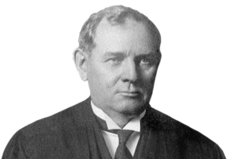
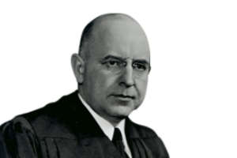
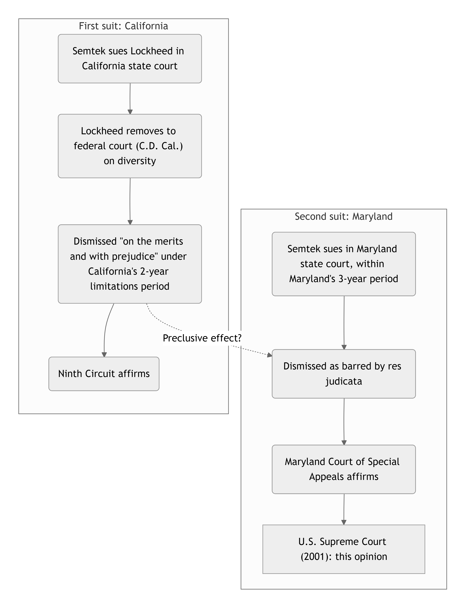
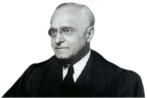
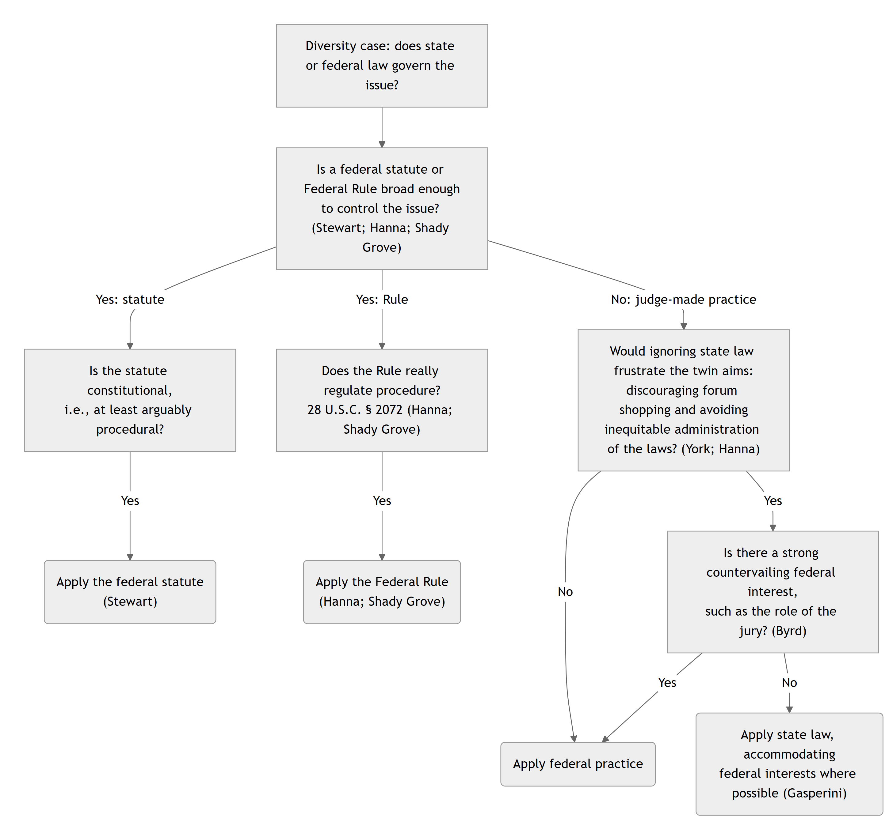

# The *Erie* Doctrine {#sec-erie}

This section explores the *Erie* doctrine, one of the murkiest and most important features of our federal system of courts. The gist of the *Erie* doctrine can be stated in simplified form:

::: {.callout-tip title="The *Erie* Doctrine"}
When a federal court sits in diversity, it applies state substantive and federal procedural law. 
:::

Working out that simple statement in practice, however, is quite tricky. 

## Ascertaining State Law

One of the most surprising features of our federal system of courts is that we not only have both state and federal courts, we also have both state and federal law. Confusingly, questions of federal law are often addressed by state courts, and questions of state law are often addressed by federal courts (as is the case with diversity jurisdiction). In other words, just because you know the forum doesn't mean you know the substantive law---and vice versa.

The question of which body of substantive law will apply in litigation is known as "choice of law." When we are trying to decide which of several states' laws might apply, the question is more specifically known as *horizontal* choice of law. By contrast, the choice between state and federal law is known as *vertical* choice of law. These two choice of law questions are related, but they are answered using different analytical tools under our constitutional system.

Article III of the U.S. Constitution grants to Congress the decision whether to create federal courts other than the Supreme Court. Since the first Congress, the legislature has used this power to establish a variety of lower federal courts. The first statute to do so was the Judiciary Act of 1789, a statute that continues to influence the structure of federal courts today. Among its many provisions, Section 34 of the Judiciary Act of 1789 included the first version of what is now known as the Rules of Decision Act. That provision, currently codified at 28 U.S.C. § 1652, provides:

> The laws of the several states, except where the Constitution or treaties of the United States or Acts of Congress otherwise require or provide, shall be regarded as rules of decision in civil actions in the courts of the United States, in cases where they apply.

The Rules of Decision Act specifies that, unless federal law applies, state law governs---even in federal court. But the Rules of Decision Act is not entirely clear about what counts as the "laws of the several states." Surely that category includes state constitutions and statutes. But does it include judicial precedent issued by state courts? And how does the common law fit into all of this? If state judges interpret the common law differently from federal judges, whose interpretation controls when litigation is brought in federal court? 

From 1842 until 1938, the Supreme Court held that judicial precedent interpreting the common law did not count as the "laws of the several states" for purposes of the Rules of Decision Act. The groundbreaking case was *Swift v. Tyson*, 41 U.S. (16 Pet.) 1 (1842). Here is how Supreme Court Justice Hugo Black described the *Swift* case in 1942:

> The famous case of *Swift v. Tyson* arose from the following rather commonplace circumstances: Two persons, [Norton] and Keith, gave Swift a bill of exchange in payment of a promissory note. The bill was accepted, or guaranteed, by another person named Tyson who in so doing meant to pay for certain land which he was purchasing from Norton and Keith. Sadly enough for Tyson, he discovered that Norton and Keith could not sell him the land because they did not own it. Therefore, when Swift sued Tyson on the bill, Tyson defended on the ground that there had been a failure of consideration to him, and that Swift could not, under these circumstances recover as a bona-fide holder for valuable consideration because Swift had paid nothing for the bill---all he had done was to accept the bill as new evidence of an old debt. The controlling issue thus became whether a new bill of exchange for an old debt was an adequate consideration for Swift’s acceptance of the bill.
> 
> The bill was made in the State of Maine; it was accepted in New York. If governed by the laws of New York, which might have been thought applicable, Swift would probably have been found to have given no consideration.^\*^ 

[ ^\*^ Address of U.S. Supreme Court Associate Justice Hugo L. Black to the Missouri Bar Annual Banquet, Sept. 25, 1942, reprinted in 64 J.Mo.B. 26, 27 (2008).\
]{.aside}

The question in *Swift* was which body of law applied: the common law as understood by the judges of New York, or the common law as understood by the judges of the United States. If the Rules of Decision Act's reference to the "laws of the several states" is read to include state judicial precedent, then New York judicial precedent controlled. If not, then federal judges were free to interpret the general common law as they understood it. Writing for the majority in *Swift*, Justice Joseph Story---the leading expert on choice of law in that era---concluded that federal courts sitting in diversity did not need to follow New York judicial precedent when applying commercial common law:



::: {.column-margin}

{width=150 fig-alt="Justice Joseph Story"}

:::

> \[T\]he courts of New York do not found their decisions upon this point upon any local statute, or positive, fixed, or ancient local usage: but they deduce the doctrine from the general principles of commercial law. It is, however, contended, that the thirty-fourth section of the judiciary act of 1789, ch. 20, furnishes a rule obligatory upon this court to follow the decisions of the state tribunals in all cases to which they apply. \[...\] In order to maintain the argument, it is essential, therefore, to hold, that the word “laws,” in this section, includes within the scope of its meaning the decisions of the local tribunals. In the ordinary use of language it will hardly be contended that the decisions of courts constitute laws. They are, at most, only evidence of what the laws are, and are not of themselves laws. They are often reexamined, reversed, and qualified by the Courts themselves, whenever they are found to be either defective, or ill-founded, or otherwise incorrect. The laws of a state are more usually understood to mean the rules and enactments promulgated by the legislative authority thereof, or long established local customs having the force of laws. In all the various cases, which have hitherto come before us for decision, this court have uniformly supposed, that the true interpretation of the thirty-fourth section limited its application to state laws strictly local, that is to say, to the positive statutes of the state, and the construction thereof adopted by the local tribunals, and to rights and titles to things having a permanent locality, such as the rights and titles to real estate, and other matters immovable and intraterritorial in their nature and character. It never has been supposed by us, that the section did apply, or was designed to apply, to questions of a more general nature, not at all dependent upon local statutes or local usages of a fixed and permanent operation, as, for example, to the construction of ordinary contracts or other written instruments and especially to questions of general commercial law, where the state tribunals are called upon to perform the like functions as ourselves, that is, to ascertain upon general reasoning and legal analogies, what is the true exposition of the contract or instrument, or what is the just rule furnished by the principles of commercial law to govern the case. And we have not now the slightest difficulty in holding, that this section \[...\] is strictly limited to local statutes and local usages of the character before stated, and does not extend to contracts and other instruments of a commercial nature, the true interpretation and effect whereof are to be sought, not in the decisions of the local tribunals, but in the general principles and doctrines of commercial jurisprudence. 

*Swift* remained governing law for nearly a century. Toward the end of its reign, commentators began to attack the intellectual foundations of *Swift*. Justice Oliver Wendell Holmes articulated the critique best: "The common law is not a brooding omnipresence in the sky but the articulate voice of some sovereign or quasi-sovereign that can be identified \[...\]. It always is the law of some State \[...\]." [S. Pac. Co. v. Jensen, 244 U.S. 205, 218, 222 (1917) (Holmes, J., dissenting).\
]{.aside} The idea is that the common law is a creature of state law, and state judges are its expositors.

Against the backdrop of these criticisms and some notorious decisions that had cast doubt on the wisdom of the *Swift* regime, the Court abruptly reversed course in the case that follows.

Harry James Tompkins, of Hughestown, PA, walked home from his mother-in-law's house sometime after midnight. His route took him on a footpath that ran parallel to the Erie Railroad tracks. As Tompkins walked down the path, an Erie train---the Ashley Special No. 2499, on its way to Wilkes-Barre---wound its way down the tracks toward him. As it passed Tompkins, the train struck him, severing his right arm. Tompkins testified that he was struck by "a black object that looked like a door" extending outward from the passing train. 

Whether Tompkins could recover damages for his injuries from the railroad turned on whether the law treated a pedestrian walking next to train tracks as a trespasser---as Pennsylvania courts had held---or rather as a member of the public permitted to walk along the path---as federal courts had held. If Tompkins was a trespasser, the railroad owed him a duty to avoid only wanton negligence; if he was permitted on the footpath, they owed him a duty of ordinary care. 

For that reason, under the rule of *Swift v. Tyson*, federal courts---applying their understanding of "general law"---would hold the railroad to a higher standard than would Pennsylvania courts. Recognizing this, Tompkins's lawyers filed suit in the United States District Court for the Southern District of New York. The case went to trial, and the jury awarded Tompkins $30,000 in damages. The railroad appealed, and the case reached the Supreme Court, which was surprisingly open to revisiting the doctrine of *Swift v. Tyson*.

### Erie Railroad v. Tompkins

**Brandeis, J., delivered the opinion of the Court.**[304 U.S. 64 (1938)]{.aside}

::: {.column-margin}

{width=150 fig-alt="Justice Louis D. Brandeis"}

:::

The question for decision is whether the oft-challenged doctrine of
*Swift v. Tyson* shall now be disapproved. 

Tompkins, a citizen of Pennsylvania, was injured on a dark night by a passing freight train of the Erie Railroad Company while walking along its right of way at Hughestown in that State. He claimed that the accident occurred through negligence in the operation, or maintenance, of the train; that he was rightfully on the premises as licensee because on a commonly used beaten footpath which ran for a short distance alongside the tracks; and that he was struck by something which looked like a door projecting from one of the moving cars. To enforce that claim he brought an action in the federal court for southern New York, which had jurisdiction because the company is a corporation of that State. It denied liability; and the case was tried by a jury.

The Erie insisted that its duty to Tompkins was no greater than that owed to a trespasser. It contended, among other things, that its duty to Tompkins, and hence its liability, should be determined in accordance with the Pennsylvania law; that under the law of Pennsylvania, as declared by its highest court, persons who use pathways along the railroad right of way---that is a longitudinal pathway as distinguished from a crossing---are to be deemed trespassers; and that the railroad is not liable for injuries to undiscovered trespassers resulting from its negligence, unless it be wanton or wilful. Tompkins denied that any such rule had been established by the decisions of the Pennsylvania courts; and contended that, since there was no statute of the State on the subject, the railroad's duty and liability is to be determined in federal courts as a matter of general law.

The trial judge refused to rule that the applicable law precluded recovery. The jury brought in a verdict of $30,000; and the judgment entered thereon was affirmed by the Circuit Court of Appeals, which held that it was unnecessary to consider whether the law of Pennsylvania was as contended, because the question was one not of local, but of general, law and that "upon questions of general law the federal courts are free, in the absence of a local statute, to exercise their independent judgment as to what the law is; and it is well settled that the question of the responsibility of a railroad for injuries caused by its servants is one of general law. ... Where the public has made open and notorious use of a railroad right of way for a long period of time and without objection, the company owes to persons on such permissive pathway a duty of care in the operation of its trains. ... It is likewise generally recognized law that a jury may find that negligence exists toward a pedestrian using a permissive path on the railroad right of way if he is hit by some object projecting from the side of the train."

The Erie had contended that application of the Pennsylvania rule was required, among other things, by § 34 of the Federal Judiciary Act of September 24, 1789, c. 20, 28 U.S.C. § 725, which provides:

> "The laws of the several States, except where the Constitution, treaties, or statutes of the United States otherwise require or provide, shall be regarded as rules of decision in trials at common law, in the courts of the United States, in cases where they apply."

Because of the importance of the question whether the federal court was free to disregard the alleged rule of the Pennsylvania common law, we granted certiorari.

*First. Swift v. Tyson* held that federal courts exercising jurisdiction on the ground of diversity of citizenship need not, in
matters of general jurisprudence, apply the unwritten law of the State as declared by its highest court; that they are free to exercise an independent judgment as to what the common law of the State is---or should be; and that, as there stated by Mr. Justice Story:

> \[T\]he true interpretation of the \[Rules of Decision Act\] limited
its application to state laws strictly local, that is to say, to the
positive statutes of the state, and the construction thereof adopted by
the local tribunals, and to rights and titles to things having a
permanent locality, such as the rights and
titles to real estate, and other matters immovable and intraterritorial
in their nature and character. It never has been supposed by us, that
the section did apply, or was designed to apply, to questions of a more
general nature, not at all dependent upon local statutes or local usages
of a fixed and permanent operation, as, for example, to the construction
of ordinary contracts or other written instruments, and especially to
questions of general commercial law, where the state tribunals are
called upon to perform the like functions as ourselves, that is, to
ascertain upon general reasoning and legal analogies, what is the true
exposition of the contract or instrument, or what is the just rule
furnished by the principles of commercial law to govern the case.

\[...\] The federal courts assumed, in the broad field of "general law,"
the power to declare rules of decision which Congress was confessedly
without power to enact as statutes. Doubt was repeatedly expressed as to
the correctness of the construction given \[the Act\], and as to the
soundness of the rule which it introduced. But it was the more recent
research of a competent scholar, who examined the original document,
which established that the construction given to it by the Court was
erroneous; and that the purpose of the section was merely to make
certain that, in all matters except those in which some federal law is
controlling, the federal courts exercising jurisdiction in diversity of
citizenship cases would apply as their rules of decision the law of the
State, unwritten as well as
written.^5^ [ ^5^ Charles Warren, *New Light on the History of the Federal Judiciary Act of 1789* (1923) 37 Harv. L. Rev. 49, 51-52, 81-88, 108.\
]{.aside}

Criticism of the doctrine became widespread after the decision of
*Black & White Taxicab Co. v. Brown & Yellow Taxicab Co*. There, Brown
and Yellow, a Kentucky corporation owned by Kentuckians, and the
Louisville and Nashville Railroad, also a Kentucky corporation, wished
that the former should have the exclusive privilege of soliciting
passenger and baggage transportation at the Bowling Green, Kentucky,
railroad station; and that the Black and White, a competing Kentucky
corporation, should be prevented from interfering with that privilege.
Knowing that such a contract would be void under the common law of
Kentucky, it was arranged that the Brown and Yellow reincorporate under
the law of Tennessee, and that the contract with the railroad should be
executed there. The suit was then brought by the Tennessee corporation
in the federal court for Western Kentucky to enjoin competition by the
Black and White; an injunction issued by the District Court was
sustained by the Court of Appeals; and this Court, citing many decisions
in which the doctrine of *Swift v. Tyson* had been applied, affirmed the
decree.

*Second*. Experience in applying the doctrine of *Swift v. Tyson* had
revealed its defects, political and social; and the benefits expected to
flow from the rule did not accrue. Persistence of state courts in their
own opinions on questions of common law prevented uniformity; and the
impossibility of discovering a satisfactory line of demarcation between
the province of general law and that of local law developed a new well
of uncertainties.

On the other hand, the mischievous results of the doctrine had become
apparent. Diversity of citizenship jurisdiction was conferred in order
to prevent apprehended discrimination in
State courts against those not citizens of the State. *Swift v. Tyson*
introduced grave discrimination by non-citizens against citizens. It
made rights enjoyed under the unwritten "general law" vary according to
whether enforcement was sought in the state or in the federal court; and
the privilege of selecting the court in which the right should be
determined was conferred upon the non-citizen. Thus, the doctrine
rendered impossible equal protection of the law. In attempting to
promote uniformity of law throughout the United States, the doctrine had
prevented uniformity in the administration of the law of the State.

The discrimination resulting became in practice far-reaching. This
resulted in part from the broad province accorded to the so-called
"general law" as to which federal courts exercised an independent
judgment. \[The court gave various examples.\]

In part the discrimination resulted from the wide range of persons
held entitled to avail themselves of the federal rule by resort to the
diversity of citizenship jurisdiction. \[...\]

The injustice and confusion incident to the doctrine of *Swift v.
Tyson* have been repeatedly urged as reasons for abolishing or limiting
diversity of citizenship jurisdiction. Other legislative relief has been
proposed. If only a question of statutory construction were involved, we
should not be prepared to abandon a doctrine so widely applied
throughout nearly a century. But the unconstitutionality of the course
pursued has now been made clear and compels us to do so.

*Third.* Except in matters governed by the Federal Constitution or by
Acts of Congress, the law to be applied in any case is the law of the
State. And whether the law of the State shall be declared by its
Legislature in a statute or by its highest court in a decision is not a
matter of federal concern. There is no federal general common law.
Congress has no power to declare substantive rules of common law
applicable in a State whether they be local in their nature or
"general," be they commercial law or a part of the law of torts. And no
clause in the Constitution purports to confer such a power upon the
federal courts. As stated by Mr. Justice Field when protesting in
*Baltimore & Ohio R.R. Co. v. Baugh* against ignoring
the Ohio common law of fellow-servant liability: 

> "\[...\] \[N\]otwithstanding
the frequency with which the doctrine \[of *Swift v. Tyson*\] has been
reiterated, there stands, as a perpetual protest against its repetition,
the constitution of the United States, which recognizes and preserves
the autonomy and independence of the states,---independence in their
legislative and independence in their judicial departments. Supervision
over either the legislative or the judicial action of the states is in
no case permissible except as to matters by the constitution
specifically authorized or delegated to the United States. Any
interference with either, except as thus permitted, is an invasion of
the authority of the state, and, to that extent, a denial of its
independence."

The fallacy underlying the rule declared in *Swift v. Tyson* is made
clear by Mr. Justice Holmes. The doctrine rests upon the assumption that
there is "a transcendental body of law outside of any particular State
but obligatory within it unless and until changed by statute," that
federal courts have the power to use their judgment as to what the rules
of common law are; and that in the federal courts "the parties are
entitled to an independent judgment on matters of general law":

> \[B\]ut law in the sense in which courts speak of it today does not
exist without some definite authority behind it. The common law so far
as it is enforced in a State, whether called
common law or not, is not the common law
generally but the law of that State existing by the authority of that
State without regard to what it may have been in England or anywhere
else. ... The authority and only authority is the State, and if that
be so, the voice adopted by the State as its own \[whether it be of its
Legislature or of its Supreme Court\] should utter the last word.

Thus the doctrine of *Swift v. Tyson* is, as Mr. Justice Holmes said,
"an unconstitutional assumption of powers by courts of the United States
which no lapse of time or respectable array of opinion should make us
hesitate to correct." In disapproving that doctrine we do not hold
unconstitutional § 34 of the Federal Judiciary Act of 1789 or any other
Act of Congress. We merely declare that in applying the doctrine this
Court and the lower courts have invaded rights which in our opinion are
reserved by the Constitution to the several States.

*Fourth*. The defendant contended that by the common law of
Pennsylvania as declared by its highest court in *Falchetti v.
Pennsylvania R. Co.*, the only duty owed to the plaintiff was
to refrain from willful or wanton injury. The plaintiff denied that such
is the Pennsylvania law. In support of their respective contentions the
parties discussed and cited many decisions of the Supreme Court of the
State. The Circuit Court of Appeals ruled that the question of liability
is one of general law; and on that ground declined to decide the issue
of state law. As we hold this was error, the judgment is reversed and
the case remanded to it for further proceedings in conformity with our
opinion.

*Reversed.*

**Butler, J.\[, concurring\]**

::: {.column-margin}

{width=150 fig-alt="Justice Pierce Butler"}

:::

\[...\]

Defendant’s petition for writ of certiorari presented two questions: Whether its duty toward plaintiff should have been determined in accordance with the law as found by the highest court of Pennsylvania, and whether the evidence conclusively showed plaintiff guilty of contributory negligence. \[...\]

No constitutional question was suggested or argued below or here. And as a general rule, this Court will not consider any question not raised below and presented by the petition. Here it does not decide either of the questions presented, but, changing the rule of decision in force since the foundation of the government, remands the case to be adjudged according to a standard never before deemed permissible.

\[...\]

The doctrine of [*Swift v. Tyson*] has been followed by this Court in an unbroken line of decisions. So far as appears, it was not questioned until more than 50 years later, and then by a single judge. *Baltimore & O. Railroad Co. v. Baugh*. \[...\]

And since that decision, the division of opinion in this Court has been of the same character as it was before. In 1910, Mr. Justice Holmes, speaking for himself and two other Justices, dissented from the holding that a court of the United States was bound to exercise its own independent judgment in the construction of a conveyance made before the state courts had rendered an authoritative decision as to its meaning and effect. *Kuhn v. Fairmont Coal Co.* \[...\]. But that dissent accepted \[...\] as “settled” the doctrine of *Swift v. Tyson*, and insisted \[...\] merely that the case under consideration was by nature and necessity peculiarly local.

\[...\]

So far as appears, no litigant has ever challenged the power of Congress to establish the rule as construed. It has so long endured that its destruction now without appropriate deliberation cannot be justified. There is nothing in the opinion to suggest that consideration of any constitutional question is necessary to a decision of the case. \[...\] Against the protest of those joining in this opinion, the Court declines to assign the case for reargument. It may not justly be assumed that the labor and argument of counsel for the parties would not disclose the right conclusion and aid the Court in the statement of reasons to support it. Indeed, it would have been appropriate to give Congress opportunity to be heard before divesting it of power to prescribe rules of decision to be followed in the courts of the United States. 

\[...\]

I am of opinion that the constitutional validity of the rule need not be considered, because under the law, as found by the courts of Pennsylvania and generally throughout the country, it is plain that the evidence required a finding that plaintiff was guilty of negligence that contributed to cause his injuries, and that the judgment below should be reversed upon that ground.

**Reed, J.\[, concurring\]**

::: {.column-margin}

{width=150 fig-alt="Justice Stanley Reed"}

:::

I concur in the conclusion reached in this case, in the disapproval of
the doctrine of *Swift v. Tyson*, and in the reasoning of the majority
opinion except insofar as it relies upon the unconstitutionality of the
"course pursued" by the federal courts. 

\[...\]

To decide the case now before us and to "disapprove" the doctrine of
*Swift v. Tyson* requires only that we say that the words "the laws"
\[in the Rules of Decision Act\] include in their meaning the decisions
of the local tribunals. \[...\] \[T\]his Court is now of the view that
"laws" includes "decisions," \[and\] it is unnecessary to go further and
declare that the "course pursued" was "unconstitutional," instead of
merely erroneous.

The "unconstitutional" course referred to in the majority opinion is
apparently the ruling in *Swift v. Tyson* that the supposed omission of
Congress to legislate as to the effect of decisions leaves federal
courts free to interpret general law for themselves. I am not at all
sure whether, in the absence of federal statutory direction, federal
courts would be compelled to follow state decisions. There was
sufficient doubt about the matter in 1789 to induce the first Congress
to legislate. \[...\] If the opinion commits this Court to the position
that the Congress is without power to declare what rules of substantive
law shall govern the federal courts, that conclusion also seems
questionable. The line between procedural and substantive law is hazy
but no one doubts federal power over procedure. The Judiciary Article
and the "necessary and proper" clause of Article One may fully authorize
legislation, such as this section of the Judiciary Act.

In this Court, stare decisis, in statutory construction, is a useful
rule, not an inexorable command. It seems preferable to overturn an
established construction of an Act of Congress, rather than, in the
circumstances of this case, to interpret the Constitution.

\[...\]

#### Notes & Questions

1. What is the basis for the Court's holding in *Erie*: the constitution? The Rules of Decision Act? Both? 

2. Justice Brandeis's majority opinion in *Erie* cites an article written by Professor Charles Warren. That article's major contribution was uncovering a lost draft of the original Rules of Decision Act of 1789. That draft provided: "And be it further enacted, That the Statute law of the several States in force for the time being and their unwritten or common law now in use, whether by adoption from the common law of England, the ancient statutes of the same or otherwise, except where the Constitution, Treaties or Statutes of the United States shall otherwise require or provide, shall be regarded as rules of decision in the trials at common law in the courts of the United States in cases where they apply." What light does this lost draft cast on the final, enacted version of the Rules of Decision Act?

3. The regime of *Swift v. Tyson* was premised on the idea that there is a single body of general common law, and that judges deciding common-law cases recognize those general principles rather than making law themselves. In declaring that "there is no federal general common law," the *Erie* Court attacked the very notion of general common law. Instead, *Erie* recognized that the common law can only be *law* to the extent it is connected to some sovereign power---*i.e.*, state judges. Put differently, *Swift* was premised on the arguably fictional idea that judges merely "find" law, whereas *Erie* is premised on the arguably crass suggestion that judges "make" law. Which do you think is the better view of things?

4. *Erie* was decided in 1938, the same year that the Federal Rules of Civil Procedure took effect. The late 1930s were a pivotal period in American law, and *Erie* was a key part of the transformation. But *Erie* threatened to undermine the newly adopted Rules. If state law supplies the substantive law in diversity cases, does that mean state rules of practice should govern instead of the Federal Rules? As you will see, *Erie*'s holding is limited to *substantive*---not procedural---law. But the distinction between substance and procedure is maddeningly vague. To see why, consider the next case, which asks an almost recursive question: which body of law governs the question of which body of law applies to a particular dispute? In other words, does state or federal law dictate the horizontal choice of law inquiry in a diversity case? 

### Klaxon Co. v. Stentor Elec. Mfg. Co.

**MR. JUSTICE REED delivered the opinion of the Court.**[313 U.S. 487 (1941)]{.aside}

::: {.column-margin}

{width=150 fig-alt="Justice Stanley Reed"}

:::

The principal question in this case is whether in diversity cases the federal courts must follow conflict of laws rules prevailing in the states in which they sit. \[…\]

In 1918, respondent, a New York corporation, transferred its entire business to petitioner, a Delaware corporation. Petitioner contracted to use its best efforts to further the manufacture and sale of certain patented devices covered by the agreement, and respondent was to have a share of petitioner’s profits. The agreement was executed in New York, the assets were transferred there, and petitioner began performance there although later it moved its operations to other states. [ ^1^ Section 480, New York Civil Practice Act:
\
“Interest to be included in recovery. Where in any action, except as provided in section four hundred eighty-a, final judgment is rendered for a sum of money awarded by a verdict, report or decision, interest upon the total amount awarded, from the time when the verdict was rendered or the report or decision was made to the time of entering judgment, must be computed by the clerk, added to the total amount awarded, and included in the amount of the judgment. In every action wherein any sum of money shall be awarded by verdict, report or decision upon a cause of action for the enforcement of or based upon breach of performance of a contract, express or implied, interest shall be recovered upon the principal sum whether theretofore liquidated or unliquidated and shall be added to and be a part of the total sum awarded.”\
]{.aside} Respondent was voluntarily dissolved under New York law in 1919. Ten years later it instituted this action in the United States District Court for the District of Delaware, alleging that petitioner had failed to perform its agreement to use its best efforts. Jurisdiction rested on diversity of citizenship. In 1939 respondent recovered a jury verdict of $100,000, upon which judgment was entered. Respondent then moved to correct the judgment by adding interest at the rate of six percent from June 1, 1929, the date the action had been brought. The basis of the motion was the provision in § 480 of the New York Civil Practice Act directing that in contract actions interest be added to the principal sum “whether theretofore liquidated or unliquidated.”^1^ The District Court granted the motion, taking the view that the rights of the parties were governed by New York law and that under New York law the addition of such interest was mandatory. The Circuit Court of Appeals affirmed, and we granted certiorari, limited to the question whether § 480 of the New York Civil Practice Act is applicable to an action in the federal court in Delaware.

The Circuit Court of Appeals was of the view that under New York law the right to interest before verdict under § 480 went to the substance of the obligation, and that proper construction of the contract in suit fixed New York as the place of performance. It then concluded that § 480 was applicable to the case because “it is clear by what we think is undoubtedly the better view of the law that the rules for ascertaining the measure of damages are not a matter of procedure at all, but are matters of substance which should be settled by reference to the law of the appropriate state according to the type of case being tried in the forum. The measure of damages for breach of a contract is determined by the law of the place of performance; Restatement, Conflict of Laws § 413.” The court referred also to § 418 of the Restatement, which makes interest part of the damages to be determined by the law of the place of performance. Application of the New York statute apparently followed from the court’s independent determination of the “better view” without regard to Delaware law, for no Delaware decision or statute was cited or discussed.

We are of opinion that the prohibition declared in _Erie R. Co. v. Tompkins_, against such independent determinations by the federal courts, extends to the field of conflict of laws. The conflict of laws rules to be applied by the federal court in Delaware must conform to those prevailing in Delaware's state courts. Otherwise, the accident of diversity of citizenship would constantly disturb equal administration of justice in coordinate state and federal courts sitting side by side. Any other ruling would do violence to the principle of uniformity within a state, upon which the _Tompkins_ decision is based. Whatever lack of uniformity this may produce between federal courts in different states is attributable to our federal system, which leaves to a state, within the limits permitted by the Constitution, the right to pursue local policies diverging from those of its neighbors. It is not for the federal courts to thwart such local policies by enforcing an independent “general law” of conflict of laws. Subject only to review by this Court on any federal question that may arise, Delaware is free to determine whether a given matter is to be governed by the law of the forum or some other law. This Court’s views are not the decisive factor in determining the applicable conflicts rule. And the proper function of the Delaware federal court is to ascertain what the state law is, not what it ought to be.

Besides these general considerations, the traditional treatment of interest in diversity cases brought in the federal courts points to the same conclusion. 28 U.S.C. § 811, relating to interest on judgments, provides that it be calculated from the date of judgment at such rate as is allowed by law on judgments recovered in the courts of the state in which the court is held. \[…\]

Looking then to the Delaware cases, petitioner relies on one group to support his contention that the Delaware state courts would refuse to apply § 480 of the New York Civil Practice Act, and respondent on another to prove the contrary. We make no analysis of these Delaware decisions, but leave this for the Circuit Court of Appeals when the case is remanded.

\[…\]

Accordingly, the judgment is reversed and the case remanded to the Circuit Court of Appeals for decision in conformity with the law of Delaware.

_Reversed._

#### Notes & Questions

1. *Klaxon* held that state choice-of-law rules govern horizontal choice of law in diversity cases.

2. What test did the *Klaxon* Court use to determine whether the choice-of-law inquiry should be governed by state or federal law?

3. The question whether state or federal law should govern proliferated across many areas of the law. The next case asks which body of law should govern the inquiry about the preclusive effect of a federal-court judgment in a diversity case---i.e., *res judicata*. For more on this topic, see @sec-judgments.

*Semtek* involves two lawsuits in two court systems. @fig-history-semtek traces them.

{#fig-history-semtek width="69%" fig-alt="Procedural history of Semtek in two columns. First suit, California: Semtek sues Lockheed in California state court; Lockheed removes to federal court on diversity; the court dismisses on the merits and with prejudice under California's two-year limitations period; the Ninth Circuit affirms. Second suit, Maryland: Semtek sues in Maryland state court within Maryland's three-year period; the court dismisses on res judicata, with a dotted arrow from the California dismissal asking about its preclusive effect; the Maryland Court of Special Appeals affirms; then the U.S. Supreme Court decides this case in 2001."}

<!-- Source: diagrams/history_semtek.mmd. After editing it, run `bash diagrams/render.sh` and commit the PNG. -->

### Semtek Int'l Inc. v. Lockheed Martin Corp.

**Scalia, J., delivered the opinion of the Court.**[531 U.S. 497 (2001)]{.aside}

::: {.column-margin}

{width=150 fig-alt="Justice Antonin Scalia"}

:::

This case presents the question whether the claim-preclusive effect of
a federal judgment dismissing a diversity action on
statute-of-limitations grounds is determined by the law of the State in
which the federal court sits.

**I**

Petitioner filed a complaint against respondent in California state
court, alleging breach of contract and various business torts.
Respondent removed the case to the United States District Court for the
Central District of California on the basis of diversity of citizenship,
and successfully moved to dismiss petitioner's claims as barred by
California's 2-year statute of limitations. In its order of dismissal,
the District Court, adopting language suggested by respondent, dismissed
petitioner's claims "in \[their\] entirety on the merits and with
prejudice." \[...\] Petitioner \[then\] brought suit against
respondent in the State Circuit Court for Baltimore City, Maryland,
alleging the same causes of action, which were not time barred under
Maryland's 3-year statute of limitations. \[...\] Following a hearing, the
Maryland state court granted respondent's motion to dismiss on the
ground of *res judicata*. \[...\] The \[Maryland\] Court of Special
Appeals affirmed, holding that, regardless of whether California would
have accorded claim-preclusive effect to a statute-of-limitations
dismissal by one of its own courts, the dismissal by the California
federal court barred the complaint filed in Maryland, since the *res
judicata* effect of federal diversity judgments is prescribed by federal
law, under which the earlier dismissal was on the merits and claim
preclusive. \[...\]

**II**

Petitioner contends that the outcome of this case is controlled by
*Dupasseur v. Rochereau*, 88 U.S. 130, 135 (1875), which held that the
*res judicata* effect of a federal diversity judgment "is such as would
belong to judgments of the State courts rendered under similar
circumstances," and may not be accorded any "higher sanctity or effect."
Since, petitioner argues, the dismissal of an action on
statute-of-limitations grounds by a California state court would not be
claim preclusive, it follows that the similar dismissal of this
diversity action by the California federal court cannot be claim
preclusive. While we agree that this would be the result demanded by
*Dupasseur*, the case is not dispositive because it was decided under
the Conformity Act of 1872 \[the pre-Rules legislation\] which required
federal courts to apply the procedural law of the forum State in
nonequity cases. \[...\]

Respondent, for its part, contends that the outcome of this case is
controlled by Federal Rule of Civil Procedure 41(b), which provides as
follows:

> [Involuntary Dismissal; Effect. If the plaintiff fails to prosecute
or to comply with these rules or a court order, a defendant may move to
dismiss the action or any claim against it.
Unless the dismissal order states otherwise, a dismissal under this
subdivision (b) and any dismissal not under this rule---except one for
lack of jurisdiction, improper venue, or failure to join a party under
Rule 19---operates as an adjudication on the
merits.]^\*^ 

[ ^\*^ When this case was decided, the text of Rule 41(b) read:
\
Involuntary Dismissal: Effect Thereof
\
For failure of the plaintiff to prosecute or to comply with these rules
or any order of court, a defendant may move for dismissal of an action
or of any claim against the defendant. Unless the court in its order for
dismissal otherwise specifies, a dismissal under this subdivision and
any dismissal not provided for in this rule, other than a dismissal for
lack of jurisdiction, for improper venue, or for failure to join a party
under Rule 19, operates as an adjudication upon the merits.
\
*--Ed.*]{.aside}

Since the dismissal here did not "\[state\] otherwise" (indeed, it
specifically stated that it *was* "on the merits"), and did not pertain
to the excepted subjects of jurisdiction, venue, or joinder, it follows,
respondent contends, that the dismissal "is entitled to claim preclusive
effect."

Implicit in this reasoning is the unstated minor premise that all
judgments denominated "on the merits" are entitled to claim-preclusive
effect. That premise is not necessarily valid \[, because the phrase's meaning has changed over time]. \[...\]

In short, it is no longer true that a judgment "on the merits" is
necessarily a judgment entitled to claim-preclusive effect; and there
are a number of reasons for believing that the phrase "adjudication upon
the merits" does not bear that meaning in Rule 41(b). \[...\]

And even apart from the purely default character of Rule 41 (b), it
would be peculiar to find a rule governing the effect that must be
accorded federal judgments by other courts ensconced in rules governing
the internal procedures of the rendering court itself. Indeed, such a
rule would arguably violate the jurisdictional limitation of the Rules
Enabling Act: that the Rules "shall not abridge, enlarge or modify any
substantive right," 28 U.S.C. § 2072(b). \[...\] In the present case, for
example, if California law left petitioner free to sue on this claim in
Maryland even after the California statute of limitations had expired,
the federal court's extinguishment of that right (through Rule 41(b)'s
mandated claim-preclusive effect of its judgment) would seem to violate
this limitation.

Moreover, as so interpreted, the Rule would in many cases violate the
federalism principle of *Erie R. Co. v. Tompkins*, 304 U.S. 64, 78-80
(1938), by engendering "'substantial' variations \[in outcomes\] between
state and federal litigation" which would "likely ... influence the
choice of a forum," *Hanna v. Plumer*. See also *Guaranty Trust Co. v.
York*. With regard to the claim-preclusion issue involved in the present
case, for example, the traditional rule is that expiration of the
applicable statute of limitations merely bars the remedy and does not
extinguish the substantive right, so that dismissal on that ground does
not have claim-preclusive effect in other jurisdictions with longer,
unexpired limitation periods. Out-of-state defendants sued on stale
claims in California and in other States adhering to this traditional
rule would systematically remove state-law suits brought against them to
federal court---where, unless otherwise
specified, a statute-of-limitations
dismissal would bar suit
everywhere.^1^ [ ^1^ Rule 41(b), interpreted as a preclusion-establishing rule, would not
have the two effects described in the preceding paragraphs---arguable
violation of the Rules Enabling Act and incompatibility with *Erie R.
Co. v. Tompkins*---if the court's failure to specify an
other-than-on-the-merits dismissal were subject to reversal on appeal
whenever it would alter the rule of claim preclusion applied by the
State in which the federal court sits. No one suggests that this is the
rule, and we are aware of no case that applies it.\
]{.aside}
We think the key to a more reasonable interpretation of the meaning of
"operates as an adjudication upon the merits" in Rule 41(b) is to be
found in Rule 41(a)\[(1)(B)\], which, in discussing the effect of
voluntary dismissal by the plaintiff, makes clear that an "adjudication
upon the merits" is the opposite of a "dismissal without prejudice":

> [Unless the notice or stipulation states otherwise, the dismissal is
without prejudice. But if the plaintiff previously dismissed any
federal- or state-court action based on or including the same claim, a
notice of dismissal operates as an adjudication on the
merits.]^\*^ 

::: {.column-margin}

^\*^ At the time of the decision, the text of Rule 41(a)(1) read:

"Unless otherwise stated in the notice of dismissal or stipulation, the
dismissal is without prejudice, except that a notice of dismissal
operates as an adjudication upon the merits when filed by a plaintiff
who has once dismissed in any court of the United States or of any state
an action based on or including the same claim."

*--Ed.*

^2^ We do not decide whether, in a diversity case, a federal court's
"dismissal upon the merits" (in the sense we have described), under
circumstances where a state court would decree only a "dismissal without
prejudice," abridges a "substantive right" and thus exceeds the
authorization of the Rules Enabling Act. We think the situation will
present itself more rarely than would the arguable violation of the Act
that would ensue from interpreting Rule 41(b) as a rule of claim
preclusion; and if it is a violation, can be more easily dealt with on
direct appeal.

:::

The primary meaning of "dismissal without prejudice," we think, is
dismissal without barring the plaintiff from returning later, to the
same court, with the same underlying claim. That will also ordinarily
(though not always) have the consequence of not barring the claim from
*other* courts, but its primary meaning relates to the dismissing court
itself. \[...\]

We think, then, that the effect of the "adjudication upon the merits"
default provision of Rule 41(b)---and, presumably, of the explicit order
in the present case that used the language of that default
provision---is simply that, unlike a dismissal "without prejudice," the
dismissal in the present case barred refiling of the same claim in the
United States District Court for the Central District of California.
That is undoubtedly a necessary condition, but it is not a sufficient
one, for claim-preclusive effect in other
courts.^2^

**III**

Having concluded that the claim-preclusive effect, in Maryland, of
this California federal diversity judgment is dictated neither by
*Dupasseur v. Rochereau*, as petitioner contends, nor by Rule 41(b), as
respondent contends, we turn to consideration of what determines the
issue. Neither the Full Faith and Credit Clause, U.S. Const.,
Art. IV, §1, nor the full faith and credit
statute, 28 U.S.C. §1738, addresses the question. By their terms they
govern the effects to be given only to state-court judgments (and, in
the case of the statute, to judgments by courts of territories and
possessions). And no other federal textual provision, neither of the
Constitution nor of any statute, addresses the claim-preclusive effect
of a judgment in a federal diversity action. 

\[...\]

It is left to us, then, to determine the appropriate federal rule. And
despite the sea change that has occurred in the background law since
*Dupasseur* was decided---not only repeal of the Conformity Act but also
the watershed decision of this Court in *Erie*---we think the result
decreed by *Dupasseur* continues to be correct for diversity cases.
Since state, rather than federal, substantive law is at issue there is
no need for a uniform federal rule. And indeed, nationwide uniformity in
the substance of the matter is better served by having the same
claim-preclusive rule (the state rule) apply whether the dismissal has
been ordered by a state or a federal court. This is, it seems to us, a
classic case for adopting, as the federally prescribed rule of decision,
the law that would be applied by state courts in the State in which the
federal diversity court sits. *See* *Gasperini v. Ctr. for Humanities,
Inc*. As we have alluded to above, any other rule would produce the sort
of "forum-shopping ... and ... inequitable administration of the
laws" that *Erie* seeks to avoid, since filing in, or removing to,
federal court would be encouraged by the divergent effects that the
litigants would anticipate from likely grounds of dismissal. See
*Guaranty Trust Co. v. York*.

This federal reference to state law will not obtain, of course, in
situations in which the state law is incompatible with federal
interests. If, for example, state law did not accord claim-preclusive
effect to dismissals for willful violation of discovery orders, federal
courts' interest in the integrity of their own processes might justify a
contrary federal rule. No such conflict with potential federal interests
exists in the present case. Dismissal of this state cause of action was
decreed by the California federal court only because the California
statute of limitations so required; and there is no conceivable federal
interest in giving that time bar more effect in other courts than the
California courts themselves would impose.

Because the claim-preclusive effect of the California federal court's
dismissal "upon the merits" of petitioner's action on
statute-of-limitations grounds is governed by a federal rule that in
turn incorporates California's law of claim preclusion (the content of
which we do not pass upon today), the Maryland Court of Special Appeals
erred in holding that the dismissal necessarily precluded the bringing
of this action in the Maryland courts. The judgment is reversed, and the
case remanded for further proceedings not inconsistent with this
opinion.

*It is so ordered.*

#### Notes & Questions

1. *Semtek* operates at several levels. To understand the case, you must understand each level separately. The first question was which body of law determined the claim-preclusive effect of the California federal court's judgment. The Court's answer to that question was "federal common law." The second question was what rule of claim preclusion existed under federal common law. The Court's answer was that, as a matter of federal common law, the preclusive effect of a judgment issued by a federal court sitting in diversity is the same as the preclusive effect a state-court judgment would have if it were issued by a state court.

2. As a result of the foregoing, the Supreme Court remanded a case to Maryland state courts so that they could determine the claim preclusion rules applicable in California state courts, so that they could determine the preclusive effect of the federal-court judgment. Sometimes, federalism can be extremely complicated.

3. A careful reader will have already recognized a potential problem. If the source of the claim-preclusion rules applied in *Semtek* is "federal common law," how can the outcome in *Semtek* be squared with *Erie*, which famously pronounced that "\[t\]here is no federal general common law"? How does the *Semtek* Court deal with this problem? Is the kind of common law at issue in *Semtek* something other than "general"?

## Federal Supremacy

### Stewart Org., Inc. v. Ricoh Corp.

**JUSTICE MARSHALL delivered the opinion of the Court.**[487 U.S. 22 (1988)]{.aside}

::: {.column-margin}

{width=150 fig-alt="Justice Thurgood Marshall"}

:::

This case presents the issue whether a federal court sitting in diversity should apply state or federal law in adjudicating a motion to transfer a case to a venue provided in a contractual forum-selection clause.

**I**

The dispute underlying this case grew out of a dealership agreement that obligated petitioner company, an Alabama corporation, to market copier products of respondent, a nationwide manufacturer with its principal place of business in New Jersey. The agreement contained a forum-selection clause providing that any dispute arising out of the contract could be brought only in a court located in Manhattan.^1^ [ ^1^ Specifically, the forum-selection clause read: “Dealer and Ricoh agree that any appropriate state or federal district court located in the Borough of Manhattan, New York City, New York, shall have exclusive jurisdiction over any case or controversy arising under or in connection with this Agreement and shall be a proper forum in which to adjudicate such case or controversy."\
]{.aside} Business relations between the parties soured under circumstances that are not relevant here. In September 1984, petitioner brought a complaint in the United States District Court for the Northern District of Alabama. The core of the complaint was an allegation that respondent had breached the dealership agreement, but petitioner also included claims for breach of warranty, fraud, and antitrust violations.

Relying on the contractual forum-selection clause, respondent moved the District Court either to transfer the case to the Southern District of New York under 28 U.S.C. § 1404(a) or to dismiss the case for improper venue under 28 U.S.C. § 1406. The District Court denied the motion. It reasoned that the transfer motion was controlled by Alabama law and that Alabama looks unfavorably upon contractual forum-selection clauses. The court certified its ruling for interlocutory appeal, _see_ 28 U.S.C. § 1292(b), and the Court of Appeals for the Eleventh Circuit accepted jurisdiction.

On appeal, a divided panel of the Eleventh Circuit reversed the District Court. The panel concluded that questions of venue in diversity actions are governed by federal law, and that the parties' forum-selection clause was enforceable as a matter of federal law. The panel therefore reversed the order of the District Court and remanded with instructions to transfer the case to a Manhattan court. After petitioner successfully moved for rehearing _en banc_, the full Court of Appeals proceeded to adopt the result, and much of the reasoning, of the panel opinion. The _en banc_ court, citing Congress' enactment or approval of several rules to govern venue determinations in diversity actions, first determined that “\[v\]enue is a matter of federal procedure.” \[…\] We now affirm under somewhat different reasoning.

**II**

Both the panel opinion and the opinion of the full Court of Appeals referred to the difficulties that often attend “the sticky question of which law, state or federal, will govern various aspects of the decisions of federal courts sitting in diversity.” A district court's decision whether to apply a federal statute such as § 1404(a) in a diversity action, however, involves a considerably less intricate analysis than that which governs the “relatively unguided _Erie_ choice.” _Hanna v. Plumer_. Our cases indicate that when the federal law sought to be applied is a congressional statute, the first and chief question for the district court's determination is whether the statute is “sufficiently broad to control the issue before the Court.” _Walker v. Armco Steel Corp_; _Burlington Northern R. Co. v. Woods_. This question involves a straightforward exercise in statutory interpretation to determine if the statute covers the point in dispute.

If the district court determines that a federal statute covers the point in dispute, it proceeds to inquire whether the statute represents a valid exercise of Congress’ authority under the Constitution. See _Hanna v. Plumer_. If Congress intended to reach the issue before the district court, and if it enacted its intention into law in a manner that abides with the Constitution, that is the end of the matter; “\[f\]ederal courts are bound to apply rules enacted by Congress with respect to matters … over which it has legislative power.” Thus, a district court sitting in diversity must apply a federal statute that controls the issue before the court and that represents a valid exercise of Congress’ constitutional powers.

**III**

Applying the above analysis to this case persuades us that federal law, specifically 28 U.S.C. § 1404(a), governs the parties’ venue dispute.

**A**

At the outset we underscore a methodological difference in our approach to the question from that taken by the Court of Appeals. The _en banc_ court determined that federal law controlled the issue based on a survey of different statutes and judicial decisions that together revealed a significant federal interest in questions of venue in general, and in choice-of-forum clauses in particular. The Court of Appeals then proceeded to \[…\] determine that the forum-selection clause in this case was enforceable. But the immediate issue before the District Court was whether to grant respondent's motion to transfer the action under § 1404(a), and as Judge Tjoflat properly noted in his special concurrence below, the immediate issue before the Court of Appeals was whether the District Court's denial of the § 1404(a) motion constituted an abuse of discretion. \[…\] \[T\]he first question for consideration should have been whether § 1404(a) itself controls respondent’s request to give effect to the parties’ contractual choice of venue and transfer this case to a Manhattan court. For the reasons that follow, we hold that it does.

**B**

Section 1404(a) provides: “For the convenience of parties and witnesses, in the interest of justice, a district court may transfer any civil action to any other district or division where it might have been brought.” Under the analysis outlined above, we first consider whether this provision is sufficiently broad to control the issue before the court. That issue is whether to transfer the case to a court in Manhattan in accordance with the forum-selection clause. We believe that the statute, fairly construed, does cover the point in dispute.

Section 1404(a) is intended to place discretion in the district court to adjudicate motions for transfer according to an “individualized, case-by-case consideration of convenience and fairness.” A motion to transfer under § 1404(a) thus calls on the district court to weigh in the balance a number of case-specific factors. The presence of a forum-selection clause such as the parties entered into in this case will be a significant factor that figures centrally in the district court's calculus. In its resolution of the § 1404(a) motion in this case, for example, the District Court will be called on to address such issues as the convenience of a Manhattan forum given the parties' expressed preference for that venue, and the fairness of transfer in light of the forum-selection clause and the parties' relative bargaining power. The flexible and individualized analysis Congress prescribed in § 1404(a) thus encompasses consideration of the parties' private expression of their venue preferences.

Section 1404(a) may not be the only potential source of guidance for the District Court to consult in weighing the parties' private designation of a suitable forum. The premise of the dispute between the parties is that Alabama law may refuse to enforce forum-selection clauses providing for out-of-state venues as a matter of state public policy. If that is so, the District Court will have either to integrate the factor of the forum-selection clause into its weighing of considerations as prescribed by Congress, or else to apply, as it did in this case, Alabama's categorical policy disfavoring forum-selection clauses. Our cases make clear that, as between these two choices in a single “field of operation,” the instructions of Congress are supreme.

It is true that § 1404(a) and Alabama's putative policy regarding forum-selection clauses are not perfectly coextensive. Section 1404(a) directs a district court to take account of factors other than those that bear solely on the parties' private ordering of their affairs. The district court also must weigh in the balance the convenience of the witnesses and those public-interest factors of systemic integrity and fairness that, in addition to private concerns, come under the heading of “the interest of justice.” It is conceivable in a particular case, for example, that because of these factors a district court acting under § 1404(a) would refuse to transfer a case notwithstanding the counterweight of a forum-selection clause, whereas the coordinate state rule might dictate the opposite result. But this potential conflict in fact frames an additional argument for the supremacy of federal law. Congress has directed that multiple considerations govern transfer within the federal court system, and a state policy focusing on a single concern or a subset of the factors identified in § 1404(a) would defeat that command. Its application would impoverish the flexible and multifaceted analysis that Congress intended to govern motions to transfer within the federal system. The forum-selection clause, which represents the parties' agreement as to the most proper forum, should receive neither dispositive consideration (as respondent might have it) nor no consideration (as Alabama law might have it), but rather the consideration for which Congress provided in § 1404(a). This is thus not a case in which state and federal rules “can exist side by side … each controlling its own intended sphere of coverage without conflict.” _Walker_.

Because § 1404(a) controls the issue before the District Court, it must be applied if it represents a valid exercise of Congress' authority under the Constitution. The constitutional authority of Congress to enact § 1404(a) is not subject to serious question. As the Court made plain in _Hanna_, “the constitutional provision for a federal court system … carries with it congressional power to make rules governing the practice and pleading in those courts, which in turn includes a power to regulate matters which, though falling within the uncertain area between substance and procedure, are rationally capable of classification as either.” Section 1404(a) is doubtless capable of classification as a procedural rule, and indeed, we have so classified it in holding that a transfer pursuant to § 1404(a) does not carry with it a change in the applicable law. It therefore falls comfortably within Congress' powers under Article III as augmented by the Necessary and Proper Clause.

We hold that federal law, specifically 28 U.S.C. § 1404(a), governs the District Court's decision whether to give effect to the parties' forum-selection clause and transfer this case to a court in Manhattan. We therefore affirm the Eleventh Circuit order reversing the District Court's application of Alabama law. The case is remanded so that the District Court may determine in the first instance the appropriate effect under federal law of the parties' forum-selection clause on respondent's § 1404(a) motion.

_It is so ordered._

**JUSTICE SCALIA, dissenting.**

::: {.column-margin}

{width=150 fig-alt="Justice Antonin Scalia"}

:::

I agree with the opinion of the Court that the initial question before us is whether the validity between the parties of a contractual forum-selection clause falls within the scope of 28 U.S.C. § 1404(a). I cannot agree, however, that the answer to that question is yes. Nor do I believe that the federal courts can, consistent with the twin-aims test of _Erie R. Co. v. Tompkins_, fashion a judge-made rule to govern this issue of contract validity.

**I**

When a litigant asserts that state law conflicts with a federal procedural statute or formal Rule of Procedure, a court's first task is to determine whether the disputed point in question in fact falls within the scope of the federal statute or Rule. In this case, the Court must determine whether the scope of § 1404(a) is sufficiently broad to cause a direct collision with state law or implicitly to control the issue before the Court, _i.e._, validity between the parties of the forum-selection clause, thereby leaving no room for the operation of state law. I conclude that it is not.

Although the language of § 1404(a) provides no clear answer, in my view it does provide direction. The provision vests the district courts with authority to transfer a civil action to another district “\[f\]or the convenience of parties and witnesses, in the interest of justice.” This language looks to the present and the future. As the specific reference to convenience of parties and witnesses suggests, it requires consideration of what is likely to be just in the future, when the case is tried, in light of things as they now stand. Accordingly, the courts in applying § 1404(a) have examined a variety of factors, each of which pertains to facts that currently exist or will exist: _e.g._, the forum actually chosen by the plaintiff, the current convenience of the parties and witnesses, the current location of pertinent books and records, similar litigation pending elsewhere, current docket conditions, and familiarity of the potential courts with governing state law. In holding that the validity between the parties of a forum-selection clause falls within the scope of § 1404(a), the Court inevitably imports, in my view without adequate textual foundation, a new _retrospective_ element into the court's deliberations, requiring examination of what the facts were concerning, among other things, the bargaining power of the parties and the presence or absence of overreaching at the time the contract was made.

The Court largely attempts to avoid acknowledging the novel scope it gives to § 1404(a) by casting the issue as how much _weight_ a district court should give a forum-selection clause as against other factors when it makes its determination under § 1404(a). I agree that if the weight-among-factors issue were before us, it would be governed by § 1404 (a). That is because, while the parties may decide who between them should bear any inconvenience, only a court can decide how much weight should be given under § 1404(a) to the factor of the parties' convenience as against other relevant factors such as the convenience of witnesses. But the Court's description of the issue begs the question: what law governs whether the forum-selection clause is a _valid_ or _invalid_ allocation of any inconvenience between the parties. If it is invalid, _i.e._, should be voided, between the parties, it cannot be entitled to any weight in the § 1404(a) determination. Since under Alabama law the forum-selection clause should be voided, in this case the question of what weight should be given the forum-selection clause can be reached only if as a preliminary matter federal law controls the issue of the validity of the clause between the parties.

Second, § 1404(a) was enacted against the background that issues of contract, including a contract's validity, are nearly always governed by state law. It is simply contrary to the practice of our system that such an issue should be wrenched from state control in absence of a clear conflict with federal law or explicit statutory provision. It is particularly instructive in this regard to compare § 1404(a) with another provision, enacted by the same Congress a year earlier, that _did_ preempt state contract law, and in precisely the same field of agreement regarding forum selection. Section 2 of the Federal Arbitration Act, 9 U.S.C. § 2, provides:

> A written provision in … a contract evidencing a transaction involving commerce to settle by arbitration a controversy thereafter arising out of such contract or transaction, or the refusal to perform the whole or any part thereof, or an agreement in writing to submit to arbitration an existing controversy arising out of such a contract, transaction, or refusal, shall be valid, irrevocable, and enforceable, save upon such grounds as exist at law or in equity for the revocation of any contract.

We have said that an arbitration clause is a “kind of forum-selection clause,” and the contrast between this explicit pre-emption of state contract law on the subject and § 1404(a) could not be more stark. Section 1404(a) is simply a venue provision that nowhere mentions contracts or agreements, much less that the validity of certain contracts or agreements will be matters of federal law. It is difficult to believe that state contract law was meant to be pre-empted by this provision that we have said “should be regarded as a federal judicial housekeeping measure," that we have said did not change “the relevant factors” which federal courts used to consider under the doctrine of _forum non conveniens_, and that we have held can be applied retroactively because it is procedural. It seems to me the generality of its language---"\[f\]or the convenience of parties and witnesses, in the interest of justice"---is plainly insufficient to work the great change in law asserted here.

Third, it has been common ground in this Court since _Erie_ that when a federal procedural statute or Rule of Procedure is not on point, substantial uniformity of predictable outcome between federal and state courts in adjudicating claims should be striven for. _See also_ _Klaxon Co. v. Stentor Electric Mfg. Co_. This rests upon a perception of the constitutional and congressional plan underlying the creation of diversity and pendent jurisdiction in the lower federal courts, which should quite obviously be carried forward into our interpretation of ambiguous statutes relating to the exercise of that jurisdiction. We should assume, in other words, when it is fair to do so, that Congress is just as concerned as we have been to avoid significant differences between state and federal courts in adjudicating claims. Thus, in deciding whether a federal procedural statute or Rule of Procedure encompasses a particular issue, a broad reading that would create significant disuniformity between state and federal courts should be avoided if the text permits. _See,_ _e.g._, _Walker_; _Cohen_. As I have shown, the interpretation given § 1404(a) by the Court today is neither the plain nor the more natural meaning; at best, § 1404(a) is ambiguous. I would therefore construe it to avoid the significant encouragement to forum shopping that will inevitably be provided by the interpretation the Court adopts today.

**II**

Since no federal statute or Rule of Procedure governs the validity of a forum-selection clause, the remaining issue is whether federal courts may fashion a judge-made rule to govern the question. If they may not, the Rules of Decision Act, 28 U.S.C. § 1652, mandates use of state law. _See_ _Erie_; _Hanna v. Plumer_ (if federal courts lack authority to fashion a rule, “state law must govern because there can be no other law”).

\[Justice Scalia concluded that forum-selection clauses raise questions of substance rather than procedure and therefore that state law should govern.\]

For the reasons stated, I respectfully dissent.

#### Notes & Questions

1. Recall that the gist of the *Erie* doctrine is that federal courts sitting in diversity apply state substantive law and federal procedural law. *Stewart* introduces a wrinkle: because of the Constitution's Supremacy Clause, reproduced in the margin, federal law applies whenever it speaks directly to the question at issue. ["This Constitution, and the laws of the United States which shall be made in pursuance thereof; and all treaties made, or which shall be made, under the authority of the United States, shall be the supreme law of the land; and the judges in every state shall be bound thereby, anything in the Constitution or laws of any State to the contrary notwithstanding." U.S. Const., Art. VI, ¶ 2.\
]{.aside} As a result, if there is a valid federal statute or Rule, it will apply---no matter whether the state law it displaces is procedural or substantive. 

2. Where does Justice Scalia part ways with the majority? 

3. *Stewart Organization* teaches that an important part of the *Erie* inquiry is determining whether state and federal law are in conflict with one another. If there is no conflict, then there is often no need to choose between them---both can apply. But in cases of genuine conflict, *Erie* demands a choice. The cases that follow explore the extent to which state and federal law conflict in greater detail.

## Identifying Conflict

### Guaranty Trust Co. v. York

**MR. JUSTICE FRANKFURTER delivered the opinion of the Court.** [326 U.S. 99 (1945)]{.aside}

::: {.column-margin}

{width=150 fig-alt="Justice Felix Frankfurter"}

:::

\[...\]

Th\[is\] suit, instituted as a class action on behalf of \[some of Guaranty's creditors\] and brought in a federal court solely because of diversity of citizenship, is based on an alleged breach of trust by Guaranty in that it failed to protect the interests of the noteholders in [connection with certain corporate transactions]. [Guaranty] moved for summary judgment [on statute of limitations grounds], which was granted \[...\]. On appeal, the Circuit Court of Appeals, one Judge dissenting \[...\] held that in a suit brought on the equity side of a federal district court that court is not required to apply the State statute of limitations that would govern like suits in the courts of a State where the federal court is sitting even though the exclusive basis of federal jurisdiction is diversity of citizenship.

Our starting point must be the policy of federal jurisdiction which
*Erie R. Co. v. Tompkins* embodies. In overruling *Swift v. Tyson*,
*Erie R. Co. v. Tompkins* did not merely overrule a venerable case. It
overruled a particular way of looking at law which dominated the
judicial process long after its inadequacies had been laid bare. Law was
conceived as a "brooding omnipresence" of Reason, of which decisions
were merely evidence and not themselves the controlling formulations.
Accordingly, federal courts deemed themselves free to ascertain what
Reason, and therefore Law, required wholly independent of
authoritatively declared State law, even in cases where a legal right as
the basis for relief was created by State authority and could not be
created by federal authority and the case got into a federal court
merely because it was "between Citizens of different States" under Art.
III, § 2 of the Constitution of the United States. 

\[...\]

\[...\] [T]his case reduces itself to the narrow question whether, when no
recovery could be had in a State court because the action is barred by
the statute of limitations, a federal court in equity can take
cognizance of the suit because there is diversity of citizenship between
the parties. Is the outlawry, according to State law, of a claim created by the States a matter of "substantive rights" to be respected by a federal court of equity when that court's jurisdiction is dependent on the fact that there is a State-created right, or is such statute of "a mere remedial character," which a federal court may disregard?

\[...\]

And so the question is not whether a statute of limitations is deemed
a matter of "procedure" in some sense. The question is whether such a
statute concerns merely the manner and the means by which a right to
recover, as recognized by the State, is enforced, or whether such
statutory limitation is a matter of substance in the aspect that alone
is relevant to our problem, namely, does it significantly affect the
result of a litigation for a federal court to disregard a law of a State
that would be controlling in an action upon the same claim by the same
parties in a State court?

It is therefore immaterial whether statutes of limitation are
characterized either as "substantive" or "procedural" in State court
opinions in any use of those terms unrelated to the specific issue
before us. *Erie R. Co. v. Tompkins* was not an endeavor to formulate
scientific legal terminology. It expressed a policy that touches vitally
the proper distribution of judicial power between State and federal
courts. In essence, the intent of that decision was to insure that, in
all cases where a federal court is exercising jurisdiction solely
because of the diversity of citizenship of the parties, the outcome of
the litigation in the federal court should be substantially the same, so
far as legal rules determine the outcome of a litigation, as it would be
if tried in a State court. \[...\]

\[...\]

\[...\] The source of substantive rights enforced by a federal court under diversity jurisdiction, it cannot be said too often, is the law of the States. Whenever that law is authoritatively declared by a State, whether its voice be the legislature or its highest court, such law ought to govern in litigation founded on that law, whether the forum of application is a State or a federal court and whether the remedies be sought at law or may be had in equity.

Dicta may be cited characterizing equity as an independent body of law. To the extent that we have indicated, it is. But insofar as these general observations go beyond that, they merely reflect notions that have been replaced by a sharper analysis of what federal courts do when they enforce rights that have no federal origin. And so, before the true source of law that is applied by the federal courts under diversity jurisdiction was fully explored, some things were said that would not now be said. \[...\]

The judgment is reversed and the case is remanded for proceedings not
inconsistent with this opinion.

**So ordered.**

**\[The dissenting opinion of Justice Rutledge is
omitted.\]**

#### Notes & Questions

1. What test did the *York* Court apply to determine whether state or federal law governed the statute of limitations?

2. What did the Court mean when it said that it is "immaterial whether statutes of limitation are characterized either as 'substantive' or 'procedural'"? Isn't that what the *Erie* doctrine is all about?

3. *York* says that the aim of the *Erie* doctrine is to ensure that "the outcome of the litigation in the federal court should be substantially the same, so far as legal rules determine the outcome of a litigation, as it would be if tried in a State court." Is that a fair reading of *Erie*?

4. After *York* was decided, the Supreme Court decided a series of cases that, like *York*, found many questions to be substantive and therefore governed by state law. *See, e.g.*, *Ragan v. Merchants Transfer & Warehouse Co.*, 337 U.S. 530 (1949) (holding that state law governs the question of when a lawsuit is filed, for statute of limitations purposes); *Cohen v. Beneficial Indus. Loan Corp.*, 337 U.S. 541 (1949) (holding that a state law requiring shareholders to post a bond before suing a corporation was substantive for *Erie* purposes); *Woods v. Interstate Realty Co.*, 337 U.S. 535 (1949) (holding that a state law barring out-of-state corporations that had not qualified to do business in the state from suing in state courts was substantive for *Erie* purposes); *Bernhardt v. Polygraphic Co. of America*, 350 U.S. 198 (1956) (holding that state law barring arbitration of employment law matters was substantive for *Erie* purposes).

5. In the wake of these aggressive applications of state law, the next case represents a bit of a retreat.

### Byrd v. Blue Ridge Rural Electrical Cooperative

**Brennan, J., delivered the opinion of the Court.** [356 U.S. 525 (1958)]{.aside}

::: {.column-margin}

{width=150 fig-alt="Justice William J. Brennan, Jr."}

:::

This case was brought in the District Court for the Western District of South Carolina. Jurisdiction was based on diversity of citizenship. \[Plaintiff\], a resident of North Carolina, sued \[defendant\], a South Carolina corporation, for \[...\] negligence. \[The jury returned a verdict in favor of the plaintiff.\] \[...\]

\[Defendant\] is in the business of selling electric power to subscribers in rural sections of South Carolina. \[Plaintiff\] was employed as a lineman in the construction crew of a construction contractor. The contractor, R. H. Bouligny, Inc., held a contract with the respondent in the amount of $334,300 for the \[electrical work\]. The petitioner was injured while connecting power lines \[...\].

One of respondent's affirmative defenses was that, under the South Carolina Workmen's Compensation Act, \[plaintiff\]---because the work contracted to be done by his employer was work of the kind also done by the respondent's own construction and maintenance crews---\[qualified as defendant's employee for purposes of worker's compensation law. As a result, defendant argued, plaintiff was barred from suing in court and was instead required by state law\] to accept statutory compensation benefits as the exclusive remedy for his injuries. \[...\]

**II**

A question is also presented as to whether on remand the factual issue
is to be decided by the judge or by the jury. The respondent argues on
the basis of the decision of the Supreme Court of South Carolina in
*Adams v. Davison-Paxon Co.*, that the issue of
\[whether plaintiff was a statutory employee or not\] should be decided by the judge and not by the jury. \[...\]

\[Defendant\] argues that this state-court decision governs the
present diversity case and "divests the jury of its normal function" to
decide the disputed fact question of \[the plaintiff's status as defendant's employee\]. This is to contend that the federal court is bound under *Erie R. Co. v. Tompkins* to follow the state court's holding to secure
uniform enforcement of the \[...] State\['s worker's compensation scheme\].

*First*. It was decided in *Erie R. Co. v. Tompkins* that the federal
courts in diversity cases must respect the definition of state-created
rights and obligations by the state courts. We must, therefore, first
examine the rule in *Adams v. Davison-Paxon Co*. to determine whether it
is bound up with these rights and obligations in such a way that its
application in the federal court is required.

The Workmen's Compensation Act is administered in South Carolina by
its Industrial Commission. The South Carolina courts hold that, on
judicial review of actions of the Commission \[...\], the question
whether the claim of an injured workman is
within the Commission's jurisdiction is a matter of law for decision by
the court, which makes its own findings of fact relating to that
jurisdiction. The South Carolina Supreme Court states no reasons in
*Adams v. Davison-Paxon Co.* why, although the jury decides all other
factual issues raised by the cause of action and defenses, the jury is
displaced as to the factual issue raised by the affirmative defense
\[...\]. \[...\] We find nothing to suggest that this rule was
announced as an integral part of the special relationship created by the
statute. Thus the requirement appears to be merely a form and mode of
enforcing the immunity, *Guaranty Trust Co. v. York*, and not a rule
intended to be bound up with the definition of the rights and
obligations of the parties. \[...\]

*Second*. But cases following *Erie* have evinced a broader policy to
the effect that the federal courts should conform as near as may be---in
the absence of other considerations---to state rules even of form and
mode where the state rules may bear substantially on the question
whether the litigation would come out one way in the federal court and
another way in the state court if the federal court failed to apply a
particular local rule. E.g., *Guaranty Trust Co. v. York*; *Bernhardt v.
Polygraphic Co.* Concededly the nature of the tribunal which tries
issues may be important in the enforcement of the parcel of rights
making up a cause of action or defense, and bear significantly upon
achievement of uniform enforcement of the right. It may well be that in
the instant personal-injury case the outcome would be substantially
affected by whether the issue of immunity is decided by a judge or a
jury. Therefore, were "outcome" the only consideration, a strong case
might appear for saying that the federal court should follow the state
practice.

::: {.column-margin}

^10^ Our conclusion makes unnecessary the consideration of---and we intimate no view upon---the constitutional question whether the right of jury trial protected in federal courts by the Seventh Amendment embraces the factual issue of statutory immunity when asserted, as here, as an affirmative defense in a common-law negligence action.

^12^ This Court held in *Sibbach v. Wilson & Co.* that Federal Rule of Civil Procedure 35 should prevail over a contrary state rule.

:::

But there are affirmative countervailing considerations at work here.
The federal system is an independent system for administering justice to
litigants who properly invoke its jurisdiction. An essential
characteristic of that system is the manner in which, in civil
common-law actions, it distributes trial functions between judge and
jury and, under the influence---if not the
command^10^---of the Seventh Amendment, assigns the decisions of disputed questions of
fact to the jury. The policy of uniform enforcement of state-created
rights and obligations, see, e.g., *Guaranty Trust Co. v. York*, supra,
cannot in every case exact compliance with a state
rule^12^---not bound up with rights and obligations---which disrupts the federal system
of allocating functions between judge and jury. Thus the inquiry here is
whether the federal policy favoring jury decisions of disputed fact
questions should yield to the state rule in the interest of furthering
the objective that the litigation should not come out one way in the
federal court and another way in the state court.

We think that in the circumstances of this case the federal court
should not follow the state rule. It cannot be gainsaid that there is a
strong federal policy against allowing state rules to disrupt the
judge-jury relationship in the federal courts. \[...\] Perhaps even more
clearly in light of the influence of the Seventh Amendment, the function
assigned to the jury "is an essential factor in the process for which
the Federal Constitution provides." \[...\]

*Third*. We have discussed the problem upon the assumption that the
outcome of the litigation may be substantially affected by whether the
issue of immunity is decided by a judge or a jury. But clearly there is
not present here the certainty that a different result would follow, cf.
*Guaranty Trust Co. v. York*, supra, or even the strong possibility that
this would be the case. There are factors present here which might
reduce that possibility. The trial judge in the federal system has
powers denied the judges of many States to comment on the weight of
evidence and credibility of witnesses, and discretion to grant a new
trial if the verdict appears to him to be against the weight of the
evidence. We do not think the likelihood of a different result is so
strong as to require the federal practice of jury determination of
disputed factual issues to yield to the state rule in the interest of
uniformity of outcome.

\[...\]

*Reversed and remanded.*

**\[The opinions of Justices Whittaker, Frankfurter, and Harlan are
omitted.\]**

#### Notes & Questions

1. How does *Byrd* differ from *York* and its immediate progeny?

2. What is the rule to be divined from *Byrd*?

3. Would *Byrd* have come out differently if it had been governed by the rule of *York*? If so, does that mean *Byrd* overruled *York* at least in part?

### Hanna v. Plumer

**WARREN, C.J., delivered the opinion of the Court.** [380 U.S. 460 (1965)]{.aside}

::: {.column-margin}

{width=150 fig-alt="Justice Earl Warren"}

:::

The question to be decided is whether, in a civil action where the jurisdiction of the United States district court is based upon diversity of citizenship between the parties, service of process shall be made in the manner prescribed by state law or that set forth in Rule 4[(e)(2)(B)] of the Federal Rules of Civil Procedure.

\[Plaintiff,\] a citizen of Ohio, filed her complaint in the District Court for the District of Massachusetts, claiming damages in excess of $10,000 for personal injuries resulting from an automobile accident in South Carolina, allegedly caused by the negligence of one Louise Plumer Osgood, a Massachusetts citizen deceased at the time of the filing of the complaint. Respondent, Mrs. Osgood's executor and also a Massachusetts citizen, was named as defendant. \[...\] \[S\]ervice was made by leaving copies of the summons and the complaint with respondent's wife at his residence, concededly in compliance with Rule 4\[(e)(2)(B).\] \[...\]

\[Defendant moved for summary judgment, arguing that service was improper because it did not comply with the statute governing service of process in Massachusetts state court. Under the circumstances of this case, that law required service by hand upon the defendant personally, and the deadline for effecting service by hand had passed. Plaintiff responded that Fed. R. Civ. P. 4---not the Massachusetts statute---governed service of process in actions pending in federal court.\]

We conclude that the adoption of Rule 4\[(e)(2)(B)\], designed to control service of process in diversity actions, neither exceeded the congressional mandate embodied in the Rules Enabling Act nor transgressed constitutional bounds, and that the Rule is therefore the standard against which the District Court should have measured the adequacy of the service. Accordingly, we reverse the decision of the Court of Appeals.

The \[version of the\] Rules Enabling Act, 28 U.S.C. § 2072 \[then in effect\] provide\[d\] in pertinent part:

> "The Supreme Court shall have the power to prescribe, by general rules, the forms of process, writs, pleadings, and motions, and the practice and procedure of the district courts of the United States in civil actions."
>
> "Such rules shall not abridge, enlarge or modify any substantive right and shall preserve the right of trial by jury. ..."

Under the cases construing the scope of the Enabling Act, Rule 4\[(e)(2)(B)\] clearly passes muster. Prescribing the manner in which a defendant is to be notified that a suit has been instituted against him, it relates to the “practice and procedure of the district courts.” “The test must be whether a rule really regulates procedure—the judicial process for enforcing rights and duties recognized by substantive law and for justly administering remedy and redress for disregard or infraction of them.” *Sibbach v. Wilson & Co.*

\[...\]

\[If there were\] no conflicting state procedure, Rule 4\[(e)(2)(B)\] would clearly control. However, respondent, focusing on the contrary Massachusetts rule, calls to the Court’s attention another line of cases, a line which---like the Federal Rules---had its birth in 1938. *Erie R. Co. v. Tompkins*, overruling *Swift v. Tyson*, held that federal courts sitting in diversity cases, when deciding questions of “substantive” law, are bound by state court decisions as well as state statutes. The broad command of *Erie* was therefore identical to that of the Enabling Act: federal courts are to apply state substantive law and federal procedural law. However, as subsequent cases sharpened the distinction between substance and procedure, the line of cases following *Erie* diverged markedly from the line construing the Enabling Act. \[...\]

Respondent \[...\] suggests that the *Erie* doctrine acts as a check on the Federal Rules of Civil Procedure, that despite the clear command of Rule 4\[(e)(2)(B)\], *Erie* and its progeny demand the application of the Massachusetts rule. Reduced to essentials, the argument is: (1) *Erie*, as refined in *York*, demands that federal courts apply state law whenever application of federal law in its stead will alter the outcome of the case. (2) In this case, a determination that the Massachusetts service requirements obtain will result in immediate victory for respondent. If, on the other hand, it should be held that Rule 4\[(e)(2)(B)\] is applicable, the litigation will continue, with possible victory for petitioner. (3) Therefore, *Erie* demands application of the Massachusetts rule. The syllogism possesses an appealing simplicity, but is for several reasons invalid.

In the first place, it is doubtful that, even if there were no Federal Rule making it clear that in-hand service is not required in diversity actions, the *Erie* rule would have obligated the District Court to follow the Massachusetts procedure. “Outcome-determination” analysis was never intended to serve as a talisman. *Byrd v. Blue Ridge Cooperative*. Indeed, the message of *York* itself is that choices between state and federal law are to be made not by application of any automatic, “litmus paper” criterion, but rather by reference to the policies underlying the *Erie* rule.

The *Erie* rule is rooted in part in a realization that it would be unfair for the character or result of a litigation materially to differ because the suit had been brought in a federal court. \[...\]

The decision was also in part a reaction to the practice of “forum-shopping” which had grown up in response to the rule of *Swift v. Tyson*. That the *York* test was an attempt to effectuate these policies is demonstrated by the fact that the opinion framed the inquiry in terms of “substantial” variations between state and federal litigation. Not only are nonsubstantial, or trivial, variations not likely to raise the sort of constitutional problems which troubled the Court in *Erie*; they are also unlikely to influence the choice of a forum. The “outcome-determination” test therefore cannot be read without reference to the twin aims of the *Erie* rule: discouragement of forum-shopping and avoidance of inequitable administration of the laws.

The difference between the conclusion that the Massachusetts rule is applicable, and the conclusion that it is not, is of course at this point “outcome-determinative” in the sense that if we hold the state rule to apply, respondent prevails, whereas if we hold that Rule 4\[(e)(2)(B)\] governs, the litigation will continue. But in this sense every procedural variation is “outcome-determinative.” For example, having brought suit in a federal court, a plaintiff cannot then insist on the right to file subsequent pleadings in accord with the time limits applicable in the state courts, even though enforcement of the federal timetable will, if he continues to insist that he must meet only the state time limit, result in determination of the controversy against him. So it is here. Though choice of the federal or state rule will at this point have a marked effect upon the outcome of the litigation, the difference between the two rules would be of scant, if any, relevance to the choice of a forum. Petitioner, in choosing her forum, was not presented with a situation where application of the state rule would wholly bar recovery; rather, adherence to the state rule would have resulted only in altering the way in which process was served. Moreover, it is difficult to argue that permitting service of defendant’s wife to take the place of in-hand service of defendant himself alters the mode of enforcement of state-created rights in a fashion sufficiently “substantial” to raise the sort of equal protection problems to which the *Erie* opinion alluded.

There is, however, a more fundamental flaw in respondent’s syllogism: the incorrect assumption that the rule of *Erie R. Co. v. Tompkins* constitutes the appropriate test of the validity and therefore the applicability of a Federal Rule of Civil Procedure. The *Erie* rule has never been invoked to void a Federal Rule. It is true that there have been cases where this Court has held applicable a state rule in the face of an argument that the situation was governed by one of the Federal Rules. But the holding of each such case was not that *Erie* commanded displacement of a Federal Rule by an inconsistent state rule, but rather that the scope of the Federal Rule was not as broad as the losing party urged, and therefore, there being no Federal Rule which covered the point in dispute, *Erie* commanded the enforcement of state law. \[...\]

(Here, of course, the clash is unavoidable; Rule 4\[(e)(2)(B)\] says---implicitly, but with unmistakable clarity---that in-hand service is not required in federal courts.) At the same time, in cases adjudicating the validity of Federal Rules, we have not applied the *York* rule or other refinements of *Erie*, but have to this day continued to decide questions concerning the scope of the Enabling Act and the constitutionality of specific Federal Rules in light of the distinction set forth in *Sibbach*.

Nor has the development of two separate lines of cases been inadvertent. The line between “substance” and “procedure” shifts as the legal context changes. \[...\] It is true that both the Enabling Act and the *Erie* rule say, roughly, that federal courts are to apply state “substantive” law and federal “procedural” law, but from that it need not follow that the tests are identical. For they were designed to control very different sorts of decisions. When a situation is covered by one of the Federal Rules, the question facing the court is a far cry from the typical, relatively unguided *Erie* choice: the court has been instructed to apply the Federal Rule, and can refuse to do so only if the Advisory Committee, this Court, and Congress erred in their prima facie judgment that the Rule in question transgresses neither the terms of the Enabling Act nor constitutional restrictions.

We are reminded by the *Erie* opinion that neither Congress nor the federal courts can, under the guise of formulating rules of decision for federal courts, fashion rules which are not supported by a grant of federal authority contained in Article I or some other section of the Constitution; in such areas state law must govern because there can be no other law. But the opinion in *Erie*, which involved no Federal Rule and dealt with a question which was "substantive" in every traditional sense (whether the railroad owed a duty of care to Tompkins as a trespasser or a licensee), surely neither said nor implied that measures like Rule 4\[(e)(2)(B)\] are unconstitutional. For the constitutional provision for a federal court system (augmented by the Necessary and Proper Clause) carries with it congressional power to make rules governing the practice and pleading in those courts, which in turn includes a power to regulate matters which, though falling within the uncertain area between substance and procedure, are rationally capable of classification as either.

*Erie* and its offspring cast no doubt on the long-recognized power of Congress to prescribe housekeeping rules for federal courts even though some of those rules will inevitably differ from comparable state rules. \[...\] Thus, though a court, in measuring a Federal Rule against the standards contained in the Enabling Act and the Constitution, need not wholly blind itself to the degree to which the Rule makes the character and result of the federal litigation stray from the course it would follow in state courts, it cannot be forgotten that the *Erie* rule, and the guidelines suggested in *York*, were created to serve another purpose altogether. To hold that a Federal Rule of Civil Procedure must cease to function whenever it alters the mode of enforcing state-created rights would be to disembowel either the Constitution’s grant of power over federal procedure or Congress’ attempt to exercise that power in the Enabling Act. Rule 4\[(e)(2)(B)\] is valid and controls the instant case.

*Reversed.*

**BLACK, J., concurs in the result.**

**HARLAN, J., concurring.**

::: {.column-margin}

{width=150 fig-alt="Justice John Marshall Harlan II"}

:::

\[...\]

*Erie* was something more than an opinion which worried about “forum-shopping and avoidance of inequitable administration of the laws,” although to be sure these were important elements of the decision. I have always regarded that decision as one of the modern cornerstones of our federalism, expressing policies that profoundly touch the allocation of judicial power between the state and federal systems. *Erie* recognized that there should not be two conflicting systems of law controlling the primary activity of citizens, for such alternative governing authority must necessarily give rise to a debilitating uncertainty in the planning of everyday affairs. And it recognized that the scheme of our Constitution envisions an allocation of lawmaking functions between state and federal legislative processes which is undercut if the federal judiciary can make substantive law affecting state affairs beyond the bounds of congressional legislative powers in this regard. Thus, in diversity cases *Erie* commands that it be the state law governing primary private activity which prevails.

The shorthand formulations which have appeared in some past decisions are prone to carry untoward results that frequently arise from oversimplification. The Court is quite right in stating that the "outcome-determinative" test of *Guaranty Trust Co. v. York*, if taken literally, proves too much, for any rule, no matter how clearly "procedural," can affect the outcome of litigation if it is not obeyed. In turning from the "outcome" test of *York* back to the unadorned forum-shopping rationale of *Erie*, however, the Court falls prey to like over-simplification, for a simple forum-shopping rule also proves too much; litigants often choose a federal forum merely to obtain what they consider the advantages of the Federal Rules of Civil Procedure or to try their cases before a supposedly more favorable judge. To my mind the proper line of approach in determining whether to apply a state or a federal rule, whether “substantive” or “procedural,” is to stay close to basic principles by inquiring if the choice of rule would substantially affect those primary decisions respecting human conduct which our constitutional system leaves to state regulation. If so, *Erie* and the Constitution require that the state rule prevail, even in the face of a conflicting federal rule.

The Court weakens, if indeed it does not submerge, this basic principle by finding, in effect, a grant of substantive legislative power in the constitutional provision for a federal court system, and through it, setting up the Federal Rules as a body of law inviolate. \[...\] So long as a reasonable man could characterize any duly adopted federal rule as “procedural,” the Court, unless I misapprehend what is said, would have it apply no matter how seriously it frustrated a State’s substantive regulation of the primary conduct and affairs of its citizens. Since the members of the Advisory Committee, the Judicial Conference, and this Court who formulated the Federal Rules are presumably reasonable men, it follows that the integrity of the Federal Rules is absolute. Whereas the unadulterated outcome and forum-shopping tests may err too far toward honoring state rules, I submit that the Court’s “arguably procedural, ergo constitutional” test moves too fast and far in the other direction. \[...\]

\[Justice Harlan concluded that, under his proposed test, the federal Rule controlled because it would not materially affect parties' conduct before litigation began.\]

#### Notes & Questions

1. What is the rule of *Hanna*?

2. What test did Justice Harlan propose in his influential concurrence? How, if at all, does his proposed test diverge from that of the majority?

3. What role does the Rules Enabling Act, 28 U.S.C. § 2072, play in the *Hanna* inquiry?

4. *Hanna* says that the "twin aims" of *Erie* are the "discouragement of forum-shopping and avoidance of inequitable administration of the laws." What does that mean?

## Accommodating State Law

One can understand the history of the *Erie* doctrine as a dialogue between two views. On the one hand, cases like *Stewart Org.* and *Hanna* suggest that federal law applies where it exists, and state law fills in the gaps. On the other hand, cases like *York* suggest that whenever state law is substantive, it should generally apply. A third category of cases, exemplified by *Byrd*, tries to accommodate both state and federal interests in the *Erie* inquiry. The tension between these views of the *Erie* doctrine is on full display in the following pair of cases, the most recent word from the Supreme Court on the *Erie* doctrine. 

### Gasperini v. Center for Humanities, Inc.

**Justice Ginsburg delivered the opinion of the Court.**[518 U.S. 415 (1996)]{.aside}

::: {.column-margin}

{width=150 fig-alt="Justice Ruth Bader Ginsburg"}

:::

Under the law of New York, appellate courts are empowered to review the size of jury verdicts and to order new trials when the jury’s award “deviates materially from what would be reasonable compensation.” N.Y. Civ. Prac. Law and Rules (CPLR) § 5501(c). Under the Seventh Amendment, which governs proceedings in federal court, but not in state court, “the right of trial by jury shall be preserved, and no fact tried by a jury, shall be otherwise re-examined in any Court of the United States, than according to the rules of the common law.” U.S. Const., Amdt. 7. The compatibility of these provisions, in an action based on New York law but tried in federal court by reason of the parties’ diverse citizenship, is the issue we confront in this case. We hold that New York’s law controlling compensation awards for excessiveness or inadequacy can be given effect, without detriment to the Seventh Amendment, if the review standard set out in CPLR § 5501(c) is applied by the federal trial court judge, with appellate control of the trial court’s ruling limited to review for “abuse of discretion.”

**I**

Petitioner William Gasperini, a journalist for CBS News and the Christian Science Monitor, began reporting on events in Central America in 1984. He earned his living primarily in radio and print media and only occasionally sold his photographic work. During the course of his seven-year stint in Central America, Gasperini took over 5,000 slide transparencies, depicting active war zones, political leaders, and scenes from daily life. In 1990, Gasperini agreed to supply his original color transparencies to The Center for Humanities, Inc. (Center) for use in an educational videotape, Conflict in Central America. Gasperini selected 300 of his slides for the Center; its videotape included 110 of them. The Center agreed to return the original transparencies, but upon the completion of the project, it could not find them.

Gasperini commenced suit in the United States District Court for the Southern District of New York, invoking the court’s diversity jurisdiction pursuant to 28 U.S.C. § 1332.^1^ [ ^1^ Plaintiff Gasperini, petitioner here, is a citizen of California; defendant Center, respondent here, is incorporated, and has its principal place of business, in New York.\
]{.aside} He alleged several state-law claims for relief, including breach of contract, conversion, and negligence. The Center conceded liability for the lost transparencies and the issue of damages was tried before a jury.

At trial, Gasperini’s expert witness testified that the “industry standard” within the photographic publishing community valued a lost transparency at \$1,500. This industry standard, the expert explained, represented the average license fee a commercial photograph could earn over the full course of the photographer’s copyright, _i.e._, in Gasperini’s case, his lifetime plus 50 years. Gasperini estimated that his earnings from photography totaled just over \$10,000 for the period from 1984 through 1993. He also testified that he intended to produce a book containing his best photographs from Central America.

After a three-day trial, the jury awarded Gasperini \$450,000 in compensatory damages. This sum, the jury foreperson announced, “is \[\$\]1500 each, for 300 slides.” Moving for a new trial under Federal Rule of Civil Procedure 59, the Center attacked the verdict on various grounds, including excessiveness. Without comment, the District Court denied the motion.

The Court of Appeals for the Second Circuit vacated the judgment entered on the jury’s verdict. Mindful that New York law governed the controversy, the Court of Appeals endeavored to apply CPLR § 5501(c), which instructs that, when a jury returns an itemized verdict, as the jury did in this case, the New York Appellate Division “shall determine that an award is excessive or inadequate if it deviates materially from what would be reasonable compensation.” \[…\] Surveying Appellate Division decisions that reviewed damage awards for lost transparencies, the Second Circuit concluded that testimony on industry standard alone was insufficient to justify a verdict; prime among other factors warranting consideration were the uniqueness of the slides’ subject matter and the photographer’s earning level.

Guided by Appellate Division rulings, the Second Circuit held that the \$450,000 verdict “materially deviates from what is reasonable compensation.” Some of Gasperini’s transparencies, the Second Circuit recognized, were unique, notably those capturing combat situations in which Gasperini was the only photographer present. But others “depicted either generic scenes or events at which other professional photojournalists were present.” No more than 50 slides merited a \$1,500 award, the court concluded, after “\[g\]iving Gasperini every benefit of the doubt.” Absent evidence showing significant earnings from photographic endeavors or concrete plans to publish a book, the court further determined, any damage award above \$100 each for the remaining slides would be excessive. Remittiturs “presen\[t\] difficult problems for appellate courts,” the Second Circuit acknowledged, for court of appeals judges review the evidence from “a cold paper record.” Nevertheless, the Second Circuit set aside the \$450,000 verdict and ordered a new trial, unless Gasperini agreed to an award of $100,000.

This case presents an important question regarding the standard a federal court uses to measure the alleged excessiveness of a jury’s verdict in an action for damages based on state law. We therefore granted certiorari.

**II**

Before 1986, state and federal courts in New York generally invoked the same judge-made formulation in responding to excessiveness attacks on jury verdicts: courts would not disturb an award unless the amount was so exorbitant that it “shocked the conscience of the court.” \[…\]

In both state and federal courts, trial judges made the excessiveness assessment in the first instance, and appellate judges ordinarily deferred to the trial court’s judgment.

In 1986, as part of a series of tort reform measures, New York codified a standard for judicial review of the size of jury awards. Placed in CPLR § 5501(c), the prescription reads:

::: {.column-margin}

^4^ In full, CPLR § 5501(c) provides:

“The appellate division shall review questions of law and questions of fact on an appeal from a judgment or order of a court of original instance and on an appeal from an order of the supreme court, a county court or an appellate term determining an appeal. In reviewing a money judgment in an action in which an itemized verdict is required by rule forty-one hundred eleven of this chapter in which it is contended that the award is excessive or inadequate and that a new trial should have been granted unless a stipulation is entered to a different award, the appellate division shall determine that an award is excessive or inadequate if it deviates materially from what would be reasonable compensation.”

^5^ CPLR § 5522(b) provides:

“In an appeal from a money judgment in an action … in which it is contended that the award is excessive or inadequate, the appellate division shall set forth in its decision the reasons therefor, including the factors it considered in complying with subdivision (c) of section fifty-five hundred one of this chapter.”

:::

> In reviewing a money judgment… in which it is contended that the award is excessive or inadequate and that a new trial should have been granted unless a stipulation is entered to a different award, the appellate division shall determine that an award is excessive or inadequate if it deviates materially from what would be reasonable compensation.^4^ 

As stated in Legislative Findings and Declarations accompanying New York’s adoption of the “deviates materially” formulation, the lawmakers found the “shock the conscience” test an insufficient check on damage awards; the legislature therefore installed a standard “invit\[ing\] more careful appellate scrutiny.” At the same time, the legislature instructed the Appellate Division, in amended § 5522, to state the reasons for the court’s rulings on the size of verdicts, and the factors the court considered in complying with § 5501(c).^5^ In his signing statement, then-Governor Mario Cuomo emphasized that the CPLR amendments were meant to rachet up the review standard: “This will assure greater scrutiny of the amount of verdicts and promote greater stability in the tort system and greater fairness for similarly situated defendants throughout the State.”

New York state-court opinions confirm that § 5501(c)’s “deviates materially” standard calls for closer surveillance than “shock the conscience” oversight.

Although phrased as a direction to New York’s intermediate appellate courts, § 5501(c)’s “deviates materially” standard, as construed by New York’s courts, instructs state trial judges as well.

To determine whether an award “deviates materially from what would be reasonable compensation,” New York state courts look to awards approved in similar cases.

**III**

In cases like Gasperini’s, in which New York law governs the claims for relief, does New York law also supply the test for federal-court review of the size of the verdict? The Center answers yes. The “deviates materially” standard, it argues, is a substantive standard that must be applied by federal appellate courts in diversity cases. The Second Circuit agreed. Gasperini, emphasizing that § 5501(c) trains on the New York Appellate Division, characterizes the provision as procedural, an allocation of decisionmaking authority regarding damages, not a hard cap on the amount recoverable. Correctly comprehended, Gasperini urges, § 5501(c)’s direction to the Appellate Division cannot be given effect by federal appellate courts without violating the Seventh Amendment’s Reexamination Clause.

As the parties’ arguments suggest, CPLR § 5501(c), appraised under _Erie_ and \[its\] path, is both “substantive” and “procedural”: “substantive” in that §5501(c)’s “deviates materially” standard controls how much a plaintiff can be awarded; “procedural” in that § 5501(c) assigns decisionmaking authority to New York’s Appellate Division. Parallel application of § 5501(c) at the federal appellate level would be out of sync with the federal system’s division of trial and appellate court functions, an allocation weighted by the Seventh Amendment. The dispositive question, therefore, is whether federal courts can give effect to the substantive thrust of § 5501(c) without untoward alteration of the federal scheme for the trial and decision of civil cases.

**A**

\[…\] Under the _Erie_ doctrine, federal courts sitting in diversity apply state substantive law and federal procedural law.

Classification of a law as “substantive” or “procedural” for _Erie_ purposes is sometimes a challenging endeavor. _Guaranty Trust Co. v._ _York_, an early interpretation of _Erie_, propounded an “outcome-determination” test: “\[D\]oes it significantly affect the result of a litigation for a federal court to disregard a law of a State that would be controlling in an action upon the same claim by the same parties in a State court?” Ordering application of a state statute of limitations to an equity proceeding in federal court, the Court said in _Guaranty Trust_: “\[W\]here a federal court is exercising jurisdiction solely because of the diversity of citizenship of the parties, the outcome of the litigation in the federal court should be substantially the same, so far as legal rules determine the outcome of a litigation, as it would be if tried in a State court.” A later pathmarking case, qualifying _Guaranty Trust_, explained that the “outcome-determination” test must not be applied mechanically to sweep in all manner of variations; instead, its application must be guided by “the twin aims of the _Erie_ rule: discouragement of forum-shopping and avoidance of inequitable administration of the laws.” _Hanna v. Plumer_.

Informed by these decisions, we address the question whether New York’s “deviates materially” standard, codified in CPLR § 5501(c), is outcome affective in this sense: Would “application of the \[standard\] … have so important an effect upon the fortunes of one or both of the litigants that failure to \[apply\] it would \[unfairly discriminate against citizens of the forum State, or\] be likely to cause a plaintiff to choose the federal court”?

We start from a point the parties do not debate. Gasperini acknowledges that a statutory cap on damages would supply substantive law for _Erie_ purposes. Although CPLR § 5501(c) is less readily classified, it was designed to provide an analogous control.

\[…\] We think it a fair conclusion that CPLR § 5501(c) differs from a statutory cap principally “in that the maximum amount recoverable is not set forth by statute, but rather is determined by case law.” In sum, § 5501(c) contains a procedural instruction, but the State’s objective is manifestly substantive.

It thus appears that if federal courts ignore the change in the New York standard and persist in applying the “shock the conscience” test to damage awards on claims governed by New York law, “‘substantial’ variations between state and federal \[money judgments\]” may be expected. We therefore agree with the Second Circuit that New York’s check on excessive damages implicates what we have called _Erie_’s “twin aims.” Just as the _Erie_ principle precludes a federal court from giving a state-created claim “longer life … than \[the claim\] would have had in the state court,” so _Erie_ precludes a recovery in federal court significantly larger than the recovery that would have been tolerated in state court.

**B**

CPLR § 5501(c), as earlier noted, is phrased as a direction to the New York Appellate Division. Acting essentially as a surrogate for a New York appellate forum, the Court of Appeals reviewed Gasperini’s award to determine if it “deviate\[d\] materially” from damage awards the Appellate Division permitted in similar circumstances. The Court of Appeals performed this task without benefit of an opinion from the District Court, which had denied “without comment” the Center’s Rule 59 motion. Concentrating on the authority § 5501(c) gives to the Appellate Division, Gasperini urges that the provision shifts fact-finding responsibility from the jury and the trial judge to the appellate court. Assigning such responsibility to an appellate court, he maintains, is incompatible with the Seventh Amendment’s Reexamination Clause, and therefore, Gasperini concludes, § 5501(c) cannot be given effect in federal court. Brief for Petitioner 19-20. Although we reach a different conclusion than Gasperini, we agree that the Second Circuit did not attend to “\[a\]n essential characteristic of \[the federal court\] system,” _Byrd v. Blue Ridge Rural Elec. Cooperative, Inc._, when it used § 5501(c) as “the standard for \[federal\] appellate review.”

That “essential characteristic” was described in _Byrd_, a diversity suit for negligence in which a pivotal issue of fact would have been tried by a judge were the case in state court. The _Byrd_ Court held that, despite the state practice, the plaintiff was entitled to a jury trial in federal court.

In so ruling, the Court said that the _Guaranty Trust_ “outcome-determination” test was an insufficient guide in cases presenting countervailing federal interests. The Court described the countervailing federal interests present in _Byrd_ this way:

> The federal system is an independent system for administering justice to litigants who properly invoke its jurisdiction. An essential characteristic of that system is the manner in which, in civil common-law actions, it distributes trial functions between judge and jury and, under the influence—if not the command—of the Seventh Amendment, assigns the decisions of disputed questions of fact to the jury.

The Seventh Amendment, which governs proceedings in federal court, but not in state court, bears not only on the allocation of trial functions between judge and jury, the issue in _Byrd_; it also controls the allocation of authority to review verdicts, the issue of concern here. The Amendment reads:

> In Suits at common law, where the value in controversy shall exceed twenty dollars, the right of trial by jury shall be preserved, and no fact tried by a jury, shall be otherwise re-examined in any Court of the United States, than according to the rules of the common law.

_Byrd_ involved the first Clause of the Amendment, the “trial by jury” Clause. This case involves the second, the “re-examination” Clause. In keeping with the historic understanding, the Reexamination Clause does not inhibit the authority of trial judges to grant new trials “for any of the reasons for which new trials have heretofore been granted in actions at law in the courts of the United States.” Fed. R. Civ. P. 59(a). That authority is large. _See_ 6A Moore’s Federal Practice ¶ 59.05\[2\], pp. 59-44 to 59-46 (2d ed. 1996) (“The power of the English common law trial courts to grant a new trial for a variety of reasons with a view to the attainment of justice was well established prior to the establishment of our Government.”). \[…\]

In contrast, appellate review of a federal trial court’s denial of a motion to set aside a jury’s verdict as excessive is a relatively late, and less secure, development. \[…\]

Before today, we have not “expressly \[held\] that the Seventh Amendment allows appellate review of a district court’s denial of a motion to set aside an award as excessive.” \[…\]

We now \[…\] explicit\[ly hold that\] “\[n\]othing in the Seventh Amendment … precludes appellate review of the trial judge’s denial of a motion to set aside \[a jury verdict\] as excessive.”

**C**

In _Byrd_, the Court faced a one-or-the-other choice: trial by judge as in state court, or trial by jury according to the federal practice. In the case before us, a choice of that order is not required, for the principal state and federal interests can be accommodated. \[…\]

New York’s dominant interest can be respected, without disrupting the federal system, once it is recognized that the federal district court is capable of performing the checking function, _i.e._, that court can apply the State’s “deviates materially” standard in line with New York case law evolving under CPLR § 5501(c). We recall, in this regard, that the “deviates materially” standard serves as the guide to be applied in trial as well as appellate courts in New York.

Within the federal system, practical reasons combine with Seventh Amendment constraints to lodge in the district court, not the court of appeals, primary responsibility for application of §5501(c)’s “deviates materially” check. Trial judges have the “unique opportunity to consider the evidence in the living courtroom context,” while appellate judges see only the “cold paper record.”

District court applications of the “deviates materially” standard would be subject to appellate review under the standard the Circuits now employ when inadequacy or excessiveness is asserted on appeal: abuse of discretion. \[…\]

**IV**

It does not appear that the District Court checked the jury’s verdict against the relevant New York decisions demanding more than “industry standard” testimony to support an award of the size the jury returned in this case. As the Court of Appeals recognized, the uniqueness of the photographs and the plaintiff’s earnings as photographer—past and reasonably projected—are factors relevant to appraisal of the award. Accordingly, we vacate the judgment of the Court of Appeals and instruct that court to remand the case to the District Court so that the trial judge, revisiting his ruling on the new trial motion, may test the jury’s verdict against CPLR §5501(c)’s “deviates materially” standard.

_It is so ordered._

**Justice Scalia, with whom The Chief Justice and Justice Thomas join, dissenting.**

::: {.column-margin}

{width=150 fig-alt="Justice Antonin Scalia"}

:::

Today the Court overrules a longstanding and well-reasoned line of precedent that has for years prohibited federal appellate courts from reviewing refusals by district courts to set aside civil jury awards as contrary to the weight of the evidence. One reason is given for overruling these cases: that the Courts of Appeals have, for some time now, decided to ignore them. Such unreasoned capitulation to the nullification of what was long regarded as a core component of the Bill of Rights—the Seventh Amendment’s prohibition on appellate reexamination of civil jury awards—is wrong. It is not for us, much less for the Courts of Appeals, to decide that the Seventh Amendment’s restriction on federal-court review of jury findings has outlived its usefulness.

The Court also holds today that a state practice that relates to the division of duties between state judges and juries must be followed by federal courts in diversity cases. On this issue, too, our prior cases are directly to the contrary.

As I would reverse the judgment of the Court of Appeals, I respectfully dissent.

**I**

\[…\]

**A**

Granting appellate courts authority to decide whether an award is “excessive or inadequate” in the manner of CPLR § 5501(c) may reflect a sound understanding of the capacities of modern juries and trial judges. That is to say, the people of the State of New York may well be correct that such a rule contributes to a more just legal system. But the practice of _federal_ appellate reexamination of facts found by a jury is precisely what the People of the several States considered _not_ to be good legal policy in 1791. Indeed, so fearful were they of such a practice that they constitutionally prohibited it by means of the Seventh Amendment.

That Amendment was Congress’s response to one of the principal objections to the proposed Constitution raised by the Anti-Federalists during the ratification debates: its failure to ensure, the right to trial by jury in civil actions in federal court. The desire for an explicit constitutional guarantee against reexamination of jury findings was explained by Justice Story, sitting as Circuit Justice in 1812, as having been specifically prompted by Article III’s conferral of “appellate Jurisdiction, both as to Law and Fact” upon the Supreme Court. “\[O\]ne of the most powerful objections urged against \[the Constitution\],” he recounted, was that this authority “would enable that court, with or without a new jury, to re-examine the whole facts, which had been settled by a previous jury.”

The second clause of the Amendment responded to that concern by providing that “\[i\]n \[s\]uits at common law … no fact tried by a jury, shall be otherwise re-examined in any Court of the United States, than according to the rules of the common law.” U.S. Const., Amdt. 7. The Reexamination Clause put to rest “apprehensions” of “new trials by the appellate courts,” by adopting, in broad fashion, “the rules of the common law” to govern federal-court interference with jury determinations. The content of that law was familiar and fixed. It quite plainly barred reviewing courts from entertaining claims that the jury’s verdict was contrary to the evidence.

\[…\]

**II**

The Court’s holding that federal courts of appeals may review district-court denials of motions for new trials for error of fact is not the only novel aspect of today’s decision. The Court also directs that the case be remanded to the District Court, so that it may “test the jury’s verdict against CPLR § 5501(c)’s ‘deviates materially’ standard.” This disposition contradicts the principle that “\[t\]he proper role of the trial and appellate courts in the federal system in reviewing the size of jury verdicts is … a matter of federal law.”

The Court acknowledges that state procedural rules cannot, as a general matter, be permitted to interfere with the allocation of functions in the federal court system. Indeed, it is at least partly for this reason that the Court rejects direct application of § 5501(c) at the appellate level as inconsistent with an “‘essential characteristic’” of the federal court system—by which the Court presumably means abuse-of-discretion review of denials of motions for new trials. But the scope of the Court’s concern is oddly circumscribed. The “essential characteristic” of the federal jury, and, more specifically, the role of the federal trial court in reviewing jury judgments, apparently counts for little. The Court approves the “accommodat\[ion\]” achieved by having district courts review jury verdicts under the “deviates materially” standard, because it regards that as a means of giving effect to the State’s purposes “without disrupting the federal system.” But changing the standard by which trial judges review jury verdicts _does_ disrupt the federal system, and is plainly inconsistent with the “strong federal policy against allowing state rules to disrupt the judge-jury relationship in the federal court.” _Byrd v. Blue Ridge Rural Elec. Cooperative, Inc_. The Court’s opinion does not even acknowledge, let alone address, this dislocation.

\[…\]

It seems to me quite wrong to regard \[§ 5501(c)\] as a “substantive” rule for _Erie_ purposes. The “analog\[y\]” to “a statutory cap on damages” fails utterly. There is an absolutely fundamental distinction between a _rule of law_ such as that, which would ordinarily be imposed upon the jury in the trial court’s instructions, and a _rule of review_, which simply determines how closely the jury verdict will be scrutinized for compliance with the instructions. A tighter standard for reviewing jury determinations can no more plausibly be called a “substantive” disposition than can a tighter appellate standard for reviewing trial-court determinations. The one, like the other, provides additional assurance _that the law has been complied with_; but the other, like the one, _leaves the law unchanged._

The Court commits the classic _Erie_ mistake of regarding whatever changes the outcome as substantive. That is not the only factor to be considered. _See Byrd_ (“\[W\]ere ‘outcome’ the only consideration, a strong case might appear for saying that the federal court should follow the state practice. But there are affirmative countervailing considerations at work here”). Outcome determination “was never intended to serve as a talisman,” _Hanna v. Plumer_, and does not have the power to convert the most classic elements of the _process_ of assuring that the law is observed into the substantive law itself. The right to have a jury make the findings of fact, for example, is generally thought to favor plaintiffs, and that advantage is often thought significant enough to be the basis for forum selection. But no one would argue that _Erie_ confers a right to a jury in federal court wherever state courts would provide it; or that, were it not for the Seventh Amendment, _Erie_ would require federal courts to dispense with the jury whenever state courts do so.

\[…\]

\[I\]n my view, one does not even reach the _Erie_ question in this case. The standard to be applied by a district court in ruling on a motion for a new trial is set forth in Rule 59 of the Federal Rules of Civil Procedure, which provides that “\[a\] new trial may be granted … for any of the reasons for which new trials have heretofore been granted in actions at law _in the courts of the United States._” (emphasis added.) That is undeniably a federal standard. Federal District Courts in the Second Circuit have interpreted that standard to permit the granting of new trials where “‘it is quite clear that the jury has reached a seriously erroneous result’” and letting the verdict stand would result in a “‘miscarriage of justice.’” Assuming (as we have no reason to question) that this is a correct interpretation of what Rule 59 requires, it is undeniable that the Federal Rule is “‘sufficiently broad’ to cause a ‘direct collision’ with the state law or, implicitly, to ‘control the issue’ before the court, thereby leaving no room for the operation of that law.” It is simply not possible to give controlling effect both to the federal standard and the state standard in reviewing the jury’s award. That being so, the court has no choice but to apply the Federal Rule, which is an exercise of what we have called Congress’s “power to regulate matters which, though falling within the uncertain area between substance and procedure, are rationally capable of classification as either,” _Hanna_.

\* \* \*

\[…\]

When there is added to the revision of the Seventh Amendment the Court’s precedent-setting disregard of Congress’s instructions in Rule 59, one must conclude that this is a bad day for the Constitution’s distinctive Article III courts in general, and for the role of the jury in those courts in particular. I respectfully dissent.

\[…\]

### Shady Grove Orthopedic Assocs., P.A. v. Allstate Ins. Co.

**Justice SCALIA** [559 U.S. 393 (2010)]{.aside} **announced the judgment of the Court and delivered the opinion of the Court with respect to Parts I and II-A, an opinion with respect to Parts II-B and II-D, in which THE CHIEF JUSTICE, Justice THOMAS, and Justice SOTOMAYOR join, and an opinion with respect to Part II-C, in which THE CHIEF JUSTICE and Justice THOMAS join.** 

::: {.column-margin}

{width=150 fig-alt="Justice Antonin Scalia"}

:::

New York law prohibits class actions in suits seeking penalties or statutory minimum damages.^1^ We consider whether this precludes a federal district court sitting in diversity from entertaining a class action under Federal Rule of Civil Procedure 23.

**I**

The petitioner’s complaint alleged the following: Shady Grove Orthopedic Associates, P. A., provided medical care to Sonia E. Galvez for injuries she suffered in an automobile accident. As partial payment for that care, Galvez assigned to Shady Grove her rights to insurance benefits under a policy issued in New York by Allstate Insurance Co. Shady Grove tendered a claim for the assigned benefits to Allstate, which under New York law had 30 days to pay the claim or deny it. See N.Y. Ins. Law Ann. § 5106(a). Allstate apparently paid, but not on time, and it refused to pay the statutory interest that accrued on the overdue benefits (at two percent per month).

::: {.column-margin}

^1^ N.Y. Civ. Prac. Law Ann. § 901 provides:

(a)\ One or more members of a class may sue or be sued as representative parties on behalf of all if: the class is so numerous that joinder of all members, whether otherwise required or permitted, is impracticable; there are questions of law or fact common to the class which predominate over any questions affecting only individual members; the claims or defenses of the representative parties are typical of the claims or defenses of the class; the representative parties will fairly and adequately protect the interests of the class; and a class action is superior to other available methods for the fair and efficient adjudication of the controversy.

(b)\ Unless a statute creating or imposing a penalty, or a minimum measure of recovery specifically authorizes the recovery thereof in a class action, an action to recover a penalty, or minimum measure of recovery created or imposed by statute may not be maintained as a class action. \[…\]

:::

Shady Grove filed this diversity suit in the Eastern District of New York to recover the unpaid statutory interest. Alleging that Allstate routinely refuses to pay interest on overdue benefits, Shady Grove sought relief on behalf of itself and a class of all others to whom Allstate owes interest. The District Court dismissed the suit for lack of jurisdiction. It reasoned that N.Y. Civ. Prac. Law Ann. § 901(b), which precludes a suit to recover a “penalty” from proceeding as a class action, applies in diversity suits in federal court, despite Federal Rule of Civil Procedure 23. Concluding that statutory interest is a “penalty” under New York law, it held that § 901(b) prohibited the proposed class action. And, since Shady Grove conceded that its individual claim (worth roughly $500) fell far short of the amount-in-controversy requirement for individual suits under 28 U.S.C. § 1332(a), the suit did not belong in federal court.

The Second Circuit affirmed. The court did not dispute that a federal rule adopted in compliance with the Rules Enabling Act, 28 U.S.C. § 2072, would control if it conflicted with § 901(b). But there was no conflict because (as we will describe in more detail below) the Second Circuit concluded that Rule 23 and § 901(b) address different issues. Finding no federal rule on point, the Court of Appeals held that § 901(b) is “substantive” within the meaning of _Erie R. Co. v. Tompkins_, and thus must be applied by federal courts sitting in diversity.

We granted certiorari.

**II**

The framework for our decision is familiar. We must first determine whether Rule 23 answers the question in dispute. _Burlington Northern R. Co. v. Woods_. If it does, it governs—New York’s law notwithstanding—unless it exceeds statutory authorization or Congress’s rulemaking power. We do not wade into _Erie_’s murky waters unless the federal rule is inapplicable or invalid.

**A**

The question in dispute is whether Shady Grove’s suit may proceed as a class action. Rule 23 provides an answer. It states that “\[a\] class action may be maintained” if two conditions are met: The suit must satisfy the criteria set forth in subdivision (a) (_i.e._, numerosity, commonality, typicality, and adequacy of representation), and it also must fit into one of the three categories described in subdivision (b). Fed. R. Civ. P. 23(b). By its terms this creates a categorical rule entitling a plaintiff whose suit meets the specified criteria to pursue his claim as a class action. (The Federal Rules regularly use “may” to confer categorical permission, as do federal statutes that establish procedural entitlements.) Thus, Rule 23 provides a one-size-fits-all formula for deciding the class-action question. Because § 901(b) attempts to answer the same question—_i.e._, it states that Shady Grove’s suit “may _not_ be maintained as a class action” (emphasis added) because of the relief it seeks—it cannot apply in diversity suits unless Rule 23 is ultra vires.

The Second Circuit believed that § 901(b) and Rule 23 do not conflict because they address different issues. Rule 23, it said, concerns only the criteria for determining whether a given class can and should be certified; section 901(b), on the other hand, addresses an antecedent question: whether the particular type of claim is eligible for class treatment in the first place—a question on which Rule 23 is silent. Allstate embraces this analysis.

We disagree. To begin with, the line between eligibility and certifiability is entirely artificial. Both are preconditions for maintaining a class action. Allstate suggests that eligibility must depend on the “particular cause of action” asserted, instead of some other attribute of the suit. But that is not so. Congress could, for example, provide that only claims involving more than a certain number of plaintiffs are “eligible” for class treatment in federal court. In other words, relabeling Rule 23(a)’s prerequisites “eligibility criteria” would obviate Allstate’s objection—a sure sign that its eligibility-certifiability distinction is made-to-order.

There is no reason, in any event, to read Rule 23 as addressing only whether claims made eligible for class treatment by some _other_ law should be certified as class actions. Allstate asserts that Rule 23 neither explicitly nor implicitly empowers a federal court “to certify a class in each and every case” where the Rule’s criteria are met. But that is _exactly_ what Rule 23 does: It says that if the prescribed preconditions are satisfied “\[a\] class action _may be maintained_” (emphasis added)—not “_a class action may be permitted._” Courts do not maintain actions; litigants do. The discretion suggested by Rule 23’s “may” is discretion residing in the plaintiff: He may bring his claim in a class action if he wishes. And like the rest of the Federal Rules of Civil Procedure, Rule 23 _automatically_ applies “in all civil actions and proceedings in the United States district courts,” Fed. Rule Civ. Proc. 1.

Allstate points out that Congress has carved out some federal claims from Rule 23’s reach, _see,_ _e.g._, 8 U.S.C. § 1252(e)(1)(B)—which shows, Allstate contends, that Rule 23 does not authorize class actions for all claims, but rather leaves room for laws like § 901(b). But Congress, unlike New York, has ultimate authority over the Federal Rules of Civil Procedure; it can create exceptions to an individual rule as it sees fit—either by directly amending the rule or by enacting a separate statute overriding it in certain instances. The fact that Congress has created specific exceptions to Rule 23 hardly proves that the Rule does not apply generally. In fact, it proves the opposite. If Rule 23 did _not_ authorize class actions across the board, the statutory exceptions would be unnecessary.

Allstate next suggests that the structure of § 901 shows that Rule 23 addresses only certifiability. Section 901(a), it notes, establishes class-certification criteria roughly analogous to those in Rule 23 (wherefore it agrees _that_ subsection is preempted). But § 901(b)’s rule barring class actions for certain claims is set off as its own subsection, and where it applies § 901(a) does not. This shows, according to Allstate, that § 901(b) concerns a separate subject. Perhaps it does concern a subject separate from the subject of § 901(a). But the question before us is whether it concerns a subject separate from the subject of _Rule 23_—and for purposes of answering _that_ question the way New York has structured its statute is immaterial. Rule 23 permits all class actions that meet its requirements, and a State cannot limit that permission by structuring one part of its statute to track Rule 23 and enacting another part that imposes additional requirements. Both of § 901’s subsections undeniably answer the same question as Rule 23: whether a class action may proceed for a given suit.

\[…\]

We must therefore confront head-on whether Rule 23 falls within the statutory authorization.

**B**

_Erie_ involved the constitutional power of federal courts to supplant state law with judge-made rules. In that context, it made no difference whether the rule was technically one of substance or procedure; the touchstone was whether it “significantly affect\[s\] the result of a litigation.” _Guaranty Trust Co. v. York_. That is not the test for either the constitutionality or the statutory validity of a Federal Rule of Procedure. Congress has undoubted power to supplant state law, and undoubted power to prescribe rules for the courts it has created, so long as those rules regulate matters “rationally capable of classification” as procedure. _Hanna_. In the Rules Enabling Act, Congress authorized this Court to promulgate rules of procedure subject to its review, 28 U.S.C. § 2072(a), but with the limitation that those rules “shall not abridge, enlarge or modify any substantive right,” § 2072(b).

We have long held that this limitation means that the Rule must “really regulat\[e\] procedure,—the judicial process for enforcing rights and duties recognized by substantive law and for justly administering remedy and redress for disregard or infraction of them,” _Sibbach_; _see_ _Hanna_; _Burlington_. The test is not whether the rule affects a litigant’s substantive rights; most procedural rules do. What matters is what the rule itself regulates: If it governs only “the manner and the means” by which the litigants’ rights are “enforced,” it is valid; if it alters “the rules of decision by which \[the\] court will adjudicate \[those\] rights,” it is not.

Applying that test, we have rejected every statutory challenge to a Federal Rule that has come before us. We have found to be in compliance with § 2072(b) rules prescribing methods for serving process, _Hanna_ (Fed. Rule Civ. Proc. 4(d)(1)), and requiring litigants whose mental or physical condition is in dispute to submit to examinations, _see_ _Sibbach_ (Fed. Rule Civ. Proc. 35). Likewise, we have upheld rules authorizing imposition of sanctions upon those who file frivolous appeals, _see_ _Burlington_ (Fed. Rule App. Proc. 38), or who sign court papers without a reasonable inquiry into the facts asserted, _see_ _Business Guides, Inc. v. Chromatic Communications Enterprises, Inc._ (Fed. Rule Civ. Proc. 11). Each of these rules had some practical effect on the parties’ rights, but each undeniably regulated only the process for enforcing those rights; none altered the rights themselves, the available remedies, or the rules of decision by which the court adjudicated either.

Applying that criterion, we think it obvious that rules allowing multiple claims (and claims by or against multiple parties) to be litigated together are also valid. _See,_ _e.g._, Fed. Rules Civ. Proc. 18 (joinder of claims), 20 (joinder of parties), 42(a) (consolidation of actions). Such rules neither change plaintiffs’ separate entitlements to relief nor abridge defendants’ rights; they alter only how the claims are processed. For the same reason, Rule 23—at least insofar as it allows willing plaintiffs to join their separate claims against the same defendants in a class action—falls within § 2072(b)’s authorization. A class action, no less than traditional joinder (of which it is a species), merely enables a federal court to adjudicate claims of multiple parties at once, instead of in separate suits. And like traditional joinder, it leaves the parties’ legal rights and duties intact and the rules of decision unchanged.

Allstate contends that the authorization of class actions is not substantively neutral: Allowing Shady Grove to sue on behalf of a class “transform\[s\]\[the\] dispute over a five _hundred_ dollar penalty into a dispute over a five _million_ dollar penalty.” Allstate’s aggregate liability, however, does not depend on whether the suit proceeds as a class action. Each of the 1,000-plus members of the putative class could (as Allstate acknowledges) bring a freestanding suit asserting his individual claim. It is undoubtedly true that some plaintiffs who would not bring individual suits for the relatively small sums involved will choose to join a class action. That has no bearing, however, on Allstate’s or the plaintiffs’ legal rights. The likelihood that some (even many) plaintiffs will be induced to sue by the availability of a class action is just the sort of “incidental effec\[t\]” we have long held does not violate § 2072(b).

Allstate argues that Rule 23 violates § 2072(b) because the state law it displaces, § 901(b), creates a right that the Federal Rule abridges—namely, a “substantive right … not to be subjected to aggregated class-action liability” in a single suit. To begin with, we doubt that that is so. Nothing in the text of § 901(b) (which is to be found in New York’s procedural code) confines it to claims under New York law; and of course New York has no power to alter substantive rights and duties created by other sovereigns. As we have said, the _consequence_ of excluding certain class actions may be to cap the damages a defendant can face in a single suit, but the law itself alters only procedure. In that respect, § 901(b) is no different from a state law forbidding simple joinder. As a fallback argument, Allstate argues that even if § 901(b) is a procedural provision, it was enacted “for _substantive reasons_.” Its end was not to improve “the conduct of the litigation process itself” but to alter “the outcome of that process.”

The fundamental difficulty with both these arguments is that the substantive nature of New York’s law, or its substantive purpose, _makes no difference._ A Federal Rule of Procedure is not valid in some jurisdictions and invalid in others—or valid in some cases and invalid in others—depending upon whether its effect is to frustrate a state substantive law (or a state procedural law enacted for substantive purposes). \[…\]

In sum, it is not the substantive or procedural nature or purpose of the affected state law that matters, but the substantive or procedural nature of the Federal Rule. We have held since _Sibbach_, and reaffirmed repeatedly, that the validity of a Federal Rule depends entirely upon whether it regulates procedure. _See_ _Sibbach_; _Hanna_; _Burlington_. If it does, it is authorized by § 2072 and is valid in all jurisdictions, with respect to all claims, regardless of its incidental effect upon state-created rights.

**C**

\[…\]

**D**

We must acknowledge the reality that keeping the federal-court door open to class actions that cannot proceed in state court will produce forum shopping. That is unacceptable when it comes as the consequence of judge-made rules created to fill supposed “gaps” in positive federal law. _See_ _Hanna_. For where neither the Constitution, a treaty, nor a statute provides the rule of decision or authorizes a federal court to supply one, “state law must govern because there can be no other law.” But divergence from state law, with the attendant consequence of forum shopping, is the inevitable (indeed, one might say the intended) result of a uniform system of federal procedure. Congress itself has created the possibility that the same case may follow a different course if filed in federal instead of state court. The short of the matter is that a Federal Rule governing procedure is valid whether or not it alters the outcome of the case in a way that induces forum shopping. To hold otherwise would be to “disembowel either the Constitution’s grant of power over federal procedure” or Congress’s exercise of it.

**\* \* \***

The judgment of the Court of Appeals is reversed, and the case is remanded for further proceedings.

_It is so ordered._

**Justice STEVENS, concurring in part and concurring in the judgment.**

::: {.column-margin}

{width=150 fig-alt="Justice John Paul Stevens"}

:::

The New York law at issue, N.Y. CPLR § 901(b), is a procedural rule that is not part of New York’s substantive law. Accordingly, I agree with Justice SCALIA that Federal Rule of Civil Procedure 23 must apply in this case and join Parts I and II-A of the Court’s opinion. But I also agree with Justice GINSBURG that there are some state procedural rules that federal courts must apply in diversity cases because they function as a part of the State’s definition of substantive rights and remedies.

**I**

\[…\]

Although the Enabling Act and the Rules of Decision Act “say, roughly, that federal courts are to apply state ‘substantive’ law and federal ‘procedural’ law,” the inquiries are not the same. The Enabling Act does not invite federal courts to engage in the “relatively unguided _Erie_ choice,” but instead instructs only that federal rules cannot “abridge, enlarge or modify any substantive right,” § 2072(b). \[…\]

Congress has thus struck a balance: “\[H\]ousekeeping rules for federal courts” will generally apply in diversity cases, notwithstanding that some federal rules “will inevitably differ” from state rules. But not every federal “rul\[e\] of practice or procedure,” § 2072(a), will displace state law. To the contrary, federal rules must be interpreted with some degree of “sensitivity to important state interests and regulatory policies,” _Gasperini v. Center for Humanities, Inc._, and applied to diversity cases against the background of Congress’ command that such rules not alter substantive rights and with consideration of “the degree to which the Rule makes the character and result of the federal litigation stray from the course it would follow in state courts,” _Hanna_. This can be a tricky balance to implement.

\[…\]

Applying this balance, therefore, requires careful interpretation of the state and federal provisions at issue. “The line between procedural and substantive law is hazy,” _Erie R. Co. v. Tompkins_ (Reed, J., concurring), and matters of procedure and matters of substance are not “mutually exclusive categories with easily ascertainable contents,” _Sibbach_ (Frankfurter, J., dissenting). Rather, “\[r\]ules which lawyers call procedural do not always exhaust their effect by regulating procedure,” _Cohen_, and in some situations, “procedure and substance are so interwoven that rational separation becomes well-nigh impossible,” _id._ (Rutledge, J., dissenting). A “state procedural rule, though undeniably ‘procedural’ in the ordinary sense of the term,” may exist “to influence substantive outcomes,” and may in some instances become so bound up with the state-created right or remedy that it defines the scope of that substantive right or remedy. Such laws, for example, may be seemingly procedural rules that make it significantly more difficult to bring or to prove a claim, thus serving to limit the scope of that claim. Such “procedural rules” may also define the amount of recovery. _See,_ _e.g._, _Gasperini_.

In our federalist system, Congress has not mandated that federal courts dictate to state legislatures the form that their substantive law must take. And were federal courts to ignore those portions of substantive state law that operate as procedural devices, it could in many instances limit the ways that sovereign States may define their rights and remedies. When a State chooses to use a traditionally procedural vehicle as a means of defining the scope of substantive rights or remedies, federal courts must recognize and respect that choice.

**II**

When both a federal rule and a state law appear to govern a question before a federal court sitting in diversity, our precedents have set out a two-step framework for federal courts to negotiate this thorny area. At both steps of the inquiry, there is a critical question about what the state law and the federal rule mean.

The court must first determine whether the scope of the federal rule is “‘sufficiently broad’” to “‘control the issue’” before the court, “thereby leaving no room for the operation” of seemingly conflicting state law. If the federal rule does not apply or can operate alongside the state rule, then there is no “Ac\[t\] of Congress” governing that particular question, 28 U.S.C. § 1652, and the court must engage in the traditional Rules of Decision Act inquiry under _Erie_ and its progeny. In some instances, the “plain meaning” of a federal rule will not come into “‘direct collision’” with the state law, and both can operate. In other instances, the rule “when fairly construed,” _Burlington Northern R. Co._, with “sensitivity to important state interests and regulatory policies,” _Gasperini_, will not collide with the state law.

If, on the other hand, the federal rule is “sufficiently broad to control the issue before the Court,” such that there is a “direct collision,” the court must decide whether application of the federal rule “represents a valid exercise” of the “rulemaking authority … bestowed on this Court by the Rules Enabling Act.” _Burlington Northern R. Co_. That Act requires, _inter alia_, that federal rules “not abridge, enlarge or modify _any_ substantive right.” 28 U.S.C. § 2072(b) (emphasis added). Unlike Justice SCALIA, I believe that an application of a federal rule that effectively abridges, enlarges, or modifies a state-created right or remedy violates this command. Congress may have the constitutional power “to supplant state law” with rules that are “rationally capable of classification as procedure,” but we should generally presume that it has not done so. Indeed, the mandate that federal rules “shall not abridge, enlarge or modify any substantive right” evinces the opposite intent, as does Congress’ decision to delegate the creation of rules to this Court rather than to a political branch.

Thus, the second step of the inquiry may well bleed back into the first. When a federal rule appears to abridge, enlarge, or modify a substantive right, federal courts must consider whether the rule can reasonably be interpreted to avoid that impermissible result. _See,_ _e.g._, _Semtek Int'l Inc. v. Lockheed Martin Corp._ (avoiding an interpretation of Federal Rule of Civil Procedure 41(b) that “would arguably violate the jurisdictional limitation of the Rules Enabling Act” contained in § 2072(b)). And when such a “saving” construction is not possible and the rule would violate the Enabling Act, federal courts cannot apply the rule. _See_ 28 U.S.C. § 2072(b) (mandating that federal rules “shall not” alter “_any_ substantive right” (emphasis added)). A federal rule, therefore, cannot govern a particular case in which the rule would displace a state law that is procedural in the ordinary use of the term but is so intertwined with a state right or remedy that it functions to define the scope of the state-created right. And absent a governing federal rule, a federal court must engage in the traditional Rules of Decision Act inquiry, under the _Erie_ line of cases. This application of the Enabling Act shows “sensitivity to important state interests” and “regulatory policies,” but it does so as Congress authorized, by ensuring that federal rules that ordinarily “prescribe general rules of practice and procedure,” § 2072(a), do “not abridge, enlarge or modify any substantive right,” § 2072(b).

Justice SCALIA believes that the sole Enabling Act question is whether the federal rule “really regulates procedure,” which means, apparently, whether it regulates “the manner and the means by which the litigants’ rights are enforced.” I respectfully disagree. This interpretation of the Enabling Act is consonant with the Act’s first limitation to “general rules of practice and procedure,” § 2072(a). But it ignores the second limitation that such rules also “not abridge, enlarge or modify _any_ substantive right,” § 2072(b) (emphasis added), and in so doing ignores the balance that Congress struck between uniform rules of federal procedure and respect for a State’s construction of its own rights and remedies. It also ignores the separation-of-powers presumption, and federalism presumption, that counsel against judicially created rules displacing state substantive law.

Although the plurality appears to agree with much of my interpretation of § 2072, it nonetheless rejects that approach \[…\].

\[…\]

**III**

Justice GINSBURG views the basic issue in this case as whether and how to apply a federal rule that dictates an answer to a traditionally procedural question (whether to join plaintiffs together as a class), when a state law that “defines the dimensions” of a state-created claim dictates the opposite answer. As explained above, I readily acknowledge that if a federal rule displaces a state rule that is “‘procedural’ in the ordinary sense of the term,” but sufficiently interwoven with the scope of a substantive right or remedy, there would be an Enabling Act problem, and the federal rule would have to give way. In my view, however, this is not such a case.

\[…\]

Because Rule 23 governs class certification, the only decision is whether certifying a class in this diversity case would “abridge, enlarge or modify” New York’s substantive rights or remedies. § 2072(b). Although one can argue that class certification would enlarge New York’s “limited” damages remedy, such arguments rest on extensive speculation about what the New York Legislature had in mind when it created § 901(b). But given that there are two plausible competing narratives, it seems obvious to me that we should respect the plain textual reading of § 901(b), a rule in New York’s procedural code about when to certify class actions brought under any source of law, and respect Congress’ decision that Rule 23 governs class certification in federal courts. In order to displace a federal rule, there must be more than just a possibility that the state rule is different than it appears.

Accordingly, I concur in part and concur in the judgment.

**Justice GINSBURG, with whom Justice KENNEDY, Justice BREYER, and Justice ALITO join, dissenting.**

::: {.column-margin}

{width=150 fig-alt="Justice Ruth Bader Ginsburg"}

:::

The Court today approves Shady Grove’s attempt to transform a \$500 case into a \$5,000,000 award, although the State creating the right to recover has proscribed this alchemy. If Shady Grove had filed suit in New York state court, the 2% interest payment authorized by New York Ins. Law Ann. § 5106(a) as a penalty for overdue benefits would, by Shady Grove’s own measure, amount to no more than \$500. By instead filing in federal court based on the parties’ diverse citizenship and requesting class certification, Shady Grove hopes to recover, for the class, statutory damages of more than \$5,000,000. The New York Legislature has barred this remedy, instructing that, unless specifically permitted, “an action to recover a penalty, or minimum measure of recovery created or imposed by statute may not be maintained as a class action.” N.Y. CPLR § 901(b). The Court nevertheless holds that Federal Rule of Civil Procedure 23, which prescribes procedures for the conduct of class actions in federal courts, preempts the application of § 901(b) in diversity suits.

The Court reads Rule 23 relentlessly to override New York’s restriction on the availability of statutory damages. Our decisions, however, caution us to ask, before undermining state legislation: Is this conflict really necessary? Had the Court engaged in that inquiry, it would not have read Rule 23 to collide with New York’s legitimate interest in keeping certain monetary awards reasonably bounded. I would continue to interpret Federal Rules with awareness of, and sensitivity to, important state regulatory policies. Because today’s judgment radically departs from that course, I dissent.

**I**

**A**

\[…\]

**B**

In our prior decisions in point, many of them not mentioned in the Court’s opinion, we have avoided immoderate interpretations of the Federal Rules that would trench on state prerogatives without serving any countervailing federal interest. \[…\]

In pre-_Hanna_ decisions, the Court vigilantly read the Federal Rules to avoid conflict with state laws. \[…\]

\[I\]n _Ragan v. Merchants Transfer & Warehouse Co._, the Court ruled that state law determines when a diversity suit commences for purposes of tolling the state limitations period. Although Federal Rule 3 specified that “\[a\] civil action is commenced by filing a complaint with the court,” we held that the Rule did not displace a state law that tied an action’s commencement to service of the summons. The “cause of action \[wa\]s created by local law,” the Court explained, therefore “the measure of it \[wa\]s to be found only in local law.”

Similarly, in _Cohen v. Beneficial Industrial Loan Corp._, the Court held applicable in a diversity action a state statute requiring plaintiffs, as a prerequisite to pursuit of a stockholder’s derivative action, to post a bond as security for costs. At the time of the litigation, Rule 23, now Rule 23.1, addressed a plaintiff’s institution of a derivative action in federal court. Although the Federal Rule specified prerequisites to a stockholder’s maintenance of a derivative action, the Court found no conflict between the Rule and the state statute in question; the requirements of both could be enforced, the Court observed. Burdensome as the security-for-costs requirement may be, _Cohen_ made plain, suitors could not escape the upfront outlay by resorting to the federal court’s diversity jurisdiction.

In all of these cases, the Court stated in _Hanna_, “the scope of the Federal Rule was not as broad as the losing party urged, and therefore, there being no Federal Rule which covered the point in dispute, _Erie_ commanded the enforcement of state law.” In _Hanna_ itself, the Court found the clash “unavoidable”; the petitioner had effected service of process as prescribed by Federal Rule 4(d)(1), but that “how-to” method did not satisfy the special Massachusetts law applicable to service on an executor or administrator. Even as it rejected the Massachusetts prescription in favor of the federal procedure, however, “\[t\]he majority in _Hanna_ recognized … that federal rules … must be interpreted by the courts applying them, and that the process of interpretation can and should reflect an awareness of legitimate state interests.”

Following _Hanna_, we continued to “interpre\[t\] the federal rules to avoid conflict with important state regulatory policies.” In _Walker_, the Court took up the question whether _Ragan_ should be overruled; we held, once again, that Federal Rule 3 does not directly conflict with state rules governing the time when an action commences for purposes of tolling a limitations period. Rule 3, we said, addresses only “the date from which various timing requirements of the Federal Rules begin to run,” and does not “purpor\[t\] to displace state tolling rules.” Significant state policy interests would be frustrated, we observed, were we to read Rule 3 as superseding the state rule, which required actual service on the defendant to stop the clock on the statute of limitations.

We were similarly attentive to a State’s regulatory policy in _Gasperini._ That diversity case concerned the standard for determining when the large size of a jury verdict warrants a new trial. Federal and state courts alike had generally employed a “shock the conscience” test in reviewing jury awards for excessiveness. Federal courts did so pursuant to Federal Rule 59(a) which, as worded at the time of _Gasperini_, instructed that a trial court could grant a new trial “for any of the reasons for which new trials have heretofore been granted in actions at law in the courts of the United States.” Fed. R. Civ. P. 59(a). In an effort to provide greater control, New York prescribed procedures under which jury verdicts would be examined to determine whether they “deviate\[d\] materially from what would be reasonable compensation.” (quoting CPLR § 5501(c)). This Court held that Rule 59(a) did not inhibit federal-court accommodation of New York’s invigorated test.

Most recently, in _Semtek_, we addressed the claim-preclusive effect of a federal-court judgment dismissing a diversity action on the basis of a California statute of limitations. The case came to us after the same plaintiff renewed the same fray against the same defendant in a Maryland state court. (Plaintiff chose Maryland because that State’s limitations period had not yet run.) We held that Federal Rule 41(b), which provided that an involuntary dismissal “operate\[d\] as an adjudication on the merits,” did not bar maintenance of the renewed action in Maryland. To hold that Rule 41(b) precluded the Maryland courts from entertaining the case, we said, “would arguably violate the jurisdictional limitation of the Rules Enabling Act,” and “would in many cases violate \[_Erie_’s\] federalism principle.”

In sum, both before and after _Hanna_, the above-described decisions show, federal courts have been cautioned by this Court to “interpre\[t\] the Federal Rules … with sensitivity to important state interests,” _Gasperini_, and a will “to avoid conflict with important state regulatory policies,” _id._ The Court veers away from that approach—and conspicuously, its most recent reiteration in _Gasperini_—in favor of a mechanical reading of Federal Rules, insensitive to state interests and productive of discord.

**C**

Our decisions instruct over and over again that, in the adjudication of diversity cases, state interests—whether advanced in a statute, _e.g._, _Cohen_, or a procedural rule, _e.g._, _Gasperini_—warrant our respectful consideration. Yet today, the Court gives no quarter to New York’s limitation on statutory damages and requires the lower courts to thwart the regulatory policy at stake: To prevent excessive damages, New York’s law controls the penalty to which a defendant may be exposed in a single suit. The story behind § 901(b)’s enactment deserves telling.

In 1975, the Judicial Conference of the State of New York proposed a new class-action statute designed “to set up a flexible, functional scheme” that would provide “an effective, but controlled group remedy.” Judicial Conference Report on CPLR. As originally drafted, the legislation addressed only the procedural aspects of class actions; it specified, for example, five prerequisites for certification, eventually codified at § 901(a), that closely tracked those listed in Rule 23. _See_ CPLR § 901(a) (requiring, for class certification, numerosity, predominance, typicality, adequacy of representation, and superiority).

While the Judicial Conference proposal was in the New York Legislature’s hopper, “various groups advocated for the addition of a provision that would prohibit class action plaintiffs from being awarded a statutorily-created penalty … except when expressly authorized in the pertinent statute.” These constituents “feared that recoveries beyond actual damages could lead to excessively harsh results.” “They also argued that there was no need to permit class actions … \[because\] statutory penalties … provided an aggrieved party with a sufficient economic incentive to pursue a claim.” Such penalties, constituents observed, often far exceed a plaintiff’s actual damages. “When lumped together,” they argued, “penalties and class actions produce overkill.”

Aiming to avoid “annihilating punishment of the defendant,” the New York Legislature amended the proposed statute to bar the recovery of statutory damages in class actions. In his signing statement, Governor Hugh Carey stated that the new statute “empowers the court to prevent abuse of the class action device and provides _a controlled remedy._” (emphasis added).

“\[T\]he final bill … was the result of a compromise among competing interests.” Section 901(a) allows courts leeway in deciding whether to certify a class, but § 901(b) rejects the use of the class mechanism to pursue the particular remedy of statutory damages. The limitation was not designed with the fair conduct or efficiency of litigation in mind. Indeed, suits seeking statutory damages are arguably _best_ suited to the class device because individual proof of actual damages is unnecessary. New York’s decision instead to block class-action proceedings for statutory damages therefore makes scant sense, except as a means to a manifestly substantive end: Limiting a defendant’s liability in a single lawsuit in order to prevent the exorbitant inflation of penalties—remedies the New York Legislature created with individual suits in mind.

**D**

Shady Grove contends—and the Court today agrees—that Rule 23 unavoidably preempts New York’s prohibition on the recovery of statutory damages in class actions. The Federal Rule, the Court emphasizes, states that Shady Grove’s suit “may be” maintained as a class action, which conflicts with § 901(b)’s instruction that it “may not” so proceed. Accordingly, the Court insists, § 901(b) “cannot apply in diversity suits unless Rule 23 is ultra vires.” Concluding that Rule 23 does not violate the Rules Enabling Act, the Court holds that the federal provision controls Shady Grove’s ability to seek, on behalf of a class, a statutory penalty of over $5,000,000.

The Court, I am convinced, finds conflict where none is necessary. Mindful of the history behind § 901(b)’s enactment, the thrust of our precedent, and the substantive-rights limitation in the Rules Enabling Act, I conclude, as did the Second Circuit and every District Court to have considered the question in any detail, that Rule 23 does not collide with § 901(b). As the Second Circuit well understood, Rule 23 prescribes the considerations relevant to class certification and post-certification proceedings—but it does not command that a particular remedy be available when a party sues in a representative capacity. Section 901(b), in contrast, trains on that latter issue. Sensibly read, Rule 23 governs procedural aspects of class litigation, but allows state law to control the size of a monetary award a class plaintiff may pursue.

In other words, Rule 23 describes a method of enforcing a claim for relief, while § 901(b) defines the dimensions of the claim itself. In this regard, it is immaterial that § 901(b) bars statutory penalties in wholesale, rather than retail, fashion. The New York Legislature could have embedded the limitation in every provision creating a cause of action for which a penalty is authorized; § 901(b) operates as shorthand to the same effect. It is as much a part of the delineation of the claim for relief as it would be were it included claim by claim in the New York Code.

The Court single-mindedly focuses on whether a suit “may” or “may not” be maintained as a class action. Putting the question that way, the Court does not home in on the reason _why_. Rule 23 authorizes class treatment for suits satisfying its prerequisites because the class mechanism generally affords a fair and efficient way to aggregate claims for adjudication. Section 901(b) responds to an entirely different concern; it does not allow class members to recover statutory damages because the New York Legislature considered the result of adjudicating such claims _en masse_ to be exorbitant. The fair and efficient _conduct_ of class litigation is the legitimate concern of Rule 23; the _remedy_ for an infraction of state law, however, is the legitimate concern of the State’s lawmakers and not of the federal rulemakers.

Suppose, for example, that a State, wishing to cap damages in class actions at \$1,000,000, enacted a statute providing that “a suit to recover more than \$1,000,000 may not be maintained as a class action.” Under the Court’s reasoning—which attributes dispositive significance to the words “may not be maintained”—Rule 23 would preempt this provision, nevermind that Congress, by authorizing the promulgation of rules of procedure for federal courts, surely did not intend to displace state-created ceilings on damages. The Court suggests that the analysis might differ if the statute “limit\[ed\] the remedies available in an existing class action,” such that Rule 23 might not conflict with a state statute prescribing that “no more than $1,000,000 may be recovered in a class action.” There is no real difference in the purpose and intended effect of these two hypothetical statutes. The notion that one directly impinges on Rule 23’s domain, while the other does not, fundamentally misperceives the office of Rule 23.

The absence of an inevitable collision between Rule 23 and § 901(b) becomes evident once it is comprehended that a federal court sitting in diversity can accord due respect to both state and federal prescriptions. Plaintiffs seeking to vindicate claims for which the State has provided a statutory penalty may pursue relief through a class action if they forgo statutory damages and instead seek actual damages or injunctive or declaratory relief; any putative class member who objects can opt out and pursue actual damages, if available, and the statutory penalty in an individual action. In this manner, the Second Circuit explained, “Rule 23’s procedural requirements for class actions can be applied along with the substantive requirement of CPLR 901(b).” In sum, while phrased as responsive to the question whether certain class actions may begin, § 901(b) is unmistakably aimed at controlling how those actions must end. On that remedial issue, Rule 23 is silent.

Any doubt whether Rule 23 leaves § 901(b) in control of the remedial issue at the core of this case should be dispelled by our _Erie_ jurisprudence, including _Hanna_, which counsels us to read Federal Rules moderately and cautions against stretching a rule to cover every situation it could conceivably reach. The Court states that “\[t\]here is no reason … to read Rule 23 as addressing only whether claims made eligible for class treatment by some _other_ law should be certified as class actions.” To the contrary, _Palmer_, _Ragan_, _Cohen_, _Walker_, _Gasperini_, and _Semtek_ provide good reason to look to the law that creates the right to recover. That is plainly so on a more accurate statement of what is at stake: Is there any reason to read Rule 23 as authorizing a claim for relief when the State that created the remedy disallows its pursuit on behalf of a class? None at all is the answer our federal system should give.

Notably, New York is not alone in its effort to contain penalties and minimum recoveries by disallowing class relief; Congress, too, has precluded class treatment for certain claims seeking a statutorily designated minimum recovery. _See,_ _e.g._, \[Truth in Lending Act\] (“\[I\]n the case of a class action… no minimum recovery shall be applicable.”); \[Electronic Fund Transfer Act\] (same); \[Expedited Fund Availability Act\] (same). Today’s judgment denies to the States the full power Congress has to keep certain monetary awards within reasonable bounds. States may hesitate to create determinate statutory penalties in the future if they are impotent to prevent federal-court distortion of the remedy they have shaped.

By finding a conflict without considering whether Rule 23 rationally should be read to avoid any collision, the Court unwisely and unnecessarily retreats from the federalism principles undergirding _Erie_. Had the Court reflected on the respect for state regulatory interests endorsed in our decisions, it would have found no cause to interpret Rule 23 so woodenly—and every reason not to do so.

**II**

Because I perceive no unavoidable conflict between Rule 23 and § 901(b), I would decide this case by inquiring “whether application of the \[state\] rule would have so important an effect upon the fortunes of one or both of the litigants that failure to \[apply\] it would be likely to cause a plaintiff to choose the federal court.”

Seeking to pretermit that inquiry, Shady Grove urges that the class-action bar in § 901(b) must be regarded as “procedural” because it is contained in the CPLR, which “govern\[s\] the _procedure_ in civil judicial proceedings _in all courts of the state_.” (quoting CPLR § 101). Placement in the CPLR is hardly dispositive. The provision held “substantive” for _Erie_ purposes in _Gasperini_ is also contained in the CPLR (§ 5501(c)), as are limitations periods, prescriptions plainly “substantive” for _Erie_ purposes however they may be characterized for other purposes, _see_ _York_.

Shady Grove also ranks § 901(b) as “procedural” because “nothing in \[the statute\] suggests that it is limited to rights of action based on New York state law, as opposed to federal law or the law of other states”; instead it “applies to actions seeking penalties under _any_ statute.”

It is true that § 901(b) is not specifically _limited_ to claims arising under New York law. But neither is it expressly _extended_ to claims arising under foreign law. The rule prescribes, without elaboration either way, that “an action to recover a penalty… may not be maintained as a class action.” We have often recognized that “general words” appearing in a statute may, in fact, have limited application; “\[t\]he words ‘any person or persons,’” for example, “are broad enough to comprehend every human being. But general words must not only be limited to cases within the jurisdiction of the state, but also to those objects to which the legislature intended to apply them.”

Moreover, Shady Grove overlooks the most likely explanation for the absence of limiting language: New York legislators make law with New York plaintiffs and defendants in mind, _i.e._, as if New York were the universe.

The point was well put by Brainerd Currie in his seminal article on governmental interest analysis in conflict-of-laws cases. The article centers on a now-archaic Massachusetts law that prevented married women from binding themselves by contract as sureties for their husbands. Discussing whether the Massachusetts prescription applied to transactions involving foreign factors (a foreign forum, foreign place of contracting, or foreign parties), Currie observed:

> When the Massachusetts legislature addresses itself to the problem of married women as sureties, the undeveloped image in its mind is that of _Massachusetts_ married women, husbands, creditors, transactions, courts, and judgments. In the history of Anglo-American law the domestic case has been normal, the conflict-of-laws case marginal.

_Married Women’s Contracts: A Study in Conflict-of-Laws Method_, 25 U. Chi. L. Rev. 227, 231 (1958) (emphasis added).

Shady Grove’s suggestion that States must specifically limit their laws to domestic rights of action if they wish their enactments to apply in federal diversity litigation misses the obvious point: State legislators generally do not focus on an interstate setting when drafting statutes.

\[…\]

In short, Shady Grove’s effort to characterize § 901(b) as simply “procedural” cannot successfully elide this fundamental norm: When no federal law or rule is dispositive of an issue, and a state statute is outcome affective in the sense our cases on _Erie_ (pre and post-_Hanna_) develop, the Rules of Decision Act commands application of the State’s law in diversity suits. As this case starkly demonstrates, if federal courts exercising diversity jurisdiction are compelled by Rule 23 to award statutory penalties in class actions while New York courts are bound by § 901(b)’s proscription, “substantial variations between state and federal \[money judgments\] may be expected.” _Gasperini_. The “variation” here is indeed “substantial.” Shady Grove seeks class relief that is _ten thousand times_ greater than the individual remedy available to it in state court. As the plurality acknowledges, _ante_ at 1448, forum shopping will undoubtedly result if a plaintiff need only file in federal instead of state court to seek a massive monetary award explicitly barred by state law. The “accident of diversity of citizenship,” _Klaxon Co. v. Stentor Elec. Mfg. Co._, should not subject a defendant to such augmented liability.

It is beyond debate that “a statutory cap on damages would supply substantive law for _Erie_ purposes.” _Gasperini_. _See also_ _id._ (Stevens, J., dissenting) (“A state-law ceiling on allowable damages … is a substantive rule of decision that federal courts must apply in diversity cases governed by New York law.”); _id._ (Scalia, J., dissenting) (“State substantive law controls what injuries are compensable and in what amount.”). In _Gasperini_, we determined that New York’s standard for measuring the alleged excessiveness of a jury verdict was designed to provide a control analogous to a damages cap. The statute was framed as “a procedural instruction,” we noted, “but the State’s objective \[wa\]s manifestly substantive.”

_Gasperini_’s observations apply with full force in this case. By barring the recovery of statutory damages in a class action, § 901(b) controls a defendant’s maximum liability in a suit seeking such a remedy. The remedial provision could have been written as an explicit cap: “In any class action seeking statutory damages, relief is limited to the amount the named plaintiff would have recovered in an individual suit.” That New York’s Legislature used other words to express the very same meaning should be inconsequential.

\[…\]

**III**

The Court’s erosion of _Erie_’s federalism grounding impels me to point out the large irony in today’s judgment. Shady Grove is able to pursue its claim in federal court only by virtue of the recent enactment of the Class Action Fairness Act of 2005 (CAFA), 28 U.S.C. § 1332(d). In CAFA, Congress opened federal-court doors to state-law-based class actions so long as there is minimal diversity, at least 100 class members, and at least $5,000,000 in controversy. By providing a federal forum, Congress sought to check what it considered to be the overreadiness of some state courts to certify class actions. In other words, Congress envisioned fewer—not more—class actions overall. Congress surely never anticipated that CAFA would make federal courts a mecca for suits of the kind Shady Grove has launched: class actions seeking state-created penalties for claims arising under state law—claims that would be barred from class treatment in the State’s own courts.^15^ [ ^15^ It remains open to Congress, of course, to exclude from federal-court jurisdiction under the Class Action Fairness Act of 2005, 28 U.S.C. § 1332(d), claims that could not be maintained as a class action in state court.\
]{.aside}

**\* \* \***

I would continue to approach _Erie_ questions in a manner mindful of the purposes underlying the Rules of Decision Act and the Rules Enabling Act, faithful to precedent, and respectful of important state interests. I would therefore hold that the New York Legislature’s limitation on the recovery of statutory damages applies in this case, and would affirm the Second Circuit’s judgment.

::: {.callout-note .oral-argument icon=false}
## Listen to the Argument

::: {.content-visible when-format="html"}
<audio controls preload="none" src="audio/shady-grove.mp3" style="width: 100%;"></audio>
:::

Justice Ginsburg and Chief Justice Roberts question Christopher Landau, counsel for Allstate, about whether New York's bar on class actions for statutory penalties is substantive or procedural. Argued November 2, 2009; this clip runs 0:41:56–0:43:59 of the recording. Recording and transcript: [Oyez](https://www.oyez.org/cases/2009/08-1008) (CC BY-NC 4.0), where the full argument is available.

::: {.callout-tip collapse="true" icon=false}
## Transcript of the Clip

**Justice Ginsburg:** One -- one question that was raised by the other side is, well, if you're saying this kind of restriction -- restriction on class action -- applies in a diversity case, why not a State that says we love class actions and we want class actions to be -- not to be hemmed in by all of the Rule 23 requirements?

**Christopher Landau:** --Then, Your Honor, you would have a Hanna issue because Rule 23 does set forth the criteria for a Federal court to certify a class. State law cannot change or water down those criteria or direct that you get to the goal line of a certified class by some mechanism other than the Rule 23 criteria. Our position, Your Honor, our point is that you don't get to the Rule 23 criteria if the State law or the substantive law that creates the cause of action sends you off the highway before you get into the land of the criteria. If it just says, this is categorically unavailable as a class, as many States have, in fact, done in the statutes in Appendix B -- they have come up with novel causes of action sometimes, abusive e-mail cause of action. And they said, well, we do not want a class action to be brought for this kind of claim. That is a decision that reflects a substantive choice by the legislature that it would be overdeterrence and overenforcement to have this brought on a class-wide basis.

**Chief Justice Roberts:** Well, it -- it only reflects a substantive choice -- if it is a substantive choice. If they say, we are not going to allow class actions because we think, procedurally, they are a bad idea because we think lawyers get too much recovery when they recover -- in other words, it -- your -- your position depends upon a characterization of the ban, and the restriction on class actions is either substantive or procedural.
:::
:::

## Putting It Together

{#fig-erie-roadmap fig-alt="Flowchart of the Erie analysis: whether a federal statute or Federal Rule controls; if not, the twin aims of Erie, Byrd balancing, and accommodation of state law under Gasperini."}

<!-- Source: diagrams/erie_roadmap.mmd. After editing it, run `bash diagrams/render.sh` and commit the PNG. -->
