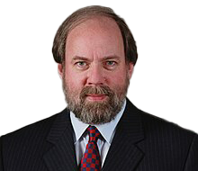
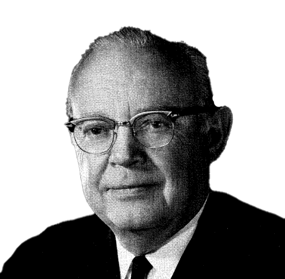
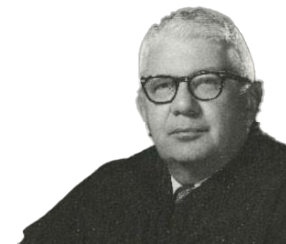
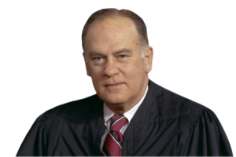

# Respect for Judgments {#sec-judgments}

## Claim Preclusion

When a case is over and appeals are exhausted, the result is a judgment.
A judgment is an order from a court stating who won and who lost. Unlike
untested claims, judgments have the force of law. A victorious party can
enforce a judgment against a losing party to take property, garnish
wages, or force compliance on pain of contempt. Judgments don't just
benefit victorious plaintiffs, though; they also protect victorious
defendants from having to fend off an identical lawsuit all over again.

Doctrines of former adjudication protect the finality of judgments by
preventing parties from relitigating claims or issues that have already
been adjudicated. We will study two such doctrines in some depth: claim
preclusion (formerly known as *res judicata*) and issue preclusion
(formerly known as collateral estoppel). It is critical that you pay
attention to the similarities and differences between these two
doctrines. It is also important to beware that the rules of claim and
issue preclusion have changed over time; the general trend is to give
greater preclusive effect than has been true in the past.

We begin with claim preclusion, which bars relitigation of claims
between the same parties. In recent decades, claim preclusion grew to
bar claims that *could have been* but *were not* brought in a prior
suit. The next case shows some of the scars of that change.

### Frier v. City of Vandalia, Ill.

**EASTERBROOK, J.** [770 F.2d 699 (7th Cir. 1985)]{.aside}

::: {.column-margin}

{width=150 fig-alt="Judge Easterbrook"}

:::

The City of Vandalia is fairly small (the population is less than
2,500), and apparently its police have maintained informal ways. When
Charles Frier parked one of his cars in a narrow street, which forced
others to drive on someone else's lawn to get around Frier's car, the
police left two notes at Frier's house asking him to move the car. That
did not work, so an officer called a local garage, which towed the car
back to the garage. The officer left a note, addressed to "Charlie,"
telling him where he could find the car. The officer did not issue a
citation for illegal parking, however; he later testified that he wanted
to make it easier for Frier to retrieve the car.

Frier balked at paying the \$10 fee the garage wanted. He also balked at
keeping his cars out of the street. The police had garages tow four of
them in 1983---a 1963 Ford Falcon, a 1970 Plymouth Duster, a 1971 Opal
GT, and a 1971 Dodge van. Instead of paying the garages, Frier filed
suits in the courts of Illinois seeking replevin. Each suit named as
defendants the City of Vandalia and the garage that had towed the car.

One of the suits (which sought to replevy two cars) was dismissed
voluntarily when Frier got his cars back. We do not know whether he paid
for the tows and the subsequent daily storage fees or whether the garage
thought it cheaper to surrender the cars than to defend the suit. The
other two cases were consolidated and litigated. The police testified to
the circumstances under which they had called for the tows. The court
concluded that the police properly took the cars into the City's
possession to remove obstructions to the alley, and it declined to issue
the writ of replevin because the City had the right to remove the cars
from the street. Frier then retrieved another car;^1^ so far as we can
tell, a garage still has the 1970 Plymouth Duster. [ ^1^ One garage told Frier he could come and get his car any time
    he wanted, without paying a fee.\
    ]{.aside}

After losing in state court, Frier turned to federal court. His
\[federal\] complaint maintained that the City had not offered him a
hearing either before or after it took the cars and that it is the
"official policy" of the City not to do so. The complaint invoked the
Due Process Clause of the Fourteenth Amendment and 42 U.S.C. § 1983, and
it sought equitable relief in addition to \$100,000 in compensatory and
\$100,000 in punitive damages. The district court, after reviewing the
transcript of the replevin action, dismissed the complaint for failure
to state a claim on which relief may be granted. (Because the judge
considered the transcript he should have treated the motion to dismiss
as one for summary judgment. We analyze the decision as if he had done
so.) The court found that Frier had notice of each tow and knew how to
get his cars back. Frier also had a full hearing in the replevin action
on the propriety of the tows. Although the judicial hearing came
approximately one month after the tows, the court thought the delay
permissible.

A month is a long wait for a hearing when the subject is an automobile.
The automobile is "property" within the meaning of the Due Process
Clause, and the City therefore must furnish appropriate process. *Sutton
v. City of Milwaukee*, 672 F.2d 644 (7th Cir. 1982), holds that a
hearing is not necessary before the police tow a car but suggests that
one must be furnished promptly after the tow. Sutton also suggests, in
line with many other cases, that the City must establish the process and
tender an opportunity for a hearing; it may not sit back and wait for
the aggrieved person to file a suit.

The City, for its part, maintains that a few isolated tows without
hearings are not the "policy" of the City and may not be imputed to it,
and that anyway a month's delay in holding a hearing about seized
property is permissible. \[...\]

A court ought not resolve a constitution\[al\] dispute unless that is
absolutely necessary. Here it is not. Frier had his day in court in the
replevin action. The City has argued that this precludes further suits.
(The City raised this argument in the motion to dismiss, which is
irregular but not fatally so. *See* Fed. R. Civ. P. 8(c).) The district
court bypassed this argument because, it believed, Frier could not have
asserted his constitutional arguments in a replevin action. This is only
partially correct.

Frier could not have obtained punitive damages or declaratory relief in
a suit limited to replevin. But he was free to join one count seeking
such relief with another seeking replevin. *See Welch v. Brunswick
Corp.*, 10 Ill. App. 3d 693 (1st Dist. 1973), *rev'd in part on other
grounds*, 57 Ill. 2d 461 (1974); *Hanaman v. Davis*, 20 Ill. App. 2d 111
(2d Dist. 1959), both of which allow one count seeking replevin to be
joined with another count seeking different relief. As we show below,
the law of Illinois, which under 28 U.S.C. § 1738 governs the preclusive
effect to be given to the judgment in the replevin actions, would bar
this suit. The City therefore is entitled to prevail on the ground of
claim preclusion, although the district court did not decide the case on
that ground.

Illinois recognizes the principles of claim preclusion (also called res
judicata or estoppel by judgment). *Jones v. City of Alton*, 757 F.2d
878, 884--85 (7th Cir. 1985) (summarizing the law of preclusion in
Illinois). One suit precludes a second "where the parties and the cause
of action are identical." "Causes of action are identical where the
evidence necessary to sustain a second verdict would sustain the first,
*i.e.*, where the causes of action are based upon a common core of
operative facts." Two suits may entail the same "cause of action" even
though they present different legal theories, and the first suit
"operates as an absolute bar to a subsequent action ... 'not only as to
every matter which was offered and received to sustain or defeat the
claim or demand, but as to any other admissible matter which might have
been offered for that purpose.'" \[...\]

The City was a defendant in each replevin action. Frier could have urged
constitutional grounds as reasons for replevin. He also could have
joined a constitutional claim seeking punitive damages and declaratory
relief to his demand for replevin, and therefore he had a full and fair
opportunity to litigate \[...\] . The actions also involve both the same
"common core of operative facts" and the same transactions. Frier argues
that the City towed his cars wrongfully. Each complaint seeking replevin
asserted \[that\] Frier owned each car and that it had not been "seized
under lawful process"---in other words, that there had been no citation
and no hearing at which anyone had found that the cars were illegally
parked. The replevin statute requires a plaintiff to show that the
property was taken without "lawful process." Ill. Rev. Stat., ch. 110,
§ 19-104. "Process," even in its technical sense, initiates or follows a
hearing. Had there been process and a hearing at which a magistrate
found the cars to have been illegally parked, Frier would have had no
claim for replevin no matter how strongly he contested the substantive
issue. The "operative facts" in the replevin and § 1983 actions
therefore are the same. Frier urges that he owned the car (the property
interest) and that the City did not offer him a hearing to adjudicate
the legality of his parking (the absence of due process).

The replevin actions diverged from the path of this § 1983 suit only
because the state judge adjudicated on the merits the propriety of the
seizures. Having found the seizures proper, the judge had no occasion to
determine whether the City should have offered Frier an earlier hearing.
But this divergence does not mean that the two legal theories require a
different "core of operative facts." \[...\]

To the extent there is any doubt about this, we look \[...\] to the
purpose of doctrines of preclusion. Claim preclusion is designed to
impel "parties to consolidate all closely related matters into one
suit." This prevents the oppression of defendants by multiple cases,
which may be easy to file and costly to defend. There is no assurance
that a second or third case will be decided more accurately than the
first and so there is no good reason to incur the costs of litigation
more than once. When the facts and issues of all theories of liability
are closely related, one case is enough. Here the replevin theory
contained the elements that make up a due process theory, and we are
therefore confident that the courts of Illinois would treat both
theories as one "cause of action." The final question is whether it
makes a difference that only two of the replevin actions went to
judgment, while here Frier challenges the towing of four cars. Under
Illinois law the answer is no. The defendant may invoke claim preclusion
when the plaintiff litigated in the first suit a subset of all available
disputes between the parties. *See Baird & Warner, Inc. v. Addison
Industrial Park, Inc.*, 70 Ill. App. 3d 59 (1st Dist. 1979), which holds
that a suit on three of six disputed parcels of land precludes a
subsequent suit on all six. We doubt that Illinois would see a difference
between three lots out of six and two cars out of four.

If Frier had filed the current suit in state court, he would have lost
under the doctrine of claim preclusion. Under 28 U.S.C. § 1738 he
therefore loses in federal court as well.

AFFIRMED.

**SWYGERT, Senior Circuit Judge, concurring in the result.**

::: {.column-margin}

{width=150 fig-alt="Judge Swygert"}

:::

In my view, the majority has simply applied the wrong analysis to the
problem at hand. Rather than trying to squeeze a res judicata solution
into a mold that does not fit, I would review the facts to determine
whether Frier's procedural due process claims could withstand a summary
judgment motion. Because I believe the City was entitled to summary
judgment, I concur in the result.

**I**

In determining whether the disposition of a claim in State court
precludes a subsequent suit on the same claim in federal court, the
federal court must apply the State's law of res judicata. Because
Illinois continues to adhere to the narrow, traditional view of claim
preclusion, as opposed to the broader approach codified in the
Restatement (Second) of Judgments §§ 24, 25 (1982), I would hold that
Frier's substantive traffic law claim does not preclude this subsequent
procedural due process claim. Under the more modern view of the new
Restatement, all claims arising from a single "transaction"---broadly
defined to include matters related in time, space, origin, and
motivation---must be litigated in a single, initial lawsuit, or be
barred from being raised in subsequent litigation. There was only one
transaction in the case at bar: the seizure of Frier's cars.
Accordingly, Frier should have raised both his substantive and
procedural objections to the seizure in one initial lawsuit.

Illinois, however, has not adopted the view of the new Restatement.^1^
[ ^1^ No Illinois court has ever cited the new Restatement. The
    first Restatement, which follows the traditional "cause of action"
    approach, see Restatement of Judgments § 61 (1942), has been cited
    several times.\
    ]{.aside} Rather, as the majority recognizes, the Illinois courts focus on the
similarities between the causes of action alleged in both suits, not on
whether there is a common factual transaction. One suit precludes a
second "where the parties and the cause of action are identical."
*Redfern v. Sullivan*, 111 Ill. App. 3d 372, 444 N.E.2d 205, 208 (1983).
"Causes of action are identical where the evidence necessary to sustain
a second verdict would sustain the first, *i.e.*, where the causes of
action are based upon a common core of operative facts." *Id.* \[...\] 

In sum, the common set of facts that must be shown to invoke Illinois'
doctrine of claim preclusion is defined as those facts necessary to
sustain the cause of action, not as those facts that could be
conveniently litigated in one lawsuit. This focus on the elements of the
causes of action and the proofs at trial---rather than on the policy
advantages of trying both actions in one suit---dooms any attempt to
invoke claim preclusion in the case at bar. To be sure, both actions
arise from the same seizure of the same cars. Yet, both the theory of
recovery and focus of factual inquiry are dramatically different in each
case. Frier's replevin claim was substantive in nature; to replevy
property, the claimant must show his superior possessory rights. Frier's
possessory rights turned on the legality of his parking. Because the
trial court found that "the officer reasonably believed and had a right
to believe that ... \[Frier's\] vehicle obstructed the free use and
passage way of that street at that time," it concluded that, therefore,
Frier did not enjoy the "superior right to possession of the property"
necessary to sustain a replevin action.

Frier's procedural due process claim requires an entirely different
factual showing. The legality or reasonableness of the seizure is
irrelevant. Because of the "risk of error inherent in the truth-finding
process," an individual is entitled to certain procedural safeguards
regardless of whether the deprivation of property was substantively
justified. The focus of the inquiry, then, is the adequacy of procedures
attending the seizure, not the seizure itself.

The majority urges that Frier could have joined a separate
constitutional claim to his replevin action. This precise argument was
rejected in *Fountas*, 455 N.E.2d at 204. \[...\] Illinois law focuses
on the similarities and differences between the various causes of
action. That two wholly different causes of action arising out of the
same transaction could be joined together as one convenient trial unit
is irrelevant for the purposes of Illinois law, though this would be
dispositive under the new Restatement.

**II**

It was established at Frier's replevin trial that the City police caused
various service station owners to tow four of Frier's cars and, in lieu
of a traffic citation, left written notice of the reason for the towing
and the whereabouts of the cars. Frier eventually recovered two of his
cars. Thus, the replevin action, and this action, concern only two of
the cars. Frier could have recovered one of those cars immediately by
paying a \$10.00 towing fee to the owner of the service station that
towed the car. However, Frier was informed that any further delay in
reclaiming the car would result in a \$2.50 per day storage charge.
Frier was free to reclaim the other car without paying any fee. I would
hold that, on the basis of these uncontested facts, the City was
entitled to summary judgment against Frier's procedural due process
claim. \[...\]

I would hold, then, that notice of towing, the availability of an
expedited State tort suit that can make the petitioner whole, and the
ability to reclaim the towed cars immediately at a cost of \$10.00
together constitute adequate postdeprivation process as long as the
\$10.00 fee does not present a financial hardship. This holding would
not necessarily conflict with recent decisions of other courts requiring
more immediate and elaborate postdeprivation process. More elaborate
process may well be required in those cases because the towing practices
of the various municipalities were more burdensome on the respective
petitioners: Immediate reclamation required significantly more than
\$10.00 and the litigants had standing to represent indigents who could
afford no fee. We need not reach such troublesome issues in the case at
bar.

I would find, as a matter of law, no procedural due process violation
under these facts. Accordingly, I concur with the majority's decision to
affirm the judgment below.

#### Notes & Questions

1.  With claim and issue preclusion, it is useful to separate out the
    two lawsuits at issue (and there will always be at least two if
    preclusion is involved).

    - What was Frier's first lawsuit? Where was it filed? Who were the
        defendant(s)? What were Frier's claims? Out of which facts did
        it arise? What elements did Frier have to prove in order to
        prevail?

    - What was Frier's second lawsuit? Where was it filed? Who were
        the defendant(s)? What were Frier's claims? Out of which facts
        did it arise? What elements did Frier have to prove in order to
        prevail?

2.  Judges Easterbrook and Swygert reach the same result (Frier loses)
    via different paths. What do they disagree about? And what body of
    law do they review to reach their answers?

### Taylor v. Sturgell

**GINSBURG, J., delivered the opinion of the Court.** [553 U.S. 880 (2008)]{.aside}

::: {.column-margin}

{width=150 fig-alt="Justice Ruth Bader Ginsburg"}

:::

"It is a principle of general application in Anglo-American
jurisprudence that one is not bound by a judgment in personam in a
litigation in which he is not designated as a party or to which he has
not been made a party by service of process." *Hansberry v. Lee*, 311
U.S. 32, 40 (1940) \[reprinted *infra*\]. Several exceptions, recognized
in this Court's decisions, temper this basic rule. In a class action,
for example, a person not named as a party may be bound by a judgment on
the merits of the action, if she was adequately represented by a party
who actively participated in the litigation. In this case, we consider
for the first time whether there is a "virtual representation" exception
to the general rule against precluding nonparties. Adopted by a number
of courts, including the courts below in the case now before us, the
exception so styled is broader than any we have so far approved. \[...\]

We disapprove the doctrine of preclusion by "virtual representation,"
and hold, based on the record as it now stands, that the judgment
against Herrick does not bar Taylor from maintaining this suit.

**I**

The Freedom of Information Act (FOIA) accords "any person" a right to
request any records held by a federal agency. 5 U.S.C. § 552(a)(3)(A)
(2006 ed.). No reason need be given for a FOIA request, and unless the
requested materials fall within one of the Act's enumerated exemptions,
*see* § 552(a)(3)(E), (b), the agency must "make the records promptly
available" to the requester, § 552(a)(3)(A). If an agency refuses to
furnish the requested records, the requester may file suit in federal
court and obtain an injunction "order\[ing\] the production of any
agency records improperly withheld." § 552(a)(4)(B).

The courts below held the instant FOIA suit barred by the judgment in
earlier litigation seeking the same records. Because the lower courts'
decisions turned on the connection between the two lawsuits, we begin
with a full account of each action.

**A**

The first suit was filed by Greg Herrick, an antique aircraft enthusiast
and the owner of an F-45 airplane, a vintage model manufactured by the
Fairchild Engine and Airplane Corporation (FEAC) in the 1930's. In 1997,
seeking information that would help him restore his plane to its
original condition, Herrick filed a FOIA request asking the Federal
Aviation Administration (FAA) for copies of any technical documents
about the F-45 contained in the agency's records.

To gain a certificate authorizing the manufacture and sale of the F-45,
FEAC had submitted to the FAA's predecessor, the Civil Aeronautics
Authority, detailed specifications and other technical data about the
plane. Hundreds of pages of documents produced by FEAC in the
certification process remain in the FAA's records. The FAA denied
Herrick's request, however, upon finding that the documents he sought
are subject to FOIA's exemption for "trade secrets and commercial or
financial information obtained from a person and privileged or
confidential," 5 U.S.C. § 552(b)(4) (2006 ed.). \[...\]

\[When Herrick filed suit,\] the District Court granted summary judgment
to the FAA \[rejecting Herrick's argument that a 1955 letter from
Fairchild to a government agency had waived any protection.\] \[T\]he
Tenth Circuit \[...\] affirmed. \[...\]

**B**

Less than a month later, on August 22, petitioner Brent Taylor---a
friend of Herrick's and an antique aircraft enthusiast in his own
right---submitted a FOIA request seeking the same documents Herrick had
unsuccessfully sued to obtain. When the FAA failed to respond, Taylor
filed a complaint in the U.S. District Court for the District of
Columbia. Like Herrick, Taylor argued that FEAC's 1955 letter had
stripped the records of their trade-secret status. But Taylor also
sought to litigate \[...\] two issues concerning recapture of protected
status that Herrick had failed to raise in his appeal to the Tenth
Circuit.

After Fairchild intervened as a defendant, the District Court in D.C.
concluded that Taylor's suit was barred by claim preclusion;
accordingly, it granted summary judgment to Fairchild and the FAA.
\[...\]

The record before the District Court in Taylor's suit revealed the
following facts about the relationship between Taylor and Herrick:
Taylor is the president of the Antique Aircraft Association, an
organization to which Herrick belongs; the two men are "close
associate\[s\]"; Herrick asked Taylor to help restore Herrick's F-45,
though they had no contract or agreement for Taylor's participation in
the restoration; Taylor was represented by the lawyer who represented
Herrick in the earlier litigation; and Herrick apparently gave Taylor
documents that Herrick had obtained from the FAA during discovery in his
suit. \[...\]

Applying this test to the record in Taylor's case, the D.C. Circuit
found both of the necessary conditions for virtual representation well
met. \[...\]

**II**

\[...\] Taylor's case presents an issue of first impression in this
sense: Until now, we have never addressed the doctrine of "virtual
representation" adopted (in varying forms) by several Circuits and
relied upon by the courts below. Our inquiry, however, is guided by
well-established precedent regarding the propriety of nonparty
preclusion. We review that precedent before taking up directly the issue
of virtual representation.

**A**

The preclusive effect of a judgment is defined by claim preclusion and
issue preclusion, which are collectively referred to as "res judicata."
\[...\] By "preclud\[ing\] parties from contesting matters that they
have had a full and fair opportunity to litigate," these two doctrines
protect against "the expense and vexation attending multiple lawsuits,
conserv\[e\] judicial resources, and foste\[r\] reliance on judicial
action by minimizing the possibility of inconsistent decisions."

A person who was not a party to a suit generally has not had a "full and
fair opportunity to litigate" the claims and issues settled in that
suit. The application of claim and issue preclusion to nonparties thus
runs up against the "deep-rooted historic tradition that everyone should
have his own day in court." Indicating the strength of that tradition,
we have often repeated the general rule that "one is not bound by a
judgment in personam in a litigation in which he is not designated as a
party or to which he has not been made a party by service of process."
*Hansberry*; *Martin v. Wilks*, 490 U.S. 755, 761 (1989).

**B**

Though hardly in doubt, the rule against nonparty preclusion is subject
to exceptions. For present purposes, the recognized exceptions can be
grouped into six categories.^6^ [ ^6^ \[...\] The list that follows is meant only to provide a
    framework for our consideration of virtual representation, not to
    establish a definitive taxonomy.\
    ]{.aside}\[(1) agreement by the parties to be
bound by a prior action; (2) preexisting substantive legal relationships
(such as preceding and succeeding owners of property); (3) adequate
representation by someone with the same interests who was a party (such
as trustees, guardians, and other fiduciaries); (4) a party assuming
control over prior litigation; (5) a party bound by a judgment who tries to
relitigate through a proxy, such as an agent or designated
representative; and (6)
special statutory schemes such as bankruptcy and probate proceedings,
provided those proceedings comport with due process.\] 

**III**

Reaching beyond these six established categories, some lower courts have
recognized a "virtual representation" exception to the rule against
nonparty preclusion. Decisions of these courts, however, have been far
from consistent. \[...\]

The D.C. Circuit, the FAA, and Fairchild have presented three arguments
in support of an expansive doctrine of virtual representation. We find
none of them persuasive.

**A**

The D.C. Circuit purported to ground its virtual representation doctrine
in this Court's decisions stating that, in some circumstances, a person
may be bound by a judgment if she was adequately represented by a party
to the proceeding yielding that judgment. But the D.C. Circuit's
definition of "adequate representation" strayed from the meaning our
decisions have attributed to that term. \[...\]

The D.C. Circuit misapprehended *Richards*. \[...\] \[O\]ur holding \[in
*Richards*\] that the Alabama Supreme Court's application of res
judicata to nonparties violated due process turned on the lack of either
special procedures to protect the nonparties' interests or an
understanding by the concerned parties that the first suit was brought
in a representative capacity. \[...\]

**B**

Fairchild and the FAA do not argue that the D.C. Circuit's virtual
representation doctrine fits within any of the recognized grounds for
nonparty preclusion. Rather, they ask us to abandon the attempt to
delineate discrete grounds and clear rules altogether. Preclusion is in
order, they contend, whenever "the relationship between a party and a
non-party is 'close enough' to bring the second litigant within the
judgment." Courts should make the "close enough" determination, they
urge, through a "heavily fact-driven" and "equitable" inquiry. \[...\]

We reject this argument for three reasons. First, our decisions
emphasize the fundamental nature of the general rule that a litigant is
not bound by a judgment to which she was not a party. \[...\]

Our second reason for rejecting a broad doctrine of virtual
representation rests on the limitations attending nonparty preclusion
based on adequate representation. A party's representation of a nonparty
is "adequate" for preclusion purposes only if, at a minimum: (1) the
interests of the nonparty and her representative are aligned; and (2)
either the party understood herself to be acting in a representative
capacity or the original court took care to protect the interests of the
nonparty. In addition, adequate representation sometimes requires (3)
notice of the original suit to the persons alleged to have been
represented. In the class-action context, these limitations are
implemented by the procedural safeguards contained in Federal Rule of
Civil Procedure 23.

An expansive doctrine of virtual representation, however, would
"recogniz\[e\], in effect, a common-law kind of class action." That is,
virtual representation would authorize preclusion based on identity of
interests and some kind of relationship between parties and nonparties,
shorn of the procedural protections prescribed in *Hansberry*,
*Richards*, and Rule 23. These protections, grounded in due process,
could be circumvented were we to approve a virtual representation
doctrine that allowed courts to "create de facto class actions at will."

Third, a diffuse balancing approach to nonparty preclusion would likely
create more headaches than it relieves. Most obviously, it could
significantly complicate the task of district courts faced in the first
instance with preclusion questions. An all-things-considered balancing
approach might spark wide-ranging, time-consuming, and expensive
discovery tracking factors potentially relevant under seven- or
five-prong tests. \[...\]

**C**

Finally \[...\] the FAA maintains that nonparty preclusion should apply
more broadly in "public-law" litigation than in "private-law"
controversies. To support this position, the FAA offers two arguments.
First, the FAA urges, our decision in *Richards* acknowledges that, in
certain cases, the plaintiff has a reduced interest in controlling the
litigation "because of the public nature of the right at issue." \[...\]

\[W\]e said in *Richards* only that, for the type of public-law claims
there envisioned, \[state and federal legislatures\] are free to adopt
procedures limiting repetitive litigation \[involving public rights\].
\[...\] It hardly follows, however, that this Court should proscribe or
confine successive FOIA suits by different requesters. Indeed, Congress'
provision for FOIA suits with no statutory constraint on successive
actions counsels against judicial imposition of constraints through
extraordinary application of the common law of preclusion.

The FAA next argues that "the threat of vexatious litigation is
heightened" in public-law cases because "the number of plaintiffs with
standing is potentially limitless." \[...\]

But we are not convinced that this risk justifies departure from the
usual rules governing nonparty preclusion. First, stare decisis will
allow courts swiftly to dispose of repetitive suits brought in the same
circuit. Second, even when stare decisis is not dispositive, "the human
tendency not to waste money will deter the bringing of suits based on
claims or issues that have already been adversely determined against
others." This intuition seems to be borne out by experience: The FAA has
not called our attention to any instances of abusive FOIA suits in the
Circuits that reject the virtual-representation theory respondents
advocate here.

**IV**

For the foregoing reasons, we disapprove the theory of virtual
representation on which the decision below rested. The preclusive
effects of a judgment in a federal-question case decided by a federal
court should instead be determined according to the established grounds
for nonparty preclusion described in this opinion. \[...\]

We now turn back to Taylor's action to determine whether his suit is
such a case, or whether the result reached by the courts below can be
justified on one of the recognized grounds for nonparty preclusion.

**A**

It is uncontested that four of the six grounds for nonparty preclusion
have no application here. \[...\]

That leaves only the fifth category: preclusion because a nonparty to an
earlier litigation has brought suit as a representative or agent of a
party who is bound by the prior adjudication. Taylor is not Herrick's
legal representative and he has not purported to sue in a representative
capacity. He concedes, however, that preclusion would be appropriate if
respondents could demonstrate that he is acting as Herrick's
"undisclosed agen\[t\]." \[...\]

We therefore remand to give the courts below an opportunity to determine
whether Taylor, in pursuing the instant FOIA suit, is acting as
Herrick's agent. Taylor concedes that such a remand is appropriate.
\[...\]

**\* \* \***

For the reasons stated, the judgment of the United States Court of
Appeals for the District of Columbia Circuit is vacated, and the case is
remanded for further proceedings consistent with this opinion.

It is so ordered.

#### Notes & Questions

1.  *Taylor v. Sturgell* illustrates the rigidity of the requirement of
    mutuality for claim preclusion to attach. The reason why Taylor's
    claims were *not* barred---even though they were essentially identical to
    Herrick's, even though Herrick and Taylor were members of the same
    hobbyist group, and even though Herrick and Taylor were represented
    by the same lawyer---is because Taylor is a different person from
    Herrick. And, as the Court notes, Taylor was entitled to his day in
    court.

2.  What tradeoffs does our civil justice system make by insisting on a
    strict rule of mutuality in the context of claim preclusion?

## Issue Preclusion

When it applies, claim preclusion bars relitigation of entire
claims---causes of action arising out of a common set of facts. Issue
preclusion is different: it bars relitigation of *issues*: facts or
legal determinations, even if they are only one small part of a claim, and
even if the prior suit was only somewhat related to the present one. But
issue preclusion only applies to issues that were actually litigated and
actually decided (recall that claim preclusion often applies to claims
that could have been, but in fact were not, brought in a prior suit).

In this way, issue preclusion is both broader (applies to more than just
claims) and narrower (only applies to issues that were actually
litigated and decided) than claim preclusion. There is one other
distinction that has grown in importance in recent decades: issue
preclusion does not always demand mutuality of parties to apply. In
other words, sometimes a third party can use the doctrine of issue
preclusion to bind their adversary, even if that third party was not
part of the earlier suit.

As the next case illustrates well, often the doctrines of claim and
issue preclusion will overlap, or arguably overlap. That is why it is so
important to keep the two doctrines straight in your mind.

### Illinois Central Gulf Railroad v. Parks

**LYBROOK, J.** [181 Ind. App. 141, 390 N.E.2d 1078 (1979)]{.aside}

::: {.column-margin}

{width=150 fig-alt="Judge Lybrook"}

:::

Bertha and Jessie were injured on March 2, 1975, when the automobile
which Jessie was driving and in which Bertha was a passenger collided
with a train operated by Illinois Central Gulf. \[Two lawsuits then
followed. In the first, Bertha and Jessie sued Illinois Central Gulf;
Bertha sought compensation for her injuries, and Jessie sought damages
for loss of Bertha's services and consortium. In the second, Jessie sued
Illinois Central Gulf for his own injuries.\]

\[In the first suit, the jury awarded Bertha a \$30,000 judgment on her
claim but returned a verdict against Jessie on his claim. The jury did
not explain its reasoning for entering a verdict in the railroad's favor
as to Jessie's claim.\]

\[In the second suit, Illinois Central Gulf moved for summary judgment,
arguing that Jessie's claims were barred by claim preclusion because he
could have brought them in the first suit and by issue preclusion
because the trial in the first action had established that he had been
contributorily negligent, which is why the jury entered a verdict
against him. The trial court disagreed and held Jessie's claims not
barred. Illinois Central Gulf filed the instant interlocutory appeal.\]

\[...\] Illinois Central Gulf's first allegation of error is an attempt
to apply \[claim preclusion\] in the case at bar, but the railroad
concedes its own argument by admitting that Jessie's cause of action for
loss of services and consortium as a derivative of Bertha's personal
injuries is a distinct cause of action from Jessie's claim for damages
for his own personal injuries.

\[Claim preclusion\] precludes the relitigation of a cause of action
finally determined between the parties, and decrees that a judgment
rendered is a complete bar to any subsequent action on the same claim or
cause of action. Jessie's cause of action in the case at bar is a
different cause of action from the one he litigated in the companion
case; therefore, \[claim preclusion\] does not apply.

\[Issue preclusion\], however, does apply. \[T\]he causes of action are
not the same but, if the case at bar were to go to trial on all the
issues raised in the pleadings and answer, some facts or questions
determined and adjudicated in the companion case would again be put in
issue in this subsequent action between the same parties.

To protect the integrity of the prior judgment by precluding the
possibility of opposite results by two different juries on the same set
of facts, the doctrine of \[issue preclusion\] allows the judgment in
the prior action to operate as an estoppel as to those facts or
questions actually litigated and determined in the prior action. The
problem at hand, then, is to determine what facts or questions were
actually litigated and determined in the companion case.

We agree with three concessions made by Illinois Central Gulf as to the
effect of the verdict in the prior case: (1) that the verdict in favor
of Bertha established, among other things, that the railroad was
negligent and that its negligence was a proximate cause of the accident
and Bertha's injuries; (2) that, inasmuch as Jessie's action for loss of
services and consortium was derivative, if Jessie sustained any such
loss it was proximately caused by the railroad's negligence; and (3)
that, in order for the jury to have returned a verdict against Jessie,
it had to have decided that he either sustained no damages or that his
own negligence was a proximate cause of his damages.

This third proposition places upon the railroad the heavy burden
outlined in \[*Town of Flora v. Indiana Service Corp.*, 222 Ind. 253, 256--57
(1944)\]:

> "\[W\]here a judgment may have been based upon either or any of two or
more distinct facts, a party desiring to plead the judgment as an
estoppel by verdict or finding upon the particular fact involved in a
subsequent suit must show that it went upon that fact, or else the
question will be open to a new contention. The estoppel of a judgment
is only presumptively conclusive, when it appears that the judgment
could not have been rendered without deciding the particular matter
brought in question. It is necessary to look to the complete record to
ascertain what was the question in issue."

The railroad argues that, because Jessie's evidence as to his loss of
services and consortium was uncontroverted, the jury's verdict had to be
based upon a finding of contributory negligence. Illinois Central Gulf
made this same argument in the companion case in relation to a related
issue and Jessie countered, as he does here, with his contention that,
although the evidence was uncontroverted, it was minimal and, thus,
could have caused the jury to find no compensable damages. We reviewed
the complete record in the companion case and held that the jury verdict
against Jessie in that cause could mean that he had failed his burden of
proving compensable damages. \[...\]

We hold that Illinois Central Gulf has failed its burden of showing that
the judgment against Jessie in the prior action could not have been
rendered without deciding that Jessie was contributorily negligent in
the accident which precipitated the two lawsuits. Consequently, the
trial court was correct in granting partial summary judgment estopping
the railroad from denying its negligence and in limiting the issues at
trial to whether Jessie was contributorily negligent, whether any such
contributory negligence was a proximate cause of the accident, and
whether Jessie sustained personal injuries and compensable damages.
\[...\]

#### Notes & Questions

1.  *Parks* focuses on one important requirement of issue preclusion:
    the issue in question must have been *actually litigated* and
    *necessary to the judgment* in the prior case.

2.  What issue did the railroad seek to bind Jessie with in his second
    suit? Why did the court conclude that it was not necessarily decided
    in the prior suit?

3.  Why do you think the doctrine of claim preclusion didn't bar
    Jessie's second suit? (Hint: recall Judge Swygert's concurrence in
    *Frier* to draw a useful inference about Indiana law at the time
    *Parks* was decided.)

### Parklane Hosiery Co. v. Shore

**STEWART, J., delivered the opinion of the Court.** [439 U.S. 322 (1979)]{.aside}

::: {.column-margin}

{width=150 fig-alt="Justice Potter Stewart"}

:::

This case presents the question whether a party who has had issues of
fact adjudicated adversely to it in an equitable action may be
collaterally estopped from relitigating the same issues before a jury in
a subsequent legal action brought against it by a new party.

The respondent brought this stockholder's class action against the
petitioners in a Federal District Court. The complaint alleged that the
petitioners, Parklane Hosiery Co., Inc. (Parklane), and 13 of its
officers, directors, and stockholders, had issued a materially false and
misleading proxy statement in connection with a merger. The proxy
statement, according to the complaint, had violated §§ 14(a), 10(b), and
20(a) of the Securities Exchange Act of 1934, as well as various rules
and regulations promulgated by the Securities and Exchange Commission
(SEC). The complaint sought damages, rescission of the merger, and
recovery of costs.

Before this action came to trial, the SEC filed suit against the same
defendants in the Federal District Court, alleging that the proxy
statement that had been issued by Parklane was materially false and
misleading in essentially the same respects as those that had been
alleged in the respondent's complaint. Injunctive relief was requested.
After a four-day trial, the District Court found that the proxy
statement was materially false and misleading in the respects alleged,
and entered a declaratory judgment to that effect. The Court of Appeals
for the Second Circuit affirmed this judgment.

::: {.column-margin}

^2^ A private plaintiff in an action under the proxy rules is not
    entitled to relief simply by demonstrating that the proxy
    solicitation was materially false and misleading. The plaintiff must
    also show that he was injured and prove damages. Since the SEC
    action was limited to a determination of whether the proxy statement
    contained materially false and misleading information, the
    respondent conceded that he would still have to prove these other
    elements of his prima facie case in the private action. The
    petitioners' right to a jury trial on those remaining issues is not
    contested.
    
:::

The respondent in the present case then moved for partial summary
judgment against the petitioners, asserting that the petitioners were
collaterally estopped from litigating the issues that had been resolved
against them in the action brought by the SEC.^2^ The District Court
denied the motion on the ground that such an application of collateral
estoppel would deny the petitioners their Seventh Amendment right to a
jury trial. The Court of Appeals for the Second Circuit reversed,
holding that a party who has had issues of fact determined against him
after a full and fair opportunity to litigate in a nonjury trial is
collaterally estopped from obtaining a subsequent jury trial of these
same issues of fact. The appellate court concluded that "the Seventh
Amendment preserves the right to jury trial only with respect to issues
of fact, \[and\] once those issues have been fully and fairly
adjudicated in a prior proceeding, nothing remains for trial, either
with or without a jury." Because of an intercircuit conflict, we granted
certiorari.

**I**

::: {.column-margin}

^4^ In this context, offensive use of collateral estoppel occurs
    when the plaintiff seeks to foreclose the defendant from litigating
    an issue the defendant has previously litigated unsuccessfully in an
    action with another party. Defensive use occurs when a defendant
    seeks to prevent a plaintiff from asserting a claim the plaintiff
    has previously litigated and lost against another defendant.
    
^5^ Under the doctrine of res judicata, a judgment on the merits
    in a prior suit bars a second suit involving the same parties or
    their privies based on the same cause of action. Under the doctrine
    of collateral estoppel, on the other hand, the second action is upon
    a different cause of action and the judgment in the prior suit
    precludes relitigation of issues actually litigated and necessary to
    the outcome of the first action. 1B J. Moore, Federal Practice ¶
    0.405 \[1\], pp. 622--624 (2d ed. 1974).
    
:::
    
The threshold question to be considered is whether quite apart from the
right to a jury trial under the Seventh Amendment, the petitioners can
be precluded from litigating facts resolved adversely to them in a prior
equitable proceeding with another party under the general law of
collateral estoppel. Specifically, we must determine whether a litigant
who was not a party to a prior judgment may nevertheless use that
judgment "offensively" to prevent a defendant from relitigating issues
resolved in the earlier proceeding.^4^ 

**A**

Collateral estoppel, like the related doctrine of res judicata,^5^ has
the dual purpose of protecting litigants from the burden of relitigating
an identical issue with the same party or his privy and of promoting
judicial economy by preventing needless litigation. Until relatively
recently, however, the scope of collateral estoppel was limited by the
doctrine of mutuality of parties. Under this mutuality doctrine, neither
party could use a prior judgment as an estoppel against the other unless
both parties were bound by the judgment. Based on the premise that it is
somehow unfair to allow a party to use a prior judgment when he himself
would not be so bound,^7^ [ ^7^ It is a violation of due process for a judgment to be binding
    on a litigant who was not a party or a privy and therefore has never
    had an opportunity to be heard.\
]{.aside} the mutuality requirement provided a party
who had litigated and lost in a previous action an opportunity to
relitigate identical issues with new parties.

By failing to recognize the obvious difference in position between a
party who has never litigated an issue and one who has fully litigated
and lost, the mutuality requirement was criticized almost from its
inception. Recognizing the validity of this criticism, the Court in
*Blonder-Tongue Laboratories, Inc. v. University of Illinois
Foundation*, abandoned the mutuality requirement. \[...\] The "broader
question" before the Court, however, was "whether it is any longer
tenable to afford a litigant more than one full and fair opportunity for
judicial resolution of the same issue." \[...\]

**B**

The *Blonder-Tongue* case involved defensive use of collateral
estoppel---a plaintiff was estopped from asserting a claim that the
plaintiff had previously litigated and lost against another defendant.
The present case, by contrast, involves offensive use of collateral
estoppel---a plaintiff is seeking to estop a defendant from relitigating
the issues which the defendant previously litigated and lost against
another plaintiff. In both the offensive and defensive use situations,
the party against whom estoppel is asserted has litigated and lost in an
earlier action. Nevertheless, several reasons have been advanced why the
two situations should be treated differently.

First, offensive use of collateral estoppel does not promote judicial
economy in the same manner as defensive use does. Defensive use of
collateral estoppel precludes a plaintiff from relitigating identical
issues by merely "switching adversaries."^12^ [ ^12^ Under the mutuality requirement, a plaintiff could
    accomplish this result since he would not have been bound by the
    judgment had the original defendant won.\
    ]{.aside} Thus defensive collateral
estoppel gives a plaintiff a strong incentive to join all potential
defendants in the first action if possible. Offensive use of collateral
estoppel, on the other hand, creates precisely the opposite incentive.
Since a plaintiff will be able to rely on a previous judgment against a
defendant but will not be bound by that judgment if the defendant wins,
the plaintiff has every incentive to adopt a "wait and see" attitude, in
the hope that the first action by another plaintiff will result in a
favorable judgment. 

::: {.column-margin} 

^13^ The Restatement (Second) of Judgments § 88 (3) (Tent. Draft
    No. 2, Apr. 15, 1975) provides that application of collateral
    estoppel may be denied if the party asserting it "could have
    effected joinder in the first action between himself and his present
    adversary."
    
:::
    
Thus offensive use of collateral estoppel will likely increase rather
than decrease the total amount of litigation, since potential plaintiffs
will have everything to gain and nothing to lose by not intervening in
the first action.^13^ A second argument against offensive use of
collateral estoppel is that it may be unfair to a defendant. If a
defendant in the first action is sued for small or nominal damages, he
may have little incentive to defend vigorously, particularly if future
suits are not foreseeable. Allowing offensive collateral estoppel may
also be unfair to a defendant if the judgment relied upon as a basis for
the estoppel is itself inconsistent with one or more previous judgments
in favor of the defendant.^14^ Still another situation where it might
be unfair to apply offensive estoppel is where the second action affords
the defendant procedural opportunities unavailable in the first action
that could readily cause a different result.^15^ 

::: {.column-margin}

^14^ In Professor Currie\'s familiar example, a railroad
    collision injures 50 passengers all of whom bring separate actions
    against the railroad. After the railroad wins the first 25 suits, a
    plaintiff wins in suit 26. Professor Currie argues that offensive
    use of collateral estoppel should not be applied so as to allow
    plaintiffs 27 through 50 automatically to recover. \[Currie,
    Mutuality of Estoppel: Limits of the Bernhard Doctrine, 9 Stan. L.
    Rev. 281 (1957).\]
    
^15^ If, for example, the defendant in the first action was
    forced to defend in an inconvenient forum and therefore was unable
    to engage in full scale discovery or call witnesses, application of
    offensive collateral estoppel may be unwarranted. Indeed,
    differences in available procedures may sometimes justify not
    allowing a prior judgment to have estoppel effect in a subsequent
    action even between the same parties, or where defensive estoppel is
    asserted against a plaintiff who has litigated and lost. The problem
    of unfairness is particularly acute in cases of offensive estoppel,
    however, because the defendant against whom estoppel is asserted
    typically will not have chosen the forum in the first action.

^18^ After a 4-day trial in which the petitioners had every
    opportunity to present evidence and call witnesses, the District
    Court held for the SEC. The petitioners then appealed to the Court
    of Appeals for the Second Circuit, which affirmed the judgment
    against them. Moreover, the petitioners were already aware of the
    action brought by the respondent, since it had commenced before the
    filing of the SEC action.
    
^19^ It is true, of course, that the petitioners in the present
    action would be entitled to a jury trial of the issues bearing on
    whether the proxy statement was materially false and misleading had
    the SEC action never been brought---a matter to be discussed in Part
    II of this opinion. But the presence or absence of a jury as
    factfinder is basically neutral, quite unlike, for example, the
    necessity of defending the first lawsuit in an inconvenient forum.
    
:::

**C**

We have concluded that the preferable approach for dealing with these
problems in the federal courts is not to preclude the use of offensive
collateral estoppel, but to grant trial courts broad discretion to
determine when it should be applied. The general rule should be that in
cases where a plaintiff could easily have joined in the earlier action
or where, either for the reasons discussed above or for other reasons,
the application of offensive estoppel would be unfair to a defendant, a
trial judge should not allow the use of offensive collateral estoppel.

In the present case, however, none of the circumstances that might
justify reluctance to allow the offensive use of collateral estoppel is
present. The application of offensive collateral estoppel will not here
reward a private plaintiff who could have joined in the previous action,
since the respondent probably could not have joined in the injunctive
action brought by the SEC even had he so desired. Similarly, there is no
unfairness to the petitioners in applying offensive collateral estoppel
in this case. First, in light of the serious allegations made in the
SEC's complaint against the petitioners, as well as the foreseeability
of subsequent private suits that typically follow a successful
Government judgment, the petitioners had every incentive to litigate the
SEC lawsuit fully and vigorously.^18^ Second, the judgment in the SEC
action was not inconsistent with any previous decision. Finally, there
will in the respondent's action be no procedural opportunities available
to the petitioners that were unavailable in the first action of a kind
that might be likely to cause a different result.^19^ We conclude,
therefore, that none of the considerations that would justify a refusal
to allow the use of offensive collateral estoppel is present in this
case. Since the petitioners received a "full and fair" opportunity to
litigate their claims in the SEC action, the contemporary law of
collateral estoppel leads inescapably to the conclusion that the
petitioners are collaterally estopped from relitigating the question of
whether the proxy statement was materially false and misleading. 

**II**

The question that remains is whether, notwithstanding the law of
collateral estoppel, the use of offensive collateral estoppel in this
case would violate the petitioners' Seventh Amendment right to a jury
trial. \[...\] The Seventh Amendment has never been interpreted in the
rigid manner advocated by the petitioners. On the contrary, many
procedural devices developed since 1791 that have diminished the civil
jury's historic domain have been found not to be inconsistent with the
Seventh Amendment. \[...\]

The law of collateral estoppel, like the law in other procedural areas
defining the scope of the jury's function, has evolved since 1791. Under
the rationale of \[an earlier\] case, these developments are not
repugnant to the Seventh Amendment simply for the reason that they did
not exist in 1791. Thus if, as we have held, the law of collateral
estoppel forecloses the petitioners from relitigating the factual issues
determined against them in the SEC action, nothing in the Seventh
Amendment dictates a different result, even though because of lack of
mutuality there would have been no collateral estoppel in 1791. \[...\]

#### Notes & Questions

1.  *Parklane Hosiery* marks the Supreme Court's broadest embrace of the
    doctrine of offensive non-mutual issue preclusion. Notice how far
    *Parklane Hosiery* carries issue preclusion away from the strict
    doctrine of mutuality we saw with *Taylor v. Sturgell* in the
    context of claim preclusion.

2.  However, be careful to remember a basic truth of due process: with
    minimal exceptions, only those who were parties to a prior suit can
    be bound by a judgment issued in it. Non-mutual issue preclusion
    does *not* permit the use of preclusion *against* a third party.
    But, as *Parklane Hosiery* shows, it sometimes permits the use of
    issue preclusion *by* a third party.

3.  The *Parklane Hosiery* Court draws an important distinction between
    offensive and defensive non-mutual issue preclusion. The latter,
    which is less controversial and potentially problematic than the
    former, arises when a defendant wants to use issue preclusion to
    fend off a lawsuit from a party. The classic example, mentioned in
    *Parklane Hosiery*, comes from *Blonder-Tongue Laboratories, Inc. v.
    Univ. of Ill. Foundation*, 402 U.S. 313 (1971). There, a university
    held a patent on an invention. The university sued D1, alleging
    infringement of the patent. D1 defended the suit by arguing that the
    patent was invalid because the invention was obvious. The court
    agreed, and D1 won the case. Undaunted, the university filed a
    second suit against a new defendant, D2, who was not party to the
    first suit. D2's defense invoked *defensive* nonmutual issue
    preclusion to argue that the university could not relitigate the
    patent's validity, and that the university was instead bound by the
    issue's determination against it in the prior suit. The Supreme
    Court agreed with D2, thus establishing the doctrine of defensive
    non-mutual issue preclusion. Be sure you understand and can explain
    why *Blonder-Tongue* involved defensive (rather than offensive)
    non-mutual issue preclusion.

4.  *Offensive* non-mutual issue preclusion raises more concerns than
    its defensive counterpart. For that reason, the Court in *Parklane
    Hosiery* set out a series of factors that must be considered before
    permitting offensive non-mutual issue preclusion. Name those
    factors. Why do you think the Court thought it necessary to limit
    the doctrine's applicability?

5.  Finally, note that even when offensive non-mutual issue preclusion
    *could* apply, it is left to the discretion of a trial judge whether
    to apply the doctrine. Why might that be a good idea?
