# Personal Jurisdiction {#personaljx}

## Origins

Personal jurisdiction refers to a court's ability to assert jurisdiction over a civil defendant. Because of the case that follows, personal jurisdiction is now constitutional in nature. It flows from the due process clauses of the constitution. That makes personal jurisdiction a powerful concept, because a judgment entered without personal jurisdiction is unenforceable in a future suit.

*Pennoyer v. Neff* concerns two separate lawsuits: one that has already happened, and one that is presently before the court. The earlier lawsuit was an attempt to collect a debt (less than \$300) allegedly owed to a lawyer, John Mitchell, by his former client, Marcus Neff. Because Neff was living in another state at the time, he was not afforded personal service of process and instead received only "constructive" notice. When Neff didn't respond to the suit, Mitchell sought and won a default judgment. After the default judgment was entered, Neff acquired 300 acres of land from the federal government in what is now downtown Portland, Oregon. Mitchell then sought to enforce his default judgment against Neff by asking the sheriff to seize Neff's land and sell it at auction. Sylvester Pennoyer bought the land and was given a sheriff's deed to prove his title. Some time later, Neff returned to Oregon and discovered that Pennoyer was in possession of his land.

The second suit, then, was brought by Neff against Pennoyer to recover his 300 acres of property. Each man had a deed to the property: Neff's was from the federal government; Pennoyer's was from the sheriff who sold it at auction to satisfy Mitchell's default judgment against Neff. The court hearing the second suit had to decide who had the superior legal claim to the property.

### Pennoyer v. Neff

**FIELD, J., delivered the opinion of the Court.** [95 U.S. 714 (1877)]{.aside}

::: {.column-margin}

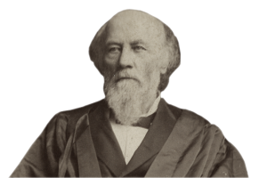{width=150}

:::

This is an action to recover the possession of a tract of land, of the alleged value of \$15,000, situated in the State of Oregon. The plaintiff asserts title to the premises by a patent of the United States issued to him in 1866, under the act of Congress of Sept. 27, 1850, usually known as the Donation Law of Oregon. The defendant claims to have acquired the premises under a sheriff's deed, made upon a sale of the property on execution issued upon a judgment recovered against the plaintiff in one of the circuit courts of the State. The case turns upon the validity of this judgment.

It appears from the record that the judgment was rendered in February, 1866, in favor of J.H. Mitchell, for less than \$300, including costs, in an action brought by him upon a demand for services as an attorney; that, at the time the action was commenced and the judgment rendered, the defendant therein, the plaintiff here, was a non-resident of the State that he was not personally served with process, and did not appear therein; and that the judgment was entered upon his default in not answering the complaint, upon a constructive service of summons by publication.

The Code of Oregon provides for \[constructive\] service when an action is brought against a non-resident and absent defendant, who has property within the State. It also provides, where the action is for the recovery of money or damages, for the attachment of the property of the non-resident. And it also declares that no natural person is subject to the jurisdiction of a court of the State, "unless he appear in the court, or be found within the State, or be a resident thereof, or have property therein; and, in the last case, only to the extent of such property at the time the jurisdiction attached." Construing this latter provision to mean that, in an action for money or damages where a defendant does not appear in the court, and is not found within the State, and is not a resident thereof, but has property therein, the jurisdiction of the court extends only over such property, the declaration expresses a principle of general, if not universal, law. The authority of every tribunal is necessarily restricted by the territorial limits of the State in which it is established. Any attempt to exercise authority beyond those limits would be deemed in every other forum, as has been said by this court, an illegitimate assumption of power, and be resisted as mere abuse. In the case against the plaintiff, the property here in controversy sold under the judgment rendered was not attached, nor in any way brought under the jurisdiction of the court. Its first connection with the case was caused by a levy of the execution. It was not, therefore, disposed of pursuant to any adjudication, but only in enforcement of a personal judgment, having no relation to the property, rendered against a non-resident without service of process upon him in the action, or his appearance therein. The court below did not consider that an attachment of the property was essential to its jurisdiction or to the validity of the sale, but held that the judgment was invalid from defects in the affidavit upon which the order of publication was obtained, and in the affidavit by which the publication was proved.

There is some difference of opinion among the members of this court as to the rulings \[by the court below regarding\] these alleged defects. \[...\]

If, therefore, we were confined to the rulings of the court below upon the defects in the affidavits mentioned, we should be unable to uphold its decision. But it was also contended in that court, and is insisted upon here, that the judgment in the State court against the plaintiff was void for want of personal service of process on him, or of his appearance in the action in which it was rendered, and that the premises in controversy could not be subjected to the payment of the demand of a resident creditor except by a proceeding in rem; that is, by a direct proceeding against the property for that purpose. If these positions are sound, the ruling of the Circuit Court as to the invalidity of that judgment must be sustained, notwithstanding our dissent from the reasons upon which it was made. And that they are sound would seem to follow from two well-established principles of public law respecting the jurisdiction of an independent State over persons and property. The several States of the Union are not, it is true, in every respect independent, many of the rights and powers which originally belonged to them being now vested in the government created by the Constitution. But, except as restrained and limited by that instrument, they possess and exercise the authority of independent States, and the principles of public law to which we have referred are applicable to them. One of these principles is, that every State possesses exclusive jurisdiction and sovereignty over persons and property within its territory. As a consequence, every State has the power to determine for itself the civil status and capacities of its inhabitants; to prescribe the subjects upon which they may contract, the forms and solemnities with which their contracts shall be executed, the rights and obligations arising from them, and the mode in which their validity shall be determined and their obligations enforced; and also to regulate the manner and conditions upon which property situated within such territory, both personal and real, may be acquired, enjoyed, and transferred. The other principle of public law referred to follows from the one mentioned; that is, that no State can exercise direct jurisdiction and authority over persons or property without its territory. Story, Confl. Laws, c. 2; Wheat. Int. Law, pt. 2, c. 2. The several States are of equal dignity and authority, and the independence of one implies the exclusion of power from all others. And so it is laid down by jurists, as an elementary principle, that the laws of one State have no operation outside of its territory, except so far as is allowed by comity; and that no tribunal established by it can extend its process beyond that territory so as to subject either persons or property to its decisions. "Any exertion of authority of this sort beyond this limit," says Story, "is a mere nullity, and incapable of binding such persons or property in any other tribunals." Story, Confl. Laws, sect. 539.

But as contracts made in one State may be enforceable only in another State, and property may be held by non-residents, the exercise of the jurisdiction which every State is admitted to possess over persons and property within its own territory will often affect persons and property without it. To any influence exerted in this way by a State affecting persons resident or property situated elsewhere, no objection can be justly taken; whilst any direct exertion of authority upon them, in an attempt to give ex-territorial operation to its laws, or to enforce an ex-territorial jurisdiction by its tribunals, would be deemed an encroachment upon the independence of the State in which the persons are domiciled or the property is situated, and be resisted as usurpation.

Thus the State, through its tribunals, may compel persons domiciled within its limits to execute, in pursuance of their contracts respecting property elsewhere situated, instruments in such form and with such solemnities as to transfer the title, so far as such formalities can be complied with; and the exercise of this jurisdiction in no manner interferes with the supreme control over the property by the State within which it is situated.

So the State, through its tribunals, may subject property situated within its limits owned by non-residents to the payment of the demand of its own citizens against them; and the exercise of this jurisdiction in no respect infringes upon the sovereignty of the State where the owners are domiciled. Every State owes protection to its own citizens; and, when non-residents deal with them, it is a legitimate and just exercise of authority to hold and appropriate any property owned by such non-residents to satisfy the claims of its citizens. It is in virtue of the State's jurisdiction over the property of the non-resident situated within its limits that its tribunals can inquire into that non-resident's obligations to its own citizens, and the inquiry can then be carried only to the extent necessary to control the disposition of the property. If the non-residents have no property in the State, there is nothing upon which the tribunals can adjudicate.

\[...\]

\[...\] If, without personal service, judgments in personam, obtained ex parte against non-residents and absent parties, upon mere publication of process, which, in the great majority of cases, would never be seen by the parties interested, could be upheld and enforced, they would be the constant instruments of fraud and oppression. Judgments for all sorts of claims upon contracts and for torts, real or pretended, would be thus obtained, under which property would be seized, when the evidence of the transactions upon which they were founded, if they ever had any existence, had perished.

Substituted service by publication, or in any other authorized form, may be sufficient to inform parties of the object of proceedings taken where property is once brought under the control of the court by seizure or some equivalent act. The law assumes that property is always in the possession of its owner, in person or by agent; and it proceeds upon the theory that its seizure will inform him, not only that it is taken into the custody of the court, but that he must look to any proceedings authorized by law upon such seizure for its condemnation and sale. Such service may also be sufficient in cases where the object of the action is to reach and dispose of property in the State, or of some interest therein, by enforcing a contract or a lien respecting the same, or to partition it among different owners, or, when the public is a party, to condemn and appropriate it for a public purpose. In other words, such service may answer in all actions which are substantially proceedings in rem. But where the entire object of the action is to determine the personal rights and obligations of the defendants, that is, where the suit is merely in personam, constructive service in this form upon a nonresident is ineffectual for any purpose. Process from the tribunals of one State cannot run into another State, and summon parties there domiciled to leave its territory and respond to proceedings against them. Publication of process or notice within the State where the tribunal sits cannot create any greater obligation upon the non-resident to appear: Process sent to him out of the State, and process published within it, are equally unavailing in proceedings to establish his personal liability.

The want of authority of the tribunals of a State to adjudicate upon the obligations of non-residents, where they have no property within its limits, is not denied by the court below: but the position is assumed, that, where they have property within the State, it is immaterial whether the property is in the first instance brought under the control of the court by attachment or some other equivalent act, and afterwards applied by its judgment to the satisfaction of demands against its owner; or such demands be first established in a personal action, and the property of the non-resident be afterwards seized and sold on execution. But the answer to this position has already been given in the statement, that the jurisdiction of the court to inquire into and determine his obligations at all is only incidental to its jurisdiction over the property. Its jurisdiction in that respect cannot be made to depend upon facts to be ascertained after it has tried the cause and rendered the judgment. If the judgment be previously void, it will not become valid by the subsequent discovery of property of the defendant, or by his subsequent acquisition of it. The judgment, if void when rendered, will always remain void: it cannot occupy the doubtful position of being valid if property be found, and void if there be none. Even if the position assumed were confined to cases where the non-resident defendant possessed property in the State at the commencement of the action, it would still make the validity of the proceedings and judgment depend upon the question whether, before the levy of the execution, the defendant had or had not disposed of the property. If before the levy the property should be sold, then, according to this position, the judgment would not be binding. This doctrine would introduce a new element of uncertainty in judicial proceedings. The contrary is the law: the validity of every judgment depends upon the jurisdiction of the court before it is rendered, not upon what may occur subsequently. In *Webster v. Reid*, the plaintiff claimed title to land sold under judgments recovered in suits brought in a territorial court of Iowa, upon publication of notice under a law of the territory, without service of process; and the court said:

"These suits were not a proceeding *in rem* against the land, but were *in personam* against the owners of it. Whether they all resided within the territory or not does not appear, nor is it a matter of any importance. No person is required to answer in a suit on whom process has not been served, or whose property has not been attached. In this case, there was no personal notice, nor an attachment or other proceeding against the land, until after the judgments. The judgments, therefore, are nullities, and did not authorize the executions on which the land was sold."

The force and effect of judgments rendered against non-residents without personal service of process upon them, or their voluntary appearance, have been the subject of frequent consideration in the courts of the United States and of the several States, as attempts have been made to enforce such judgments in States other than those in which they were rendered, under the provision of the Constitution requiring that "full faith and credit shall be given in each State to the public acts, records, and judicial proceedings of every other State"; and the act of Congress \[the current version of which is codified at 28 U.S.C. § 1738\] providing for the mode of authenticating such acts, records, and proceedings, and declaring that, when thus authenticated, "they shall have such faith and credit given to them in every court within the United States as they have by law or usage in the courts of the State from which they are or shall be taken." In the earlier cases, it was supposed that the act gave to all judgments the same effect in other States which they had by law in the State where rendered. But this view was afterwards qualified so as to make the act applicable only when the court rendering the judgment had jurisdiction of the parties and of the subject-matter, and not to preclude an inquiry into the jurisdiction of the court in which the judgment was rendered, or the right of the State itself to exercise authority over the person or the subject-matter. \[...\]

\[...\]

Since the adoption of the Fourteenth Amendment to the Federal Constitution, the validity of such judgments may be directly questioned, and their enforcement in the State resisted, on the ground that proceedings in a court of justice to determine the personal rights and obligations of parties over whom that court has no jurisdiction do not constitute due process of law. Whatever difficulty may be experienced in giving to those terms a definition which will embrace every permissible exertion of power affecting private rights, and exclude such as is forbidden, there can be no doubt of their meaning when applied to judicial proceedings. They then mean a course of legal proceedings according to those rules and principles which have been established in our systems of jurisprudence for the protection and enforcement of private rights. To give such proceedings any validity, there must be a tribunal competent by its constitution---that is, by the law of its creation---to pass upon the subject-matter of the suit; and, if that involves merely a determination of the personal liability of the defendant, he must be brought within its jurisdiction by service of process within the State, or his voluntary appearance.

Except in cases affecting the personal status of the plaintiff, and cases in which that mode of service may be considered to have been assented to in advance, as hereinafter mentioned, the substituted service of process by publication, allowed by the law of Oregon and by similar laws in other States, where actions are brought against non-residents, is effectual only where, in connection with process against the person for commencing the action, property in the State is brought under the control of the court, and subjected to its disposition by process adapted to that purpose, or where the judgment is sought as a means of reaching such property or affecting some interest therein; in other words, where the action is in the nature of a proceeding in rem. As stated by Cooley in his Treatise on Constitutional Limitations, 405, for any other purpose than to subject the property of a non-resident to valid claims against him in the State, "due process of law would require appearance or personal service before the defendant could be personally bound by any judgment rendered."

\[...\]

It follows from the views expressed that the personal judgment recovered in the State court of Oregon against the plaintiff herein, then a non-resident of the State, was without any validity, and did not authorize a sale of the property in controversy.

To prevent any misapplication of the views expressed in this opinion, it is proper to observe that we do not mean to assert, by anything we have said, that a State may not authorize proceedings to determine the status of one of its citizens towards a non-resident, which would be binding within the State, though made without service of process or personal notice to the non-resident. The jurisdiction which every State possesses to determine the civil status and capacities of all its inhabitants involves authority to prescribe the conditions on which proceedings affecting them may be commenced and carried on within its territory. The State, for example, has absolute right to prescribe the conditions upon which the marriage relation between its own citizens shall be created, and the causes for which it may be dissolved. \[...\]

Neither do we mean to assert that a State may not require a non-resident entering into a partnership or association within its limits, or making contracts enforceable there, to appoint an agent or representative in the State to receive service of process and notice in legal proceedings instituted with respect to such partnership, association, or contracts, or to designate a place where such service may be made and notice given, and provide, upon their failure, to make such appointment or to designate such place that service may be made upon a public officer designated for that purpose, or in some other prescribed way, and that judgments rendered upon such service may not be binding upon the nonresidents both within and without the State. \[...\] Nor do we doubt that a State, on creating corporations or other institutions for pecuniary or charitable purposes, may provide a mode in which their conduct may be investigated, their obligations enforced, or their charters revoked, which shall require other than personal service upon their officers or members. Parties becoming members of such corporations or institutions would hold their interest subject to the conditions prescribed by law.

In the present case, there is no feature of this kind, and, consequently, no consideration of what would be the effect of such legislation in enforcing the contract of a non-resident can arise. The question here respects only the validity of a money judgment rendered in one State, in an action upon a simple contract against the resident of another, without service of process upon him, or his appearance therein.

*Judgment affirmed.*

**\[The dissenting opinion of Justice HUNT is omitted.\]**

#### Notes & Questions

1.  *Pennoyer* made personal jurisdiction a constitutional limitation on a court's power derived from the due process clause of the Fourteenth Amendment. Those facts remain true today.

2.  *Pennoyer*'s concept of personal jurisdiction is territorial. The Oregon court's power extended to people and things within the physical borders of the state---but no farther. This part of *Pennoyer*, as we will soon see, lasted for more than 70 years, but it is no longer true that personal jurisdiction is so rigidly territorial.

3.  What role, if any, does the due process requirement of notice play in the Court's discussion of due process? Was the notice afforded to Neff in the first suit constitutionally sufficient?

4.  What would it have taken for the original judgment to be enforceable? Is there anything Mitchell or the earlier court could have done to make sure it had jurisdiction? If so, what?

5.  The Court draws a distinction between two types of personal jurisdiction: *in personam* and *in rem*. What is meant by each of those terms?

6.  What exceptions did the Court note to its general territorial theory of personal jurisdiction?

## Long-Arm Statutes

*Pennoyer v. Neff* constitutionalized personal jurisdiction by making it a requirement of due process. Put differently, *Pennoyer* held that the Fourteenth Amendment limits state courts' ability to exercise personal jurisdiction over persons outside the territorial boundaries of the state. You can think of the due process dimension of personal jurisdiction as the maximum that states can exercise under the Constitution.

But states do not have to exercise personal jurisdiction over absent parties to the maximum extent allowed under the Constitution. Instead, states can voluntarily limit the personal jurisdiction of their courts via legislation known as long-arm statutes. In some states, the relevant long-arm statute authorizes state courts to exercise personal jurisdiction to the maximum extent permitted under the Constitution. In other states, including Missouri, the long-arm statute places meaningful limits on personal jurisdiction.

Proper analysis of personal jurisdiction issues thus requires a two-step process. First, you must apply the state's long-arm statute to determine whether state law authorizes the court to exercise personal jurisdiction over the defendant. If the answer is no, then there is no personal jurisdiction, and the analysis is complete. If personal jurisdiction is authorized by the long-arm statute, however, you must analyze whether it also complies with due process.

This section introduces state long-arm statutes and how to interpret and apply them.

### Hess v. Pawloski

**Mr. Justice Butler delivered the opinion of the Court.** [274 U.S. 352 (1927)]{.aside}

::: {.column-margin}

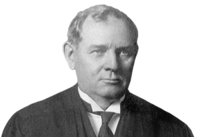{width=150}

:::

This action was brought by defendant in error to recover damages for personal injuries. The declaration alleged that plaintiff in error negligently and wantonly drove a motor vehicle on a public highway in Massachusetts and that by reason thereof the vehicle struck and injured defendant in error. Plaintiff in error is a resident of Pennsylvania. No personal service was made on him and no property belonging to him was attached. The service of process was made in compliance with c. 90, General Laws of Massachusetts, as amended by Stat. 1923, c. 431, § 2, the material parts of which follow:

> The acceptance by a non-resident of the rights and privileges conferred by section three or four, as evidenced by his operating a motor vehicle thereunder, or the operation by a non-resident of a motor vehicle on a public way in the commonwealth other than under said sections, shall be deemed equivalent to an appointment by such non-resident of the registrar or his successor in office, to be his true and lawful attorney upon whom may be served all lawful processes in any action or proceeding against him, growing out of any accident or collision in which said non-resident may be involved while operating a motor vehicle on such a way, and said acceptance or operation shall be a signification of his agreement that any such process against him which is so served shall be of the same legal force and validity as if served on him personally. Service of such process shall be made by leaving a copy of the process with a fee of two dollars in the hands of the registrar, or in his office, and such service shall be sufficient service upon the said non-resident; provided, that notice of such service and a copy of the process are forthwith sent by registered mail by the plaintiff to the defendant, and the defendant's return receipt and the plaintiff's affidavit of compliance herewith are appended to the writ and entered with the declaration. The court in which the action is pending may order such continuances as may be necessary to afford the defendant reasonable opportunity to defend the action.

\[Defendant\] appeared specially for the purpose of contesting jurisdiction and filed an answer in abatement and moved to dismiss on the ground that, the service of process, if sustained, would deprive him of his property without due process of law in violation of the Fourteenth Amendment. The court overruled the answer in abatement and denied the motion. The Supreme Judicial Court \[...\] affirmed the order. \[...\]

The question is whether the Massachusetts enactment contravenes the due process clause of the Fourteenth Amendment.

The process of a court of one State cannot run into another and summon a party there domiciled to respond to proceedings against him. Notice sent outside the State to a non-resident is unavailing to give jurisdiction in an action against him personally for money recovery. *Pennoyer v. Neff*. There must be actual service within the State of notice upon him or upon some one authorized to accept service for him. A personal judgment rendered against a non-resident, who has neither been served with process nor appeared in the suit is without validity. The mere transaction of business in a State by non-resident natural persons does not imply consent to be bound by the process of its courts. The power of a State to exclude foreign corporations, although not absolute but qualified, is the ground on which such an implication is supported as to them. But a State may not withhold from non-resident individuals the right of doing business therein. The privileges and immunities clause of the Constitution, § 2, Art. IV, safeguards to the citizens of one State the right "to pass through, or to reside in any other state for purposes of trade, agriculture, professional pursuits, or otherwise." And it prohibits state legislation discriminating against citizens of other States.

Motor vehicles are dangerous machines; and, even when skillfully and carefully operated, their use is attended by serious dangers to persons and property. In the public interest the State may make and enforce regulations reasonably calculated to promote care on the part of all, residents and non-residents alike, who use its highways. The measure in question operates to require a non-resident to answer for his conduct in the State where arise causes of action alleged against him, as well as to provide for a claimant a convenient method by which he may sue to enforce his rights. Under the statute the implied consent is limited to proceedings growing out of accidents or collisions on a highway in which the non-resident may be involved. It is required that he shall actually receive and receipt for notice of the service and a copy of the process. And it contemplates such continuances as may be found necessary to give reasonable time and opportunity for defense. It makes no hostile discrimination against non-residents but tends to put them on the same footing as residents. Literal and precise equality in respect of this matter is not attainable; it is not required. The State's power to regulate the use of its highways extends to their use by non-residents as well as by residents. And, in advance of the operation of a motor vehicle on its highway by a non-resident, the State may require him to appoint one of its officials as his agent on whom process may be served in proceedings growing out of such use. That case recognizes power of the State to exclude a non-resident until the formal appointment is made. And, having the power so to exclude, the State may declare that the use of the highway by the nonresident is the equivalent of the appointment of the registrar as agent on whom process may be served. The difference between the formal and implied appointment is not substantial so far as concerns the application of the due process clause of the Fourteenth Amendment.

*Judgment affirmed.*

### Mo. Rev. Stat. § 506.500

**Actions in which outstate service is authorized --- jurisdiction of Missouri courts applicable, when. ---**

1.  Any person or firm, whether or not a citizen or resident of this state, or any corporation, who in person or through an agent does any of the acts enumerated in this section, thereby submits such person, firm, or corporation, and, if an individual, his personal representative, to the jurisdiction of the courts of this state as to any cause of action arising from the doing of any of such acts:

    1)  The transaction of any business within this state;
    2)  The making of any contract within this state;
    3)  The commission of a tortious act within this state;
    4)  The ownership, use, or possession of any real estate situated in this state;
    5)  The contracting to insure any person, property or risk located within this state at the time of contracting;
    6)  Engaging in an act of sexual intercourse within this state with the mother of a child on or near the probable period of conception of that child.

2.  Any person, whether or not a citizen or resident of this state, who has lived in lawful marriage within this state, submits himself to the jurisdiction of the courts of this state as to all civil actions for dissolution of marriage or for legal separation and all obligations arising for maintenance of a spouse, support of any child of the marriage, attorney's fees, suit money, or disposition of marital property, if the other party to the lawful marriage lives in this state or if a third party has provided support to the spouse or to the children of the marriage and is a resident of this state.

3.  Only causes of action arising from acts enumerated in this section may be asserted against a defendant in an action in which jurisdiction over him is based upon this section.

### Missouri ex rel. PPG Indus., Inc. v. McShane

**Mary R. Russell, Judge.** [560 S.W.3d 888 (Mo. 2018)]{.aside}

::: {.column-margin}

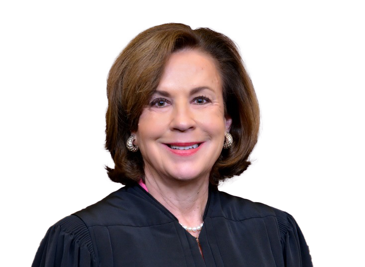{width=150}

:::

PPG Industries, Inc., seeks a writ of prohibition directing the circuit court to dismiss the underlying claim against it for lack of personal jurisdiction. PPG asserts the Circuit Court of St. Louis County cannot exercise personal jurisdiction over it because the underlying claim arises solely out of PPG's wide-reaching, passive website and does not arise from its contacts with Missouri. This Court issued a preliminary writ of prohibition. Because the circuit court lacks personal jurisdiction over PPG, the preliminary writ is made permanent.

**Background**

Hilboldt Curtainwall, Inc., a Missouri corporation, agreed to provide building materials for a Missouri-based construction project. Hilboldt, as a subcontractor, was to supply curtainwalls, which included coated aluminum extrusions. The project specifications required the aluminum extrusions be coated with a product made by PPG, a Pennsylvania-based corporation, or an approved substitute. Hilboldt alleges that after seeing on PPG's website that Finishing Dynamics, LLC, was an "approved" applicator of the required coating, it contracted with Finishing Dynamics to apply the coating.

When Finishing Dynamics failed to properly coat the aluminum extrusions, rendering them defective and unusable in the construction project, Hilboldt sued PPG and Finishing Dynamics. The count against PPG was for negligent misrepresentation based on PPG's online representation that Finishing Dynamics was an "approved extrusion applicator." PPG filed a motion to dismiss for lack of personal jurisdiction, arguing its website was insufficient to render it subject to the state's personal jurisdiction. After the circuit court overruled PPG's motion to dismiss, PPG filed a petition for a writ of prohibition in this Court seeking to prevent the circuit court from taking any further action in the case other than dismissing the claim against it. This Court issued a preliminary writ of prohibition.

**Standard of Review**

The Missouri Constitution vests this Court with the authority to issue and determine original remedial writs. Mo. Const. art. V, sec. 4. Prohibition is a discretionary writ that will only issue to (1) prevent a court from acting in excess of its authority or jurisdiction; (2) remedy a court acting in excess of its authority or jurisdiction or abusing its discretion; or (3) avoid irreparable harm to a party. "Prohibition is the proper remedy to prevent further action of the trial court where personal jurisdiction of the defendant is lacking."

**Analysis**

The question before this Court is whether the circuit court erred in overruling PPG's motion to dismiss and finding the circuit court had personal jurisdiction over PPG. Hilboldt asserts the circuit court has personal jurisdiction under section 506.500, Missouri's long-arm statute, because PPG committed a tortious act---negligent misrepresentation---in Missouri. PPG argues Hilboldt failed to establish the circuit court has personal jurisdiction in that PPG is a Pennsylvania-based corporation and its only ties to Missouri in the instant case were the representations made on its passive website, which were not aimed specifically at Missouri consumers. To answer this question, a brief review of the concepts of personal jurisdiction is helpful.

\[...\]

Missouri courts use a two-prong test to determine if personal jurisdiction exists over a nonresident defendant. First, the out-of-state defendant's conduct "must fall within Missouri's long-arm statute, section 506.600." Once it has been determined the nonresident defendant's conduct is covered under the long-arm statute, the court must then determine whether the defendant has sufficient minimum contacts with Missouri to satisfy due process.

Missouri's long-arm statute provides:

> Any person or firm, whether or not a citizen or resident of this state, or any corporation, who in person or through an agent does any of the acts enumerated in this section, thereby submits such person, firm, or corporation, and, if an individual, his personal representative, to the jurisdiction of the courts of this state as to any cause of action arising from the doing of any of such acts: \[...\]\
> (3) The commission of a tortious act within the state.

Section 506.500.1(3).

Included in the tortious act section of the long-arm statute are "\[e\]xtraterritorial acts that produce consequences in the state, such as fraud." Hilboldt concedes PPG's conduct was extraterritorial but nevertheless argues the circuit court has jurisdiction over PPG because "PPG's misrepresentations ... were received by Hilboldt in Missouri, relied upon by Hilboldt in Missouri, and ... caused injury to Hilboldt in Missouri." Hilboldt contends these "consequences in the state" are sufficient to find PPG committed a tortious act in Missouri.

Hilboldt principally relies on *Bryant* \[*v. Smith Interior Design Grp., Inc.*, 310 S.W.3d 227, 232 (Mo. 2010)\] to further its argument that PPG acted tortiously within Missouri. In *Bryant*, an out-of-state defendant sent allegedly fraudulent documents to a Missouri resident and concealed its fraud in subsequent communications with that resident over telephone, email, and written correspondence. The allegations of directed action into the state of Missouri were "sufficient to demonstrate the commission of a tortious act within this state and to place \[the defendant\] within the reach of Missouri's long-arm statute." "Where a defendant knowingly sends into a state a false statement, intended that it should there be relied upon to the injury of a resident of that state, he has, for jurisdictional purposes, acted within that state."

*Bryant* is distinguishable on its facts. In *Bryant*, the defendant sent physical mail and emails and made phone calls directly to the Missouri plaintiff. Here, no such direct or individual communication was made to Hilboldt. PPG did not contact any Hilboldt representative through its website, nor did Hilboldt interact with any PPG representative using the website. The website was not used to complete any transaction, facilitate any communication, or beget any interaction between Hilboldt and PPG. And although the website was accessible by Missouri residents, it was not targeted at Missouri residents. PPG sent nothing into Missouri, nor did it attempt to solicit web traffic from Missouri specifically. PPG did nothing more than publish information that was equally as available to individuals in each of the other 49 states as it was to residents of Missouri.

The absolute remoteness of the connection between PPG's online representation and the forum state bears emphasizing. PPG merely indicated on its website that Finishing Dynamics was one of an indeterminate number of companies it had deemed "approved extrusion applicator\[s\]." This wide-reaching, public posting of information was the extent of PPG's "action" at issue here. Given the broad and general nature of PPG's website, PPG's suit-related contacts with Missouri are not sufficient to be considered tortious acts within the state.^4^ [ ^4^ Further, compare this case with *Good World Deals, LLC. v. Gallagher*, 554 S.W.3d 905, 911-13 (Mo. App. W.D. 2018) (determining extraterritorial conduct of defendant in the form of sending allegedly false and misleading emails, text messages, and telephone calls to plaintiff in Missouri, which caused plaintiff to suffer financial harm in Missouri, was sufficient to find a tortious act occurred in Missouri). In contrast, PPG did absolutely nothing intentionally or specifically directed into Missouri.\
]{.aside}

Additionally, the information on PPG's website that Hilboldt allegedly relied upon was used to enter into a contract with a third party, Finishing Dynamics---a contract in which PPG had no role. And it was this third party's alleged unilateral mistake that is the true basis for the underlying lawsuit, which muddles the connection between PPG and Missouri even further. Without more, the website's accessibility in Missouri is insufficient to confer personal jurisdiction.

The mere allegation that a website, accessible by internet users in every state in the country, published false or misleading statements cannot be enough to conclude the website owner acted tortiously within Missouri. To find specific jurisdiction under these facts would allow PPG---and virtually any other company with a website---to be sued in Missouri if its website was viewed by a party who believes it was aggrieved by the information obtained. Such a result would open up Missouri courts to suits against companies who lack even negligible contacts with the state. \[...\] This cannot be the proper result. \[...\]

PPG's connection to Missouri, based solely on its passive internet activity, is so very attenuated and so very remote that any consequences felt in Missouri in this case cannot reasonably be attributed to PPG's online activity. Because PPG's conduct does not fall within Missouri's long-arm statute, Hilboldt cannot demonstrate its claim satisfies the first prong of the test for personal jurisdiction.^6^ [ ^6^ Because this is dispositive of the case, this Court need not discuss the second prong of the personal jurisdiction test, the due process analysis.\
]{.aside} As such, the circuit court does not have personal jurisdiction over PPG.

**Conclusion**

Because there was no tortious act within the state, the circuit court lacks personal jurisdiction over PPG. The circuit court should have sustained PPG's motion to dismiss for lack of personal jurisdiction. The preliminary writ of prohibition is made permanent, and the circuit court is directed to dismiss the underlying claim against PPG. All concur.

## Minimum Contacts

Technological, economic, and social change put tremendous pressure on the territorial models of personal jurisdiction, as Hess illustrates. One of the most important challenges as the Pennoyer model began to break down was the question of where, exactly, a corporation was "present" for purposes of personal jurisdiction. In light of this uncertainty, corporations ordered their behavior so that they could do business in a jurisdiction without being subject to suit there. The next case, which set the agenda for the next 80 years (and counting), resolved that problem by reorienting personal jurisdiction around a defendant's contacts with the forum.

### International Shoe Co. v. Washington

**MR. CHIEF JUSTICE STONE delivered the opinion of the Court.** [326 U.S. 310 (1945)]{.aside}

::: {.column-margin}

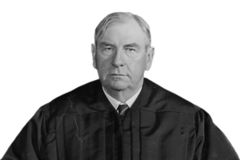{width=150}

:::

The questions for decision are (1) whether, within the limitations of the due process clause of the Fourteenth Amendment, the appellant, a Delaware corporation, has by its activities in the State of Washington rendered itself amenable to proceedings in the courts of that state to recover unpaid contributions to the state unemployment compensation fund enacted by state statutes, Washington Unemployment Compensation Act, and (2) whether the state can exact those contributions consistently with the due process clause of the Fourteenth Amendment.

The statutes in question set up a comprehensive scheme of unemployment compensation, the costs of which are defrayed by contributions required to be made by employers to a state unemployment compensation fund. The contributions are a specified percentage of the wages payable annually by each employer for his employees' services in the state. The assessment and collection of the contributions and the fund are administered by appellees. Section 14(c) of the Act authorizes appellee Commissioner to issue an order and notice of assessment of delinquent contributions upon prescribed personal service of the notice upon the employer if found within the state, or, if not so found, by mailing the notice to the employer by registered mail at his last known address. \[...\]

In this case notice of assessment for the years in question was personally served upon a sales solicitor employed by appellant in the State of Washington, and a copy of the notice was mailed by registered mail to appellant at its address in St. Louis, Missouri. Appellant appeared specially before the office of unemployment and moved to set aside the order and notice of assessment on the ground that the service upon appellant's salesman was not proper service upon appellant; that appellant was not a corporation of the State of Washington and was not doing business within the state; that it had no agent within the state upon whom service could be made; and that appellant is not an employer and does not furnish employment within the meaning of the statute.

\[...\]

The facts as found by the appeal tribunal and accepted by the state Superior Court and Supreme Court, are not in dispute. Appellant is a Delaware corporation, having its principal place of business in St. Louis, Missouri, and is engaged in the manufacture and sale of shoes and other footwear. It maintains places of business in several states, other than Washington, at which its manufacturing is carried on and from which its merchandise is distributed interstate through several sales units or branches located outside the State of Washington.

Appellant has no office in Washington and makes no contracts either for sale or purchase of merchandise there. It maintains no stock of merchandise in that state and makes there no deliveries of goods in intrastate commerce. During the years from 1937 to 1940, now in question, appellant employed eleven to thirteen salesmen under direct supervision and control of sales managers located in St. Louis. These salesmen resided in Washington; their principal activities were confined to that state; and they were compensated by commissions based upon the amount of their sales. The commissions for each year totaled more than \$31,000. Appellant supplies its salesmen with a line of samples, each consisting of one shoe of a pair, which they display to prospective purchasers. On occasion they rent permanent sample rooms, for exhibiting samples, in business buildings, or rent rooms in hotels or business buildings temporarily for that purpose. The cost of such rentals is reimbursed by appellant. The authority of the salesmen is limited to exhibiting their samples and soliciting orders from prospective buyers, at prices and on terms fixed by appellant. The salesmen transmit the orders to appellant's office in St. Louis for acceptance or rejection, and when accepted the merchandise for filling the orders is shipped f.o.b. from points outside Washington to the purchasers within the state. All the merchandise shipped into Washington is invoiced at the place of shipment from which collections are made. No salesman has authority to enter into contracts or to make collections.

\[...\]

Appellant \[...\] insists that its activities within the state were not sufficient to manifest its "presence" there and that in its absence the state courts were without jurisdiction, that consequently it was a denial of due process for the state to subject appellant to suit. \[...\] And appellant further argues that since it was not present within the state, it is a denial of due process to subject it to taxation or other money exaction. It thus denies the power of the state to lay the tax or to subject appellant to a suit for its collection.

Historically the jurisdiction of courts to render judgment *in personam* is grounded on their de facto power over the defendant's person. Hence his presence within the territorial jurisdiction of a court was prerequisite to its rendition of a judgment personally binding him. *Pennoyer v. Neff*. But now that the capias ad respondendum has given way to personal service of summons or other form of notice, due process requires only that in order to subject a defendant to a judgment in personam, if he be not present within the territory of the forum, he have certain minimum contacts with it such that the maintenance of the suit does not offend "traditional notions of fair play and substantial justice." *Milliken v. Meyer*. *See Hess v. Pawloski*.

Since the corporate personality is a fiction, although a fiction intended to be acted upon as though it were a fact, it is clear that unlike an individual its "presence" without, as well as within, the state of its origin can be manifested only by activities carried on in its behalf by those who are authorized to act for it. To say that the corporation is so far "present" there as to satisfy due process requirements, for purposes of taxation or the maintenance of suits against it in the courts of the state, is to beg the question to be decided. For the terms "present" or "presence" are used merely to symbolize those activities of the corporation's agent within the state which courts will deem to be sufficient to satisfy the demands of due process. Those demands may be met by such contacts of the corporation with the state of the forum as to make it reasonable, in the context of our federal system of government, to require the corporation to defend the particular suit which is brought there. An "estimate of the inconveniences" which would result to the corporation from a trial away from its "home" or principal place of business is relevant in this connection.

"Presence" in the state in this sense has never been doubted when the activities of the corporation there have not only been continuous and systematic, but also give rise to the liabilities sued on, even though no consent to be sued or authorization to an agent to accept service of process has been given. Conversely it has been generally recognized that the casual presence of the corporate agent or even his conduct of single or isolated items of activities in a state in the corporation's behalf are not enough to subject it to suit on causes of action unconnected with the activities there. To require the corporation in such circumstances to defend the suit away from its home or other jurisdiction where it carries on more substantial activities has been thought to lay too great and unreasonable a burden on the corporation to comport with due process.

While it has been held, in cases on which appellant relies, that continuous activity of some sorts within a state is not enough to support the demand that the corporation be amenable to suits unrelated to that activity, there have been instances in which the continuous corporate operations within a state were thought so substantial and of such a nature as to justify suit against it on causes of action arising from dealings entirely distinct from those activities.

Finally, although the commission of some single or occasional acts of the corporate agent in a state sufficient to impose an obligation or liability on the corporation has not been thought to confer upon the state authority to enforce it, other such acts, because of their nature and quality and the circumstances of their commission, may be deemed sufficient to render the corporation liable to suit. True, some of the decisions holding the corporation amenable to suit have been supported by resort to the legal fiction that it has given its consent to service and suit, consent being implied from its presence in the state through the acts of its authorized agents. But more realistically it may be said that those authorized acts were of such a nature as to justify the fiction.

It is evident that the criteria by which we mark the boundary line between those activities which justify the subjection of a corporation to suit, and those which do not, cannot be simply mechanical or quantitative. The test is not merely, as has sometimes been suggested, whether the activity, which the corporation has seen fit to procure through its agents in another state, is a little more or a little less. Whether due process is satisfied must depend rather upon the quality and nature of the activity in relation to the fair and orderly administration of the laws which it was the purpose of the due process clause to insure. That clause does not contemplate that a state may make binding a judgment *in personam* against an individual or corporate defendant with which the state has no contacts, ties, or relations.

But to the extent that a corporation exercises the privilege of conducting activities within a state, it enjoys the benefits and protection of the laws of that state. The exercise of that privilege may give rise to obligations, and, so far as those obligations arise out of or are connected with the activities within the state, a procedure which requires the corporation to respond to a suit brought to enforce them can, in most instances, hardly be said to be undue.

Applying these standards, the activities carried on in behalf of appellant in the State of Washington were neither irregular nor casual. They were systematic and continuous throughout the years in question. They resulted in a large volume of interstate business, in the course of which appellant received the benefits and protection of the laws of the state, including the right to resort to the courts for the enforcement of its rights. The obligation which is here sued upon arose out of those very activities. It is evident that these operations establish sufficient contacts or ties with the state of the forum to make it reasonable and just, according to our traditional conception of fair play and substantial justice, to permit the state to enforce the obligations which appellant has incurred there. Hence we cannot say that the maintenance of the present suit in the State of Washington involves an unreasonable or undue procedure.

We are likewise unable to conclude that the service of the process within the state upon an agent whose activities establish appellant's "presence" there was not sufficient notice of the suit, or that the suit was so unrelated to those activities as to make the agent an inappropriate vehicle for communicating the notice. It is enough that appellant has established such contacts with the state that the particular form of substituted service adopted there gives reasonable assurance that the notice will be actual. Nor can we say that the mailing of the notice of suit to appellant by registered mail at its home office was not reasonably calculated to apprise appellant of the suit.

\[...\]

Appellant having rendered itself amenable to suit upon obligations arising out of the activities of its salesmen in Washington, the state may maintain the present suit *in personam* to collect the tax laid upon the exercise of the privilege of employing appellant's salesmen within the state. For Washington has made one of those activities, which taken together establish appellant's "presence" there for purposes of suit, the taxable event by which the state brings appellant within the reach of its taxing power. The state thus has constitutional power to lay the tax and to subject appellant to a suit to recover it. The activities which establish its "presence" subject it alike to taxation by the state and to suit to recover the tax.

Affirmed.

**MR. JUSTICE BLACK delivered the following opinion.**

::: {.column-margin}

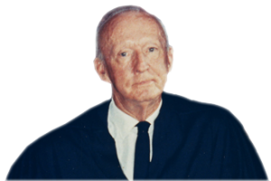{width=150}

:::

\[...\]

I believe that the Federal Constitution leaves to each State, without any "ifs" or "buts," a power to tax and to open the doors of its courts for its citizens to sue corporations whose agents do business in those States. Believing that the Constitution gave the States that power, I think it a judicial deprivation to condition its exercise upon this Court's notion of "fair play," however appealing that term may be. Nor can I stretch the meaning of due process so far as to authorize this Court to deprive a State of the right to afford judicial protection to its citizens on the ground that it would be more "convenient" for the corporation to be sued somewhere else.

There is a strong emotional appeal in the words "fair play," "justice," and "reasonableness." But they were not chosen by those who wrote the original Constitution or the Fourteenth Amendment as a measuring rod for this Court to use in invalidating State or Federal laws passed by elected legislative representatives. No one, not even those who most feared a democratic government, ever formally proposed that courts should be given power to invalidate legislation under any such elastic standards. \[...\]

True, the State's power is here upheld. But the rule announced means that tomorrow's judgment may strike down a State or Federal enactment on the ground that it does not conform to the Court's idea of natural justice. \[...\]

#### Notes & Questions

1.  Why did the International Shoe Company have so many unusual policies? For example, sales personnel were given only one of each shoe to take with them for display purposes. And they were given no authority to enter into sales contracts directly. Instead, contracts were finalized and orders were fulfilled and shipped from ISC's warehouse in Missouri "f.o.b." (What does "f.o.b." mean?) Why would the company take all of these steps?

2.  Which inquiry is easier? Figuring out where a corporation is "present" or figuring out where it has contacts and how many contacts are enough to satisfy due process? Why? Does the constitution provide any guidance on which one is required?

3.  The major question after *International Shoe* was decided was whether any portion of *Pennoyer* survived the revolutionary transformation from territorial jurisdiction to minimum contacts. The next two cases explore the vitality of two types of service that had traditionally been recognized under the *Pennoyer* regime but were arguably inconsistent with the minimum contacts approach ushered in by *International Shoe*.

### Shaffer v. Heitner

**MARSHALL, J., delivered the opinion of the Court.** [433 U.S. 186 (1977)]{.aside}

::: {.column-margin}

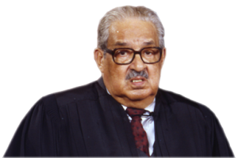{width=150}

:::

The controversy in this case concerns the constitutionality of a Delaware statute that allows a court of that State to take jurisdiction of a lawsuit by sequestering any property of the defendant that happens to be located in Delaware. Appellants contend that the sequestration statute as applied in this case violates the Due Process Clause of the Fourteenth Amendment both because it permits the state courts to exercise jurisdiction despite the absence of sufficient contacts among the defendants, the litigation, and the State of Delaware and because it authorizes the deprivation of defendants' property without providing adequate procedural safeguards. We find it necessary to consider only the first of these contentions.

**I**

Appellee Heitner, a nonresident of Delaware, is the owner of one share of stock in the Greyhound Corporation, a business incorporated under the laws of Delaware with its principal place of business in Phoenix, Ariz. On May 22, 1974, he filed a shareholder's derivative suit in the Court of Chancery for New Castle County, Del., in which he named as defendants Greyhound, its wholly owned subsidiary Greyhound Lines, Inc., and 28 present or former officers or directors of one or both of the corporations. In essence, Heitner alleged that the individual defendants had violated their duties to Greyhound by causing it and its subsidiary to engage in actions that resulted in the corporation's being held liable for substantial damages in a private antitrust suit and a large fine in a criminal contempt action. The activities which led to these penalties took place in Oregon.

Simultaneously with his complaint, Heitner filed a motion for an order of sequestration of the Delaware property of the individual defendants pursuant to 10 Del. C. § 366. This motion was accompanied by a supporting affidavit of counsel which stated that the individual defendants were nonresidents of Delaware. The affidavit identified the property to be sequestered as

> common stock, 3% Second Cumulative Preferenced Stock and stock unit credits of the Defendant Greyhound Corporation, a Delaware corporation, as well as all options and all warrants to purchase said stock issued to said individual Defendants and all contractral \[sic\] obligations, all rights, debts or credits due or accrued to or for the benefit of any of the said Defendants under any type of written agreement, contract, or other legal instrument of any kind whatever between any of the individual Defendants and said corporation.

The requested sequestration order was signed the day the motion was filed. Pursuant to that order, the sequestrator "seized" approximately 82,000 shares of Greyhound common stock belonging to 19 of the defendants, and options belonging to another two defendants. These seizures were accomplished by placing "stop transfer" orders or their equivalents on the books of the Greyhound Corporation. So far as the record shows, none of the certificates representing the seized property was physically present in Delaware. The stock was considered to be in Delaware, and so subject to seizure, by virtue of 8 Del. C. § 169, which makes Delaware the situs of ownership of all stock in Delaware corporations.

All 28 defendants were notified of the initiation of the suit by certified mail directed to their last known addresses and by publication in a New Castle County newspaper. The 21 defendants whose property was seized (hereafter referred to as appellants) responded by entering a special appearance for the purpose of moving to quash service of process and to vacate the sequestration order. They contended that the ex parte sequestration procedure did not accord them due process of law and that the property seized was not capable of attachment in Delaware. In addition, appellants asserted that under the rule of *International Shoe Co. v. Washington*, they did not have sufficient contacts with Delaware to sustain the jurisdiction of that State's courts.

\[...\]

**II**

The Delaware courts rejected appellants' jurisdictional challenge by noting that this suit was brought as a quasi *in rem* proceeding. Since *quasi in rem* jurisdiction is traditionally based on attachment or seizure of property present in the jurisdiction, not on contacts between the defendant and the State, the courts considered appellants' claimed lack of contacts with Delaware to be unimportant. This categorical analysis assumes the continued soundness of the conceptual structure founded on the century-old case of *Pennoyer v. Neff*.

\[The Court reviewed *Pennoyer* and its rationale.\]

From our perspective, the importance of *Pennoyer* is not its result, but the fact that its principles and corollaries derived from them became the basic elements of the constitutional doctrine governing state-court jurisdiction. As we have noted, under *Pennoyer* state authority to adjudicate was based on the jurisdiction's power over either persons or property. This fundamental concept is embodied in the very vocabulary which we use to describe judgments. If a court's jurisdiction is based on its authority over the defendant's person, the action and judgment are denominated "in personam" and can impose a personal obligation on the defendant in favor of the plaintiff. If jurisdiction is based on the court's power over property within its territory, the action is called "in rem" or "quasi in rem." The effect of a judgment in such a case is limited to the property that supports jurisdiction and does not impose a personal liability on the property owner, since he is not before the court. In *Pennoyer*'s terms, the owner is affected only "indirectly" by an *in rem* judgment adverse to his interest in the property subject to the court's disposition.

By concluding that "\[t\]he authority of every tribunal is necessarily restricted by the territorial limits of the State in which it is established," *Pennoyer* sharply limited the availability of *in personam* jurisdiction over defendants not resident in the forum State. If a nonresident defendant could not be found in a State, he could not be sued there. On the other hand, since the State in which property was located was considered to have exclusive sovereignty over that property, *in rem* actions could proceed regardless of the owner's location. Indeed, since a State's process could not reach beyond its borders, this Court held after *Pennoyer* that due process did not require any effort to give a property owner personal notice that his property was involved in an *in rem* proceeding.

The *Pennoyer* rules generally favored nonresident defendants by making them harder to sue. This advantage was reduced, however, by the ability of a resident plaintiff to satisfy a claim against a nonresident defendant by bringing into court any property of the defendant located in the plaintiff's State. For example, in the well-known case of *Harris v. Balk*, Epstein, a resident of Maryland, had a claim against Balk, a resident of North Carolina. Harris, another North Carolina resident, owed money to Balk. When Harris happened to visit Maryland, Epstein garnished his debt to Balk. Harris did not contest the debt to Balk and paid it to Epstein's North Carolina attorney. When Balk later sued Harris in North Carolina, this Court held that the Full Faith and Credit Clause, U.S. Const., Art. IV, § 1, required that Harris' payment to Epstein be treated as a discharge of his debt to Balk. This Court reasoned that the debt Harris owed Balk was an intangible form of property belonging to Balk, and that the location of that property traveled with the debtor. By obtaining personal jurisdiction over Harris, Epstein had "arrested" his debt to Balk, and brought it into the Maryland court. Under the structure established by *Pennoyer*, Epstein was then entitled to proceed against that debt to vindicate his claim against Balk, even though Balk himself was not subject to the jurisdiction of a Maryland tribunal.

*Pennoyer* itself recognized that its rigid categories, even as blurred by the kind of action typified by Harris, could not accommodate some necessary litigation. Accordingly, Mr. Justice Field's opinion carefully noted that cases involving the personal status of the plaintiff, such as divorce actions, could be adjudicated in the plaintiff's home State even though the defendant could not be served within that State. Similarly, the opinion approved the practice of considering a foreign corporation doing business in a State to have consented to being sued in that State. This basis for *in personam* jurisdiction over foreign corporations was later supplemented by the doctrine that a corporation doing business in a State could be deemed "present" in the State, and so subject to service of process under the rule of *Pennoyer*. 

The advent of automobiles, with the concomitant increase in the incidence of individuals causing injury in States where they were not subject to *in personam* actions under *Pennoyer*, required further moderation of the territorial limits on jurisdictional power. This modification, like the accommodation to the realities of interstate corporate activities, was accomplished by use of a legal fiction that left the conceptual structure established in *Pennoyer* theoretically unaltered. The fiction used was that the out-of-state motorist, who it was assumed could be excluded altogether from the State's highways, had by using those highways appointed a designated state official as his agent to accept process. *See Hess v. Pawloski*. Since the motorist's "agent" could be personally served within the State, the state courts could obtain *in personam* jurisdiction over the nonresident driver. 

The motorists' consent theory was easy to administer since it required only a finding that the out-of-state driver had used the State's roads. By contrast, both the fictions of implied consent to service on the part of a foreign corporation and of corporate presence required a finding that the corporation was "doing business" in the forum State. Defining the criteria for making that finding and deciding whether they were met absorbed much judicial energy. While the essentially quantitative tests which emerged from these cases purported simply to identify circumstances under which presence or consent could be attributed to the corporation, it became clear that they were in fact attempting to ascertain "what dealings make it just to subject a foreign corporation to local suit." In International Shoe, we acknowledged that fact. 

\[...\] 

It is clear, therefore, that the law of state-court jurisdiction no longer stands securely on the foundation established in *Pennoyer.* We think that the time is ripe to consider whether the standard of fairness and substantial justice set forth in *International Shoe* should be held to govern actions *in rem* as well as *in personam*. 

**III**

The case for applying to jurisdiction *in rem* the same test of "fair play and substantial justice" as governs assertions of jurisdiction *in personam* is simple and straightforward. It is premised on recognition that "\[t\]he phrase, 'judicial jurisdiction over a thing,' is a customary elliptical way of referring to jurisdiction over the interests of persons in a thing."^23^ [ ^23^ It is true that the potential liability of a defendant in an *in rem* action is limited by the value of the property, but that limitation does not affect the argument. The fairness of subjecting a defendant to state-court jurisdiction does not depend on the size of the claim being litigated.\
]{.aside} Restatement (Second) of Conflict of Laws § 56, introductory note. This recognition leads to the conclusion that in order to justify an exercise of jurisdiction *in rem*, the basis for jurisdiction must be sufficient to justify exercising "jurisdiction over the interests of persons in a thing." The standard for determining whether an exercise of jurisdiction over the interests of persons is consistent with the Due Process Clause is the minimum contacts standard elucidated in *International Shoe*.

This argument, of course, does not ignore the fact that the presence of property in a State may bear on the existence of jurisdiction by providing contacts among the forum State, the defendant, and the litigation. For example, when claims to the property itself are the source of the underlying controversy between the plaintiff and the defendant, it would be unusual for the State where the property is located not to have jurisdiction. In such cases, the defendant's claim to property located in the State would normally indicate that he expected to benefit from the State's protection of his interest. The State's strong interests in assuring the marketability of property within its borders and in providing a procedure for peaceful resolution of disputes about the possession of that property would also support jurisdiction, as would the likelihood that important records and witnesses will be found in the State. The presence of property may also favor jurisdiction in cases, such as suits for injury suffered on the land of an absentee owner, where the defendant's ownership of the property is conceded but the cause of action is otherwise related to rights and duties growing out of that ownership.

It appears, therefore, that jurisdiction over many types of actions which now are or might be brought *in rem* would not be affected by a holding that any assertion of state-court jurisdiction must satisfy the *International Shoe* standard. For the type of *quasi in rem* action typified by *Harris v. Balk* and the present case, however, accepting the proposed analysis would result in significant change. These are cases where the property which now serves as the basis for state-court jurisdiction is completely unrelated to the plaintiff's cause of action. Thus, although the presence of the defendant's property in a State might suggest the existence of other ties among the defendant, the State, and the litigation, the presence of the property alone would not support the State's jurisdiction.

\[...\]

Since acceptance of the *International Shoe* test would most affect this class of cases, we examine the arguments against adopting that standard as they relate to this category of litigation. Before doing so, however, we note that this type of case also presents the clearest illustration of the argument in favor of assessing assertions of jurisdiction by a single standard. For in cases such as Harris and this one, the only role played by the property is to provide the basis for bringing the defendant into court. Indeed, the express purpose of the Delaware sequestration procedure is to compel the defendant to enter a personal appearance. In such cases, if a direct assertion of personal jurisdiction over the defendant would violate the Constitution, it would seem that an indirect assertion of the jurisdiction should be equally impermissible.

The primary rationale for treating the presence of property as a sufficient basis for jurisdiction to adjudicate claims over which the State would not have jurisdiction if *International Shoe* applied is that a wrongdoer "should not be able to avoid payment of his obligations by the expedient of removing his assets to a place where he is not subject to an *in personam* suit." Restatement § 66, Comment a.

This justification, however, does not explain why jurisdiction should be recognized without regard to whether the property is present in the State because of an effort to avoid the owner's obligations. Nor does it support jurisdiction to adjudicate the underlying claim.

\[...\]

It might also be suggested that allowing *in rem* jurisdiction avoids the uncertainty inherent in the *International Shoe* standard and assures a plaintiff of a forum.^37^ [ ^37^ This case does not raise, and we therefore do not consider, the question whether the presence of a defendant's property in a State is a sufficient basis for jurisdiction when no other forum is available to the plaintiff.\
]{.aside} We believe, however, that the fairness standard of *International Shoe* can be easily applied in the vast majority of cases. Moreover, when the existence of jurisdiction in a particular forum under *International Shoe* is unclear, the cost of simplifying the litigation by avoiding the jurisdictional question may be the sacrifice of "fair play and substantial justice." That cost is too high.

We are left, then, to consider the significance of the long history of jurisdiction based solely on the presence of property in a State. \[...\] "\[T\]raditional notions of fair play and substantial justice" can be as readily offended by the perpetuation of ancient forms that are no longer justified as by the adoption of new procedures that are inconsistent with the basic values of our constitutional heritage. The fiction that an assertion of jurisdiction over property is anything but an assertion of jurisdiction over the owner of the property supports an ancient form without substantial modern justification. Its continued acceptance would serve only to allow state court jurisdiction that is fundamentally unfair to the defendant.

We therefore conclude that all assertions of state court jurisdiction must be evaluated according to the standards set forth in *International Shoe* and its progeny.^39^ [ ^39^ It would not be fruitful for us to re-examine the facts of cases decided on the rationales of *Pennoyer* and *Harris* to determine whether jurisdiction might have been sustained under the standard we adopt today. To the extent that prior decisions are inconsistent with this standard, they are overruled.\
]{.aside}

**IV**

The Delaware courts based their assertion of jurisdiction in this case solely on the statutory presence of appellants' property in Delaware. Yet that property is not the subject matter of this litigation, nor is the underlying cause of action related to the property. Appellants' holdings in Greyhound do not, therefore, provide contacts with Delaware sufficient to support the jurisdiction of that State's courts over appellants. If it exists, that jurisdiction must have some other foundation.

Appellee Heitner did not allege and does not now claim that appellants have ever set foot in Delaware. Nor does he identify any act related to his cause of action as having taken place in Delaware. Nevertheless, he contends that appellants' positions as directors and officers of a corporation chartered in Delaware provide sufficient "contacts, ties, or relations," *International Shoe Co. v. Washington*, with that State to give its courts jurisdiction over appellants in this stockholder's derivative action. This argument is based primarily on what Heitner asserts to be the strong interest of Delaware in supervising the management of a Delaware corporation. That interest is said to derive from the role of Delaware law in establishing the corporation and defining the obligations owed to it by its officers and directors. In order to protect this interest, appellee concludes, Delaware's courts must have jurisdiction over corporate fiduciaries such as appellants.

\[...\]

\[But\] Appellants have simply had nothing to do with the State of Delaware. Moreover, appellants had no reason to expect to be haled before a Delaware court. Delaware, unlike some States, has not enacted a statute that treats acceptance of a directorship as consent to jurisdiction in the State. And "\[i\]t strains reason ... to suggest that anyone buying securities in a corporation formed in Delaware 'impliedly consents' to subject himself to Delaware's ... jurisdiction on any cause of action." Appellants, who were not required to acquire interests in Greyhound in order to hold their positions, did not by acquiring those interests surrender their right to be brought to judgment only in States with which they had "minimum contacts." The Due Process Clause

> "does not contemplate that a state may make binding a judgment ... against an individual or corporate defendant with which the state has no contacts, ties, or relations." *International Shoe Co. v. Washington*.

Delaware's assertion of jurisdiction over appellants in this case is inconsistent with that constitutional limitation on state power. The judgment of the Delaware Supreme Court must, therefore, be reversed.

It is so ordered.

**REHNQUIST, J., took no part in the consideration or decision of this case.**

**POWELL, J., concurring.**

::: {.column-margin}

{width=150}

:::

I agree that the principles of *International Shoe Co. v. Washington* should be extended to govern assertions of *in rem* as well as *in personam* jurisdiction in state court. I also agree that neither the statutory presence of appellants' stock in Delaware nor their positions as directors and officers of a Delaware corporation can provide sufficient contacts to support the Delaware courts' assertion of jurisdiction in this case.

I would explicitly reserve judgment, however, on whether the ownership of some forms of property whose situs is indisputably and permanently located within a State may, without more, provide the contacts necessary to subject a defendant to jurisdiction within the State to the extent of the value of the property. In the case of real property, in particular, preservation of the common law concept of *quasi in rem* jurisdiction arguably would avoid the uncertainty of the general *International Shoe* standard without significant cost to "traditional notions of fair play and substantial justice." Subject to that reservation, I join the opinion of the Court.

**STEVENS, J., concurring in the judgment.**

::: {.column-margin}

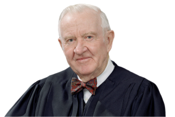{width=150}

:::

The Due Process Clause affords protection against "judgments without notice." *International Shoe* Co. v. Washington (opinion of Black, J.).

\[...\]

One who purchases shares of stock on the open market can hardly be expected to know that he has thereby become subject to suit in a forum remote from his residence and unrelated to the transaction. As a practical matter, the Delaware sequestration statute created an unacceptable risk of judgment without notice \[...\] . I therefore agree with the Court that on the record before us no adequate basis for jurisdiction exists and that the Delaware statute is unconstitutional on its face.

How the Court's opinion may be applied in other contexts is not entirely clear to me. \[...\] My uncertainty as to the reach of the opinion, and my fear that it purports to decide a great deal more than is necessary to dispose of this case, persuade me merely to concur in the judgment.

**BRENNAN, J., concurring in part and dissenting in part.**

::: {.column-margin}

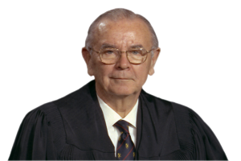{width=150}

:::

I join Parts I-III of the Court's opinion. I fully agree that the minimum contacts analysis developed in *International Shoe Co. v. Washington* represents a far more sensible construct for the exercise of state court jurisdiction than the patchwork of legal and factual fictions that has been generated from the decision in *Pennoyer v. Neff*. It is precisely because the inquiry into minimum contacts is now of such overriding importance, however, that I must respectfully dissent from Part IV of the Court's opinion.

\[...\]

I, therefore, would approach the minimum contacts analysis differently than does the Court. Crucial to me is the fact that appellants voluntarily associated themselves with the State of Delaware, "invoking the benefits and protections of its laws," *Hanson v. Denckla*; *International Shoe Co. v. Washington*, by entering into a long term and fragile relationship with one of its domestic corporations. They thereby elected to assume powers and to undertake responsibilities wholly derived from that State's rules and regulations, and to become eligible for those benefits that Delaware law makes available to its corporations' officials. *E.g.*, 8 Del. C. §§ 143 (interest-free loans); 145 (indemnification). While it is possible that countervailing issues of judicial efficiency and the like might clearly favor a different forum, they do not appear on the meager record before us; and, of course, we are concerned solely with "minimum" contacts, not the "best" contacts. I thus do not believe that it is unfair to insist that appellants make themselves available to suit in a competent forum that Delaware might create for vindication of its important public policies directly pertaining to appellants' fiduciary associations with the State.

#### Notes & Questions

1.  After *Pennoyer*, a common tactic to obtain jurisdiction against an out-of-state defendant was to attach property they owned within the forum state. Under the holding in *Harris v. Balk*, this attach-and-then-sue strategy, known as *quasi in rem*, authorized personal jurisdiction over the property owner up to the value of the property attached. *Shaffer* did away with all that, ruling most forms of *quasi in rem* jurisdiction unconstitutional.

2.  Even though attaching property does not automatically grant personal jurisdiction over its owner, as it once did, it can still be valuable for a plaintiff to attach a defendant's property, usually to ensure that the property is not moved elsewhere while the action is pending.

3.  *Shaffer*'s holding was justified as an attempt to apply *International Shoe*'s minimum-contacts regime to *in rem* and *quasi in rem* suits. As the next case illustrates, though, some remnants of *Pennoyer*'s territorial paradigm remain good law.

### Burnham v. Superior Court

**SCALIA, J.,** [495 U.S. 604 (1990)]{.aside}**announced the judgment of the Court and delivered an opinion in which THE CHIEF JUSTICE and KENNEDY, J., joined, and in which WHITE, J., joined as to Parts I, II-A, II-B, and II-C.** 

::: {.column-margin}

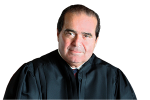{width=150}

:::

The question presented is whether the Due Process Clause of the Fourteenth Amendment denies California courts jurisdiction over a nonresident, who was personally served with process while temporarily in that State, in a suit unrelated to his activities in the State.

**I**

Petitioner Dennis Burnham married Francie Burnham in 1976, in West Virginia. In 1977 the couple moved to New Jersey, where their two children were born. In July 1987 the Burnhams decided to separate. They agreed that Mrs. Burnham, who intended to move to California, would take custody of the children. Shortly before Mrs. Burnham departed for California that same month, she and petitioner agreed that she would file for divorce on grounds of "irreconcilable differences."

In October 1987, petitioner filed for divorce in New Jersey state court on grounds of "desertion." Petitioner did not, however, obtain an issuance of summons against his wife, and did not attempt to serve her with process. Mrs. Burnham, after unsuccessfully demanding that petitioner adhere to their prior agreement to submit to an "irreconcilable differences" divorce, brought suit for divorce in California state court in early January 1988.

In late January, petitioner visited southern California on business, after which he went north to visit his children in the San Francisco Bay area, where his wife resided. He took the older child to San Francisco for the weekend. Upon returning the child to Mrs. Burnham's home on January 24, 1988, petitioner was served with a California court summons and a copy of Mrs. Burnham's divorce petition. He then returned to New Jersey.

\[...\]

**II**

**A**

\[...\]

To determine whether the assertion of personal jurisdiction is consistent with due process, we have long relied on the principles traditionally followed by American courts in marking out the territorial limits of each State's authority. That criterion was first announced in *Pennoyer v. Neff*, in which we stated that due process "mean\[s\] a course of legal proceedings according to those rules and principles which have been established in our systems of jurisprudence for the protection and enforcement of private rights," including the "well-established principles of public law respecting the jurisdiction of an independent State over persons and property." In what has become the classic expression of the criterion, we said in *International Shoe Co. v. Washington*, that a State Court's assertion of personal jurisdiction satisfies the Due Process Clause if it does not violate "'traditional notions of fair play and substantial justice.'" Since *International Shoe*, we have only been called upon to decide whether these "traditional notions" permit States to exercise jurisdiction over absent defendants in a manner that deviates from the rules of jurisdiction applied in the 19th century. We have held such deviations permissible, but only with respect to suits arising out of the absent defendant's contacts with the State. The question we must decide today is whether due process requires a similar connection between the litigation and the defendant's contacts with the State in cases where the defendant is physically present in the State at the time process is served upon him.

**B**

Among the most firmly established principles of personal jurisdiction in American tradition is that the courts of a State have jurisdiction over nonresidents who are physically present in the State. The view developed early that each State had the power to hale before its courts any individual who could be found within its borders, and that once having acquired jurisdiction over such a person by properly serving him with process, the State could retain jurisdiction to enter judgment against him, no matter how fleeting his visit. That view had antecedents in English common-law practice, which sometimes allowed "transitory" actions, arising out of events outside the country, to be maintained against seemingly nonresident defendants who were present in England. Justice Story believed the principle, which he traced to Roman origins, to be firmly grounded in English tradition: "\[B\]y the common law\[,\] personal actions, being transitory, may be brought in any place, where the party defendant may be found," for "every nation may ... rightfully exercise jurisdiction over all persons within its domains." J. Story, Commentaries on the Conflict of Laws §§ 554, 543 (1846).

Recent scholarship has suggested that English tradition was not as clear as Story thought. Accurate or not, however, judging by the evidence of contemporaneous or near-contemporaneous decisions, one must conclude that Story's understanding was shared by American courts at the crucial time for present purposes: 1868, when the Fourteenth Amendment was adopted. \[...\]

\[...\]

**C**

Despite this formidable body of precedent, petitioner contends, in reliance on our decisions applying the *International Shoe* standard, that in the absence of "continuous and systematic" contacts with the forum, a nonresident defendant can be subjected to judgment only as to matters that arise out of or relate to his contacts with the forum. This argument rests on a thorough misunderstanding of our cases.

\[...\]

As *International Shoe* suggests, the defendant's litigation-related "minimum contacts" may take the place of physical presence as the basis for jurisdiction\[.\] \[...\]

\[But n\]othing in *International Shoe* or the cases that have followed it, however, offers support for the very different proposition petitioner seeks to establish today: that a defendant's presence in the forum is not only unnecessary to validate novel, nontraditional assertions of jurisdiction, but is itself no longer sufficient to establish jurisdiction. \[...\]

The short of the matter is that jurisdiction based on physical presence alone constitutes due process because it is one of the continuing traditions of our legal system that define the due process standard of "traditional notions of fair play and substantial justice." That standard was developed by analogy to "physical presence," and it would be perverse to say it could now be turned against that touchstone of jurisdiction.

**D**

Petitioner's strongest argument, though we ultimately reject it, relies upon our decision in *Shaffer v. Heitner*.

It goes too far to say, as petitioner contends, that *Shaffer* compels the conclusion that a State lacks jurisdiction over an individual unless the litigation arises out of his activities in the State. *Shaffer*, like *International Shoe*, involved jurisdiction over an absent defendant, and it stands for nothing more than the proposition that when the "minimum contact" that is a substitute for physical presence consists of property ownership it must, like other minimum contacts, be related to the litigation. Petitioner wrenches out of its context our statement in Shaffer that "all assertions of state-court jurisdiction must be evaluated according to the standards set forth in *International Shoe* and its progeny." When read together with the two sentences that preceded it, the meaning of this statement becomes clear:

> The fiction that an assertion of jurisdiction over property is anything but an assertion of jurisdiction over the owner of the property supports an ancient form without substantial modern justification. Its continued acceptance would serve only to allow state-court jurisdiction that is fundamentally unfair to the defendant.
>
> We *therefore conclude* that all assertions of state-court jurisdiction must be evaluated according to the standards set forth in *International Shoe* and its progeny. (emphasis added).

*Shaffer* was saying, in other words, not that all bases for the assertion of *in personam* jurisdiction (including, presumably, in-state service) must be treated alike and subjected to the "minimum contacts" analysis of *International Shoe*; but rather that *quasi in rem* jurisdiction, that fictional "ancient form," and *in personam* jurisdiction, are really one and the same and must be treated alike---leading to the conclusion that *quasi in rem* jurisdiction, *i.e.*, that form of *in personam* jurisdiction based upon a "property ownership" contact and by definition unaccompanied by personal, in-state service, must satisfy the litigation-relatedness requirement of *International Shoe.* \[...\] *International Shoe* confined its "minimum contacts" requirement to situations in which the defendant "be not present within the territory of the forum," and nothing in *Shaffer* expands that requirement beyond that.

It is fair to say, however, that while our holding today does not contradict *Shaffer*, our basic approach to the due process question is different. We have conducted no independent inquiry into the desirability or fairness of the prevailing in-state service rule, leaving that judgment to the legislatures that are free to amend it; for our purposes, its validation is its pedigree, as the phrase "traditional notions of fair play and substantial justice" makes clear. *Shaffer* did conduct such an independent inquiry, asserting that "'traditional notions of fair play and substantial justice' can be as readily offended by the perpetuation of ancient forms that are no longer justified as by the adoption of new procedures that are inconsistent with the basic values of our constitutional heritage." Perhaps that assertion can be sustained when the "perpetuation of ancient forms" is engaged in by only a very small minority of the States. Where, however, as in the present case, a jurisdictional principle is both firmly approved by tradition and still favored, it is impossible to imagine what standard we could appeal to for the judgment that it is "no longer justified." While in no way receding from or casting doubt upon the holding of *Shaffer* or any other case, we reaffirm today our time-honored approach. For new procedures, hitherto unknown, the Due Process Clause requires analysis to determine whether "traditional notions of fair play and substantial justice" have been offended. *International Shoe*. But a doctrine of personal jurisdiction that dates back to the adoption of the Fourteenth Amendment and is still generally observed unquestionably meets that standard.

\[...\]

**White, J., concurring in part and concurring in the judgment.**

::: {.column-margin}

{width=150}

:::

I join Parts I, II-A, II-B, and II-C of Justice Scalia's opinion and concur in the judgment of affirmance. The rule allowing jurisdiction to be obtained over a nonresident by personal service in the forum State, without more, has been and is so widely accepted throughout this country that I could not possibly strike it down, either on its face or as applied in this case, on the ground that it denies due process of law guaranteed by the Fourteenth Amendment. Although the Court has the authority under the Amendment to examine even traditionally accepted procedures and declare them invalid, *e.g.*, *Shaffer v. Heitner*, there has been no showing here or elsewhere that as a general proposition the rule is so arbitrary and lacking in common sense in so many instances that it should be held violative of due process in every case. Furthermore, until such a showing is made, which would be difficult indeed, claims in individual cases that the rule would operate unfairly as applied to the particular nonresident involved need not be entertained. At least this would be the case where presence in the forum State is intentional, which would almost always be the fact. Otherwise, there would be endless, fact-specific litigation in the trial and appellate courts, including this one. Here, personal service in California, without more, is enough, and I agree that the judgment should be affirmed.

**BRENNAN, J., with whom MARSHALL, J., BLACKMUN, J., and O'CONNOR, J., join, concurring in the judgment.**

::: {.column-margin}

{width=150}

:::

I agree with Justice Scalia that the Due Process Clause of the Fourteenth Amendment generally permits a state court to exercise jurisdiction over a defendant if he is served with process while voluntarily present in the forum State. I do not perceive the need, however, to decide that a jurisdictional rule that "'has been immemorially the actual law of the land,'" automatically comports with due process simply by virtue of its "pedigree." Although I agree that history is an important factor in establishing whether a jurisdictional rule satisfies due process requirements, I cannot agree that it is the only factor such that all traditional rules of jurisdiction are, ipso facto, forever constitutional. Unlike Justice Scalia, I would undertake an "independent inquiry into the ... fairness of the prevailing in-state service rule." I therefore concur in the judgment.

\[...\]

I believe that the approach adopted by Justice Scalia's opinion today---reliance solely on historical pedigree---is foreclosed by our decisions in *International Shoe Co. v. Washington* and *Shaffer v. Heitner*. \[...\] The critical insight of Shaffer is that all rules of jurisdiction, even ancient ones, must satisfy contemporary notions of due process. \[...\]

\[...\]

**STEVENS, J., concurring in the judgment.**

::: {.column-margin}

{width=150}

^\*^ Perhaps the adage about hard cases making bad law should be revised to cover easy cases.

:::

As I explained in my separate writing, I did not join the Court's opinion in *Shaffer v. Heitner* because I was concerned by its unnecessarily broad reach. The same concern prevents me from joining either Justice Scalia's or Justice Brennan's opinion in this case. For me, it is sufficient to note that the historical evidence and consensus identified by Justice Scalia, the considerations of fairness identified by Justice Brennan, and the common sense displayed by Justice White, all combine to demonstrate that this is, indeed, a very easy case.^\*^ 

#### Notes & Questions

1.  This case is one in which it is important to count votes. When the Supreme Court has nine members, as it typically does, it takes five votes to create a majority. How many votes did Justice Scalia get for his opinion?

2.  When no opinion garners five votes, the lead opinion is termed a "plurality" rather than a "majority." In *Marks v. United States*, 430 U.S. 188, 193 (1977), the Supreme Court said, in a case without a majority opinion, "the holding of the Court may be viewed as that position taken by those Members who concurred in the judgments on the narrowest grounds." What are the narrowest grounds on which five justices agreed in *Burnham*?

3.  The plurality in Burnham took a very different approach to understanding personal jurisdiction than did the Court in *Shaffer*. Can you articulate what separates the two approaches? What tradeoffs are implicated by the choice between the two approaches? Which one do you think is better? Why?

4.  What does *Burnham* tell us, if anything, about what remains of Pennoyer? Does it signal a willingness to return to *Pennoyer*'s territorial paradigm, even if only sometimes?

## Specific Personal Jurisdiction

An important line in modern personal jurisdiction doctrine distinguishes between *specific* personal jurisdiction and *general* personal jurisdiction. The former refers to personal jurisdiction resting only on those of defendants' contacts with the forum state that are related to the lawsuit itself. Unrelated contacts with the forum are not relevant to specific jurisdiction. By contrast, general jurisdiction looks at all of defendants' contacts with the forum state, but applies a much higher bar of "minimum contacts": for general jurisdiction, due process demands that the defendant be "essentially at home" in the forum state. We will begin by looking in some depth at specific personal jurisdiction. As we do so, keep in mind that only the defendants' contacts with the forum state that are related to the lawsuit are relevant for personal jurisdiction purposes. Later, we will turn to general jurisdiction and the standards for being "at home" in a forum.

### McGee v. International Life Insurance Co.

**Opinion of the Court by BLACK, J., announced by DOUGLAS, J.** [355 U.S. 220 (1957)]{.aside}

::: {.column-margin}

{width=150}

:::

\[...\]

The material facts are relatively simple. In 1944, Lowell Franklin, a resident of California, purchased a life insurance policy from the Empire Mutual Insurance Company, an Arizona corporation. In 1948 the respondent agreed with Empire Mutual to assume its insurance obligations. Respondent then mailed \[...\] to Franklin in California \[an offer\] to insure him in accordance with the terms of the policy he held with Empire Mutual. \[...\] He accepted this offer and from that time until his death in 1950 paid premiums by mail from his California home to respondent's Texas office. Petitioner, Franklin's mother, was the beneficiary under the policy. She sent proofs of his death to the respondent but it refused to pay claiming that he had committed suicide. It appears that neither Empire Mutual nor respondent has ever had any office or agent in California. And so far as the record before us shows, respondent has never solicited or done any insurance business in California apart from the policy involved here.

Since *Pennoyer v. Neff*, this Court has held that the Due Process Clause of the Fourteenth Amendment places some limit on the power of state courts to enter binding judgments against persons not served with process within their boundaries. But just where this line of limitation falls has been the subject of prolific controversy, particularly with respect to foreign corporations. In a continuing process of evolution this Court accepted and then abandoned "consent," "doing business," and "presence" as the standard for measuring the extent of state judicial power over such corporations. More recently in *International Shoe Co. v. Washington*, the Court decided that "due process requires only that in order to subject a defendant to a judgment *in personam*, if he be not present within the territory of the forum, he have certain minimum contacts with it such that the maintenance of the suit does not offend 'traditional notions of fair play and substantial justice.'"

Looking back over this long history \[...\] a trend is clearly discernible toward expanding the permissible scope of state jurisdiction over foreign corporations and other nonresidents. In part this is attributable to the fundamental transformation of our national economy over the years. Today many commercial transactions touch two or more States and may involve parties separated by the full continent. With this increasing nationalization of commerce has come a great increase in the amount of business conducted by mail across state lines. At the same time modern transportation and communication have made it much less burdensome for a party sued to defend himself in a State where he engages in economic activity.

Turning to this case we think it apparent that the Due Process Clause did not preclude the California court from entering a judgment binding on respondent. It is sufficient for purposes of due process that the suit was based on a contract which had substantial connection with that State. *Cf. Hess v. Pawloski*; *Pennoyer v. Neff*. The contract was delivered in California, the premiums were mailed from there and the insured was a resident of that State when he died. It cannot be denied that California has a manifest interest in providing effective means of redress for its residents when their insurers refuse to pay claims. These residents would be at a severe disadvantage if they were forced to follow the insurance company to a distant State in order to hold it legally accountable. When claims were small or moderate individual claimants frequently could not afford the cost of bringing an action in a foreign forum---thus in effect making the company judgment proof. Often the crucial witnesses---as here on the company's defense of suicide---will be found in the insured's locality. Of course there may be inconvenience to the insurer if it is held amenable to suit in California where it had this contract but certainly nothing which amounts to a denial of due process. There is no contention that respondent did not have adequate notice of the suit or sufficient time to prepare its defenses and appear.

### Hanson v. Denckla

**WARREN, C.J., delivered the opinion of the Court.** [357 U.S. 235 (1958)]{.aside}

::: {.column-margin}

{width=150}

:::

\[Dora Browning Donner, then a resident of Pennsylvania, created a trust instrument in Delaware, naming a Delaware bank as trustee. Donner retained power over the trust, including most importantly the power to name a new owner of the trust upon her death. Later, after the trust was created, Donner moved to Florida, where she lived the rest of her life. Shortly before passing, Donner transferred control of the trust to separate Delaware trusts controlled by one of her daughters, for the benefit of two of her grandchildren. After Donner's death, a dispute arose in Florida probate court between Donner's three daughters. In particular, Donner's *other* two daughters claimed that the transfer of the trust was invalid. In connection with that dispute, the two daughters challenging the transfer served process on the Delaware trustee by mail and publication. The trustee challenged the Florida court's personal jurisdiction over it.\]

Appellees \[...\] urge that the circumstances of this case amount to sufficient affiliation with the State of Florida to empower its courts to exercise personal jurisdiction over this nonresident defendant. Principal reliance is placed upon *McGee v. International Life Ins. Co.* In *McGee* the Court noted the trend of expanding personal jurisdiction over nonresidents. As technological progress has increased the flow of commerce between States, the need for jurisdiction over nonresidents has undergone a similar increase. At the same time, progress in communications and transportation has made the defense of a suit in a foreign tribunal less burdensome. In response to these changes, the requirements for personal jurisdiction over nonresidents have evolved from the rigid rule of *Pennoyer v. Neff* to the flexible standard of *International Shoe Co. v. Washington*. But it is a mistake to assume that this trend heralds the eventual demise of all restrictions on the personal jurisdiction of state courts. Those restrictions are more than a guarantee of immunity from inconvenient or distant litigation. They are a consequence of territorial limitations on the power of the respective States. However minimal the burden of defending in a foreign tribunal, a defendant may not be called upon to do so unless he has had the "minimal contacts" with that State that are a prerequisite to its exercise of power over him. *See International Shoe Co. v. Washington*.

We fail to find such contacts in the circumstances of this case. The defendant trust company has no office in Florida, and transacts no business there. None of the trust assets has ever been held or administered in Florida, and the record discloses no solicitation of business in that State either in person or by mail.

The cause of action in this case is not one that arises out of an act done or transaction consummated in the forum State. In that respect, it differs from *McGee*. In *McGee*, the nonresident defendant solicited a reinsurance agreement with a resident of California. The offer was accepted in that State, and the insurance premiums were mailed from there until the insured's death. Noting the interest California has in providing effective redress for its residents when nonresident insurers refuse to pay claims on insurance they have solicited in that State, the Court upheld jurisdiction because the suit "was based on a contract which had substantial connection with that State." In contrast, this action involves the validity of an agreement that was entered without any connection with the forum State. The agreement was executed in Delaware by a trust company incorporated in that State and a settlor domiciled in Pennsylvania. The first relationship Florida had to the agreement was years later when \[Donner\] became domiciled there, and the trustee remitted the trust income to her in the State. From Florida Mrs. Donner carried on several bits of trust administration. But the record discloses no instance in which the trustee performed any acts in Florida that bear the same relationship to the agreement as the solicitation in *McGee*. Consequently, this suit cannot be said to be one to enforce an obligation that arose from a privilege the defendant exercised in Florida. \[...\]

\[...\]

\[Nor does it make any difference that Donner named the new owner of the trust from Florida.\] The unilateral activity of those \[like Donner\] who claim some relationship with a nonresident defendant \[the Delaware trustee\] cannot satisfy the requirement of contact with the forum State. The application of that rule will vary with the quality and nature of the defendant's activity, but it is essential in each case that there be some act by which the defendant purposefully avails itself of the privilege of conducting activities within the forum State, thus invoking the benefits and protections of its laws. *International Shoe Co. v. Washington*. \[...\]

\[...\]

**\[The dissenting opinions for Justices BLACK, BURTON, BRENNAN, and DOUGLAS are omitted.\]**

#### Notes & Questions

1.  It is sometimes said that *McGee* supported personal jurisdiction over the defendant based on just a single contact, the insurance policy. Is it true that there was only one case-related contact between the defendant and the forum state? Can you think of other possible such contacts?

2.  *Hanson* stands for, among other things, the proposition that the unilateral conduct of a third party cannot affect the defendant's amenability to suit in a particular forum. In other words, Donner's actions could not make the trust subject to personal jurisdiction in Florida, because Donner's actions do not reflect a choice on the part of the trust to avail itself of the benefits of Florida's laws.

3.  There is tension between *McGee* and *Hanson*. Can you explain why they rest uneasily side by side? What can we infer about the rules governing personal jurisdiction by looking at them together?

### Note on "Effects-Based" Jurisdiction

What if a defendant takes some action with knowledge that the effects will be felt in another state? Can knowingly causing effects in another state constitute minimum contacts under *International Shoe*? The Supreme Court first addressed this question in *Kulko v. Superior Court*, 436 U.S. 84 (1978). The case arose out of a child-custody dispute. At first, the mother lived in California, while the father and ex-husband lived in New York with the couple's two children. After a time, the father bought a plane ticket so their daughter could move to California to live with her mother. Next, the mother bought a plane ticket for the son to fly to California (without the father's knowledge) and live there as well. Soon thereafter, the mother sued in California state court seeking to modify the couple's child-support agreement. The California state courts found jurisdiction to be proper on the theory that the father's decision to send his son to live in California caused sufficient effects in that state as to constitute the requisite minimum contacts.

The Supreme Court reversed, 6-3:

> The circumstances in this case clearly render "unreasonable" California's assertion of personal jurisdiction. There is no claim that appellant has visited physical injury on either property or persons within the State of California. *Cf. Hess v. Pawloski*. The cause of action herein asserted arises, not from the defendant's commercial transactions in interstate commerce, but rather from his personal, domestic relations. It thus cannot be said that appellant has sought a commercial benefit from solicitation of business from a resident of California that could reasonably render him liable to suit in state court; appellant's activities cannot fairly be analogized to an insurer's sending an insurance contract and premium notices into the State to an insured resident of the State. *Cf. McGee v. International Life Insurance Co.* Furthermore, the controversy between the parties arises from a separation that occurred in the State of New York; appellee Horn seeks modification of a contract that was negotiated in New York and that she flew to New York to sign. As in *Hanson v. Denckla*, the instant action involves an agreement that was entered into with virtually no connection with the forum State. \[...\]
>
> Finally, basic considerations of fairness point decisively in favor of appellant's State of domicile as the proper forum for adjudication of this case, whatever the merits of appellee's underlying claim. It is appellant who has remained in the State of the marital domicile, whereas it is appellee who has moved across the continent. \[...\] Appellant has at all times resided in New York State, and, until the separation and appellee's move to California, his entire family resided there as well. As noted above, appellant did no more than acquiesce in the stated preference of one of his children to live with her mother in California. This single act is surely not one that a reasonable parent would expect to result in the substantial financial burden and personal strain of litigating a child-support suit in a forum 3,000 miles away, and we therefore see no basis on which it can be said that appellant could reasonably have anticipated being "haled before a \[California\] court," *Shaffer v. Heitner*. To make jurisdiction in a case such as this turn on whether appellant bought his daughter her ticket or instead unsuccessfully sought to prevent her departure would impose an unreasonable burden on family relations, and one wholly unjustified by the "quality and nature" of appellant's activities in or relating to the State of California. *International Shoe Co. v. Washington*.

The cases that follow explore the circumstances when knowingly causing effects within the out-of-state forum suffices to permit the exercise of specific personal jurisdiction over the non-resident defendant. As you read them, ask yourself why their outcome differs from that in *Kulko*.

### World-Wide Volkswagen Corp. v. Woodson

**WHITE, J., delivered the opinion of the Court.** [444 U.S. 286 (1980)]{.aside}

::: {.column-margin}

{width=150}

:::

The issue before us is whether, consistently with the Due Process Clause of the Fourteenth Amendment, an Oklahoma court may exercise *in personam* jurisdiction over a nonresident automobile retailer and its wholesale distributor in a products-liability action, when the defendants' only connection with Oklahoma is the fact that an automobile sold in New York to New York residents became involved in an accident in Oklahoma.

**I**

Respondents Harry and Kay Robinson purchased a new Audi automobile from petitioner Seaway Volkswagen, Inc. (Seaway) in Massena, N.Y., in 1976. The following year the Robinson family, who resided in New York, left that State for a new home in Arizona. As they passed through the State of Oklahoma, another car struck their Audi in the rear, causing a fire which severely burned Kay Robinson and her two children.^1^ [ ^1^ The driver of the other automobile does not figure in the present litigation.\
]{.aside} The Robinsons subsequently brought a products-liability action in the District Court for Creek County, Okla. claiming that their injuries resulted from defective design and placement of the Audi's gas tank and fuel system. They joined as defendants the automobile's manufacturer, Audi NSU Auto Union Aktiengesellschaft (Audi); its importer, Volkswagen of America, Inc. (Volkswagen); its regional distributor, petitioner World-Wide Volkswagen Corporation (World-Wide); and its retail dealer, petitioner Seaway. Seaway and World-Wide entered special appearances,^3^ [ ^3^ Volkswagen also entered a special appearance in the District Court, but unlike World-Wide and Seaway did not seek review in the Supreme Court of Oklahoma and is not a petitioner here. Both Volkswagen and Audi remain as defendants in the litigation pending before the District Court in Oklahoma.\
]{.aside} claiming that Oklahoma's exercise of jurisdiction over them would offend the limitations on the State's jurisdiction imposed by the Due Process Clause of the Fourteenth Amendment.

The facts presented to the District Court showed that World-Wide is incorporated and has its business office in New York. It distributes vehicles, parts and accessories, under contract with Volkswagen, to retail dealers in New York, New Jersey, and Connecticut. Seaway, one of these retail dealers, is incorporated and has its place of business in New York. Insofar as the record reveals, Seaway and World-Wide are fully independent corporations whose relations with each other and with Volkswagen and Audi are contractual only. Respondents adduced no evidence that either World-Wide or Seaway does any business in Oklahoma, ships or sells any products to or in that State, has an agent to receive process there, or purchases advertisements in any media calculated to reach Oklahoma. In fact, as respondents' counsel conceded at oral argument, there was no showing that any automobile sold by World-Wide or Seaway has ever entered Oklahoma with the single exception of the vehicle involved in the present case.

\[...\] Petitioners then sought a writ of prohibition in the Supreme Court of Oklahoma to restrain the District Judge, respondent Charles S. Woodson, from exercising *in personam* jurisdiction over them. \[...\]

The Supreme Court of Oklahoma denied the writ. \[...\] The Court's rationale was contained in the following paragraph:

> In the case before us, the product being sold and distributed by the petitioners is by its very design and purpose so mobile that petitioners can foresee its possible use in Oklahoma. This is especially true of the distributor, who has the exclusive right to distribute such automobile in New York, New Jersey and Connecticut. The evidence presented below demonstrated that goods sold and distributed by the petitioners were used in the State of Oklahoma, and under the facts we believe it reasonable to infer, given the retail value of the automobile, that the petitioners derive substantial income from automobiles which from time to time are used in the State of Oklahoma. This being the case, we hold that under the facts presented, the trial court was justified in concluding that the petitioners derive substantial revenue from goods used or consumed in this State.

We granted certiorari to consider an important constitutional question with respect to state-court jurisdiction and to resolve a conflict between the Supreme Court of Oklahoma and the highest courts of at least four other States. We reverse.

**II**

The Due Process Clause of the Fourteenth Amendment limits the power of a state court to render a valid personal judgment against a nonresident defendant. *Kulko v. Superior Court*. A judgment rendered in violation of due process is void in the rendering State and is not entitled to full faith and credit elsewhere. *Pennoyer v. Neff*. Due process requires that the defendant be given adequate notice of the suit, *Mullane v. Central Hanover Trust Co.*, and be subject to the personal jurisdiction of the court, *International Shoe Co. v. Washington*. In the present case, it is not contended that notice was inadequate; the only question is whether these particular petitioners were subject to the jurisdiction of the Oklahoma courts.

As has long been settled, and as we reaffirm today, a state court may exercise personal jurisdiction over a nonresident defendant only so long as there exist "minimum contacts" between the defendant and the forum State. *International Shoe Co. v. Washington*. The concept of minimum contacts, in turn, can be seen to perform two related, but distinguishable functions. It protects the defendant against the burdens of litigating in a distant or inconvenient forum. And it acts to ensure that the States, through their courts, do not reach out beyond the limits imposed on them by their status as coequal sovereigns in a federal system.

The protection against inconvenient litigation is typically described in terms of "reasonableness" or "fairness." We have said that the defendant's contacts with the forum State must be such that maintenance of the suit "does not offend 'traditional notions of fair play and substantial justice.'" *International Shoe Co. v. Washington*, quoting *Milliken v. Meyer*. The relationship between the defendant and the forum must be such that it is "reasonable ... to require the corporation to defend the particular suit which is brought there." Implicit in this emphasis on reasonableness is the understanding that the burden on the defendant, while always a primary concern, will in an appropriate case be considered in light of other relevant factors, including the forum State's interest in adjudicating the dispute; the plaintiff's interest in obtaining convenient and effective relief, at least when that interest is not adequately protected by the plaintiff's power to choose the forum, *cf. Shaffer v. Heitner*; the interstate judicial system's interest in obtaining the most efficient resolution of controversies; and the shared interest of the several States in furthering fundamental substantive social policies.

The limits imposed on state jurisdiction by the Due Process Clause, in its role as a guarantor against inconvenient litigation, have been substantially relaxed over the years. As we noted in *McGee v. International Life Ins. Co.*, this trend is largely attributable to a fundamental transformation in the American economy. \[...\] The historical developments noted in *McGee*, of course, have only accelerated in the generation since that case was decided.

Nevertheless, we have never accepted the proposition that state lines are irrelevant for jurisdictional purposes, nor could we, and remain faithful to the principles of interstate federalism embodied in the Constitution. The economic interdependence of the States was foreseen and desired by the Framers. In the Commerce Clause, they provided that the Nation was to be a common market, a "free trade unit" in which the States are debarred from acting as separable economic entities. But the Framers also intended that the States retain many essential attributes of sovereignty, including, in particular, the sovereign power to try causes in their courts. The sovereignty of each State, in turn, implied a limitation on the sovereignty of all of its sister States---a limitation express or implicit in both the original scheme of the Constitution and the Fourteenth Amendment.

Hence, even while abandoning the shibboleth that "\[t\]he authority of every tribunal is necessarily restricted by the territorial limits of the State in which it is established," *Pennoyer v. Neff*, we emphasized that the reasonableness of asserting jurisdiction over the defendant must be assessed "in the context of our federal system of government," *International Shoe Co. v. Washington*, and stressed that the Due Process Clause ensures not only fairness, but also the "orderly administration of the laws." \[...\]

Thus, the Due Process Clause "does not contemplate that a state may make binding a judgment *in personam* against an individual or corporate defendant with which the state has no contacts, ties, or relations." *International Shoe Co. v. Washington*. Even if the defendant would suffer minimal or no inconvenience from being forced to litigate before the tribunals of another State; even if the forum State has a strong interest in applying its law to the controversy; even if the forum State is the most convenient location for litigation, the Due Process Clause, acting as an instrument of interstate federalism, may sometimes act to divest the State of its power to render a valid judgment. *Hanson v. Denckla*.

**III**

Applying these principles to the case at hand, we find in the record before us a total absence of those affiliating circumstances that are a necessary predicate to any exercise of state-court jurisdiction. Petitioners carry on no activity whatsoever in Oklahoma. They close no sales and perform no services there. They avail themselves of none of the privileges and benefits of Oklahoma law. They solicit no business there either through salespersons or through advertising reasonably calculated to reach the State. Nor does the record show that they regularly sell cars at wholesale or retail to Oklahoma customers or residents or that they indirectly, through others, serve or seek to serve the Oklahoma market. In short, respondents seek to base jurisdiction on one, isolated occurrence and whatever inferences can be drawn therefrom: the fortuitous circumstance that a single Audi automobile, sold in New York to New York residents, happened to suffer an accident while passing through Oklahoma.

It is argued, however, that because an automobile is mobile by its very design and purpose it was "foreseeable" that the Robinsons' Audi would cause injury in Oklahoma. Yet "foreseeability" alone has never been a sufficient benchmark for personal jurisdiction under the Due Process Clause. In *Hanson v. Denckla*, it was no doubt foreseeable that the settlor of a Delaware trust would subsequently move to Florida and seek to exercise a power of appointment there; yet we held that Florida courts could not constitutionally exercise jurisdiction over a Delaware trustee that had no other contacts with the forum State. In *Kulko v. Superior Court*, it was surely "foreseeable" that a divorced wife would move to California from New York, the domicile of the marriage, and that a minor daughter would live with the mother. Yet we held that California could not exercise jurisdiction in a child-support action over the former husband who had remained in New York.

If foreseeability were the criterion, a local California tire retailer could be forced to defend in Pennsylvania when a blowout occurs there; a Wisconsin seller of a defective automobile jack could be haled before a distant court for damage caused in New Jersey; or a Florida soft drink concessionaire could be summoned to Alaska to account for injuries happening there. Every seller of chattels would in effect appoint the chattel his agent for service of process. His amenability to suit would travel with the chattel. We recently abandoned the outworn rule of *Harris v. Balk*, that the interest of a creditor in a debt could be extinguished or otherwise affected by any State having transitory jurisdiction over the debtor. *Shaffer v. Heitner*. Having interred the mechanical rule that a creditor's amenability to a quasi *in rem* action travels with his debtor, we are unwilling to endorse an analogous principle in the present case.^11^ [ ^11^ Respondents' counsel, at oral argument, sought to limit the reach of the foreseeability standard by suggesting that there is something unique about automobiles. It is true that automobiles are uniquely mobile, that they did play a crucial role in the expansion of personal jurisdiction through the fiction of implied consent, e.g., *Hess v. Pawloski*, and that some of the cases have treated the automobile as a "dangerous instrumentality." But today, under the regime of International Shoe, we see no difference for jurisdictional purposes between an automobile and any other chattel. The "dangerous instrumentality" concept apparently was never used to support personal jurisdiction; and to the extent it has relevance today it bears not on jurisdiction but on the possible desirability of imposing substantive principles of tort law such as strict liability.\
]{.aside}

This is not to say, of course, that foreseeability is wholly irrelevant. But the foreseeability that is critical to due process analysis is not the mere likelihood that a product will find its way into the forum State. Rather, it is that the defendant's conduct and connection with the forum State are such that he should reasonably anticipate being haled into court there. The Due Process Clause, by ensuring the "orderly administration of the laws," gives a degree of predictability to the legal system that allows potential defendants to structure their primary conduct with some minimum assurance as to where that conduct will and will not render them liable to suit.

When a corporation "purposefully avails itself of the privilege of conducting activities within the forum State," it has clear notice that it is subject to suit there, and can act to alleviate the risk of burdensome litigation by procuring insurance, passing the expected costs on to customers, or, if the risks are too great, severing its connection with the State. Hence if the sale of a product of a manufacturer or distributor such as Audi or Volkswagen is not simply an isolated occurrence, but arises from the efforts of the manufacturer or distributor to serve, directly or indirectly, the market for its product in other States, it is not unreasonable to subject it to suit in one of those States if its allegedly defective merchandise has there been the source of injury to its owner or to others. The forum State does not exceed its powers under the Due Process Clause if it asserts personal jurisdiction over a corporation that delivers its products into the stream of commerce with the expectation that they will be purchased by consumers in the forum State.

But there is no such or similar basis for Oklahoma jurisdiction over World-Wide or Seaway in this case. Seaway's sales are made in Massena, N.Y. World-Wide's market, although substantially larger, is limited to dealers in New York, New Jersey, and Connecticut. There is no evidence of record that any automobiles distributed by World-Wide are sold to retail customers outside this tri-State area. It is foreseeable that the purchasers of automobiles sold by World-Wide and Seaway may take them to Oklahoma. But the mere "unilateral activity of those who claim some relationship with a nonresident defendant cannot satisfy the requirement of contact with the forum State." *Hanson v. Denckla*.

In a variant on the previous argument it is contended that jurisdiction can be supported by the fact that petitioners earn substantial revenue from goods used in Oklahoma. The Oklahoma Supreme Court so found, drawing the inference that because one automobile sold by petitioners had been used in Oklahoma, others might have been used there also. While this inference seems less than compelling on the facts of the instant case, we need not question the Court's factual findings in order to reject its reasoning.

This argument seems to make the point that the purchase of automobiles in New York, from which the petitioners earn substantial revenue, would not occur but for the fact that the automobiles are capable of use in distant States like Oklahoma. Respondents observe that the very purpose of an automobile is to travel, and that travel of automobiles sold by petitioners is facilitated by an extensive chain of Volkswagen service centers throughout the Country, including some in Oklahoma.^12^ [ ^12^ As we have noted, petitioners earn no direct revenues from these service centers.\
]{.aside} However, financial benefits accruing to the defendant from a collateral relation to the forum State will not support jurisdiction if they do not stem from a constitutionally cognizable contact with that State. In our view, whatever marginal revenues petitioners may receive by virtue of the fact that their products are capable of use in Oklahoma is far too attenuated a contact to justify that State's exercise of *in personam* jurisdiction over them.

Because we find that petitioners have no "contacts, ties, or relations" with the State of Oklahoma, the judgment of the Supreme Court of Oklahoma is

*Reversed.*

**BRENNAN, J., dissenting.**

::: {.column-margin}

{width=150}

:::

\[...\] Because I believe that the Court reads *International Shoe* and its progeny too narrowly, and because I believe that the standards enunciated by those cases may already be obsolete as constitutional boundaries, I dissent.

\[...\]

The Court's opinions focus tightly on the existence of contacts between the forum and the defendant. In so doing, they accord too little weight to the strength of the forum State's interest in the case and fail to explore whether there would be any actual inconvenience to the defendant. \[...\]

\[...\]

\[T\]he interest of the forum State and its connection to the litigation is strong. The automobile accident underlying the litigation occurred in Oklahoma. The plaintiffs were hospitalized in Oklahoma when they brought suit. Essential witnesses and evidence were in Oklahoma. *See Shaffer v. Heitner*. The State has a legitimate interest in enforcing its laws designed to keep its highway system safe, and the trial can proceed at least as efficiently in Oklahoma as anywhere else.

::: {.column-margin}

^9^ Moreover, imposing liability in this case would not so undermine certainty as to destroy an automobile dealer's ability to do business. According jurisdiction does not expand liability except in the marginal case where a plaintiff cannot afford to bring an action except in the plaintiff's own State. In addition, these petitioners are represented by insurance companies. They not only could, but did, purchase insurance to protect them should they stand trial and lose the case. The costs of the insurance no doubt are passed on to customers.

:::

The petitioners are not unconnected with the forum. Although both sell automobiles within limited sales territories, each sold the automobile which in fact was driven to Oklahoma where it was involved in an accident. It may be true, as the Court suggests, that each sincerely intended to limit its commercial impact to the limited territory, and that each intended to accept the benefits and protection of the laws only of those States within the territory. But obviously these were unrealistic hopes that cannot be treated as an automatic constitutional shield.^9^ An automobile simply is not a stationary item or one designed to be used in one place. An automobile is intended to be moved around. Someone in the business of selling large numbers of automobiles can hardly plead ignorance of their mobility or pretend that the automobiles stay put after they are sold. It is not merely that a dealer in automobiles foresees that they will move. The dealer actually intends that the purchasers will use the automobiles to travel to distant States where the dealer does not directly "do business." The sale of an automobile does purposefully inject the vehicle into the stream of interstate commerce so that it can travel to distant States.

\[...\]

The Court accepts that a State may exercise jurisdiction over a distributor which "serves" that State "indirectly" by "deliver\[ing\] its products into the stream of commerce with the expectation that they will \[be\] purchased by consumers in other States." It is difficult to see why the Constitution should distinguish between a case involving goods which reach a distant State through a chain of distribution and a case involving goods which reach the same State because a consumer, using them as the dealer knew the customer would, took them there. In each case the seller purposefully injects the goods into the stream of commerce and those goods predictably are used in the forum State.

\[...\]

It may be that affirmance of the judgments in these cases would approach the outer limits of *International Shoe*'s jurisdictional principle. But that principle, with its almost exclusive focus on the rights of defendants, may be outdated. \[...\]

\[...\]

The Court's opinion \[...\] suggests that the defendant ought to be subject to a State's jurisdiction only if he has contacts with the State "such that he should reasonably anticipate being haled into court there."^18^ [ ^18^ The Court suggests that this is the critical foreseeability rather than the likelihood that the product will go to the forum State. But the reasoning begs the question. A defendant cannot know if his actions will subject him to jurisdiction in another State until we have declared what the law of jurisdiction is.\
]{.aside} There is nothing unreasonable or unfair, however, about recognizing commercial reality. Given the tremendous mobility of goods and people, and the inability of businessmen to control where goods are taken by customers (or retailers), I do not think that the defendant should be in complete control of the geographical stretch of his amenability to suit. Jurisdiction is no longer premised on the notion that nonresident defendants have somehow impliedly consented to suit. People should understand that they are held responsible for the consequences of their actions and that in our society most actions have consequences affecting many States. When an action in fact causes injury in another State, the actor should be prepared to answer for it there unless defending in that State would be unfair for some reason other than that a state boundary must be crossed.^19^ [ ^19^ One consideration that might create some unfairness would be if the choice of forum also imposed on the defendant an unfavorable substantive law which the defendant could justly have assumed would not apply.\
]{.aside}

\[...\]

**\[The dissenting opinions of Justice Marshall (joined by Justice Blackmun) and Justice Blackmun are omitted.\]**

#### Notes & Questions

1.  The Court in *World-Wide Volkswagen* rests its rationale on the twin purposes of personal jurisdiction doctrine under the Fourteenth Amendment: 1. To ensure that the burdens of litigation do not fall unfairly on the defendant; and 2. To prevent states from projecting their courts' power too far beyond their borders. Are these two goals related to each other? Which would you associate more closely with *Pennoyer*? With *International Shoe*?

2.  In addition to the minimum-contacts analysis required by *International Shoe*, *World-Wide Volkswagen* adds an additional step: a five-factor balancing test aimed at determining the overall fairness of requiring the defendant to litigate in the forum. The factors are: (1) "the burden on the defendant"; (2) "the forum State's interest in adjudicating the dispute"; (3) "the plaintiff's interest in obtaining convenient and effective relief"; (4) "the interstate judicial system's interest in obtaining the most efficient resolution of controversies"; and (5) "the shared interest of the several States in furthering fundamental substantive social policies." This step in the analysis was later clarified in *Asahi*, *infra*.

### Calder v. Jones

**Justice REHNQUIST delivered the opinion of the Court.** [465 U.S. 783 (1984)]{.aside}

::: {.column-margin}

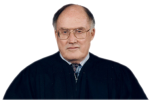{width=150}

:::

Respondent Shirley Jones brought suit in California Superior Court claiming that she had been libeled in an article written and edited by petitioners in Florida. The article was published in a national magazine with a large circulation in California. Petitioners were served with process by mail in Florida and caused special appearances to be entered on their behalf, moving to quash the service of process for lack of personal jurisdiction. The superior court granted the motion on the ground that First Amendment concerns weighed against an assertion of jurisdiction otherwise proper under the Due Process Clause. The California Court of Appeal reversed, rejecting the suggestion that First Amendment considerations enter into the jurisdictional analysis. We now affirm.

Respondent lives and works in California. She and her husband brought this suit against the National Enquirer, Inc., its local distributing company, and petitioners for libel, invasion of privacy, and intentional infliction of emotional harm. The Enquirer is a Florida corporation with its principal place of business in Florida. It publishes a national weekly newspaper with a total circulation of over 5 million. About 600,000 of those copies, almost twice the level of the next highest State, are sold in California. Respondent's and her husband's claims were based on an article that appeared in the Enquirer's October 9, 1979 issue. \[...\]

The allegedly libelous story concerned the California activities of a California resident. It impugned the professionalism of an entertainer whose television career was centered in California.^9^ [ ^9^ The article alleged that respondent drank so heavily as to prevent her from fulfilling her professional obligations.\
]{.aside} The article was drawn from California sources, and the brunt of the harm, in terms both of respondent's emotional distress and the injury to her professional reputation, was suffered in California. In sum, California is the focal point both of the story and of the harm suffered. Jurisdiction over petitioners is therefore proper in California based on the "effects" of their Florida conduct in California. *World-Wide Volkswagen Corp. v. Woodson*. \[...\]

We hold that jurisdiction over petitioners in California is proper because of their intentional conduct in Florida calculated to cause injury to respondent in California. The judgment of the California Court of Appeal is

*Affirmed.*

### Keeton v. Hustler Magazine, Inc.

**Justice Rehnquist delivered the opinion of the Court.** [465 U.S. 770 (1984)]{.aside}

::: {.column-margin}

{width=150}

:::

Petitioner Kathy Keeton sued respondent Hustler Magazine, Inc., and other defendants in the United States District Court for the District of New Hampshire, alleging jurisdiction over her libel complaint by reason of diversity of citizenship. The District Court dismissed her suit because it believed that the Due Process Clause of the Fourteenth Amendment to the United States Constitution forbade the application of New Hampshire's long-arm statute in order to acquire personal jurisdiction over respondent. The Court of Appeals for the First Circuit affirmed \[...\]. We granted certiorari, and we now reverse.

Petitioner Keeton is a resident of New York. Her only connection with New Hampshire is the circulation there of copies of a magazine that she assists in producing. The magazine bears petitioner's name in several places crediting her with editorial and other work. Respondent Hustler Magazine, Inc., is an Ohio corporation, with its principal place of business in California. Respondent's contacts with New Hampshire consist of the sale of some 10,000 to 15,000 copies of Hustler Magazine in that State each month. Petitioner claims to have been libeled in five separate issues of respondent's magazine published between September 1975 and May 1976. \[...\] New Hampshire was the only State where petitioner's suit would not have been time-barred when it was filed. \[...\]

We conclude that the Court of Appeals erred when it affirmed the dismissal of petitioner's suit for lack of personal jurisdiction. Respondent's regular circulation of magazines in the forum State is sufficient to support an assertion of jurisdiction in a libel action based on the contents of the magazine. \[...\]

\[R\]egular monthly sales of thousands of magazines cannot by any stretch of the imagination be characterized as random, isolated, or fortuitous. It is, therefore, unquestionable that New Hampshire jurisdiction over a complaint based on those contacts would ordinarily satisfy the requirement of the Due Process Clause that a State's assertion of personal jurisdiction over a nonresident defendant be predicated on "minimum contacts" between the defendant and the State. *See World-Wide Volkswagen Corp. v. Woodson*; *International Shoe Co. v. Washington*. And, as the Court of Appeals acknowledged, New Hampshire has adopted a "long-arm" statute authorizing service of process on nonresident corporations whenever permitted by the Due Process Clause.^4^ [ ^4^ New Hampshire Rev. Stat. Ann. § 300:14 (1977) provides in relevant part:\
"If a foreign corporation ... commits a tort in whole or in part in New Hampshire, such ac\[t\] shall be deemed to be doing business in New Hampshire by such foreign corporation and shall be deemed equivalent to the appointment by such foreign corporation of the secretary of the state of New Hampshire and his successors to be its true and lawful attorney upon whom may be served all lawful process in any actions or proceedings against such foreign corporation arising from or growing out of such ... tort."\
This statute has been construed in the New Hampshire courts to extend jurisdiction over nonresident corporations to the fullest extent permitted under the Federal Constitution.\
]{.aside} Thus, all the requisites for personal jurisdiction over Hustler Magazine, Inc., in New Hampshire are present.

\[...\]

\[A\]ny potential unfairness in applying New Hampshire's statute of limitations to all aspects of this nationwide suit has nothing to do with the jurisdiction of the court to adjudicate the claims. "The issue is personal jurisdiction, not choice of law." *Hanson v. Denckla*. The question of the applicability of New Hampshire's statute of limitations to claims for out-of-state damages presents itself in the course of litigation only after jurisdiction over respondent is established, and we do not think that such choice-of-law concerns should complicate or distort the jurisdictional inquiry.

\[...\]

The plaintiff's residence is not, of course, completely irrelevant to the jurisdictional inquiry. As noted, that inquiry focuses on the relations among the defendant, the forum, and the litigation. Plaintiff's residence may well play an important role in determining the propriety of entertaining a suit against the defendant in the forum. That is, plaintiff's residence in the forum may, because of defendant's relationship with the plaintiff, enhance defendant's contacts with the forum. Plaintiff's residence may be the focus of the activities of the defendant out of which the suit arises. *See Calder v. Jones*; *McGee v. International Life Ins. Co.* But plaintiff's residence in the forum State is not a separate requirement, and lack of residence will not defeat jurisdiction established on the basis of defendant's contacts.

It is undoubtedly true that the bulk of the harm done to petitioner occurred outside New Hampshire. But that will be true in almost every libel action brought somewhere other than the plaintiff's domicile. There is no justification for restricting libel actions to the plaintiff's home forum. The victim of a libel, like the victim of any other tort, may choose to bring suit in any forum with which the defendant has "certain minimum contacts ... such that the maintenance of the suit does not offend 'traditional notions of fair play and substantial justice.'" *International Shoe Co. v. Washington*.

Where, as in this case, respondent Hustler Magazine, Inc., has continuously and deliberately exploited the New Hampshire market, it must reasonably anticipate being haled into court there in a libel action based on the contents of its magazine. *World-Wide Volkswagen Corp. v. Woodson*. \[...\]

The judgment of the Court of Appeals is reversed, and the cause is remanded for proceedings consistent with this opinion.

*It is so ordered.*

### Burger King Corp. v. Rudzewicz

**JUSTICE BRENNAN delivered the opinion of the Court.** [471 U.S. 462 (1985)]{.aside}

::: {.column-margin}

{width=150}

:::

The State of Florida's long-arm statute extends jurisdiction to "\[a\]ny person, whether or not a citizen or resident of this state," who, *inter alia*, "\[b\]reach\[es\] a contract in this state by failing to perform acts required by the contract to be performed in this state," so long as the cause of action arises from the alleged contractual breach. The United States District Court for the Southern District of Florida, sitting in diversity, relied on this provision in exercising personal jurisdiction over a Michigan resident who allegedly had breached a franchise agreement with a Florida corporation by failing to make required payments in Florida. The question presented is whether this exercise of long-arm jurisdiction offended "traditional conception\[s\] of fair play and substantial justice" embodied in the Due Process Clause of the Fourteenth Amendment. *International Shoe Co. v. Washington*.

**I**

**A**

Burger King Corporation is a Florida corporation whose principal offices are in Miami. It is one of the world's largest restaurant organizations, with over 3,000 outlets in the 50 States, the Commonwealth of Puerto Rico, and 8 foreign nations. Burger King conducts approximately 80% of its business through a franchise operation that the company styles the "Burger King System"---"a comprehensive restaurant format and operating system for the sale of uniform and quality food products." Burger King licenses its franchisees to use its trademarks and service marks for a period of 20 years and leases standardized restaurant facilities to them for the same term. In addition, franchisees acquire a variety of proprietary information concerning the "standards, specifications, procedures and methods for operating a Burger King Restaurant." They also receive market research and advertising assistance; ongoing training in restaurant management; and accounting, cost-control, and inventory-control guidance. By permitting franchisees to tap into Burger King's established national reputation and to benefit from proven procedures for dispensing standardized fare, this system enables them to go into the restaurant business with significantly lowered barriers to entry.

In exchange for these benefits, franchisees pay Burger King an initial \$40,000 franchise fee and commit themselves to payment of monthly royalties, advertising and sales promotion fees, and rent computed in part from monthly gross sales. Franchisees also agree to submit to the national organization's exacting regulation of virtually every conceivable aspect of their operations.^4^ [ ^4^ Mandatory training seminars are conducted at Burger King University in Miami and at Whopper College Regional Training Centers around the country.\
]{.aside} Burger King imposes these standards and undertakes its rigid regulation out of conviction that "\[u\]niformity of service, appearance, and quality of product is essential to the preservation of the Burger King image and the benefits accruing therefrom to both Franchisee and Franchisor."

Burger King oversees its franchise system through a two-tiered administrative structure. The governing contracts provide that the franchise relationship is established in Miami and governed by Florida law, and call for payment of all required fees and forwarding of all relevant notices to the Miami headquarters. The Miami headquarters sets policy and works directly with its franchisees in attempting to resolve major problems. Day-to-day monitoring of franchisees, however, is conducted through a network of 10 district offices which in turn report to the Miami headquarters.

The instant litigation grows out of Burger King's termination of one of its franchisees, and is aptly described by the franchisee as "a divorce proceeding among commercial partners." \[...\]

\[Appellee John\] Rudzewicz and \[his business partner, Brian\] MacShara jointly applied for a franchise to Burger King's Birmingham, Michigan, district office in the autumn of 1978. Their application was forwarded to Burger King's Miami headquarters, which entered into a preliminary agreement with them in February 1979. During the ensuing four months it was agreed that Rudzewicz and MacShara would assume operation of an existing facility in Drayton Plains, Michigan. MacShara attended the prescribed management courses in Miami during this period, and the franchisees purchased \$165,000 worth of restaurant equipment from Burger King's Davmor Industries division in Miami. Even before the final agreements were signed, however, the parties began to disagree over site-development fees, building design, computation of monthly rent, and whether the franchisees would be able to assign their liabilities to a corporation they had formed. During these disputes Rudzewicz and MacShara negotiated both with the Birmingham district office and with the Miami headquarters. With some misgivings, Rudzewicz and MacShara finally obtained limited concessions from the Miami headquarters, signed the final agreements, and commenced operations in June 1979. By signing the final agreements, Rudzewicz obligated himself personally to payments exceeding \$1 million over the 20-year franchise relationship.

The Drayton Plains facility apparently enjoyed steady business during the summer of 1979, but patronage declined after a recession began later that year. Rudzewicz and MacShara soon fell far behind in their monthly payments to Miami. Headquarters sent notices of default, and an extended period of negotiations began among the franchisees, the Birmingham district office, and the Miami headquarters. After several Burger King officials in Miami had engaged in prolonged but ultimately unsuccessful negotiations with the franchisees by mail and by telephone, headquarters terminated the franchise and ordered Rudzewicz and MacShara to vacate the premises. They refused and continued to occupy and operate the facility as a Burger King restaurant.

\[...\]

**II**

\[...\]

**B**

**(1)**

\[...\]

If the question is whether an individual's contract with an out-of-state party *alone* can automatically establish sufficient minimum contacts in the other party's home forum, we believe the answer clearly is that it cannot. The Court long ago rejected the notion that personal jurisdiction might turn on "mechanical" tests, *International Shoe Co. v. Washington*, or on "conceptualistic ... theories of the place of contracting or of performance." Instead, we have emphasized the need for a "highly realistic" approach that recognizes that a "contract" is "ordinarily but an intermediate step serving to tie up prior business negotiations with future consequences which themselves are the real object of the business transaction." It is these factors---prior negotiations and contemplated future consequences, along with the terms of the contract and the parties' actual course of dealing---that must be evaluated in determining whether the defendant purposefully established minimum contacts within the forum.

In this case, no physical ties to Florida can be attributed to Rudzewicz other than MacShara's brief training course in Miami. Rudzewicz did not maintain offices in Florida and, for all that appears from the record, has never even visited there. Yet this franchise dispute grew directly out of "a contract which had a *substantial* connection with that State." *McGee v. International Life Insurance Co.* (emphasis added). Eschewing the option of operating an independent local enterprise, Rudzewicz deliberately "reach\[ed\] out beyond" Michigan and negotiated with a Florida corporation for the purchase of a long-term franchise and the manifold benefits that would derive from affiliation with a nationwide organization. Upon approval, he entered into a carefully structured 20-year relationship that envisioned continuing and wide-reaching contacts with Burger King in Florida. In light of Rudzewicz' voluntary acceptance of the long-term and exacting regulation of his business from Burger King's Miami headquarters, the "quality and nature" of his relationship to the company in Florida can in no sense be viewed as "random," "fortuitous," or "attenuated." *Hanson v. Denckla*; *Keeton v. Hustler Magazine, Inc.*; *World-Wide Volkswagen Corp. v. Woodson*. Rudzewicz' refusal to make the contractually required payments in Miami, and his continued use of Burger King's trademarks and confidential business information after his termination, caused foreseeable injuries to the corporation in Florida. For these reasons it was, at the very least, presumptively reasonable for Rudzewicz to be called to account there for such injuries.

\[...\] Rudzewicz most certainly knew that he was affiliating himself with an enterprise based primarily in Florida. The contract documents themselves emphasize that Burger King's operations are conducted and supervised from the Miami headquarters, that all relevant notices and payments must be sent there, and that the agreements were made in and enforced from Miami. Moreover, the parties' actual course of dealing repeatedly confirmed that decisionmaking authority was vested in the Miami headquarters and that the district office served largely as an intermediate link between the headquarters and the franchisees. \[...\]

Moreover, we believe the Court of Appeals gave insufficient weight to provisions in the various franchise documents providing that all disputes would be governed by Florida law. \[...\] The Court in *Hanson* and subsequent cases has emphasized that choice-of-law *analysis*---which focuses on all elements of a transaction, and not simply on the defendant's conduct---is distinct from minimum-contacts jurisdictional analysis---which focuses at the threshold solely on the defendant's purposeful connection to the forum. Nothing in our cases, however, suggests that a choice-of-law *provision* should be ignored in considering whether a defendant has "purposefully invoked the benefits and protections of a State's laws" for jurisdictional purposes. Although such a provision standing alone would be insufficient to confer jurisdiction, we believe that, when combined with the 20-year interdependent relationship Rudzewicz established with Burger King's Miami headquarters, it reinforced his deliberate affiliation with the forum State and the reasonable foreseeability of possible litigation there. \[...\]

**(2)**

Nor has Rudzewicz pointed to other factors that can be said persuasively to outweigh the considerations discussed above and to establish the *unconstitutionality* of Florida's assertion of jurisdiction. We cannot conclude that Florida had no "legitimate interest in holding \[Rudzewicz\] answerable on a claim related to" the contacts he had established in that State. *Keeton v. Hustler Magazine, Inc.*; *see also McGee v. International Life Insurance Co.* (noting that State frequently will have a "manifest interest in providing effective means of redress for its residents"). \[...\] Although the Court has suggested that inconvenience may at some point become so substantial as to achieve *constitutional* magnitude, *McGee v. International Life Insurance Co.*, this is not such a case.

\[...\]

Because Rudzewicz established a substantial and continuing relationship with Burger King's Miami headquarters, received fair notice from the contract documents and the course of dealing that he might be subject to suit in Florida, and has failed to demonstrate how jurisdiction in that forum would otherwise be fundamentally unfair, we conclude that the District Court's exercise of jurisdiction \[...\] did not offend due process. The judgment of the Court of Appeals is accordingly reversed, and the case is remanded for further proceedings consistent with this opinion.

*It is so ordered.*

**JUSTICE STEVENS, with whom JUSTICE WHITE joins, dissenting.**

::: {.column-margin}

{width=150}

:::

In my opinion there is a significant element of unfairness in requiring a franchisee to defend a case of this kind in the forum chosen by the franchisor. It is undisputed that appellee maintained no place of business in Florida, that he had no employees in that State, and that he was not licensed to do business there. Appellee did not prepare his French fries, shakes, and hamburgers in Michigan, and then deliver them into the stream of commerce "with the expectation that they \[would\] be purchased by consumers in" Florida. To the contrary, appellee did business only in Michigan, his business, property, and payroll taxes were payable in that State, and he sold all of his products there.

Throughout the business relationship, appellee's principal contacts with appellant were with its Michigan office. Notwithstanding its disclaimer, the Court seems ultimately to rely on nothing more than standard boilerplate language contained in various documents to establish that appellee "purposefully availed himself of the benefits and protections of Florida's laws." Such superficial analysis creates a potential for unfairness not only in negotiations between franchisors and their franchisees but, more significantly, in the resolution of the disputes that inevitably arise from time to time in such relationships.

\[...\]

Accordingly, I respectfully dissent.

### Asahi Metal Industry Co. v. Superior Court

**JUSTICE O'CONNOR** [480 U.S. 102 (1987)]{.aside}**announced the judgment of the Court and delivered the unanimous opinion of the Court with respect to Part I, the opinion of the Court with respect to Part II-B, in which THE CHIEF JUSTICE, JUSTICE BRENNAN, JUSTICE WHITE, JUSTICE MARSHALL, JUSTICE BLACKMUN, JUSTICE POWELL, and JUSTICE STEVENS join, and an opinion with respect to Parts II-A and III, in which THE CHIEF JUSTICE, JUSTICE POWELL, and JUSTICE SCALIA join.** 

::: {.column-margin}

{width=150}

:::

This case presents the question whether the mere awareness on the part of a foreign defendant that the components it manufactured, sold, and delivered outside the United States would reach the forum State in the stream of commerce constitutes "minimum contacts" between the defendant and the forum State such that the exercise of jurisdiction "does not offend 'traditional notions of fair play and substantial justice.'" *International Shoe Co. v. Washington*.

**I**

On September 23, 1978, on Interstate Highway 80 in Solano County, California, Gary Zurcher lost control of his Honda motorcycle and collided with a tractor. Zurcher was severely injured, and his passenger and wife, Ruth Ann Moreno, was killed. In September 1979, Zurcher filed a product liability action in the Superior Court of the State of California in and for the County of Solano. Zurcher alleged that the 1978 accident was caused by a sudden loss of air and an explosion in the rear tire of the motorcycle, and alleged that the motorcycle tire, tube, and sealant were defective. Zurcher's complaint named, inter alia, Cheng Shin Rubber Industrial Co., Ltd. (Cheng Shin), the Taiwanese manufacturer of the tube. Cheng Shin in turn filed a cross-complaint seeking indemnification from its codefendants and from petitioner, Asahi Metal Industry Co., Ltd. (Asahi), the manufacturer of the tube's valve assembly. Zurcher's claims against Cheng Shin and the other defendants were eventually settled and dismissed, leaving only Cheng Shin's indemnity action against Asahi.

California's long-arm statute authorizes the exercise of jurisdiction "on any basis not inconsistent with the Constitution of this state or of the United States." Asahi moved to quash Cheng Shin's service of summons, arguing the State could not exert jurisdiction over it consistent with the Due Process Clause of the Fourteenth Amendment.

In relation to the motion, the following information was submitted by Asahi and Cheng Shin. Asahi is a Japanese corporation. It manufactures tire valve assemblies in Japan and sells the assemblies to Cheng Shin, and to several other tire manufacturers, for use as components in finished tire tubes. Asahi's sales to Cheng Shin took place in Taiwan. The shipments from Asahi to Cheng Shin were sent from Japan to Taiwan. Cheng Shin bought and incorporated into its tire tubes 150,000 Asahi valve assemblies in 1978; 500,000 in 1979; 500,000 in 1980; 100,000 in 1981; and 100,000 in 1982. Sales to Cheng Shin accounted for 1.24 percent of Asahi's income in 1981 and 0.44 percent in 1982. Cheng Shin alleged that approximately 20 percent of its sales in the United States are in California. Cheng Shin purchases valve assemblies from other suppliers as well, and sells finished tubes throughout the world.

In 1983 an attorney for Cheng Shin conducted an informal examination of the valve stems of the tire tubes sold in one cycle store in Solano County. The attorney declared that of the approximately 115 tire tubes in the store, 97 were purportedly manufactured in Japan or Taiwan, and of those 97, 21 valve stems were marked with the circled letter "A", apparently Asahi's trademark. Of the 21 Asahi valve stems, 12 were incorporated into Cheng Shin tire tubes. The store contained 41 other Cheng Shin tubes that incorporated the valve assemblies of other manufacturers. An affidavit of a manager of Cheng Shin whose duties included the purchasing of component parts stated: "'In discussions with Asahi regarding the purchase of valve stem assemblies the fact that my Company sells tubes throughout the world and specifically the United States has been discussed. I am informed and believe that Asahi was fully aware that valve stem assemblies sold to my Company and to others would end up throughout the United States and in California.'" An affidavit of the president of Asahi, on the other hand, declared that Asahi "'has never contemplated that its limited sales of tire valves to Cheng Shin in Taiwan would subject it to lawsuits in California.'" The record does not include any contract between Cheng Shin and Asahi.

Primarily on the basis of the above information, the Superior Court denied the motion to quash summons, stating: "Asahi obviously does business on an international scale. It is not unreasonable that they defend claims of defect in their product on an international scale." Order Denying Motion to Quash Summons.

The Court of Appeal of the State of California \[disagreed,\] conclud\[ing\] that "it would be unreasonable to require Asahi to respond in California solely on the basis of ultimately realized foreseeability that the product into which its component was embodied would be sold all over the world including California."

The Supreme Court of the State of California reversed \[...\]. The court observed: "Asahi has no offices, property or agents in California. It solicits no business in California and has made no direct sales \[in California\]." Moreover, "Asahi did not design or control the system of distribution that carried its valve assemblies into California." Nevertheless, the court found the exercise of jurisdiction over Asahi to be consistent with the Due Process Clause. It concluded that Asahi knew that some of the valve assemblies sold to Cheng Shin would be incorporated into tire tubes sold in California, and that Asahi benefited indirectly from the sale in California of products incorporating its components. The court considered Asahi's intentional act of placing its components into the stream of commerce --- that is, by delivering the components to Cheng Shin in Taiwan --- coupled with Asahi's awareness that some of the components would eventually find their way into California, sufficient to form the basis for state court jurisdiction under the Due Process Clause.

We granted certiorari and now reverse.

**II**

**A**

\[...\]

Applying the principle that minimum contacts must be based on an act of the defendant, the Court in *World-Wide Volkswagen Corp. v. Woodson* rejected the assertion that a consumer's unilateral act of bringing the defendant's product into the forum State was a sufficient constitutional basis for personal jurisdiction over the defendant. It had been argued in *World-Wide Volkswagen* that because an automobile retailer and its wholesale distributor sold a product mobile by design and purpose, they could foresee being haled into court in the distant States into which their customers might drive. The Court rejected this concept of foreseeability as an insufficient basis for jurisdiction under the Due Process Clause. The Court disclaimed, however, the idea that "foreseeability is wholly irrelevant" to personal jurisdiction, concluding that "\[t\]he forum State does not exceed its powers under the Due Process Clause if it asserts personal jurisdiction over a corporation that delivers its products into the stream of commerce with the expectation that they will be purchased by consumers in the forum State." \[...\]

In *World-Wide Volkswagen* itself, the state court sought to base jurisdiction not on any act of the defendant, but on the foreseeable unilateral actions of the consumer. Since *World-Wide Volkswagen*, lower courts have been confronted with cases in which the defendant acted by placing a product in the stream of commerce, and the stream eventually swept defendant's product into the forum State, but the defendant did nothing else to purposefully avail itself of the market in the forum State. Some courts have understood the Due Process Clause, as interpreted in *World-Wide Volkswagen*, to allow an exercise of personal jurisdiction to be based on no more than the defendant's act of placing the product in the stream of commerce. Other courts have understood the Due Process Clause and the above-quoted language in *World-Wide Volkswagen* to require the action of the defendant to be more purposefully directed at the forum State than the mere act of placing a product in the stream of commerce.

The reasoning of the Supreme Court of California in the present case illustrates the former interpretation of *World-Wide Volkswagen*. The Supreme Court of California held that, because the stream of commerce eventually brought some valves Asahi sold Cheng Shin into California, Asahi's awareness that its valves would be sold in California was sufficient to permit California to exercise jurisdiction over Asahi consistent with the requirements of the Due Process Clause. The Supreme Court of California's position was consistent with those courts that have held that mere foreseeability or awareness was a constitutionally sufficient basis for personal jurisdiction if the defendant's product made its way into the forum State while still in the stream of commerce.

Other courts, however, have understood the Due Process Clause to require something more than that the defendant was aware of its product's entry into the forum State through the stream of commerce in order for the State to exert jurisdiction over the defendant. \[...\]

We now find this latter position to be consonant with the requirements of due process. The "substantial connection," *Burger King*; *McGee*, between the defendant and the forum State necessary for a finding of minimum contacts must come about *by an action of the defendant purposefully directed toward the forum State*. *Burger King*; *Keeton v. Hustler Magazine, Inc.* The placement of a product into the stream of commerce, without more, is not an act of the defendant purposefully directed toward the forum State. Additional conduct of the defendant may indicate an intent or purpose to serve the market in the forum State, for example, designing the product for the market in the forum State, advertising in the forum State, establishing channels for providing regular advice to customers in the forum State, or marketing the product through a distributor who has agreed to serve as the sales agent in the forum State. But a defendant's awareness that the stream of commerce may or will sweep the product into the forum State does not convert the mere act of placing the product into the stream into an act purposefully directed toward the forum State.

Assuming, *arguendo*, that respondents have established Asahi's awareness that some of the valves sold to Cheng Shin would be incorporated into tire tubes sold in California, respondents have not demonstrated any action by Asahi to purposefully avail itself of the California market. Asahi does not do business in California. It has no office, agents, employees, or property in California. It does not advertise or otherwise solicit business in California. It did not create, control, or employ the distribution system that brought its valves to California. There is no evidence that Asahi designed its product in anticipation of sales in California. On the basis of these facts, the exertion of personal jurisdiction over Asahi by the Superior Court of California exceeds the limits of due process.

**B**

\[...\]

We have previously explained that the determination of the reasonableness of the exercise of jurisdiction in each case will depend on an evaluation of several factors. A court must consider the burden on the defendant, the interests of the forum State, and the plaintiff's interest in obtaining relief. It must also weigh in its determination "the interstate judicial system's interest in obtaining the most efficient resolution of controversies; and the shared interest of the several States in furthering fundamental substantive social policies." *World-Wide Volkswagen*.

A consideration of these factors in the present case clearly reveals the unreasonableness of the assertion of jurisdiction over Asahi, even apart from the question of the placement of goods in the stream of commerce.

Certainly the burden on the defendant in this case is severe. Asahi has been commanded by the Supreme Court of California not only to traverse the distance between Asahi's headquarters in Japan and the Superior Court of California in and for the County of Solano, but also to submit its dispute with Cheng Shin to a foreign nation's judicial system. The unique burdens placed upon one who must defend oneself in a foreign legal system should have significant weight in assessing the reasonableness of stretching the long arm of personal jurisdiction over national borders.

When minimum contacts have been established, often the interests of the plaintiff and the forum in the exercise of jurisdiction will justify even the serious burdens placed on the alien defendant. In the present case, however, the interests of the plaintiff and the forum in California's assertion of jurisdiction over Asahi are slight. All that remains is a claim for indemnification asserted by Cheng Shin, a Taiwanese corporation, against Asahi. The transaction on which the indemnification claim is based took place in Taiwan; Asahi's components were shipped from Japan to Taiwan. Cheng Shin has not demonstrated that it is more convenient for it to litigate its indemnification claim against Asahi in California rather than in Taiwan or Japan.

Because the plaintiff is not a California resident, California's legitimate interests in the dispute have considerably diminished. The Supreme Court of California argued that the State had an interest in "protecting its consumers by ensuring that foreign manufacturers comply with the state's safety standards." The State Supreme Court's definition of California's interest, however, was overly broad. The dispute between Cheng Shin and Asahi is primarily about indemnification rather than safety standards. Moreover, it is not at all clear at this point that California law should govern the question whether a Japanese corporation should indemnify a Taiwanese corporation on the basis of a sale made in Taiwan and a shipment of goods from Japan to Taiwan. The possibility of being haled into a California court as a result of an accident involving Asahi's components undoubtedly creates an additional deterrent to the manufacture of unsafe components; however, similar pressures will be placed on Asahi by the purchasers of its components as long as those who use Asahi components in their final products, and sell those products in California, are subject to the application of California tort law.

*World-Wide Volkswagen* also admonished courts to take into consideration the interests of the "several States," in addition to the forum State, in the efficient judicial resolution of the dispute and the advancement of substantive policies. In the present case, this advice calls for a court to consider the procedural and substantive policies of other nations whose interests are affected by the assertion of jurisdiction by the California court. The procedural and substantive interests of other *nations* in a state court's assertion of jurisdiction over an alien defendant will differ from case to case. In every case, however, those interests, as well as the Federal Government's interest in its foreign relations policies, will be best served by a careful inquiry into the reasonableness of the assertion of jurisdiction in the particular case, and an unwillingness to find the serious burdens on an alien defendant outweighed by minimal interests on the part of the plaintiff or the forum State. "Great care and reserve should be exercised when extending our notions of personal jurisdiction into the international field."

Considering the international context, the heavy burden on the alien defendant, and the slight interests of the plaintiff and the forum State, the exercise of personal jurisdiction by a California court over Asahi in this instance would be unreasonable and unfair.

**III**

Because the facts of this case do not establish minimum contacts such that the exercise of personal jurisdiction is consistent with fair play and substantial justice, the judgment of the Supreme Court of California is reversed, and the case is remanded for further proceedings not inconsistent with this opinion.

*It is so ordered.*

**JUSTICE BRENNAN, with whom JUSTICE WHITE, JUSTICE MARSHALL, and JUSTICE BLACKMUN join, concurring in part and concurring in the judgment.**

::: {.column-margin}

{width=150}

:::

I do not agree with the interpretation in Part II-A of the stream-of-commerce theory, nor with the conclusion that Asahi did not "purposely avail itself of the California market." I do agree, however, with the Court's conclusion in Part II-B that the exercise of personal jurisdiction over Asahi in this case would not comport with "fair play and substantial justice," *International Shoe Co. v. Washington*. This is one of those rare cases in which "minimum requirements inherent in the concept of 'fair play and substantial justice' ... defeat the reasonableness of jurisdiction even \[though\] the defendant has purposefully engaged in forum activities." *Burger King Corp. v. Rudzewicz*. I therefore join Parts I and II-B of the Court's opinion, and write separately to explain my disagreement with Part II-A.

Part II-A states that "a defendant's awareness that the stream of commerce may or will sweep the product into the forum State does not convert the mere act of placing the product into the stream into an act purposefully directed toward the forum State." Under this view, a plaintiff would be required to show "\[a\]dditional conduct" directed toward the forum before finding the exercise of jurisdiction over the defendant to be consistent with the Due Process Clause. I see no need for such a showing, however. The stream of commerce refers not to unpredictable currents or eddies, but to the regular and anticipated flow of products from manufacture to distribution to retail sale. As long as a participant in this process is aware that the final product is being marketed in the forum State, the possibility of a lawsuit there cannot come as a surprise. Nor will the litigation present a burden for which there is no corresponding benefit. A defendant who has placed goods in the stream of commerce benefits economically from the retail sale of the final product in the forum State, and indirectly benefits from the State's laws that regulate and facilitate commercial activity. These benefits accrue regardless of whether that participant directly conducts business in the forum State, or engages in additional conduct directed toward that State. Accordingly, most courts and commentators have found that jurisdiction premised on the placement of a product into the stream of commerce is consistent with the Due Process Clause, and have not required a showing of additional conduct.

\[...\]

**JUSTICE STEVENS, with whom JUSTICE WHITE and JUSTICE BLACKMUN join, concurring in part and concurring in the judgment.**

::: {.column-margin}

{width=150}

:::

The judgment of the Supreme Court of California should be reversed for the reasons stated in Part II-B of the Court's opinion. While I join Parts I and II-B, I do not join Part II-A for two reasons. First, it is not necessary to the Court's decision. An examination of minimum contacts is not always necessary to determine whether a state court's assertion of personal jurisdiction is constitutional. *See Burger King Corp. v. Rudzewicz*. Part II-B establishes, after considering the factors set forth in *World-Wide Volkswagen Corp. v. Woodson*, that California's exercise of jurisdiction over Asahi in this case would be "unreasonable and unfair." This finding alone requires reversal; this case fits within the rule that "minimum requirements inherent in the concept of 'fair play and substantial justice' may defeat the reasonableness of jurisdiction even if the defendant has purposefully engaged in forum activities." *Burger King* (quoting *International Shoe Co. v. Washington*). Accordingly, I see no reason in this case for the plurality to articulate "purposeful direction" or any other test as the nexus between an act of a defendant and the forum State that is necessary to establish minimum contacts.

Second, even assuming that the test ought to be formulated here, Part II-A misapplies it to the facts of this case. The plurality seems to assume that an unwavering line can be drawn between "mere awareness" that a component will find its way into the forum State and "purposeful availment" of the forum's market. Over the course of its dealings with Cheng Shin, Asahi has arguably engaged in a higher quantum of conduct than "\[t\]he placement of a product into the stream of commerce, without more ... ." Whether or not this conduct rises to the level of purposeful availment requires a constitutional determination that is affected by the volume, the value, and the hazardous character of the components. In most circumstances I would be inclined to conclude that a regular course of dealing that results in deliveries of over 100,000 units annually over a period of several years would constitute "purposeful availment" even though the item delivered to the forum State was a standard product marketed throughout the world.

#### Notes & Questions

1.  In *Asahi*, we can see more clearly the five fairness factors first introduced in *World-Wide Volkswagen*. Can you identify those five factors? How do the fairness factors fit together with the minimum-contacts analysis? Does the court need both? One or the other?

2.  Like *Burnham* (decided one year later), *Asahi* is another personal jurisdiction case in which the Supreme Court failed to reach a majority. On which question(s) did the Court fall short of five votes? What is left unanswered in *Asahi*?

3.  Note that the dispute at issue in *Asahi* concerned crossclaims: those brought by one defendant (Cheng Shin) for indemnification against another defendant (Asahi). Nevertheless, the court's personal jurisdiction over the relevant defendant is still necessary for any judgment to be valid and enforceable.

4.  *Asahi* is what we might call a foreign-cubed suit. It involves a foreign plaintiff alleging claims against a foreign defendant for conduct that occurred primarily outside the United States. Does that make this case an unlikely one for personal jurisdiction in California? What theory did the plaintiff rely on to try to establish such jurisdiction?

### J. McIntyre Machinery, Ltd. v. Nicastro

**KENNEDY, J.,** [564 U.S. 873 (2011)]{.aside}**announced the judgment of the Court and delivered an opinion, in which THE CHIEF JUSTICE, SCALIA, J., and THOMAS, J., join.** 

::: {.column-margin}

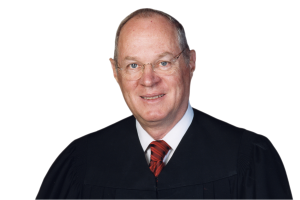{width=150}

:::

Whether a person or entity is subject to the jurisdiction of a state court despite not having been present in the State either at the time of suit or at the time of the alleged injury, and despite not having consented to the exercise of jurisdiction, is a question that arises with great frequency in the routine course of litigation. The rules and standards for determining when a State does or does not have jurisdiction over an absent party have been unclear because of decades-old questions left open in *Asahi Metal Industry Co. v. Superior Court*.

Here, the Supreme Court of New Jersey, relying in part on *Asahi*, held that New Jersey's courts can exercise jurisdiction over a foreign manufacturer of a product so long as the manufacturer "knows or reasonably should know that its products are distributed through a nationwide distribution system that might lead to those products being sold in any of the fifty states." Applying that test, the court concluded that a British manufacturer of scrap metal machines was subject to jurisdiction in New Jersey, even though at no time had it advertised in, sent goods to, or in any relevant sense targeted the State.

That decision cannot be sustained. \[...\] As a general rule, the exercise of judicial power is not lawful unless the defendant "purposefully avails itself of the privilege of conducting activities within the forum State, thus invoking the benefits and protections of its laws." *Hanson v. Denckla*. There may be exceptions, say, for instance, in cases involving an intentional tort. But the general rule is applicable in this products-liability case, and the so-called "stream-of-commerce" doctrine cannot displace it.

**I**

This case arises from a products-liability suit filed in New Jersey state court. Robert Nicastro seriously injured his hand while using a metal-shearing machine manufactured by J. McIntyre Machinery, Ltd. (J. McIntyre). The accident occurred in New Jersey, but the machine was manufactured in England, where J. McIntyre is incorporated and operates. The question here is whether the New Jersey courts have jurisdiction over J. McIntyre, notwithstanding the fact that the company at no time either marketed goods in the State or shipped them there.

At oral argument in this Court, Nicastro's counsel stressed three primary facts in defense of New Jersey's assertion of jurisdiction over J. McIntyre.

First, an independent company agreed to sell J. McIntyre's machines in the United States. J. McIntyre itself did not sell its machines to buyers in this country beyond the U.S. distributor, and there is no allegation that the distributor was under J. McIntyre's control.

Second, J. McIntyre officials attended annual conventions for the scrap recycling industry to advertise J. McIntyre's machines alongside the distributor. The conventions took place in various States, but never in New Jersey.

Third, no more than four machines, including the machine that caused the injuries that are the basis for this suit, ended up in New Jersey.

In addition to these facts emphasized by respondent, the New Jersey Supreme Court noted that \[...\] the U.S. distributor "structured \[its\] advertising and sales efforts in accordance with" J. McIntyre's "direction and guidance whenever possible," and that "at least some of the machines were sold on consignment to" the distributor.

In light of these facts, the New Jersey Supreme Court concluded that New Jersey courts could exercise jurisdiction over petitioner. \[...\]

\[...\] This Court's *Asahi* decision may be responsible in part for \[the New Jersey\] court's error regarding the stream of commerce, and this case presents an opportunity to provide greater clarity.

**II**

\[...\]

A court may subject a defendant to judgment only when the defendant has sufficient contacts with the sovereign "such that the maintenance of the suit does not offend 'traditional notions of fair play and substantial justice.'" *International Shoe Co. v. Washington* (quoting *Milliken v. Meyer*). Freeform notions of fundamental fairness divorced from traditional practice cannot transform a judgment rendered in the absence of authority into law. As a general rule, the sovereign's exercise of power requires some act by which the defendant "purposefully avails itself of the privilege of conducting activities within the forum State, thus invoking the benefits and protections of its laws," *Hanson*, though in some cases, as with an intentional tort, the defendant might well fall within the State's authority by reason of his attempt to obstruct its laws. In products-liability cases like this one, it is the defendant's purposeful availment that makes jurisdiction consistent with "traditional notions of fair play and substantial justice."

A person may submit to a State's authority in a number of ways. There is, of course, explicit consent. Presence within a State at the time suit commences through service of process is another example. *See Burnham*. Citizenship or domicile---or, by analogy, incorporation or principal place of business for corporations---also indicates general submission to a State's powers. *Goodyear Dunlop Tires Operations, S.A. v. Brown*. Each of these examples reveals circumstances, or a course of conduct, from which it is proper to infer an intention to benefit from and thus an intention to submit to the laws of the forum State. *Cf. Burger King Corp. v. Rudzewicz*. These examples support exercise of the general jurisdiction of the State's courts and allow the State to resolve both matters that originate within the State and those based on activities and events elsewhere. By contrast, those who live or operate primarily outside a State have a due process right not to be subjected to judgment in its courts as a general matter.

There is also a more limited form of submission to a State's authority for disputes that "arise out of or are connected with the activities within the state." *International Shoe Co.* Where a defendant "purposefully avails itself of the privilege of conducting activities within the forum State, thus invoking the benefits and protections of its laws," *Hanson*, it submits to the judicial power of an otherwise foreign sovereign to the extent that power is exercised in connection with the defendant's activities touching on the State. In other words, submission through contact with and activity directed at a sovereign may justify specific jurisdiction "in a suit arising out of or related to the defendant's contacts with the forum." *Helicopteros v. Hall*.

The imprecision arising from *Asahi*, for the most part, results from its statement of the relation between jurisdiction and the "stream of commerce." The stream of commerce, like other metaphors, has its deficiencies as well as its utility. It refers to the movement of goods from manufacturers through distributors to consumers, yet beyond that descriptive purpose its meaning is far from exact. This Court has stated that a defendant's placing goods into the stream of commerce "with the expectation that they will be purchased by consumers within the forum State" may indicate purposeful availment. *World-Wide Volkswagen Corp. v. Woodson* (finding that expectation lacking). But that statement does not amend the general rule of personal jurisdiction. It merely observes that a defendant may in an appropriate case be subject to jurisdiction without entering the forum---itself an unexceptional proposition---as where manufacturers or distributors "seek to serve" a given State's market. The principal inquiry in cases of this sort is whether the defendant's activities manifest an intention to submit to the power of a sovereign. In other words, the defendant must "purposefully avai\[l\] itself of the privilege of conducting activities within the forum State, thus invoking the benefits and protections of its laws." *Hanson*. Sometimes a defendant does so by sending its goods rather than its agents. The defendant's transmission of goods permits the exercise of jurisdiction only where the defendant can be said to have targeted the forum; as a general rule, it is not enough that the defendant might have predicted that its goods will reach the forum State.

In *Asahi*, an opinion by Justice Brennan for four Justices outlined a different approach. It discarded the central concept of sovereign authority in favor of considerations of fairness and foreseeability. As that concurrence contended, "jurisdiction premised on the placement of a product into the stream of commerce \[without more\] is consistent with the Due Process Clause," for "\[a\]s long as a participant in this process is aware that the final product is being marketed in the forum State, the possibility of a lawsuit there cannot come as a surprise." It was the premise of the concurring opinion that the defendant's ability to anticipate suit renders the assertion of jurisdiction fair. In this way, the opinion made foreseeability the touchstone of jurisdiction.

The standard set forth in Justice Brennan's concurrence was rejected in an opinion written by Justice O'Connor; but the relevant part of that opinion, too, commanded the assent of only four Justices, not a majority of the Court. That opinion stated: "The 'substantial connection' between the defendant and the forum State necessary for a finding of minimum contacts must come about by an action of the defendant purposefully directed toward the forum State. The placement of a product into the stream of commerce, without more, is not an act of the defendant purposefully directed toward the forum State."

Since *Asahi* was decided, the courts have sought to reconcile the competing opinions. But Justice Brennan's concurrence, advocating a rule based on general notions of fairness and foreseeability, is inconsistent with the premises of lawful judicial power. This Court's precedents make clear that it is the defendant's actions, not his expectations, that empower a State's courts to subject him to judgment.

\[...\]

Two principles are implicit in the foregoing. First, personal jurisdiction requires a forum-by-forum, or sovereign-by-sovereign, analysis. The question is whether a defendant has followed a course of conduct directed at the society or economy existing within the jurisdiction of a given sovereign, so that the sovereign has the power to subject the defendant to judgment concerning that conduct. Personal jurisdiction, of course, restricts "judicial power not as a matter of sovereignty, but as a matter of individual liberty," for due process protects the individual's right to be subject only to lawful power. But whether a judicial judgment is lawful depends on whether the sovereign has authority to render it.

The second principle is a corollary of the first. Because the United States is a distinct sovereign, a defendant may in principle be subject to the jurisdiction of the courts of the United States but not of any particular State. This is consistent with the premises and unique genius of our Constitution. Ours is "a legal system unprecedented in form and design, establishing two orders of government, each with its own direct relationship, its own privity, its own set of mutual rights and obligations to the people who sustain it and are governed by it." For jurisdiction, a litigant may have the requisite relationship with the United States Government but not with the government of any individual State. That would be an exceptional case, however. If the defendant is a domestic domiciliary, the courts of its home State are available and can exercise general jurisdiction. And if another State were to assert jurisdiction in an inappropriate case, it would upset the federal balance, which posits that each State has a sovereignty that is not subject to unlawful intrusion by other States. Furthermore, foreign corporations will often target or concentrate on particular States, subjecting them to specific jurisdiction in those forums.

It must be remembered, however, that although this case and Asahi both involve foreign manufacturers, the undesirable consequences of Justice Brennan's approach are no less significant for domestic producers. The owner of a small Florida farm might sell crops to a large nearby distributor, for example, who might then distribute them to grocers across the country. If foreseeability were the controlling criterion, the farmer could be sued in Alaska or any number of other States' courts without ever leaving town. And the issue of foreseeability may itself be contested so that significant expenses are incurred just on the preliminary issue of jurisdiction. Jurisdictional rules should avoid these costs whenever possible.

The conclusion that the authority to subject a defendant to judgment depends on purposeful availment, consistent with Justice O'Connor's opinion in *Asahi*, does not by itself resolve many difficult questions of jurisdiction that will arise in particular cases. The defendant's conduct and the economic realities of the market the defendant seeks to serve will differ across cases, and judicial exposition will, in common-law fashion, clarify the contours of that principle.

**III**

In this case, petitioner directed marketing and sales efforts at the United States. It may be that, assuming it were otherwise empowered to legislate on the subject, the Congress could authorize the exercise of jurisdiction in appropriate courts. That circumstance is not presented in this case, however, and it is neither necessary nor appropriate to address here any constitutional concerns that might be attendant to that exercise of power. Nor is it necessary to determine what substantive law might apply were Congress to authorize jurisdiction in a federal court in New Jersey. A sovereign's legislative authority to regulate conduct may present considerations different from those presented by its authority to subject a defendant to judgment in its courts. Here the question concerns the authority of a New Jersey state court to exercise jurisdiction, so it is petitioner's purposeful contacts with New Jersey, not with the United States, that alone are relevant.

Respondent has not established that J. McIntyre engaged in conduct purposefully directed at New Jersey. Recall that respondent's claim of jurisdiction centers on three facts: The distributor agreed to sell J. McIntyre's machines in the United States; J. McIntyre officials attended trade shows in several States but not in New Jersey; and up to four machines ended up in New Jersey. The British manufacturer had no office in New Jersey; it neither paid taxes nor owned property there; and it neither advertised in, nor sent any employees to, the State. Indeed, after discovery the trial court found that the "defendant does not have a single contact with New Jersey short of the machine in question ending up in this state." These facts may reveal an intent to serve the U.S. market, but they do not show that J. McIntyre purposefully availed itself of the New Jersey market.

\[...\]

**\* \* \***

Due process protects petitioner's right to be subject only to lawful authority. At no time did petitioner engage in any activities in New Jersey that reveal an intent to invoke or benefit from the protection of its laws. New Jersey is without power to adjudge the rights and liabilities of J. McIntyre, and its exercise of jurisdiction would violate due process. The contrary judgment of the New Jersey Supreme Court is

*Reversed.*

**BREYER, J., with whom ALITO, J., joins, concurring in the judgment.**

::: {.column-margin}

{width=150}

:::

The Supreme Court of New Jersey adopted a broad understanding of the scope of personal jurisdiction based on its view that "\[t\]he increasingly fast-paced globalization of the world economy has removed national borders as barriers to trade." I do not doubt that there have been many recent changes in commerce and communication, many of which are not anticipated by our precedents. But this case does not present any of those issues. So I think it unwise to announce a rule of broad applicability without full consideration of the modern-day consequences.

In my view, the outcome of this case is determined by our precedents. Based on the facts found by the New Jersey courts, respondent Robert Nicastro failed to meet his burden to demonstrate that it was constitutionally proper to exercise jurisdiction over petitioner J. McIntyre Machinery, Ltd. (British Manufacturer), a British firm that manufactures scrap-metal machines in Great Britain and sells them through an independent distributor in the United States (American Distributor). On that basis, I agree with the plurality that the contrary judgment of the Supreme Court of New Jersey should be reversed.

**I**

\[...\]

None of our precedents finds that a single isolated sale, even if accompanied by the kind of sales effort indicated here, is sufficient. Rather, this Court's previous holdings suggest the contrary. \[...\]

There may well have been other facts that Mr. Nicastro could have demonstrated in support of jurisdiction. And the dissent considers some of those facts. But the plaintiff bears the burden of establishing jurisdiction, and here I would take the facts precisely as the New Jersey Supreme Court stated them.

Accordingly, on the record present here, resolving this case requires no more than adhering to our precedents.

**II**

I would not go further. Because the incident at issue in this case does not implicate modern concerns, and because the factual record leaves many open questions, this is an unsuitable vehicle for making broad pronouncements that refashion basic jurisdictional rules.

**A**

The plurality seems to state strict rules that limit jurisdiction where a defendant does not "inten\[d\] to submit to the power of a sovereign" and cannot "be said to have targeted the forum." But what do those standards mean when a company targets the world by selling products from its Web site? And does it matter if, instead of shipping the products directly, a company consigns the products through an intermediary (say, Amazon.com) who then receives and fulfills the orders? And what if the company markets its products through popup advertisements that it knows will be viewed in a forum? Those issues have serious commercial consequences but are totally absent in this case.

\[...\]

**GINSBURG, J., with whom SOTOMAYOR, J., and KAGAN, J., join, dissenting.**

::: {.column-margin}

{width=150}

:::

A foreign industrialist seeks to develop a market in the United States for machines it manufactures. It hopes to derive substantial revenue from sales it makes to United States purchasers. Where in the United States buyers reside does not matter to this manufacturer. Its goal is simply to sell as much as it can, wherever it can. It excludes no region or State from the market it wishes to reach. But, all things considered, it prefers to avoid products liability litigation in the United States. To that end, it engages a U.S. distributor to ship its machines stateside. Has it succeeded in escaping personal jurisdiction in a State where one of its products is sold and causes injury or even death to a local user?

Under this Court's pathmarking precedent in *International Shoe Co. v. Washington* and subsequent decisions, one would expect the answer to be unequivocally, "No." But instead, six Justices of this Court, in divergent opinions, tell us that the manufacturer has avoided the jurisdiction of our state courts, except perhaps in States where its products are sold in sizeable quantities. Inconceivable as it may have seemed yesterday, the splintered majority today "turn\[s\] the clock back to the days before modern long-arm statutes when a manufacturer, to avoid being haled into court where a user is injured, need only Pilate-like wash its hands of a product by having independent distributors market it."

**I**

On October 11, 2001, a three-ton metal shearing machine severed four fingers on Robert Nicastro's right hand. Alleging that the machine was a dangerous product defectively made, Nicastro sought compensation from the machine's manufacturer, J. McIntyre Machinery Ltd. (McIntyre UK). Established in 1872 as a United Kingdom corporation, and headquartered in Nottingham, England, McIntyre UK "designs, develops and manufactures a complete range of equipment for metal recycling." The company's product line, as advertised on McIntyre UK's Web site, includes "metal shears, balers, cable and can recycling equipment, furnaces, casting equipment and ... the world's best aluminum dross processing and cooling system." McIntyre UK holds both United States and European patents on its technology.

The machine that injured Nicastro, a "McIntyre Model 640 Shear," sold in the United States for \$24,900 in 1995, and features a "massive cutting capacity." According to McIntyre UK's product brochure, the machine is "use\[d\] throughout the \[w\]orld." McIntyre UK represented in the brochure that, by "incorporat\[ing\] off-the-shelf hydraulic parts from suppliers with international sales outlets," the 640 Shear's design guarantees serviceability "wherever \[its customers\] may be based." The instruction manual advises "owner\[s\] and operators of a 640 Shear \[to\] make themselves aware of \[applicable health and safety regulations\]," including "the American National Standards Institute Regulations (USA) for the use of Scrap Metal Processing Equipment."

Nicastro operated the 640 Shear in the course of his employment at Curcio Scrap Metal (CSM) in Saddle Brook, New Jersey. "New Jersey has long been a hotbed of scrap-metal businesses ... ." In 2008, New Jersey recycling facilities processed 2,013,730 tons of scrap iron, steel, aluminum, and other metals---more than any other State---outpacing Kentucky, its nearest competitor, by nearly 30 percent.

CSM's owner, Frank Curcio, "first heard of \[McIntyre UK's\] machine while attending an Institute of Scrap Metal Industries \[(ISRI)\] convention in Las Vegas in 1994 or 1995, where \[McIntyre UK\] was an exhibitor." ISRI "presents the world's largest scrap recycling industry trade show each year." The event attracts "owners \[and\] managers of scrap processing companies" and others "interested in seeing---and purchasing---new equipment." According to ISRI, more than 3,000 potential buyers of scrap processing and recycling equipment attend its annual conventions, "primarily because th\[e\] exposition provides them with the most comprehensive industry-related shopping experience concentrated in a single, convenient location."

McIntyre UK representatives attended every ISRI convention from 1990 through 2005. These annual expositions were held in diverse venues across the United States; in addition to Las Vegas, conventions were held 1990-2005 in New Orleans, Orlando, San Antonio, and San Francisco. McIntyre UK's president, Michael Pownall, regularly attended ISRI conventions. He attended ISRI's Las Vegas convention the year CSM's owner first learned of, and saw, the 640 Shear. McIntyre UK exhibited its products at ISRI trade shows, the company acknowledged, hoping to reach "anyone interested in the machine from anywhere in the United States."

Although McIntyre UK's U.S. sales figures are not in the record, it appears that for several years in the 1990's, earnings from sales of McIntyre UK products in the United States "ha\[d\] been good" in comparison to "the rest of the world." In response to interrogatories, McIntyre UK stated that its commissioning engineer had installed the company's equipment in several States---Illinois, Iowa, Kentucky, Virginia, and Washington.

From at least 1995 until 2001, McIntyre UK retained an Ohio-based company, McIntyre Machinery America, Ltd. (McIntyre America), "as its exclusive distributor for the entire United States." Though similarly named, the two companies were separate and independent entities with "no commonality of ownership or management." In invoices and other written communications, McIntyre America described itself as McIntyre UK's national distributor, "America's Link" to "Quality Metal Processing Equipment" from England.

In a November 23, 1999 letter to McIntyre America, McIntyre UK's president spoke plainly about the manufacturer's objective in authorizing the exclusive distributorship: "All we wish to do is sell our products in the \[United\] States---and get paid!" Notably, McIntyre America was concerned about U.S. litigation involving McIntyre UK products, in which the distributor had been named as a defendant. McIntyre UK counseled McIntyre America to respond personally to the litigation, but reassured its distributor that "the product was built and designed by McIntyre Machinery in the UK and the buck stops here---if there's something wrong with the machine."

Over the years, McIntyre America distributed several McIntyre UK products to U.S. customers, including, in addition to the 640 Shear, McIntyre UK's "Niagara" and "Tardis" systems, wire strippers, and can machines. In promoting McIntyre UK's products at conventions and demonstration sites and in trade journal advertisements, McIntyre America looked to McIntyre UK for direction and guidance. To achieve McIntyre UK's objective, *i.e.*, "to sell \[its\] machines to customers throughout the United States," "the two companies \[were acting\] closely in concert with each other." McIntyre UK never instructed its distributor to avoid certain States or regions of the country; rather, as just noted, the manufacturer engaged McIntyre America to attract customers "from anywhere in the United States."

In sum, McIntyre UK's regular attendance and exhibitions at ISRI conventions was surely a purposeful step to reach customers for its products "anywhere in the United States." At least as purposeful was McIntyre UK's engagement of McIntyre America as the conduit for sales of McIntyre UK's machines to buyers "throughout the United States." Given McIntyre UK's endeavors to reach and profit from the United States market as a whole, Nicastro's suit, I would hold, has been brought in a forum entirely appropriate for the adjudication of his claim. He alleges that McIntyre UK's shear machine was defectively designed or manufactured and, as a result, caused injury to him at his workplace. The machine arrived in Nicastro's New Jersey workplace not randomly or fortuitously, but as a result of the U.S. connections and distribution system that McIntyre UK deliberately arranged. On what sensible view of the allocation of adjudicatory authority could the place of Nicastro's injury within the United States be deemed off limits for his products liability claim against a foreign manufacturer who targeted the United States (including all the States that constitute the Nation) as the territory it sought to develop?

**II**

\[...\]

\[...\] \[I\]n *International Shoe* itself, and decisions thereafter, the Court has made plain that legal fictions, notably "presence" and "implied consent," should be discarded, for they conceal the actual bases on which jurisdiction rests. "\[T\]he relationship among the defendant, the forum, and the litigation" determines whether due process permits the exercise of personal jurisdiction over a defendant, and "fictions of implied consent" or "corporate presence" do not advance the proper inquiry.

\[...\]

**III**

This case is illustrative of marketing arrangements for sales in the United States common in today's commercial world. A foreign-country manufacturer engages a U.S. company to promote and distribute the manufacturer's products, not in any particular State, but anywhere and everywhere in the United States the distributor can attract purchasers. The product proves defective and injures a user in the State where the user lives or works. \[...\]

\[...\]

The modern approach to jurisdiction over corporations and other legal entities, ushered in by *International Shoe*, gave prime place to reason and fairness. Is it not fair and reasonable, given the mode of trading of which this case is an example, to require the international seller to defend at the place its products cause injury? Do not litigational convenience and choice-of-law considerations point in that direction? On what measure of reason and fairness can it be considered undue to require McIntyre UK to defend in New Jersey as an incident of its efforts to develop a market for its industrial machines anywhere and everywhere in the United States? Is not the burden on McIntyre UK to defend in New Jersey fair, *i.e.*, a reasonable cost of transacting business internationally, in comparison to the burden on Nicastro to go to Nottingham, England to gain recompense for an injury he sustained using McIntyre's product at his workplace in Saddle Brook, New Jersey?

McIntyre UK dealt with the United States as a single market. Like most foreign manufacturers, it was concerned not with the prospect of suit in State X as opposed to State Y, but rather with its subjection to suit anywhere in the United States. As a McIntyre UK officer wrote in an e-mail to McIntyre America: "American law---who needs it?!" If McIntyre UK is answerable in the United States at all, is it not "perfectly appropriate to permit the exercise of that jurisdiction ... at the place of injury"? \[...\]

**\* \* \***

For the reasons stated, I would hold McIntyre UK answerable in New Jersey for the harm Nicastro suffered at his workplace in that State using McIntyre UK's shearing machine. While I dissent from the Court's judgment, I take heart that the plurality opinion does not speak for the Court, for that opinion would take a giant step away from the "notions of fair play and substantial justice" underlying *International Shoe*.

### Walden v. Fiore

**Justice THOMAS delivered the opinion of the Court.** [571 U.S. 277 (2014)]{.aside}

::: {.column-margin}

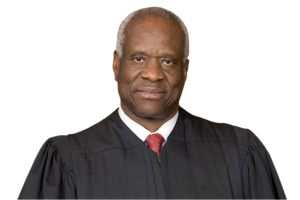{width=150}

:::

This case asks us to decide whether a court in Nevada may exercise personal jurisdiction over a defendant on the basis that he knew his allegedly tortious conduct in Georgia would delay the return of funds to plaintiffs with connections to Nevada. \[...\]

**I**

Petitioner Anthony Walden serves as a police officer for the city of Covington, Georgia. In August 2006, petitioner was working at the Atlanta Hartsfield-Jackson Airport as a deputized agent of the Drug Enforcement Administration (DEA). As part of a task force, petitioner conducted investigative stops and other law enforcement functions in support of the DEA's airport drug interdiction program.

On August 8, 2006, Transportation Security Administration agents searched respondents Gina Fiore and Keith Gipson and their carry-on bags at the San Juan airport in Puerto Rico. They found almost \$97,000 in cash. Fiore explained to DEA agents in San Juan that she and Gipson had been gambling at a casino known as the El San Juan, and that they had residences in both California and Nevada (though they provided only California identification). After respondents were cleared for departure, a law enforcement official at the San Juan airport notified petitioner's task force in Atlanta that respondents had boarded a plane for Atlanta, where they planned to catch a connecting flight to Las Vegas, Nevada.

When respondents arrived in Atlanta, petitioner and another DEA agent approached them at the departure gate for their flight to Las Vegas. In response to petitioner's questioning, Fiore explained that she and Gipson were professional gamblers. Respondents maintained that the cash they were carrying was their gambling "bank" and winnings. After using a drug-sniffing dog to perform a sniff test, petitioner seized the cash. Petitioner advised respondents that their funds would be returned if they later proved a legitimate source for the cash. Respondents then boarded their plane.

After respondents departed, petitioner moved the cash to a secure location and the matter was forwarded to DEA headquarters. The next day, petitioner received a phone call from respondents' attorney in Nevada seeking return of the funds. On two occasions over the next month, petitioner also received documentation from the attorney regarding the legitimacy of the funds.

\[...\]

Respondents filed suit against petitioner in the United States District Court for the District of Nevada, seeking money damages \[to redress injuries allegedly caused by the seizure\].

\[...\]

::: {.callout-caution collapse="true" .content-visible when-format="html"}
## In Her Own Words

To hear Gina Fiore tell the story in her own words, listen to the audio clip below, which is taken from an episode of The Ringer podcast ["The Gamblers."](https://www.theringer.com/2020/11/18/21571516/gamblers-podcast-gina-fiore-blackjack-hole-card)



:::

**II**

**A**

\[...\] Nevada has authorized its courts to exercise jurisdiction over persons "on any basis not inconsistent with ... the Constitution of the United States." Thus, in order to determine whether the Federal District Court in this case was authorized to exercise jurisdiction over petitioner, we ask whether the exercise of jurisdiction "comports with the limits imposed by federal due process" on the State of Nevada. \[...\]

**III**

\[...\] \[W\]e conclude that petitioner lacks the "minimal contacts" with Nevada that are a prerequisite to the exercise of jurisdiction over him. *Hanson*. It is undisputed that no part of petitioner's course of conduct occurred in Nevada. Petitioner approached, questioned, and searched respondents, and seized the cash at issue, in the Atlanta airport. \[...\] Petitioner never traveled to, conducted activities within, contacted anyone in, or sent anything or anyone to Nevada. In short, when viewed through the proper lens---whether the *defendant's* actions connect him to the forum---petitioner formed no jurisdictionally relevant contacts with Nevada.

The Court of Appeals reached a contrary conclusion by shifting the analytical focus from petitioner's contacts with the forum to his contacts with respondents. Rather than assessing petitioner's own contacts with Nevada, the Court of Appeals looked to petitioner's knowledge of respondents' "strong forum connections." In the court's view, that knowledge, combined with its conclusion that respondents suffered foreseeable harm in Nevada, satisfied the "minimum contacts" inquiry.

This approach to the "minimum contacts" analysis impermissibly allows a plaintiff's contacts with the defendant and forum to drive the jurisdictional analysis. Petitioner's actions in Georgia did not create sufficient contacts with Nevada simply because he allegedly directed his conduct at plaintiffs whom he knew had Nevada connections. Such reasoning improperly attributes a plaintiff's forum connections to the defendant and makes those connections "decisive" in the jurisdictional analysis. It also obscures the reality that none of petitioner's challenged conduct had anything to do with Nevada itself.

\[...\] *Calder* made clear that mere injury to a forum resident is not a sufficient connection to the forum. Regardless of where a plaintiff lives or works, an injury is jurisdictionally relevant only insofar as it shows that the defendant has formed a contact with the forum State. The proper question is not where the plaintiff experienced a particular injury or effect but whether the defendant's conduct connects him to the forum in a meaningful way.

Respondents' claimed injury does not evince a connection between petitioner and Nevada. Even if we consider the continuation of the seizure in Georgia to be a distinct injury, it is not the sort of effect that is tethered to Nevada in any meaningful way. Respondents (and only respondents) lacked access to their funds in Nevada not because anything independently occurred there, but because Nevada is where respondents chose to be at a time when they desired to use the funds seized by petitioner. Respondents would have experienced this same lack of access in California, Mississippi, or wherever else they might have traveled and found themselves wanting more money than they had. Unlike the broad publication of the forum-focused story in *Calder*, the effects of petitioner's conduct on respondents are not connected to the forum State in a way that makes those effects a proper basis for jurisdiction.

\[...\]

**\* \* \***

Well-established principles of personal jurisdiction are sufficient to decide this case. The proper focus of the "minimum contacts" inquiry in intentional-tort cases is "'the relationship among the defendant, the forum, and the litigation.'" *Calder*. And it is the defendant, not the plaintiff or third parties, who must create contacts with the forum State. In this case, the application of those principles is clear: Petitioner's relevant conduct occurred entirely in Georgia, and the mere fact that his conduct affected plaintiffs with connections to the forum State does not suffice to authorize jurisdiction. We therefore reverse the judgment of the Court of Appeals.

*It is so ordered.*

\[...\]

#### Notes & Questions

1.  There is at least some tension between the Court's holdings in *Calder* and *Keeton*, on the one hand, and *Walden*, on the other. All three cases involved allegedly tortious actions taken outside the forum state by defendants who knew that their conduct would have effects in the forum state. What explains why *Walden* came out differently from the other two? Two factors seem relevant. First, in *Walden*, the claims did not involve any allegation that the officer targeted the plaintiffs in particular with his allegedly tortious conduct; it was purely incidental who they were or where they lived. By contrast, in *Calder* and *Keeton*, the plaintiffs' identities were essential to the defendants' conduct. Second, drawing from *Hanson*, the fact that the plaintiffs kept their bank accounts in Nevada is arguably the unilateral conduct of the plaintiffs, and therefore cannot support personal jurisdiction over the defendant.

2.  What role, if any, should the fact that the underlying events occurred at an international airport play in the personal jurisdiction analysis? Note that this is not the only lawsuit challenging federal officials' behavior at Atlanta's Hartsfield-Jackson International Airport. *See, e.g.*, *André v. Clayton County*, No. 1:22-CV-4065-MHC (Sept. 5, 2023) (dismissing claims brought by comedian Eric André alleging racial profiling by officers at the Atlanta airport on qualified immunity grounds) (currently on appeal).

## General Personal Jurisdiction

As you now know, specific jurisdiction considers the relationship between three separate factors: the defendant, the forum, and the subject matter of the suit. General jurisdiction is different: it looks only to the relationship between the defendant and the forum. In other words, it is not concerned only with those of the defendant's contacts that gave rise to, or relate to, the lawsuit at issue. In exchange for relaxing the requirement of "case-relatedness," however, general jurisdiction requires a much higher showing of minimum contacts before deeming due process satisfied.

The result is that, today, general jurisdiction exists over a defendant only if they can be said to be "essentially at home" in the forum. Paradigmatically, a person is "at home" in their state of domicile, and a business corporation is "at home" in state place of incorporation and the state where they are headquartered.

As the cases that follow demonstrate, the path of development of general jurisdiction has been roughly opposite from that of specific jurisdiction. While *International Shoe* ushered in a more expansive form of specific jurisdiction, recent Supreme Court cases have narrowed general jurisdiction considerably. As you work your way through the cases, ask yourself why the two prongs of personal jurisdiction have seemingly diverged so dramatically.

### Perkins v. Benguet Consolidated Mining Co.

**Mr. Justice Burton delivered the opinion of the Court.** [342 U.S. 437 (1952)]{.aside}

::: {.column-margin}

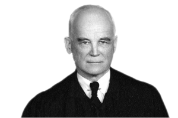{width=150}

:::

This case calls for an answer to the question whether the Due Process Clause of the Fourteenth Amendment to the Constitution of the United States precludes Ohio from subjecting a foreign corporation to the jurisdiction of its courts in this action *in personam*. The corporation has been carrying on in Ohio a continuous and systematic, but limited, part of its general business. Its president, while engaged in doing such business in Ohio, has been served with summons in this proceeding. The cause of action sued upon did not arise in Ohio and does not relate to the corporation's activities there. \[W\]e hold that the Fourteenth Amendment leaves Ohio free to take or decline jurisdiction over the corporation.

After extended litigation elsewhere petitioner, Idonah Slade Perkins, a nonresident of Ohio, filed two actions *in personam* in the Court of Common Pleas of Clermont County, Ohio, against the several respondents. Among those sued is the Benguet Consolidated Mining Company, here called the mining company. It is styled a "sociedad anónima" under the laws of the Philippine Islands, where it owns and has operated profitable gold and silver mines. In one action petitioner seeks approximately \$68,400 in dividends claimed to be due her as a stockholder. In the other she claims \$2,500,000 damages largely because of the company's failure to issue to her certificates for 120,000 shares of its stock.

\[...\]

The answer to the question of whether the state courts of Ohio are open to a proceeding *in personam*, against an amply notified foreign corporation, to enforce a cause of action not arising in Ohio and not related to the business or activities of the corporation in that State rests entirely upon the law of Ohio, unless the Due Process Clause of the Fourteenth Amendment compels a decision either way.

\[Discussion of Ohio law omitted\]

A more serious question is presented by the claim that the Due Process Clause of the Fourteenth Amendment *prohibits* Ohio from granting such relief against a foreign corporation. \[...\]

Today if an authorized representative of a foreign corporation be physically present in the state of the forum and be there engaged in activities appropriate to accepting service or receiving notice on its behalf, we recognize that there is no unfairness in subjecting that corporation to the jurisdiction of the courts of that state through such service of process upon that representative. This has been squarely held to be so in a proceeding *in personam* against such a corporation, at least in relation to a cause of action arising out of the corporation's activities within the state of the forum.

\[...\]

The instant case takes us one step further to a proceeding in personam to enforce a cause of action not arising out of the corporation's activities in the state of the forum. Using the tests mentioned above we find no requirement of federal due process that either prohibits Ohio from opening its courts to the cause of action here presented or compels Ohio to do so. This conforms to the realistic reasoning in *International Shoe Co. v. Washington*:

> ... there have been instances in which the continuous corporate operations within a state were thought so substantial and of such a nature as to justify suit against it on causes of action arising from dealings entirely distinct from those activities.
>
> ... some of the decisions holding the corporation amenable to suit have been supported by resort to the legal fiction that it has given its consent to service and suit, consent being implied from its presence in the state through the acts of its authorized agents.
>
> ... Whether due process is satisfied must depend rather upon the quality and nature of the activity in relation to the fair and orderly administration of the laws which it was the purpose of the due process clause to insure. That clause does not contemplate that a state may make binding a judgment in personam against an individual or corporate defendant with which the state has no contacts, ties, or relations. *Cf. Pennoyer v. Neff*.

It remains only to consider, in more detail, the issue of whether, as a matter of federal due process, the business done in Ohio by the respondent mining company was sufficiently substantial and of such a nature as to permit Ohio to entertain a cause of action against a foreign corporation, where the cause of action arose from activities entirely distinct from its activities in Ohio. *See International Shoe Co. v. Washington*.

\[...\] The company's mining properties were in the Philippine Islands. Its operations there were completely halted during the occupation of the Islands by the Japanese. During that interim the president, who was also the general manager and principal stockholder of the company, returned to his home in Clermont County, Ohio. There, he maintained an office in which he conducted his personal affairs and did many things on behalf of the company. He kept there office files of the company. He carried on there correspondence relating to the business of the company and to its employees. He drew and distributed there salary checks on behalf of the company, both in his own favor as president and in favor of two company secretaries who worked there with him. He used and maintained in Clermont County, Ohio, two active bank accounts carrying substantial balances of company funds. A bank in Hamilton County, Ohio, acted as transfer agent for the stock of the company. Several directors' meetings were held at his office or home in Clermont County. From that office he supervised policies dealing with the rehabilitation of the corporation's properties in the Philippines and he dispatched funds to cover purchases of machinery for such rehabilitation. Thus he carried on in Ohio a continuous and systematic supervision of the necessarily limited wartime activities of the company. He there discharged his duties as president and general manager, both during the occupation of the company's properties by the Japanese and immediately thereafter. While no mining properties in Ohio were owned or operated by the company, many of its wartime activities were directed from Ohio and were being given the personal attention of its president in that State at the time he was served with summons. Consideration of the circumstances which, under the law of Ohio, ultimately, will determine whether the courts of that State will choose to take jurisdiction over the corporation is reserved for the courts of that State. Without reaching that issue of state policy, we conclude that, under the circumstances above recited, it would not violate federal due process for Ohio either to take or decline jurisdiction of the corporation in this proceeding. This relieves the Ohio courts of the restriction relied upon in the opinion accompanying the syllabus below and which may have influenced the judgment of the court below.

Accordingly, the judgment of the Supreme Court of Ohio is vacated and the cause is remanded to that court for further proceedings in the light of this opinion.

*It is so ordered.*

#### Notes & Questions

1.  Notice what is different about general jurisdiction: the Benguet Mining Company could be sued in Ohio even in a suit focused only on its activities elsewhere. In other words, the "nexus" requirement we saw in specific jurisdiction is entirely absent from general jurisdiction.

2.  Did *Perkins* recognize that a corporation could be "at home" somewhere besides its place of incorporation and where it is headquartered?

3.  Which contacts did the Court in Perkins rely on in holding that it could be subject to general jurisdiction in Ohio?

### Helicopteros Nacionales de Colombia, S. A. v. Hall

**Justice Blackmun delivered the opinion of the Court.** [466 U.S. 408 (1984)]{.aside}

::: {.column-margin}

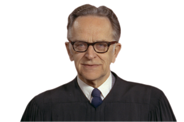{width=150}

:::

We granted certiorari in this case, 460 U.S. 1021 (1983), to decide whether the Supreme Court of Texas correctly ruled that the contacts of a foreign corporation with the State of Texas were sufficient to allow a Texas state court to assert jurisdiction over the corporation in a cause of action not arising out of or related to the corporation's activities within the State.

**I**

Petitioner Helicopteros Nacionales de Colombia, S. A. (Helicol), is a Colombian corporation with its principal place of business in the city of Bogota in that country. It is engaged in the business of providing helicopter transportation for oil and construction companies in South America. On January 26, 1976, a helicopter owned by Helicol crashed in Peru. Four United States citizens were among those who lost their lives in the accident. Respondents are the survivors and representatives of the four decedents.

At the time of the crash, respondents' decedents were employed by Consorcio, a Peruvian consortium, and were working on a pipeline in Peru. Consorcio is the alter ego of a joint venture named Williams-Sedco-Horn (WSH). The venture had its headquarters in Houston, Tex. Consorcio had been formed to enable the venturers to enter into a contract with Petro Peru, the Peruvian state-owned oil company. Consorcio was to construct a pipeline for Petro Peru running from the interior of Peru westward to the Pacific Ocean. Peruvian law forbade construction of the pipeline by any non-Peruvian entity.

Consorcio/WSH needed helicopters to move personnel, materials, and equipment into and out of the construction area. In 1974, upon request of Consorcio/WSH, the chief executive officer of Helicol, Francisco Restrepo, flew to the United States and conferred in Houston with representatives of the three joint venturers. At that meeting, there was a discussion of prices, availability, working conditions, fuel, supplies, and housing. Restrepo represented that Helicol could have the first helicopter on the job in 15 days. The Consorcio/WSH representatives decided to accept the contract proposed by Restrepo. Helicol began performing before the agreement was formally signed in Peru on November 11, 1974. The contract was written in Spanish on official government stationery and provided that the residence of all the parties would be Lima, Peru. It further stated that controversies arising out of the contract would be submitted to the jurisdiction of Peruvian courts. In addition, it provided that Consorcio/WSH would make payments to Helicol's account with the Bank of America in New York City.

Aside from the negotiation session in Houston between Restrepo and the representatives of Consorcio/WSH, Helicol had other contacts with Texas. During the years 1970-1977, it purchased helicopters (approximately 80% of its fleet), spare parts, and accessories for more than \$4 million from Bell Helicopter Company in Fort Worth. In that period, Helicol sent prospective pilots to Fort Worth for training and to ferry the aircraft to South America. It also sent management and maintenance personnel to visit Bell Helicopter in Fort Worth during the same period in order to receive "plant familiarization" and for technical consultation. Helicol received into its New York City and Panama City, Fla., bank accounts over \$5 million in payments from Consorcio/WSH drawn upon First City National Bank of Houston.

Beyond the foregoing, there have been no other business contacts between Helicol and the State of Texas. Helicol never has been authorized to do business in Texas and never has had an agent for the service of process within the State. It never has performed helicopter operations in Texas or sold any product that reached Texas, never solicited business in Texas, never signed any contract in Texas, never had any employee based there, and never recruited an employee in Texas. In addition, Helicol never has owned real or personal property in Texas and never has maintained an office or establishment there. Helicol has maintained no records in Texas and has no shareholders in that State. None of the respondents or their decedents were domiciled in Texas, but all of the decedents were hired in Houston by Consorcio/WSH to work on the Petro Peru pipeline project.

Respondents instituted wrongful-death actions in the District Court of Harris County, Tex., against Consorcio/WSH, Bell Helicopter Company, and Helicol. Helicol filed special appearances and moved to dismiss the actions for lack of *in personam* jurisdiction over it. The motion was denied. After a consolidated jury trial, judgment was entered against Helicol on a jury verdict of \$1,141,200 in favor of respondents.

::: {.column-margin}

^7^ The State's long-arm statute \[...\] reads in relevant part:

"Sec. 3.\ Any foreign corporation ... that engages in business in this State, irrespective of any Statute or law respecting designation or maintenance of resident agents, and does not maintain a place of regular business in this State or a designated agent upon whom service may be made upon causes of action arising out of such business done in this State, the act or acts of engaging in such business within this State shall be deemed equivalent to an appointment by such foreign corporation ... of the Secretary of State of Texas as agent upon whom service of process may be made in any action, suit or proceedings arising out of such business done in this State, wherein such corporation ... is a party or is to be made a party.

Sec. 4.\ For the purpose of this Act, and without including other acts that may constitute doing business, any foreign corporation ... shall be deemed doing business in this State by entering into contract by mail or otherwise with a resident of Texas to be performed in whole or in part by either party in this State, or the committing of any tort in whole or in part in this State. The act of recruiting Texas residents, directly or through an intermediary located in Texas, for employment inside or outside of Texas shall be deemed doing business in this State." \[...\]

^8^ It has been said that when a State exercises personal jurisdiction over a defendant in a suit arising out of or related to the defendant's contacts with the forum, the State is exercising "specific jurisdiction" over the defendant.

:::

The Texas Court of Civil Appeals, Houston, First District, reversed the judgment of the District Court, holding that *in personam* jurisdiction over Helicol was lacking. The Supreme Court of Texas, with three justices dissenting, initially affirmed the judgment of the Court of Civil Appeals. Seven months later, however, on motion for rehearing, the court withdrew its prior opinions and, again with three justices dissenting, reversed the judgment of the intermediate court. In ruling that the Texas courts had *in personam* jurisdiction, the Texas Supreme Court first held that the State's long-arm statute reaches as far as the Due Process Clause of the Fourteenth Amendment permits.^7^ Thus, the only question remaining for the court to decide was whether it was consistent with the Due Process Clause for Texas courts to assert *in personam* jurisdiction over Helicol.

**II**

The Due Process Clause of the Fourteenth Amendment operates to limit the power of a State to assert *in personam* jurisdiction over a nonresident defendant. *Pennoyer v. Neff*. Due process requirements are satisfied when *in personam* jurisdiction is asserted over a nonresident corporate defendant that has "certain minimum contacts with \[the forum\] such that the maintenance of the suit does not offend 'traditional notions of fair play and substantial justice.'" *International Shoe Co. v. Washington*. When a controversy is related to or "arises out of" a defendant's contacts with the forum, the Court has said that a "relationship among the defendant, the forum, and the litigation" is the essential foundation of *in personam* jurisdiction. *Shaffer v. Heitner*.^8^ 

Even when the cause of action does not arise out of or relate to the foreign corporation's activities in the forum State,^9^ due process is not offended by a State's subjecting the corporation to its in personam jurisdiction when there are sufficient contacts between the State and the foreign corporation. *Perkins v. Benguet Consolidated Mining Co.* In *Perkins*, the Court addressed a situation in which state courts had asserted general jurisdiction over a defendant foreign corporation. During the Japanese occupation of the Philippine Islands, the president and general manager of a Philippine mining corporation maintained an office in Ohio from which he conducted activities on behalf of the company. He kept company files and held directors' meetings in the office, carried on correspondence relating to the business, distributed salary checks drawn on two active Ohio bank accounts, engaged an Ohio bank to act as transfer agent, and supervised policies dealing with the rehabilitation of the corporation's properties in the Philippines. In short, the foreign corporation, through its president, "ha\[d\] been carrying on in Ohio a continuous and systematic, but limited, part of its general business," and the exercise of general jurisdiction over the Philippine corporation by an Ohio court was "reasonable and just." [ ^9^ When a State exercises personal jurisdiction over a defendant in a suit not arising out of or related to the defendant's contacts with the forum, the State has been said to be exercising "general jurisdiction" over the defendant.\
]{.aside} 

All parties to the present case concede that respondents' claims against Helicol did not "arise out of," and are not related to, Helicol's activities within Texas. We thus must explore the nature of Helicol's contacts with the State of Texas to determine whether they constitute the kind of continuous and systematic general business contacts the Court found to exist in *Perkins*. We hold that they do not.

It is undisputed that Helicol does not have a place of business in Texas and never has been licensed to do business in the State. Basically, Helicol's contacts with Texas consisted of sending its chief executive officer to Houston for a contract-negotiation session; accepting into its New York bank account checks drawn on a Houston bank; purchasing helicopters, equipment, and training services from Bell Helicopter for substantial sums; and sending personnel to Bell's facilities in Fort Worth for training.

The one trip to Houston by Helicol's chief executive officer for the purpose of negotiating the transportation-services contract with Consorcio/WSH cannot be described or regarded as a contact of a "continuous and systematic" nature, as *Perkins* described it, and thus cannot support an assertion of *in personam* jurisdiction over Helicol by a Texas court. Similarly, Helicol's acceptance from Consorcio/WSH of checks drawn on a Texas bank is of negligible significance for purposes of determining whether Helicol had sufficient contacts in Texas. There is no indication that Helicol ever requested that the checks be drawn on a Texas bank or that there was any negotiation between Helicol and Consorcio/WSH with respect to the location or identity of the bank on which checks would be drawn. Common sense and everyday experience suggest that, absent unusual circumstances, the bank on which a check is drawn is generally of little consequence to the payee and is a matter left to the discretion of the drawer. Such unilateral activity of another party or a third person is not an appropriate consideration when determining whether a defendant has sufficient contacts with a forum State to justify an assertion of jurisdiction. *See Kulko v. California Superior Court* (arbitrary to subject one parent to suit in any State where other parent chooses to spend time while having custody of child pursuant to separation agreement); *Hanson v. Denckla* ("The unilateral activity of those who claim some relationship with a nonresident defendant cannot satisfy the requirement of contact with the forum State").

\[...\]

**III**

We hold that Helicol's contacts with the State of Texas were insufficient to satisfy the requirements of the Due Process Clause of the Fourteenth Amendment. Accordingly, we reverse the judgment of the Supreme Court of Texas.

*It is so ordered.*

**Justice Brennan, dissenting.**

::: {.column-margin}

{width=150}

:::

\[...\]

I believe that the undisputed contacts in this case between petitioner Helicol and the State of Texas are sufficiently important, and sufficiently related to the underlying cause of action, to make it fair and reasonable for the State to assert personal jurisdiction over Helicol for the wrongful-death actions filed by the respondents. Given that Helicol has purposefully availed itself of the benefits and obligations of the forum, and given the direct relationship between the underlying cause of action and Helicol's contacts with the forum, maintenance of this suit in the Texas courts "does not offend \[the\] traditional notions of fair play and substantial justice," *International Shoe Co. v. Washington*, that are the touchstone of jurisdictional analysis under the Due Process Clause. I therefore dissent.

**I**

The Court expressly limits its decision in this case to "an assertion of general jurisdiction over a foreign defendant." Having framed the question in this way, the Court is obliged to address our prior holding\[\] in *Perkins v. Benguet Consolidated Mining Co.* \[...\]. In *Perkins*, the Court considered a State's assertion of general jurisdiction over a foreign corporation that "ha\[d\] been carrying on ... a continuous and systematic, but limited, part of its general business" in the forum. Under the circumstances of that case, we held that such contacts were constitutionally sufficient "to make it reasonable and just to subject the corporation to the jurisdiction" of that State. Nothing in *Perkins* suggests, however, that such "continuous and systematic" contacts are a necessary minimum before a State may constitutionally assert general jurisdiction over a foreign corporation.

\[...\]

The vast expansion of our national economy during the past several decades has provided the primary rationale for expanding the permissible reach of a State's jurisdiction under the Due Process Clause. By broadening the type and amount of business opportunities available to participants in interstate and foreign commerce, our economy has increased the frequency with which foreign corporations actively pursue commercial transactions throughout the various States. In turn, it has become both necessary and, in my view, desirable to allow the States more leeway in bringing the activities of these nonresident corporations within the scope of their respective jurisdictions.

This is neither a unique nor a novel idea. As the Court first noted in 1957:

> \[M\]any commercial transactions touch two or more States and may involve parties separated by the full continent. With this increasing nationalization of commerce has come a great increase in the amount of business conducted by mail across state lines. At the same time modern transportation and communication have made it much less burdensome for a party sued to defend himself in a State where he engages in economic activity.

*McGee*. *See also World-Wide Volkswagen* (reaffirming that "\[t\]he historical developments noted in *McGee* ... have only accelerated in the generation since that case was decided"); *Hanson v. Denckla*.

Moreover, this "trend ... toward expanding the permissible scope of state jurisdiction over foreign corporations and other nonresidents," *McGee*, is entirely consistent with the "traditional notions of fair play and substantial justice" that control our inquiry under the Due Process Clause. As active participants in interstate and foreign commerce take advantage of the economic benefits and opportunities offered by the various States, it is only fair and reasonable to subject them to the obligations that may be imposed by those jurisdictions. And chief among the obligations that a nonresident corporation should expect to fulfill is amenability to suit in any forum that is significantly affected by the corporation's commercial activities.

As a foreign corporation that has actively and purposefully engaged in numerous and frequent commercial transactions in the State of Texas, Helicol clearly falls within the category of nonresident defendants that may be subject to that forum's general jurisdiction. Helicol not only purchased helicopters and other equipment in the State for many years, but also sent pilots and management personnel into Texas to be trained in the use of this equipment and to consult with the seller on technical matters. Moreover, negotiations for the contract under which Helicol provided transportation services to the joint venture that employed the respondents' decedents also took place in the State of Texas. Taken together, these contacts demonstrate that Helicol obtained numerous benefits from its transaction of business in Texas. In turn, it is eminently fair and reasonable to expect Helicol to face the obligations that attach to its participation in such commercial transactions. Accordingly, on the basis of continuous commercial contacts with the forum, I would conclude that the Due Process Clause allows the State of Texas to assert general jurisdiction over petitioner Helicol.

**II**

The Court also fails to distinguish the legal principles that controlled our prior decisions \[...\]. In particular, the contacts between petitioner Helicol and the State of Texas, unlike the contacts between the defendant and the forum in \[*Perkins*\], are significantly related to the cause of action alleged in the original suit filed by the respondents. Accordingly, in my view, it is both fair and reasonable for the Texas courts to assert specific jurisdiction over Helicol in this case.

By asserting that the present case does not implicate the specific jurisdiction of the Texas courts, the Court necessarily removes its decision from the reality of the actual facts presented for our consideration. Moreover, the Court refuses to consider any distinction between contacts that are "related to" the underlying cause of action and contacts that "give rise" to the underlying cause of action. In my view, however, there is a substantial difference between these two standards for asserting specific jurisdiction. Thus, although I agree that the respondents' cause of action did not formally "arise out of" specific activities initiated by Helicol in the State of Texas, I believe that the wrongful-death claim filed by the respondents is significantly related to the undisputed contacts between Helicol and the forum. On that basis, I would conclude that the Due Process Clause allows the Texas courts to assert specific jurisdiction over this particular action.

The wrongful-death actions filed by the respondents were premised on a fatal helicopter crash that occurred in Peru. Helicol was joined as a defendant in the lawsuits because it provided transportation services, including the particular helicopter and pilot involved in the crash, to the joint venture that employed the decedents. Specifically, the respondent Hall claimed in her original complaint that "Helicol is ... legally responsible for its own negligence through its pilot employee." Viewed in light of these allegations, the contacts between Helicol and the State of Texas are directly and significantly related to the underlying claim filed by the respondents. The negotiations that took place in Texas led to the contract in which Helicol agreed to provide the precise transportation services that were being used at the time of the crash. Moreover, the helicopter involved in the crash was purchased by Helicol in Texas, and the pilot whose negligence was alleged to have caused the crash was actually trained in Texas. This is simply not a case, therefore, in which a state court has asserted jurisdiction over a nonresident defendant on the basis of wholly unrelated contacts with the forum. Rather, the contacts between Helicol and the forum are directly related to the negligence that was alleged in the respondent Hall's original complaint. Because Helicol should have expected to be amenable to suit in the Texas courts for claims directly related to these contacts, it is fair and reasonable to allow the assertion of jurisdiction in this case.

Despite this substantial relationship between the contacts and the cause of action, the Court declines to consider whether the courts of Texas may assert specific jurisdiction over this suit. Apparently, this simply reflects a narrow interpretation of the question presented for review. It is nonetheless possible that the Court's opinion may be read to imply that the specific jurisdiction of the Texas courts is inapplicable because the cause of action did not formally "arise out of" the contacts between Helicol and the forum. In my view, however, such a rule would place unjustifiable limits on the bases under which Texas may assert its jurisdictional power.

Limiting the specific jurisdiction of a forum to cases in which the cause of action formally arose out of the defendant's contacts with the State would subject constitutional standards under the Due Process Clause to the vagaries of the substantive law or pleading requirements of each State. For example, the complaint filed against Helicol in this case alleged negligence based on pilot error. Even though the pilot was trained in Texas, the Court assumes that the Texas courts may not assert jurisdiction over the suit because the cause of action "did not 'arise out of,' and \[is\] not related to," that training. If, however, the applicable substantive law required that negligent training of the pilot was a necessary element of a cause of action for pilot error, or if the respondents had simply added an allegation of negligence in the training provided for the Helicol pilot, then presumably the Court would concede that the specific jurisdiction of the Texas courts was applicable.

Our interpretation of the Due Process Clause has never been so dependent upon the applicable substantive law or the State's formal pleading requirements. At least since *International Shoe Co. v. Washington*, the principal focus when determining whether a forum may constitutionally assert jurisdiction over a nonresident defendant has been on fairness and reasonableness to the defendant. To this extent, a court's specific jurisdiction should be applicable whenever the cause of action arises out of or relates to the contacts between the defendant and the forum. It is eminently fair and reasonable, in my view, to subject a defendant to suit in a forum with which it has significant contacts directly related to the underlying cause of action. Because Helicol's contacts with the State of Texas meet this standard, I would affirm the judgment of the Supreme Court of Texas.

\[...\]

#### Notes & Questions

1.  *Helicopteros* is one of our best chances to see how the Supreme Court distinguishes between contacts that are relevant to both general and specific jurisdiction and those that are only relevant to general jurisdiction. Which of the defendant's contacts with Texas were not "case-linked" and therefore not relevant to any potential specific jurisdiction inquiry?

2.  Justice Brennan's dissent suggests that he was skeptical of the sharp line dividing specific and general personal jurisdiction. How would you articulate his alternative way of thinking about the two strands of personal jurisdiction doctrine?

### Goodyear Dunlop Tires Operations, S.A. v. Brown

**GINSBURG, J., delivered the opinion for a unanimous Court.** [564 U.S. 915 (2011)]{.aside}

::: {.column-margin}

{width=150}

:::

This case concerns the jurisdiction of state courts over corporations organized and operating abroad. We address, in particular, this question: Are foreign subsidiaries of a United States parent corporation amenable to suit in state court on claims unrelated to any activity of the subsidiaries in the forum State?

A bus accident outside Paris that took the lives of two 13-year-old boys from North Carolina gave rise to the litigation we here consider. Attributing the accident to a defective tire manufactured in Turkey at the plant of a foreign subsidiary of The Goodyear Tire and Rubber Company (Goodyear USA), the boys' parents commenced an action for damages in a North Carolina state court; they named as defendants Goodyear USA, an Ohio corporation, and three of its subsidiaries, organized and operating, respectively, in Turkey, France, and Luxembourg. Goodyear USA, which had plants in North Carolina and regularly engaged in commercial activity there, did not contest the North Carolina court's jurisdiction over it; Goodyear USA's foreign subsidiaries, however, maintained that North Carolina lacked adjudicatory authority over them.

A state court's assertion of jurisdiction exposes defendants to the State's coercive power, and is therefore subject to review for compatibility with the Fourteenth Amendment's Due Process Clause. *International Shoe Co. v. Washington* (assertion of jurisdiction over out-of-state corporation must comply with "'traditional notions of fair play and substantial justice'" (quoting *Milliken v. Meyer*)). Opinions in the wake of the pathmarking *International Shoe* decision have differentiated between general or all-purpose jurisdiction, and specific or case-linked jurisdiction. *Helicopteros Nacionales de Colombia, S.A. v. Hall*.

A court may assert general jurisdiction over foreign (sister-state or foreign-country) corporations to hear any and all claims against them when their affiliations with the State are so "continuous and systematic" as to render them essentially at home in the forum State. *See International Shoe*. Specific jurisdiction, on the other hand, depends on an "affiliatio\[n\] between the forum and the underlying controversy," principally, activity or an occurrence that takes place in the forum State and is therefore subject to the State's regulation. von Mehren & Trautman, *Jurisdiction To Adjudicate: A Suggested Analysis*, 79 Harv. L. Rev. 1121, 1136 (1966) (hereinafter von Mehren & Trautman); *see* Brilmayer et al., *A General Look at General Jurisdiction*, 66 Texas L. Rev. 721, 782 (1988) (hereinafter Brilmayer). In contrast to general, all-purpose jurisdiction, specific jurisdiction is confined to adjudication of "issues deriving from, or connected with, the very controversy that establishes jurisdiction." von Mehren & Trautman 1136.

Because the episode-in-suit, the bus accident, occurred in France, and the tire alleged to have caused the accident was manufactured and sold abroad, North Carolina courts lacked specific jurisdiction to adjudicate the controversy. The North Carolina Court of Appeals so acknowledged. Were the foreign subsidiaries nonetheless amenable to general jurisdiction in North Carolina courts? Confusing or blending general and specific jurisdictional inquiries, the North Carolina courts answered yes. Some of the tires made abroad by Goodyear's foreign subsidiaries, the North Carolina Court of Appeals stressed, had reached North Carolina through "the stream of commerce"; that connection, the Court of Appeals believed, gave North Carolina courts the handle needed for the exercise of general jurisdiction over the foreign corporations.

A connection so limited between the forum and the foreign corporation, we hold, is an inadequate basis for the exercise of general jurisdiction. Such a connection does not establish the "continuous and systematic" affiliation necessary to empower North Carolina courts to entertain claims unrelated to the foreign corporation's contacts with the State.

**I**

On April 18, 2004, a bus destined for Charles de Gaulle Airport overturned on a road outside Paris, France. Passengers on the bus were young soccer players from North Carolina beginning their journey home. Two 13-year-olds, Julian Brown and Matthew Helms, sustained fatal injuries. The boys' parents, respondents in this Court, filed a suit for wrongful-death damages in the Superior Court of Onslow County, North Carolina, in their capacity as administrators of the boys' estates. Attributing the accident to a tire that failed when its plies separated, the parents alleged negligence in the "design, construction, testing, and inspection" of the tire.

Goodyear Luxembourg Tires, SA (Goodyear Luxembourg), Goodyear Lastikleri T.A.S. (Goodyear Turkey), and Goodyear Dunlop Tires France, SA (Goodyear France), petitioners here, were named as defendants. Incorporated in Luxembourg, Turkey, and France, respectively, petitioners are indirect subsidiaries of Goodyear USA, an Ohio corporation also named as a defendant in the suit. Petitioners manufacture tires primarily for sale in European and Asian markets. Their tires differ in size and construction from tires ordinarily sold in the United States. They are designed to carry significantly heavier loads, and to serve under road conditions and speed limits in the manufacturers' primary markets.

In contrast to the parent company, Goodyear USA, which does not contest the North Carolina courts' personal jurisdiction over it, petitioners are not registered to do business in North Carolina. They have no place of business, employees, or bank accounts in North Carolina. They do not design, manufacture, or advertise their products in North Carolina. And they do not solicit business in North Carolina or themselves sell or ship tires to North Carolina customers. Even so, a small percentage of petitioners' tires (tens of thousands out of tens of millions manufactured between 2004 and 2007) were distributed within North Carolina by other Goodyear USA affiliates. These tires were typically custom ordered to equip specialized vehicles such as cement mixers, waste haulers, and boat and horse trailers. Petitioners state, and respondents do not here deny, that the type of tire involved in the accident, a Goodyear Regional RHS tire manufactured by Goodyear Turkey, was never distributed in North Carolina.

Petitioners moved to dismiss the claims against them for want of personal jurisdiction. The trial court denied the motion, and the North Carolina Court of Appeals affirmed. \[...\]

\[...\]

We granted certiorari to decide whether the general jurisdiction the North Carolina courts asserted over petitioners is consistent with the Due Process Clause of the Fourteenth Amendment.

**II**

**A**

The Due Process Clause of the Fourteenth Amendment sets the outer boundaries of a state tribunal's authority to proceed against a defendant. *Shaffer v. Heitner*. The canonical opinion in this area remains *International Shoe*, in which we held that a State may authorize its courts to exercise personal jurisdiction over an out-of-state defendant if the defendant has "certain minimum contacts with \[the State\] such that the maintenance of the suit does not offend 'traditional notions of fair play and substantial justice.'"

Endeavoring to give specific content to the "fair play and substantial justice" concept, the Court in *International Shoe* classified cases involving out-of-state corporate defendants. First, as in *International Shoe* itself, jurisdiction unquestionably could be asserted where the corporation's in-state activity is "continuous and systematic" *and that activity gave rise to the episode-in-suit*. Further, the Court observed, the commission of certain "single or occasional acts" in a State may be sufficient to render a corporation answerable in that State with respect to those acts, though not with respect to matters unrelated to the forum connections. The heading courts today use to encompass these two *International Shoe* categories is "specific jurisdiction." *See* von Mehren & Trautman 1144-1163. Adjudicatory authority is "specific" when the suit "aris\[es\] out of or relate\[s\] to the defendant's contacts with the forum." *Helicopteros*.

*International Shoe* distinguished from cases that fit within the "specific jurisdiction" categories, "instances in which the continuous corporate operations within a state \[are\] so substantial and of such a nature as to justify suit against it on causes of action arising from dealings entirely distinct from those activities." Adjudicatory authority so grounded is today called "general jurisdiction." *Helicopteros*. For an individual, the paradigm forum for the exercise of general jurisdiction is the individual's domicile; for a corporation, it is an equivalent place, one in which the corporation is fairly regarded as at home. *See* Brilmayer 728 (identifying domicile, place of incorporation, and principal place of business as "paradig\[m\]" bases for the exercise of general jurisdiction).

\[...\]

In only two decisions postdating *International Shoe*, has this Court considered whether an out-of-state corporate defendant's in-state contacts were sufficiently "continuous and systematic" to justify the exercise of general jurisdiction over claims unrelated to those contacts: *Perkins v. Benguet Consol. Mining Co.* (general jurisdiction appropriately exercised over Philippine corporation sued in Ohio, where the company's affairs were overseen during World War II); and *Helicopteros* (helicopter owned by Colombian corporation crashed in Peru; survivors of U.S. citizens who died in the crash, the Court held, could not maintain wrongful-death actions against the Colombian corporation in Texas, for the corporation's helicopter purchases and purchase-linked activity in Texas were insufficient to subject it to Texas court's general jurisdiction).

**B**

To justify the exercise of general jurisdiction over petitioners, the North Carolina courts relied on the petitioners' placement of their tires in the "stream of commerce." The stream-of-commerce metaphor has been invoked frequently in lower court decisions permitting "jurisdiction in products liability cases in which the product has traveled through an extensive chain of distribution before reaching the ultimate consumer." 18 W. Fletcher, Cyclopedia of the Law of Corporations § 8640.40, p. 133 (rev. ed. 2007). Typically, in such cases, a non-resident defendant, acting *outside* the forum, places in the stream of commerce a product that ultimately causes harm *inside* the forum.

\[...\]

The North Carolina court's stream-of-commerce analysis elided the essential difference between case-specific and all-purpose (general) jurisdiction. Flow of a manufacturer's products into the forum, we have explained, may bolster an affiliation germane to *specific* jurisdiction. *See, e.g.*, *World-Wide Volkswagen* (where "the sale of a product ... is not simply an isolated occurrence, but arises from the efforts of the manufacturer or distributor to serve ... the market for its product in \[several\] States, it is not unreasonable to subject it to suit in one of those States if its allegedly defective merchandise *has there been the source of injury to its owner or to others*" (emphasis added)). But ties serving to bolster the exercise of specific jurisdiction do not warrant a determination that, based on those ties, the forum has *general* jurisdiction over a defendant.

A corporation's "continuous activity of some sorts within a state," *International Shoe* instructed, "is not enough to support the demand that the corporation be amenable to suits unrelated to that activity." Our 1952 decision in *Perkins v. Benguet Consol. Mining Co.* remains "\[t\]he textbook case of general jurisdiction appropriately exercised over a foreign corporation that has not consented to suit in the forum."

Sued in Ohio, the defendant in *Perkins* was a Philippine mining corporation that had ceased activities in the Philippines during World War II. To the extent that the company was conducting any business during and immediately after the Japanese occupation of the Philippines, it was doing so in Ohio: The corporation's president maintained his office there, kept the company files in that office, and supervised from the Ohio office "the necessarily limited wartime activities of the company." Although the claim-in-suit did not arise in Ohio, this Court ruled that it would not violate due process for Ohio to adjudicate the controversy. *See Keeton v. Hustler Magazine, Inc.* (Ohio's exercise of general jurisdiction was permissible in *Perkins* because "Ohio was the corporation's principal, if temporary, place of business").

We next addressed the exercise of general jurisdiction over an out-of-state corporation over three decades later, in *Helicopteros*. In that case, survivors of United States citizens who died in a helicopter crash in Peru instituted wrongful-death actions in a Texas state court against the owner and operator of the helicopter, a Colombian corporation. The Colombian corporation had no place of business in Texas and was not licensed to do business there. "Basically, \[the company's\] contacts with Texas consisted of sending its chief executive officer to Houston for a contract-negotiation session; accepting into its New York bank account checks drawn on a Houston bank; purchasing helicopters, equipment, and training services from \[a Texas enterprise\] for substantial sums; and sending personnel to \[Texas\] for training." These links to Texas, we determined, did not "constitute the kind of continuous and systematic general business contacts ... found to exist in *Perkins*," and were insufficient to support the exercise of jurisdiction over a claim that neither "ar\[o\]se out of ... no\[r\] related to" the defendant's activities in Texas.

*Helicopteros* concluded that "mere purchases \[made in the forum State\], even if occurring at regular intervals, are not enough to warrant a State's assertion of \[general\] jurisdiction over a nonresident corporation in a cause of action not related to those purchase transactions." We see no reason to differentiate from the ties to Texas held insufficient in *Helicopteros*, the sales of petitioners' tires sporadically made in North Carolina through intermediaries. Under the sprawling view of general jurisdiction urged by respondents and embraced by the North Carolina Court of Appeals, any substantial manufacturer or seller of goods would be amenable to suit, on any claim for relief, wherever its products are distributed.

Measured against *Helicopteros* and *Perkins*, North Carolina is not a forum in which it would be permissible to subject petitioners to general jurisdiction. Unlike the defendant in *Perkins*, whose sole wartime business activity was conducted in Ohio, petitioners are in no sense at home in North Carolina. Their attenuated connections to the State fall far short of "the continuous and systematic general business contacts" necessary to empower North Carolina to entertain suit against them on claims unrelated to anything that connects them to the State. *Helicopteros*.

**C**

Respondents belatedly assert a "single enterprise" theory, asking us to consolidate petitioners' ties to North Carolina with those of Goodyear USA and other Goodyear entities. In effect, respondents would have us pierce Goodyear corporate veils, at least for jurisdictional purposes. Neither below nor in their brief in opposition to the petition for certiorari did respondents urge disregard of petitioners' discrete status as subsidiaries and treatment of all Goodyear entities as a "unitary business," so that jurisdiction over the parent would draw in the subsidiaries as well. Respondents have therefore forfeited this contention, and we do not address it.

**\* \* \***

For the reasons stated, the judgment of the North Carolina Court of Appeals is

*Reversed.*

#### Notes & Questions

1.  Why wasn't specific personal jurisdiction available in this case? In exploring that question, remember that at least some of the defendants' products reached the forum state. Why wasn't that enough?

2.  Why do you think the plaintiffs wanted to sue in the United States rather than in France? In this regard, it is helpful to know that France limits the availability of contingency fee agreements, caps the amount of damages available in a wrongful-death suit, makes the loser of a lawsuit pay the winner's attorney's fees, and makes it substantially harder to collect a judgment even if you win.

### Daimler AG v. Bauman

**Justice GINSBURG delivered the opinion of the Court.** [571 U.S. 117 (2014)]{.aside}

::: {.column-margin}

{width=150}

:::

This case concerns the authority of a court in the United States to entertain a claim brought by foreign plaintiffs against a foreign defendant based on events occurring entirely outside the United States. The litigation commenced in 2004, when 22 Argentinian residents filed a complaint in the United States District Court for the Northern District of California against DaimlerChrysler Aktiengesellschaft (Daimler), a German public stock company, headquartered in Stuttgart, that manufactures Mercedes-Benz vehicles in Germany. The complaint alleged that during Argentina's 1976--1983 "Dirty War," Daimler's Argentinian subsidiary, Mercedes-Benz Argentina (MB Argentina) collaborated with state security forces to kidnap, detain, torture, and kill certain MB Argentina workers, among them, plaintiffs or persons closely related to plaintiffs. Damages for the alleged human-rights violations were sought from Daimler under the laws of the United States, California, and Argentina. Jurisdiction over the lawsuit was predicated on the California contacts of Mercedes-Benz USA, LLC (MBUSA), a subsidiary of Daimler incorporated in Delaware with its principal place of business in New Jersey. MBUSA distributes Daimler-manufactured vehicles to independent dealerships throughout the United States, including California.

\[...\]

In *Goodyear Dunlop Tires Operations, S.A. v. Brown*, we addressed the distinction between general or all-purpose jurisdiction, and specific or conduct-linked jurisdiction. As to the former, we held that a court may assert jurisdiction over a foreign corporation "to hear any and all claims against \[it\]" only when the corporation's affiliations with the State in which suit is brought are so constant and pervasive "as to render \[it\] essentially at home in the forum State." Instructed by *Goodyear*, we conclude Daimler is not "at home" in California, and cannot be sued there for injuries plaintiffs attribute to MB Argentina's conduct in Argentina.

**I**

In 2004, plaintiffs (respondents here) filed suit in the United States District Court for the Northern District of California, alleging that MB Argentina collaborated with Argentinian state security forces to kidnap, detain, torture, and kill plaintiffs and their relatives during the military dictatorship in place there from 1976 through 1983, a period known as Argentina's "Dirty War." Based on those allegations, plaintiffs asserted claims under the Alien Tort Statute and the Torture Victim Protection Act of 1991, as well as claims for wrongful death and intentional infliction of emotional distress under the laws of California and Argentina. The incidents recounted in the complaint center on MB Argentina's plant in Gonzalez Catan, Argentina; no part of MB Argentina's alleged collaboration with Argentinian authorities took place in California or anywhere else in the United States.

Plaintiffs' operative complaint names only one corporate defendant: Daimler, the petitioner here. Plaintiffs seek to hold Daimler vicariously liable for MB Argentina's alleged malfeasance. Daimler is a German *Aktiengesellschaft* (public stock company) that manufactures Mercedes-Benz vehicles primarily in Germany and has its headquarters in Stuttgart. At times relevant to this case, MB Argentina was a subsidiary wholly owned by Daimler's predecessor in interest.

Daimler moved to dismiss the action for want of personal jurisdiction. Opposing the motion, plaintiffs submitted declarations and exhibits purporting to demonstrate the presence of Daimler itself in California. Alternatively, plaintiffs maintained that jurisdiction over Daimler could be founded on the California contacts of MBUSA, a distinct corporate entity that, according to plaintiffs, should be treated as Daimler's agent for jurisdictional purposes.

MBUSA, an indirect subsidiary of Daimler, is a Delaware limited liability corporation.^3^ [ ^3^ At times relevant to this suit, MBUSA was wholly owned by DaimlerChrysler North America Holding Corporation, a Daimler subsidiary.\
]{.aside} MBUSA serves as Daimler's exclusive importer and distributor in the United States, purchasing Mercedes-Benz automobiles from Daimler in Germany, then importing those vehicles, and ultimately distributing them to independent dealerships located throughout the Nation. Although MBUSA's principal place of business is in New Jersey, MBUSA has multiple California-based facilities, including a regional office in Costa Mesa, a Vehicle Preparation Center in Carson, and a Classic Center in Irvine. According to the record developed below, MBUSA is the largest supplier of luxury vehicles to the California market. In particular, over 10% of all sales of new vehicles in the United States take place in California, and MBUSA's California sales account for 2.4% of Daimler's worldwide sales.

The relationship between Daimler and MBUSA is delineated in a General Distributor Agreement, which sets forth requirements for MBUSA's distribution of Mercedes-Benz vehicles in the United States. That agreement established MBUSA as an "independent contracto\[r\]" that "buy\[s\] and sell\[s\] \[vehicles\] ... as an independent business for \[its\] own account." App. 179a. The agreement "does not make \[MBUSA\] ... a general or special agent, partner, joint venturer or employee of DAIMLERCHRYSLER or any Daimler-Chrysler Group Company"; MBUSA "ha\[s\] no authority to make binding obligations for or act on behalf of DAIMLERCHRYSLER or any DaimlerChrysler Group Company."

After allowing jurisdictional discovery on plaintiffs' agency allegations, the District Court granted Daimler's motion to dismiss. Daimler's own affiliations with California, the court first determined, were insufficient to support the exercise of all-purpose jurisdiction over the corporation. Next, the court declined to attribute MBUSA's California contacts to Daimler on an agency theory, concluding that plaintiffs failed to demonstrate that MBUSA acted as Daimler's agent.

The Ninth Circuit \[reversed, reasoning that\] the agency test was satisfied and considerations of "reasonableness" did not bar the exercise of jurisdiction.

\[...\]

We granted certiorari to decide whether, consistent with the Due Process Clause of the Fourteenth Amendment, Daimler is amenable to suit in California courts for claims involving only foreign plaintiffs and conduct occurring entirely abroad.

\[...\]

**III**

\[...\]

As is evident from *Perkins*, *Helicopteros*, and *Goodyear*, general and specific jurisdiction have followed markedly different trajectories post-International Shoe. Specific jurisdiction has been cut loose from *Pennoyer*'s sway, but we have declined to stretch general jurisdiction beyond limits traditionally recognized. As this Court has increasingly trained on the "relationship among the defendant, the forum, and the litigation," *i.e.*, specific jurisdiction, general jurisdiction has come to occupy a less dominant place in the contemporary scheme.

**IV**

With this background, we turn directly to the question whether Daimler's affiliations with California are sufficient to subject it to the general (all-purpose) personal jurisdiction of that State's courts. In the proceedings below, the parties agreed on, or failed to contest, certain points we now take as given. Plaintiffs have never attempted to fit this case into the *specific* jurisdiction category. Nor did plaintiffs challenge on appeal the District Court's holding that Daimler's own contacts with California were, by themselves, too sporadic to justify the exercise of general jurisdiction. While plaintiffs ultimately persuaded the Ninth Circuit to impute MBUSA's California contacts to Daimler on an agency theory, at no point have they maintained that MBUSA is an alter ego of Daimler.

Daimler, on the other hand, failed to object below to plaintiffs' assertion that the California courts could exercise all-purpose jurisdiction over MBUSA.^12^ [ ^12^ MBUSA is not a defendant in this case.\
]{.aside} We will assume then, for purposes of this decision only, that MBUSA qualifies as at home in California.

**A**

\[...\]

**B**

Even if we were to assume that MBUSA is at home in California, and further to assume MBUSA's contacts are imputable to Daimler, there would still be no basis to subject Daimler to general jurisdiction in California, for Daimler's slim contacts with the State hardly render it at home there.

*Goodyear* made clear that only a limited set of affiliations with a forum will render a defendant amenable to all-purpose jurisdiction there. "For an individual, the paradigm forum for the exercise of general jurisdiction is the individual's domicile; for a corporation, it is an equivalent place, one in which the corporation is fairly regarded as at home." With respect to a corporation, the place of incorporation and principal place of business are "paradig\[m\] ... bases for general jurisdiction." Those affiliations have the virtue of being unique---that is, each ordinarily indicates only one place---as well as easily ascertainable. These bases afford plaintiffs recourse to at least one clear and certain forum in which a corporate defendant may be sued on any and all claims.

*Goodyear* did not hold that a corporation may be subject to general jurisdiction only in a forum where it is incorporated or has its principal place of business; it simply typed those places paradigm all-purpose forums. Plaintiffs would have us look beyond the exemplar bases *Goodyear* identified, and approve the exercise of general jurisdiction in every State in which a corporation "engages in a substantial, continuous, and systematic course of business." That formulation, we hold, is unacceptably grasping.

\[...\] Accordingly, the inquiry under *Goodyear* is not whether a foreign corporation's in-forum contacts can be said to be in some sense "continuous and systematic," it is whether that corporation's "affiliations with the State are so 'continuous and systematic' as to render \[it\] essentially at home in the forum State."^19^ [ ^19^ We do not foreclose the possibility that in an exceptional case, *see, e.g.*, *Perkins*, a corporation's operations in a forum other than its formal place of incorporation or principal place of business may be so substantial and of such a nature as to render the corporation at home in that State. But this case presents no occasion to explore that question, because Daimler's activities in California plainly do not approach that level. It is one thing to hold a corporation answerable for operations in the forum State, quite another to expose it to suit on claims having no connection whatever to the forum State.\
]{.aside}

Here, neither Daimler nor MBUSA is incorporated in California, nor does either entity have its principal place of business there. If Daimler's California activities sufficed to allow adjudication of this Argentina-rooted case in California, the same global reach would presumably be available in every other State in which MBUSA's sales are sizable. Such exorbitant exercises of all-purpose jurisdiction would scarcely permit out-of-state defendants "to structure their primary conduct with some minimum assurance as to where that conduct will and will not render them liable to suit." *Burger King*.

It was therefore error for the Ninth Circuit to conclude that Daimler, even with MBUSA's contacts attributed to it, was at home in California, and hence subject to suit there on claims by foreign plaintiffs having nothing to do with anything that occurred or had its principal impact in California.

**C**

Finally, the transnational context of this dispute bears attention. \[...\]

The Ninth Circuit \[...\] paid little heed to the risks to international comity its expansive view of general jurisdiction posed. Other nations do not share the uninhibited approach to personal jurisdiction advanced by the Court of Appeals in this case. In the European Union, for example, a corporation may generally be sued in the nation in which it is "domiciled," a term defined to refer only to the location of the corporation's "statutory seat," "central administration," or "principal place of business." The Solicitor General informs us, in this regard, that "foreign governments' objections to some domestic courts' expansive views of general jurisdiction have in the past impeded negotiations of international agreements on the reciprocal recognition and enforcement of judgments." Considerations of international rapport thus reinforce our determination that subjecting Daimler to the general jurisdiction of courts in California would not accord with the "fair play and substantial justice" due process demands. *International Shoe*.

**\* \* \***

For the reasons stated, the judgment of the United States Court of Appeals for the Ninth Circuit is

*Reversed.*

**Justice SOTOMAYOR, concurring in the judgment.**

::: {.column-margin}

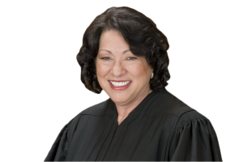{width=150}

:::

I agree with the Court's conclusion that the Due Process Clause prohibits the exercise of personal jurisdiction over Daimler in light of the unique circumstances of this case. I concur only in the judgment, however, because I cannot agree with the path the Court takes to arrive at that result.

The Court acknowledges that Mercedes-Benz USA, LLC (MBUSA), Daimler's wholly owned subsidiary, has considerable contacts with California. It has multiple facilities in the State, including a regional headquarters. Each year, it distributes in California tens of thousands of cars, the sale of which generated billions of dollars in the year this suit was brought. And it provides service and sales support to customers throughout the State. Daimler has conceded that California courts may exercise general jurisdiction over MBUSA on the basis of these contacts, and the Court assumes that MBUSA's contacts may be attributed to Daimler for the purpose of deciding whether Daimler is also subject to general jurisdiction.

Are these contacts sufficient to permit the exercise of general jurisdiction over Daimler? The Court holds that they are not, for a reason wholly foreign to our due process jurisprudence. The problem, the Court says, is not that Daimler's contacts with California are too few, but that its contacts with other forums are too many. In other words, the Court does not dispute that the presence of multiple offices, the direct distribution of thousands of products accounting for billions of dollars in sales, and continuous interaction with customers throughout a State would be enough to support the exercise of general jurisdiction over some businesses. Daimler is just not one of those businesses, the Court concludes, because its California contacts must be viewed in the context of its extensive "nationwide and worldwide" operations. In recent years, Americans have grown accustomed to the concept of multinational corporations that are supposedly "too big to fail"; today the Court deems Daimler "too big for general jurisdiction."

The Court's conclusion is wrong as a matter of both process and substance. As to process, the Court decides this case on a ground that was neither argued nor passed on below, and that Daimler raised for the first time in a footnote to its brief. As to substance, the Court's focus on Daimler's operations outside of California ignores the lodestar of our personal jurisdiction jurisprudence: A State may subject a defendant to the burden of suit if the defendant has sufficiently taken advantage of the State's laws and protections through its contacts in the State; whether the defendant has contacts elsewhere is immaterial.

Regrettably, these errors are unforced. The Court can and should decide this case on the far simpler ground that, no matter how extensive Daimler's contacts with California, that State's exercise of jurisdiction would be unreasonable given that the case involves foreign plaintiffs suing a foreign defendant based on foreign conduct, and given that a more appropriate forum is available. Because I would reverse the judgment below on this ground, I concur in the judgment only.

\[...\]

#### Notes & Questions

1.  In the wake of *Goodyear* and *Daimler*, is a corporate defendant ever "at home" someplace other than where it is headquartered or incorporated? If so, when? If not, what do you make of footnote 19 in the Court's opinion in *Daimler*?

2.  The facts of *Goodyear* and *Daimler* made clear that the lawsuit did not "arise out of" or "relate to" the defendants' forum contacts. But what happens when the answer to that question isn't so clear? For example, what if a defendant manufactures a large volume of identical products, some of which were sold and caused injury in the forum state, but others of which were sold and/or caused injury elsewhere? Do they count for purposes of specific jurisdiction or not? The next section takes up these tricky questions.

## The Future of Personal Jurisdiction

### Bristol-Myers Squibb Co. v. Superior Court

**ALITO, J., delivered the opinion of the Court.** [582 U.S. 255 (2017)]{.aside}

::: {.column-margin}

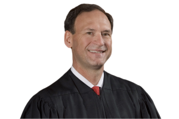{width=150}

:::

More than 600 plaintiffs, most of whom are not California residents, filed this civil action in a California state court against Bristol-Myers Squibb Company (BMS), asserting a variety of state-law claims based on injuries allegedly caused by a BMS drug called Plavix. The California Supreme Court held that the California courts have specific jurisdiction to entertain the nonresidents' claims. We now reverse.

**I**

**A**

BMS, a large pharmaceutical company, is incorporated in Delaware and headquartered in New York, and it maintains substantial operations in both New York and New Jersey. Over 50 percent of BMS's work force in the United States is employed in those two States.

BMS also engages in business activities in other jurisdictions, including California. Five of the company's research and laboratory facilities, which employ a total of around 160 employees, are located there. BMS also employs about 250 sales representatives in California and maintains a small state-government advocacy office in Sacramento.

One of the pharmaceuticals that BMS manufactures and sells is Plavix, a prescription drug that thins the blood and inhibits blood clotting. BMS did not develop Plavix in California, did not create a marketing strategy for Plavix in California, and did not manufacture, label, package, or work on the regulatory approval of the product in California. BMS instead engaged in all of these activities in either New York or New Jersey. But BMS does sell Plavix in California. Between 2006 and 2012, it sold almost 187 million Plavix pills in the State and took in more than \$900 million from those sales. This amounts to a little over one percent of the company's nationwide sales revenue.

**B**

A group of plaintiffs---consisting of 86 California residents and 592 residents from 33 other States---filed eight separate complaints in California Superior Court, alleging that Plavix had damaged their health. All the complaints asserted 13 claims under California law, including products liability, negligent misrepresentation, and misleading advertising claims. The nonresident plaintiffs did not allege that they obtained Plavix through California physicians or from any other California source; nor did they claim that they were injured by Plavix or were treated for their injuries in California.

Asserting lack of personal jurisdiction, BMS moved to quash service of summons on the nonresidents' claims, but the California Superior Court denied this motion, finding that the California courts had general jurisdiction over BMS "\[b\]ecause \[it\] engages in extensive activities in California." BMS unsuccessfully petitioned the State Court of Appeal for a writ of mandate, but after our decision on general jurisdiction in *Daimler AG v. Bauman*, the California Supreme Court instructed the Court of Appeal "to vacate its order denying mandate and to issue an order to show cause why relief sought in the petition should not be granted."

The Court of Appeal then changed its decision on the question of general jurisdiction. Under *Daimler*, it held, general jurisdiction was clearly lacking, but it went on to find that the California courts had specific jurisdiction over the nonresidents' claims against BMS.

The California Supreme Court affirmed. The court unanimously agreed with the Court of Appeal on the issue of general jurisdiction, but the court was divided on the question of specific jurisdiction. The majority applied a "sliding scale approach to specific jurisdiction." Under this approach, "the more wide ranging the defendant's forum contacts, the more readily is shown a connection between the forum contacts and the claim." Applying this test, the majority concluded that "BMS's extensive contacts with California" permitted the exercise of specific jurisdiction "based on a less direct connection between BMS's forum activities and plaintiffs' claims than might otherwise be required." This attenuated requirement was met, the majority found, because the claims of the nonresidents were similar in several ways to the claims of the California residents (as to which specific jurisdiction was uncontested). The court noted that "\[b\]oth the resident and nonresident plaintiffs' claims are based on the same allegedly defective product and the assertedly misleading marketing and promotion of that product." And while acknowledging that "there is no claim that Plavix itself was designed and developed in \[BMS's California research facilities\]," the court thought it significant that other research was done in the State.

Three justices dissented.

**II**

**A**

It has long been established that the Fourteenth Amendment limits the personal jurisdiction of state courts. \[...\] The primary focus of our personal jurisdiction inquiry is the defendant's relationship to the forum State.

Since our seminal decision in *International Shoe*, our decisions have recognized two types of personal jurisdiction: "general" (sometimes called "all-purpose") jurisdiction and "specific" (sometimes called "case-linked") jurisdiction. *Goodyear*. "For an individual, the paradigm forum for the exercise of general jurisdiction is the individual's domicile; for a corporation, it is an equivalent place, one in which the corporation is fairly regarded as at home." *Id.* A court with general jurisdiction may hear any claim against that defendant, even if all the incidents underlying the claim occurred in a different State. But "only a limited set of affiliations with a forum will render a defendant amenable to" general jurisdiction in that State. *Daimler*.

Specific jurisdiction is very different. In order for a state court to exercise specific jurisdiction, "the suit" must "aris\[e\] out of or relat\[e\] to the defendant's contacts with the forum." *Id.* In other words, there must be "an affiliation between the forum and the underlying controversy, principally, \[an\] activity or an occurrence that takes place in the forum State and is therefore subject to the State's regulation." *Goodyear*. For this reason, "specific jurisdiction is confined to adjudication of issues deriving from, or connected with, the very controversy that establishes jurisdiction."

**B**

In determining whether personal jurisdiction is present, a court must consider a variety of interests. These include "the interests of the forum State and of the plaintiff in proceeding with the cause in the plaintiff's forum of choice." But the "primary concern" is "the burden on the defendant." Assessing this burden obviously requires a court to consider the practical problems resulting from litigating in the forum, but it also encompasses the more abstract matter of submitting to the coercive power of a State that may have little legitimate interest in the claims in question. As we have put it, restrictions on personal jurisdiction "are more than a guarantee of immunity from inconvenient or distant litigation. They are a consequence of territorial limitations on the power of the respective States." *Hanson*. "\[T\]he States retain many essential attributes of sovereignty, including, in particular, the sovereign power to try causes in their courts. The sovereignty of each State ... implie\[s\] a limitation on the sovereignty of all its sister States." *World-Wide Volkswagen*. And at times, this federalism interest may be decisive. As we explained in *World-Wide Volkswagen*, "\[e\]ven if the defendant would suffer minimal or no inconvenience from being forced to litigate before the tribunals of another State; even if the forum State has a strong interest in applying its law to the controversy; even if the forum State is the most convenient location for litigation, the Due Process Clause, acting as an instrument of interstate federalism, may sometimes act to divest the State of its power to render a valid judgment."

**III**

Our settled principles regarding specific jurisdiction control this case. In order for a court to exercise specific jurisdiction over a claim, there must be an "affiliation between the forum and the underlying controversy, principally, \[an\] activity or an occurrence that takes place in the forum State." *Goodyear*. When there is no such connection, specific jurisdiction is lacking regardless of the extent of a defendant's unconnected activities in the State.

For this reason, the California Supreme Court's "sliding scale approach" is difficult to square with our precedents. Under the California approach, the strength of the requisite connection between the forum and the specific claims at issue is relaxed if the defendant has extensive forum contacts that are unrelated to those claims. Our cases provide no support for this approach, which resembles a loose and spurious form of general jurisdiction. For specific jurisdiction, a defendant's general connections with the forum are not enough. As we have said, "\[a\] corporation's 'continuous activity of some sorts within a state ... is not enough to support the demand that the corporation be amenable to suits unrelated to that activity.'"

The present case illustrates the danger of the California approach. The State Supreme Court found that specific jurisdiction was present without identifying any adequate link between the State and the nonresidents' claims. As noted, the nonresidents were not prescribed Plavix in California, did not ingest Plavix in California, and were not injured by Plavix in California. The mere fact that other plaintiffs were prescribed, obtained, and ingested Plavix in California---and allegedly sustained the same injuries as did the non-residents---does not allow the State to assert specific jurisdiction over the nonresidents' claims. As we have explained, "a defendant's relationship with a ... third party, standing alone, is an insufficient basis for jurisdiction." *Walden*. This remains true even when third parties (here, the plaintiffs who reside in California) can bring claims similar to those brought by the nonresidents. Nor is it sufficient---or even relevant---that BMS conducted research in California on matters unrelated to Plavix. What is needed---and what is missing here---is a connection between the forum and the specific claims at issue.

\[...\]

In a last ditch contention, respondents contend that BMS's "decision to contract with a California company \[McKesson\] to distribute \[Plavix\] nationally" provides a sufficient basis for personal jurisdiction. But as we have explained, "\[t\]he requirements of *International Shoe* ... must be met as to each defendant over whom a state court exercises jurisdiction." In this case, it is not alleged that BMS engaged in relevant acts together with McKesson in California. Nor is it alleged that BMS is derivatively liable for McKesson's conduct in California. And the nonresidents have adduced no evidence to show how or by whom the Plavix they took was distributed to the pharmacies that dispensed it to them. The bare fact that BMS contracted with a California distributor is not enough to establish personal jurisdiction in the State.

**IV**

Our straightforward application in this case of settled principles of personal jurisdiction will not result in the parade of horribles that respondents conjure up. Our decision does not prevent the California and out-of-state plaintiffs from joining together in a consolidated action in the States that have general jurisdiction over BMS. BMS concedes that such suits could be brought in either New York or Delaware. Alternatively, the plaintiffs who are residents of a particular State---for example, the 92 plaintiffs from Texas and the 71 from Ohio---could probably sue together in their home States. In addition, since our decision concerns the due process limits on the exercise of specific jurisdiction by a State, we leave open the question whether the Fifth Amendment imposes the same restrictions on the exercise of personal jurisdiction by a federal court.

**\* \* \***

The judgment of the California Supreme Court is reversed, and the case is remanded for further proceedings not inconsistent with this opinion.

It is so ordered.

**SOTOMAYOR, J., dissenting.**

::: {.column-margin}

{width=150}

:::

Three years ago, the Court imposed substantial curbs on the exercise of general jurisdiction in its decision in *Daimler AG v. Bauman*. Today, the Court takes its first step toward a similar contraction of specific jurisdiction by holding that a corporation that engages in a nationwide course of conduct cannot be held accountable in a state court by a group of injured people unless all of those people were injured in the forum State.

I fear the consequences of the Court's decision today will be substantial. The majority's rule will make it difficult to aggregate the claims of plaintiffs across the country whose claims may be worth little alone. It will make it impossible to bring a nationwide mass action in state court against defendants who are "at home" in different States. And it will result in piecemeal litigation and the bifurcation of claims. None of this is necessary. A core concern in this Court's personal jurisdiction cases is fairness. And there is nothing unfair about subjecting a massive corporation to suit in a State for a nationwide course of conduct that injures both forum residents and nonresidents alike.

**I**

Bristol-Myers Squibb is a Fortune 500 pharmaceutical company incorporated in Delaware and headquartered in New York. It employs approximately 25,000 people worldwide and earns annual revenues of over \$15 billion. In the late 1990's, Bristol-Myers began to market and sell a prescription blood thinner called Plavix. Plavix was advertised as an effective tool for reducing the risk of blood clotting for those vulnerable to heart attacks and to strokes. The ads worked: At the height of its popularity, Plavix was a blockbuster, earning Bristol-Myers billions of dollars in annual revenues.

Bristol-Myers' advertising and distribution efforts were national in scope. It conducted a single nationwide advertising campaign for Plavix, using television, magazine, and Internet ads to broadcast its message. A consumer in California heard the same advertisement as a consumer in Maine about the benefits of Plavix. Bristol-Myers' distribution of Plavix also proceeded through nationwide channels: Consistent with its usual practice, it relied on a small number of wholesalers to distribute Plavix throughout the country. One of those distributors, McKesson Corporation, was named as a defendant below; during the relevant time period, McKesson was responsible for almost a quarter of Bristol-Myers' revenue worldwide.

\[...\]

**II**

\[...\]

\[T\]he California courts appropriately exercised specific jurisdiction over respondents' claims.

First, there is no dispute that Bristol-Myers "purposefully avail\[ed\] itself" of California and its substantial pharmaceutical market. Bristol-Myers employs over 400 people in California and maintains half a dozen facilities in the State engaged in research, development, and policymaking. It contracts with a California-based distributor, McKesson, whose sales account for a significant portion of its revenue. And it markets and sells its drugs, including Plavix, in California, resulting in total Plavix sales in that State of nearly \$1 billion during the period relevant to this suit.

Second, respondents' claims "relate to" Bristol-Myers' in-state conduct. A claim "relates to" a defendant's forum conduct if it has a "connect\[ion\] with" that conduct. So respondents could not, for instance, hale Bristol-Myers into court in California for negligently maintaining the sidewalk outside its New York headquarters---a claim that has no connection to acts Bristol-Myers took in California. But respondents' claims against Bristol-Myers look nothing like such a claim. Respondents' claims against Bristol-Myers concern conduct materially identical to acts the company took in California: its marketing and distribution of Plavix, which it undertook on a nationwide basis in all 50 States. That respondents were allegedly injured by this nationwide course of conduct in Indiana, Oklahoma, and Texas, and not California, does not mean that their claims do not "relate to" the advertising and distribution efforts that Bristol-Myers undertook in that State. All of the plaintiffs---residents and nonresidents alike---allege that they were injured by the same essential acts. Our cases require no connection more direct than that.

Finally, and importantly, there is no serious doubt that the exercise of jurisdiction over the nonresidents' claims is reasonable. Because Bristol-Myers already faces claims that are identical to the nonresidents' claims in this suit, it will not be harmed by having to defend against respondents' claims: Indeed, the alternative approach---litigating those claims in separate suits in as many as 34 different States---would prove far more burdensome. By contrast, the plaintiffs' "interest in obtaining convenient and effective relief" is obviously furthered by participation in a consolidated proceeding in one State under shared counsel, which allows them to minimize costs, share discovery, and maximize recoveries on claims that may be too small to bring on their own. California, too, has an interest in providing a forum for mass actions like this one: Permitting the non-residents to bring suit in California alongside the residents facilitates the efficient adjudication of the residents' claims and allows it to regulate more effectively the conduct of both nonresident corporations like Bristol-Myers and resident ones like McKesson.

Nothing in the Due Process Clause prohibits a California court from hearing respondents' claims---at least not in a case where they are joined to identical claims brought by California residents.

**III**

\[...\]

I fear the consequences of the majority's decision today will be substantial. Even absent a rigid requirement that a defendant's in-state conduct must actually cause a plaintiff's claim,^3^ [ ^3^ Bristol-Myers urges such a rule upon us, but its adoption would have consequences far beyond those that follow from today's factbound opinion. Among other things, it might call into question whether even a plaintiff *injured* in a State by an item identical to those sold by a defendant in that State could avail himself of that State's courts to redress his injuries---a result specifically contemplated by *World-Wide Volkswagen*.\
]{.aside} the upshot of today's opinion is that plaintiffs cannot join their claims together and sue a defendant in a State in which only some of them have been injured. That rule is likely to have consequences far beyond this case.

First, and most prominently, the Court's opinion in this case will make it profoundly difficult for plaintiffs who are injured in different States by a defendant's nationwide course of conduct to sue that defendant in a single, consolidated action. The holding of today's opinion is that such an action cannot be brought in a State in which only some plaintiffs were injured. Not to worry, says the majority: The plaintiffs here could have sued Bristol-Myers in New York or Delaware; could "probably" have subdivided their separate claims into 34 lawsuits in the States in which they were injured; and might have been able to bring a single suit in federal court (an "open ... question"). Even setting aside the majority's caveats, what is the purpose of such limitations? What interests are served by preventing the consolidation of claims and limiting the forums in which they can be consolidated? The effect of the Court's opinion today is to eliminate nationwide mass actions in any State other than those in which a defendant is "'essentially at home.'"^4^ [ ^4^ The Court today does not confront the question whether its opinion here would also apply to a class action in which a plaintiff injured in the forum State seeks to represent a nationwide class of plaintiffs, not all of whom were injured there. *Cf. Devlin v. Scardelletti* ("Nonnamed class members ... may be parties for some purposes and not for others").\
]{.aside} *See Daimler*. Such a rule hands one more tool to corporate defendants determined to prevent the aggregation of individual claims, and forces injured plaintiffs to bear the burden of bringing suit in what will often be far flung jurisdictions.

Second, the Court's opinion today may make it impossible to bring certain mass actions at all. After this case, it is difficult to imagine where it might be possible to bring a nationwide mass action against two or more defendants headquartered and incorporated in different States. There will be no State where both defendants are "at home," and so no State in which the suit can proceed. What about a nationwide mass action brought against a defendant not headquartered or incorporated in the United States? Such a defendant is not "at home" in any State. Especially in a world in which defendants are subject to general jurisdiction in only a handful of States, the effect of today's opinion will be to curtail---and in some cases eliminate---plaintiffs' ability to hold corporations fully accountable for their nationwide conduct.

The majority chides respondents for conjuring a "parade of horribles," but says nothing about how suits like those described here will survive its opinion in this case. The answer is simple: They will not.

**\* \* \***

It "does not offend 'traditional notions of fair play and substantial justice'" to permit plaintiffs to aggregate claims arising out of a single nationwide course of conduct in a single suit in a single State where some, but not all, were injured. But that is exactly what the Court holds today is barred by the Due Process Clause.

This is not a rule the Constitution has required before. I respectfully dissent.

#### Notes & Questions

1.  Why wasn't there general jurisdiction in *Bristol-Myers*?

2.  Note that *Bristol-Myers* concerned a "mass action," a type of case in which there are many individual plaintiffs, but, critically, they are not part of a certified class. Rather, each plaintiff is a party present before the Court. How did that procedural posture affect the Court's personal jurisdiction analysis? In answering that question, consider footnote 4 of Justice Sotomayor's dissenting opinion.

3.  Is Justice Sotomayor right to be concerned about the potential consequences of the Court's opinion in *Bristol-Myers*? Should the Court consider practical consequences when interpreting the constitutional limits imposed by due process?

### Ford Motor Co. v. Montana Eighth Judicial District Court

**Justice KAGAN delivered the opinion of the Court.** [592 U.S. 351 (2021)]{.aside}

::: {.column-margin}

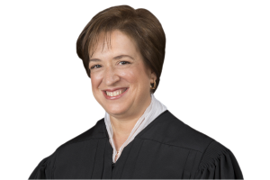{width=150}

:::

In each of these two cases, a state court held that it had jurisdiction over Ford Motor Company in a products-liability suit stemming from a car accident. The accident happened in the State where suit was brought. The victim was one of the State's residents. And Ford did substantial business in the State---among other things, advertising, selling, and servicing the model of vehicle the suit claims is defective. Still, Ford contends that jurisdiction is improper because the particular car involved in the crash was not first sold in the forum State, nor was it designed or manufactured there. We reject that argument. When a company like Ford serves a market for a product in a State and that product causes injury in the State to one of its residents, the State's courts may entertain the resulting suit.

**I**

Ford is a global auto company. It is incorporated in Delaware and headquartered in Michigan. But its business is everywhere. Ford markets, sells, and services its products across the United States and overseas. In this country alone, the company annually distributes over 2.5 million new cars, trucks, and SUVs to over 3,200 licensed dealerships. Ford also encourages a resale market for its products: Almost all its dealerships buy and sell used Fords, as well as selling new ones. To enhance its brand and increase its sales, Ford engages in wide-ranging promotional activities, including television, print, online, and direct-mail advertisements. No matter where you live, you've seen them: "Have you driven a Ford lately?" or "Built Ford Tough." Ford also ensures that consumers can keep their vehicles running long past the date of sale. The company provides original parts to auto supply stores and repair shops across the country. (Goes another slogan: "Keep your Ford a Ford.") And Ford's own network of dealers offers an array of maintenance and repair services, thus fostering an ongoing relationship between Ford and its customers.

Accidents involving two of Ford's vehicles---a 1996 Explorer and a 1994 Crown Victoria---are at the heart of the suits before us. One case comes from Montana. Markkaya Gullett was driving her Explorer near her home in the State when the tread separated from a rear tire. The vehicle spun out, rolled into a ditch, and came to rest upside down. Gullett died at the scene of the crash. The representative of her estate sued Ford in Montana state court, bringing claims for a design defect, failure to warn, and negligence. The second case comes from Minnesota. Adam Bandemer was a passenger in his friend's Crown Victoria, traveling on a rural road in the State to a favorite ice-fishing spot. When his friend rear-ended a snowplow, this car too landed in a ditch. Bandemer's air bag failed to deploy, and he suffered serious brain damage. He sued Ford in Minnesota state court, asserting products-liability, negligence, and breach-of-warranty claims.

Ford moved to dismiss the two suits for lack of personal jurisdiction, on basically identical grounds. According to Ford, the state court (whether in Montana or Minnesota) had jurisdiction only if the company's conduct in the State had given rise to the plaintiff's claims. And that causal link existed, Ford continued, only if the company had designed, manufactured, or---most likely---sold in the State the particular vehicle involved in the accident. In neither suit could the plaintiff make that showing. Ford had designed the Explorer and Crown Victoria in Michigan, and it had manufactured the cars in (respectively) Kentucky and Canada. Still more, the company had originally sold the cars at issue outside the forum States---the Explorer in Washington, the Crown Victoria in North Dakota. Only later resales and relocations by consumers had brought the vehicles to Montana and Minnesota. That meant, in Ford's view, that the courts of those States could not decide the suits.

Both the Montana and the Minnesota Supreme Courts (affirming lower court decisions) rejected Ford's argument.

\[...\]

We granted certiorari to consider if Ford is subject to jurisdiction in these cases. We hold that it is.

**II**

**A**

The Fourteenth Amendment's Due Process Clause limits a state court's power to exercise jurisdiction over a defendant. The canonical decision in this area remains *International Shoe Co. v. Washington*. There, the Court held that a tribunal's authority depends on the defendant's having such "contacts" with the forum State that "the maintenance of the suit" is "reasonable, in the context of our federal system of government," and "does not offend traditional notions of fair play and substantial justice." In giving content to that formulation, the Court has long focused on the nature and extent of "the defendant's relationship to the forum State." *Bristol-Myers Squibb Co. v. Superior Court of Cal.* That focus led to our recognizing two kinds of personal jurisdiction: general (sometimes called all-purpose) jurisdiction and specific (sometimes called case-linked) jurisdiction. *See Goodyear Dunlop Tires Operations, S. A. v. Brown*.

A state court may exercise general jurisdiction only when a defendant is "essentially at home" in the State. General jurisdiction, as its name implies, extends to "any and all claims" brought against a defendant. Those claims need not relate to the forum State or the defendant's activity there; they may concern events and conduct anywhere in the world. But that breadth imposes a correlative limit: Only a select "set of affiliations with a forum" will expose a defendant to such sweeping jurisdiction. *Daimler AG v. Bauman*. In what we have called the "paradigm" case, an individual is subject to general jurisdiction in her place of domicile. And the "equivalent" forums for a corporation are its place of incorporation and principal place of business. \[*But cf.*\] *id.* at 139 n.19 (leaving open "the possibility that in an exceptional case" a corporation might also be "at home" elsewhere). So general jurisdiction over Ford (as all parties agree) attaches in Delaware and Michigan---not in Montana and Minnesota.

Specific jurisdiction is different: It covers defendants less intimately connected with a State, but only as to a narrower class of claims. The contacts needed for this kind of jurisdiction often go by the name "purposeful availment." *Burger King Corp. v. Rudzewicz*. The defendant, we have said, must take "some act by which \[it\] purposefully avails itself of the privilege of conducting activities within the forum State." *Hanson v. Denckla*. The contacts must be the defendant's own choice and not "random, isolated, or fortuitous." *Keeton v. Hustler Magazine, Inc.* They must show that the defendant deliberately "reached out beyond" its home---by, for example, "exploi\[ting\] a market" in the forum State or entering a contractual relationship centered there. *Walden v. Fiore*. Yet even then---because the defendant is not "at home"---the forum State may exercise jurisdiction in only certain cases. The plaintiff's claims, we have often stated, "must arise out of or relate to the defendant's contacts" with the forum. *Bristol-Myers*. Or put just a bit differently, "there must be 'an affiliation between the forum and the underlying controversy, principally, \[an\] activity or an occurrence that takes place in the forum State and is therefore subject to the State's regulation.'" *Bristol-Myers*.

::: {.column-margin}

^2^ One of the concurrences here expresses a worry that our *International Shoe*-based body of law is not "well suited for the way in which business is now conducted," and tentatively suggests a 21st-century rethinking. Post (Alito, J., concurring in judgment). Fair enough perhaps, *see infra* n.4, but the concurrence then acknowledges that these cases have no distinctively modern features, and it decides them on grounds that (as it agrees) are much the same as ours. The other concurrence proposes instead a return to the mid-19th century---a replacement of our current doctrine with the Fourteenth Amendment's original meaning respecting personal jurisdiction. Post (GORSUCH, J., concurring in judgment). But that opinion never reveals just what the Due Process Clause as understood at its ratification required, and its ground for deciding these cases is correspondingly spare. This opinion, by contrast, resolves these cases by proceeding as the Court has done for the last 75 years---applying the standards set out in *International Shoe* and its progeny, with attention to their underlying values of ensuring fairness and protecting interstate federalism.

:::

These rules derive from and reflect two sets of values---treating defendants fairly and protecting "interstate federalism." *World-Wide Volkswagen Corp. v. Woodson*. Our decision in *International Shoe* founded specific jurisdiction on an idea of reciprocity between a defendant and a State: When (but only when) a company "exercises the privilege of conducting activities within a state"---thus "enjoy\[ing\] the benefits and protection of \[its\] laws"---the State may hold the company to account for related misconduct. Later decisions have added that our doctrine similarly provides defendants with "fair warning"---knowledge that "a particular activity may subject \[it\] to the jurisdiction of a foreign sovereign." *Burger King*. A defendant can thus "structure \[its\] primary conduct" to lessen or avoid exposure to a given State's courts. And this Court has considered alongside defendants' interests those of the States in relation to each other. One State's "sovereign power to try" a suit, we have recognized, may prevent "sister States" from exercising their like authority. The law of specific jurisdiction thus seeks to ensure that States with "little legitimate interest" in a suit do not encroach on States more affected by the controversy.^2^

**B**

Ford contends that our jurisdictional rules prevent Montana's and Minnesota's courts from deciding these two suits. In making that argument, Ford does not contest that it does substantial business in Montana and Minnesota---that it actively seeks to serve the market for automobiles and related products in those States. Or to put that concession in more doctrinal terms, Ford agrees that it has "purposefully avail\[ed\] itself of the privilege of conducting activities" in both places. Ford's claim is instead that those activities do not sufficiently connect to the suits, even though the resident-plaintiffs allege that Ford cars malfunctioned in the forum States. In Ford's view, the needed link must be causal in nature: Jurisdiction attaches "only if the defendant's forum conduct gave rise to the plaintiff's claims." And that rule reduces, Ford thinks, to locating specific jurisdiction in the State where Ford sold the car in question, or else the States where Ford designed and manufactured the vehicle. On that view, the place of accident and injury is immaterial. So (Ford says) Montana's and Minnesota's courts have no power over these cases.

But Ford's causation-only approach finds no support in this Court's requirement of a "connection" between a plaintiff's suit and a defendant's activities. *Bristol-Myers*. That rule indeed serves to narrow the class of claims over which a state court may exercise specific jurisdiction. But not quite so far as Ford wants. None of our precedents has suggested that only a strict causal relationship between the defendant's in-state activity and the litigation will do. As just noted, our most common formulation of the rule demands that the suit "arise out of or relate to the defendant's contacts with the forum." The first half of that standard asks about causation; but the back half, after the "or," contemplates that some relationships will support jurisdiction without a causal showing. That does not mean anything goes. In the sphere of specific jurisdiction, the phrase "relate to" incorporates real limits, as it must to adequately protect defendants foreign to a forum. But again, we have never framed the specific jurisdiction inquiry as always requiring proof of causation---*i.e.*, proof that the plaintiff's claim came about because of the defendant's in-state conduct. \[...\]

And indeed, this Court has stated that specific jurisdiction attaches in cases identical to the ones here---when a company like Ford serves a market for a product in the forum State and the product malfunctions there. In *World-Wide Volkswagen*, the Court held that an Oklahoma court could not assert jurisdiction over a New York car dealer just because a car it sold later caught fire in Oklahoma. But in so doing, we contrasted the dealer's position to that of two other defendants---Audi, the car's manufacturer, and Volkswagen, the car's nationwide importer (neither of which contested jurisdiction):

> \[I\]f the sale of a product of a manufacturer or distributor such as Audi or Volkswagen is not simply an isolated occurrence, but arises from the efforts of the manufacturer or distributor to serve, directly or indirectly, the market for its product in \[several or all\] other States, it is not unreasonable to subject it to suit in one of those States if its allegedly defective merchandise has there been the source of injury to its owner or to others.

Or said another way, if Audi and Volkswagen's business deliberately extended into Oklahoma (among other States), then Oklahoma's courts could hold the companies accountable for a car's catching fire there---even though the vehicle had been designed and made overseas and sold in New York. For, the Court explained, a company thus "purposefully avail\[ing\] itself" of the Oklahoma auto market "has clear notice" of its exposure in that State to suits arising from local accidents involving its cars. And the company could do something about that exposure: It could "act to alleviate the risk of burdensome litigation by procuring insurance, passing the expected costs on to customers, or, if the risks are \[still\] too great, severing its connection with the State."

\[...\]

To see why Ford is subject to jurisdiction in these cases (as Audi, Volkswagen, and Daimler were in their analogues), consider first the business that the company regularly conducts in Montana and Minnesota. Small wonder that Ford has here conceded "purposeful availment" of the two States' markets. By every means imaginable---among them, billboards, TV and radio spots, print ads, and direct mail---Ford urges Montanans and Minnesotans to buy its vehicles, including (at all relevant times) Explorers and Crown Victorias. Ford cars---again including those two models---are available for sale, whether new or used, throughout the States, at 36 dealerships in Montana and 84 in Minnesota. And apart from sales, Ford works hard to foster ongoing connections to its cars' owners. The company's dealers in Montana and Minnesota (as elsewhere) regularly maintain and repair Ford cars, including those whose warranties have long since expired. And the company distributes replacement parts both to its own dealers and to independent auto shops in the two States. Those activities, too, make Ford money. And by making it easier to own a Ford, they encourage Montanans and Minnesotans to become lifelong Ford drivers.

Now turn to how all this Montana- and Minnesota-based conduct relates to the claims in these cases, brought by state residents in Montana's and Minnesota's courts. Each plaintiff's suit, of course, arises from a car accident in one of those States. In each complaint, the resident-plaintiff alleges that a defective Ford vehicle---an Explorer in one, a Crown Victoria in the other---caused the crash and resulting harm. And as just described, Ford had advertised, sold, and serviced those two car models in both States for many years. (Contrast a case, which we do not address, in which Ford marketed the models in only a different State or region.) In other words, Ford had systematically served a market in Montana and Minnesota for the very vehicles that the plaintiffs allege malfunctioned and injured them in those States. So there is a strong "relationship among the defendant, the forum, and the litigation"---the "essential foundation" of specific jurisdiction. Helicopteros. \[...\] ^4^ [ ^4^ None of this is to say that any person using any means to sell any good in a State is subject to jurisdiction there if the product malfunctions after arrival. We have long treated isolated or sporadic transactions differently from continuous ones. *See, e.g.*, *World-Wide Volkswagen*. And we do not here consider internet transactions, which may raise doctrinal questions of their own. So consider, for example, a hypothetical offered at oral argument. "\[A\] retired guy in a small town" in Maine "carves decoys" and uses "a site on the Internet" to sell them. "Can he be sued in any state if some harm arises from the decoy?" The differences between that case and the ones before us virtually list themselves. (Just consider all our descriptions of Ford's activities outside its home bases.) So we agree with the plaintiffs' counsel that resolving these cases does not also resolve the hypothetical.\
]{.aside}

The only complication here, pressed by Ford, is that the company sold the specific cars involved in these crashes outside the forum States, with consumers later selling them to the States' residents. Because that is so, Ford argues, the plaintiffs' claims "would be precisely the same if Ford had never done anything in Montana and Minnesota." Of course, that argument merely restates Ford's demand for an exclusively causal test of connection---which we have already shown is inconsistent with our caselaw. And indeed, a similar assertion could have been made in *World-Wide Volkswagen*---yet the Court made clear that systematic contacts in Oklahoma rendered Audi accountable there for an in-state accident, even though it involved a car sold in New York. So too here, and for the same reasons, even supposing (as Ford does) that without the company's Montana or Minnesota contacts the plaintiffs' claims would be just the same.

But in any event, that assumption is far from clear. For the owners of these cars might never have bought them, and so these suits might never have arisen, except for Ford's contacts with their home States. Those contacts might turn any resident of Montana or Minnesota into a Ford owner---even when he buys his car from out of state. He may make that purchase because he saw ads for the car in local media. And he may take into account a raft of Ford's in-state activities designed to make driving a Ford convenient there: that Ford dealers stand ready to service the car; that other auto shops have ample supplies of Ford parts; and that Ford fosters an active resale market for its old models. The plaintiffs here did not in fact establish, or even allege, such causal links. Nor should jurisdiction in cases like these ride on the exact reasons for an individual plaintiff's purchase, or on his ability to present persuasive evidence about them. But the possibilities listed above---created by the reach of Ford's Montana and Minnesota contacts---underscore the aptness of finding jurisdiction here, even though the cars at issue were first sold out of state.

For related reasons, allowing jurisdiction in these cases treats Ford fairly, as this Court's precedents explain. In conducting so much business in Montana and Minnesota, Ford "enjoys the benefits and protection of \[their\] laws"---the enforcement of contracts, the defense of property, the resulting formation of effective markets. *International Shoe*. All that assistance to Ford's in-state business creates reciprocal obligations---most relevant here, that the car models Ford so extensively markets in Montana and Minnesota be safe for their citizens to use there. Thus our repeated conclusion: A state court's enforcement of that commitment, enmeshed as it is with Ford's government-protected in-state business, can "hardly be said to be undue." And as World-Wide Volkswagen described, it cannot be thought surprising either. An automaker regularly marketing a vehicle in a State, the Court said, has "clear notice" that it will be subject to jurisdiction in the State's courts when the product malfunctions there (regardless where it was first sold). Precisely because that exercise of jurisdiction is so reasonable, it is also predictable---and thus allows Ford to "structure \[its\] primary conduct" to lessen or even avoid the costs of state-court litigation. *World-Wide Volkswagen*.

Finally, principles of "interstate federalism" support jurisdiction over these suits in Montana and Minnesota. Those States have significant interests at stake--- "providing \[their\] residents with a convenient forum for redressing injuries inflicted by out-of-state actors," as well as enforcing their own safety regulations. Burger King. Consider, next to those, the interests of the States of first sale (Washington and North Dakota)---which Ford's proposed rule would make the most likely forums. For each of those States, the suit involves all out-of-state parties, an out-of-state accident, and out-of-state injuries; the suit's only connection with the State is that a former owner once (many years earlier) bought the car there. In other words, there is a less significant "relationship among the defendant, the forum, and the litigation." *Walden*. So by channeling these suits to Washington and North Dakota, Ford's regime would undermine, rather than promote, what the company calls the Due Process Clause's "jurisdiction-allocating function."

**C**

Ford mainly relies for its rule on two of our recent decisions---*Bristol-Myers* and *Walden*. But those precedents stand for nothing like the principle Ford derives from them. If anything, they reinforce all we have said about why Montana's and Minnesota's courts can decide these cases.

Ford says of *Bristol-Myers* that it "squarely foreclose\[s\]" jurisdiction. In that case, non-resident plaintiffs brought claims in California state court against Bristol-Myers Squibb, the manufacturer of a nationally marketed prescription drug called Plavix. The plaintiffs had not bought Plavix in California; neither had they used or suffered any harm from the drug there. Still, the California Supreme Court thought it could exercise jurisdiction because Bristol-Myers Squibb sold Plavix in California and was defending there against identical claims brought by the State's residents. This Court disagreed, holding that the exercise of jurisdiction violated the Fourteenth Amendment. In Ford's view, the same must be true here. Each of these plaintiffs, like the plaintiffs in Bristol-Myers, alleged injury from a particular item (a car, a pill) that the defendant had sold outside the forum State. Ford reads *Bristol-Myers* to preclude jurisdiction when that is true, even if the defendant regularly sold "the same kind of product" in the State.

But that reading misses the point of our decision. We found jurisdiction improper in *Bristol-Myers* because the forum State, and the defendant's activities there, lacked any connection to the plaintiffs' claims. The plaintiffs, the Court explained, were not residents of California. They had not been prescribed Plavix in California. They had not ingested Plavix in California. And they had not sustained their injuries in California. In short, the plaintiffs were engaged in forum-shopping---suing in California because it was thought plaintiff-friendly, even though their cases had no tie to the State. That is not at all true of the cases before us. Yes, Ford sold the specific products in other States, as Bristol-Myers Squibb had. But here, the plaintiffs are residents of the forum States. They used the allegedly defective products in the forum States. And they suffered injuries when those products malfunctioned in the forum States. In sum, each of the plaintiffs brought suit in the most natural State \[...\]. So *Bristol-Myers* does not bar jurisdiction.

\[The Court also rejected Ford's argument that *Walden v. Fiore* foreclosed jurisdiction.\] In *Walden*, only the plaintiffs had any contacts with the State of Nevada \[...\]. The officer had "never traveled to, conducted activities within, contacted anyone in, or sent anything or anyone to Nevada." So to use the language of our doctrinal test: He had not "purposefully availed himself of the privilege of conducting activities" in the forum State. *Hanson*. Because that was true, the Court had no occasion to address the necessary connection between a defendant's in-state activity and the plaintiff's claims. But here, Ford has a veritable truckload of contacts with Montana and Minnesota, as it admits. The only issue is whether those contacts are related enough to the plaintiffs' suits. As to that issue, so what if (as *Walden* held) the place of a plaintiff's injury and residence cannot create a defendant's contact with the forum State? Those places still may be relevant in assessing the link between the defendant's forum contacts and the plaintiff's suit---including its assertions of who was injured where. \[...\]

**\* \* \***

Here, resident-plaintiffs allege that they suffered in-state injury because of defective products that Ford extensively promoted, sold, and serviced in Montana and Minnesota. For all the reasons we have given, the connection between the plaintiffs' claims and Ford's activities in those States--- or otherwise said, the "relationship among the defendant, the forum\[s\], and the litigation"---is close enough to support specific jurisdiction. *Walden*. The judgments of the Montana and Minnesota Supreme Courts are therefore affirmed.

It is so ordered.

**JUSTICE ALITO, concurring in the judgment.**

::: {.column-margin}

{width=150}

:::

These cases can and should be decided without any alteration or refinement of our case law on specific personal jurisdiction. To be sure, for the reasons outlined in Justice Gorsuch's thoughtful opinion, there are grounds for questioning the standard that the Court adopted in *International Shoe Co. v. Washington*. And there are also reasons to wonder whether the case law we have developed since that time is well suited for the way in which business is now conducted. But there is nothing distinctively 21st century about the question in the cases now before us, and the answer to that question is settled by our case law.

Since *International Shoe*, the rule has been that a state court can exercise personal jurisdiction over a defendant if the defendant has "minimum contacts" with the forum--- which means that the contacts must be "such that the maintenance of the suit does not offend 'traditional notions of fair play and substantial justice.'"

\[...\] Can anyone seriously argue that requiring Ford to litigate these cases in Minnesota and Montana would be fundamentally unfair?

Well, Ford makes that argument. It would send the plaintiffs packing to the jurisdictions where the vehicles in question were assembled (Kentucky and Canada), designed (Michigan), or first sold (Washington and North Dakota) or where Ford is incorporated (Delaware) or has its principal place of business (Michigan).

\[...\]

The Court properly rejects that argument, and I agree with the main thrust of the Court's opinion. My only quibble is with the new gloss that the Court puts on our case law. Several of our opinions have said that a plaintiff's claims "must arise out of or relate to the defendant's contacts" with the forum. \[Relying on this language,\] the Court recognizes a new category of cases in which personal jurisdiction is permitted: those in which the claims do not "arise out of" (*i.e.*, are not caused by) the defendant's contacts but nevertheless sufficiently "relate to" those contacts in some undefined way.

This innovation is unnecessary and, in my view, unwise. \[...\]

Recognizing "relate to" as an independent basis for specific jurisdiction risks needless complications. The "ordinary meaning" of the phrase "relate to" "is a broad one." Applying that phrase "according to its terms is a project doomed to failure, since, as many a curbstone philosopher has observed, everything is related to everything else." To rein in this phrase, limits must be found, and the Court assures us that "relate to," as it now uses the concept, "incorporates real limits." But without any indication what those limits might be, I doubt that the lower courts will find that observation terribly helpful. Instead, what limits the potentially boundless reach of "relate to" is just the sort of rough causal connection I have described.

I would leave the law exactly where it stood before we took these cases, and for that reason, I concur in the judgment.

**JUSTICE GORSUCH, with whom JUSTICE THOMAS joins, concurring in the judgment.**

::: {.column-margin}

{width=150}

:::

Since *International Shoe Co. v. Washington*, this Court's cases have sought to divide the world of personal jurisdiction in two. A tribunal with "general jurisdiction" may entertain any claim against the defendant. But to trigger this power, a court usually must ensure the defendant is "at home" in the forum State. *Daimler AG v. Bauman*. Meanwhile, "specific jurisdiction" affords a narrower authority. It applies only when the defendant "purposefully avails" itself of the opportunity to do business in the forum State and the suit "arises out of or relates to" the defendant's contacts with the forum State. *Burger King Corp. v. Rudzewicz*.

While our cases have long admonished lower courts to keep these concepts distinct, some of the old guardrails have begun to look a little battered. Take general jurisdiction. If it made sense to speak of a corporation having one or two "homes" in 1945, it seems almost quaint in 2021 when corporations with global reach often have massive operations spread across multiple States. \[...\]

Today's case tests the old boundaries from another direction. Until now, many lower courts have proceeded on the premise that specific jurisdiction requires two things. First, the defendant must "purposefully avail" itself of the chance to do business in a State. Second, the plaintiff's suit must "arise out of or relate to" the defendant's in-state activities. Typically, courts have read this second phrase as a unit requiring at least a but-for causal link between the defendant's local activities and the plaintiff's injuries. As every first year law student learns, a but-for causation test isn't the most demanding. At a high level of abstraction, one might say any event in the world would not have happened "but for" events far and long removed.

Now, though, the Court pivots away from this understanding. Focusing on the phrase "arise out of or relate to" that so often appears in our cases, the majority asks us to parse those words "as though we were dealing with language of a statute." In particular, the majority zeros in on the disjunctive conjunction "or," and proceeds to build its entire opinion around that linguistic feature. The majority admits that "arise out of" may connote causation. But, it argues, "relate to" is an independent clause that does not.

Where this leaves us is far from clear. For a case to "relate to" the defendant's forum contacts, the majority says, it is enough if an "affiliation" or "relationship" or "connection" exists between them. But what does this assortment of nouns mean? Loosed from any causation standard, we are left to guess. The majority promises that its new test "does not mean anything goes," but that hardly tells us what does. In some cases, the new test may prove more forgiving than the old causation rule. But it's hard not to wonder whether it may also sometimes turn out to be more demanding. \[...\]

For a glimpse at the complications invited by today's decision, consider its treatment of North Dakota and Washington. Those are the States where Ford first sold the allegedly defective cars at issue in the cases before us. The majority seems to suggest that, if the plaintiffs had sought to bring their suits in those States, they would have failed. The majority stresses that the "only connection" between the plaintiffs' claims and North Dakota and Washington is the fact that former owners once bought the allegedly defective cars there. But the majority never tells us why that "connection" isn't enough. Surely, North Dakota and Washington would contend they have a strong interest in ensuring they don't become marketplaces for unreasonably dangerous products. Nor is it clear why the majority casts doubt on the availability of specific jurisdiction in these States without bothering to consider whether the old causation test might allow it. After all, no one doubts Ford purposefully availed itself of those markets. The plaintiffs' injuries, at least arguably, "arose from" (or were caused by) the sale of defective cars in those places. Even if the majority's new affiliation test isn't satisfied, don't we still need to ask those causation questions, or are they now to be abandoned?

Consider, too, a hypothetical the majority offers in a footnote. The majority imagines a retiree in Maine who starts a one-man business, carving and selling wooden duck decoys. In time, the man sells a defective decoy over the Internet to a purchaser in another State who is injured. \[...\] The majority says this hypothetical supplies a useful study in contrast with our cases. On the majority's telling, Ford's "continuous" contacts with Montana and Minnesota are enough to establish an "affiliation" with those States; by comparison, the decoy seller's contacts may be too "isolated" and "sporadic" to entitle an injured buyer to sue in his home State. But if this comparison highlights anything, it is only the litigation sure to follow. For between the poles of "continuous" and "isolated" contacts lie a virtually infinite number of "affiliations" waiting to be explored. And when it comes to that vast terrain, the majority supplies no meaningful guidance about what kind or how much of an "affiliation" will suffice. Nor, once more, does the majority tell us whether its new affiliation test supplants or merely supplements the old causation inquiry.

\[...\]

**\* \* \***

With the old *International Shoe* dichotomy looking increasingly uncertain, it's hard not to ask how we got here and where we might be headed.

Before *International Shoe*, it seems due process was usually understood to guarantee that only a court of competent jurisdiction could deprive a defendant of his life, liberty, or property. In turn, a court's competency normally depended on the defendant's presence in, or consent to, the sovereign's jurisdiction. But once a plaintiff was able to "tag" the defendant with process in the jurisdiction, that State's courts were generally thought competent to render judgment on any claim against the defendant, whether it involved events inside or outside the State. *Pennoyer v. Neff*, *Burnham v. Superior Court of Cal.*^2^ [ ^2^ Some disagree that due process requires even this much. Recent scholarship, for example, contends *Pennoyer*'s territorial account of sovereign power is mostly right, but the rules it embodies are not "fixed in constitutional amber"---that is, Congress might be able to change them. Sachs, Pennoyer *Was Right*, 95 Texas L. Rev. 1249, 1255 (2017). Others suggest that fights over personal jurisdiction would be more sensibly waged under the Full Faith and Credit Clause. Jackson, *Full Faith and Credit---The Lawyer's Clause of the Constitution*, 45 Colum. L. Rev. 1, 3 (1945). Whether these theories are right or wrong, they at least seek to answer the right question---what the Constitution as originally understood requires, not what nine judges consider "fair" and "just."\
]{.aside}

*International Shoe*'s emergence may be attributable to many influences, but at least part of the story seems to involve the rise of corporations and interstate trade. A corporation doing business in its State of incorporation is one thing; the old physical presence rules for individuals seem easily adaptable to them. But what happens when a corporation, created and able to operate thanks to the laws of one State, seeks the privilege of sending agents or products into another State?

Early on, many state courts held conduct like that renders an out-of-state corporation present in the second jurisdiction. And a present company could be sued for any claim, so long as the plaintiff served an employee doing corporate business within the second State. Other States sought to obviate any potential question about corporate jurisdiction by requiring an out-of-state corporation to incorporate under their laws too, or at least designate an agent for service of process. Either way, the idea was to secure the out-of-state company's presence or consent to suit.

Unsurprisingly, corporations soon looked for ways around rules like these. No one, after all, has ever liked greeting the process server. For centuries, individuals facing imminent suit sought to avoid it by fleeing the court's territorial jurisdiction. But this tactic proved "too crude for the American business genius," and it held some obvious disadvantages. Corporations wanted to retain the privilege of sending their personnel and products to other jurisdictions where they lacked a charter to do business. At the same time, when confronted with lawsuits in the second forum, they sought to hide behind their foreign charters and deny their presence. Really, their strategy was to do business without being seen to do business.

Initially and routinely, state courts rejected ploys like these. But, in a series of decisions at the turn of the last century, this Court eventually provided a more receptive audience. On the one hand, the Court held that an out-of-state corporation often has a right to do business in another State unencumbered by that State's registration rules, thanks to the so-called dormant Commerce Clause. On the other hand, the Court began invoking the Due Process Clause to restrict the circumstances in which an out-of-state corporation could be deemed present. So, for example, the Court ruled that even an Oklahoma corporation purchasing a large portion of its merchandise in New York was not "doing business" there. Perhaps advocates of this arrangement thought it promoted national economic growth. But critics questioned its fidelity to the Constitution and traditional jurisdictional principles, noting that it often left injured parties with no practical forum for their claims too.

In many ways, *International Shoe* sought to start over. The Court "cast ... aside" the old concepts of territorial jurisdiction that its own earlier decisions had seemingly twisted in favor of out-of-state corporations. At the same time, the Court also cast doubt on the idea, once pursued by many state courts, that a company "consents" to suit when it is forced to incorporate or designate an agent for receipt of process in a jurisdiction other than its home State. In place of nearly everything that had come before, the Court sought to build a new test focused on "traditional notions of fair play and substantial justice." *International Shoe*.

It was a heady promise. But it is unclear how far it has really taken us. Even today, this Court usually considers corporations "at home" and thus subject to general jurisdiction in only one or two States. All in a world where global conglomerates boast of their many "headquarters." The Court has issued these restrictive rulings, too, even though individual defendants remain subject to the old "tag" rule, allowing them to be sued on any claim anywhere they can be found. Burnham. Nearly 80 years removed from International Shoe, it seems corporations continue to receive special jurisdictional protections in the name of the Constitution. Less clear is why.

Maybe, too, *International Shoe* just doesn't work quite as well as it once did. For a period, its specific jurisdiction test might have seemed a reasonable new substitute for assessing corporate "presence," a way to identify those out-of-state corporations that were simply pretending to be absent from jurisdictions where they were really transacting business. When a company "purposefully availed" itself of the benefits of another State's market in the 1940s, it often involved sending in agents, advertising in local media, or developing a network of on-the-ground dealers, much as Ford did in these cases. But, today, even an individual retiree carving wooden decoys in Maine can "purposefully avail" himself of the chance to do business across the continent after drawing online orders to his eBay "store" thanks to Internet advertising with global reach. A test once aimed at keeping corporations honest about their out-of-state operations now seemingly risks hauling individuals to jurisdictions where they have never set foot.

Perhaps this is the real reason why the majority introduces us to the hypothetical decoy salesman. Yes, he arguably availed himself of a new market. Yes, the plaintiff's injuries arguably arose from (or were caused by) the product he sold there. Yes, *International Shoe*'s old causation test would seemingly allow for personal jurisdiction. But maybe the majority resists that conclusion because the old test no longer seems as reliable a proxy for determining corporate presence as it once did. Maybe that's the intuition lying behind the majority's introduction of its new "affiliation" rule and its comparison of the Maine retiree's "sporadic" and "isolated" sales in the plaintiff's State and Ford's deep "relationships" and "connections" with Montana and Minnesota.

If that is the logic at play here, I cannot help but wonder if we are destined to return where we began. Perhaps all of this Court's efforts since *International Shoe*, including those of today's majority, might be understood as seeking to recreate in new terms a jurisprudence about corporate jurisdiction that was developing before this Court's muscular interventions in the early 20th century. Perhaps it was, is, and in the end always will be about trying to assess fairly a corporate defendant's presence or consent. *International Shoe* may have sought to move past those questions. But maybe all we have done since is struggle for new words to express the old ideas. Perhaps, too, none of this should come as a surprise. New technologies and new schemes to evade the process server will always be with us. But if our concern is with "traditional notions of fair play and substantial justice," not just our personal and idiosyncratic impressions of those things, perhaps we will always wind up asking variations of the same questions.^5^ [ ^5^ The majority worries that the thoughts expressed here threaten to "transfigure our specific jurisdiction standard as applied to corporations" and "return \[us\] to the mid-19th century." But it has become a tired trope to criticize any reference to the Constitution's original meaning as (somehow) both radical and antiquated. Seeking to understand the Constitution's original meaning is part of our job. What's the majority's real worry anyway---that corporations might lose special protections? The Constitution has always allowed suits against individuals on any issue in any State where they set foot. Yet the majority seems to recoil at even entertaining the possibility the Constitution might tolerate similar results for "nationwide corporation\[s\]," whose "business is everywhere."\
]{.aside}

None of this is to cast doubt on the outcome of these cases. The parties have not pointed to anything in the Constitution's original meaning or its history that might allow Ford to evade answering the plaintiffs' claims in Montana or Minnesota courts. No one seriously questions that the company, seeking to do business, entered those jurisdictions through the front door. And I cannot see why, when faced with the process server, it should be allowed to escape out the back. The real struggle here isn't with settling on the right outcome in these cases, but with making sense of our personal jurisdiction jurisprudence and *International Shoe*'s increasingly doubtful dichotomy. On those scores, I readily admit that I finish these cases with even more questions than I had at the start. Hopefully, future litigants and lower courts will help us face these tangles and sort out a responsible way to address the challenges posed by our changing economy in light of the Constitution's text and the lessons of history.

#### Notes & Questions

1.  In *Bristol-Myers*, out-of-state plaintiffs sued an out-of-state defendant alleging negligence in connection with products made outside the forum. All that is identical in *Ford* as well. Arguably, the only difference is that, in *Ford*, the plaintiffs sued in their home forum. Why, then, do the cases come out in opposite ways (note that even Justice Alito, who authored the Court's opinion in *Bristol-Myers*, agreed that personal jurisdiction was proper in *Ford*)?

2.  One possible answer to question 1 is that the plaintiffs' choice in *Ford* to sue in their home forum made all the difference. But consider that the plaintiffs' choice to take their Ford cars from the state where they were purchased to the eventual forum for suit was arguably a unilateral choice of a third party, as in *Hanson* and especially *World-Wide Volkswagen*. Does *Ford* mean that the requirements of personal jurisdiction are easier to satisfy when the plaintiff sues in her home forum? If that's the answer, how do you explain *Walden*, which rejected a similar argument?

## Personal Jurisdiction by Consent

Personal jurisdiction is waivable, and defendants are free to consent to jurisdiction before a court that would otherwise not have power over them. (This is why, in many of the cases you have read, defendants entered "special appearances" for the sole purpose of contesting personal jurisdiction.) The next case explores what type of consent is sufficient to waive an objection to a court's personal jurisdiction. To what extent does the prevalence of form contracts render the niceties of personal jurisdiction doctrine irrelevant in the modern economy?

### Carnival Cruise Lines, Inc. v. Shute

**BLACKMUN, J., delivered the opinion of the Court.** [499 U.S. 585 (1991)]{.aside}

::: {.column-margin}

{width=150}

:::

In this admiralty case we primarily consider whether the United States Court of Appeals for the Ninth Circuit correctly refused to enforce a forum-selection clause contained in tickets issued by petitioner Carnival Cruise Lines, Inc., to respondents Eulala and Russel Shute.

**I**

The Shutes, through an Arlington, Wash., travel agent, purchased passage for a 7-day cruise on petitioner's ship, the Tropicale. Respondents paid the fare to the agent who forwarded the payment to petitioner's headquarters in Miami, Fla. Petitioner then prepared the tickets and sent them to respondents in the State of Washington. The face of each ticket, at its left-hand lower corner, contained this admonition: "SUBJECT TO CONDITIONS OF CONTRACT ON LAST PAGES IMPORTANT! PLEASE READ CONTRACT---ON LAST PAGES 1, 2, 3." The following appeared on "contract page 1" of each ticket:

> **TERMS AND CONDITIONS OF PASSAGE CONTRACT TICKET**
>
> 3.  \(a\) The acceptance of this ticket by the person or persons named hereon as passengers shall be deemed to be an acceptance and agreement by each of them of all of the terms and conditions of this Passage Contract Ticket. ...
>
> 8.  It is agreed by and between the passenger and the Carrier that all disputes and matters whatsoever arising under, in connection with or incident to this Contract shall be litigated, if at all, in and before a Court located in the State of Florida, U.S.A., to the exclusion of the Courts of any other state or country.

The last quoted paragraph is the forum-selection clause at issue.

**II**

Respondents boarded the Tropicale in Los Angeles, Cal. The ship sailed to Puerto Vallarta, Mexico, and then returned to Los Angeles. While the ship was in international waters off the Mexican coast, respondent Eulala Shute was injured when she slipped on a deck mat during a guided tour of the ship's galley. Respondents filed suit against petitioner in the United States District Court for the Western District of Washington, claiming that Mrs. Shute's injuries had been caused by the negligence of Carnival Cruise Lines and its employees.

Petitioner moved for summary judgment, contending that the forum clause in respondents' tickets required the Shutes to bring their suit against petitioner in a court in the State of Florida. \[...\]

**III**

We begin by noting the boundaries of our inquiry. First, this is a case in admiralty, and federal law governs the enforceability of the forum-selection clause we scrutinize. Second, we do not address the question whether respondents had sufficient notice of the forum clause before entering the contract for passage. Respondents essentially have conceded that they had notice of the forum-selection provision.

**IV**

**A**

\[...\]

\[R\]espondents' passage contract was purely routine and doubtless nearly identical to every commercial passage contract issued by petitioner and most other cruise lines. In this context, it would be entirely unreasonable for us to assume that respondents---or any other cruise passenger---would negotiate with petitioner the terms of a forum-selection clause in an ordinary commercial cruise ticket. Common sense dictates that a ticket of this kind will be a form contract the terms of which are not subject to negotiation, and that an individual purchasing the ticket will not have bargaining parity with the cruise line. \[...\]

\[...\] Including a reasonable forum clause in a form contract of this kind well may be permissible for several reasons: First, a cruise line has a special interest in limiting the fora in which it potentially could be subject to suit. Because a cruise ship typically carries passengers from many locales, it is not unlikely that a mishap on a cruise could subject the cruise line to litigation in several different fora. Additionally, a clause establishing ex ante the forum for dispute resolution has the salutary effect of dispelling any confusion about where suits arising from the contract must be brought and defended, sparing litigants the time and expense of pretrial motions to determine the correct forum and conserving judicial resources that otherwise would be devoted to deciding those motions. Finally, it stands to reason that passengers who purchase tickets containing a forum clause like that at issue in this case benefit in the form of reduced fares reflecting the savings that the cruise line enjoys by limiting the fora in which it may be sued.

\[...\]

It bears emphasis that forum-selection clauses contained in form passage contracts are subject to judicial scrutiny for fundamental fairness. In this case, there is no indication that petitioner set Florida as the forum in which disputes were to be resolved as a means of discouraging cruise passengers from pursuing legitimate claims. Any suggestion of such a bad-faith motive is belied by two facts: Petitioner has its principal place of business in Florida, and many of its cruises depart from and return to Florida ports. Similarly, there is no evidence that petitioner obtained respondents' accession to the forum clause by fraud or overreaching. Finally, respondents have conceded that they were given notice of the forum provision and, therefore, presumably retained the option of rejecting the contract with impunity. In the case before us, therefore, we conclude that the Court of Appeals erred in refusing to enforce the forum-selection clause.

\[...\]

**STEVENS, J., with whom MARSHALL, J., joins, dissenting.**

::: {.column-margin}

{width=150}

:::

The Court prefaces its legal analysis with a factual statement that implies that a purchaser of a Carnival Cruise Lines passenger ticket is fully and fairly notified about the existence of the choice of forum clause in the fine print on the back of the ticket. Even if this implication were accurate, I would disagree with the Court's analysis. But, given the Court's preface, I begin my dissent by noting that only the most meticulous passenger is likely to become aware of the forum-selection provision. I have therefore appended to this opinion a facsimile of the relevant text, using the type size that actually appears in the ticket itself. A careful reader will find the forum-selection clause in the 8th of the 25 numbered paragraphs.

\[...\]

Forum-selection clauses in passenger tickets involve the intersection of two strands of traditional contract law that qualify the general rule that courts will enforce the terms of a contract as written. Pursuant to the first strand, courts traditionally have reviewed with heightened scrutiny the terms of contracts of adhesion, form contracts offered on a take-or-leave basis by a party with stronger bargaining power to a party with weaker power. Some commentators have questioned whether contracts of adhesion can justifiably be enforced at all under traditional contract theory because the adhering party generally enters into them without manifesting knowing and voluntary consent to all their terms.

\[...\]

The second doctrinal principle implicated by forum-selection clauses is the traditional rule that "contractual provisions, which seek to limit the place or court in which an action may ... be brought, are invalid as contrary to public policy." Although adherence to this general rule has declined in recent years, \[...\] the prevailing rule is still that forum-selection clauses are not enforceable if they were not freely bargained for, create additional expense for one party, or deny one party a remedy. A forum-selection clause in a standardized passenger ticket would clearly have been unenforceable under the common law \[...\] and, in my opinion, remains unenforceable under the prevailing rule today.

\[...\]

I respectfully dissent.

::: {#fig-carnival-cruise layout-ncol=2}
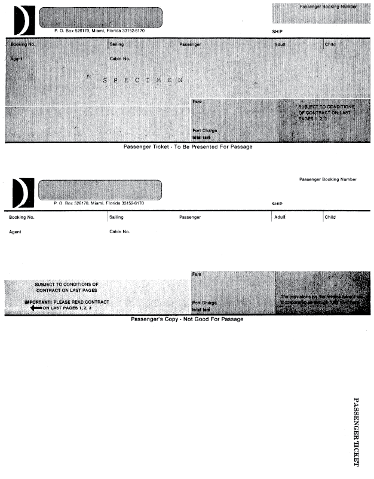{group="carnival-cruise"}

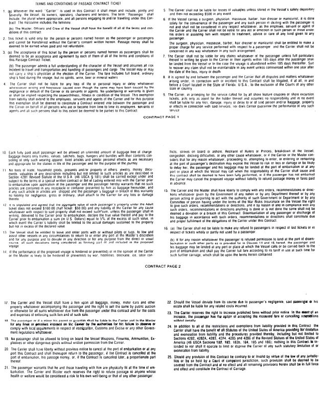{group="carnival-cruise"}

Appendix to Justice Stevens's dissent
:::

#### Notes & Questions

1.  *Carnival Cruise* stands for the proposition that consent waives any personal jurisdiction argument, and that such consent can be found according to ordinary contract principles. In other words, the bar for finding consent to jurisdiction is low.

2.  Recall Justice Kennedy's opinion in *McIntyre*, which sought to reorient personal jurisdiction around the concept of consent. Even if that effort was not successful, doesn't *Carnival Cruise* suggest another way in which he was correct?

3.  If consent is easily found, can a state condition permission to do business in the state on a corporation's consent to personal jurisdiction there? The next case takes up that question---and answers it in a way that may signal dramatic changes in this area in the years to come.

### Mallory v. Norfolk Southern Railway Co.

**Justice GORSUCH** [600 U.S. 122 (2023)]{.aside}**announced the judgment of the Court and delivered the opinion of the Court with respect to Parts I and III-B, and an opinion with respect to Parts II, III-A, and IV, in which Justice THOMAS, Justice SOTOMAYOR, and Justice JACKSON join.**

::: {.column-margin}

{width=150}

:::

Imagine a lawsuit based on recent events. A few months ago, a Norfolk Southern train derailed in Ohio near the Pennsylvania border. Its cargo? Hazardous chemicals. Some poured into a nearby creek; some burst into flames. In the aftermath, many residents reported unusual symptoms. Suppose an Ohio resident sued the train conductor seeking compensation for an illness attributed to the accident. Suppose, too, that the plaintiff served his complaint on the conductor across the border in Pennsylvania. Everyone before us agrees a Pennsylvania court could hear that lawsuit consistent with the Due Process Clause of the Fourteenth Amendment. The court could do so even if the conductor was a Virginia resident who just happened to be passing through Pennsylvania when the process server caught up with him.

Now, change the hypothetical slightly. Imagine the same Ohio resident brought the same suit in the same Pennsylvania state court, but this time against Norfolk Southern. Assume, too, the company has filed paperwork consenting to appear in Pennsylvania courts as a condition of registering to do business in the Commonwealth. Could a Pennsylvania court hear that case too? You might think so. But today, Norfolk Southern argues that the Due Process Clause entitles it to a more favorable rule, one shielding it from suits even its employees must answer. We reject the company's argument. Nothing in the Due Process Clause requires such an incongruous result.

**I**

Robert Mallory worked for Norfolk Southern as a freight-car mechanic for nearly 20 years, first in Ohio, then in Virginia. During his time with the company, Mr. Mallory contends, he was responsible for spraying boxcar pipes with asbestos and handling chemicals in the railroad's paint shop. He also demolished car interiors that, he alleges, contained carcinogens.

After Mr. Mallory left the company, he moved to Pennsylvania for a period before returning to Virginia. Along the way, he was diagnosed with cancer. Attributing his illness to his work for Norfolk Southern, Mr. Mallory hired Pennsylvania lawyers and sued his former employer in Pennsylvania state court under the Federal Employers' Liability Act. That law creates a workers' compensation scheme permitting railroad employees to recover damages for their employers' negligence.

Norfolk Southern resisted Mr. Mallory's suit on constitutional grounds. By the time he filed his complaint, the company observed, Mr. Mallory resided in Virginia. His complaint alleged that he was exposed to carcinogens in Ohio and Virginia. Meanwhile, the company itself was incorporated in Virginia and had its headquarters there too. On these facts, Norfolk Southern submitted, any effort by a Pennsylvania court to exercise personal jurisdiction over it would offend the Due Process Clause of the Fourteenth Amendment.

Mr. Mallory saw things differently. He noted that Norfolk Southern manages over 2,000 miles of track, operates 11 rail yards, and runs 3 locomotive repair shops in Pennsylvania. He also pointed out that Norfolk Southern has registered to do business in Pennsylvania in light of its "'regular, systematic, \[and\] extensive'" operations there. That is significant, Mr. Mallory argued, because Pennsylvania requires out-of-state companies that register to do business in the Commonwealth to agree to appear in its courts on "any cause of action" against them. 42 Pa. Cons. Stat. § 5301(a)(2)(i), (b) (2019). By complying with this statutory scheme, Mr. Mallory contended, Norfolk Southern had consented to suit in Pennsylvania on claims just like his.

Ultimately, the Pennsylvania Supreme Court sided with Norfolk Southern. Yes, Mr. Mallory correctly read Pennsylvania law. It requires an out-of-state firm to answer any suits against it in exchange for status as a registered foreign corporation and the benefits that entails. But, no, the court held, Mr. Mallory could not invoke that law because it violates the Due Process Clause. In reaching this conclusion, the Pennsylvania Supreme Court acknowledged its disagreement with the Georgia Supreme Court, which had recently rejected a similar due process argument from a corporate defendant.

In light of this split of authority, we agreed to hear this case and decide whether the Due Process Clause of the Fourteenth Amendment prohibits a State from requiring an out-of-state corporation to consent to personal jurisdiction to do business there.

**II**

The question before us is not a new one. In truth, it is a very old question---and one this Court resolved in *Pennsylvania Fire Ins. Co. of Philadelphia v. Gold Issue Mining & Milling Co.*, 243 U.S. 93 (1917). There, the Court unanimously held that laws like Pennsylvania's comport with the Due Process Clause. Some background helps explain why the Court reached the result it did.

As the use of the corporate form proliferated in the 19th century, the question arose how to adapt the traditional rule about \[tag jurisdiction\] for individuals to artificial persons created by law. Unsurprisingly, corporations did not relish the prospect of being haled into court for any claim anywhere they conducted business. "No one, after all, has ever liked greeting the process server." *Ford Motor Co. v. Montana Eighth Judicial Dist. Court* (Gorsuch, J., concurring in judgment). Corporations chartered in one State sought the right to send their sales agents and products freely into other States. At the same time, when confronted with lawsuits in those other States, some firms sought to hide behind their foreign character and deny their presence to defeat the court's jurisdiction.

Lawmakers across the country soon responded to these stratagems. Relevant here, both before and after the Fourteenth Amendment's ratification, they adopted statutes requiring out-of-state corporations to consent to in-state suits in exchange for the rights to exploit the local market and to receive the full range of benefits enjoyed by in-state corporations. These statutes varied. In some States, out-of-state corporate defendants were required to agree to answer suits brought by in-state plaintiffs. In other States, corporations were required to consent to suit if the plaintiff's cause of action arose within the State, even if the plaintiff happened to reside elsewhere. Still other States (and the federal government) omitted both of these limitations. They required all out-of-state corporations that registered to do business in the forum to agree to defend themselves there against any manner of suit. Yet another group of States applied this all-purpose-jurisdiction rule to a subset of corporate defendants, like railroads and insurance companies.

**III**

**A**

Unsurprisingly, some corporations challenged statutes like these on various grounds, due process included. And, ultimately, one of these disputes reached this Court in *Pennsylvania Fire*.

\[...\]

\[In *Pennsylvania Fire*, a Missouri statute required foreign corporations to consent to personal jurisdiction of the state's courts in order to register to do business in the state. Sued for events that occurred outside Missouri, the defendant argued to the Supreme Court that this consent-by-registration scheme violated its due process rights.\] Writing for a unanimous Court, Justice Holmes had little trouble dispatching the company's due process argument. Under this Court's precedents, there was "no doubt" Pennsylvania Fire could be sued in Missouri by an out-of-state plaintiff on an out-of-state contract because it had agreed to accept service of process in Missouri on any suit as a condition of doing business there. Indeed, the Court thought the matter so settled by existing law that the case "hardly" presented an "open" question.

\[...\]

\[...\] Other leading judges, including Learned Hand and Benjamin Cardozo, had reached similar conclusions in similar cases in the years leading up to *Pennsylvania Fire*. In the years following *Pennsylvania Fire*, too, this Court reaffirmed its holding as often as the issue arose.

**B**

*Pennsylvania Fire* controls this case. Much like the Missouri law at issue there, the Pennsylvania law at issue here provides that an out-of-state corporation "may not do business in this Commonwealth until it registers with" the Department of State. 15 Pa. Cons. Stat. § 411(a). As part of the registration process, a corporation must identify an "office" it will "continuously maintain" in the Commonwealth. § 411(f); *see also* § 412(a)(5). Upon completing these requirements, the corporation "shall enjoy the same rights and privileges as a domestic entity and shall be subject to the same liabilities, restrictions, duties and penalties ... imposed on domestic entities." § 402(d). Among other things, Pennsylvania law is explicit that "qualification as a foreign corporation" shall permit state courts to "exercise general personal jurisdiction" over a registered foreign corporation, just as they can over domestic corporations. 42 Pa. Cons. Stat. § 5301(a)(2)(i).

Norfolk Southern has complied with this law for many years. In 1998, the company registered to do business in Pennsylvania. Acting through its Corporate Secretary as a "duly authorized officer," the company completed an "Application for Certificate of Authority" from the Commonwealth "[i]n compliance with" state law. As part of that process, the company named a "Commercial Registered Office Provider" in Philadelphia County, agreeing that this was where it "shall be deemed ... located." The Secretary of the Commonwealth approved the application, conferring on Norfolk Southern both the benefits and burdens shared by domestic corporations---including amenability to suit in state court on any claim. Since 1998, Norfolk Southern has regularly updated its information on file with the Secretary. In 2009, for example, the company advised that it had changed its Registered Office Provider and would now be deemed located in Dauphin County. All told, then, Norfolk Southern has agreed to be found in Pennsylvania and answer any suit there for more than 20 years.

*Pennsylvania Fire* held that suits premised on these grounds do not deny a defendant due process of law. Even Norfolk Southern does not seriously dispute that much. It concedes that it registered to do business in Pennsylvania, that it established an office there to receive service of process, and that in doing so it understood it would be amenable to suit on any claim. Of course, Mr. Mallory no longer lives in Pennsylvania and his cause of action did not accrue there. But none of that makes any more difference than \[it did in *Pennsylvania Fire*.\] To decide this case, we need not speculate whether any other statutory scheme and set of facts would suffice to establish consent to suit. It is enough to acknowledge that the state law and facts before us fall squarely within *Pennsylvania Fire*'s rule.

\[...\]

**IV**

Now before us, Norfolk Southern candidly asks us to do what the Pennsylvania Supreme Court could not---overrule *Pennsylvania Fire*. To smooth the way, Norfolk Southern suggests that this Court's decision in *International Shoe Co. v. Washington* has already done much of the hard work for us. That decision, the company insists, seriously undermined *Pennsylvania Fire*'s foundations. We disagree. The two precedents sit comfortably side by side.

**A**

Start with how Norfolk Southern sees things. On the company's telling, echoed by the dissent, *International Shoe* held that the Due Process Clause tolerates two (and only two) types of personal jurisdiction over a corporate defendant. First, "specific jurisdiction" permits suits that "'arise out of or relate to'" a corporate defendant's activities in the forum State. Second, "general jurisdiction" allows all kinds of suits against a corporation, but only in States where the corporation is incorporated or has its "principal place of business." After *International Shoe*, Norfolk Southern insists, no other bases for personal jurisdiction over a corporate defendant are permissible.

But if this account might seem a plausible summary of some of our *International Shoe* jurisprudence, it oversimplifies matters. Here is what really happened in *International Shoe*. The State of Washington sued a corporate defendant in state court for claims based on its in-state activities even though the defendant had not registered to do business in Washington and had not agreed to be present and accept service of process there. Despite this, the Court held that the suit against the company comported with due process. In doing so, the Court reasoned that the Fourteenth Amendment "permit\[s\]" suits against a corporate defendant that has not agreed to be "presen\[t\] within the territorial jurisdiction of a court," so long as "the quality and nature of the \[company's\] activity" in the State "make it reasonable and just" to maintain suit there. Put simply, even without agreeing to be present, the out-of-state corporation was still amenable to suit in Washington consistent with "'fair play and substantial justice'"---terms the Court borrowed from Justice Holmes, the author of *Pennsylvania Fire*.

In reality, then, all *International Shoe* did was stake out an additional road to jurisdiction over out-of-state corporations. *Pennsylvania Fire* held that an out-of-state corporation that has consented to in-state suits in order to do business in the forum is susceptible to suit there. *International Shoe* held that an out-of-state corporation that has not consented to in-state suits may also be susceptible to claims in the forum State based on "the quality and nature of \[its\] activity" in the forum. Consistent with all this, our precedents applying *International Shoe* have long spoken of the decision as asking whether a state court may exercise jurisdiction over a corporate defendant "'that *has not consented* to suit in the forum.'" *Goodyear* (emphasis added); *see also Daimler*. Our precedents have recognized, too, that "express or implied consent" can continue to ground personal jurisdiction---and consent may be manifested in various ways by word or deed.

\[...\]

Given all this, it is no wonder that we have already turned aside arguments very much like Norfolk Southern's. In *Burnham*, the defendant contended that *International Shoe* implicitly overruled the traditional tag rule holding that individuals physically served in a State are subject to suit there for claims of any kind. This Court rejected that submission. Instead, as Justice Scalia explained, *International Shoe* simply provided a "novel" way to secure personal jurisdiction that did nothing to displace other "traditional ones." What held true there must hold true here. Indeed, seven years after deciding *International Shoe*, the Court cited *Pennsylvania Fire* approvingly. *Perkins v. Benguet Consol. Mining Co.*

\[...\]

Next, Norfolk Southern appeals to the spirit of our age. After *International Shoe*, it says, the "primary concern" of the personal jurisdiction analysis is "\[t\]reating defendants fairly." And on the company's telling, it would be "unfair" to allow Mr. Mallory's suit to proceed in Pennsylvania because doing so would risk unleashing "'local prejudice'" against a company that is "not 'local' in the eyes of the community."

But if fairness is what Norfolk Southern seeks, pause for a moment to measure this suit against that standard. When Mr. Mallory brought his claim in 2017, Norfolk Southern had registered to do business in Pennsylvania for many years. It had established an office for receiving service of process. It had done so pursuant to a statute that gave the company the right to do business in-state in return for agreeing to answer any suit against it. And the company had taken full advantage of its opportunity to do business in the Commonwealth \[...\].

All told, when Mr. Mallory sued, Norfolk Southern employed nearly 5,000 people in Pennsylvania. It maintained more than 2,400 miles of track across the Commonwealth. Its 70-acre locomotive shop there was the largest in North America. Contrary to what it says in its brief here, the company even proclaimed itself a proud part of "the Pennsylvania Community." By 2020, too, Norfolk Southern managed more miles of track in Pennsylvania than in any other State. And it employed more people in Pennsylvania than it did in Virginia, where its headquarters was located. Nor are we conjuring these statistics out of thin air. The company *itself* highlighted its "intrastate activities" in the proceedings below. \[...\] Given all this, on what plausible account could *International Shoe*'s concerns with "fair play and substantial justice" require a Pennsylvania court to turn aside Mr. Mallory's suit?

Perhaps sensing its arguments from fairness meet a dead end, Norfolk Southern ultimately heads in another direction altogether. It suggests the Due Process Clause separately prohibits one State from infringing on the sovereignty of another State through exorbitant claims of personal jurisdiction. And, in candor, the company is half right. Some of our personal jurisdiction cases have discussed the federalism implications of one State's assertion of jurisdiction over the corporate residents of another. *See, e.g.*, *Bristol-Myers Squibb*. But that neglects an important part of the story. To date, our personal jurisdiction cases have never found a Due Process Clause problem sounding in federalism when an out-of-state defendant submits to suit in the forum State. After all, personal jurisdiction is a personal defense that may be waived or forfeited.

That leaves Norfolk Southern one final stand. It argues that it has not really submitted to proceedings in Pennsylvania. The company does not dispute that it has filed paperwork with Pennsylvania seeking the right to do business there. It does not dispute that it has established an office in the Commonwealth to receive service of process on any claim. It does not dispute that it appreciated the jurisdictional consequences attending these actions and proceeded anyway, presumably because it thought the benefits outweighed the costs. But, in the name of the Due Process Clause, Norfolk Southern insists we should dismiss all that as a raft of meaningless formalities.

Taken seriously, this argument would have us undo not just *Pennsylvania Fire* but a legion of precedents that attach jurisdictional consequences to what some might dismiss as mere formalities. Consider some examples we have already encountered. In a typical general jurisdiction case under *International Shoe*, a company is subject to suit on any claim in a forum State only because of its decision to file a piece of paper there (a certificate of incorporation). The firm is amenable to suit even if all of its operations are located elsewhere and even if its certificate only sits collecting dust on an office shelf for years thereafter. Then there is the tag rule. The invisible state line might seem a trivial thing. But when an individual takes one step off a plane after flying from New Jersey to California, the jurisdictional consequences are immediate and serious. *See Burnham*.

\[...\]

Not every case poses a new question. This case poses a very old question indeed ---one this Court resolved more than a century ago in *Pennsylvania Fire*. Because that decision remains the law, the judgment of the Supreme Court of Pennsylvania is vacated, and the case is remanded.

It is so ordered.

**\[The concurring opinion of Jackson, J., is omitted.\]**

**Justice ALITO, concurring in part and concurring in the judgment.**

::: {.column-margin}

{width=150}

:::

The sole question before us is whether the Due Process Clause of the Fourteenth Amendment is violated when a large out-of-state corporation with substantial operations in a State complies with a registration requirement that conditions the right to do business in that State on the registrant's submission to personal jurisdiction in any suits that are brought there. I agree with the Court that the answer to this question is no. Assuming that the Constitution allows a State to impose such a registration requirement, I see no reason to conclude that such suits violate the corporation's right to "'fair play and substantial justice.'" *International Shoe Co. v. Washington*.

I am not convinced, however, that the Constitution permits a State to impose such a submission-to-jurisdiction requirement. A State's assertion of jurisdiction over lawsuits with no real connection to the State may violate fundamental principles that are protected by one or more constitutional provisions or by the very structure of the federal system that the Constitution created. At this point in the development of our constitutional case law, the most appropriate home for these principles is the so-called dormant Commerce Clause. Norfolk Southern appears to have asserted a Commerce Clause claim below, but the Pennsylvania Supreme Court did not address it. Presumably, Norfolk Southern can renew the challenge on remand. I therefore agree that we should vacate the Pennsylvania Supreme Court's judgment and remand the case for further proceedings.

**Justice BARRETT, with whom THE CHIEF JUSTICE, Justice KAGAN, and Justice Kavanaugh join, dissenting.**

::: {.column-margin}

{width=150}

:::

For 75 years, we have held that the Due Process Clause does not allow state courts to assert general jurisdiction over foreign defendants merely because they do business in the State. *International Shoe Co. v. Washington*. Pennsylvania nevertheless claims general jurisdiction over all corporations that lawfully do business within its borders. As the Commonwealth's own courts recognized, that flies in the face of our precedent. *See Daimler*.

The Court finds a way around this settled rule. All a State must do is compel a corporation to register to conduct business there (as every State does) and enact a law making registration sufficient for suit on any cause (as every State could do). Then, every company doing business in the State is subject to general jurisdiction based on implied "consent"---not contacts. That includes suits, like this one, with no connection whatsoever to the forum.

Such an approach does not formally overrule our traditional contacts-based approach to jurisdiction, but it might as well. By relabeling their long-arm statutes, States may now manufacture "consent" to personal jurisdiction. Because I would not permit state governments to circumvent constitutional limits so easily, I respectfully dissent.

\[...\]

#### Notes & Questions

1.  Just when one might have thought *Pennoyer* was dead and buried, it appeared to rise again in *Mallory*. Justice Gorsuch's opinion relied heavily not just on *Pennsylvania Fire* but also *Pennoyer* and *Burnham*. Together with his separate opinion in *Ford*, does this point to a comeback for *Pennoyer* in its decades-long battle with *International Shoe*?

2.  Not so fast. Justice Alito, who provided the necessary fifth vote to hold that personal jurisdiction over Norfolk Southern was proper, did not join the key parts of Justice Gorsuch's opinion discussing *Pennoyer* and broader principles of personal jurisdiction. Instead, he joined only so much of Justice Gorsuch's opinion as relied on the existing precedent of *Pennsylvania Fire*. And he introduced a separate reason to doubt that Pennsylvania could exercise personal jurisdiction over Norfolk Southern: the so-called "dormant commerce clause," which you may learn more about in a class in constitutional law.

3.  Meanwhile, Justice Barrett, writing in dissent on behalf of four justices, objected that allowing consent by registration to defeat a personal jurisdiction argument undermines the Court's key general jurisdiction precedents: *Goodyear* and *Daimler*. Isn't she right about that? So far, no states have successfully enacted consent-by-registration statutes like the one in *Mallory*. But some have tried, and Justice Barrett's predictions may yet come to pass.

4.  At this point, first-year law students may rightly scream bloody murder. Throughout this chapter, time and again, we have seen the Supreme Court vacillate between alternate approaches to personal jurisdiction doctrine, often failing to form a majority opinion in the process. Why do you think personal jurisdiction doctrine has proven so divisive? Why has it eluded clarification for so long? And where will it go in the future?

## Personal Jurisdiction of Federal Courts

As you know, Federal Rule of Civil Procedure 4 governs service of process. But what may have escaped your notice until now is that it also contains the long-arm statute governing federal courts. In particular, Rule 4(k) defines the "territorial limits of effective service." Read Rule 4(k) carefully.

Note that Rule 4(k) limits the personal jurisdiction of a federal district court in the typical case to the same extent as "a court of general jurisdiction in the state where the district court is located." This limitation is not constitutionally compelled. After all, unlike state courts, federal courts are organs of a *national* sovereign; for that reason, the contacts relevant to their personal jurisdiction are those that the defendant has with the *entire nation*. The principal exception to Rule 4(k)'s equation of the personal jurisdiction of state and federal courts is "when authorized by a federal statute." When do you think it would be appropriate to authorize federal courts to exercise nationwide personal jurisdiction? Consider the following provocative proposal, made by one member of the Advisory Committee on Civil Rules.

### Letter from Prof. A. Benjamin Spencer to Hon. John D. Bates, Chair, Advisory Committee on Civil Rules

Dear Judge Bates: [March 9, 2018]{.aside}

I hope all is well. In 2010, I penned a brief article proposing that Rule 4(k)(1)(A) be amended to permit federal courts to exercise personal jurisdiction to the constitutional limit--- which would require a defendant to have minimum contacts with the United States rather than with any particular state---leaving to the federal venue statutes the task of ensuring that cases are litigated in districts that are connected with the litigants and/or the claims involved in the action. I write now to request that you put these views before the Committee.

\[...\]

In my view, the \[best\] approach would be to eliminate entirely the artificial tether of a federal court's territorial jurisdiction to that of their respective host states. I would amend Rule 4(k) as follows:

(k) Territorial Limits of Effective Service.

\[~~(1) In general.~~\] Serving a summons or filing a waiver of service establishes personal jurisdiction over a defendant: **when exercising jurisdiction is consistent with the United States Constitution and laws**.

~~(A) who is subject to the jurisdiction of a court of general jurisdiction in the state where the district court is located;~~

~~(B) who is a party joined under Rule 14 or 19 and is served within a judicial district of the United States and not more than 100 miles from where the summons was issued; or~~

~~(C) when authorized by a federal statute.~~

~~(2) Federal Claim Outside State-Court Jurisdiction. For a claim that arises under federal law, serving a summons or filing a waiver of service establishes personal jurisdiction over a defendant if:~~

~~(A) the defendant is not subject to jurisdiction in any state's courts of general jurisdiction; and~~

~~(B) exercising jurisdiction is consistent with the United States Constitution and laws.~~

In the absence of any linkage between personal jurisdiction in the federal district courts and the scope of such jurisdiction in their respective hosts' state courts, the determination of which among the several district courts would hear a case would be based on an application of the federal statutes governing venue. *See, e.g.*, 28 U.S.C. § 1391. In the ordinary case, that would limit a plaintiff's choice to (1) a defendant's district within the state in which all defendants reside, (2) a district in which a significant portion of the events or omissions giving rise to the action occurred, (3) the district in which property involved in the action is located, or (4) districts in which defendants could be subjected to personal jurisdiction if none of the other possibilities were available. Ultimately, then, the district chosen would be one that had some connection to the situs of the events giving rise to the dispute, if not to the location of one or more of the defendants.

\[...\]

Thank you for your consideration of these views. I look forward to discussing them with you and other members of the Committee.

Best regards, A. Benjamin Spencer Professor of Law
