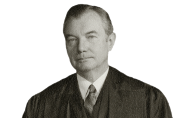
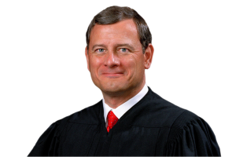
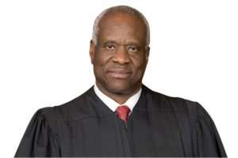
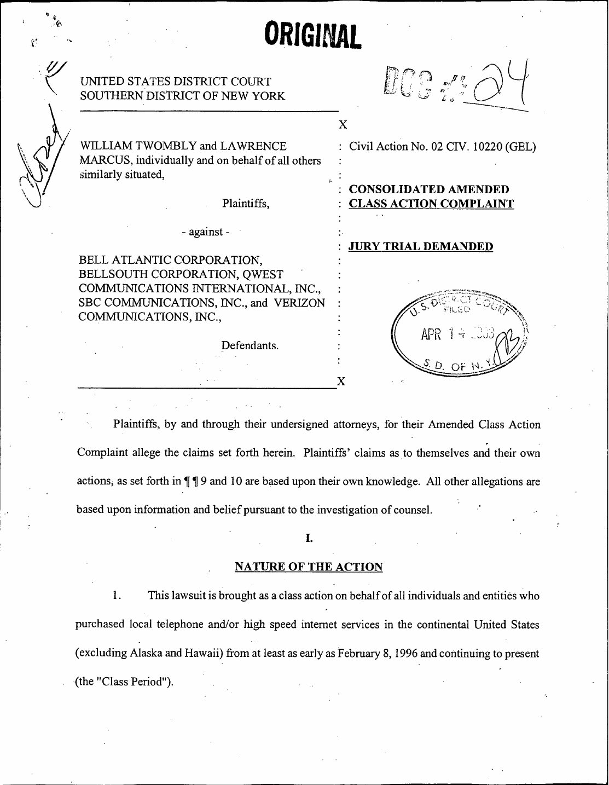
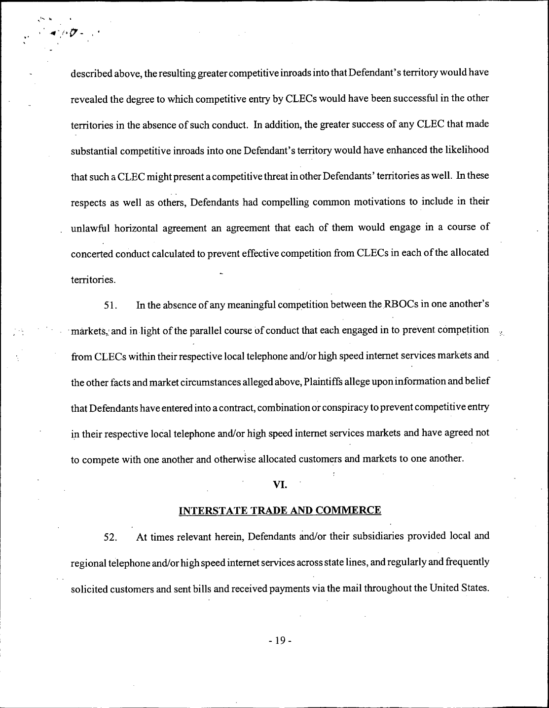
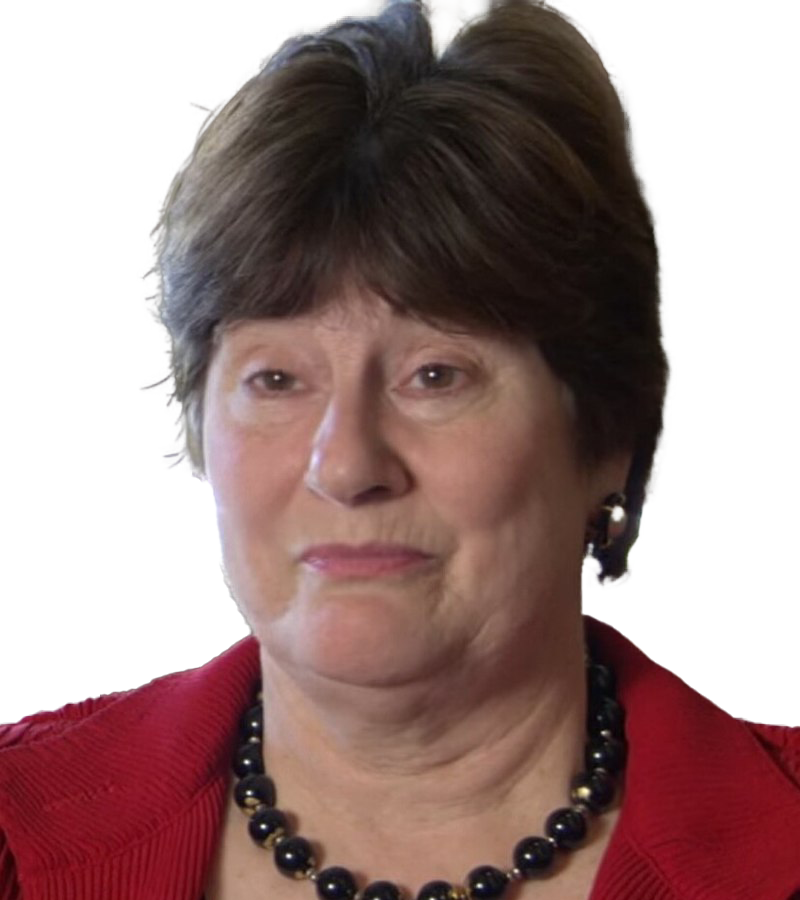
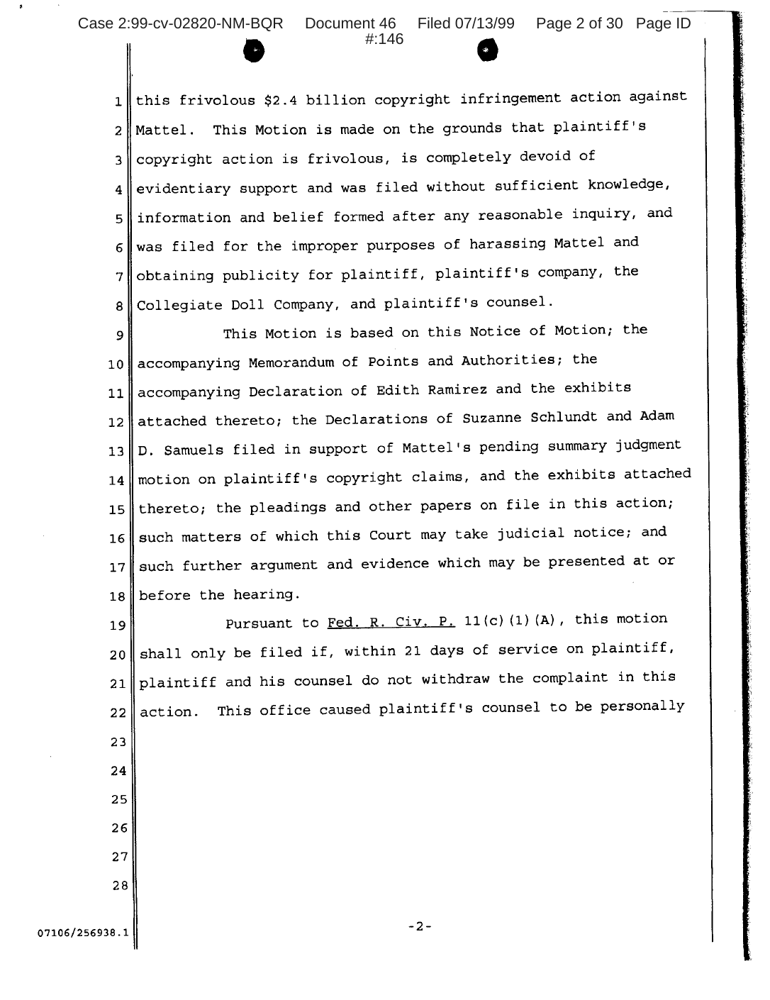
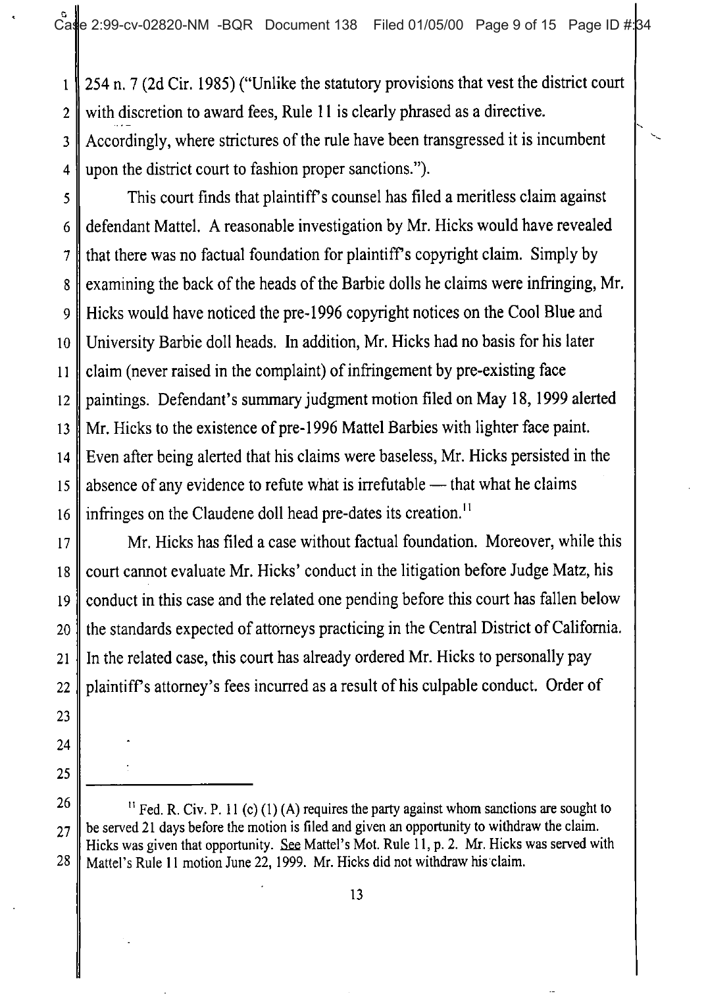
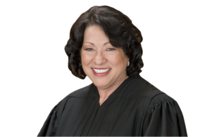

# Pleadings {#sec-pleadings}

## Service

As we have seen, due process binds the government across many different
areas of law, from family law to the law of war. And we have seen that
the requirements of due process are flexible and require balancing
competing interests. Finally, we have seen that the twin hallmarks of
due process are notice and an opportunity to be heard. In other words,
before the government can deprive a person of life, liberty, or property
(including money), it typically must notify that person of the
proceeding in which such deprivation may occur and afford them an
opportunity to defend themselves.

The same rules of due process apply to civil lawsuits in court. After
all, a civil suit is a proceeding by which a plaintiff asks the
government (a court) to afford her relief, typically by depriving the
defendant of property (ordering him to pay money damages). For that
reason, due process requires that the plaintiff and/or the court notify
the defendant of the proceeding. This notice is traditionally achieved
through service of process, which typically consists of delivering a
copy of the complaint and summons to each defendant. The next two cases
examine how due process interacts with service of process, which is the
beginning of most civil suits. Much of the remainder of the first half
of this course will examine what opportunities to be heard courts afford
to parties appearing before them.

### Mullane v. Central Hanover Bank & Tr. Co.

**MR. JUSTICE JACKSON delivered the opinion of the Court.** [339 U.S. 306 (1950)]{.aside}

::: {.column-margin}

{width=150 fig-alt="Justice Robert H. Jackson"}

:::

This controversy questions the constitutional sufficiency of notice to
beneficiaries on judicial settlement of accounts by the trustee of a
common trust fund established under the New York Banking Law. \[...\]

\[Common trust funds allow a bank to pool together trusts that would
otherwise be too small to warrant the bank's supervision.\] The income,
capital gains, losses and expenses of the collective trust are shared by
the constituent trusts in proportion to their contribution. By this
plan, diversification of risk and economy of management can be extended
to those whose capital standing alone would not obtain such advantage.

\[The law allows banks to make periodic "accountings" of trusts under
their control. Such accountings allow beneficiaries to challenge the
bank's actions during a specified period, but once the accounting is
complete, no further challenges may be brought alleging mismanagement of
the trust during the relevant period.\] The decree in each such judicial
settlement of accounts is made binding and conclusive as to any matter
set forth in the account upon everyone having any interest in the common
fund or in any participating estate, trust or fund.

In January, 1946, Central Hanover Bank and Trust Company established a
common trust fund in accordance with these provisions, and in March,
1947, it petitioned the Surrogate's Court for settlement of its first
account as common trustee. During the accounting period a total of 113
trusts \[...\] participated in the common trust fund, the gross capital
of which was nearly three million dollars. The record does not show the
number or residence of the beneficiaries, but they were many and it is
clear that some of them were not residents of the State of New York.

\[...\] \[T\]he only notice required \[by New York law\], and the only
one given, was by newspaper publication setting forth merely the name
and address of the trust company, the name and the date of establishment
of the common trust fund, and a list of all participating estates,
trusts or funds. \[However, as required by law, when the trust was first
established, the bank sent a letter to each beneficiary describing the
procedures, including notice, governing future accountings.\]

Upon the filing of the petition for the settlement of accounts,
appellant \[Mullane\] was, by order of the court \[...\], appointed
special guardian and attorney for all persons known or unknown not
otherwise appearing who had or might thereafter have any interest in the
income of the common trust fund; and appellee Vaughan was appointed to
represent those similarly interested in the principal. There were no
other appearances on behalf of any one interested in either interest or
principal.

Appellant \[Mullane\] appeared specially, objecting that notice and the
statutory provisions for notice to beneficiaries were inadequate to
afford due process under the Fourteenth Amendment, and therefore that
the court was without jurisdiction to render a final and binding decree.
Appellant's objections were entertained and overruled, the Surrogate
\[(a special kind of judge with jurisdiction over trusts in New York)\]
holding that the notice required and given was sufficient. A final
decree accepting the accounts has been entered. \[...\]

The effect of this decree, as held below, is to settle "all questions
respecting the management of the common fund." We understand that every
right which beneficiaries would otherwise have against the trust
company, either as trustee of the common fund or as trustee of any
individual trust, for improper management of the common trust fund
during the period covered by the accounting is sealed and wholly
terminated by the decree. \[...\]

\[What\] opportunity \[...\] must \[the state\] give beneficiaries to
contest \[the outcome of a proceeding affecting their property?\] Many
controversies have raged about the cryptic and abstract words of the Due
Process Clause but there can be no doubt that at a minimum they require
that deprivation of life, liberty or property by adjudication be
preceded by notice and opportunity for hearing appropriate to the nature
of the case.

In two ways this proceeding does or may deprive beneficiaries of
property. It may cut off their rights to have the trustee answer for
negligent or illegal impairments of their interests. Also, their
interests are presumably subject to diminution in the proceeding by
allowance of fees and expenses to one who, in their names but without
their knowledge, may conduct a fruitless or uncompensatory contest.
Certainly the proceeding is one in which they may be deprived of
property rights and hence notice and hearing must measure up to the
standards of due process.

Personal service of written notice within the jurisdiction is the
classic form of notice always adequate in any type of proceeding. But
the vital interest of the State in bringing any issues as to its
fiduciaries to a final settlement can be served only if interests or
claims of individuals who are outside of the State can somehow be
determined. A construction of the Due Process Clause which would place
impossible or impractical obstacles in the way could not be justified.

Against this interest of the State we must balance the individual
interest sought to be protected by the Fourteenth Amendment. This is
defined by our holding that "The fundamental requisite of due process of
law is the opportunity to be heard." This right to be heard has little
reality or worth unless one is informed that the matter is pending and
can choose for himself whether to appear or default, acquiesce or
contest.

The Court has not committed itself to any formula achieving a balance
between these interests in a particular proceeding or determining when
constructive notice may be utilized or what test it must meet. Personal
service has not in all circumstances been regarded as indispensable to
the process due to residents, and it has more often been held
unnecessary as to nonresidents. We disturb none of the established rules
on these subjects. No decision constitutes a controlling or even a very
illuminating precedent for the case before us. But a few general
principles stand out in the books.

An elementary and fundamental requirement of due process in any
proceeding which is to be accorded finality is notice reasonably
calculated, under all the circumstances, to apprise interested parties
of the pendency of the action and afford them an opportunity to present
their objections. The notice must be of such nature as reasonably to
convey the required information, and it must afford a reasonable time
for those interested to make their appearance. But if with due regard
for the practicalities and peculiarities of the case these conditions
are reasonably met, the constitutional requirements are satisfied.
\[...\]

But when notice is a person's due, process which is a mere gesture is
not due process. The means employed must be such as one desirous of
actually informing the absentee might reasonably adopt to accomplish it.
The reasonableness and hence the constitutional validity of any chosen
method may be defended on the ground that it is in itself reasonably
certain to inform those affected, or, where conditions do not reasonably
permit such notice, that the form chosen is not substantially less
likely to bring home notice than other of the feasible and customary
substitutes.

It would be idle to pretend that publication alone, as prescribed here,
is a reliable means of acquainting interested parties of the fact that
their rights are before the courts. It is not an accident that the
greater number of cases reaching this Court on the question of adequacy
of notice have been concerned with actions founded on process
constructively served through local newspapers. Chance alone brings to
the attention of even a local resident an advertisement in small type
inserted in the back pages of a newspaper, and if he makes his home
outside the area of the newspaper's normal circulation the odds that the
information will never reach him are large indeed. The chance of actual
notice is further reduced when, as here, the notice required does not
even name those whose attention it is supposed to attract, and does not
inform acquaintances who might call it to attention. In weighing its
sufficiency on the basis of equivalence with actual notice, we are
unable to regard this as more than a feint.

Nor is publication here reinforced by steps likely to attract the
parties' attention to the proceeding. It is true that publication
traditionally has been acceptable as notification supplemental to other
action \[such as attachment or seizure\] which in itself may reasonably
be expected to convey a warning. \[But no such action is present here.\]

This Court has not hesitated to approve of resort to publication as a
customary substitute in another class of cases where it is not
reasonably possible or practicable to give more adequate warning. Thus
it has been recognized that, in the case of persons missing or unknown,
employment of an indirect and even a probably futile means of
notification is all that the situation permits and creates no
constitutional bar to a final decree foreclosing their rights.

Those beneficiaries represented by appellant whose interests or
whereabouts could not with due diligence be ascertained come clearly
within this category. As to them the statutory notice is sufficient.
However great the odds that publication will never reach the eyes of
such unknown parties, it is not in the typical case much more likely to
fail than any of the choices open to legislators endeavoring to
prescribe the best notice practicable.

Nor do we consider it unreasonable for the State to dispense with more
certain notice to those beneficiaries whose interests are either
conjectural or future or, although they could be discovered upon
investigation, do not in due course of business come to knowledge of the
common trustee. \[...\] We recognize the practical difficulties and
costs that would be attendant on frequent investigations into the status
of great numbers of beneficiaries, many of whose interests in the common
fund are so remote as to be ephemeral; and we have no doubt that such
impracticable and extended searches are not required in the name of due
process. \[...\] These are practical matters in which we should be
reluctant to disturb the judgment of the state authorities.

Accordingly we overrule appellant's constitutional objections to
published notice insofar as they are urged on behalf of any
beneficiaries whose interests or addresses are unknown to the trustee.

As to known present beneficiaries of known place of residence, however,
notice by publication stands on a different footing. Exceptions in the
name of necessity do not sweep away the rule that within the limits of
practicability notice must be such as is reasonably calculated to reach
interested parties. Where the names and post-office addresses of those
affected by a proceeding are at hand, the reasons disappear for resort
to means less likely than the mails to apprise them of its pendency.

The trustee has on its books the names and addresses of the income
beneficiaries represented by appellant, and we find no tenable ground
for dispensing with a serious effort to inform them personally of the
accounting, at least by ordinary mail to the record addresses. Certainly
sending them a copy of the statute months and perhaps years in advance
does not answer this purpose. The trustee periodically remits their
income to them, and we think that they might reasonably expect that with
or apart from their remittances word might come to them personally that
steps were being taken affecting their interests.

We need not weigh contentions that a requirement of personal service of
citation on even the large number of known resident or nonresident
beneficiaries would, by reasons of delay if not of expense, seriously
interfere with the proper administration of the fund. \[...\]

The statutory notice to known beneficiaries is inadequate, not because
in fact it fails to reach everyone, but because under the circumstances
it is not reasonably calculated to reach those who could easily be
informed by other means at hand. However it may have been in former
times, the mails today are recognized as an efficient and inexpensive
means of communication. Moreover, the fact that the trust company has
been able to give mailed notice to known beneficiaries at the time the
common trust fund was established is persuasive that postal notification
at the time of accounting would not seriously burden the plan.

In some situations the law requires greater precautions in its
proceedings than the business world accepts for its own purposes. In
few, if any, will it be satisfied with less. Certainly it is
instructive, in determining the reasonableness of the impersonal
broadcast notification here used, to ask whether it would satisfy a
prudent man of business, counting his pennies but finding it in his
interest to convey information to many persons whose names and addresses
are in his files. We are not satisfied that it would. Publication may
theoretically be available for all the world to see, but it is too much
in our day to suppose that each or any individual beneficiary does or
could examine all that is published to see if something may be tucked
away in it that affects his property interests. \[...\]

We hold that the notice of judicial settlement of accounts required by
the New York Banking Law § 100-c(12) is incompatible with the
requirements of the Fourteenth Amendment as a basis for adjudication
depriving known persons whose whereabouts are also known of substantial
property rights. Accordingly the judgment is reversed and the cause
remanded for further proceedings not inconsistent with this opinion.

*Reversed.*

::: {.callout-tip .self-check icon=false}
## Check Your Understanding: *Mullane*

A trustee asks a court to approve its accounts. It knows the names and mailing addresses of 40 beneficiaries, and it cannot identify a handful of others who may have future interests. It gives notice to everyone by publishing it in a local newspaper for four weeks. Is that enough?

::: {.callout-note collapse="true" icon=false}
## Answer

**Enough for the unknown beneficiaries, but not for the 40 known ones.** *Mullane* requires notice "reasonably calculated, under all the circumstances," to reach interested parties. Publication can suffice for people whose "interests or addresses are unknown," because nothing better is practicable. But "[w]here the names and post-office addresses of those affected by a proceeding are at hand, the reasons disappear for resort to means less likely than the mails to apprise them." The trustee has to mail notice to the 40 beneficiaries it can reach.

:::
:::

### Jones v. Flowers

**Chief Justice Roberts delivered the opinion of the Court.** [547 U.S. 220 (2006)]{.aside}

::: {.column-margin}

{width=150 fig-alt="Justice John G. Roberts, Jr."}

:::

Before a State may take property and sell it for unpaid taxes, the Due
Process Clause of the Fourteenth Amendment requires the government to
provide the owner "notice and opportunity for hearing appropriate to the
nature of the case." *Mullane v. Central Hanover Bank & Trust Co*. We
granted certiorari to determine whether, when notice of a tax sale is
mailed to the owner and returned undelivered, the government must take
additional reasonable steps to provide notice before taking the owner's
property.

**I**

In 1967, petitioner Gary Jones purchased a house at 717 North Bryan
Street in Little Rock, Arkansas. He lived in the house with his wife
until they separated in 1993. Jones then moved into an apartment in
Little Rock, and his wife continued to live in the North Bryan Street
house. Jones paid his mortgage each month for 30 years, and the mortgage
company paid Jones' property taxes. After Jones paid off his mortgage in
1997, the property taxes went unpaid, and the property was certified as
delinquent.

In April 2000, respondent Mark Wilcox, the Commissioner of State Lands,
attempted to notify Jones of his tax delinquency, and his right to
redeem the property, by mailing a certified letter to Jones at the North
Bryan Street address. The packet of information stated that unless Jones
redeemed the property, it would be subject to public sale two years
later on April 17, 2002. Nobody was home to sign for the letter, and
nobody appeared at the post office to retrieve the letter within the
next 15 days. The post office returned the unopened packet to the
Commissioner marked "unclaimed."

Two years later, and just a few weeks before the public sale, the
Commissioner published a notice of public sale in the Arkansas Democrat
Gazette. No bids were submitted, which permitted the State to negotiate
a private sale of the property. *See* § 26-37-202(b). Several months
later, respondent Linda Flowers submitted a purchase offer. The
Commissioner mailed another certified letter to Jones at the North Bryan
Street address, attempting to notify him that his house would be sold to
Flowers if he did not pay his taxes. Like the first letter, the second
was also returned to the Commissioner marked "unclaimed." Flowers
purchased the house, which the parties stipulated in the trial court had
a fair market value of \$80,000, for \$21,042.15. Immediately after the
30-day period for postsale redemption passed, *see* § 26-37-202(e),
Flowers had an unlawful detainer notice delivered to the property. The
notice was served on Jones' daughter, who contacted Jones and notified
him of the tax sale.

Jones filed a lawsuit in Arkansas state court against the Commissioner
and Flowers, alleging that the Commissioner's failure to provide notice
of the tax sale and of Jones' right to redeem resulted in the taking of
his property without due process. The Commissioner and Flowers moved for
summary judgment on the ground that the two unclaimed letters sent by
the Commissioner were a constitutionally adequate attempt at notice, and
Jones filed a cross-motion for summary judgment. The trial court granted
summary judgment in favor of the Commissioner and Flowers. It concluded
that the Arkansas tax sale statute, which set forth the notice procedure
followed by the Commissioner, complied with constitutional due process
requirements.

Jones appealed, and the Arkansas Supreme Court affirmed the trial
court's judgment.

\[...\] We hold that when mailed notice of a tax sale is returned
unclaimed, the State must take additional reasonable steps to attempt to
provide notice to the property owner before selling his property, if it
is practicable to do so. Under the circumstances presented here,
additional reasonable steps were available to the State. We therefore
reverse the judgment of the Arkansas Supreme Court.

**II**

**A**

Due process does not require that a property owner receive actual notice
before the government may take his property. Rather, we have stated that
due process requires the government to provide "notice reasonably
calculated, under all the circumstances, to apprise interested parties
of the pendency of the action and afford them an opportunity to present
their objections." *Mullane*. The Commissioner argues that once the
State provided notice reasonably calculated to apprise Jones of the
impending tax sale by mailing him a certified letter, due process was
satisfied. The Arkansas statutory scheme is reasonably calculated to
provide notice, the Commissioner continues, because it provides for
notice by certified mail to an address that the property owner is
responsible for keeping up to date. The Commissioner notes this Court's
ample precedent condoning notice by mail and adds that the Arkansas
scheme exceeds constitutional requirements by requiring the Commissioner
to use certified mail.

\[...\] \[W\]e have never addressed whether due process entails further
responsibility when the government becomes aware prior to the taking
that its attempt at notice has failed. That is a new wrinkle, and we
have explained that the "notice required will vary with circumstances
and conditions." The question presented is whether such knowledge on the
government's part is a "circumstance and condition" that varies the
"notice required."

The Courts of Appeals and State Supreme Courts have addressed this
question on frequent occasions, and most have decided that when the
government learns its attempt at notice has failed, due process requires
the government to do something more before real property may be sold in
a tax sale. \[...\] Many States already require in their statutes that
the government do more than simply mail notice to delinquent owners,
either at the outset or as a follow-up measure if initial mailed notice
is ineffective.

In *Mullane,* we stated that "when notice is a person's due ... \[t\]he
means employed must be such as one desirous of actually informing the
absentee might reasonably adopt to accomplish it," and that assessing
the adequacy of a particular form of notice requires balancing the
"interest of the State" against "the individual interest sought to be
protected by the Fourteenth Amendment." \[...\]

We do not think that a person who actually desired to inform a real
property owner of an impending tax sale of a house he owns would do
nothing when a certified letter sent to the owner is returned unclaimed.
If the Commissioner prepared a stack of letters to mail to delinquent
taxpayers, handed them to the postman, and then watched as the departing
postman accidentally dropped the letters down a storm drain, one would
certainly expect the Commissioner's office to prepare a new stack of
letters and send them again. No one "desirous of actually informing" the
owners would simply shrug his shoulders as the letters disappeared and
say "I tried." Failure to follow up would be unreasonable, despite the
fact that the letters were reasonably calculated to reach their intended
recipients when delivered to the postman.

By the same token, when a letter is returned by the post office, the
sender will ordinarily attempt to resend it, if it is practicable to do
so. This is especially true when, as here, the subject matter of the
letter concerns such an important and irreversible prospect as the loss
of a house. Although the State may have made a reasonable calculation of
how to reach Jones, it had good reason to suspect when the notice was
returned that Jones was "no better off than if the notice had never been
sent." Deciding to take no further action is not what someone "desirous
of actually informing" Jones would do; such a person would take further
reasonable steps if any were available.

In prior cases, we have required the government to consider unique
information about an intended recipient regardless of whether a
statutory scheme is reasonably calculated to provide notice in the
ordinary case. \[...\]

The Commissioner points out that in these cases, the State was aware of
such information *before* it calculated how best to provide notice. But
it is difficult to explain why due process would have settled for
something less if the government had learned after notice was sent, but
before the taking occurred, that the property owner was in prison or was
incompetent. \[...\] \[The government's\] knowledge was one of the
"practicalities and peculiarities of the case," *Mullane*, that the
Court took into account in determining whether constitutional
requirements were met. It should similarly be taken into account in
assessing the adequacy of notice in this case. The dissent dismisses the
State's knowledge that its notice was ineffective as "learned long after
the fact," but the notice letter was promptly returned to the State two
to three weeks after it was sent, and the Arkansas statutory regime
precludes the State from taking the property for two *years* while the
property owner may exercise his right to redeem, *see* Ark. Code Ann.
§ 26-37-301.

It is certainly true \[...\] that the failure of notice in a specific
case does not establish the inadequacy of the attempted notice; in that
sense, the constitutionality of a particular procedure for notice is
assessed *ex ante*, rather than *post hoc*. But if a feature of the
State's chosen procedure is that it promptly provides additional
information to the government about the effectiveness of notice, it does
not contravene the *ex ante* principle to consider what the government
does with that information in assessing the adequacy of the chosen
procedure. After all, the State knew *ex ante* that it would promptly
learn whether its effort to effect notice through certified mail had
succeeded. It would not be inconsistent with the approach the Court has
taken in notice cases to ask, with respect to a procedure under which
telephone calls were placed to owners, what the State did when no one
answered. Asking what the State does when a notice letter is returned
unclaimed is not substantively different. \[...\]

Jones should have been more diligent with respect to his property, no
question. People must pay their taxes, and the government may hold
citizens accountable for tax delinquency by taking their property. But
before forcing a citizen to satisfy his debt by forfeiting his property,
due process requires the government to provide adequate notice of the
impending taking. U.S. Const., Amdt. 14.

**B**

\[...\] For the reasons stated, we conclude the State should have taken
additional reasonable steps to notify Jones, if practicable to do so.
The question remains whether there were any such available steps. While
"\[i\]t is not our responsibility to prescribe the form of service that
the \[government\] should adopt," if there were no reasonable additional
steps the government could have taken upon return of the unclaimed
notice letter, it cannot be faulted for doing nothing.

We think there were several reasonable steps the State could have taken.
What steps are reasonable in response to new information depends upon
what the new information reveals. The return of the certified letter
marked "unclaimed" meant either that Jones still lived at 717 North
Bryan Street, but was not home when the postman called and did not
retrieve the letter at the post office, or that Jones no longer resided
at that address. One reasonable step primarily addressed to the former
possibility would be for the State to resend the notice by regular mail,
so that a signature was not required. The Commissioner says that use of
certified mail makes actual notice more likely, because requiring the
recipient's signature protects against misdelivery. But that is only
true, of course, when someone is home to sign for the letter, or to
inform the mail carrier that he has arrived at the wrong address.
Otherwise, \[...\] the use of certified mail might make actual notice
less likely in some cases---the letter cannot be left like regular mail
to be examined at the end of the day, and it can only be retrieved from
the post office for a specified period of time. Following up with
regular mail might also increase the chances of actual notice to Jones
if---as it turned out---he had moved. Even occupants who ignored
certified mail notice slips addressed to the owner (if any had been
left) might scrawl the owner's new address on the notice packet and
leave it for the postman to retrieve, or notify Jones directly.

Other reasonable followup measures, directed at the possibility that
Jones had moved as well as that he had simply not retrieved the
certified letter, would have been to post notice on the front door, or
to address otherwise undeliverable mail to "occupant." Most States that
explicitly outline additional procedures in their tax sale statutes
require just such steps. Either approach would increase the likelihood
that the owner would be notified that he was about to lose his property,
given the failure of a letter deliverable only to the owner in person.
That is clear in the case of an owner who still resided at the premises.
It is also true in the case of an owner who has moved: Occupants who
might disregard a certified mail slip not addressed to them are less
likely to ignore posted notice, and a letter addressed to them (even as
"occupant") might be opened and read. In either case, there is a
significant chance the occupants will alert the owner, if only because a
change in ownership could well affect their own occupancy. In fact,
Jones first learned of the State's effort to sell his house when he was
alerted by one of the occupants---his daughter---after she was served
with an unlawful detainer notice.

Jones believes that the Commissioner should have searched for his new
address in the Little Rock phonebook and other government records such
as income tax rolls. We do not believe the government was required to go
this far. \[...\] An open-ended search for a new address---especially
when the State obligates the taxpayer to keep his address updated with
the tax collector, *see* Ark. Code Ann. § 26-35-705 (1997)---imposes
burdens on the State significantly greater than the several relatively
easy options outlined above.

The Commissioner complains about the burden of even those additional
steps, \[...\] The Commissioner has offered no estimate of how many
notice letters are returned, and no facts to support the dissent's
assertion that the Commissioner must now physically locate "tens of
thousands of properties every year." \[...\] Successfully providing
notice is often the most efficient way to collect unpaid taxes, \[...\]
but rather than taking relatively easy additional steps to effect
notice, the State undertook the burden and expense of purchasing a
newspaper advertisement, conducting an auction, and then negotiating a
private sale of the property to Flowers.

The Solicitor General argues that requiring further effort when the
government learns that notice was not delivered will cause the
government to favor modes of providing notice that do not generate
additional information---for example, starting (and stopping) with
regular mail instead of certified mail. We find this unlikely, as we
have no doubt that the government repeatedly finds itself being asked to
prove that notice was sent and received. Using certified mail provides
the State with documentation of personal delivery and protection against
false claims that notice was never received. That added security,
however, comes at a price---the State also learns when notice has *not*
been received. We conclude that, under the circumstances presented, the
State cannot simply ignore that information in proceeding to take and
sell the owner's property \[...\].

Though the Commissioner argues that followup measures are not
constitutionally required, he reminds us that the State did make some
attempt to follow up with Jones by publishing notice in the newspaper a
few weeks before the public sale. Several decades ago, this Court
observed that "\[c\]hance alone" brings a person's attention to "an
advertisement in small type inserted in the back pages of a newspaper,"
*Mullane*, and that notice by publication is adequate only where "it is
not reasonably possible or practicable to give more adequate warning."
Following up by publication was not constitutionally adequate under the
circumstances presented here because, as we have explained, it was
possible and practicable to give Jones more adequate warning of the
impending tax sale. \[...\]

There is no reason to suppose that the State will ever be less than
fully zealous in its efforts to secure the tax revenue it needs. The
same cannot be said for the State's efforts to ensure that its citizens
receive proper notice before the State takes action against them. In
this case, the State is exerting extraordinary power against a property
owner---taking and selling a house he owns. It is not too much to insist
that the State do a bit more to attempt to let him know about it when
the notice letter addressed to him is returned unclaimed.

The Commissioner's effort to provide notice to Jones of an impending tax
sale of his house was insufficient to satisfy due process given the
circumstances of this case. The judgment of the Arkansas Supreme Court
is reversed, and the case is remanded for proceedings not inconsistent
with this opinion.

*It is so ordered.*

**JUSTICE ALITO took no part in the consideration or decision of this
case.**

**JUSTICE THOMAS, with whom JUSTICE SCALIA and JUSTICE KENNEDY join,
dissenting.**

::: {.column-margin}

{width=150 fig-alt="Justice Clarence Thomas"}

:::

\[...\] Because, under this Court's precedents, the State's notice
methods clearly satisfy the requirements of the Due Process Clause, I
respectfully dissent.

**I**

\[...\] Balancing a State's interest in efficiently managing its
administrative system and an individual's interest in adequate notice,
this Court has held that a State must provide "notice reasonably
calculated, under all the circumstances, to apprise interested parties
of the pendency of the action." \[...\] "\[H\]eroic efforts," however,
are not required. \[...\]

The methods of notice employed by Arkansas were reasonably calculated to
inform petitioner of proceedings affecting his property interest and
thus satisfy the requirements of the Due Process Clause. The State
mailed a notice by certified letter to the address provided by
petitioner. The certified letter was returned to the State marked
"unclaimed" after three attempts to deliver it. The State then published
a notice of public sale containing redemption information in the
*Arkansas Democrat Gazette* newspaper. After Flowers submitted a
purchase offer, the State sent yet another certified letter to
petitioner at his record address. That letter, too, was returned to the
State marked "unclaimed" after three delivery attempts.

Arkansas' attempts to contact petitioner by certified mail at his
"record address," without more, satisfy due process. Because the notices
were sent to the address provided by petitioner himself, the State had
an especially sound basis for determining that notice would reach him.
Moreover, Arkansas exceeded the constitutional minimum by additionally
publishing notice in a local newspaper. *See* *Mullane*. Due process
requires nothing more---and certainly not here, where petitioner had a
statutory duty to pay his taxes and to report any change of address to
the state taxing authority.

My conclusion that Arkansas' notice methods satisfy due process is
reinforced by the well-established presumption that individuals,
especially those owning property, act in their own interest. \[...\]
Consistent with this observation, Arkansas was free to "indulge the
assumption" that petitioner had either provided the state taxing
authority with a correct and up-to-date mailing address---as required by
state law---"or that he ... left some caretaker under a duty to let him
know that \[his property was\] being jeopardized."

The Court does not conclude that certified mail is inherently
insufficient as a means of notice, but rather that "the government's
knowledge that notice pursuant to the normal procedure was ineffective
triggered an obligation on the government's part to take additional
steps to effect notice." I disagree.

First, whether a method of notice is reasonably calculated to notify the
interested party is determined *ex ante*, *i.e.*, from the viewpoint of
the government agency at the time its notice is sent. \[...\] Relatedly,
we have refused to evaluate the reasonableness of a particular method of
notice by comparing it to alternative methods that are identified after
the fact. Today the Court appears to abandon both of these practices.
Its rejection of Arkansas' selected method of notice---a method this
Court has repeatedly concluded is constitutionally sufficient---is based
upon information that was unavailable when notice was sent. Indeed, the
Court's proposed notice methods---regular mail, posting, and addressing
mail to "'occupant,'"---are entirely the product of *post hoc*
considerations, including the discovery that members of petitioner's
family continued to live in the house. \[...\]

Second, \[...\] \[u\]nder the majority's logic, each time a doubt is
raised with respect to whether notice has reached an interested party,
the State will have to consider additional means better calculated to
achieve notice. Because this rule turns on speculative, newly acquired
information, it has no natural end point, and, in effect, requires the
States to achieve something close to actual notice. \[...\]

The only circumstances in which this Court has found notice by mail and
publication inadequate under the Due Process Clause involve situations
where the state or local government knew at the outset that its notice
efforts were destined to fail and knew how to rectify the problem prior
to sending notice. \[...\]

By contrast, Arkansas did not know at the time it sent notice to
petitioner that its method would fail, and Arkansas did not know that
petitioner no longer lived at the record address simply because letters
were returned "unclaimed." \[...\] The State cannot be charged to
correct a problem of petitioner's own creation and of which it was not
aware. Even if the State had divined that petitioner was no longer at
the record address, its publication of notice in a local newspaper would
have sufficed because *Mullane* authorizes the use of publication when
the record address is unknown. \[...\]

**II**

The Court's proposed methods, aside from being constitutionally
unnecessary, are also burdensome, impractical, and no more likely to
effect notice than the methods actually employed by the State.

\[...\] These administrative burdens are not compelled by the Due
Process Clause. Here, Arkansas has determined that its law requiring
property owners to maintain a current address with the state taxing
authority, in conjunction with its authorization to send property
notices to the record address, is an efficient and fair way to
administer its tax collection system. The Court's decision today
forecloses such a reasonable system and burdens the State with
inefficiencies caused by delinquent taxpayers. \[...\]

Accordingly, I would affirm the judgment of the Arkansas Supreme Court.

#### Notes & Questions

1.  Both *Mullane* and *Jones* show one important ramification of
    due process: effecting service to initiate a proceeding
    operates to provide notice.

2.  Note that in neither *Mullane* nor *Jones* does the Court require
    the serving party to provide proof that the person being served was
    in fact notified of the proceeding. Instead, the Court discusses
    which forms of "constructive" notice suffice to satisfy due process.
    What does the Court mean by "constructive" notice?

3.  Constructive notice must be watched carefully to ensure that the
    fiction does not swallow the truth. Consider the following cases:

    - May a landlord notify tenants of eviction proceedings by posting
        notice on the door of the renter's residence? In *Greene v.
        Lindsey*, 456 U.S. 444 (1982), an administrator of
        public-housing units employed such a procedure. The tenants
        sued, alleging that service was defective and that they had no
        actual notice of the eviction proceedings. The record indicated
        that "the process servers were well aware \[that\] notices
        posted on apartment doors in the area where these tenants lived
        were 'not infrequently' removed by children or other tenants
        before they could have their intended effect." The Supreme Court
        ruled in favor of the tenants, holding that the circumstances
        required the landlord to mail the notice of eviction.

    - Can a person agree by contract in advance to a method of constructive
        notice? In *National Equipment Rental, Ltd. v.
        Szukhent*, 375 U.S. 311 (1964), a divided Court upheld the
        validity of a contractual agreement to appoint a third-party to
        serve as agent for purposes of service of process. The Szukhent
        family, who lived in Michigan, leased farm equipment from the
        New York plaintiff. The contract governing the lease, which the
        Szukhents signed, named as their agent for purposes of service
        of process Florence Weinberg, a New York resident whom they had
        never met nor spoken with. When the Szukhents failed to make
        payments on the farm equipment, the rental company sued and
        served process on Ms. Weinberg, who in turn mailed a copy of the
        complaint to the Szukhents. The plaintiff also separately mailed
        a copy of the complaint to the Szukhents. The Court upheld the
        notice in part because the Szukhents had received actual notice.

    - Can a state require people engaged in certain types of activity
        within the state to appoint an in-state agent for purposes of
        service of process? In *Wuchter v. Pizzutti*, 276 U.S. 13
        (1928), the Court considered whether a statute could require all
        nonresident motorists to appoint the state Secretary of State as
        their agent for purposes of service of process. The statute did
        not require that the motorist be given any actual notice of the
        proceeding. The Court held that the statute violated due
        process, even though the defendant in the case had actual notice
        of the proceeding.

4.  How long before the proceeding begins must the defendant be
    notified? In *Roller v. Holly*, 176 U.S. 398 (1900), a Virginia
    defendant was served only five days before a proceeding against him
    in Texas was set to begin. The Supreme Court held that the short
    notice violated due process. How many days do you think would be
    enough? Would your answer be different in 1900 than it would be
    today?

5.  What information must the notice contain? *Aguchak v. Montgomery
    Ward Co.*, 520 P.2d 1352 (Alaska 1974), involved the purchase by the
    Aguchak family of a snowmobile from the defendant. The Aguchaks
    lived in a remote area of Alaska, which explains their desire for a
    snowmobile. When the family defaulted on their payments, the
    department store sued and sent them a summons. Because they lived in
    a remote area, it would have taken the Aguchaks at least two days to
    travel to the courthouse at a cost of \$186. The Aguchaks defaulted
    and judgment was entered against them. On appeal, they argued that
    the notice should have informed them of the option to appear by
    writing rather than in person and that they had a right to request a
    change of venue. The Supreme Court of Alaska sided with the Aguchaks
    and held that summons in small-claims court must inform recipients
    of these options.

6.  Read Federal [Rule of Civil Procedure 4](#sec-frcp4), which sets the requirements
    for serving the complaint in a civil case in federal court. Do you
    think that the various methods of service authorized by [Rule 4](#sec-frcp4)
    comply with the constitutional requirement of due process?

7.  See if you can answer the following questions about service under
    Rule 4:

    - What must the summons contain? *See* Rule 4(a)(1).

    - Who is eligible to serve the summons and complaint? *See* Rule
        4(c)(2)--(3).

    - What are the benefits of waiving service? What are the potential
        consequences of refusing to waive service? *See* Rule 4(d).

    - Name one way to effect service upon a domestic, individual
        defendant that will be sufficient in any federal district court?
        *See* Rule 4(e)(2).

    - How would you go about serving the United States Department of
        Agriculture? *See* Rule 4(i)(2).

    - How long does a plaintiff have to effect service? What is the
        consequence of failing to make timely service? *See* Rule 4(m).

::: {.callout-tip .self-check icon=false}
## Check Your Understanding: *Jones v. Flowers*

Change the facts. After the certified letter comes back marked "unclaimed," the State posts a copy of the notice on the front door of the house and waits several weeks before the sale. Jones, who has moved, never sees it. Did the State give adequate notice?

::: {.callout-note collapse="true" icon=false}
## Answer

**Probably yes.** *Jones* doesn't require actual notice. It requires the State to take "additional reasonable steps" when it learns that its first attempt failed, "if practicable to do so." The Court listed posting "notice on the front door" as one of those steps, along with resending by regular mail and addressing mail to "occupant." Each is aimed at a different possibility: that Jones still lived there but missed the certified letter, or that he had moved and the occupants might pass the notice along. Having taken a step the Court itself named, the State has likely done what due process requires, even though the notice didn't reach Jones.

:::
:::

## The Complaint

This section examines the document that initiates a civil suit: the
complaint. In federal court, [Rule 8](#sec-frcp8) regulates what the plaintiff must
allege in this important filing. By rule, the plaintiff must give "a
short and plain statement of the claim showing that the pleader is
entitled to relief." [Fed. R. Civ. P. 8(a)(2)](#sec-frcp8). As you will see, the
practical implications of Rule 8 are more complicated than its simple
text suggests.

Read Rules [8(a)](#sec-frcp8), [9(b)](#sec-frcp9), and [12(b)](#sec-frcp12) in the supplement.

### Haddle v. Garrison (Complaint)

___

```
|                                         |
| MICHAEL A. HADDLE,                      |
|                         Plaintiff       |
|               v.                        |     Civ. No. 96-00029-CV-1-AAA
| JEANETTE G. GARRISON [et al.],          |
|                         Defendants.     |
|                                         |
```

___

**COMPLAINT FOR DAMAGES PURSUANT TO 42 U.S.C. § 1985(2) (THE CIVIL RIGHTS ACT OF 1871), THE GEORGIA RICO STATUTE AND GEORGIA LAW OF TORTIOUS INTERFERENCE AND FRAUDULENT CONVEYANCE**

NOW COMES Plaintiff MICHAEL A. HADDLE and for this his complaint against
Defendants JEANETTE G. GARRISON ("Garrison"), DENNIS KELLY ("Kelly"),
PETER MOLLOY ("Molloy"), HEALTHMASTER, INC. ("Healthmaster"), and shows
as follows:

**Introductory Statement**

1\. Plaintiff is a citizen and resident of the State of Georgia.

2\. Defendant Garrison is a resident of the State of South Carolina.

3\. Defendants Molloy \[and\] Kelly are residents of the Southern
District of Georgia.

4\. Defendant Healthmaster is a corporation organized and existing under
the laws of the State of Georgia with its principal place of business
within the Southern District of Georgia.

5\. Jurisdiction is proper in this Court over Count I of this Complaint
(the Civil Rights Act of 1871) by virtue of 28 U.S.C. § 1331.
Jurisdiction over Count II (Georgia RICO), Count III (Tortious
Interference) and Count IV (Fraudulent Conveyance) is proper in this
Court because these Counts are pendent to Count I.

6\. Venue is proper in this Court in that most Defendants reside within
the Southern District of Georgia and in that the actions of all
Defendants as alleged below occurred within the Southern District of
Georgia.

**General Factual Allegations**

7\. From September 22, 1986 until approximately April 13, 1995,
Plaintiff was employed by Defendant Healthmaster.

8\. From approximately April 13, 1995, until his discharge as alleged
below, Plaintiff was employed by Healthmaster Home Health Care, Inc., a
Georgia corporation whose stock is owned entirely by Defendant
Healthmaster.

9\. Defendant Garrison has at all relevant times owned 50% of the stock
of Healthmaster and controlled Healthmaster until April or May, 1995,
when a trustee was appointed for Healthmaster, then a debtor in
possession under Chapter 11 of the federal Bankruptcy Code, by the
United States Bankruptcy Court for the Southern District of Georgia.

10\. The individual Defendants herein have all served in various
capacities as corporate officers and directors of Defendant Healthmaster
and of Healthmaster Home Health Care, Inc.

11\. Defendant Molloy has at all relevant times been employed by
Defendant Healthmaster or Healthmaster Home Health Care, Inc.

12\. On March 8, 1995, a grand jury convened in the United States
District Court for the Southern District of Georgia, Augusta Division,
filed an indictment against Defendants Garrison, Kelly, Healthmaster,
and others charging a total of 133 counts of fraud against various
defendants, which indictment is enumerated as number CR-195-11 in this
Court.

13\. Although not indicted, Defendant Molloy was, on information and
belief, a target of the ongoing criminal investigation.

14\. Plaintiff cooperated with the investigation by federal agents which
preceded this indictment and testified pursuant to subpoena before said
grand jury and appeared pursuant to subpoena to testify before said
grand jury, although his testimony was not actually taken due to the
press of time.^\*^ [ ^\*^ The inconsistency here is likely an error. --*Ed.*]

15\. As a result of their indictment, Defendants Garrison and Kelly were
banned from any participation in the affairs of Healthmaster Home Health
Care, Inc., by order of said Bankruptcy Court.

16\. On June 21, 1995, after Defendants had become aware that Plaintiff
would appear as a witness at the criminal trial of Indictment No. CR
195-11, Defendant Molloy, who was then President of Defendant
Healthmaster, having been retained in said position by the trustee, but
acting at the direction of Defendants Garrison and Kelly and pursuant to
a prior understanding and agreement between these three persons,
terminated Plaintiff from his employment at Healthmaster Home Health
Care, Inc.

**Count I---Conspiracy in Violation of 42 U.S.C. § 1985(2) (The Civil Rights Act of 1871)**

17\. The allegations contained in paragraphs numbered "1" through "16"
are incorporated herein by reference.

18\. The decision to terminate Plaintiff was made by Defendants and
others not in furtherance of the business interests of Defendant
Healthmaster, but instead for the purpose of retaliating against
Plaintiff for his cooperation with federal agents and his testimony
under subpoena to the federal grand jury, and in order to intimidate
Plaintiff and others from cooperating with federal agents or testifying
in any criminal matters against them including said indictment.

19\. Defendants participated in and carried out the decision to
terminate Plaintiff, not in furtherance of the business interests of
Defendant Healthmaster, but rather to protect themselves as criminal
defendants or potential criminal defendants.

20\. By means of the described actions, and their agreement and plan to
do the same, Defendants have violated 42 U.S.C. § 1985(2), in that they
have conspired within the State of Georgia to deter, by force,
intimidation or threat, a party or witness in the United States District
Court for the Southern District of Georgia, from attending such court,
or from testifying in any matter pending therein, freely, fully, and
truthfully, or to injure such party or witness in his person or property
on account of his having so attended or testified, or to influence the
verdict, presentment, or indictment of the grand jurors of such court.

21\. Plaintiff has been injured in his person and property by the acts
of Defendants in violation of 42 U.S.C. § 1985(2), and Plaintiff is
entitled to recover his damages occasioned by such injury and
deprivation against Defendants jointly and severally.

22\. Because said Defendants' acts were willful, intentional and
malicious, Plaintiff is entitled to recover punitive damages against
Defendants jointly and severally.

23\. Pursuant to 42 U.S.C. § 1988, Plaintiff is entitled to recover his
expenses of litigation including a reasonable attorney's fee from said
Defendants jointly and severally.

\[Counts alleging statutory and common law claims under Georgia law are
omitted.\]

**PRAYER FOR RELIEF**

WHEREFORE, Plaintiff demands trial by jury on all counts and judgment as
to all Defendants jointly and severally for money damages in such amount
for actual damages as the evidence may show and as to all Defendants,
jointly and severally, judgment for punitive damages and reasonable
attorneys' fees and expenses of litigation, together with all costs of
Court and such other and further relief as the Court may deem equitable
and just.

#### Notes & Questions

1.  Can you identify in the above complaint the three parts required by
    Rule 8(a): jurisdictional allegation, "short plain statement of the
    claim," and prayer for relief?

2.  Does the complaint contain more than just these three parts? If so,
    what else does it contain?

3.  How did Haddle's complaint tell the story of what happened to him in
    a way that made him seem like the good guy and the defendants seem
    like the bad guys?
    
### Haddle v. Garrison (District Court)

**ALAIMO, J.** [Civ. No. 96-0029-CV-1-AAA (S.D. Ga. 1996)]{.aside}

::: {.column-margin}

{width=150 fig-alt="Judge Alaimo"}
:::

Plaintiff, Michael A. Haddle, has brought the current litigation seeking
damages under Section 1985(2) of Title 42 of the United States Code, and
state law. Presently before the Court are four \[defendants'\] motions
to dismiss for failure to state a claim upon which relief can be granted
under Rule 12(b)(6) of the Federal Rules of Civil Procedure. For the
reasons stated below, Defendants' motions will be Granted.

**Facts**

Haddle is a former employee of Healthmaster Home Health Care, Inc. He
claims that he was improperly discharged from his employment by
Defendants in an attempt to deter his participation as a witness in a
Federal criminal trial. At the times relevant to this litigation, Haddle
concedes that he was an at-will employee.

**Discussion**

**I. Rule 12(b)(6)**

Rule 12(b)(6) permits a defendant to move to dismiss a complaint on the
grounds that the plaintiff has failed to state a claim upon which relief
can be granted. A motion under Rule 12(b)(6) attacks the legal
sufficiency of the complaint. In essence, the movant says, "Even if
everything you allege is true, the law affords you no relief."
Consequently, in determining the merits of a 12(b)(6) motion, a court
must assume that all of the factual allegations of the complaint are
true. A court should not dismiss a complaint for failure to state a
claim unless it is clear that the plaintiff can prove "no set of facts
in support of his claim which would entitle him to relief." *Conley v.
Gibson*, 355 U.S. 41, 45--46 (1957).

**II. 42 U.S.C. § 1985(2)**

\[...\] In the case at bar, Haddle asserts that he can maintain an
action under Section 1985(2) despite the fact that he was defined as an
at-will employee during the term of his employment. This is directly
contrary to binding precedent of the Eleventh Circuit. Case law states:

> \[T\]o make out a cause of action under § 1985(2) the plaintiff must
have suffered an actual injury. Because \[Plaintiff\] was an at-will
employee ... he has no constitutionally protected interest in continued
employment. Therefore, \[Plaintiff's\] discharge did not constitute an
actual injury under this statute.

*Morast v. Lance*, 807 F.2d 926, 930 (11th Cir. 1987). Given the clear
language of *Morast*, the Court is required to DISMISS Haddle's claim
under Section 1985(2).

\[...\]

**Conclusion**

The Court has determined that, under Rule 12(b)(6) Haddle has failed to
state a federal claim upon which relief can be granted. His claim under
Section 1985(2) is DISMISSED with respect to the above-named Defendants.
Additionally, all state law claims are DISMISSED WITHOUT PREJUDICE.

#### Notes & Questions

1.  What did the court do in this order?

2.  Why did the court dismiss Haddle's case? Did the court make a factual determination
    that Haddle had not been fired? That he had been fired in a lawful
    manner? Or something else?
    
3.  What kind of motion did the defendants file and the court grant?

4.  After his case was dismissed, Haddle's only realistic path to
    victory was to appeal. As is typical with appeals from judgments
    entered by the U.S. District Court for the Southern District of
    Georgia, Haddle's appeal went to the U.S. Court of Appeals for the
    Eleventh Circuit, whose opinion in the case appears below---in its
    entirety.

### Haddle v. Garrison (Court of Appeals)

**PER CURIAM:** [No. 96-8856 (11th Cir. 1997)]{.aside}

Michael A. Haddle appeals following the district court's dismissal of
his 42 U.S.C. § 1985(2) claim for failure to state a claim. We conclude
that Haddle's arguments on appeal are foreclosed by this court's
decision in *Morast v. Lance*, 807 F.2d 926 (11th Cir. 1987). The
judgment of the district court is therefore affirmed.

#### Notes & Questions

1.  Who wrote the Eleventh Circuit opinion?

2.  Why was the Eleventh Circuit's opinion so short?

3.  Most of the time, losing at the Court of Appeals by such a short
    order spells the end of the federal appellate process. The Courts of
    Appeals decide tens of thousands of appeals per year, and the
    Supreme Court typically agrees to review less than 100 of those.
    
4.  But in this case, Mr. Haddle was fortunate. The Supreme Court agreed
    to hear his case. See if you can discern why by reading the
    Supreme Court's opinion below.
    
### Haddle v. Garrison (Supreme Court)

**REHNQUIST, C.J., delivered the opinion for a unanimous Court.** [525 U.S. 121 (1998)]{.aside}

::: {.column-margin}

{width=150 fig-alt="Justice William H. Rehnquist"}

:::

Petitioner Michael A. Haddle, an at-will employee, alleges that
respondents conspired to have him fired from his job in retaliation for
obeying a federal grand jury subpoena and to deter him from testifying
at a federal criminal trial. We hold that such interference with at-will
employment may give rise to a claim for damages under the Civil Rights
Act of 1871, Rev. Stat. § 1980, 42 U.S.C. § 1985(2).

According to petitioner's complaint, a federal grand jury indictment in
March 1995 charged petitioner's employer, Healthmaster, Inc., and
respondents Jeanette Garrison and Dennis Kelly, officers of
Healthmaster, with Medicare fraud. Petitioner cooperated with the
federal agents in the investigation that preceded the indictment. He
also appeared to testify before the grand jury pursuant to a subpoena,
but did not testify due to the press of time. Petitioner was also
expected to appear as a witness in the criminal trial resulting from the
indictment.

Although Garrison and Kelly were barred by the Bankruptcy Court from
participating in the affairs of Healthmaster, they conspired with G.
Peter Molloy, Jr., one of the remaining officers of Healthmaster, to
bring about petitioner's termination. They did this both to intimidate
petitioner and to retaliate against him for his attendance at the
federal-court proceedings.

Petitioner sued for damages in the United States District Court for the
Southern District of Georgia, asserting a federal claim under 42 U.S.C.
§ 1985(2) and various state-law claims. Petitioner stated two grounds
for relief under § 1985(2): one for conspiracy to deter him from
testifying in the upcoming criminal trial and one for conspiracy to
retaliate against him for attending the grand jury proceedings. As
§ 1985 demands, he also alleged that he had been "injured in his person
or property" by the acts of respondents in violation of § 1985(2) and
that he was entitled to recover his damages occasioned by such injury
against respondents jointly and severally.

Respondents moved to dismiss for failure to state a claim upon which
relief can be granted. Because petitioner conceded that he was an
at-will employee, the District Court granted the motion on the authority
of *Morast v. Lance*, 807 F.2d 926 (1987). In *Morast*, the Eleventh
Circuit held that an at-will employee who is dismissed pursuant to a
conspiracy proscribed by § 1985(2) has no cause of action. The *Morast*
court explained: "\[T\]o make out a cause of action under § 1985(2) the
plaintiff must have suffered an actual injury. Because Morast was an
at-will employee, ... he had no constitutionally protected interest in
continued employment. Therefore, Morast's discharge did not constitute
an actual injury under this statute." Relying on its decision in
*Morast*, the Court of Appeals affirmed.

The Eleventh Circuit's rule in Morast conflicts with the holdings of the
First and Ninth Circuits. We therefore granted certiorari to decide
whether petitioner was "injured in his property or person" when
respondents induced his employer to terminate petitioner's at-will
employment as part of a conspiracy prohibited by § 1985(2).

Section 1985(2), in relevant part, proscribes conspiracies to "deter, by
force, intimidation, or threat, any party or witness in any court of the
United States from attending such court, or from testifying to any
matter pending therein, freely, fully, and truthfully, or to injure such
party or witness in his person or property on account of his having so
attended or testified."\[1\] The statute provides that if one or more
persons engaged in such a conspiracy "do, or cause to be done, any act
in furtherance of the object of such conspiracy, whereby another is
injured in his person or property, ... the party so injured ...may have
an action for the recovery of damages occasioned by such injury ...
against any one or more of the conspirators." § 1985(3).\[2\]

Petitioner's action was dismissed pursuant to Federal Rule of Civil
Procedure 12(b)(6) because, in the Eleventh Circuit's view, he had not
suffered an injury that could give rise to a claim for damages under
§ 1985(2). We must, of course, assume that the facts as alleged in
petitioner's complaint are true and that respondents engaged in a
conspiracy prohibited by § 1985(2). Our review in this case is
accordingly confined to one question: Can petitioner state a claim for
damages by alleging that a conspiracy proscribed by § 1985(2) induced
his employer to terminate his at-will employment?

We disagree with the Eleventh Circuit's conclusion that petitioner must
suffer an injury to a "constitutionally protected property interest" to
state a claim for damages under § 1985(2). Nothing in the language or
purpose of the proscriptions in the first clause of § 1985(2), nor in
its attendant remedial provisions, establishes such a requirement. The
gist of the wrong at which § 1985(2) is directed is not deprivation of
property, but intimidation or retaliation against witnesses in
federal-court proceedings. The terms "injured in his person or property"
define the harm that the victim may suffer as a result of the conspiracy
to intimidate or retaliate. Thus, the fact that employment at will is
not "property" for purposes of the Due Process Clause does not mean that
loss of at-will employment may not "injur\[e\] \[petitioner\] in his
person or property" for purposes of § 1985(2).

We hold that the sort of harm alleged by petitioner here---essentially
third-party interference with at-will employment relationships---states
a claim for relief under § 1985(2). Such harm has long been a
compensable injury under tort law, and we see no reason to ignore this
tradition in this case. As Thomas Cooley recognized:

> "One who maliciously and without justifiable cause, induces an
employer to discharge an employee, by means of false statements,
threats or putting in fear, or perhaps by means of malevolent advice
and persuasion, is liable in an action of tort to the employee for the
damages thereby sustained. *And it makes no difference whether the
employment was for a fixed term not yet expired or is terminable at
the will of the employer*."

2 Law of Torts 589--591 (3d ed. 1906) (emphasis added).

This Court also recognized in *Truax v. Raich*, 239 U.S. 33 (1915):

> "The fact that the employment is at the will of the parties,
respectively, does not make it one at the will of others. The employé
has manifest interest in the freedom of the employer to exercise his
judgment without illegal interference or compulsion and, by the weight
of authority, the unjustified interference of third persons is
actionable although the employment is at will."

*Id.* at 38 (citing cases).

The kind of interference with at-will employment relations alleged here
is merely a species of the traditional torts of intentional interference
with contractual relations and intentional interference with prospective
contractual relations. *See* Restatement (Second) of Torts § 766,
Comment g, pp. 10--11 (1977); *see also id.*, § 766B, Comment c, at 22.
This protection against third-party interference with at-will employment
relations is still afforded by state law today. *See* W. Keeton, D.
Dobbs, R. Keeton, & D. Owen, Prosser and Keaton on Law of Torts § 129,
pp. 995--996, and n. 83 (5th ed. 1984) (citing cases). For example, the
State of Georgia, where the acts underlying the complaint in this case
took place, provides a cause of action against third parties for
wrongful interference with employment relations. Thus, to the extent
that the terms "injured in his person or property" in § 1985 refer to
principles of tort law, *see* 3 W. Blackstone, Commentaries on the Laws
of England 118 (1768) (describing the universe of common-law torts as
"all private wrongs, or civil injuries, which may be offered to the
rights of either a man's person or his property"), we find ample support
for our holding that the harm occasioned by the conspiracy here may give
rise to a claim for damages under § 1985(2).

The judgment of the Court of Appeals is reversed, and the case is
remanded for further proceedings consistent with this opinion.

*It is so ordered.*

#### Notes & Questions

1.  Why did the Supreme Court reverse the Eleventh Circuit?

2.  What do you think the next step was after the Supreme Court revived
    Haddle's suit?
    
3.  Haddle's claims went before a jury in December 1999. The jury
    awarded him \$65,000 in compensatory damages. Afterward, lawyers for
    both the plaintiff and the defendants said they were pleased with
    the outcome. How is this possible?
    
4.  Interestingly, the jury trial was not the end of the case. Haddle's
    lawyers asked that the defendants pay their legal fees and expenses
    under a federal fee-shifting statute. The court awarded those legal
    fees---in the amount of \$258,113. How do you think the existence of
    this fee-shifting statute (which allows victorious plaintiffs to
    recover their legal fees from defendants if they win) affected how
    the case was litigated?
    
5.  In the saga of *Haddle v. Garrison*, we saw the importance of
    [Federal Rule of Civil Procedure 12(b)(6)](#sec-frcp12), which allows a defendant
    to test the legal sufficiency of a plaintiff's claim at an early
    stage of the case. The legal standards under Rule 12(b)(6) have
    changed dramatically over the years. For 50 years, the case that
    follows provided the test under Rule 12(b)(6), and it was a rule
    that allowed most complaints to survive a motion to dismiss for
    failure to state a claim.
    
::: {.callout-tip .self-check icon=false}
## Check Your Understanding: *Haddle*

Garrison moves to dismiss Haddle's complaint under Rule 12(b)(6). His brief argues that Haddle wasn't fired to keep him from testifying; he was fired for poor job performance, and Garrison attaches the performance reviews to prove it. How should the court rule?

::: {.callout-note collapse="true" icon=false}
## Answer

**Deny the motion (or, if it considers the reviews, treat it as a motion for summary judgment).** A 12(b)(6) motion "attacks the legal sufficiency of the complaint." The movant in effect says, "Even if everything you allege is true, the law affords you no relief." Garrison's argument is the opposite: it disputes whether Haddle's allegations are true. That is a factual dispute for discovery and later stages, not a ground for dismissal on the pleadings. The legal question in *Haddle* was different: whether an at-will employee fired for testifying is injured within the meaning of § 1985(2), even assuming every fact he alleged.

:::
:::

### Conley v. Gibson

**MR. JUSTICE BLACK delivered the opinion of the Court.** [355 U.S. 41 (1957)]{.aside}

::: {.column-margin}

{width=150 fig-alt="Justice Hugo L. Black"}

:::

\[...\] In appraising the sufficiency of the complaint we follow, of
course, the accepted rule that a complaint should not be dismissed for
failure to state a claim unless it appears beyond doubt that the
plaintiff can prove no set of facts in support of his claim which would
entitle him to relief. \[...\]

\[T\]he Federal Rules of Civil Procedure do not require a claimant to
set out in detail the facts upon which he bases his claim. To the
contrary, all the Rules require is "a short and plain statement of the
claim" that will give the defendant fair notice of what the plaintiff's
claim is and the grounds upon which it rests. The illustrative forms
appended to the Rules plainly demonstrate this. Such simplified "notice
pleading" is made possible by the liberal opportunity for discovery and
the other pretrial procedures established by the Rules to disclose more
precisely the basis of both claim and defense and to define more
narrowly the disputed facts and issues. Following the simple guide of
Rule 8(f) that "all pleadings shall be so construed as to do substantial
justice," we have no doubt that petitioners' complaint adequately set
forth a claim and gave the respondents fair notice of its basis. The
Federal Rules reject the approach that pleading is a game of skill in
which one misstep by counsel may be decisive to the outcome and accept
the principle that the purpose of pleading is to facilitate a proper
decision on the merits. \[...\]

#### Notes & Questions

1.  According to *Conley v. Gibson*, what is the test for whether a
    complaint should be dismissed under Rule 12(b)(6)?
    
2.  What kinds of claims would fail *Conley*'s "no set of facts" test?

3.  The next case illustrates the *Conley* test in practice.

### Swierkiewicz v. Sorema N.A.

**Justice Thomas delivered the opinion of the Court.** [534 U.S. 506 (2002)]{.aside}

::: {.column-margin}

{width=150 fig-alt="Justice Clarence Thomas"}

:::

\[...\]

**I**

Petitioner Akos Swierkiewicz is a native of Hungary, who at the time of
his complaint was 53 years old. In April 1989, petitioner began working
for respondent Sorema N.A., a reinsurance company headquartered in New
York and principally owned and controlled by a French parent
corporation. Petitioner was initially employed in the position of senior
vice president and chief underwriting officer (CUO). Nearly six years
later, François M. Chavel, respondent's Chief Executive Officer, demoted
petitioner to a marketing and services position and transferred the bulk
of his underwriting responsibilities to Nicholas Papadopoulo, a
32-year-old who, like Mr. Chavel, is a French national. About a year
later, Mr. Chavel stated that he wanted to "energize" the underwriting
department and appointed Mr. Papadopoulo as CUO. Petitioner claims that
Mr. Papadopoulo had only one year of underwriting experience at the time
he was promoted, and therefore was less experienced and less qualified
to be CUO than he, since at that point he had 26 years of experience in
the insurance industry.

Following his demotion, petitioner contends that he "was isolated by Mr.
Chavel ... excluded from business decisions and meetings and denied the
opportunity to reach his true potential at SOREMA." Petitioner
unsuccessfully attempted to meet with Mr. Chavel to discuss his
discontent. Finally, in April 1997, petitioner sent a memo to Mr. Chavel
outlining his grievances and requesting a severance package. Two weeks
later, respondent's general counsel presented petitioner with two
options: He could either resign without a severance package or be
dismissed. Mr. Chavel fired petitioner after he refused to resign.

Petitioner filed a lawsuit alleging that he had been terminated on
account of his national origin in violation of Title VII of the Civil
Rights Act of 1964, and on account of his age in violation of the Age
Discrimination in Employment Act of 1967 (ADEA). The United States
District Court for the Southern District of New York dismissed
petitioner's complaint because it found that he "ha\[d\] not adequately
alleged a prima facie case, in that he ha\[d\] not adequately alleged
circumstances that support an inference of discrimination." The United
States Court of Appeals for the Second Circuit affirmed \[...\]. We
granted certiorari, \[...\] and now reverse.

**II**

Applying Circuit precedent, the Court of Appeals required petitioner to
plead a prima facie case of discrimination in order to survive
respondent's motion to dismiss. In the Court of Appeals' view,
petitioner was thus required to allege in his complaint: (1) membership
in a protected group; (2) qualification for the job in question; (3) an
adverse employment action; and (4) circumstances that support an
inference of discrimination.

The \[requirement of a\] prima facie case \[...\], however, is an
evidentiary standard, not a pleading requirement. \[...\] \[T\]his Court
has reiterated that the prima facie case relates to the employee's
burden of presenting evidence that raises an inference of
discrimination.

This Court has never indicated that the requirements for establishing a
prima facie case \[...\] also apply to the pleading standard that
plaintiffs must satisfy in order to survive a motion to dismiss. \[...\]

In addition, under a notice pleading system, it is not appropriate to
require a plaintiff to plead facts establishing a prima facie case
because \[this\] framework does not apply in every employment
discrimination case. For instance, if a plaintiff is able to produce
direct evidence of discrimination, he may prevail without proving all
the elements of a prima facie case. Under the Second Circuit's
heightened pleading standard, a plaintiff without direct evidence of
discrimination at the time of his complaint must plead a prima facie
case of discrimination, even though discovery might uncover such direct
evidence. It thus seems incongruous to require a plaintiff, in order to
survive a motion to dismiss, to plead more facts than he may ultimately
need to prove to succeed on the merits if direct evidence of
discrimination is discovered. \[...\]

Furthermore, imposing the Court of Appeals' heightened pleading standard
in employment discrimination cases conflicts with Federal Rule of Civil
Procedure 8(a)(2), which provides that a complaint must include only "a
short and plain statement of the claim showing that the pleader is
entitled to relief." Such a statement must simply "give the defendant
fair notice of what the plaintiff's claim is and the grounds upon which
it rests." *Conley v. Gibson*. This simplified notice pleading
standard relies on liberal discovery rules and summary judgment motions
to define disputed facts and issues and to dispose of unmeritorious
claims. \[...\]

Rule 8(a)'s simplified pleading standard applies to all civil actions,
with limited exceptions. Rule 9(b), for example, provides for greater
particularity in all averments of fraud or mistake. This Court, however,
has declined to extend such exceptions to other contexts. \[...\]

Applying the relevant standard, petitioner's complaint easily satisfies
the requirements of Rule 8(a) because it gives respondent fair notice of
the basis for petitioner's claims. Petitioner alleged that he had been
terminated on account of his national origin in violation of Title VII
and on account of his age in violation of the ADEA. His complaint
detailed the events leading to his termination, provided relevant dates,
and included the ages and nationalities of at least some of the relevant
persons involved with his termination. These allegations give respondent
fair notice of what petitioner's claims are and the grounds upon which
they rest. In addition, they state claims upon which relief could be
granted under Title VII and the ADEA.

Respondent argues that allowing lawsuits based on conclusory allegations
of discrimination to go forward will burden the courts and encourage
disgruntled employees to bring unsubstantiated suits. Whatever the
practical merits of this argument, the Federal Rules do not contain a
heightened pleading standard for employment discrimination suits. A
requirement of greater specificity for particular claims is a result
that "must be obtained by the process of amending the Federal Rules, and
not by judicial interpretation." Furthermore, Rule 8(a) establishes a
pleading standard without regard to whether a claim will succeed on the
merits. "Indeed it may appear on the face of the pleadings that a
recovery is very remote and unlikely but that is not the test." \[...\]

#### Notes & Questions

1.  What did Swierkiewicz allege in his complaint?

2.  What does the Court mean when it says that the requirement of a
    prima facie case is "an evidentiary standard, not a pleading
    requirement"? Pleading requirements govern what a plaintiff must
    allege in a complaint; evidentiary standards govern how much and
    what kind of proof the plaintiff must adduce at trial.
    
3.  Notice what the Court says is the appropriate way to change the
    Federal Rules of Civil Procedure: the formal amendment process. In
    that vein, consider *Leatherman v. Tarrant County Narcotics
    Intelligence & Coordination Unit*, 507 U.S. 163 (1993), which
    involved a civil-rights suit under 42 U.S.C. § 1983. The Court
    rejected the defendant's argument that Rule 8 imposed a
    heightened-pleading requirement in such suits: "Perhaps if Rules 8
    and 9 were rewritten today, claims \[...\] under § 1983 might be
    subjected to the added specificity requirement of Rule 9(b). But
    that is a result which must be obtained by the process of amending
    the Federal Rules, and not by judicial interpretation. In the
    absence of such an amendment, federal courts and litigants must rely
    on summary judgment and control of discovery to weed out
    unmeritorious claims sooner rather than later."
    
4.  The rule of *Conley v. Gibson*, applied in *Swierkiewicz*, is no
    longer good law. As you read the next case, see if you can figure
    out the rule that replaced it.
    
::: {.callout-tip .self-check icon=false}
## Check Your Understanding: *Swierkiewicz*

A woman sues her former employer for sex discrimination. Her complaint says when she was hired, what her job was, that she was fired, that a man with less experience replaced her, and that her supervisor made derogatory comments about women. It does not plead each element of the *McDonnell Douglas* prima facie case. Should the complaint be dismissed?

::: {.callout-note collapse="true" icon=false}
## Answer

**No.** *Swierkiewicz* holds that the *McDonnell Douglas* prima facie case "is an evidentiary standard, not a pleading requirement." It describes one way a plaintiff can prove discrimination at trial or summary judgment, not what she has to allege in her complaint. Rule 8(a)(2) requires only "a short and plain statement of the claim showing that the pleader is entitled to relief." Her complaint gives the employer fair notice of what she claims and why, with concrete facts about the firing and her replacement. *Twombly*, which follows, describes *Swierkiewicz* as consistent with its plausibility standard.

:::
:::

### Bell Atlantic Corp. v. Twombly

**Justice SOUTER delivered the opinion of the Court.** [550 U.S. 544 (2007)]{.aside}

::: {.column-margin}

{width=150 fig-alt="Justice David H. Souter"}

:::

\[Federal antitrust law prohibits explicit agreements among competitors
to charge a particular price (*i.e.*, price fixing). A group of local
telephone subscribers filed a class-action complaint against the major
telephone companies, known in telecom jargon as "Incumbent Local
Exchange Carriers" (ILECs). The complaint alleged that the ILECs
conspired together to use their market power to exclude upstart
Competitive Local Exchange Carriers (CLECs). It also alleged that the
ILECs agreed not to compete with one another within their own
territories.\]

**I**

\[...\] The United States District Court for the Southern District of
New York dismissed the complaint for failure to state a claim upon which
relief can be granted. The District Court acknowledged that "plaintiffs
may allege a conspiracy by citing instances of parallel business
behavior that suggest an agreement," but emphasized that "while
'\[c\]ircumstantial evidence of consciously parallel behavior may have
made heavy inroads into the traditional judicial attitude toward
conspiracy\[, ...\] "conscious parallelism" has not yet read conspiracy
out of the Sherman Act entirely.'" Thus, the District Court understood
that allegations of parallel business conduct, taken alone, do not state
a claim under \§ 1; plaintiffs must allege additional facts that
"ten\[d\] to exclude independent self-interested conduct as an
explanation for defendants' parallel behavior." The District Court found
plaintiffs' allegations of parallel ILEC actions to discourage
competition inadequate because "the behavior of each ILEC in resisting
the incursion of CLECs is fully explained by the ILEC's own interests in
defending its individual territory." As to the ILECs' supposed agreement
against competing with each other, the District Court found that the
complaint does not "alleg\[e\] facts ... suggesting that refraining from
competing in other territories as CLECs was contrary to \[the ILECs'\]
apparent economic interests, and consequently \[does\] not rais\[e\] an
inference that \[the ILECs'\] actions were the result of a conspiracy."

The Court of Appeals for the Second Circuit reversed, holding that the
District Court tested the complaint by the wrong standard. It held that
"plus factors are not *required* to be pleaded to permit an antitrust
claim based on parallel conduct to survive dismissal." Although the
Court of Appeals took the view that plaintiffs must plead facts that
"include conspiracy among the realm of 'plausible' possibilities in
order to survive a motion to dismiss," it then said that "to rule that
allegations of parallel anticompetitive conduct fail to support a
plausible conspiracy claim, a court would have to conclude that there is
no set of facts that would permit a plaintiff to demonstrate that the
particular parallelism asserted was the product of collusion rather than
coincidence."

We granted certiorari to address the proper standard for pleading an
antitrust conspiracy through allegations of parallel conduct, and now
reverse.

**II**

**A**

Because \§ 1 of the Sherman Act "does not prohibit \[all\] unreasonable
restraints of trade ... but only restraints effected by a contract,
combination, or conspiracy," "\[t\]he crucial question" is whether the
challenged anticompetitive conduct "stem\[s\] from independent decision
or from an agreement, tacit or express." While a showing of parallel
"business behavior is admissible circumstantial evidence from which the
fact finder may infer agreement," it falls short of "conclusively
establish\[ing\] agreement or ... itself constitut\[ing\] a Sherman Act
offense." Even "conscious parallelism," a common reaction of "firms in a
concentrated market \[that\] recogniz\[e\] their shared economic
interests and their interdependence with respect to price and output
decisions" is "not in itself unlawful." \[...\]

**B**

This case presents the antecedent question of what a plaintiff must
plead in order to state a claim under \§ 1 of the Sherman Act. Federal
Rule of Civil Procedure 8(a)(2) requires only "a short and plain
statement of the claim showing that the pleader is entitled to relief,"
in order to "give the defendant fair notice of what the ... claim is and
the grounds upon which it rests." While a complaint attacked by a Rule
12(b)(6) motion to dismiss does not need detailed factual allegations, a
plaintiff's obligation to provide the "grounds" of his "entitle\[ment\]
to relief" requires more than labels and conclusions, and a formulaic
recitation of the elements of a cause of action will not do. Factual
allegations must be enough to raise a right to relief above the
speculative level, on the assumption that all the allegations in the
complaint are true (even if doubtful in fact).

In applying these general standards to a \§ 1 claim, we hold that stating
such a claim requires a complaint with enough factual matter (taken as
true) to suggest that an agreement was made. Asking for plausible
grounds to infer an agreement does not impose a probability requirement
at the pleading stage; it simply calls for enough fact to raise a
reasonable expectation that discovery will reveal evidence of illegal
agreement. And, of course, a well-pleaded complaint may proceed even if
it strikes a savvy judge that actual proof of those facts is improbable,
and "that a recovery is very remote and unlikely." In identifying facts
that are suggestive enough to render a \§ 1 conspiracy plausible, we have
the benefit of the prior rulings and considered views of leading
commentators, already quoted, that lawful parallel conduct fails to
bespeak unlawful agreement. It makes sense to say, therefore, that an
allegation of parallel conduct and a bare assertion of conspiracy will
not suffice. Without more, parallel conduct does not suggest conspiracy,
and a conclusory allegation of agreement at some unidentified point does
not supply facts adequate to show illegality. Hence, when allegations of
parallel conduct are set out in order to make a \§ 1 claim, they must be
placed in a context that raises a suggestion of a preceding agreement,
not merely parallel conduct that could just as well be independent
action. \[...\]

Thus, it is one thing to be cautious before dismissing an antitrust
complaint in advance of discovery, but quite another to forget that
proceeding to antitrust discovery can be expensive. As we indicated over
20 years ago \[...\] "a district court must retain the power to insist
upon some specificity in pleading before allowing a potentially massive
factual controversy to proceed." *See also* \[...\] Memorandum from Paul
V. Niemeyer, Chair, Advisory Committee on Civil Rules, to Hon. Anthony
J. Scirica, Chair, Committee on Rules of Practice and Procedure (May 11,
1999), 192 F.R.D. 354, 357 (2000) (reporting that discovery accounts for
as much as 90 percent of litigation costs when discovery is actively
employed). That potential expense is obvious enough in the present case:
plaintiffs represent a putative class of at least 90 percent of all
subscribers to local telephone or high-speed Internet service in the
continental United States, in an action against America's largest
telecommunications firms (with many thousands of employees generating
reams and gigabytes of business records) for unspecified (if any)
instances of antitrust violations that allegedly occurred over a period
of seven years.

It is no answer to say that a claim just shy of a plausible entitlement
to relief can, if groundless, be weeded out early in the discovery
process through "careful case management," given the common lament that
the success of judicial supervision in checking discovery abuse has been
on the modest side. And it is self-evident that the problem of discovery
abuse cannot be solved by "careful scrutiny of evidence at the summary
judgment stage," much less "lucid instructions to juries"; the threat of
discovery expense will push cost-conscious defendants to settle even
anemic cases before reaching those proceedings. Probably, then, it is
only by taking care to require allegations that reach the level
suggesting conspiracy that we can hope to avoid the potentially enormous
expense of discovery in cases with no "'reasonably founded hope that the
\[discovery\] process will reveal relevant evidence'" to support a \§ 1
claim.

Plaintiffs do not, of course, dispute the requirement of plausibility
and the need for something more than merely parallel behavior \[...\],
and their main argument against the plausibility standard at the
pleading stage is its ostensible conflict with an early statement of
ours construing Rule 8. Justice Black's opinion for the Court in *Conley
v. Gibson* spoke not only of the need for fair notice of the grounds for
entitlement to relief but of "the accepted rule that a complaint should
not be dismissed for failure to state a claim unless it appears beyond
doubt that the plaintiff can prove no set of facts in support of his
claim which would entitle him to relief." This "no set of facts"
language can be read in isolation as saying that any statement revealing
the theory of the claim will suffice unless its factual impossibility
may be shown from the face of the pleadings; and the Court of Appeals
appears to have read *Conley* in some such way when formulating its
understanding of the proper pleading standard.

On such a focused and literal reading of *Conley*'s "no set of facts," a
wholly conclusory statement of claim would survive a motion to dismiss
whenever the pleadings left open the possibility that a plaintiff might
later establish some "set of \[undisclosed\] facts" to support recovery.
So here, the Court of Appeals specifically found the prospect of
unearthing direct evidence of conspiracy sufficient to preclude
dismissal, even though the complaint does not set forth a single fact in
a context that suggests an agreement. It seems fair to say that this
approach to pleading would dispense with any showing of a "'reasonably
founded hope'" that a plaintiff would be able to make a case; Mr.
Micawber's optimism would be enough.

Seeing this, a good many judges and commentators have balked at taking
the literal terms of the *Conley* passage as a pleading standard.
\[...\] We could go on, but there is no need to pile up further
citations to show that *Conley*'s "no set of facts" language has been
questioned, criticized, and explained away long enough. To be fair to
the *Conley* Court, the passage should be understood in light of the
opinion's preceding summary of the complaint's concrete allegations,
which the Court quite reasonably understood as amply stating a claim for
relief. But the passage so often quoted fails to mention this
understanding on the part of the Court, and after puzzling the
profession for 50 years, this famous observation has earned its
retirement. The phrase is best forgotten as an incomplete, negative
gloss on an accepted pleading standard: once a claim has been stated
adequately, it may be supported by showing any set of facts consistent
with the allegations in the complaint. *Conley,* then, described the
breadth of opportunity to prove what an adequate complaint claims, not
the minimum standard of adequate pleading to govern a complaint's
survival.

When we look for plausibility in this complaint, we agree with the
District Court that plaintiffs' claim of conspiracy in restraint of
trade comes up short. To begin with, the complaint leaves no doubt that
plaintiffs rest their \§ 1 claim on descriptions of parallel conduct and
not on any independent allegation of actual agreement among the ILECs.
Although in form a few stray statements speak directly of agreement, on
fair reading these are merely legal conclusions resting on the prior
allegations. \[...\] The nub of the complaint, then, is the ILECs'
parallel behavior, consisting of steps to keep the CLECs out and
manifest disinterest in becoming CLECs themselves, and its sufficiency
turns on the suggestions raised by this conduct when viewed in light of
common economic experience.

\[...\] \[T\]here is no reason to infer that the companies had agreed
among themselves to do what was only natural anyway; so natural, in
fact, that if alleging parallel decisions to resist competition were
enough to imply an antitrust conspiracy, pleading a \§ 1 violation
against almost any group of competing businesses would be a sure thing.
\[...\]

Plaintiffs' second conspiracy theory rests on the competitive reticence
among the ILECs themselves in the wake of the 1996 Act \[...\]. \[...\]

But \[a lack of competition is\] not suggestive of conspiracy, not if
history teaches anything. In a traditionally unregulated industry with
low barriers to entry, sparse competition among large firms dominating
separate geographical segments of the market could very well signify
illegal agreement, but here we have an obvious alternative explanation.
In the decade preceding the 1996 Act and well before that, monopoly was
the norm in telecommunications, not the exception. The ILECs were born
in that world, doubtless liked the world the way it was, and surely knew
the adage about him who lives by the sword. Hence, a natural explanation
for the noncompetition alleged is that the former Government-sanctioned
monopolists were sitting tight, expecting their neighbors to do the same
thing.

In fact, the complaint itself gives reasons to believe that the ILECs
would see their best interests in keeping to their old turf. Although
the complaint says generally that the ILECs passed up "especially
attractive business opportunit\[ies\]" by declining to compete as CLECs
against other ILECs, Complaint ¶ 40, it does not allege that competition
as CLECs was potentially any more lucrative than other opportunities
being pursued by the ILECs during the same period, and the complaint is
replete with indications that any CLEC faced nearly insurmountable
barriers to profitability owing to the ILECs' flagrant resistance to the
network sharing requirements of the 1996 Act, *id.* ¶ 47. \[...\]

Plaintiffs say that our analysis runs counter to *Swierkiewicz* \[...\].
\[...\] Even though Swierkiewicz's pleadings "detailed the events
leading to his termination, provided relevant dates, and included the
ages and nationalities of at least some of the relevant persons involved
with his termination," the Court of Appeals dismissed his complaint for
failing to allege certain additional facts that Swierkiewicz would need
at the trial stage to support his claim in the absence of direct
evidence of discrimination. We reversed on the ground that the Court of
Appeals had impermissibly applied what amounted to a heightened pleading
requirement by insisting that Swierkiewicz allege "specific facts"
beyond those necessary to state his claim and the grounds showing
entitlement to relief.

Here, in contrast, we do not require heightened fact pleading of
specifics, but only enough facts to state a claim to relief that is
plausible on its face. Because the plaintiffs here have not nudged their
claims across the line from conceivable to plausible, their complaint
must be dismissed.

\* \* \*

The judgment of the Court of Appeals for the Second Circuit is reversed,
and the case is remanded for further proceedings consistent with this
opinion.

*It is so ordered.*

**Justice STEVENS, with whom Justice GINSBURG joins except as to Part IV,
dissenting.**

::: {.column-margin}

{width=150 fig-alt="Justice John Paul Stevens"}

:::

\[...\] \[T\]his is a case in which there is no dispute about the
substantive law. If the defendants acted independently, their conduct
was perfectly lawful. If, however, that conduct is the product of a
horizontal agreement among potential competitors, it was unlawful. The
plaintiffs have alleged such an agreement and, because the complaint was
dismissed in advance of answer, the allegation has not even been denied.
Why, then, does the case not proceed? Does a judicial opinion that the
charge is not "plausible" provide a legally acceptable reason for
dismissing the complaint? I think not.

Respondents' amended complaint describes a variety of circumstantial
evidence and makes the straightforward allegation that petitioners

> "entered into a contract, combination or conspiracy to prevent
competitive entry in their respective local telephone and/or high
speed internet services markets and have agreed not to compete with
one another and otherwise allocated customers and markets to one
another." 

\[Amended Complaint\] ¶ 51.

The complaint explains that, contrary to Congress' expectation when it
enacted the 1996 Telecommunications Act, and consistent with their own
economic self-interests, \[the ILECs\] have assiduously avoided
infringing upon each other's markets and have refused to permit
nonincumbent competitors to access their networks. The complaint quotes
\[...\] the former chief executive officer of one such ILEC, as saying
that competing in a neighboring ILEC's territory "'might be a good way
to turn a quick dollar but that doesn't make it right.'" *Id.,* ¶ 42.
Moreover, respondents allege that petitioners "communicate amongst
themselves" through numerous industry associations. *Id.,* ¶ 46. In sum,
respondents allege that petitioners entered into an agreement that has
long been recognized as a classic *per se* violation of the Sherman Act.

Under rules of procedure that have been well settled \[...\], a judge
ruling on a defendant's motion to dismiss a complaint "must accept as
true all of the factual allegations contained in the complaint."
*Swierkiewicz*. But instead of requiring knowledgeable executives
\[...\] to respond to these allegations by way of sworn depositions or
other limited discovery---and indeed without so much as requiring
petitioners to file an answer denying that they entered into any
agreement---the majority permits immediate dismissal based on the
assurances of company lawyers that nothing untoward was afoot. \[...\]

The Court and petitioners' legal team are no doubt correct that the
parallel conduct alleged is consistent with the absence of any contract,
combination, or conspiracy. But that conduct is also entirely consistent
with the *presence* of the illegal agreement alleged in the complaint.
And the charge that petitioners "agreed not to compete with one another"
is not just one of "a few stray statements," it is an allegation
describing unlawful conduct. As such, the Federal Rules of Civil
Procedure, our longstanding precedent, and sound practice mandate that
the District Court at least require some sort of response from
petitioners before dismissing the case.

Two practical concerns presumably explain the Court's dramatic departure
from settled procedural law. Private antitrust litigation can be
enormously expensive, and there is a risk that jurors may mistakenly
conclude that evidence of parallel conduct has proved that the parties
acted pursuant to an agreement when they in fact merely made similar
independent decisions. Those concerns merit careful case management,
including strict control of discovery, careful scrutiny of evidence at
the summary judgment stage, and lucid instructions to juries; they do
not, however, justify the dismissal of an adequately pleaded complaint
without even requiring the defendants to file answers denying a charge
that they in fact engaged in collective decisionmaking. More
importantly, they do not justify an interpretation of Federal Rule of
Civil Procedure 12(b)(6) that seems to be driven by the majority's
appraisal of the plausibility of the ultimate factual allegation rather
than its legal sufficiency.

**I**

\[...\] Under the relaxed pleading standards of the Federal Rules, the
idea was not to keep litigants out of court but rather to keep them in.
The merits of a claim would be sorted out during a flexible pretrial
process and, as appropriate, through the crucible of trial. \[...\]

**II**

\[...\] Consistent with the design of the Federal Rules, *Conley*'s "no
set of facts" formulation permits outright dismissal only when
proceeding to discovery or beyond would be futile. Once it is clear that
a plaintiff has stated a claim that, if true, would entitle him to
relief, matters of proof are appropriately relegated to other stages of
the trial process. Today, however, in its explanation of a decision to
dismiss a complaint that it regards as a fishing expedition, the Court
scraps *Conley*'s "no set of facts" language. Concluding that the phrase
has been "questioned, criticized, and explained away long enough," the
Court dismisses it as careless composition.

If *Conley*'s "no set of facts" language is to be interred, let it not
be without a eulogy. That exact language, which the majority says has
"puzzl\[ed\] the profession for 50 years," has been cited as authority
in a dozen opinions of this Court and four separate writings. In not one
of those 16 opinions was the language "questioned," "criticized," or
"explained away." Indeed today's opinion is the first by any Member of
this Court to express *any* doubt as to the adequacy of the *Conley*
formulation. Taking their cues from the federal courts, 26 States and
the District of Columbia utilize as their standard for dismissal of a
complaint the very language the majority repudiates: whether it appears
"beyond doubt" that "no set of facts" in support of the claim would
entitle the plaintiff to relief.

Petitioners have not requested that the *Conley* formulation be retired,
nor have any of the six *amici* who filed briefs in support of
petitioners. I would not rewrite the Nation's civil procedure textbooks
and call into doubt the pleading rules of most of its States without far
more informed deliberation as to the costs of doing so. Congress has
established a process---a rulemaking process---for revisions of that
order.

\[...\] The "pleading standard" label the majority gives to what it
reads into the *Conley* opinion---a statement of the permissible factual
support for an adequately pleaded complaint---would not, therefore, have
impressed the *Conley* Court itself. Rather, that Court would have
understood the majority's remodeling of its language to express an
*evidentiary* standard, which the *Conley* Court had neither need nor
want to explicate. Second, it is pellucidly clear that the *Conley*
Court was interested in what a complaint *must* contain, not what it
*may* contain. \[...\]

\[...\] *Conley*'s statement that a complaint is not to be dismissed
unless "no set of facts" in support thereof would entitle the plaintiff
to relief is hardly "puzzling." It reflects a philosophy that, unlike in
the days of code pleading, separating the wheat from the chaff is a task
assigned to the pretrial and trial process. *Conley*'s language, in
short, captures the policy choice embodied in the Federal Rules and
binding on the federal courts.

We have consistently reaffirmed that basic understanding of the Federal
Rules in the half century since *Conley*. \[...\]

Everything today's majority says would \[...\] make perfect sense if it
were ruling on a Rule 56 motion for summary judgment and the evidence
included nothing more than the Court has described. But it should go
without saying in the wake of *Swierkiewicz* that a heightened
production burden at the summary judgment stage does not translate into
a heightened pleading burden at the complaint stage. The majority
rejects the complaint in this case because---in light of the fact that
the parallel conduct alleged is consistent with ordinary market
behavior---the claimed conspiracy is "conceivable" but not "plausible."
I have my doubts about the majority's assessment of the plausibility of
this alleged conspiracy. But even if the majority's speculation is
correct, its "plausibility" standard is irreconcilable with Rule 8 and
with our governing precedents. \[F\]ear of the burdens of litigation
does not justify factual conclusions supported only by lawyers'
arguments rather than sworn denials or admissible evidence.

\[...\]

**III**

\[...\] \[T\]he theory on which the Court permits dismissal is that, so
far as the Federal Rules are concerned, no agreement has been alleged at
all. This is a mind-boggling conclusion.

\[...\] I am \[...\] willing to entertain the majority's belief that any
agreement among the companies was unlikely. But the plaintiffs allege in
three places in their complaint, ¶¶ 4, 51, 64, that the ILECs did in
fact agree both to prevent competitors from entering into their local
markets and to forgo competition with each other. And as the Court
recognizes, at the motion to dismiss stage, a judge assumes "that all
the allegations in the complaint are true (even if doubtful in fact)."

The majority circumvents this obvious obstacle to dismissal by
pretending that it does not exist. The Court admits that "in form a few
stray statements in the complaint speak directly of agreement," but
disregards those allegations by saying that "on fair reading these are
merely legal conclusions resting on the prior allegations" of parallel
conduct. The Court's dichotomy between factual allegations and "legal
conclusions" is the stuff of a bygone era. That distinction was a
defining feature of code pleading, but was conspicuously abolished when
the Federal Rules were enacted in 1938. \[...\]

\[...\] To be clear, if I had been the trial judge in this case, I would
not have permitted the plaintiffs to engage in massive discovery based
solely on the allegations in this complaint. On the other hand, I surely
would not have dismissed the complaint without requiring the defendants
to answer the charge that they "have agreed not to compete with one
another and otherwise allocated customers and markets to one another."
¶ 51, App. 27. Even a sworn denial of that charge would not justify a
summary dismissal without giving the plaintiffs the opportunity to take
depositions from \[...\] at least one responsible executive representing
each of the \[...\] defendants.

\[...\]

**IV**

\[...\] Whether the Court's actions will benefit only defendants in
antitrust treble-damages cases, or whether its test for the sufficiency
of a complaint will inure to the benefit of all civil defendants, is a
question that the future will answer. But that the Court has announced a
significant new rule that does not even purport to respond to any
congressional command is glaringly obvious.

The transparent policy concern that drives the decision is the interest
in protecting antitrust defendants---who in this case are some of the
wealthiest corporations in our economy---from the burdens of pretrial
discovery. Even if it were not apparent that the legal fees petitioners
have incurred in arguing the merits of their Rule 12(b) motion have far
exceeded the cost of limited discovery, or that those discovery costs
would burden respondents as well as petitioners, that concern would not
provide an adequate justification for this law-changing decision. For in
the final analysis it is only a lack of confidence in the ability of
trial judges to control discovery, buttressed by appellate judges'
independent appraisal of the plausibility of profoundly serious factual
allegations, that could account for this stark break from precedent.

\[...\]

::: {.callout-note .primary-document icon=false}
## Read the Complaint

The plaintiffs' Consolidated Amended Class Action Complaint, filed April 14, 2003, runs 29 pages. Most of it describes what the defendants did in parallel; the allegation that they *agreed* comes in paragraph 51, which the Court quotes above. The first page and the page with paragraph 51 appear in @fig-twombly-complaint.

::: {.content-visible when-format="html"}
[Read the full complaint (PDF, 29 pages).](documents/twombly-complaint.pdf)
:::
:::

::: {#fig-twombly-complaint layout-ncol=2}
{group="twombly-complaint" fig-alt="Page 1 of the Consolidated Amended Class Action Complaint in Twombly v. Bell Atlantic Corp., with the caption and the court's April 14, 2003 filing stamp"}

{group="twombly-complaint" fig-alt="Page 19 of the Twombly complaint, containing paragraph 51's allegation that the defendants entered into a contract, combination or conspiracy and agreed not to compete with one another"}

Consolidated Amended Class Action Complaint, *Twombly v. Bell Atlantic Corp.*, No. 02 Civ. 10220 (GEL) (S.D.N.Y. filed Apr. 14, 2003)
:::

::: {.callout-note .oral-argument icon=false}
## Listen to the Argument

::: {.content-visible when-format="html"}
<audio controls preload="none" src="audio/twombly.mp3" style="width: 100%;"></audio>
:::

Justice Stevens, who wrote the dissent, questions Michael K. Kellogg, counsel for the telephone companies, about whether an allegation of agreement is a fact or a conclusion. Argued November 27, 2006; this clip runs 0:09:47–0:11:02 of the recording. Recording and transcript: [Oyez](https://www.oyez.org/cases/2006/05-1126) (CC BY-NC 4.0), where the full argument is available.

::: {.callout-tip collapse="true" icon=false}
## Transcript of the Clip

**Justice Stevens:** Of course, that may be true on summary judgment, you may be dead right on the merits, but are you telling me that an allegation that the defendants have agreed not to compete with one another is not a statement of fact?

**Michael K. Kellogg:** I am. I would say that that's a... that's a conclusion--

**Justice Stevens:** Well, what if they said they agreed in writing not to compete with one another, would that be sufficient? Or if they have agreed orally not to compete with one another, would that be sufficient?

**Michael K. Kellogg:** --If there were a specific context and they said--

**Justice Stevens:** If they said they have agreed orally not to compete with one another, would that be a statement of fact, an allegation of fact?

**Michael K. Kellogg:** --Yes. Because you require--

**Justice Stevens:** Then why did you leave the words orally out? Why is it not a statement, allegation of fact?

**Michael K. Kellogg:** --Because the plaintiffs here were very careful, in light of Rule 11, not to make any direct allegations of conspiracy, not to suggest that there was a time and place--

**Justice Stevens:** But that's a direct allegation of conspiracy, that very statement.

**Michael K. Kellogg:** --But they make it clear in that paragraph that it's an inference.

**Justice Stevens:** They make it fairly clear that they may only have the evidence of parallel conduct that you describe, and that may not be sufficient, and maybe for that reason, you get a summary judgment. But how you can say this is not an allegation of fact, I find mind-boggling.
:::
:::

#### Notes & Questions

1.  Did the *Twombly* Court overrule *Conley v. Gibson*?

2.  How much of *Twombly* was about antitrust law, and how much was
    about Rule 12(b)(6) more generally?
    
3.  It is often said that the Federal Rules of Civil Procedure are
    *transsubstantive*---meaning they apply equally to all cases,
    regardless of their subject matter. The next case illustrates well
    the power of the Rules' transsubstantivity.

::: {.callout-tip .self-check icon=false}
## Check Your Understanding: *Twombly*

Two gas stations across the street from each other raise their prices by 20 cents on the same morning. A customer sues both under the Sherman Act, alleging the price increases and that, "upon information and belief, defendants agreed to fix prices." Does the complaint survive *Twombly*? What if it also alleged that the two owners met privately the night before and discussed "where prices should go"?

::: {.callout-note collapse="true" icon=false}
## Answer

**The first complaint fails; the second probably survives.** *Twombly* holds that allegations of parallel conduct must be "placed in a context that raises a suggestion of a preceding agreement." Matching price increases are just as consistent with each station reacting to the other or to a rise in wholesale costs, and the bare allegation that they "agreed" is a conclusion that adds nothing. The complaint must contain "enough facts to state a claim to relief that is plausible on its face." A private meeting the night before, at which the owners discussed future prices, is a fact that makes agreement plausible rather than merely possible. The plaintiff doesn't have to prove the agreement at this stage.

:::
:::

### Ashcroft v. Iqbal

**JUSTICE KENNEDY delivered the opinion of the Court.** [556 U.S. 662 (2009)]{.aside}

::: {.column-margin}

{width=150 fig-alt="Justice Anthony M. Kennedy"}

:::

Javaid Iqbal (hereinafter respondent) is a citizen of Pakistan and a
Muslim. In the wake of the September 11, 2001, terrorist attacks he was
arrested in the United States on criminal charges and detained by
federal officials. Respondent claims he was deprived of various
constitutional protections while in federal custody. To redress the
alleged deprivations, respondent filed a complaint against numerous
federal officials, including John Ashcroft, the former Attorney General
of the United States, and Robert Mueller, the Director of the Federal
Bureau of Investigation (FBI). Ashcroft and Mueller are the petitioners
in the case now before us. As to these two petitioners, the complaint
alleges that they adopted an unconstitutional policy that subjected
respondent to harsh conditions of confinement on account of his race,
religion, or national origin.

In the District Court petitioners raised the defense of qualified
immunity and moved to dismiss the suit, contending the complaint was not
sufficient to state a claim against them. The District Court denied the
motion to dismiss, concluding the complaint was sufficient to state a
claim despite petitioners' official status at the times in question.
Petitioners brought an interlocutory appeal in the Court of Appeals for
the Second Circuit. The court, without discussion, assumed it had
jurisdiction over the order denying the motion to dismiss; and it
affirmed the District Court's decision.

Respondent's account of his prison ordeal could, if proved, demonstrate
unconstitutional misconduct by some governmental actors. But the
allegations and pleadings with respect to these actors are not before us
here. This case instead turns on a narrower question: Did respondent, as
the plaintiff in the District Court, plead factual matter that, if taken
as true, states a claim that petitioners deprived him of his clearly
established constitutional rights. \[...\]

**I**

Following the 2001 attacks, the FBI and other entities within the
Department of Justice began an investigation of vast reach to identify
the assailants and prevent them from attacking anew. The FBI dedicated
more than 4,000 special agents and 3,000 support personnel to the
endeavor. By September 18 "the FBI had received more than 96,000 tips or
potential leads from the public."

In the ensuing months the FBI questioned more than 1,000 people with
suspected links to the attacks in particular or to terrorism in general.
Of those individuals, some 762 were held on immigration charges; and a
184-member subset of that group was deemed to be "of 'high interest'" to
the investigation. The high-interest detainees were held under
restrictive conditions designed to prevent them from communicating with
the general prison population or the outside world.

Respondent was one of the detainees. According to his complaint, in
November 2001 agents of the FBI and Immigration and Naturalization
Service arrested him on charges of fraud in relation to identification
documents and conspiracy to defraud the United States. Pending trial for
those crimes, respondent was housed at the Metropolitan Detention Center
(MDC) in Brooklyn, New York. Respondent was designated a person "of high
interest" to the September 11 investigation and in January 2002 was
placed in a section of the MDC known as the Administrative Maximum
Special Housing Unit (ADMAX SHU). As the facility's name indicates, the
ADMAX SHU incorporates the maximum security conditions allowable under
Federal Bureau of Prisons regulations. ADMAX SHU detainees were kept in
lockdown 23 hours a day, spending the remaining hour outside their cells
in handcuffs and leg irons accompanied by a four-officer escort.

::: {.column-margin}

^\*^ \[*Bivens v. Six Unknown Fed. Narcotics Agents*, 403 U.S. 388 (1971), recognized a cause of action against federal officers for violations of Constitutional rights. Such claims are now colloquially known as "*Bivens* claims." *--Ed.*\]
    
:::

Respondent pleaded guilty to the criminal charges, served a term of
imprisonment, and was removed to his native Pakistan. He then filed a
*Bivens*^\*^ action in the United States District Court for the Eastern
District of New York against 34 current and former federal officials
\[...\]. The defendants range from the correctional officers who had
day-to-day contact with respondent during the term of his confinement,
to the wardens of the MDC facility, all the way to
petitioners---officials who were at the highest level of the federal law
enforcement hierarchy. 

\[...\] The allegations against petitioners are the only ones relevant
here. The complaint contends that petitioners designated respondent a
person of high interest on account of his race, religion, or national
origin, in contravention of the First and Fifth Amendments to the
Constitution. The complaint alleges that "the \[FBI\], under the
direction of Defendant Mueller, arrested and detained thousands of Arab
Muslim men ... as part of its investigation of the events of September
11." *Id.*, ¶ 47. It further alleges that "\[t\]he policy of holding
post-September-11th detainees in highly restrictive conditions of
confinement until they were 'cleared' by the FBI was approved by
Defendants Ashcroft and Mueller in discussions in the weeks after
September 11, 2001." *Id.*, ¶ 69. Lastly, the complaint posits that
petitioners "each knew of, condoned, and willfully and maliciously
agreed to subject" respondent to harsh conditions of confinement "as a
matter of policy, solely on account of \[his\] religion, race, and/or
national origin and for no legitimate penological interest." *Id.*,
¶ 96. The pleading names Ashcroft as the "principal architect" of the
policy, *id.*, ¶ 10, and identifies Mueller as "instrumental in \[its\]
adoption, promulgation, and implementation," *id.*, ¶ 11.

Petitioners moved to dismiss the complaint for failure to state
sufficient allegations to show their own involvement in clearly
established unconstitutional conduct. The District Court denied their
motion. Accepting all of the allegations in respondent's complaint as
true, the court held that "it cannot be said that there \[is\] no set of
facts on which \[respondent\] would be entitled to relief as against"
petitioners. \[...\] While \[this\] appeal was pending, this Court
decided *Bell Atlantic Corp. v. Twombly*, which discussed the standard
for evaluating whether a complaint is sufficient to survive a motion to
dismiss.

The Court of Appeals considered *Twombly*'s applicability to this case.
\[...\] It concluded that *Twombly* called for a "flexible 'plausibility
standard,' which obliges a pleader to amplify a claim with some factual
allegations in those contexts where such amplification is needed to
render the claim *plausible.*" The court found that petitioners' appeal
did not present one of "those contexts" requiring amplification. As a
consequence, it held respondent's pleading adequate to allege
petitioners' personal involvement in discriminatory decisions which, if
true, violated clearly established constitutional law.

\[...\]

**IV**

**A**

We turn to respondent's complaint. Under Federal Rule of Civil Procedure
8(a)(2), a pleading must contain a "short and plain statement of the
claim showing that the pleader is entitled to relief." As the Court held
in *Twombly,* the pleading standard Rule 8 announces does not require
"detailed factual allegations," but it demands more than an unadorned,
the-defendant-unlawfully-harmed-me accusation. A pleading that offers
"labels and conclusions" or "a formulaic recitation of the elements of a
cause of action will not do." Nor does a complaint suffice if it tenders
"naked assertion\[s\]" devoid of "further factual enhancement."

To survive a motion to dismiss, a complaint must contain sufficient
factual matter, accepted as true, to "state a claim to relief that is
plausible on its face." A claim has facial plausibility when the
plaintiff pleads factual content that allows the court to draw the
reasonable inference that the defendant is liable for the misconduct
alleged. The plausibility standard is not akin to a "probability
requirement," but it asks for more than a sheer possibility that a
defendant has acted unlawfully. Where a complaint pleads facts that are
"merely consistent with" a defendant's liability, it "stops short of the
line between possibility and plausibility of 'entitlement to relief.'"

Two working principles underlie our decision in *Twombly.* First, the
tenet that a court must accept as true all of the allegations contained
in a complaint is inapplicable to legal conclusions. Threadbare recitals
of the elements of a cause of action, supported by mere conclusory
statements, do not suffice. Rule 8 marks a notable and generous
departure from the hypertechnical, code-pleading regime of a prior era,
but it does not unlock the doors of discovery for a plaintiff armed with
nothing more than conclusions. Second, only a complaint that states a
plausible claim for relief survives a motion to dismiss. Determining
whether a complaint states a plausible claim for relief will, as the
Court of Appeals observed, be a context-specific task that requires the
reviewing court to draw on its judicial experience and common sense. But
where the well-pleaded facts do not permit the court to infer more than
the mere possibility of misconduct, the complaint has alleged---but it
has not "show\[n\]"---"that the pleader is entitled to relief." Fed.
Rule Civ. Proc. 8(a)(2).

In keeping with these principles a court considering a motion to dismiss
can choose to begin by identifying pleadings that, because they are no
more than conclusions, are not entitled to the assumption of truth.
While legal conclusions can provide the framework of a complaint, they
must be supported by factual allegations. When there are well-pleaded
factual allegations, a court should assume their veracity and then
determine whether they plausibly give rise to an entitlement to relief.

Our decision in *Twombly* illustrates the two-pronged approach. There,
we considered the sufficiency of a complaint alleging that incumbent
telecommunications providers had entered an agreement not to compete and
to forestall competitive entry, in violation of the Sherman Act.
Recognizing that \§ 1 enjoins only anticompetitive conduct "effected by a
contract, combination, or conspiracy," the plaintiffs in *Twombly*
flatly pleaded that the defendants "ha\[d\] entered into a contract,
combination or conspiracy to prevent competitive entry ... and ha\[d\]
agreed not to compete with one another." The complaint also alleged that
the defendants' "parallel course of conduct ... to prevent competition"
and inflate prices was indicative of the unlawful agreement alleged.

The Court held the plaintiffs' complaint deficient under Rule 8. In
doing so it first noted that the plaintiffs' assertion of an unlawful
agreement was a "'legal conclusion'" and, as such, was not entitled to
the assumption of truth. Had the Court simply credited the allegation of
a conspiracy, the plaintiffs would have stated a claim for relief and
been entitled to proceed perforce. The Court next addressed the "nub" of
the plaintiffs' complaint---the well-pleaded, nonconclusory factual
allegation of parallel behavior---to determine whether it gave rise to a
"plausible suggestion of conspiracy." Acknowledging that parallel
conduct was consistent with an unlawful agreement, the Court
nevertheless concluded that it did not plausibly suggest an illicit
accord because it was not only compatible with, but indeed was more
likely explained by, lawful, unchoreographed free-market behavior.
Because the well-pleaded fact of parallel conduct, accepted as true, did
not plausibly suggest an unlawful agreement, the Court held the
plaintiffs' complaint must be dismissed.

**B**

Under *Twombly*'s construction of Rule 8, we conclude that respondent's
complaint has not "nudged \[his\] claims" of invidious discrimination
"across the line from conceivable to plausible."

We begin our analysis by identifying the allegations in the complaint
that are not entitled to the assumption of truth. Respondent pleads that
petitioners "knew of, condoned, and willfully and maliciously agreed to
subject \[him\]" to harsh conditions of confinement "as a matter of
policy, solely on account of \[his\] religion, race, and/or national
origin and for no legitimate penological interest." Complaint ¶ 96. The
complaint alleges that Ashcroft was the "principal architect" of this
invidious policy, *id.*, ¶ 10, and that Mueller was "instrumental" in
adopting and executing it, *id.*, ¶ 11. These bare assertions, much like
the pleading of conspiracy in *Twombly,* amount to nothing more than a
"formulaic recitation of the elements" of a constitutional
discrimination claim, namely, that petitioners adopted a policy
"'because of,' not merely 'in spite of,' its adverse effects upon an
identifiable group." As such, the allegations are conclusory and not
entitled to be assumed true. To be clear, we do not reject these bald
allegations on the ground that they are unrealistic or nonsensical. We
do not so characterize them any more than the Court in *Twombly*
rejected the plaintiffs' express allegation of a "'contract, combination
or conspiracy to prevent competitive entry,'" because it thought that
claim too chimerical to be maintained. It is the conclusory nature of
respondent's allegations, rather than their extravagantly fanciful
nature, that disentitles them to the presumption of truth.

We next consider the factual allegations in respondent's complaint to
determine if they plausibly suggest an entitlement to relief. The
complaint alleges that "the \[FBI\], under the direction of Defendant
Mueller, arrested and detained thousands of Arab Muslim men ... as part
of its investigation of the events of September 11." Complaint ¶ 47. It
further claims that "\[t\]he policy of holding post-September-11th
detainees in highly restrictive conditions of confinement until they
were 'cleared' by the FBI was approved by Defendants Ashcroft and
Mueller in discussions in the weeks after September 11, 2001." *Id.*,
¶ 69. Taken as true, these allegations are consistent with petitioners'
purposefully designating detainees "of high interest" because of their
race, religion, or national origin. But given more likely explanations,
they do not plausibly establish this purpose.

The September 11 attacks were perpetrated by 19 Arab Muslim hijackers
who counted themselves members in good standing of al Qaeda, an Islamic
fundamentalist group. Al Qaeda was headed by another Arab Muslim---Osama
bin Laden---and composed in large part of his Arab Muslim disciples. It
should come as no surprise that a legitimate policy directing law
enforcement to arrest and detain individuals because of their suspected
link to the attacks would produce a disparate, incidental impact on Arab
Muslims, even though the purpose of the policy was to target neither
Arabs nor Muslims. On the facts respondent alleges the arrests Mueller
oversaw were likely lawful and justified by his nondiscriminatory intent
to detain aliens who were illegally present in the United States and who
had potential connections to those who committed terrorist acts. As
between that "obvious alternative explanation" for the arrests,
*Twombly*, and the purposeful, invidious discrimination respondent asks
us to infer, discrimination is not a plausible conclusion.

But even if the complaint's well-pleaded facts give rise to a plausible
inference that respondent's arrest was the result of unconstitutional
discrimination, that inference alone would not entitle respondent to
relief. It is important to recall that respondent's complaint challenges
neither the constitutionality of his arrest nor his initial detention in
the MDC. Respondent's constitutional claims against petitioners rest
solely on their ostensible "policy of holding post-September-11th
detainees" in the ADMAX SHU once they were categorized as "of high
interest." Complaint ¶ 69. To prevail on that theory, the complaint must
contain facts plausibly showing that petitioners purposefully adopted a
policy of classifying post-September-11 detainees as "of high interest"
because of their race, religion, or national origin.

This the complaint fails to do. Though respondent alleges that various
other defendants, who are not before us, may have labeled him a person
"of high interest" for impermissible reasons, his only factual
allegation against petitioners accuses them of adopting a policy
approving "restrictive conditions of confinement" for post-September-11
detainees until they were "'cleared' by the FBI." Accepting the truth of
that allegation, the complaint does not show, or even intimate, that
petitioners purposefully housed detainees in the ADMAX SHU due to their
race, religion, or national origin. All it plausibly suggests is that
the Nation's top law enforcement officers, in the aftermath of a
devastating terrorist attack, sought to keep suspected terrorists in the
most secure conditions available until the suspects could be cleared of
terrorist activity. Respondent does not argue, nor can he, that such a
motive would violate petitioners' constitutional obligations. He would
need to allege more by way of factual content to "nudg\[e\]" his claim
of purposeful discrimination "across the line from conceivable to
plausible." *Twombly*.

\[...\] It is important to note, however, that we express no opinion
concerning the sufficiency of respondent's complaint against the
defendants who are not before us. Respondent's account of his prison
ordeal alleges serious official misconduct that we need not address
here. Our decision is limited to the determination that respondent's
complaint does not entitle him to relief from petitioners.

**C**

Respondent offers three arguments that bear on our disposition of his
case, but none is persuasive.

**1**

Respondent first says that our decision in *Twombly* should be limited
to pleadings made in the context of an antitrust dispute. This argument
is not supported by *Twombly* and is incompatible with the Federal Rules
of Civil Procedure. Though *Twombly* determined the sufficiency of a
complaint sounding in antitrust, the decision was based on our
interpretation and application of Rule 8. That Rule in turn governs the
pleading standard "in all civil actions and proceedings in the United
States district courts." Fed. Rule Civ. Proc. 1. Our decision in
*Twombly* expounded the pleading standard for "all civil actions," and
it applies to antitrust and discrimination suits alike.

**2**

Respondent next implies that our construction of Rule 8 should be
tempered where, as here, the Court of Appeals has "instructed the
district court to cabin discovery in such a way as to preserve"
petitioners' defense of qualified immunity "as much as possible in
anticipation of a summary judgment motion." We have held, however, that
the question presented by a motion to dismiss a complaint for
insufficient pleadings does not turn on the controls placed upon the
discovery process.

Our rejection of the careful-case-management approach is especially
important in suits where Government-official defendants are entitled to
assert the defense of qualified immunity. The basic thrust of the
qualified-immunity doctrine is to free officials from the concerns of
litigation, including "avoidance of disruptive discovery." There are
serious and legitimate reasons for this. If a Government official is to
devote time to his or her duties, and to the formulation of sound and
responsible policies, it is counterproductive to require the substantial
diversion that is attendant to participating in litigation and making
informed decisions as to how it should proceed. Litigation, though
necessary to ensure that officials comply with the law, exacts heavy
costs in terms of efficiency and expenditure of valuable time and
resources that might otherwise be directed to the proper execution of
the work of the Government. \[...\]

It is no answer to these concerns to say that discovery for petitioners
can be deferred while pretrial proceedings continue for other
defendants. It is quite likely that, when discovery as to the other
parties proceeds, it would prove necessary for petitioners and their
counsel to participate in the process to ensure the case does not
develop in a misleading or slanted way that causes prejudice to their
position. Even if petitioners are not yet themselves subject to
discovery orders, then, they would not be free from the burdens of
discovery.

\[...\] Because respondent's complaint is deficient under Rule 8, he is
not entitled to discovery, cabined or otherwise.

**3**

Respondent finally maintains that the Federal Rules expressly allow him
to allege petitioners' discriminatory intent "generally," which he
equates with a conclusory allegation (citing Fed. Rule Civ. Proc. 9). It
follows, respondent says, that his complaint is sufficiently well
pleaded because it claims that petitioners discriminated against him "on
account of \[his\] religion, race, and/or national origin and for no
legitimate penological interest." Complaint ¶ 96. Were we required to
accept this allegation as true, respondent's complaint would survive
petitioners' motion to dismiss. But the Federal Rules do not require
courts to credit a complaint's conclusory statements without reference
to its factual context.

It is true that Rule 9(b) requires particularity when pleading "fraud or
mistake," while allowing "\[m\]alice, intent, knowledge, and other
conditions of a person's mind \[to\] be alleged generally." But
"generally" is a relative term. In the context of Rule 9, it is to be
compared to the particularity requirement applicable to fraud or
mistake. Rule 9 merely excuses a party from pleading discriminatory
intent under an elevated pleading standard. It does not give him license
to evade the less rigid---though still operative---strictures of Rule 8.
\[...\]

**V**

We hold that respondent's complaint fails to plead sufficient facts to
state a claim for purposeful and unlawful discrimination against
petitioners. The Court of Appeals should decide in the first instance
whether to remand to the District Court so that respondent can seek
leave to amend his deficient complaint.

The judgment of the Court of Appeals is reversed, and the case is
remanded for further proceedings consistent with this opinion.

*It is so ordered.*

**Justice SOUTER, with whom Justice STEVENS, Justice GINSBURG, and Justice
BREYER join, dissenting.**

::: {.column-margin}

{width=150 fig-alt="Justice David H. Souter"}

:::

\[...\] Ashcroft and Mueller admit they are liable for their
subordinates' conduct if they "had actual knowledge of the assertedly
discriminatory nature of the classification of suspects as being 'of
high interest' and they were deliberately indifferent to that
discrimination." Iqbal alleges that after the September 11 attacks the
FBI "arrested and detained thousands of Arab Muslim men," Complaint
¶ 47, that many of these men were designated by high-ranking FBI
officials as being "'of high interest,'" *id.*, ¶¶ 48, 50, and that in
many cases, including Iqbal's, this designation was made "because of the
race, religion, and national origin of the detainees, and not because of
any evidence of the detainees' involvement in supporting terrorist
activity," *id.*, ¶ 49. The complaint further alleges that Ashcroft was
the "principal architect of the policies and practices challenged,"
*id.,* ¶ 10, and that Mueller "was instrumental in the adoption,
promulgation, and implementation of the policies and practices
challenged," *id.*, ¶ 11. According to the complaint, Ashcroft and
Mueller "knew of, condoned, and willfully and maliciously agreed to
subject \[Iqbal\] to these conditions of confinement as a matter of
policy, solely on account of \[his\] religion, race, and/or national
origin and for no legitimate penological interest." *Id.*, ¶ 96. The
complaint thus alleges, at a bare minimum, that Ashcroft and Mueller
knew of and condoned the discriminatory policy their subordinates
carried out. Actually, the complaint goes further in alleging that
Ashcroft and Mueller affirmatively acted to create the discriminatory
detention policy. If these factual allegations are true, Ashcroft and
Mueller were, at the very least, aware of the discriminatory policy
being implemented and deliberately indifferent to it.

Ashcroft and Mueller argue that these allegations fail to satisfy the
"plausibility standard" of *Twombly.* They contend that Iqbal's claims
are implausible because such high-ranking officials "tend not to be
personally involved in the specific actions of lower-level officers down
the bureaucratic chain of command." But this response bespeaks a
fundamental misunderstanding of the enquiry that *Twombly* demands.
*Twombly* does not require a court at the motion-to-dismiss stage to
consider whether the factual allegations are probably true. We made it
clear, on the contrary, that a court must take the allegations as true,
no matter how skeptical the court may be. The sole exception to this
rule lies with allegations that are sufficiently fantastic to defy
reality as we know it: claims about little green men, or the plaintiff's
recent trip to Pluto, or experiences in time travel. That is not what we
have here.

\[...\] I do not understand the majority to disagree with this
understanding of "plausibility" under *Twombly.* Rather, the majority
discards the allegations discussed above with regard to Ashcroft and
Mueller as conclusory, and is left considering only two statements in
the complaint: that "the \[FBI\], under the direction of Defendant
Mueller, arrested and detained thousands of Arab Muslim men ... as part
of its investigation of the events of September 11," Complaint ¶ 47, and
that "\[t\]he policy of holding post-September-11th detainees in highly
restrictive conditions of confinement until they were 'cleared' by the
FBI was approved by Defendants Ashcroft and Mueller in discussions in
the weeks after September 11, 2001," *id.*, ¶ 69. I think the majority
is right in saying that these allegations suggest only that Ashcroft and
Mueller "sought to keep suspected terrorists in the most secure
conditions available until the suspects could be cleared of terrorist
activity," and that this produced "a disparate, incidental impact on
Arab Muslims." And I agree that the two allegations selected by the
majority, standing alone, do not state a plausible entitlement to relief
for unconstitutional discrimination.

But these allegations do not stand alone as the only significant,
nonconclusory statements in the complaint, for the complaint contains
many allegations linking Ashcroft and Mueller to the discriminatory
practices of their subordinates. \[...\]

The majority says that these are "bare assertions" that, "much like the
pleading of conspiracy in *Twombly*, amount to nothing more than a
'formulaic recitation of the elements' of a constitutional
discrimination claim" and therefore are "not entitled to be assumed
true." The fallacy of the majority's position, however, lies in looking
at the relevant assertions in isolation. The complaint contains specific
allegations that, in the aftermath of the September 11 attacks, the
Chief of the FBI's International Terrorism Operations Section and the
Assistant Special Agent in Charge for the FBI's New York Field Office
implemented a policy that discriminated against Arab Muslim men,
including Iqbal, solely on account of their race, religion, or national
origin. *See* Complaint ¶¶ 47--53. Viewed in light of these subsidiary
allegations, the allegations singled out by the majority as "conclusory"
are no such thing. Iqbal's claim is not that Ashcroft and Mueller "knew
of, condoned, and willfully and maliciously agreed to subject" him to a
discriminatory practice that is left undefined; his allegation is that
"they knew of, condoned, and willfully and maliciously agreed to
subject" him to a particular, discrete, discriminatory policy detailed
in the complaint. Iqbal does not say merely that Ashcroft was the
architect of some amorphous discrimination, or that Mueller was
instrumental in an ill-defined constitutional violation; he alleges that
they helped to create the discriminatory policy he has described. Taking
the complaint as a whole, it gives Ashcroft and Mueller "'fair notice of
what the ... claim is and the grounds upon which it rests.'" \[...\]

I respectfully dissent.

**Justice BREYER, dissenting.**

::: {.column-margin}

{width=150 fig-alt="Justice Stephen G. Breyer"}

:::

I agree with Justice Souter and join his dissent. I write separately to
point out that, like the Court, I believe it important to prevent
unwarranted litigation from interfering with "the proper execution of
the work of the Government." But I cannot find in that need adequate
justification for the Court's interpretation of *Bell Atlantic Corp. v.
Twombly* and Federal Rule of Civil Procedure 8. The law, after all,
provides trial courts with other legal weapons designed to prevent
unwarranted interference. As the Second Circuit explained, where a
Government defendant asserts a qualified immunity defense, a trial
court, responsible for managing a case and "mindful of the need to
vindicate the purpose of the qualified immunity defense," can structure
discovery in ways that diminish the risk of imposing unwarranted burdens
upon public officials. A district court, for example, can begin
discovery with lower level Government defendants before determining
whether a case can be made to allow discovery related to higher level
Government officials. Neither the briefs nor the Court's opinion
provides convincing grounds for finding these alternative
case-management tools inadequate, either in general or in the case
before us. For this reason, as well as for the independently sufficient
reasons set forth in Justice Souter's opinion, I would affirm the Second
Circuit.

::: {.callout-note .primary-document icon=false}
## Read the Complaint

Ehab Elmaghraby and Javaid Iqbal's First Amended Complaint, filed September 30, 2004, runs 54 pages and 270 paragraphs and names more than thirty defendants, from the Attorney General to individual guards at the Metropolitan Detention Center in Brooklyn. Only Ashcroft and Mueller's motion to dismiss reached the Supreme Court. Here are the paragraphs about them that the Court quoted, followed by one paragraph about two of the guards. Note 1 below asks which allegations the Court set aside as conclusory; try sorting these yourself before you read it.

> **¶ 10.** Defendant JOHN ASHCROFT is the Attorney General of the United States. As Attorney General, Defendant ASHCROFT has ultimate responsibility for the implementation and enforcement of the immigration and federal criminal laws. He is a principal architect of the policies and practices challenged here. He authorized, condoned, and/or ratified the unreasonable and excessively harsh conditions under which Plaintiffs were detained.
>
> **¶ 11.** Defendant ROBERT MUELLER is the Director of the Federal Bureau of Investigation ("FBI"). As FBI Director, he was instrumental in the adoption, promulgation, and implementation of the policies and practices challenged here.
>
> **¶ 47.** In the months after September 11, 2001, the Federal Bureau of Investigation ("FBI"), under the direction of Defendant MUELLER, arrested and detained thousands of Arab Muslim men, designated herein as "post-September 11th detainees," as part of its investigation of the events of September 11.
>
> **¶ 69.** The policy of holding post-September-11th detainees in highly restrictive conditions of confinement until they were "cleared" by the FBI was approved by Defendants ASHCROFT and MUELLER in discussions in the weeks after September 11, 2001.
>
> **¶ 96.** Defendants ASHCROFT, MUELLER, SAWYER, RARDIN, COOKSEY, HASTY, ZENK, THOMAS, SHERMAN, LOPRESTI, and SHACKS each knew of, condoned, and willfully and maliciously agreed to subject Plaintiffs to these conditions of confinement as a matter of policy, solely on account of their religion, race, and/or national origin and for no legitimate penological interest.
>
> **¶ 119.** In response, Defendant DEFRANCISCO punched Mr. IQBAL in the face and Defendant CUSH punched Mr. IQBAL in the back and his legs and kicked him in the back. As a result, Mr. IQBAL bled from his mouth. There was no legal justification for Defendants' brutal assault of Mr. IQBAL.

First Amended Complaint and Jury Demand, *Elmaghraby v. Ashcroft*, No. 04 CV 1809 (E.D.N.Y. filed Sept. 30, 2004).

::: {.content-visible when-format="html"}
[Read the full complaint (PDF, 54 pages).](documents/iqbal-complaint.pdf)
:::
:::

::: {.callout-note .oral-argument icon=false}
## Listen to the Argument

::: {.content-visible when-format="html"}
<audio controls preload="none" src="audio/iqbal.mp3" style="width: 100%;"></audio>
:::

Justice Breyer presses Solicitor General Gregory G. Garre, arguing for Ashcroft and Mueller, on what in the Rules lets a busy official stop discovery on a baseless claim; Justice Souter, who wrote *Twombly*, then asks what "plausible" means. Argued December 10, 2008; this clip runs 0:11:54–0:14:11 of the recording. Recording and transcript: [Oyez](https://www.oyez.org/cases/2008/07-1015) (CC BY-NC 4.0), where the full argument is available.

::: {.callout-tip collapse="true" icon=false}
## Transcript of the Clip

**Justice Breyer:** How does -- how does this work in an ordinary case? I should know the answer to this, but I don't. It's a very elementary question. Jones sues the president of Coca-Cola. His claim is the president personally put a mouse in the bottle. Now, he has no reason for thinking that. Then his lawyer says: Okay, I'm now going to take seven depositions of the president of Coca-Cola. The president of Coca-Cola says: You know, I don't have time for this; there's no basis. He's -- he's -- I agree he's in good faith, but he's -- there is no basis. Okay, I don't want to go and spend the time to answer a question. Where in the rules does it say he can go to the judge and say, judge -- his lawyer will say -- my client has nothing to do with this; there's no basis for it; don't make him answer the depositions, please?

**Gregory G. Garre:** And I think it would be--

**Justice Breyer:** Where does it say that in the rules?

**Gregory G. Garre:** --It -- it says that, as this Court interpreted it, in Rule 8 of the rules, Justice Breyer.

**Justice Breyer:** In Rule 8?

**Gregory G. Garre:** Yes, because in Rule 8--

**Justice Breyer:** I thought Rule 8 was move for a more definite statement.

**Gregory G. Garre:** --No. Rule 8 is the -- is the plain statement showing entitlement to relief. It is the rule interpreted in Bell Atlantic, and there the Bell Atlantic Court said that the plaintiff had the obligation to show a plausible entitlement to relief. And--

**Justice Breyer:** He shows a plausible entitlement. He says -- there's no doubt it's a claim if the president of Coca-Cola did put the mouse in the bottle. It's just there is no basis for thinking that.

**Gregory G. Garre:** --It's--

**Justice Breyer:** So he wants to go to the judge and say: I've set out a claim here; I copied it right out of the rules. All right? Now, what allows the judge to stop this deposition?

**Gregory G. Garre:** --Rule 8 does, as interpreted--

**Justice Breyer:** Where?

**Gregory G. Garre:** --in Bell Atlantic, because that is not a plausible entitlement of a claim to relief--

**Justice Souter:** But, Mr. Garre, you are using the word "plausible" or you're taking the word "plausible" out of Bell Atlantic, I think, and you are using it to mean something that probably can be proven to be true. Bell Atlantic drew that distinction. They -- the plausibility there is a plausibility that if they prove what they say, they will -- they will establish a violation.

**Gregory G. Garre:** --I certainly agree with you. You don't have to show that it probably is, but you have to show facts suggesting -- above the speculative level. And just as in Bell Atlantic--
:::
:::

#### Notes & Questions

1.  Why did Iqbal's complaint fail to satisfy Rule 8(a)? The Court
    built on its opinion in *Twombly* and announced a two-step test for
    evaluating the sufficiency of complaints at the motion-to-dismiss
    stage:
    
    - First, disregard all allegations that are merely "conclusory."
        Which of Iqbal's allegations were disregarded in this way?
        
    - Second, evaluate the remaining allegations to determine whether,
        if accepted as true, they "plausibly" give rise to an inference
        that the defendant is liable. Which parts of Iqbal's complaint (or
        inferences drawn therefrom) did the Court conclude were implausible?

2.  Recall Justice Stevens's dissent in *Twombly*, where he criticized
    the majority in that case for "rewrit\[ing\] the Nation's civil
    procedure textbooks" when "Congress has established a process---a
    rulemaking process---for revisions of that order." Does *Iqbal*
    (taken together with *Twombly*) effectively amend the standards for
    adequate pleading under Rule 8?
    
3.  Notice who wrote the principal dissent in *Iqbal*: Justice Souter,
    who also wrote the majority opinion in *Twombly*. Much of the
    discussion in *Iqbal* is about what exactly the Court held in
    *Iqbal*. Does it make sense that a majority of the Court could
    disagree with the author of the majority opinion in *Twombly* about
    what it held?
    
4.  How big of a deal is the pleading revolution heralded by *Twombly*
    and *Iqbal*? Scholars disagree as an empirical matter about how big
    the impact has been. One study estimated that approximately 20% of
    plaintiffs will have more difficulty satisfying the new standards
    than they would have under the rule of *Conley v. Gibson*. *See*
    Jonah B. Gelbach, *Locking the Doors to Discovery? Assessing the
    Effects of* Twombly *and* Iqbal *on Access to Discovery*, 121 [Yale
    L.J.]{.smallcaps} 2270, 2277--78 (2012).

    ```{r}
    #| label: fig-mtd
    #| fig-alt: "Dumbbell chart of motion-to-dismiss outcomes in 2006 and 2010: denied fell from 34.1 to 25.0 percent, granted with leave to amend rose from 20.9 to 35.3 percent, and granted without leave to amend fell from 45.0 to 39.7 percent."
    #| fig-cap: "Outcomes of orders deciding Rule 12(b)(6) motions in 23 federal districts, January--June 2006 (before *Twombly*; open circles) and January--June 2010 (after *Iqbal*; filled circles). Grants increased, but only grants with leave to amend; grants that ended the claims did not. Prisoner and pro se cases are excluded. Source: Joe S. Cecil et al., Fed. Judicial Ctr., *Motions to Dismiss for Failure to State a Claim After* Iqbal 14 tbl.4 (2011)."
    #| echo: false
    #| fig-width: 6.5
    #| fig-height: 2.6
    library(ggplot2)

    mtd <- read.csv("data/mtd_fjc_2011.csv")
    mtd$outcome <- factor(mtd$outcome, levels = rev(mtd$outcome))

    ggplot(mtd, aes(y = outcome)) +
      geom_segment(aes(x = pct_2006, xend = pct_2010, yend = outcome), colour = "grey70") +
      geom_point(aes(x = pct_2006), shape = 21, fill = "white", size = 2.6) +
      geom_point(aes(x = pct_2010), size = 2.6) +
      scale_x_continuous(limits = c(0, 50), labels = function(x) paste0(x, "%"),
                         expand = expansion(mult = c(0, 0.03))) +
      labs(x = "Share of orders", y = NULL) +
      theme_classic(base_size = 11)
    ```
    
5.  Will certain types of plaintiffs have a harder or easier time
    satisfying *Twombly* and *Iqbal*'s standards? Consider how difficult
    you think it might be to allege plausible claims for: breach of
    contract; employment discrimination; assault; trespass; and patent
    infringement.
    
6.  What tradeoffs are embedded in the choice between the rule of
    *Conley v. Gibson* and the rule of *Ashcroft v. Iqbal*? Which rule
    do you think is superior? Why?
    
7.  Read [Rule 9(b)](#sec-frcp9). Consider how and why it differs from Rule 8(a), then
    read the next case, which illustrates Rule 9(b) in practice.
    
::: {.callout-tip .self-check icon=false}
## Check Your Understanding: *Iqbal*

A prisoner sues the warden, alleging that the warden "knew of, condoned, and willfully and maliciously agreed to subject" him to solitary confinement "solely on account of his religion." Under *Iqbal*'s two steps, does the complaint state a claim? What if it instead alleged that the warden signed a written order directing that all inmates of the prisoner's religion be housed in solitary confinement?

::: {.callout-note collapse="true" icon=false}
## Answer

**The first version fails; the second likely survives.** *Iqbal*'s first step sets aside allegations that are legal conclusions: "Threadbare recitals of the elements of a cause of action, supported by mere conclusory statements, do not suffice." Phrases like "knew of, condoned, and willfully and maliciously agreed" track what the plaintiff must eventually prove, and they are close to the language the Court disregarded in *Iqbal* itself. With them set aside, nothing is left to make discrimination plausible. A signed order singling out inmates by religion is a factual allegation, entitled to the assumption of truth, and it plausibly shows the warden's own discriminatory purpose. That is the "context-specific task" of the second step.

:::
:::

### Stradford v. Zurich Insurance Co.

**BUCHWALD, District J.** [2002 WL 31027517 (S.D.N.Y. 2002)]{.aside}

::: {.column-margin}

{width=150 fig-alt="Judge Buchwald"}

:::

Dr. Stradford\[, the plaintiff,\] is a dentist who maintains an office
in Staten Island, New York. \[...\] Defendants are affiliated corporate
insurers. Northern issued a policy of insurance \[...\] on Dr.
Stradford's office effective August 18, 1999, thereby insuring the
premises until August 19, 2000. During this term, Dr. Stradford
apparently failed to pay the required insurance premiums, and Northern
cancelled the Policy from October 10, 1999 to December 13, 1999. On or
about December 6, 1999, however, Dr. Stradford submitted a "no claims"
letter certifying that he had no losses from October 19, 1999, to that
date. He also apparently resumed paying the premiums, and National
reinstated the Policy on or about December 14, 1999. Dr. Stradford was
notified of the reinstatement on or about January 9, 2000.

Less than ten days later, Dr. Stradford filed a claim on the Policy. Dr.
Stradford notified Northern that, "\[o\]n January 17, 2000, \[he\]
returned to his office from his vacation and found water dripping from
frozen pipes and extensive water damage to his personal property and the
interior of his office." He further notified Northern that certain
dental implants, worth more than \$100,000, which had apparently been
stored in his office, "had become wet and \[therefore\] ruined." Dr.
Stradford submitted a claim under the Policy for \$151,154.74, and
Northern made payments to Dr. Stradford in this amount. After receiving
these payments, Dr. Stradford "submitted a revised claim under the
Policy totaling \$1,385,456.70, consisting of \$168,000.00 for property
damage, and a business interruption claim of \$1,209,456.70."

Northern continued to investigate Dr. Stradford's claimed loss\[ and
ultimately concluded that the damage occurred during the time when the
policy's coverage had lapsed.\]

Slightly less than one year later, plaintiffs commenced this suit
seeking \$1,385,456.70 on the Policy, less the \$151,154.74 already
paid, or \$1,234,301.96. Defendants counterclaimed, asserting, *inter
alia,* that Dr. Stradford "knowingly and willfully devised a scheme and
artifice ... to defraud defendants and obtain money by false pretenses
and representations," and seeking the return of the \$151,154.74,
punitive damages, and investigation expenses. Dr. Stradford now moves,
*inter alia*, to dismiss those counterclaims that are based in fraud for
failure to state their claims with sufficient "particularity" under Rule
9(b), and to dismiss certain other counterclaims for failure to state a
claim.

Rule 9(b) provides, "In all averments of fraud or mistake, the
circumstances constituting fraud or mistake shall be stated with
particularity. Malice, intent, knowledge, and other condition of mind of
a person may be averred generally." Here, defendants' counterclaims
succeed in alleging facts that "give rise to a strong inference of
fraudulent intent" as required by the second sentence of Rule 9(b). The
timing of Dr. Stradford's claim, just ten days after the Policy was
reinstated, his alleged refusal to cooperate with \[defendants'\]
investigation of his claim, and the size of his claim can fairly be said
to satisfy this requirement.

We find, however, that the counterclaims do not satisfy the first
sentence of Rule 9(b), which requires that the "time, place, and nature
of the \[alleged\] misrepresentations" be disclosed to the party accused
of fraud. Here, defendants' counterclaims simply fail to identify the
statement made by Dr. Stradford that they claim to be false. Thus, it is
unclear from the face of the counterclaims whether defendants assert
that Dr. Stradford's claimed losses are improperly inflated, that Dr.
Stradford's office never even flooded, or that the offices flooded, but
not during the term of the Policy. In essence, defendants claim that Dr.
Stradford lied, but fail to identify the lie.

The "primary purpose" of Rule 9(b) is to afford a litigant accused of
fraud "fair notice of the \[ \] claim and the factual ground upon which
it is based." Here, defendants' counterclaims fail to provide Dr.
Stradford with fair notice of precisely which statement, or which aspect
of his claim on the Policy, they allege to be false. The counterclaims
are therefore insufficient under Rule 9(b), and must be dismissed.

Nevertheless, it is the usual practice in this Circuit, when there was
no prior opportunity to replead, to grant a litigant who has suffered a
dismissal under Rule 9(b) leave to amend so that he may conform his
pleadings to the Rule. Indeed, defendants have already moved for leave
to amend and submitted a proposed amended pleading. This pleading cures
the defects we found in the counterclaims dismissed above because it
makes clear that defendants allege that Dr. Stradford's office was
flooded at a time when he permitted the Policy to lapse, and that Dr.
Stradford "misrepresented the date of the loss in an effort to bring the
date of loss within the coverage period." Accordingly, we hereby grant
defendants leave to amend their counterclaims. \[...\]

#### Notes & Questions

1.  Notice the differences in how demanding [Rules 8(a)](#sec-frcp8) and [9(b)](#sec-frcp9) are.
    What more does Rule 9 require of plaintiffs alleging fraud or
    mistake?
    
2.  Notice also that the fraud allegations were a counterclaim raised by
    the *defendants* in response to the plaintiffs' complaint. Such
    counterclaims are authorized by Federal Rule 13. You should further
    recognize that, in response to defendants' counterclaims, the
    *plaintiffs* filed a motion to dismiss. And in the context of that
    motion, the defendants/counterclaim-plaintiffs must satisfy the
    pleading requirements of Rule 9(b).
    
3.  Consider that the district court allowed the defendants to amend and
    refile their counterclaims to provide the requisite specificity
    under Rule 9. When should courts allow amendment? When should they
    not?
    
4.  Dr. Stradford's alleged conduct raises a tricky question about legal
    ethics: can a plaintiff allege anything he wants---including facts
    he has made up---in his complaint? The next case tackles that
    question, which is addressed by, among other ethical rules, [Federal
    Rule 11](#sec-frcp11).

::: {.callout-tip .self-check icon=false}
## Check Your Understanding: *Stradford*

The insurers amend their fraud counterclaim to allege that "in a sworn proof-of-loss statement submitted on February 3, 2000, Dr. Stradford stated that the water damage occurred on January 17, 2000, when in fact it occurred in November 1999, while the policy had lapsed." Does the amended counterclaim satisfy Rule 9(b)?

::: {.callout-note collapse="true" icon=false}
## Answer

**Very likely yes.** The original counterclaims failed because Rule 9(b) requires disclosing the "time, place, and nature of the [alleged] misrepresentations," and they "simply fail[ed] to identify the statement made by Dr. Stradford that they claim to be false." The amendment identifies the statement (the date of loss in the proof of loss), when and how it was made (in a sworn statement on February 3, 2000), and why it was false (the damage occurred while the policy had lapsed). The court in *Stradford* had already found that the facts pleaded about the timing of the reinstatement and the claim gave rise to an inference of fraudulent intent. Rule 9(b) allows intent and knowledge to be alleged generally.

:::
:::

## Ethical Limitations

### Christian v. Mattel, Inc.

**McKEOWN, Circuit J.** [286 F.3d 1118 (9th Cir. 2002)]{.aside}

::: {.column-margin}

{width=150 fig-alt="Judge McKeown"}

:::

It is difficult to imagine that the Barbie doll, so perfect in her
sculpture and presentation, and so comfortable in every setting, from
"California girl" to "Chief Executive Officer Barbie," could spawn such
acrimonious litigation and such egregious conduct on the part of her
challenger. In her wildest dreams, Barbie could not have imagined
herself in the middle of Rule 11 proceedings. But the intersection of
copyrights on Barbie sculptures and the scope of Rule 11 is precisely
what defines this case.

\[Plaintiff's attorney\] James Hicks appeals from a district court order
requiring him, pursuant to Federal Rule of Civil Procedure 11, to pay
Mattel, Inc. \$501,565 in attorneys' fees that it incurred in defending
against what the district court determined to be a frivolous action.
\[...\]

Mattel is a toy company that is perhaps best recognized as the
manufacturer of the world-famous Barbie doll. Since Barbie's creation in
1959, Mattel has outfitted her in fashions and accessories that have
evolved over time. In perhaps the most classic embodiment, Barbie is
depicted as a slender-figured doll with long blonde hair and blue eyes.
Mattel has sought to protect its intellectual property by registering
various Barbie-related copyrights, including copyrights protecting the
doll's head sculpture. Mattel has vigorously litigated against putative
infringers.

In 1990, Claudene Christian, then an undergraduate student at the
University of Southern California, decided to create and market a
collegiate cheerleader doll. The doll, which the parties refer to
throughout their papers as "Claudene," had blonde hair and blue eyes and
was outfitted to resemble a USC cheerleader.

\[...\] Christian \[...\] retained Hicks as \[...\] counsel and filed a
federal court action against Mattel. In the complaint, which Hicks
signed, Christian alleged that Mattel obtained a copy of the copyrighted
Claudene doll in 1996, the year of its creation, and then infringed its
overall appearance, including its face paint, by developing a new Barbie
line called "Cool Blue" that was substantially similar to Claudene.
Christian sought damages in the amount of \$2.4 billion and various
forms of injunctive relief. \[...\]

Two months after the complaint was filed, Mattel moved for summary
judgment. In support of its motion, Mattel proffered evidence that the
Cool Blue Barbie doll contained a 1991 copyright notice on the back of
its head, indicating that it predated Claudene's head sculpture
copyright by approximately six years. Mattel therefore argued that Cool
Blue Barbie could not as a matter of law infringe Claudene's head
sculpture copyright. \[...\]

At a follow-up counsel meeting required by a local rule, Mattel's
counsel attempted to convince Hicks that his complaint was frivolous.
During the videotaped meeting, they presented Hicks with copies of
various Barbie dolls that not only had been created prior to 1996 (the
date of Claudene's creation), but also had copyright designations on
their heads that pre-dated Claudene's creation. Additionally, Mattel's
counsel noted that the face paint on some of the earlier-created Barbie
dolls was virtually identical to that used on Claudene. Hicks declined
Mattel's invitation to inspect the dolls and, later during the meeting,
hurled them in disgust from a conference table.

Having been unsuccessful in convincing Hicks to dismiss Christian's
action voluntarily, Mattel served Hicks with a motion for Rule 11
sanctions. In its motion papers, Mattel argued, among other things, that
Hicks had signed and filed a frivolous complaint based on a legally
meritless theory that Mattel's prior-created head sculptures infringed
Claudene's 1997 copyright. Hicks declined to withdraw the complaint
during the 21-day safe harbor period provided by Rule 11, and Mattel
filed its motion.

\[...\] The district court granted Mattel's motions for summary judgment
and Rule 11 sanctions. The court ruled that Mattel did not infringe the
1997 Claudene copyright because it could not possibly have accessed the
Claudene doll at the time it created the head sculptures of the Cool
Blue (copyrighted in 1991) and Virginia Tech (copyrighted in 1976)
Barbies. \[...\]

As for Mattel's Rule 11 motion, the district court found that Hicks had
"filed a meritless claim against defendant Mattel. A reasonable
investigation by Mr. Hicks would have revealed that there was no factual
foundation for \[Christian's\] copyright claim." Indeed, the district
court noted that Hicks needed to do little more than examine "the back
of the heads of the Barbie dolls he claims were infringing," because
such a perfunctory inquiry would have revealed "the pre-1996 copyright
notices on the Cool Blue and \[Virginia Tech\] Barbie doll heads."

Additionally, the district court made other findings regarding Hicks'
misconduct in litigating against Mattel, all of which demonstrated that
his conduct fell "below the standards of attorneys practicing in the
Central District of California." The district court singled out the
following conduct:

-   Sanctions imposed by the district court against Hicks in a related
    action against Mattel for failing, among other things, to file a
    memorandum of law in support of papers styled as a motion to
    dismiss and failing to appear at oral argument;

-   Hicks' behavior during the Early Meeting of Counsel, in which he
    "toss\[ed\] Barbie dolls off a table";

-   Hicks' interruption of Christian's deposition after Christian made a
    "damaging admission ... that a pre-1996 Barbie doll allegedly
    infringed the later created Claudene doll head ... ." When asked
    whether the prior-created Pioneer Barbie doll infringed Claudene,
    Christian stated, "I think so ... \[b\]ecause it's got the look
    ... ." At that juncture, Hicks requested an immediate recess,
    during which he lambasted his client in plain view of Mattel's
    attorneys and the video camera.

-   Hicks' misrepresentations during oral argument on Mattel's summary
    judgment motion about the number of dolls alleged in the complaint
    to be infringing and whether he had ever reviewed a particular
    Barbie catalogue (when a videotape presented to the district court
    by Mattel demonstrated that Hicks had reviewed it during a
    deposition);

-   Hicks' misstatement of law in a summary judgment opposition brief
    about the circuit's holdings regarding joint authorship of
    copyrightable works.

\[...\] The district court awarded Mattel \$501,565 in attorneys' fees.

\[...\] The district court did not abuse its discretion in concluding
that Hicks' failure to investigate fell below the requisite standard
established by Rule 11. \[...\]

Hicks argues that even if the district court were justified in
sanctioning him under Rule 11 based on Christian's complaint and the
follow-on motions, its conclusion was tainted because it impermissibly
considered other misconduct that cannot be sanctioned under Rule 11,
such as discovery abuses, misstatements made during oral argument, and
conduct in other litigation.

Hicks' argument has merit. While Rule 11 permits the district court to
sanction an attorney for conduct regarding "pleading\[s\], written
motion\[s\], and other paper\[s\]" that have been signed and filed in a
given case, Fed. R. Civ. P. 11(a), it does not authorize sanctions for,
among other things, discovery abuses or misstatements made to the court
during an oral presentation. \[...\]

\[...\] The orders clearly demonstrate that the district court decided,
at least in part, to sanction Hicks because he signed and filed a
factually and legally meritless complaint and for misrepresentations in
subsequent briefing. But the orders, coupled with the supporting
examples, also strongly suggest that the court considered
extra-pleadings conduct as a basis for Rule 11 sanctions. \[...\]

The laundry list of Hicks' outlandish conduct is a long one and raises
serious questions as to his respect for the judicial process.
Nonetheless, Rule 11 sanctions are limited to "paper\[s\]" signed in
violation of the rule. Conduct in depositions, discovery meetings of
counsel, oral representations at hearings, and behavior in prior
proceedings do not fall within the ambit of Rule 11. Because we do not
know for certain whether the district court granted Mattel's Rule 11
motion as a result of an impermissible intertwining of its conclusion
about the complaint's frivolity and Hicks' extrinsic misconduct, we must
vacate the district court's Rule 11 orders.

::: {.column-margin}

^11^ Section 1927 provides for imposition of "excess costs, expenses, and attorneys' fees" on counsel who "multiplies the proceedings in any case unreasonably and vexatiously."
    
:::

We decline Mattel's suggestion that the district court's sanctions
orders could be supported in their entirety under the court's inherent
authority. To impose sanctions under its inherent authority, the
district court must "make an explicit finding \[which it did not do
here\] that counsel's conduct constituted or was tantamount to bad
faith." We acknowledge that the district court has a broad array of
sanctions options at its disposal: Rule 11, 28 U.S.C. § 1927,^11^ and
the court's inherent authority. Each of these sanctions alternatives has
its own particular requirements, and it is important that the grounds be
separately articulated to assure that the conduct at issue falls within
the scope of the sanctions remedy. On remand, the district court will
have an opportunity to delineate the factual and legal basis for its
sanctions orders. 

::: {.callout-note .primary-document icon=false}
## Read the Record

The district court's file shows each step of the Rule 11 process the Ninth Circuit describes.

- **Mattel's motion.** Mattel's lawyers had Hicks personally served with the motion on June 22, 1999. Its notice states that, under the safe-harbor provision, "this motion shall only be filed if, within 21 days of service on plaintiff, plaintiff and his counsel do not withdraw the complaint in this action." Mattel filed it on July 13, 1999, 21 days later. [(For how Rule 6 counts those days, try the [deadline calculator](#rule6-calculator) earlier in this chapter.)]{.content-visible when-format="html"}
- **The sanctions order.** Judge Nora M. Manella granted summary judgment and Rule 11 sanctions on January 5, 2000. "A reasonable investigation by Mr. Hicks would have revealed that there was no factual foundation for plaintiff's copyright claim," the court wrote. "Simply by examining the back of the heads of the Barbie dolls he claims were infringing, Mr. Hicks would have noticed the pre-1996 copyright notices on the Cool Blue and University Barbie doll heads." This is one of the orders the Ninth Circuit vacated and remanded.
- **The fee order.** On June 12, 2000, the court set the sanction. Mattel had sought $526,085.50. The court subtracted $24,520.50 that Mattel spent answering cross-claims by a party Hicks did not represent, and ordered Hicks to pay $501,565.00.
- **The end of the case.** After the remand, the court's minutes of August 21, 2002 record that the parties had settled Mattel's request for attorney's fees, "the last remaining issue in this case."

::: {.content-visible when-format="html"}
Read the [motion (PDF, 30 pages)](documents/christian-rule11-motion.pdf), the [sanctions order (PDF, 15 pages)](documents/christian-sanctions-order.pdf), the [fee order (PDF, 5 pages)](documents/christian-fee-order.pdf), and the [2002 minutes (PDF, 1 page)](documents/christian-fee-settlement.pdf). The pages of the scanned sanctions order are out of order: its printed pages 12 and 13 come before pages 8 through 11.
:::
:::

::: {#fig-christian-record layout-ncol=2}
{group="christian-record" fig-alt="Page 2 of Mattel's notice of motion for Rule 11 sanctions in Christian v. Mattel, stating that under Rule 11(c)(1)(A) the motion shall only be filed if, within 21 days of service, the plaintiff and his counsel do not withdraw the complaint"}

{group="christian-record" fig-alt="Page 13 of the district court's January 5, 2000 order in Christian v. Mattel, finding that a reasonable investigation by Mr. Hicks would have revealed the pre-1996 copyright notices on the backs of the Barbie doll heads, with a footnote noting that Hicks was served with the motion on June 22, 1999 and did not withdraw the claim"}

Documents from *Christian v. Mattel, Inc.*, No. CV 99-2820 NM (C.D. Cal.): Mattel's Notice of Motion and Motion for Rule 11 Sanctions (filed July 13, 1999), ECF No. 46; Order Granting Mattel's Motion for Summary Judgment and Rule 11 Sanctions (Jan. 5, 2000), ECF No. 138
:::

#### Notes & Questions

1.  The Ninth Circuit ultimately held that the district court erroneously applied Rule 11 to Hicks's conduct during the discovery process, even though discovery is not
    subject to [Rule 11](#sec-frcp11). Which part of Rule 11 says that it does not
    apply to attorneys' conduct during discovery?

2.  Although Hicks won vacatur of the sanctions order against him, he
    was still in a good bit of trouble. Not only would Hicks have to
    face the threat of renewed sanctions from the district court, but
    also he faced the possibility of disciplinary action by the state
    bar of California for his conduct.

3.  Although the focus was on Rule 11, notice that the court talked about
    two other authorities that permit district courts to impose
    sanctions: 28 U.S.C. § 1927 and "the court's inherent authority."
    Each has its own requirements and procedures. In particular, the
    Ninth Circuit emphasized the special findings a district court must
    make before invoking its inherent authority to impose sanctions. Why
    do you think such a special showing might be required?

::: {.callout-tip .self-check icon=false}
## Check Your Understanding: *Christian v. Mattel*

Change the procedure. Mattel files its Rule 11 motion with the court on the same day it serves the motion on Hicks, without waiting for him to respond. Hicks insists he honestly believed the claim was valid. Can the court sanction him?

::: {.callout-note collapse="true" icon=false}
## Answer

**Not on Mattel's motion, but it could act on its own.** Rule 11(c)(2) requires the moving party to serve the motion first and give the other side 21 days to withdraw or correct the challenged paper; the motion "must not be filed or be presented to the court" until that safe harbor has run. In the real case Mattel waited, and Hicks declined to withdraw during "the 21-day safe harbor period." Filing early defeats Mattel's motion. Under Rule 11(c)(3), though, the court may order Hicks to show cause on its own initiative. As for Hicks's honest belief, it is no defense. Rule 11(b) asks whether a claim is warranted "after an inquiry reasonable under the circumstances," an objective test. An attorney who could easily have learned that Mattel's sculptures predated the copyrighted doll did not make that inquiry.

:::
:::

## Responding to the Complaint

### Answers: Denials and Affirmative Defenses

[Rule 8(b)](#sec-frcp8) sets the rules for how a party must respond to a complaint.
This responsive pleading is typically called an answer. Rule 8(b)
requires that answers must "state in short and plain terms" any defenses
to the claims in the complaint, Rule 8(b)(1)(A), and either admit or
deny the factual allegations asserted in the complaint, Rule 8(b)(1)(B).

When admitting or denying the complaint's allegations, an answering
defendant must beware of the distinction between general and specific
denials. *See* Rule 8(b)(3). A general denial is appropriate "to deny
all the allegations of a pleading," whereas specific denials are
required when a party wishes to "specifically deny designated
allegations." Because most complaints contain at least some facts that
the defendant cannot deny---for example, his name---it is common for
answers to admit or deny the complaint's allegations on a
paragraph-by-paragraph basis. In fact, Rule 8(b)(4) requires that a
party responding to a paragraph in a complaint that contains more than
one allegation must make clear which allegations are admitted and which
are denied (or, as is sometimes appropriate, which the defendant lacks
knowledge either to admit or deny).

The following case is a study in what can go wrong if a party answering a complaint fails
to pay heed to Rule 8(b)(4) and denies more than it intends to.

### Zielinski v. Philadelphia Piers, Inc.

**VAN DUSEN, J.** [139 F. Supp. 408 (E.D. Pa. 1956)]{.aside}

Plaintiff requests a ruling that, for the purposes of this case, the
motor-driven fork lift operated by Sandy Johnson on February 9, 1953,
was owned by defendant and that Sandy Johnson was its agent acting in
the course of his employment on that date. The following facts are
established by the pleadings, interrogatories, depositions and
uncontradicted portions of affidavits:

Plaintiff filed his complaint on April 28, 1953, for personal injuries
received on February 9, 1953, while working on Pier 96, Philadelphia,
for J.A. McCarthy, as a result of a collision of two motor-driven fork
lifts.

Paragraph 5 of this complaint stated that "a motor-driven vehicle known
as a fork lift or chisel, owned, operated and controlled by the
defendant, its agents, servants and employees, was so negligently and
carelessly managed ... that the same ... did come into contact with the
plaintiff causing him to sustain the injuries more fully hereinafter set
forth."

The "First Defense" of the Answer stated "Defendant ... (c) denies the
averments of paragraph 5 ... ."

The motor-driven vehicle known as a fork lift or chisel, which collided
with the McCarthy fork lift on which plaintiff was riding, had on it the
initials "P.P.I."

On February 10, 1953, Carload Contractors, Inc. made a report of this
accident to its insurance company, whose policy No. CL 3964 insured
Carload Contractors, Inc. against potential liability for the negligence
of its employees contributing to a collision of the type described in
paragraph 2 above.

By letter of April 29, 1953, the complaint served on defendant was
forwarded to the above-mentioned insurance company. This letter read as
follows:

> Gentlemen:
>
> As per telephone conversation today with your office, we attach hereto
> "Complaint in Trespass" as brought against Philadelphia Piers, Inc. by
> one Frank Zielinski for supposed injuries sustained by him on February
> 9, 1953.
>
> We find that a fork lift truck operated by an employee of Carload
> Contractors, Inc. also insured by yourselves was involved in an
> accident with another chisel truck, which, was alleged \[sic\], did
> cause injury to Frank Zielinski, and same was reported to you by
> Carload Contractors, Inc. at the time, and you assigned Claim Number
> OL 0153-94 to this claim.
>
> Should not this Complaint in Trespass be issued against Carload
> Contractors, Inc. and not Philadelphia Piers, Inc.?
>
> We forward for your handling.

Interrogatories 1 \[and 2\] and the answers thereto, which were sworn to
by defendant's General Manager on June 12, 1953, and filed on June 22,
1953, read as follows:

> 1\. State whether you have received any information of an injury
sustained by the plaintiff on February 9, 1953, South Wharves. If so,
state when and from whom you first received notice of such injury.
>
>> A. We were first notified of this accident on or about February 9,
1953 by Thomas Wilson.
>
> 2\. State whether you caused an investigation to be made of the
circumstances of said injury and if so, state who made such
investigation and when it was made.
>
>> A. We made a very brief investigation on February 9, 1953 and turned
the matter over to (our insurance company) for further investigation.
\[...\]

At a deposition taken August 18, 1953, Sandy Johnson testified that he
was the employee of defendant on February 9, 1953, and had been their
employee for approximately fifteen years.

At a pre-trial conference held on September 27, 1955, plaintiff first
learned that over a year before February 9, 1953, the business of moving
freight on piers in Philadelphia, formerly conducted by defendant, had
been sold by it to Carload Contractors, Inc. and Sandy Johnson had been
transferred to the payroll of this corporation without apparently
realizing it, since the nature or location of his work had not changed.

\[...\]

Defendant now admits that on February 9, 1953, it owned the fork lift in
the custody of Sandy Johnson and that this fork lift was leased to
Carload Contractors, Inc. It is also admitted that the pier on which the
accident occurred was leased by defendant.

There is no indication of action by either party in bad faith and there
is no proof of inaccurate statements being made with intent to deceive.
Because defendant made a prompt investigation of the accident \[...\]
its insurance company has been representing the defendant since suit was
brought, and this company insures Carload Contractors, Inc. also,
requiring defendant to defend this suit, will not prejudice it. Under
these circumstances, and for the purposes of this action, it is ordered
that the following shall be stated to the jury at the trial:

> It is admitted that, on February 9, 1953, the towmotor or fork lift
bearing the initials "P.P.I." was owned by defendant and that Sandy
Johnson was a servant in the employ of defendant and doing its work on
that date.

This ruling is based on the following principles:

Under the circumstances of this case, the answer contains an ineffective
denial of that part of paragraph 5 of the complaint which alleges that
"a motor driven vehicle known as a fork lift or chisel (was) owned,
operated and controlled by the defendant, its agents, servants and
employees."

Fed. R. Civ. P. 8(b), 28 U.S.C. provides:

> A party shall state in short and plain terms his defenses to each
claim asserted and shall admit or deny the averments upon which the
adverse party relies. ... Denials shall fairly meet the substance of
the averments denied. When a pleader intends in good faith to deny
only a part or a qualification of an averment, he shall specify so
much of it as is true and material and shall deny only the remainder.

For example, it is quite clear that defendant does not deny the averment
in paragraph 5 that the fork lift came into contact with plaintiff,
since it admits, in the answers to interrogatories, that an
investigation of an occurrence of the accident had been made and that a
report dated February 10, 1953, was sent to its insurance company
stating "While Frank Zielinski was riding on bumper of chisel and
holding rope to secure cargo, the chisel truck collided with another
chisel truck operated by Sandy Johnson causing injuries to Frank
Zielinski's legs and hurt head of Sandy Johnson." Compliance with the
above-mentioned rule required that defendant file a more specific answer
than a general denial. A specific denial of parts of this paragraph and
specific admission of other parts would have warned plaintiff that he
had sued the wrong defendant.

Paragraph 8.23 of Moore's Federal Practice (2nd Edition) Vol. II, p.
1680, says: "In such a case, the defendant should make clear just what
he is denying and what he is admitting." This answer to paragraph 5 does
not make clear to plaintiff the defenses he must be prepared to meet.

\[...\]

Under the circumstances of this case, principles of equity require that
defendant be estopped from denying agency because, otherwise, its
inaccurate statements and statements in the record, which it knew (or
had the means of knowing within its control) were inaccurate, will have
deprived plaintiff of his right of action.

::: {.column-margin}

^11^ Pages 73 and 85 of the depositions of October 14, 1955, indicate that the answer to Interrogatory 2 was also inaccurate in saying that defendant made the investigation of the accident; but actually the employees of Carload Contractors, Inc. made the investigation.

:::

If Interrogatory 2 had been answered accurately by saying that employees
of Carload Contractors, Inc. had turned the matter over to the insurance
company,^11^ it seems clear that plaintiff would have realized his
mistake. The fact that if Sandy Johnson had testified accurately, the
plaintiff could have brought its action against the proper party
defendant within the statutory period of limitations is also a factor to
be considered, since defendant was represented at the deposition and
received knowledge of the inaccurate testimony. 

At least one appellate court has stated that the doctrine of equitable
estoppel will be applied to prevent a party from taking advantage of the
statute of limitations where the plaintiff has been misled by conduct of
such party. *See* *Peters v. Public Service Corporation*. In that case,
the court said,

> "Of course, defendants were under no duty to advise complainants'
attorney of his error, other than by appropriate pleadings, but
neither did defendants have a right, knowing of the mistake, to foster
it by its acts of omission."

This doctrine has been held to estop a party from taking advantage of a
document of record where the misleading conduct occurred after the
recording, so that application of this doctrine would not necessarily be
precluded in a case such as this where the misleading answers to
interrogatories and depositions were subsequent to the filing of the
answer, even if the denial in the answer had been sufficient.

Since this is a pre-trial order, it may be modified at the trial if the
trial judge determines from the facts which then appear that justice so
requires.

#### Notes & Questions

1.  Under a rule of tort law called *respondeat superior*, an employer
    is legally responsible for its employees' workplace negligence. As a
    result, whoever "operated and controlled" the forklift was
    responsible for Zielinski's injuries (assuming Sandy Johnson had
    been negligent).
    
2.  Pay close attention to Paragraph 5 of the complaint (quoted in the
    court's opinion). The defendant *generally* denied that paragraph.
    Under Rule 8(b)(3), what was the legal consequence of that general
    denial? Do you think the defendant intended that consequence?
    
3.  At some point, it became clear that Philadelphia Piers was the wrong
    defendant for Zielinski's claims, and that Carload Contractors was
    the appropriate defendant. Why do you think the plaintiff didn't
    dismiss his complaint against Philadelphia Piers and file a new one
    against Carload Contractors?
    
4.  Even though Philadelphia Piers seems like the wrong defendant, the
    court nevertheless barred Philadelphia Piers from denying that it
    was in control of the forklift. Why do you think the court might
    have done that? (As an evergreen hint: keep your eyes on the
    insurance companies.)
    
5.  Note that the exact problem at the heart of this case is unlikely to recur
    because of the addition of [Rule 15(c)(1)(C)](#sec-frcp15), which we will read
    about shortly. But the larger lessons about general denials are still important.

::: {.callout-tip .self-check icon=false}
## Check Your Understanding: *Zielinski*

Change the answer. Instead of denying paragraph 5, Philadelphia Piers answers that it "lacks knowledge or information sufficient to form a belief about the truth of" the allegation that it owned and operated the fork lift. Is that a proper response?

::: {.callout-note collapse="true" icon=false}
## Answer

**No.** Rule 8(b)(5) allows that response only when a party truly lacks the knowledge or information. Who owned a fork lift and employed its driver are facts within the defendant's own records and control. A defendant cannot claim ignorance of them to avoid admitting part of an allegation. The answer would cause the same harm as the general denial in *Zielinski*: the plaintiff would not learn which part of the allegation was disputed, and the statute of limitations against the right defendant could run out in the meantime. The court in *Zielinski* stressed that the defendant's statements were ones "it knew (or had the means of knowing within its control) were inaccurate." Rule 8(b)(4) requires a party to admit the part of an allegation that is true and deny only the rest.

:::
:::

## Amending Pleadings

If a party wants to change the factual allegations or legal claims made
in a pleading such as a complaint or answer, it must comply with [Rule
15](#sec-frcp15). Rule 15 sets out a complex set of procedures governing when and to
what extent such amendments are permitted.

Especially when it comes to complaints, amendment is not always
necessary. A party wishing to add additional claims or sue additional
parties can typically file a new lawsuit, perhaps one that will be
consolidated with the existing suit. This will achieve many of the same
goals as amending without requiring the procedural hoop-jumping called
for by Rule 15.

The major exception to this pattern is when the statute of limitations
has run on the proposed claims to be added via the amendment. When that
happens, the new claims will be barred as untimely unless they can
"relate back" to the date of the original complaint. If an amended
pleading relates back, it is treated as though it was filed on the day
of the original pleading. *See* Rule 15(c).

For this reason, whether an amended pleading relates back to the date of
the original pleading is often a decisive issue in litigation. The
materials that follow explore when relation back is allowed. The first
case, *Beeck*, concerns whether to allow a defendant to amend its answer
when it is too late for the plaintiff to amend her complaint in
response. The second and third cases, *Moore* and *Bonerb*, contemplate
whether a plaintiff should be allowed to amend her complaint when the
statute of limitations on bringing new claims has already passed. The
final case, *Krupski*, explains when a plaintiff may amend her complaint
to add an entirely new defendant, even after the statute of limitations
to sue that defendant has passed.

As you read each of these four cases, track the language of Rule 15(a) &
(c) carefully. Doing so will help you to understand the Rule's complex
logic.

### Beeck v. Aquaslide 'N' Dive Corp.

**BENSON, J.** [562 F.2d 537 (8th Cir. 1977)]{.aside}

::: {.column-margin}

{width=150 fig-alt="Judge Benson"}

:::

This case is an appeal from the trial court's exercise of discretion on
procedural matters in a diversity personal injury action.

Jerry A. Beeck was severely injured on July 15, 1972, while using a
water slide. He and his wife, Judy A. Beeck, sued Aquaslide 'N' Dive
Corporation (Aquaslide), a Texas corporation, alleging it manufactured
the slide involved in the accident, and sought to recover substantial
damages on theories of negligence, strict liability and breach of
implied warranty.

Aquaslide initially admitted manufacture of the slide, but later moved
to amend its answer to deny manufacture; the motion was resisted. The
district court granted leave to amend. On motion of the defendant, a
separate trial was held on the issue of "whether the defendant designed,
manufactured or sold the slide in question." This motion was also
resisted by the plaintiffs. The issue was tried to a jury, which
returned a verdict for the defendant, after which the trial court
entered summary judgment of dismissal of the case. Plaintiffs took this
appeal, and stated the issue\[\] presented for review to be:

> Where the manufacturer of the product, a water slide, admitted in its
Answer and later in its Answer to Interrogatories both filed prior to
the running of the statute of limitations that it designed,
manufactured and sold the water slide in question, was it an abuse of
the trial court's discretion to grant leave to amend to the
manufacturer in order to deny these admissions after the running of
the statute of limitations? \[...\]

**I. Facts.**

A brief review of the facts found by the trial court in its order
granting leave to amend, and which do not appear to have been in
dispute, is essential to a full understanding of appellants' claims.

In 1971 Kimberly Village Home Association of Davenport, Iowa, ordered an
Aquaslide product from one George Boldt, who was a local distributor
handling defendant's products. The order was forwarded by Boldt to
Sentry Pool and Chemical Supply Co. in Rock Island, Illinois, and Sentry
forwarded the order to Purity Swimming Pool Supply in Hammond, Indiana.
A slide was delivered from a Purity warehouse to Kimberly Village, and
was installed by Kimberly employees. On July 15, 1972, Jerry A. Beeck
was injured while using the slide at a social gathering sponsored at
Kimberly Village by his employer, Harker Wholesale Meats, Inc. Soon
after the accident investigations were undertaken by representatives of
the separate insurers of Harker and Kimberly Village. On October 31,
1972, Aquaslide first learned of the accident through a letter sent by a
representative of Kimberly's insurer to Aquaslide, advising that "one of
your Queen Model \# Q-3D slides" was involved in the accident. Aquaslide
forwarded this notification to its insurer. Aquaslide's insurance
adjuster made an on-site investigation of the slide in May, 1973, and
also interviewed persons connected with the ordering and assembly of the
slide. An inter-office letter dated September 23, 1973, indicates that
Aquaslide's insurer was of the opinion the "Aquaslide in question was
definitely manufactured by our insured." The complaint was filed October
15, 1973. Investigators for three different insurance companies,
representing Harker, Kimberly and the defendant, had concluded that the
slide had been manufactured by Aquaslide, and the defendant, with no
information to the contrary, answered the complaint on December 12,
1973, and admitted that it "designed, manufactured, assembled and sold"
the slide in question.

The statute of limitations on plaintiff's personal injury claim expired
on July 15, 1974. About six and one-half months later Carl Meyer,
president and owner of Aquaslide, visited the site of the accident prior
to the taking of his deposition by the plaintiff. From his on-site
inspection of the slide, he determined it was not a product of the
defendant. Thereafter, Aquaslide moved the court for leave to amend its
answer to deny manufacture of the slide.

**II. Leave to Amend.**

::: {.column-margin}

^\*^ \[When this case was decided, Rule 15 permitted amendment after a responsive pleading "only by leave of court or by written consent of the adverse party; and leave shall be freely given when justice so requires." *--Ed.*\]

:::

Amendment of pleadings in civil actions is governed by Rule 15(a), which
provides in part that once issue is joined in a lawsuit, a party may
amend his pleading \["only with the opposing party's written consent or
the court's leave. The court should freely give leave when justice so
requires."\]^\*^ 

In *Foman v. Davis,* 371 U.S. 178 (1962), the Supreme Court had occasion
to construe that portion of Rule 15(a) set out above:

> Rule 15(a) declares that leave to amend "shall be freely given when
justice so requires," this mandate is to be heeded. ... If the
underlying facts or circumstances relied upon by a plaintiff may be a
proper subject of relief, he ought to be afforded an opportunity to
test his claim on the merits. In the absence of any apparent or
declared reason---such as undue delay, bad faith or dilatory motive on
the part of the movant, repeated failure to cure deficiencies by
amendments previously allowed, undue prejudice to the opposing party
by virtue of allowance of the amendment, futility of amendment,
etc.---the leave sought should, as the rules require, be "freely
given." Of course, the grant or denial of an opportunity to amend is
within the discretion of the District Court, ... .

This Court in *Hanson v. Hunt Oil Co.* held that "\[p\]rejudice *must be
shown.*" (Emphasis added). The burden is on the party opposing the
amendment to show such prejudice. In ruling on a motion for leave to
amend, the trial court must inquire into the issue of prejudice to the
opposing party, in light of the particular facts of the case.

Certain principles apply to appellate review of a trial court's grant or
denial of a motion to amend pleadings. First, as noted in *Foman v.
Davis*, allowance or denial of leave to amend lies within the sound
discretion of the trial court. The appellate court must view the case in
the posture in which the trial court acted in ruling on the motion to
amend.

It is evident from the order of the district court that in the exercise
of its discretion in ruling on defendant's motion for leave to amend, it
searched the record for evidence of bad faith, prejudice and undue delay
which might be sufficient to overbalance the mandate of Rule 15(a) and
*Foman v. Davis* that leave to amend should be "freely given."
Plaintiffs had not at any time conceded that the slide in question had
not been manufactured by the defendant, and at the time the motion for
leave to amend was at issue, the court had to decide whether the
defendant should be permitted to litigate a material factual issue on
its merits.

In inquiring into the issue of bad faith, the court noted the fact that
the defendant, in initially concluding that it had manufactured the
slide, relied upon the conclusions of three different insurance
companies, each of which had conducted an investigation into the
circumstances surrounding the accident. This reliance upon
investigations of three insurance companies, and the fact that "no
contention has been made by anyone that the defendant influenced this
possibly erroneous conclusion," persuaded the court that "defendant has
not acted in such bad faith as to be precluded from contesting the issue
of manufacture at trial." The court further found "\[t\]o the extent
that 'blame' is to be spread regarding the original identification, the
record indicates that it should be shared equally."

In considering the issue of prejudice that might result to the
plaintiffs from the granting of the motion for leave to amend, the trial
court held that the facts presented to it did not support plaintiffs'
assertion that, because of the running of the two-year Iowa statute of
limitations on personal injury claims, the allowance of the amendment
would sound the "death knell" of the litigation. In order to accept
plaintiffs' argument, the court would have had to assume that the
defendant would prevail at trial on the factual issue of manufacture of
the slide, and further that plaintiffs would be foreclosed, should the
amendment be allowed, from proceeding against other parties if they were
unsuccessful in pressing their claim against Aquaslide. On the state of
the record before it, the trial court was unwilling to make such
assumptions and concluded "\[u\]nder these circumstances, the Court
deems that the possible prejudice to the plaintiffs is an insufficient
basis on which to deny the proposed amendment." The court reasoned that
the amendment would merely allow the defendant to contest a disputed
factual issue at trial, and further that it would be prejudicial to the
defendant to deny the amendment.

The court also held that defendant and its insurance carrier, in
investigating the circumstances surrounding the accident, had not been
so lacking in diligence as to dictate a denial of the right to litigate
the factual issue of manufacture of the slide.

On this record we hold that the trial court did not abuse its discretion
in allowing the defendant to amend its answer.

\[...\] The judgment of the district court is affirmed.

#### Notes & Questions

1.  What was the defendant's excuse for mispleading its answer on the
    allegation that it manufactured the water slide? Does this strike
    you as a good excuse?
    
2.  What is the prejudice to the plaintiffs of allowing Aquaslide to
    amend its answer? Does this strike you as unfair?
    
3.  How can we explain the court's decision to allow Aquaslide to amend
    its answer even after the statute of limitations has run? One
    possibility is to imagine how Aquaslide would have defended itself
    at trial against plaintiffs' claims of negligent manufacture. Should
    it present evidence about how the actual (non-Aquaslide) slide was
    manufactured, or should it instead offer evidence that its own
    slides were safe? Either choice seems absurd.
    
::: {.callout-tip .self-check icon=false}
## Check Your Understanding: *Beeck*

Change the facts. Aquaslide's insurer learns, early in the case, that the slide was not made by Aquaslide, but Aquaslide waits until after the statute of limitations against the real manufacturer has run before moving to amend its answer, hoping that the delay will leave the Beecks with no one to sue. Should the court grant leave to amend?

::: {.callout-note collapse="true" icon=false}
## Answer

**Probably not.** Rule 15(a) says leave should be "freely given," but *Foman v. Davis*, which *Beeck* applies, lists reasons to deny it, including "undue delay, bad faith or dilatory motive on the part of the movant" and "undue prejudice to the opposing party." In *Beeck* the trial court "searched the record for evidence of bad faith, prejudice and undue delay" and found none that outweighed the policy of allowing amendment; Aquaslide's mistake about the slide was made in good faith. Deliberately sitting on the information until the plaintiffs' claim against the true manufacturer expired is bad faith that causes exactly that prejudice.

:::
:::

### Moore v. Baker

**MORGAN, J.** [989 F.2d 1129 (11th Cir. 1993)]{.aside}

\[...\] Appellant, Judith Moore, was suffering from a partial blockage
of her left common carotid artery, which impeded the flow of oxygen to
her brain and caused her to feel dizzy and tired. In April of 1989, she
consulted with appellee Dr. Roy Baker \[...\] about her symptoms. Dr.
Baker diagnosed a blockage of her left carotid artery \[...\] and
recommended that she undergo \[surgery\] to correct her medical problem.

Dr. Baker discussed the proposed procedure with Moore and advised her of
the risks of undergoing the surgery. He did not advise her, however, of
an alternative treatment \[that did not involve surgery\]. Moore signed
a written consent allowing Dr. Baker to perform \[surgery\]. Following
surgery, she appeared to recover well, but soon the hospital staff
discovered that Moore was weak on one side. Dr. Baker reopened the
operative wound and removed a blood clot that had formed in the artery.
Although the clot was removed and the area repaired, Moore suffered
permanent brain damage. As a result, Moore is permanently and severely
disabled.

On April 8, 1991, the last day permitted by the statute of limitations,
Moore filed a complaint alleging that Dr. Baker committed medical
malpractice by failing to inform her of the availability of EDTA therapy
as an alternative to surgery in violation of Georgia\'s informed consent
law, O.C.G.A. § 31-9-6.1 (1991). According to Moore\'s complaint, EDTA
therapy is as effective as carotid endarterectomy in treating coronary
blockages, but it does not entail those risks that accompany invasive
surgery.

On August 6, 1991, Dr. Baker filed a motion for summary judgment on the
issue of informed consent. On August 26, 1991, Moore moved to amend her
complaint to assert allegations of negligence by Dr. Baker in the
performance of the surgery and in his post-operative care of Moore.
\[...\] \[The district court denied Moore's motion to amend.\]

**I**

Moore claims that the district court abused its discretion by \[...\]
denying Moore's motion to amend her complaint \[...\] on the ground that
the newly-asserted claim was barred by the applicable statute of
limitations. \[...\]

Moore filed her original complaint on the last day permitted by
Georgia's statute of limitations. Accordingly, the statute of
limitations bars the claim asserted in Moore's proposed amended
complaint unless the amended complaint relates back to the date of the
original complaint. An amendment relates back to the original filing
\[when\] "the amendment asserts a claim or defense that arose out of
the conduct, transaction, or occurrence set out---or attempted to be set
out---in the original pleading." Fed. R. Civ. P. 15(c)\[(1)(B)\]. The
critical issue in Rule 15(c) determinations is whether the original
complaint gave notice to the defendant of the claim now being asserted.

Moore relies heavily on *Azarbal v. Medical Center of Delaware, Inc.*,
724 F. Supp. 279 (D. Del. 1989), which addressed the doctrine of
relation back in the context of a medical malpractice case. In
*Azarbal*, the original complaint alleged negligence in the performance
of an amniocentesis on the plaintiff, resulting in injury to the fetus.
After the statute of limitations had expired, the plaintiff sought to
amend the complaint to add a claim that the doctor failed to obtain her
informed consent prior to performing a sterilization procedure on her
because the doctor did not tell her that the fetus had probably been
injured by the amniocentesis. The district court \[in *Azarbal*\] found
that "the original complaint provided adequate notice of any claims Ms.
Azarbal would have arising from the amniocentesis, including a claim
that Dr. Palacio should have revealed that the procedure had caused
fetal injury." The instant case is clearly distinguishable from
*Azarbal*. Unlike the complaint in *Azarbal*, the allegations asserted
in Moore's original complaint contain nothing to put Dr. Baker on notice
that the new claims of negligence might be asserted. Even when given a
liberal construction, there is nothing in Moore's original complaint
which makes reference to any acts of alleged negligence by Dr. Baker
either during or after surgery.^1^ [ ^1^ Moore's original complaint is very specific and focuses solely on Dr. Baker's failure to inform Moore of EDTA therapy as an alternative to surgery. Although the complaint recounts the details of the operation and subsequent recovery, it does not hint that Dr. Baker's actions were negligent. In fact, the only references in the original complaint relating to the surgery or post-operative care suggest that Dr. Baker acted with reasonable care. \[...\]\
]{.aside} The original complaint focuses on
Baker's actions before Moore decided to undergo surgery, but the amended
complaint focuses on Baker's actions during and after the surgery. The
alleged acts of negligence occurred at different times and involved
separate and distinct conduct. In order to recover on the negligence
claim contained in her amended complaint, Moore would have to prove
completely different facts than would otherwise have been required to
recover on the informed consent claim in the original complaint. 

We must conclude that Moore's new claim does not arise out of the same
conduct, transaction, or occurrence as the claims in the original
complaint. Therefore, the amended complaint does not relate back to the
original complaint, and the proposed new claims are barred by the
applicable statute of limitations. Since the amended complaint could not
withstand a motion to dismiss, we hold that the district court did not
abuse its discretion in denying Moore's motion to amend her complaint.
\[...\]

For all of the foregoing reasons, we AFFIRM the judgment of the district
court.

### Bonerb v. Richard J. Caron Foundation

**HECKMAN, U.S. Magistrate Judge** [159 F.R.D. 16 (W.D.N.Y. 1994)]{.aside}

\[...\]

**BACKGROUND**

In this diversity action, plaintiff seeks damages for personal injuries
allegedly sustained when he slipped and fell while playing basketball on
defendant's recreational basketball court on November 29, 1991.
Defendant is a not-for-profit corporation licensed and doing business as
a drug and alcohol rehabilitation facility in Westfield, Pennsylvania.
Plaintiff is a resident of Western New York.

The original complaint, filed on October 1, 1993, alleges that plaintiff
was injured while he was a rehabilitation patient at defendant's
Westfield facility, and was participating in a mandatory exercise
program. Plaintiff claims that the basketball court was negligently
maintained by defendant.

On July 25, 1994, this court granted plaintiff's motion for substitution
of new counsel. On September 1, 1994, plaintiff moved to amend his
complaint to add a new cause of action for "counseling malpractice."
According to plaintiff's counsel, investigation and discussions
undertaken after his substitution as counsel indicated to him that a
malpractice claim was warranted under the circumstances. Defendant
objects to the amendment on the grounds that the counseling malpractice
claim does not relate back to the original pleading and is therefore
barred by Pennsylvania's two-year statute of limitations.

**DISCUSSION**

Rule 15 of the Federal Rules of Civil Procedure provides that once time
for amending a pleading as of right has expired, a party may request
leave of court to amend, \[and "The court should freely give leave when
justice so requires."\] Fed. R. Civ. P. 15(a)\[(2)\]. \[...\]

Rule 15(c)(2) provides that where a party seeks to amend its pleading to
assert a claim that would otherwise be time-barred, the claim may be
saved by "relation back" to the date of the original pleading when "the
claim or defense asserted in the amended pleading arose out of the
conduct, transaction, or occurrence set forth or attempted to be set
forth in the original pleading ... ." In determining whether a claim
relates back, courts look to the "operational facts" set forth in the
original complaint to determine whether the defendant was put on notice
of the claim that the plaintiff later seeks to add. As stated in
*Tri-Ex Enterprises, Inc. v. Morgan Guaranty Trust Co.,* 586 F. Supp.
930, 932 (S.D.N.Y. 1984):

> "\[T\]he relation back doctrine is based upon the principle that one
who has been given notice of litigation concerning a given transaction
or occurrence has been provided with all the protection that statutes
of limitation are designed to afford. Thus, if the litigant has been
advised at the outset of the general facts from which the belatedly
asserted claim arises, the amendment will relate back even though the
statute of limitations may have run in the interim."

An amendment which changes the legal theory of the case is appropriate
if the factual situation upon which the action depends remains the same
and has been brought to the defendant's attention by the original
pleading.

In this case, the original complaint alleges that plaintiff was injured
when he slipped and fell on a wet, muddy basketball court "while
participating in a mandatory exercise program" at defendant's
rehabilitation facility. Plaintiff alleges several instances of
defendant's negligent conduct, such as failure to maintain the premises
safely, failure to warn, failure to inspect and failure to "properly
supervise and/or instruct plaintiff." The proposed amendment seeks to
allege that plaintiff "was caused to fall while playing in an outdoor
basketball court ... in an exercise program mandated as part of his
treatment in the rehabilitation program," and that "the rehabilitation
and counseling care rendered ... was negligently, carelessly and
unskillfully performed."

The allegations in the original and amended complaints derive from the
same nucleus of operative facts involving the injury suffered by
plaintiff on November 29, 1991. It is true that a claim for professional
malpractice invokes an entirely different duty and conduct on the part
of the defendant than does a claim for negligent maintenance of the
premises. However, the original complaint advised defendant of the same
transaction or occurrence giving rise to these different theories of
negligence. Indeed, the original complaint alleged that participation in
the exercise program was mandatory, and that the injury was caused by
defendant's failure to "properly supervise and/or instruct plaintiff."
These allegations not only gave defendant sufficient notice of the
general facts surrounding the occurrence, but also alerted defendant to
the possibility of a claim based on negligent performance of
professional duties. This is all that is required for relation back
under Rule 15(c).

Defendant contends that it will be unduly prejudiced by the amendment
because it will have to return to the drawing board to prepare an
entirely new defense. However, as plaintiff points out, the period for
discovery has not yet expired, depositions of defendant's personnel have
not yet been taken, and expert witness information has not been
exchanged. In addition, the parties have consented to trial before the
undersigned, thereby simplifying any further supervision of discovery
and the conduct and review of pretrial matters and dispositive motions.

Finally, there has been no showing of undue delay or bad faith on the
part of plaintiff. \[...\]

#### Notes & Questions

1.  [Rule 15](#sec-frcp15) allows amended pleadings to "relate back" to the date on
    which the original pleading was filed. When amended pleadings
    "relate back" in this way, they are treated as though they were
    filed on the day that the original filing was made.
    
2.  What is the test for determining whether an amendment relates back
    under Rule 15(c)(1)(B)?
    
3.  Stop to see why the relation-back question was so important in
    *Bonerb*. Why couldn't the plaintiff simply file an amended complaint?
    Or dismiss the pending action and file a new lawsuit that includes
    the new legal theory? The answer is that the statute of limitations
    has expired, meaning any new lawsuit is likely to be barred. This
    pattern is common in relation-back disputes.
    
4.  *Bonerb* concerned whether an amended complaint alleging a new claim
    against the same defendant should be allowed to relate back. The
    next case involves a different situation: whether an amended
    complaint alleging the same claims against a new defendant should be
    allowed to relate back.

::: {.callout-tip .self-check icon=false}
## Check Your Understanding: *Moore and Bonerb*

Change *Moore v. Baker*. Moore's original complaint alleged that Dr. Baker failed to tell her about EDTA therapy, and also that she "suffered permanent brain damage as a result of the surgery and its aftermath, including the formation of a blood clot after the operation." Would her later claim of negligence in the surgery and post-operative care relate back?

::: {.callout-note collapse="true" icon=false}
## Answer

**Very likely yes.** Under Rule 15(c)(1)(B), an amendment relates back if it "arose out of the conduct, transaction, or occurrence set out" in the original pleading. The question, as *Bonerb* put it, is whether the "operational facts" in the original complaint put the defendant on notice of the new claim. In the real *Moore*, the complaint "focuse[d] solely" on the informed-consent theory and contained "nothing to put Dr. Baker on notice that the new claims of negligence might be asserted." A complaint that described the surgery, the clot, and the injury would have pleaded the same operational facts on which the negligence claim rests. That is closer to *Bonerb*, where a new theory (counseling malpractice) related back because the original complaint already described the same occurrence.

:::
:::

### Krupski v. Costa Crociere S.p.A.

**Justice Sotomayor delivered the opinion of the Court.** [560 U.S. 538 (2010)]{.aside}

::: {.column-margin}

{width=150 fig-alt="Justice Sonia Sotomayor"}

:::

Rule 15(c) of the Federal Rules of Civil Procedure governs when an
amended pleading "relates back" to the date of a timely filed original
pleading and is thus itself timely even though it was filed outside an
applicable statute of limitations. Where an amended pleading changes a
party or a party's name, the Rule requires, among other things, that
"the party to be brought in by amendment ... knew or should have known
that the action would have been brought against it, but for a mistake
concerning the proper party's identity." Rule 15(c)(1)(C). In this case,
the Court of Appeals held that Rule 15(c) was not satisfied because the
plaintiff knew or should have known of the proper defendant before
filing her original complaint. The court also held that relation back
was not appropriate because the plaintiff had unduly delayed in seeking
to amend. We hold that relation back under Rule 15(c)(1)(C) depends on
what the party to be added knew or should have known, not on the
amending party's knowledge or its timeliness in seeking to amend the
pleading. Accordingly, we reverse the judgment of the Court of Appeals.

**I**

On February 21, 2007, petitioner, Wanda Krupski, tripped over a cable
and fractured her femur while she was on board the cruise ship Costa
Magica. Upon her return home, she acquired counsel and began the process
of seeking compensation for her injuries. Krupski's passenger
ticket---which explained that it was the sole contract between each
passenger and the carrier \[...\]---included a variety of requirements for
obtaining damages for an injury suffered on board one of the carrier's
ships. The ticket identified the carrier as

> "Costa Crociere S. p. A., an Italian corporation, and all Vessels and
other ships owned, chartered, operated, marketed or provided by Costa
Crociere, S. p. A., and all officers, staff members, crew members,
independent contractors, medical providers, concessionaires, pilots,
suppliers, agents and assigns onboard said Vessels, and the
manufacturers of said Vessels and all their component parts."

The ticket required an injured party to submit "written notice of the
claim with full particulars ... to the carrier or its duly authorized
agent within 185 days after the date of injury." The ticket further
required any lawsuit to be "filed within one year after the date of
injury" and to be "served upon the carrier within 120 days after
filing." For cases arising from voyages departing from or returning to a
United States port in which the amount in controversy exceeded \$75,000,
the ticket designated the United States District Court for the Southern
District of Florida in Broward County, Florida, as the exclusive forum
for a lawsuit. The ticket extended the "defenses, limitations and
exceptions ... that may be invoked by the CARRIER" to "all persons who
may act on behalf of the CARRIER or on whose behalf the CARRIER may
act," including "the CARRIER'S parents, subsidiaries, affiliates,
successors, assigns, representatives, agents, employees, servants,
concessionaires and contractors" as well as "Costa Cruise Lines N.V.,"
identified as the "sales and marketing agent for the CARRIER and the
issuer of this Passage Ticket Contract." The front of the ticket listed
Costa Cruise Lines' address in Florida and stated that an entity called
"Costa Cruises" was "the first cruise company in the world" to obtain a
certain certification of quality.

On July 2, 2007, Krupski's counsel notified Costa Cruise Lines of
Krupski's claims. On July 9, 2007, the claims administrator for Costa
Cruise requested additional information from Krupski "\[i\]n order to
facilitate our future attempts to achieve a pre-litigation settlement."
The parties were unable to reach a settlement, however, and on February
1, 2008---three weeks before the 1-year limitations period
expired---Krupski filed a negligence action against Costa Cruise,
invoking the diversity jurisdiction of the Federal District Court for
the Southern District of Florida. The complaint alleged that Costa
Cruise "owned, operated, managed, supervised and controlled" the ship on
which Krupski had injured herself; that Costa Cruise had extended to its
passengers an invitation to enter onto the ship; and that Costa Cruise
owed Krupski a duty of care, which it breached by failing to take steps
that would have prevented her accident. The complaint further stated
that venue was proper under the passenger ticket's forum selection
clause and averred that, by the July 2007 notice of her claims, Krupski
had complied with the ticket's presuit requirements. Krupski served
Costa Cruise on February 4, 2008.

Over the next several months---after the limitations period had
expired---Costa Cruise brought Costa Crociere's existence to Krupski's
attention three times. First, on February 25, 2008, Costa Cruise filed
its answer, asserting that it was not the proper defendant, as it was
merely the North American sales and marketing agent for Costa Crociere,
which was the actual carrier and vessel operator. Second, on March 20,
2008, Costa Cruise listed Costa Crociere as an interested party in its
corporate disclosure statement. Finally, on May 6, 2008, Costa Cruise
moved for summary judgment, again stating that Costa Crociere was the
proper defendant.

On June 13, 2008, Krupski responded to Costa Cruise's motion for summary
judgment, arguing for limited discovery to determine whether Costa
Cruise should be dismissed. According to Krupski, the following sources
of information led her to believe Costa Cruise was the responsible
party: The travel documents prominently identified Costa Cruise and gave
its Florida address; Costa Cruise's Web site listed Costa Cruise in
Florida as the United States office for the Italian company Costa
Crociere; and the Web site of the Florida Department of State listed
Costa Cruise as the only "Costa" company registered to do business in
that State. Krupski also observed that Costa Cruise's claims
administrator had responded to her claims notification without
indicating that Costa Cruise was not a responsible party. With her
response, Krupski simultaneously moved to amend her complaint to add
Costa Crociere as a defendant.

On July 2, 2008, after oral argument, the District Court denied Costa
Cruise's motion for summary judgment without prejudice and granted
Krupski leave to amend, ordering that Krupski effect proper service on
Costa Crociere by September 16, 2008. Complying with the court's
deadline, Krupski filed an amended complaint on July 11, 2008, and
served Costa Crociere on August 21, 2008. On that same date, the
District Court issued an order dismissing Costa Cruise from the case
pursuant to the parties' joint stipulation, Krupski apparently having
concluded that Costa Cruise was correct that it bore no responsibility
for her injuries.

Shortly thereafter, Costa Crociere---represented by the same counsel who
had represented Costa Cruise---moved to dismiss, contending that the
amended complaint did not relate back under Rule 15(c) and was therefore
untimely. The District Court agreed. Rule 15(c), the court explained,
imposes three requirements before an amended complaint against a newly
named defendant can relate back to the original complaint. First, the
claim against the newly named defendant must have arisen "out of the
conduct, transaction, or occurrence set out---or attempted to be set
out---in the original pleading." Fed. Rules Civ. Proc. 15(c)(1)(B), (C).
Second, "within the period provided by Rule 4(m) for serving the summons
and complaint" (which is ordinarily 120 days from when the complaint is
filed, *see* Rule 4(m)), the newly named defendant must have "received
such notice of the action that it will not be prejudiced in defending on
the merits." Rule 15(c)(1)(C)(i). Finally, the plaintiff must show that,
within the Rule 4(m) period, the newly named defendant "knew or should
have known that the action would have been brought against it, but for a
mistake concerning the proper party's identity." Rule 15(c)(1)(C)(ii).

The first two conditions posed no problem, the court explained: The
claim against Costa Crociere clearly involved the same occurrence as the
original claim against Costa Cruise, and Costa Crociere had constructive
notice of the action and had not shown that any unfair prejudice would
result from relation back. But the court found the third condition fatal
to Krupski's attempt to relate back, concluding that Krupski had not
made a mistake concerning the identity of the proper party. Relying on
Eleventh Circuit precedent, the court explained that the word "mistake"
should not be construed to encompass a deliberate decision not to sue a
party whose identity the plaintiff knew before the statute of
limitations had run. Because Costa Cruise informed Krupski that Costa
Crociere was the proper defendant in its answer, corporate disclosure
statement, and motion for summary judgment, and yet Krupski delayed for
months in moving to amend and then in filing an amended complaint, the
court concluded that Krupski knew of the proper defendant and made no
mistake.

Rather than relying on the information contained in Costa Cruise's
filings, all of which were made after the statute of limitations had
expired, as evidence that Krupski did not make a mistake, the Court of
Appeals noted that the relevant information was located within Krupski's
passenger ticket, which she had furnished to her counsel well before the
end of the limitations period. Because the ticket clearly identified
Costa Crociere as the carrier, the court stated, Krupski either knew or
should have known of Costa Crociere's identity as a potential party. It
was therefore appropriate to treat Krupski as having chosen to sue one
potential party over another. Alternatively, even assuming that she
first learned of Costa Crociere's identity as the correct party from
Costa Cruise's answer, the Court of Appeals observed that Krupski waited
133 days from the time she filed her original complaint to seek leave to
amend and did not file an amended complaint for another month after
that. In light of this delay, the Court of Appeals concluded that the
District Court did not abuse its discretion in denying relation back.

We granted certiorari to resolve tension among the Circuits over the
breadth of Rule 15(c)(1)(C)(ii), and we now reverse.

**II**

Under the Federal Rules of Civil Procedure, an amendment to a pleading
relates back to the date of the original pleading when:

> "(A) the law that provides the applicable statute of limitations
allows relation back;
>
> "(B) the amendment asserts a claim or defense that arose out of the
conduct, transaction, or occurrence set out---or attempted to be set
out---in the original pleading; or
>
> "(C) the amendment changes the party or the naming of the party
against whom a claim is asserted, if Rule 15(c)(1)(B) is satisfied and
if, within the period provided by Rule 4(m) for serving the summons
and complaint, the party to be brought in by amendment:
>
> "(i) received such notice of the action that it will not be prejudiced
in defending on the merits; and
>
> "(ii) knew or should have known that the action would have been
brought against it, but for a mistake concerning the proper party's
identity." 

Rule 15(c)(1).

In our view, neither of the Court of Appeals' reasons for denying
relation back under Rule 15(c)(1)(C)(ii) finds support in the text of
the Rule. We consider each reason in turn.

**A**

The Court of Appeals first decided that Krupski either knew or should
have known of the proper party's identity and thus determined that she
had made a deliberate choice instead of a mistake in not naming Costa
Crociere as a party in her original pleading. By focusing on Krupski's
knowledge, the Court of Appeals chose the wrong starting point. The
question under Rule 15(c)(1)(C)(ii) is not whether Krupski knew or
should have known the identity of Costa Crociere as the proper
defendant, but whether Costa Crociere knew or should have known that it
would have been named as a defendant but for an error. Rule
15(c)(1)(C)(ii) asks what the prospective defendant knew or should have
known during the Rule 4(m) period, not what the plaintiff knew or should
have known at the time of filing her original complaint.

Information in the plaintiff's possession is relevant only if it bears
on the defendant's understanding of whether the plaintiff made a mistake
regarding the proper party's identity. For purposes of that inquiry, it
would be error to conflate knowledge of a party's existence with the
absence of mistake. A mistake is "\[a\]n error, misconception, or
misunderstanding; an erroneous belief." Black's Law Dictionary 1092 (9th
ed. 2009); *see also* Webster's Third New International Dictionary 1446
(2002) (defining "mistake" as "a misunderstanding of the meaning or
implication of something"; "a wrong action or statement proceeding from
faulty judgment, inadequate knowledge, or inattention"; "an erroneous
belief"; or "a state of mind not in accordance with the facts"). That a
plaintiff knows of a party's existence does not preclude her from making
a mistake with respect to that party's identity. A plaintiff may know
that a prospective defendant---call him party A---exists, while
erroneously believing him to have the status of party B. Similarly, a
plaintiff may know generally what party A does while misunderstanding
the roles that party A and party B played in the "conduct, transaction,
or occurrence" giving rise to her claim. If the plaintiff sues party B
instead of party A under these circumstances, she has made a "mistake
concerning the proper party's identity" notwithstanding her knowledge of
the existence of both parties. The only question under Rule
15(c)(1)(C)(ii), then, is whether party A knew or should have known
that, absent some mistake, the action would have been brought against
him.

Respondent urges that the key issue under Rule 15(c)(1)(C)(ii) is
whether the plaintiff made a deliberate choice to sue one party over
another. We agree that making a deliberate choice to sue one party
instead of another while fully understanding the factual and legal
differences between the two parties is the antithesis of making a
mistake concerning the proper party's identity. We disagree, however,
with respondent's position that any time a plaintiff is aware of the
existence of two parties and chooses to sue the wrong one, the proper
defendant could reasonably believe that the plaintiff made no mistake.
The reasonableness of the mistake is not itself at issue. As noted, a
plaintiff might know that the prospective defendant exists but
nonetheless harbor a misunderstanding about his status or role in the
events giving rise to the claim at issue, and she may mistakenly choose
to sue a different defendant based on that misimpression. That kind of
deliberate but mistaken choice does not foreclose a finding that Rule
15(c)(1)(C)(ii) has been satisfied.

This reading is consistent with the purpose of relation back: to balance
the interests of the defendant protected by the statute of limitations
with the preference expressed in the Federal Rules of Civil Procedure in
general, and Rule 15 in particular, for resolving disputes on their
merits. *See, e.g.*, Advisory Committee's 1966 Notes 122. A prospective
defendant who legitimately believed that the limitations period had
passed without any attempt to sue him has a strong interest in repose.
But repose would be a windfall for a prospective defendant who
understood, or who should have understood, that he escaped suit during
the limitations period only because the plaintiff misunderstood a
crucial fact about his identity. Because a plaintiff's knowledge of the
existence of a party does not foreclose the possibility that she has
made a mistake of identity about which that party should have been
aware, such knowledge does not support that party's interest in repose.

\[...\]

**B**

The Court of Appeals offered a second reason why Krupski's amended
complaint did not relate back: Krupski had unduly delayed in seeking to
file, and in eventually filing, an amended complaint. The Court of
Appeals offered no support for its view that a plaintiff's dilatory
conduct can justify the denial of relation back under Rule 15(c)(1)(C),
and we find none. The Rule plainly sets forth an exclusive list of
requirements for relation back, and the amending party's diligence is
not among them. Moreover, the Rule mandates relation back once the
Rule's requirements are satisfied; it does not leave the decision
whether to grant relation back to the district court's equitable
discretion. *See* Rule 15(c)(1) ("An amendment *... relates back ...*
when" the three listed requirements are met (emphasis added)).

The mandatory nature of the inquiry for relation back under Rule 15(c)
is particularly striking in contrast to the inquiry under Rule 15(a),
which sets forth the circumstances in which a party may amend its
pleading before trial. By its terms, Rule 15(a) gives discretion to the
district court in deciding whether to grant a motion to amend a pleading
to add a party or a claim. Following an initial period after filing a
pleading during which a party may amend once "as a matter of course," "a
party may amend its pleading only with the opposing party's written
consent or the court's leave," which the court "should freely give ...
when justice so requires." Rules 15(a)(1)-(2). We have previously
explained that a court may consider a movant's "undue delay" or
"dilatory motive" in deciding whether to grant leave to amend under Rule
15(a). As the contrast between Rule 15(a) and Rule 15(c) makes clear,
however, the speed with which a plaintiff moves to amend her complaint
or files an amended complaint after obtaining leave to do so has no
bearing on whether the amended complaint relates back.

Rule 15(c)(1)(C) does permit a court to examine a plaintiff's conduct
during the Rule 4(m) period, but not in the way or for the purpose
respondent or the Court of Appeals suggests. As we have explained, the
question under Rule 15(c)(1)(C)(ii) is what the prospective defendant
reasonably should have understood about the plaintiff's intent in filing
the original complaint against the first defendant. To the extent the
plaintiff's postfiling conduct informs the prospective defendant's
understanding of whether the plaintiff initially made a "mistake
concerning the proper party's identity," a court may consider the
conduct. The plaintiff's postfiling conduct is otherwise immaterial to
the question whether an amended complaint relates back.

**C**

Applying these principles to the facts of this case, we think it clear
that the courts below erred in denying relation back under Rule
15(c)(1)(C)(ii). The District Court held that Costa Crociere had
"constructive notice" of Krupski's complaint within the Rule 4(m)
period. Costa Crociere has not challenged this finding. Because the
complaint made clear that Krupski meant to sue the company that "owned,
operated, managed, supervised and controlled" the ship on which she was
injured, and also indicated (mistakenly) that Costa Cruise performed
those roles, Costa Crociere should have known, within the Rule 4(m)
period, that it was not named as a defendant in that complaint only
because of Krupski's misunderstanding about which "Costa" entity was in
charge of the ship---clearly a "mistake concerning the proper party's
identity."

Respondent contends that because the original complaint referred to the
ticket's forum requirement and presuit claims notification procedure,
Krupski was clearly aware of the contents of the ticket, and because the
ticket identified Costa Crociere as the carrier and proper party for a
lawsuit, respondent was entitled to think that she made a deliberate
choice to sue Costa Cruise instead of Costa Crociere. As we have
explained, however, that Krupski may have known the contents of the
ticket does not foreclose the possibility that she nonetheless
misunderstood crucial facts regarding the two companies' identities.
Especially because the face of the complaint plainly indicated such a
misunderstanding, respondent's contention is not persuasive. Moreover,
respondent has articulated no strategy that it could reasonably have
thought Krupski was pursuing in suing a defendant that was legally
unable to provide relief.

Respondent also argues that Krupski's failure to move to amend her
complaint during the Rule 4(m) period shows that she made no mistake in
that period. But as discussed, any delay on Krupski's part is relevant
only to the extent it may have informed Costa Crociere's understanding
during the Rule 4(m) period of whether she made a mistake originally.
Krupski's failure to add Costa Crociere during the Rule 4(m) period is
not sufficient to make reasonable any belief that she had made a
deliberate and informed decision not to sue Costa Crociere in the first
instance. Nothing in Krupski's conduct during the Rule 4(m) period
suggests that she failed to name Costa Crociere because of anything
other than a mistake.

It is also worth noting that Costa Cruise and Costa Crociere are related
corporate entities with very similar names; "crociera" even means
"cruise" in Italian. Cassell's Italian Dictionary 137, 670 (1967). This
interrelationship and similarity heighten the expectation that Costa
Crociere should suspect a mistake has been made when Costa Cruise is
named in a complaint that actually describes Costa Crociere's
activities. In addition, Costa Crociere's own actions contributed to
passenger confusion over "the proper party" for a lawsuit. The front of
the ticket advertises that "Costa Cruises" has achieved a certification
of quality, without clarifying whether "Costa Cruises" is Costa Cruise
Lines, Costa Crociere, or some other related "Costa" company. Indeed,
Costa Crociere is evidently aware that the difference between Costa
Cruise and Costa Crociere can be confusing for cruise ship passengers.
*See, e.g.*, *Suppa v. Costa Crociere, S. p. A.*, No. 07-60526-CIV, 2007
WL 4287508, \*1 (SD Fla., Dec. 4, 2007) (denying Costa Crociere's motion
to dismiss the amended complaint where the original complaint had named
Costa Cruise as a defendant after "find\[ing\] it simply inconceivable
that Defendant Costa Crociere was not on notice ... that ... but for the
mistake in the original Complaint, Costa Crociere was the appropriate
party to be named in the action").

In light of these facts, Costa Crociere should have known that Krupski's
failure to name it as a defendant in her original complaint was due to a
mistake concerning the proper party's identity. We therefore reverse the
judgment of the Court of Appeals for the Eleventh Circuit and remand the
case for further proceedings consistent with this opinion.

*It is so ordered.*

**Justice Scalia, concurring in part and concurring in the judgment.**

::: {.column-margin}

{width=150 fig-alt="Justice Antonin Scalia"}

:::

I join the Court's opinion except for its reliance on the Notes of the
Advisory Committee as establishing the meaning of Federal Rule of Civil
Procedure 15(c)(1)(C). The Advisory Committee's insights into the proper
interpretation of a Rule's text are useful to the same extent as any
scholarly commentary. But the Committee's intentions have no effect on
the Rule's meaning. Even assuming that we and the Congress that allowed
the Rule to take effect read and agreed with those intentions, it is the
text of the Rule that controls.

#### Notes & Questions

1.  What evidence did the Court rely on in concluding that Costa
    Crociere "knew or should have known" that it would have been
    made the defendant but for the plaintiff's mistake?
    
2.  How much do you think the outcome in this case depended on the fact
    that Costa Cruise and Costa Crociere were closely related corporate
    entities that were engaged together in a systematic course of
    business? How much should that matter?
    
3.  Why did Justice Scalia not join the part of the Court's opinion
    relying on the Notes of the Advisory Committee? What makes them
    different from the text of the Rules themselves? By contrast, why
    did the Court think the Advisory Committee Notes were helpful in
    understanding the requirements of Rule 15?

::: {.callout-tip .self-check icon=false}
## Check Your Understanding: *Krupski*

Change the facts. Before filing suit, Krupski's lawyer reads the ticket, sees that Costa Crociere is the carrier, and understands that Costa Cruise is only its U.S. sales agent. He decides to sue Costa Cruise anyway, because it is a U.S. company and he thinks it will be easier to collect from. After the limitations period runs, he moves to substitute Costa Crociere. Does the amendment relate back?

::: {.callout-note collapse="true" icon=false}
## Answer

**No.** Rule 15(c)(1)(C)(ii) asks whether the new defendant "knew or should have known that the action would have been brought against it, but for a mistake concerning the proper party's identity." *Krupski* held that the focus is on what the new defendant knew, not on whether the plaintiff could have avoided the error, and that a plaintiff who knows both parties exist can still make a mistake about their roles. But the Court also said that "making a deliberate choice to sue one party instead of another while fully understanding the factual and legal differences between the two parties is the antithesis of making a mistake concerning the proper party's identity." Here the lawyer understood the difference and chose the agent on purpose. Costa Crociere could reasonably conclude that it was left out by design, not by mistake.

:::
:::
