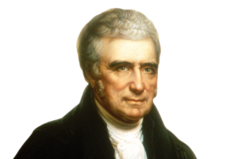
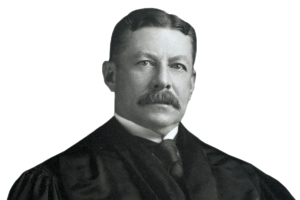
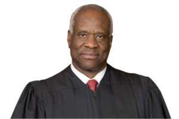
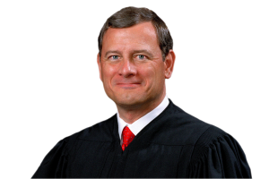
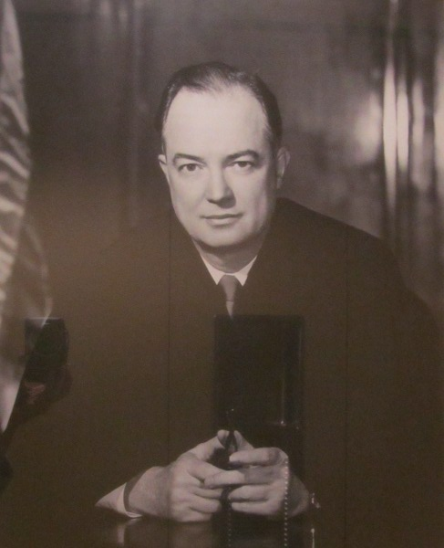
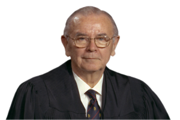

# Subject-Matter Jurisdiction {#sec-smj}

## Federal Question

Subject-matter jurisdiction refers to the power of a court to entertain certain types of disputes. Compare that with personal jurisdiction, which regulates when courts have power over certain parties. This difference gives rise to one of the most important distinctions between subject-matter and personal jurisdiction: the latter, as a personal right held by the defendant, can be waived. Subject-matter jurisdiction, by contrast, is a hard limit on court power, and so it cannot be consented to, waived, or ignored. Indeed, even when the parties do not raise the issue of subject-matter jurisdiction, courts have an independent obligation to investigate it for themselves.

Subject-matter jurisdiction does, however, share several key features with personal jurisdiction: both are threshold issues that must be addressed before the merits of a case, and defects in either type of jurisdiction can render an otherwise-final judgment unenforceable in a subsequent action. Similarly, like personal jurisdiction, subject-matter jurisdiction requires both a statutory and a constitutional grounding. 

We will begin our study of subject-matter jurisdiction with one of the chief categories of cases federal courts are empowered to hear: those “arising under” federal law. The next case lays out the constitutional limits on this jurisdictional grant, which derive from Article III, § 2 of the Constitution. That provision states: “The judicial power shall extend to all cases, in law and equity, arising under this Constitution, the laws of the United States, and treaties made, or which shall be made, under their authority.”

### Osborn v. Bank of the United States

**Mr. Chief Justice MARSHALL delivered the opinion of the Court:** [22 U.S. (9 Wheat.) 738 (1824)]{.aside}

::: {.column-margin}

{width=150}

:::

[…]

[The Bank of the United States sued Ohio tax officials in federal court seeking to enjoin the state from collecting tax from the Bank. The lower court granted a temporary injunction. Ohio ignored the injunction and seized the tax allegedly owed by force. The federal court ordered the state officials to return the money. The state officials appealed on the grounds that the federal court lacked subject-matter jurisdiction. The statute creating the Bank authorized it "to sue and be sued … in any Circuit Court of the United States." A key question on appeal was whether this statutory grant of subject-matter jurisdiction exceeded the jurisdictional limits of Article III, § 2 of the Constitution. In particular, the Court analyzed whether a suit in which the Bank is a party automatically "aris[es] under" federal law.]

When [the] Bank sues, the first question which presents itself, and which lies at the foundation of the cause, is, has this legal entity a right to sue? Has it a right to come, not into this Court particularly, but into any Court? This depends on a law of the United States. The next question is, has this being a right to make this particular contract? If this question be decided in the negative, the cause is determined against the plaintiff; and this question, too, depends entirely on a law of the United States. These are important questions, and they exist in every possible case. The right to sue, if decided once, is decided for ever; but the power of Congress was exercised antecedently to the first decision on that right, and if it was constitutional then, it cannot cease to be so, because the particular question is decided. It may be revived at the will of the party, and most probably would be renewed, were the tribunal to be changed. But the question respecting the right to make a particular contract, or to acquire a particular property, or to sue on account of a particular injury, belongs to every particular case, and may be renewed in every case. The question forms an original ingredient in every cause. Whether it be in fact relied on or not, in the defence, it is still a part of the cause, and may be relied on. The right of the plaintiff to sue, cannot depend on the defence which the defendant may choose to set up. His right to sue is anterior to that defence, and must depend on the state of things when the action is brought. The questions which the case involves, then, must determine its character, whether those questions be made in the cause or not.

The appellants say, that the case arises on the contract; but the validity of the contract depends on a law of the United States, and the plaintiff is compelled, in every case, to show its validity. The case arises emphatically under the law. The act of Congress is its foundation. The contract could never have been made, but under the authority of that act. The act itself is the first ingredient in the case, is its origin, is that from which every other part arises. That other questions may also arise, as the execution of the contract, or its performance, cannot change the case, or give it any other origin than the charter of incorporation. The action still originates in, and is sustained by, that charter.

[…]

#### Notes & Questions

1. *Osborn* held that the Article III test for federal question jurisdiction is satisfied whenever federal law forms an “original ingredient” in the cause of action. This test does not require that the federal issue be litigated or even disputed. This is a very broad test.
2. Before the Civil War, Congress did not often exercise its power to give federal courts subject-matter jurisdiction over federal questions. But in the late 19th century, such statutory grants proliferated. Today, the key statute is 28 U.S.C. § 1331, which provides that “district courts shall have original jurisdiction of all civil actions arising under the Constitution, laws, or treaties of the United States.” Note that the language of § 1331 is quite similar to the relevant language of Article III, § 2. Yet as the following cases show, courts have interpreted the statutory grant under § 1331 much more narrowly than the broad interpretation the Osborn Court gave to Article III. 

### Louisville & Nashville Railroad v. Mottley

**MOODY, J., delivered the opinion of the Court.** [211 U.S. 149 (1908)]{.aside}

::: {.column-margin}

{width=150}

:::

[Erasmus and Annie Mottley were injured in a railroad accident. They sued the railroad, which agreed to settle the suit by giving the Mottleys free lifetime travel passes. Decades later, out of concern that free passes for railroad travel were a vector for political bribery and corruption, Congress banned them. That prompted the railroad to tell the Mottleys that they could not use the passes any longer. The Mottleys sued for breach of contract in federal court and requested specific performance as a remedy. The lower court denied the motion to dismiss, and the railroad appealed.]

Two questions of law were raised by the demurrer to the bill, were brought here by appeal, and have been argued before us. They are, first, whether that part of the act of Congress of June 29, 1906 (34 Stat. 584), which forbids the giving of free passes or the collection of any different compensation for transportation of passengers than that specified in the tariff filed, makes it unlawful to perform a contract for transportation of persons, who in good faith, before the passage of the act, had accepted such contract in satisfaction of a valid cause of action against the railroad; and, second, whether the statute, if it should be construed to render such a contract unlawful, is in violation of the Fifth Amendment of the Constitution of the United States. We do not deem it necessary, however, to consider either of these questions, because, in our opinion, the court below was without jurisdiction of the cause. Neither party has questioned that jurisdiction, but it is the duty of this court to see to it that the jurisdiction of the Circuit Court, which is defined and limited by statute, is not exceeded. This duty we have frequently performed of our own motion.

There was no diversity of citizenship and it is not and cannot be suggested that there was any ground of jurisdiction, except that the case was a "suit … arising under the Constitution and laws of the United States." [The Court cited the then-current version of the "arising under" jurisdiction statute.] It is the settled interpretation of these words, as used in this statute, conferring jurisdiction, that a suit arises under the Constitution and laws of the United States only when the plaintiff's statement of his own cause of action shows that it is based upon those laws or that Constitution. It is not enough that the plaintiff alleges some anticipated defense to his cause of action and asserts that the defense is invalidated by some provision of the Constitution of the United States. Although such allegations show that very likely, in the course of the litigation, a question under the Constitution would arise, they do not show that the suit, that is, the plaintiff's original cause of action, arises under the Constitution. In _Tennessee v. Union & Planters' Bank_, 152 U.S. 454, the plaintiff, the State of Tennessee, brought suit in the Circuit Court of the United States to recover from the defendant certain taxes alleged to be due under the laws of the State. The plaintiff alleged that the defendant claimed an immunity from the taxation by virtue of its charter, and that therefore the tax was void, because in violation of the provision of the Constitution of the United States, which forbids any State from passing a law impairing the obligation of contracts. The cause was held to be beyond the jurisdiction of the Circuit Court, the court saying, by Mr. Justice Gray, "a suggestion of one party, that the other will or may set up a claim under the Constitution or laws of the United States, does not make the suit one arising under that Constitution or those laws." Again, in _Boston & Montana Consolidated Copper & Silver Mining Company v. Montana Ore Purchasing Company_, 188 U.S. 632, the […] cause was held to be beyond the jurisdiction of the Circuit Court, the court saying, by Mr. Justice Peckham:

> It would be wholly unnecessary and improper in order to prove complainant's cause of action to go into any matters of defence which the defendants might possibly set up and then attempt to reply to such defence, and thus, if possible, to show that a Federal question might or probably would arise in the course of the trial of the case. To allege such defence and then make an answer to it before the defendant has the opportunity to itself plead or prove its own defence is inconsistent with any known rule of pleading so far as we are aware, and is improper.
>
> The rule is a reasonable and just one that the complainant in the first instance shall be confined to a statement of its cause of action, leaving to the defendant to set up in his answer what his defence is and, if anything more than a denial of complainant's cause of action, imposing upon the defendant the burden of proving such defence.
>
> Conforming itself to that rule the complainant would not, in the assertion or proof of its cause of action, bring up a single Federal question. The presentation of its cause of action would not show that it was one arising under the Constitution or laws of the United States.
>
> The only way in which it might be claimed that a Federal question was presented would be in the complainant's statement of what the defence of defendants would be and complainant's answer to such defence. Under these circumstances the case is brought within the rule laid down in _Tennessee v. Union & Planters' Bank_, 152 U.S. 454 [holding that such cases do not arise under federal law].

[…] The application of this rule to the case at bar is decisive against the jurisdiction of the circuit court.

It is ordered that the judgment be reversed and the case remitted to the circuit court with instructions to dismiss for want of jurisdiction.

#### Notes & Questions

1.	*Mottley* held that, in determining whether a suit arises under federal law for purposes of § 1331, courts must look only at the plaintiff’s complaint, and not any defenses that the defendant might raise in response. This rule, known as the “well-pleaded complaint rule,” applies only under § 1331 and not under Article III. 
2.	A corollary, known as the “artful pleading” rule, says that plaintiffs may not plead the denial of an anticipated federal defense and thereby render their claim one that arises under federal law. Instead, courts must look to the elements of the plaintiff’s cause of action to determine whether it raises a federal question.
3.	Does it make sense to ignore likely federal defenses in determining whether a case “arises under” federal law? What theory might support allowing federal questions embedded in a complaint to be filed in federal court, but relegating significant federal questions raised only in defense to state court?
4.	Does it make sense to read the language of § 1331 so differently from that of Art. III, given that they are so textually similar? Even if not, do you think Congress implicitly blessed the divergence between statute and constitution by refusing to expand federal-question jurisdiction to encompass federal defenses, despite many other amendments to § 1331 and its predecessors over the years?
5.	While *Mottley* rules out federal question jurisdiction based only on a federal defense, it leaves open the question of when a plaintiff’s complaint “arises under” federal law. Does it require that the plaintiff’s cause of action be a creation of federal law, or can the test be satisfied if the plaintiff pleads a state-law claim that necessarily involves federal law? The following cases seek to work out the answer to this question. 

### American Well Works Co. v. Layne & Bowler Co.

**Mr. Justice Holmes delivered the opinion of the court.** [241 U.S. 257 (1916)]{.aside}

::: {.column-margin}

{width=150}

:::

This is a suit begun in a state court, removed to the United States Court, and then, on motion to remand by the plaintiff, dismissed by the latter court, on the ground that the cause of action arose under the patent laws of the United States, that the state court had no jurisdiction, and that therefore the one to which it was removed had none. […]

[…] The plaintiff alleges that it owns, manufactures and sells a certain pump, has or has applied for a patent for it, and that the pump is known as the best in the market. It then alleges that the defendants have falsely and maliciously libeled and slandered the plaintiff's title to the pump by stating that the pump and certain parts thereof are infringements upon the defendant's pump and certain parts thereof and that without probable cause they have brought suits against some parties who are using the plaintiff's pump and that they are threatening suits against all who use it. The allegation of the defendants' libel or slander is repeated in slightly varying form but it all comes to statements to various people that the plaintiff was infringing the defendants' patent and that the defendant would sue both seller and buyer if the plaintiff's pump was used. Actual damage to the plaintiff in its business is alleged to the extent of $50,000 and punitive damages to the same amount are asked.

[…]

A suit for damages to business caused by a threat to sue under the patent law is not itself a suit under the patent law. And the same is true when the damage is caused by a statement of fact—that the defendant has a patent which is infringed. What makes the defendants' act a wrong is its manifest tendency to injure the plaintiff's business and the wrong is the same whatever the means by which it is accomplished. But whether it is a wrong or not depends upon the law of the State where the act is done, not upon the patent law, and therefore the suit arises under the law of the State. A suit arises under the law that creates the cause of action. The fact that the justification may involve the validity and infringement of a patent is no more material to the question under what law the suit is brought than it would be in an action of contract. […] The State is master of the whole matter, and if it saw fit to do away with actions of this type altogether, no one, we imagine, would suppose that they still could be maintained under the patent laws of the United States.

_Judgment reversed._

#### Notes & Questions

1. The rule of *American Well-Works* is that “\[a\] suit arises under the law that creates the cause of action.” In other words, if a cause of action is created by federal law, it “arises under” federal law; if it is created by state law, it does not. This rule has an obvious strength: it is quite clear and easily applied. But does that advantage come at the cost of relegating some significant questions of federal law to the domain of state courts, at least in the first instance?
2. Justice Holmes’s vision for a clear, bright-line rule faded quickly. As the legendary Second Circuit Judge Henry Friendly put it, “Mr. Justice Holmes’ formula is more useful for inclusion than for the exclusion for which it was intended. Even though the claim is created by state law, a case may ‘arise under’ a law of the United States if the complaint discloses a need for determining the meaning or application of such a law.” *T.B. Harms Co. v. Eliscu*, 339 F.2d 823, 827 (2d Cir. 1964). The case that follows shows why.

### Smith v. Kansas City Title & Trust Co.

**MR. JUSTICE DAY delivered the opinion of the court.** [255 U.S. 180 (1921)]{.aside}

::: {.column-margin}

{width=150}

:::

A bill was filed in the United States District Court for the Western Division of the Western District of Missouri by a shareholder in the Kansas City Title & Trust Company to enjoin the Company, its officers, agents and employees from investing the funds of the Company in farm loan bonds issued by Federal Land Banks or Joint Stock Land Banks under authority of the Federal Farm Loan Act of July 17, 1916.

The relief was sought on the ground that these acts were beyond the constitutional power of Congress. The bill avers that the Board of Directors of the Company are about to invest its funds in the bonds to the amount of $10,000 in each of the classes described, and will do so unless enjoined by the court in this action. […]

As diversity of citizenship is lacking, the jurisdiction of the District Court depends upon whether the cause of action set forth arises under the Constitution or laws of the United States.

The general rule is that where it appears from the bill or statement of the plaintiff that the right to relief depends upon the construction or application of the Constitution or laws of the United States, and that such federal claim is not merely colorable, and rests upon a reasonable foundation, the District Court has jurisdiction under this provision.

[…]

In the instant case the averments of the bill show that the directors were proceeding to make the investments in view of the act authorizing the bonds about to be purchased, maintaining that the act authorizing them was constitutional and the bonds valid and desirable investments. The objecting shareholder avers in the bill that the securities were issued under an unconstitutional law, and hence of no validity. It is, therefore, apparent that the controversy concerns the constitutional validity of an act of Congress which is directly drawn in question. The decision depends upon the determination of this issue.

[…] We are, therefore, of the opinion that the District Court had jurisdiction […].

**MR. JUSTICE HOLMES, dissenting.**

::: {.column-margin}

{width=150}

:::

No doubt it is desirable that the question raised in this case should be set at rest, but that can be done by the Courts of the United States only within the limits of the jurisdiction conferred upon them by the Constitution and the laws of the United States. As this suit was brought by a citizen of Missouri against a Missouri corporation the single ground upon which the jurisdiction of the District Court can be maintained is that the suit "arises under the Constitution or laws of the United States" within the meaning of § 24 of the Judicial Code. I am of opinion that this case does not arise in that way and therefore that the bill should have been dismissed.

\[I\]t seems to me that a suit cannot be said to arise under any other law than that which creates the cause of action. It may be enough that the law relied upon creates a part of the cause of action although not the whole, as held in _Osborn v. Bank of the United States_ […], although the _Osborn Case_ has been criticized and regretted. But the law must create at least a part of the cause of action by its own force, for it is the suit, not a question in the suit, that must arise under the law of the United States. The mere adoption by a state law of a United States law as a criterion or test, when the law of the United States has no force _proprio vigore_, does not cause a case under the state law to be also a case under the law of the United States […].

[…]

### Merrell Dow Pharmaceuticals Inc. v. Thompson

**JUSTICE STEVENS delivered the opinion of the Court.** [478 U.S. 804 (1986)]{.aside}

::: {.column-margin}

{width=150}

:::

The question presented is whether the incorporation of a federal standard in a state-law private action, when Congress has intended that there not be a federal private action for violations of that federal standard, makes the action one "arising under the Constitution, laws, or treaties of the United States," 28 U.S.C. § 1331.

**I**

The Thompson respondents are residents of Canada and the MacTavishes reside in Scotland. They filed virtually identical complaints against petitioner, a corporation, that manufactures and distributes the drug Bendectin. The complaints were filed in the Court of Common Pleas in Hamilton County, Ohio. Each complaint alleged that a child was born with multiple deformities as a result of the mother's ingestion of Bendectin during pregnancy. In five of the six counts, the recovery of substantial damages was requested on common-law theories of negligence, breach of warranty, strict liability, fraud, and gross negligence. In Count IV, respondents alleged that the drug Bendectin was "misbranded" in violation of the Federal Food, Drug, and Cosmetic Act (FDCA), because its labeling did not provide adequate warning that its use was potentially dangerous. Paragraph 26 alleged that the violation of the FDCA "in the promotion" of Bendectin "constitutes a rebuttable presumption of negligence." Paragraph 27 alleged that the "violation of said federal statutes directly and proximately caused the injuries suffered" by the two infants.

Petitioner filed a timely petition for removal from the state court to the Federal District Court alleging that the action was "founded, in part, on an alleged claim arising under the laws of the United States." After removal, the two cases were consolidated. Respondents filed a motion to remand to the state forum on the ground that the federal court lacked subject-matter jurisdiction. Relying on our decision in _Smith v. Kansas City Title & Trust Co._, the District Court held that Count IV of the complaint alleged a cause of action arising under federal law and denied the motion to remand. It then granted petitioner's motion to dismiss on _forum non conveniens_ grounds.

The Court of Appeals for the Sixth Circuit reversed. After […] noting "that the FDCA does not create or imply a private right of action for individuals injured as a result of violations of the Act," it explained:

> Federal question jurisdiction would, thus, exist only if plaintiffs' right to relief _depended necessarily_ on a substantial question of federal law. Plaintiffs' causes of action referred to the FDCA merely as one available criterion for determining whether Merrell Dow was negligent. Because the jury could find negligence on the part of Merrell Dow without finding a violation of the FDCA, the plaintiffs' causes of action did not depend necessarily upon a question of federal law. Consequently, the causes of action did not arise under federal law and, therefore, were improperly removed to federal court.

We granted certiorari, and we now affirm.

**II**

Article III of the Constitution gives the federal courts power to hear cases "arising under" federal statutes. That grant of power, however, is not self-executing, and it was not until the Judiciary Act of 1875 that Congress gave the federal courts general federal-question jurisdiction. Although the constitutional meaning of "arising under" may extend to all cases in which a federal question is "an ingredient" of the action, _Osborn v. Bank of the United States_, we have long construed the statutory grant of federal-question jurisdiction as conferring a more limited power.

Under our longstanding interpretation of the current statutory scheme, the question whether a claim "arises under" federal law must be determined by reference to the "well-pleaded complaint." A defense that raises a federal question is inadequate to confer federal jurisdiction. _Louisville & Nashville R. Co. v. Mottley_. Since a defendant may remove a case only if the claim could have been brought in federal court, 28 U.S.C. § 1441(b), moreover, the question for removal jurisdiction must also be determined by reference to the "well-pleaded complaint."

[…]

The "vast majority" of cases that come within this grant of jurisdiction are covered by Justice Holmes' statement that a "suit arises under the law that creates the cause of action." _American Well Works Co. v. Layne & Bowler Co._ Thus, the vast majority of cases brought under the general federal-question jurisdiction of the federal courts are those in which federal law creates the cause of action.

We have, however, also noted that a case may arise under federal law "where the vindication of a right under state law necessarily turned on some construction of federal law." […]

This case does not pose a federal question of the first kind; respondents do not allege that federal law creates any of the causes of action that they have asserted. This case thus poses what Justice Frankfurter called the "litigation-provoking problem," the presence of a federal issue in a state-created cause of action.

[…] We have consistently emphasized that, in exploring the outer reaches of § 1331, determinations about federal jurisdiction require sensitive judgments about congressional intent, judicial power, and the federal system. […]

In this case, both parties agree with the Court of Appeals' conclusion that there is no federal cause of action for FDCA violations. For purposes of our decision, we assume that this is a correct interpretation of the FDCA. […] In short, Congress did not intend a private federal remedy for violations of the statute that it enacted.

[…]

The significance of the necessary assumption that there is no federal private cause of action thus cannot be overstated. For the ultimate import of such a conclusion, as we have repeatedly emphasized, is that it would flout congressional intent to provide a private federal remedy for the violation of the federal statute. We think it would similarly flout, or at least undermine, congressional intent to conclude that the federal courts might nevertheless exercise federal-question jurisdiction and provide remedies for violations of that federal statute solely because the violation of the federal statute is said to be a "rebuttable presumption" or a "proximate cause" under state law, rather than a federal action under federal law.

**III**

Petitioner […] argues that, whatever the general rule, there are special circumstances that justify federal-question jurisdiction in this case. Petitioner emphasizes that it is unclear whether the FDCA applies to sales in Canada and Scotland; there is, therefore, a special reason for having a federal court answer the novel federal question relating to the extra-territorial meaning of the Act. We reject this argument. We do not believe the question whether a particular claim arises under federal law depends on the novelty of the federal issue. Although it is true that federal jurisdiction cannot be based on a frivolous or insubstantial federal question, "the interrelation of federal and state authority and the proper management of the federal judicial system" would be ill served by a rule that made the existence of federal-question jurisdiction depend on the district court's case-by-case appraisal of the novelty of the federal question asserted as an element of the state tort. The novelty of an FDCA issue is not sufficient to give it status as a federal cause of action; nor should it be sufficient to give a state-based FDCA claim status as a jurisdiction-triggering federal question.

**IV**

We conclude that a complaint alleging a violation of a federal statute as an element of a state cause of action, when Congress has determined that there should be no private, federal cause of action for the violation, does not state a claim "arising under the Constitution, laws, or treaties of the United States." 28 U.S.C. § 1331.

The judgment of the Court of Appeals is affirmed.

_It is so ordered._

### Grable & Sons Metal Prods., Inc. v. Darue Eng'g & Mfg.

**JUSTICE SOUTER delivered the opinion of the Court.** [545 U.S. 308 (2005)]{.aside}

::: {.column-margin}

{width=150}

:::

The question is whether want of a federal cause of action to try claims of title to land obtained at a federal tax sale precludes removal to federal court of a state action with nondiverse parties raising a disputed issue of federal title law. We answer no, and hold that the national interest in providing a federal forum for federal tax litigation is sufficiently substantial to support the exercise of federal-question jurisdiction over the disputed issue on removal, which would not distort any division of labor between the state and federal courts, provided or assumed by Congress.

**I**

In 1994, the Internal Revenue Service seized Michigan real property belonging to petitioner Grable & Sons Metal Products, Inc., to satisfy Grable's federal tax delinquency. Title 26 U.S.C. § 6335 required the IRS to give notice of the seizure, and there is no dispute that Grable received actual notice by certified mail before the IRS sold the property to respondent Darue Engineering & Manufacturing. Although Grable also received notice of the sale itself, it did not exercise its statutory right to redeem the property within 180 days of the sale, and after that period had passed, the Government gave Darue a quitclaim deed.

Five years later, Grable brought a quiet title action in state court, claiming that Darue's record title was invalid because the IRS had failed to notify Grable of its seizure of the property in the exact manner required by § 6335(a), which provides that written notice must be "given by the Secretary to the owner of the property [or] left at his usual place of abode or business." Grable said that the statute required personal service, not service by certified mail.

Darue removed the case to Federal District Court as presenting a federal question, because the claim of title depended on the interpretation of the notice statute in the federal tax law. The District Court declined to remand the case at Grable's behest after finding that the "claim does pose a significant question of federal law" and ruling that Grable's lack of a federal right of action to enforce its claim against Darue did not bar the exercise of federal jurisdiction. […]

The Court of Appeals for the Sixth Circuit affirmed. On the jurisdictional question, the panel thought it sufficed that the title claim raised an issue of federal law that had to be resolved, and implicated a substantial federal interest (in construing federal tax law). […] We granted certiorari […] to resolve a split within the Courts of Appeals on whether _Merrell Dow Pharmaceuticals Inc. v. Thompson_, always requires a federal cause of action as a condition for exercising federal-question jurisdiction. We now affirm.

**II**

Darue was entitled to remove the quiet title action if Grable could have brought it in federal district court originally, 28 U.S.C. § 1441(a), as a civil action "arising under the Constitution, laws, or treaties of the United States," § 1331. This provision for federal-question jurisdiction is invoked by and large by plaintiffs pleading a cause of action created by federal law (_e.g._, claims under 42 U.S.C. § 1983). There is, however, another longstanding, if less frequently encountered, variety of federal "arising under" jurisdiction, this Court having recognized for nearly 100 years that in certain cases federal-question jurisdiction will lie over state-law claims that implicate significant federal issues. The doctrine captures the commonsense notion that a federal court ought to be able to hear claims recognized under state law that nonetheless turn on substantial questions of federal law, and thus justify resort to the experience, solicitude, and hope of uniformity that a federal forum offers on federal issues.

The classic example is _Smith v. Kansas City Title & Trust Co._, a suit by a shareholder claiming that the defendant corporation could not lawfully buy certain bonds of the National Government because their issuance was unconstitutional. Although Missouri law provided the cause of action, the Court recognized federal-question jurisdiction because the principal issue in the case was the federal constitutionality of the bond issue. _Smith_ thus held, in a somewhat generous statement of the scope of the doctrine, that a state-law claim could give rise to federal-question jurisdiction so long as it "appears from the [complaint] that the right to relief depends upon the construction or application of [federal law]."

The _Smith_ statement has been subject to some trimming to fit earlier and later cases recognizing the vitality of the basic doctrine, but shying away from the expansive view that mere need to apply federal law in a state-law claim will suffice to open the "arising under" door. As early as 1912, this Court had confined federal-question jurisdiction over state-law claims to those that "really and substantially involv[e] a dispute or controversy respecting the validity, construction or effect of [federal] law." This limitation was the ancestor of Justice Cardozo's later explanation that a request to exercise federal-question jurisdiction over a state action calls for a "common-sense accommodation of judgment to [the] kaleidoscopic situations" that present a federal issue, in "a selective process which picks the substantial causes out of the web and lays the other ones aside." It has in fact become a constant refrain in such cases that federal jurisdiction demands not only a contested federal issue, but a substantial one, indicating a serious federal interest in claiming the advantages thought to be inherent in a federal forum.

But even when the state action discloses a contested and substantial federal question, the exercise of federal jurisdiction is subject to a possible veto. For the federal issue will ultimately qualify for a federal forum only if federal jurisdiction is consistent with congressional judgment about the sound division of labor between state and federal courts governing the application of § 1331. […] Because arising-under jurisdiction to hear a state-law claim always raises the possibility of upsetting the state-federal line drawn (or at least assumed) by Congress, the presence of a disputed federal issue and the ostensible importance of a federal forum are never necessarily dispositive; there must always be an assessment of any disruptive portent in exercising federal jurisdiction. _See also Merrell Dow_.

These considerations have kept us from stating a "single, precise, all-embracing" test for jurisdiction over federal issues embedded in state-law claims between nondiverse parties. We have not kept them out simply because they appeared in state raiment, as Justice Holmes would have done, _see Smith_ (dissenting opinion), but neither have we treated "federal issue" as a password opening federal courts to any state action embracing a point of federal law. Instead, the question is, does a state-law claim necessarily raise a stated federal issue, actually disputed and substantial, which a federal forum may entertain without disturbing any congressionally approved balance of federal and state judicial responsibilities.

**III**

**A**

This case warrants federal jurisdiction. Grable's state complaint must specify "the facts establishing the superiority of [its] claim," Mich. Ct. Rule 3.411(B)(2)(c), and Grable has premised its superior title claim on a failure by the IRS to give it adequate notice, as defined by federal law. Whether Grable was given notice within the meaning of the federal statute is thus an essential element of its quiet title claim, and the meaning of the federal statute is actually in dispute; it appears to be the only legal or factual issue contested in the case. The meaning of the federal tax provision is an important issue of federal law that sensibly belongs in a federal court. The Government has a strong interest in the "prompt and certain collection of delinquent taxes," and the ability of the IRS to satisfy its claims from the property of delinquents requires clear terms of notice to allow buyers like Darue to satisfy themselves that the Service has touched the bases necessary for good title. The Government thus has a direct interest in the availability of a federal forum to vindicate its own administrative action, and buyers (as well as tax delinquents) may find it valuable to come before judges used to federal tax matters. Finally, because it will be the rare state title case that raises a contested matter of federal law, federal jurisdiction to resolve genuine disagreement over federal tax title provisions will portend only a microscopic effect on the federal-state division of labor.

[…]

**B**

_Merrell Dow Pharmaceuticals Inc. v. Thompson_, on which Grable rests its position, is not to the contrary. _Merrell Dow_ considered a state tort claim resting in part on the allegation that the defendant drug company had violated a federal misbranding prohibition, and was thus presumptively negligent under Ohio law. The Court assumed that federal law would have to be applied to resolve the claim, but after closely examining the strength of the federal interest at stake and the implications of opening the federal forum, held federal jurisdiction unavailable. Congress had not provided a private federal cause of action for violation of the federal branding requirement, and the Court found "it would … flout, or at least undermine, congressional intent to conclude that federal courts might nevertheless exercise federal-question jurisdiction and provide remedies for violations of that federal statute solely because the violation … is said to be a … 'proximate cause' under state law."

Because federal law provides for no quiet title action that could be brought against Darue, Grable argues that there can be no federal jurisdiction here, stressing some broad language in _Merrell Dow_ (including the passage just quoted) that on its face supports Grable's position. But an opinion is to be read as a whole, and _Merrell Dow_ cannot be read whole as overturning decades of precedent, as it would have done by effectively adopting the Holmes dissent in _Smith_ and converting a federal cause of action from a sufficient condition for federal-question jurisdiction into a necessary one.

In the first place, _Merrell Dow_ disclaimed the adoption of any bright-line rule, as when the Court reiterated that "in exploring the outer reaches of § 1331, determinations about federal jurisdiction require sensitive judgments about congressional intent, judicial power, and the federal system." […] And as a final indication that it did not mean to make a federal right of action mandatory, it expressly approved the exercise of jurisdiction sustained in _Smith_, despite the want of any federal cause of action available to _Smith_'s shareholder plaintiff. _Merrell Dow_ then, did not toss out, but specifically retained, the contextual enquiry that had been _Smith_'s hallmark for over 60 years. At the end of _Merrell Dow_, Justice Holmes was still dissenting.

Accordingly, _Merrell Dow_ should be read in its entirety as treating the absence of a federal private right of action as evidence relevant to, but not dispositive of, the "sensitive judgments about congressional intent" that § 1331 requires. The absence of any federal cause of action affected _Merrell Dow_'s result two ways. The Court saw the fact as worth some consideration in the assessment of substantiality. But its primary importance emerged when the Court treated the combination of no federal cause of action and no preemption of state remedies for misbranding as an important clue to Congress's conception of the scope of jurisdiction to be exercised under § 1331. The Court saw the missing cause of action not as a missing federal door key, always required, but as a missing welcome mat, required in the circumstances, when exercising federal jurisdiction over a state misbranding action would have attracted a horde of original filings and removal cases raising other state claims with embedded federal issues. For if the federal labeling standard without a federal cause of action could get a state claim into federal court, so could any other federal standard without a federal cause of action. And that would have meant a tremendous number of cases.

One only needed to consider the treatment of federal violations generally in garden variety state tort law. "The violation of federal statutes and regulations is commonly given negligence _per se_ effect in state tort proceedings." Restatement (Third) of Torts § 14, Reporters' Note, Comment _a_, p. 195 (Tent. Draft No. 1, Mar. 28, 2001). A general rule of exercising federal jurisdiction over state claims resting on federal mislabeling and other statutory violations would thus have heralded a potentially enormous shift of traditionally state cases into federal courts. Expressing concern over the "increased volume of federal litigation," and noting the importance of adhering to "legislative intent," _Merrell Dow_ thought it improbable that the Congress, having made no provision for a federal cause of action, would have meant to welcome any state-law tort case implicating federal law "solely because the violation of the federal statute is said to [create] a rebuttable presumption [of negligence] … under state law." In this situation, no welcome mat meant keep out. _Merrell Dow_'s analysis thus fits within the framework of examining the importance of having a federal forum for the issue, and the consistency of such a forum with Congress's intended division of labor between state and federal courts.

As already indicated, however, a comparable analysis yields a different jurisdictional conclusion in this case. Although Congress also indicated ambivalence in this case by providing no private right of action to Grable, it is the rare state quiet title action that involves contested issues of federal law. Consequently, jurisdiction over actions like Grable's would not materially affect, or threaten to affect, the normal currents of litigation. Given the absence of threatening structural consequences and the clear interest the Government, its buyers, and its delinquents have in the availability of a federal forum, there is no good reason to shirk from federal jurisdiction over the dispositive and contested federal issue at the heart of the state-law title claim.

**IV**

The judgment of the Court of Appeals, upholding federal jurisdiction over Grable's quiet title action, is affirmed.

_It is so ordered._

**JUSTICE THOMAS, concurring.**

::: {.column-margin}

{width=150}

:::

[…] In this case, no one has asked us to overrule those precedents and adopt the rule Justice Holmes set forth in _American Well Works Co. v. Layne & Bowler Co._, limiting § 1331 jurisdiction to cases in which federal law creates the cause of action pleaded on the face of the plaintiff's complaint. In an appropriate case, and perhaps with the benefit of better evidence as to the original meaning of § 1331's text, I would be willing to consider that course.

Jurisdictional rules should be clear. Whatever the virtues of the _Smith_ standard, it is anything but clear. _Ante_ (the standard "calls for a 'common-sense accommodation of judgment to [the] kaleidoscopic situations' that present a federal issue, in 'a selective process which picks the substantial causes out of the web and lays the other ones aside'"); _ante_ ("[T]he question is, does a state-law claim necessarily raise a stated federal issue, actually disputed and substantial, which a federal forum may entertain without disturbing any congressionally approved balance of federal and state judicial responsibilities"); _ante_ ("'\[D\]eterminations about federal jurisdiction require sensitive judgments about congressional intent, judicial power, and the federal system'"; "the absence of a federal private right of action [is] evidence relevant to, but not dispositive of, the 'sensitive judgments about congressional intent' that § 1331 requires").

Whatever the vices of the _American Well Works_ rule, it is clear. Moreover, it accounts for the "vast majority" of cases that come within § 1331 under our current case law, further indication that trying to sort out which cases fall within the smaller _Smith_ category may not be worth the effort it entails. Accordingly, I would be willing in appropriate circumstances to reconsider our interpretation of § 1331.

### Gunn v. Minton

**Chief Justice Roberts delivered the opinion of the Court.** [568 U.S. 251 (2013)]{.aside}

::: {.column-margin}

{width=150}

:::

Federal courts have exclusive jurisdiction over cases "arising under any Act of Congress relating to patents." 28 U.S.C. § 1338(a). The question presented is whether a state law claim alleging legal malpractice in the handling of a patent case must be brought in federal court.

**I**

[Vernon Minton created software to facilitate securities trading. He later patented his invention.]

Patent in hand, Minton filed a patent infringement suit in Federal District Court against the National Association of Securities Dealers, Inc. (NASD), and the NASDAQ Stock Market, Inc. He was represented by Jerry Gunn and the other petitioners. NASD and NASDAQ moved for summary judgment on the ground that Minton's patent was invalid […]. [T]he District Court granted the summary judgment motion and declared Minton's patent invalid.

Minton then filed a motion for reconsideration in the District Court, arguing for the first time that […] the "experimental use" exception [under federal patent law applied and saved his patent from invalidity]. The District Court denied the motion.

Minton appealed to the U.S. Court of Appeals for the Federal Circuit. That court affirmed, concluding that the District Court had appropriately held Minton's experimental-use argument waived.

Minton, convinced that his attorneys' failure to raise the experimental-use argument earlier had cost him the lawsuit and led to invalidation of his patent, brought this malpractice action in Texas state court. His former lawyers defended on the ground that […][the] experimental[-]use [exception did not apply] and that therefore Minton's patent infringement claims would have failed even if the experimental-use argument had been timely raised. The trial court agreed, […]\[and\] accordingly granted summary judgment to Gunn and the other lawyer defendants.

On appeal, Minton raised a new argument: Because his legal malpractice claim was based on an alleged error in a patent case, it "aris[es] under" federal patent law for purposes of 28 U.S.C. § 1338(a). And because, under § 1338(a), "[n]o State court shall have jurisdiction over any claim for relief arising under any Act of Congress relating to patents," the Texas court—where Minton had originally brought his malpractice claim—lacked subject matter jurisdiction to decide the case. Accordingly, Minton argued, the trial court's order should be vacated and the case dismissed, leaving Minton free to start over in the Federal District Court.

A divided panel of the Court of Appeals of Texas rejected Minton's argument. Applying the test we articulated in _Grable & Sons Metal Products, Inc. v. Darue Engineering & Mfg._, it held that the federal interests implicated by Minton's state law claim were not sufficiently substantial to trigger § 1338 "arising under" jurisdiction. It also held that finding exclusive federal jurisdiction over state legal malpractice actions would, contrary to _Grable_'s commands, disturb the balance of federal and state judicial responsibilities. […]

The Supreme Court of Texas reversed […]. The court concluded that Minton's claim involved "a substantial federal issue" within the meaning of _Grable_ "because the success of Minton's malpractice claim is reliant upon the viability of the experimental use exception […]."

[…]

**II**

[…]

Adhering to the demands of "[l]inguistic consistency," we have interpreted the phrase "arising under" in both [28 U.S.C. § 1331 and § 1338(a)] identically, applying our § 1331 and § 1338(a) precedents interchangeably. For cases falling within the patent specific arising under jurisdiction of § 1338(a), however, Congress has not only provided for federal jurisdiction but also eliminated state jurisdiction, decreeing that "[n]o State court shall have jurisdiction over any claim for relief arising under any Act of Congress relating to patents." § 1338(a). To determine whether jurisdiction was proper in the Texas courts, therefore, we must determine whether it would have been proper in a federal district court—whether, that is, the case "aris[es] under any Act of Congress relating to patents."

For statutory purposes, a case can "aris[e] under" federal law in two ways. Most directly, a case arises under federal law when federal law creates the cause of action asserted. _See American Well Works Co. v. Layne & Bowler Co._ ("A suit arises under the law that creates the cause of action"). As a rule of inclusion, this "creation" test admits of only extremely rare exceptions and accounts for the vast bulk of suits that arise under federal law. […]

But even where a claim finds its origins in state rather than federal law—as Minton's legal malpractice claim indisputably does—we have identified a "special and small category" of cases in which arising under jurisdiction still lies. In outlining the contours of this slim category, we do not paint on a blank canvas. Unfortunately, the canvas looks like one that Jackson Pollock got to first.

In an effort to bring some order to this unruly doctrine several Terms ago, we condensed our prior cases into the following inquiry: Does the "state-law claim necessarily raise a stated federal issue, actually disputed and substantial, which a federal forum may entertain without disturbing any congressionally approved balance of federal and state judicial responsibilities?" _Grable_. That is, federal jurisdiction over a state law claim will lie if a federal issue is: (1) necessarily raised, (2) actually disputed, (3) substantial, and (4) capable of resolution in federal court without disrupting the federal-state balance approved by Congress. Where all four of these requirements are met, we held, jurisdiction is proper because there is a "serious federal interest in claiming the advantages thought to be inherent in a federal forum," which can be vindicated without disrupting Congress's intended division of labor between state and federal courts.

**III**

Applying *Grable*'s inquiry here, it is clear that Minton's legal malpractice claim does not arise under federal patent law. Indeed, for the reasons we discuss, we are comfortable concluding that state legal malpractice claims based on underlying patent matters will rarely, if ever, arise under federal patent law for purposes of § 1338(a). Although such cases may necessarily raise disputed questions of patent law, those cases are by their nature unlikely to have the sort of significance for the federal system necessary to establish jurisdiction.

**A**

To begin, we acknowledge that resolution of a federal patent question is "necessary" to Minton's case. Under Texas law, a plaintiff alleging legal malpractice must establish four elements: (1) that the defendant attorney owed the plaintiff a duty; (2) that the attorney breached that duty; (3) that the breach was the proximate cause of the plaintiff's injury; and (4) that damages occurred. In cases like this one, in which the attorney's alleged error came in failing to make a particular argument, the causation element requires a "case within a case" analysis of whether, had the argument been made, the outcome of the earlier litigation would have been different. To prevail on his legal malpractice claim, therefore, Minton must show that he would have prevailed in his federal patent infringement case if only petitioners had timely made an experimental-use argument on his behalf. […]

**B**

The federal issue is also "actually disputed" here—indeed, on the merits, it is the central point of dispute. Minton argues that the experimental-use exception properly applied […], saving his patent from [invalidity]; petitioners argue that it did not. This is just the sort of "'dispute … respecting the … effect of [federal] law'" that _Grable_ envisioned.

**C**

Minton's argument founders on _Grable_'s next requirement, however, for the federal issue in this case is not substantial in the relevant sense. In reaching the opposite conclusion, the Supreme Court of Texas focused on the importance of the issue to the plaintiff's case and to the parties before it. As our past cases show, however, it is not enough that the federal issue be significant to the particular parties in the immediate suit; that will _always_ be true when the state claim "necessarily raise[s]" a disputed federal issue, as _Grable_ separately requires. The substantiality inquiry under _Grable_ looks instead to the importance of the issue to the federal system as a whole.

[…]

Here, the federal issue carries no such significance. Because of the backward-looking nature of a legal malpractice claim, the question is posed in a merely hypothetical sense: If Minton's lawyers had raised a timely experimental-use argument, would the result in the patent infringement proceeding have been different? No matter how the state courts resolve that hypothetical "case within a case," it will not change the real-world result of the prior federal patent litigation. Minton's patent will remain invalid.

Nor will allowing state courts to resolve these cases undermine "the development of a uniform body of [patent] law." Congress ensured such uniformity by vesting exclusive jurisdiction over actual patent cases in the federal district courts and exclusive appellate jurisdiction in the Federal Circuit. _See_ 28 U.S.C. §§ 1338(a), 1295(a)(1). In resolving the nonhypothetical patent questions those cases present, the federal courts are of course not bound by state court case-within-a-case patent rulings. In any event, the state court case-within-a-case inquiry asks what would have happened in the prior federal proceeding if a particular argument had been made. In answering that question, state courts can be expected to hew closely to the pertinent federal precedents. […]

As for more novel questions of patent law that may arise for the first time in a state court "case within a case," they will at some point be decided by a federal court in the context of an actual patent case, with review in the Federal Circuit. If the question arises frequently, it will soon be resolved within the federal system, laying to rest any contrary state court precedent; if it does not arise frequently, it is unlikely to implicate substantial federal interests. […]

Minton also suggests that state courts' answers to hypothetical patent questions can sometimes have real-world effect on other patents through issue preclusion. […] He argues that, in evaluating [a related patent] application [he filed], the patent examiner could be bound by the Texas trial court's interpretation of the scope of Minton's original patent. It is unclear whether this is true. […] In fact, Minton has not identified any case finding such preclusive effect based on a state court decision. But even assuming that a state court's case-within-a-case adjudication may be preclusive under some circumstances, the result would be limited to the parties and patents that had been before the state court. Such "fact-bound and situation-specific" effects are not sufficient to establish federal arising under jurisdiction.

Nor can we accept the suggestion that the federal courts' greater familiarity with patent law means that legal malpractice cases like this one belong in federal court. […][T]he possibility that a state court will incorrectly resolve a state claim is not, by itself, enough to trigger the federal courts' exclusive patent jurisdiction, even if the potential error finds its root in a misunderstanding of patent law.

There is no doubt that resolution of a patent issue in the context of a state legal malpractice action can be vitally important to the particular parties in that case. But something more, demonstrating that the question is significant to the federal system as a whole, is needed. That is missing here.

**D**

It follows from the foregoing that _Grable_'s fourth requirement is also not met. That requirement is concerned with the appropriate "balance of federal and state judicial responsibilities." We have already explained the absence of a substantial federal issue within the meaning of _Grable._ The States, on the other hand, have "a special responsibility for maintaining standards among members of the licensed professions." […] We have no reason to suppose that Congress—in establishing exclusive federal jurisdiction over patent cases—meant to bar from state courts state legal malpractice claims simply because they require resolution of a hypothetical patent issue. […]

The judgment of the Supreme Court of Texas is reversed, and the case is remanded for further proceedings not inconsistent with this opinion.

_It is so ordered._

## Diversity of Citizenship

Article III extends the subject-matter jurisdiction of federal courts to “controversies … between citizens of different states.” Why do you think the framers of Article III might have given that class of cases to federal as opposed to state courts? What might their concerns have been? These questions are especially pressing given that diversity jurisdiction was quite controversial, and provided one of the main points of attack for skeptics of the new federal constitution during the ratification debates.

Recall that subject-matter jurisdiction requires both constitutional and statutory authorization. Just as Osborn set the constitutional test for federal-question jurisdiction, the next case distinguishes between the statutory and constitutional tests for subject-matter jurisdiction based on diversity of citizenship. And as with federal-question jurisdiction, the constitutional test for diversity jurisdiction is much more expansive than the statutory test, despite nearly identical text.

### Strawbridge v. Curtiss

**MARSHALL, Ch. J. delivered the opinion of the court.** [7 U.S. (3 Cranch) 267 (1806)]{.aside}

::: {.column-margin}

{width=150}

:::

The court has considered this case, and is of opinion that the jurisdiction cannot be supported.

The words of the act of congress are, "where an alien is a party; or the suit is between a citizen of a state where the suit is brought, and a citizen of another state."

The court understands these expressions to mean that each distinct interest should be represented by persons, all of whom are entitled to sue, or may be sued, in the federal courts. That is, that where the interest is joint, each of the persons concerned in that interest must be competent to sue, or liable to be sued, in those courts.

But the court does not mean to give an opinion in the case where several parties represent several distinct interests, and some of those parties are, and others are not, competent to sue, or liable to be sued, in the courts of the United States.

[…]

#### Notes & Questions

(@)  Article III, Section 2 of the Constitution extends the judicial power to all cases "between citizens of different states." Courts have interpreted this language to require "minimal diversity," meaning that the state citizenship of at least one plaintiff and defendant must be different. By contrast, courts have interpreted _Strawbridge v. Curtiss_ as requiring "complete diversity," meaning that every plaintiff must be a citizen of a different state from every defendant.

(@)  In a later case, the Supreme Court claimed that Chief Justice Marshall regretted how _Strawbridge_ came to be understood:

> By no one was the correctness of [_Strawbridge_] more questioned than by the late chief justice who [wrote it]. It is within the knowledge of several of us, that he repeatedly expressed regret [about the decision in _Strawbridge_], adding, whenever the subject was mentioned, that if the point of jurisdiction was an original one, the conclusion would be different.

_Louisville, Cincinnati & Charleston R.R. Co. v. Letson_, 43 U.S. 497, 555 (1844).

(@)  James Madison, an advocate for diversity jurisdiction's inclusion in Article III, defended it only weakly at the Virginia ratifying convention:

> As to its cognizance of disputes between citizens of different states, I will not say it is a matter of such importance. Perhaps it might be left to the state courts. But I sincerely believe this provision will be rather salutary, than otherwise. It may happen that a strong prejudice may arise in some states, against the citizens of others, who may have claims against them. We know what tardy, and even defective administration of justice, has happened in some states. A citizen of another state might not chance to get justice in a state court, and at all events he might think himself injured.

3 Jonathan Elliot, _The Debates in the Several State Conventions on the Adoption of the Federal Constitution_ 533 (2d ed. 1836). Subsequent commentators are skeptical of Madison's justifications. _See, e.g._, Henry J. Friendly, _The Historic Basis of Diversity Jurisdiction_, 41 Harv. L. Rev. 483, 492–97 (1928). As you read the cases that follow, see whether you think that diversity jurisdiction is necessary, salutary, and effective at achieving its stated goals.

### Mas v. Perry

**AINSWORTH, Circuit Judge:** [489 F.2d 1396 (5th Cir. 1974)]{.aside}

::: {.column-margin}

{width=150}

:::

[…] Appellees Jean Paul Mas, a citizen of France, and Judy Mas were married at her home in Jackson, Mississippi. Prior to their marriage, Mr. and Mrs. Mas were graduate assistants, pursuing coursework as well as performing teaching duties, for approximately nine months and one year, respectively, at Louisiana State University in Baton Rouge, Louisiana. Shortly after their marriage, they returned to Baton Rouge to resume their duties as graduate assistants at LSU. They remained in Baton Rouge for approximately two more years, after which they moved to Park Ridge, Illinois. At the time of the trial in this case, it was their intention to return to Baton Rouge while Mr. Mas finished his studies for [a PhD]. Mr. and Mrs. Mas were undecided as to where they would reside after that.

Upon their return to Baton Rouge after their marriage, appellees rented an apartment from appellant Oliver H. Perry, a citizen of Louisiana. This appeal arises from a final judgment entered on a jury verdict awarding \$5,000 to Mr. Mas and \$15,000 to Mrs. Mas for damages incurred by them as a result of the discovery that their bedroom and bathroom contained "two-way" mirrors and that they had been watched through them by the appellant during three of the first four months of their marriage.

At the close of the appellees' case at trial, appellant made an oral motion to dismiss for lack of jurisdiction. The motion was denied by the district court. Before this Court, appellant challenges the final judgment below solely on jurisdictional grounds, contending that appellees failed to prove diversity of citizenship among the parties and that the requisite jurisdictional amount is lacking with respect to Mr. Mas. Finding no merit to these contentions, we affirm. Under section 1332(a)(2), the federal judicial power extends to the claim of Mr. Mas, a citizen of France, against the appellant, a citizen of Louisiana. Since we conclude that Mrs. Mas is a citizen of Mississippi for diversity purposes, the district court also properly had jurisdiction under section 1332(a)(1) of her claim.

It has long been the general rule that complete diversity of parties is required in order that diversity jurisdiction obtain; that is, no party on one side may be a citizen of the same State as any party on the other side. _Strawbridge v. Curtiss_. This determination of one's State citizenship for diversity purposes is controlled by federal law, not by the law of any State. As is the case in other areas of federal jurisdiction, the diverse citizenship among adverse parties must be present at the time the complaint is filed. The burden of pleading the diverse citizenship is upon the party invoking federal jurisdiction, and if the diversity jurisdiction is properly challenged, that party also bears the burden of proof.

To be a citizen of a State within the meaning of section 1332, a natural person must be both a citizen of the United States and a domiciliary of that State. For diversity purposes, citizenship means domicile; mere residence in the State is not sufficient.

A person's domicile is the place of "his true, fixed, permanent home and principal establishment, and to which he has the intention of returning whenever he is absent therefrom." A change of domicile may be effected only by a combination of two elements: (a) taking up residence in a different domicile with (b) the intention to remain there.

It is clear that at the time of her marriage, Mrs. Mas was a domiciliary of the State of Mississippi. While it is generally the case that the domicile of the wife—and, consequently, her State citizenship for purposes of diversity jurisdiction—is deemed to be that of her husband, we find no precedent for extending this concept to the situation here, in which the husband is a citizen of a foreign state but resides in the United States. Indeed, such a fiction would work absurd results on the facts before us. If Mr. Mas were considered a domiciliary of France—as he would be since he had lived in Louisiana as a student-teaching assistant prior to filing this suit, then Mrs. Mas would also be deemed a domiciliary, and thus, fictionally at least, a citizen of France. She would not be a citizen of any State and could not sue in a federal court on that basis; nor could she invoke the alienage jurisdiction to bring her claim in federal court, since she is not an alien. On the other hand, if Mrs. Mas's domicile were Louisiana, she would become a Louisiana citizen for diversity purposes and could not bring suit with her husband against appellant, also a Louisiana citizen, on the basis of diversity jurisdiction. These are curious results under a rule arising from the theoretical identity of person and interest of the married couple.

An American woman is not deemed to have lost her United States citizenship solely by reason of her marriage to an alien. 8 U.S.C. § 1489. Similarly, we conclude that for diversity purposes a woman does not have her domicile or State citizenship changed solely by reason of her marriage to an alien.

Mrs. Mas's Mississippi domicile was disturbed neither by her year in Louisiana prior to her marriage nor as a result of the time she and her husband spent at LSU after their marriage, since for both periods she was a graduate assistant at LSU. Though she testified that after her marriage she had no intention of returning to her parents' home in Mississippi, Mrs. Mas did not effect a change of domicile since she and Mr. Mas were in Louisiana only as students and lacked the requisite intention to remain there. Until she acquires a new domicile, she remains a domiciliary, and thus a citizen, of Mississippi.

[The court's analysis of the amount-in-controversy requirement is omitted.]

Thus the power of the federal district court to entertain the claims of appellees in this case stands on two separate legs of diversity jurisdiction: a claim by an alien against a State citizen; and an action between citizens of different States. We also note, however, the propriety of having the federal district court entertain a spouse's action against a defendant, where the district court already has jurisdiction over a claim, arising from the same transaction, by the other spouse against the same defendant. In the case before us, such a result is particularly desirable. The claims of Mr. and Mrs. Mas arise from the same operative facts, and there was almost complete interdependence between their claims with respect to the proof required and the issues raised at trial. Thus, since the district court had jurisdiction of Mr. Mas's action, sound judicial administration militates strongly in favor of federal jurisdiction of Mrs. Mas's claim.

_Affirmed_.

#### Notes & Questions

1.	The *Mas* case concerns not only diversity jurisdiction but also its cousin, alienage jurisdiction, which exists in a suit between a citizen and an alien (rather than a suit between citizens of different states). 

2.	Note that 28 U.S.C. § 1332, the diversity-jurisdiction statute, requires not only complete diversity but also that the amount in controversy exceed a specified dollar amount. Though Congress has increased that amount over the years to account for inflation, today the requirement is that the amount in controversy exceed $75,000. Typically the amount in controversy is determined by looking at the plaintiff’s complaint, and it does not require any assessment of how likely the plaintiff is to prevail or to persuade a jury that her damages are as much as she alleges. 
Nevertheless, questions frequently arise about how to value non-monetary forms of relief like injunctions. At least three approaches exist for such valuations: 1. the cost to the defendant of complying; 2. the benefit to the plaintiff of defendant’s compliance; or 3. some combination of both. Courts have divided on which is the right approach.  

3.	*Mas* turns heavily on the concept of domicile. A person is a citizen of a state if they are domiciled there. What is the test for determining a person’s domicile? What does it take for a person to establish a new domicile?

4.	Where is a corporation domiciled for purposes of diversity jurisdiction? The test applied in Mas seems like a poor fit for a corporation. So what test should apply? The Supreme Court answered that question in the next case.

### Hertz Corp. v. Friend

**BREYER, J., delivered the unanimous opinion of the court.** [559 U.S. 77 (2010)]{.aside}

::: {.column-margin}

{width=150}

:::

The federal diversity jurisdiction statute provides that "a corporation shall be deemed to be a citizen of any State by which it has been incorporated _and of the State where it has its principal place of business._" 28 U.S.C. §1332(c)(1) (emphasis added). We seek here to resolve different interpretations that the Circuits have given this phrase. In doing so, we place primary weight upon the need for judicial administration of a jurisdictional statute to remain as simple as possible. And we conclude that the phrase "principal place of business" refers to the place where the corporation's high level officers direct, control, and coordinate the corporation's activities. Lower federal courts have often metaphorically called that place the corporation's "nerve center." We believe that the "nerve center" will typically be found at a corporation's headquarters.

[…]

[The case grew from a class action. Hertz employees in California alleged that Hertz had failed to conform to California's wage and hour laws. Hertz sought to remove to federal court, invoking diversity jurisdiction. The employees resisted with the argument that California was a principal place of business for Hertz, since it derived more revenue from that state than any other and the plurality of its business activities also occurred there. Reasoning that, because of this business activity Hertz was, like them, a citizen of California, the plaintiffs resisted removal. The District Court found that Hertz was a citizen of California, relying on Ninth Circuit precedent instructing "courts to identify a corporation's 'principal place of business' by first determining the amount of a corporation's business activity State by State. If the amount of activity is 'significantly larger' or 'substantially predominates' in one State, then that State is the corporation's 'principal place of business.'" The Ninth Circuit affirmed. The Supreme Court reviewed the history of "principal place of business" and its judicial interpretations.]

**V**

**A**

In an effort to find a single, more uniform interpretation of the statutory phrase, we have reviewed the Courts of Appeals' divergent and increasingly complex interpretations. Having done so, we now return to, and expand, Judge Weinfeld's approach, as applied [in a case decided shortly after the 1958 amendment to §1332 created dual corporate citizenship]. We conclude that "principal place of business" is best read as referring to the place where a corporation's officers direct, control, and coordinate the corporation's activities. It is the place that Courts of Appeals have called the corporation's "nerve center." And in practice it should normally be the place where the corporation maintains its headquarters—provided that the headquarters is the actual center of direction, control, and coordination, _i.e._, the "nerve center," and not simply an office where the corporation holds its board meetings (for example, attended by directors and officers who have traveled there for the occasion).

Three sets of considerations, taken together, convince us that this approach, while imperfect, is superior to other possibilities. First, the statute's language supports the approach. The statute's text deems a corporation a citizen of the "State where it has its principal place of business." 28 U.S.C. § 1332(c)(1). The word "place" is in the singular, not the plural. The word "principal" requires us to pick out the "main, prominent" or "leading" place. 12 Oxford English Dictionary 495 (2d ed. 1989) (def.(A)(I)(2)). And the fact that the word "place" follows the words "State where" means that the "place" is a place within a State. It is not the State itself.

A corporation's "nerve center," usually its main headquarters, is a single place. The public often (though not always) considers it the corporation's main place of business. And it is a place within a State. By contrast, the application of a more general business activities test has led some courts, as in the present case, to look, not at a particular place within a State, but incorrectly at the State itself, measuring the total amount of business activities that the corporation conducts there and determining whether they are "significantly larger" than in the next-ranking State.

[…]

Second, administrative simplicity is a major virtue in a jurisdictional statute. Complex jurisdictional tests complicate a case, eating up time and money as the parties litigate, not the merits of their claims, but which court is the right court to decide those claims. Complex tests produce appeals and reversals, encourage gamesmanship, and, again, diminish the likelihood that results and settlements will reflect a claim's legal and factual merits. Judicial resources too are at stake. Courts have an independent obligation to determine whether subject-matter jurisdiction exists, even when no party challenges it. So courts benefit from straightforward rules under which they can readily assure themselves of their power to hear a case.

Simple jurisdictional rules also promote greater predictability. Predictability is valuable to corporations making business and investment decisions. Predictability also benefits plaintiffs deciding whether to file suit in a state or federal court.

A "nerve center" approach, which ordinarily equates that "center" with a corporation's headquarters, is simple to apply comparatively speaking. The metaphor of a corporate "brain," while not precise, suggests a single location. By contrast, a corporation's general business activities more often lack a single principal place where they take place. That is to say, the corporation may have several plants, many sales locations, and employees located in many different places. If so, it will not be as easy to determine which of these different business locales is the "principal" or most important "place."

Third, the statute's legislative history, for those who accept it, offers a simplicity-related interpretive benchmark. The Judicial Conference provided an initial version of its proposal that suggested a numerical test. A corporation would be deemed a citizen of the State that accounted for more than half of its gross income. The Conference changed its mind in light of criticism that such a test would prove too complex and impractical to apply. That history suggests that the words "principal place of business" should be interpreted to be no more complex than the initial "half of gross income" test. A "nerve center" test offers such a possibility. A general business activities test does not.

**B**

We recognize that there may be no perfect test that satisfies all administrative and purposive criteria. We recognize as well that, under the "nerve center" test we adopt today, there will be hard cases. For example, in this era of telecommuting, some corporations may divide their command and coordinating functions among officers who work at several different locations, perhaps communicating over the Internet. That said, our test nonetheless points courts in a single direction, towards the center of overall direction, control, and coordination. Courts do not have to try to weigh corporate functions, assets, or revenues different in kind, one from the other. Our approach provides a sensible test that is relatively easier to apply, not a test that will, in all instances, automatically generate a result.

We also recognize that the use of a "nerve center" test may in some cases produce results that seem to cut against the basic rationale for 28 U.S.C. §1332. For example, if the bulk of a company's business activities visible to the public take place in New Jersey, while its top officers direct those activities just across the river in New York, the "principal place of business" is New York. One could argue that members of the public in New Jersey would be _less_ likely to be prejudiced against the corporation than persons in New York—yet the corporation will still be entitled to remove a New Jersey state case to federal court. And note too that the same corporation would be unable to remove a New York state case to federal court, despite the New York public's presumed prejudice against the corporation.

We understand that such seeming anomalies will arise. However, in view of the necessity of having a clearer rule, we must accept them. Accepting occasionally counterintuitive results is the price the legal system must pay to avoid overly complex jurisdictional administration while producing the benefits that accompany a more uniform legal system.

[…]

## Supplemental

Often a lawsuit will include a mix of claims that arise under both federal and state law. In that circumstance, federal courts have recognized a power to take jurisdiction over related state-law claims, even in the absence of diversity jurisdiction, so long as there is at least one “anchor claim” over which there is an independent jurisdictional basis. This “supplemental” jurisdiction—formerly known by the twin terms “pendent” and “ancillary” jurisdiction—illustrates the ways in which the different grants of subject-matter jurisdiction interact with and relate to one another.

### United Mine Workers of America v. Gibbs

**MR. JUSTICE BRENNAN delivered the opinion of the Court.** [383 U.S. 715 (1966)]{.aside}

::: {.column-margin}

{width=150}

:::

Respondent Paul Gibbs was awarded compensatory and punitive damages in this action against petitioner United Mine Workers of America (UMW) for alleged violations of § 303 of the Labor Management Relations Act, 1947, 61 Stat. 158, as amended, [which prohibits certain unfair labor practices,] and of the common law of Tennessee. The case grew out of the rivalry between the United Mine Workers and the Southern Labor Union over representation of workers in the southern Appalachian coal fields. Tennessee Consolidated Coal Company, not a party here, laid off 100 miners of the UMW's Local 5881 when it closed one of its mines in southern Tennessee during the spring of 1960. Late that summer, Grundy Company, a wholly owned subsidiary of Consolidated, hired respondent as mine superintendent to attempt to open a new mine on Consolidated's property at nearby Gray's Creek through use of members of the Southern Labor Union. As part of the arrangement, Grundy also gave respondent a contract to haul the mine's coal to the nearest railroad loading point.

On August 15 and 16, 1960, armed members of Local 5881 forcibly prevented the opening of the mine, threatening respondent and beating an organizer for the rival union. The members of the local believed Consolidated had promised them the jobs at the new mine; they insisted that if anyone would do the work, they would. […] George Gilbert, the UMW's field representative for the area including Local 5881, […][had] explicit instructions from his international union superiors to establish a limited picket line, to prevent any further violence, and to see to it that the strike did not spread to neighboring mines. There was no further violence at the mine site […].

Respondent lost his job as superintendent, and never entered into performance of his haulage contract. He testified that he soon began to lose other trucking contracts and mine leases he held in nearby areas. Claiming these effects to be the result of a concerted union plan against him, he sought recovery not against Local 5881 or its members, but only against petitioner, the international union. The suit was brought in the United States District Court for the Eastern District of Tennessee, and jurisdiction was premised on allegations of secondary boycotts under § 303. The state law claim, for which jurisdiction was based upon the doctrine of pendent jurisdiction, asserted "an unlawful conspiracy and an unlawful boycott aimed at him and [Grundy] to maliciously, wantonly and willfully interfere with his contract of employment and with his contract of haulage."

[…] The jury's verdict was that the UMW had violated both § 303 and state law. Gibbs was awarded \$60,000 as damages under the employment contract and \$14,500 under the haulage contract; he was also awarded $100,000 punitive damages. […]

**I**

A threshold question is whether the District Court properly entertained jurisdiction of the claim based on Tennessee law. […]

The Court held in _Hurn v. Oursler_ that state law claims are appropriate for federal court determination if they form a separate but parallel ground for relief also sought in a substantial claim based on federal law. The Court distinguished permissible from nonpermissible exercises of federal judicial power over state law claims by contrasting "a case where two distinct grounds in support of a single cause of action are alleged, one only of which presents a federal question, and a case where two separate and distinct causes of action are alleged, one only of which is federal in character. In the former, where the federal question averred is not plainly wanting in substance, the federal court, even though the federal ground be not established, may nevertheless retain and dispose of the case upon the non-federal _ground_; in the latter it may not do so upon the non-federal _cause of action_." The question is into which category the present action fell.

_Hurn_ was decided in 1933, before the unification of law and equity by the Federal Rules of Civil Procedure. At the time, the meaning of "cause of action" was a subject of serious dispute; the phrase might "mean one thing for one purpose and something different for another." The Court in _Hurn_ identified what it meant by the term by citation of _Baltimore S. S. Co. v. Phillips_, 274 U.S. 316, a case in which "cause of action" had been used to identify the operative scope of the doctrine of _res judicata_. In that case the Court had noted that "'the whole tendency of our decisions is to require a plaintiff to try his whole cause of action and his whole case at one time.'" It stated its holding in the following language, quoted in part in the _Hurn_ opinion:

> Upon principle, it is perfectly plain that the respondent [a seaman suing for an injury sustained while working aboard ship] suffered but one actionable wrong and was entitled to but one recovery, whether his injury was due to one or the other of several distinct acts of alleged negligence or to a combination of some or all of them. In either view, there would be but a single wrongful invasion of a single primary right of the plaintiff, namely, the right of bodily safety, whether the acts constituting such invasion were one or many, simple or complex.
>
> A cause of action does not consist of facts, but of the unlawful violation of a right which the facts show. The number and variety of the facts alleged do not establish more than one cause of action so long as their result, whether they be considered severally or in combination, is the violation of but one right by a single legal wrong. The mere multiplication of grounds of negligence alleged as causing the same injury does not result in multiplying the causes of action. "The facts are merely the means, and not the end. They do not constitute the cause of action, but they show its existence by making the wrong appear."

Had the Court found a jurisdictional bar to reaching the state claim in _Hurn_, we assume that the doctrine of _res judicata_ would not have been applicable in any subsequent state suit. But the citation of _Baltimore S. S. Co._ shows that the Court found that the weighty policies of judicial economy and fairness to parties reflected in _res judicata_ doctrine were in themselves strong counsel for the adoption of a rule which would permit federal courts to dispose of the state as well as the federal claims.

With the adoption of the Federal Rules of Civil Procedure and the unified form of action, Fed. R. Civ. P. 2, much of the controversy over "cause of action" abated. The phrase remained as the keystone of the _Hurn_ test, however, and, as commentators have noted, has been the source of considerable confusion. Under the Rules, the impulse is toward entertaining the broadest possible scope of action consistent with fairness to the parties; joinder of claims, parties and remedies is strongly encouraged. Yet because the _Hurn_ question involves issues of jurisdiction as well as convenience, there has been some tendency to limit its application to cases in which the state and federal claims are, as in _Hurn_, "little more than the equivalent of different epithets to characterize the same group of circumstances."

This limited approach is unnecessarily grudging. Pendent jurisdiction, in the sense of judicial _power_, exists whenever there is a claim "arising under [the] Constitution, the Laws of the United States, and Treaties made, or which shall be made, under their Authority … ," U.S. Const., Art. III, § 2, and the relationship between that claim and the state claim permits the conclusion that the entire action before the court comprises but one constitutional "case." The federal claim must have substance sufficient to confer subject matter jurisdiction on the court. The state and federal claims must derive from a common nucleus of operative fact. But if, considered without regard to their federal or state character, a plaintiff's claims are such that he would ordinarily be expected to try them all in one judicial proceeding, then, assuming substantiality of the federal issues, there is _power_ in federal courts to hear the whole.

That power need not be exercised in every case in which it is found to exist. It has consistently been recognized that pendent jurisdiction is a doctrine of discretion, not of plaintiff's right. Its justification lies in considerations of judicial economy, convenience and fairness to litigants; if these are not present a federal court should hesitate to exercise jurisdiction over state claims, even though bound to apply state law to them. Needless decisions of state law should be avoided both as a matter of comity and to promote justice between the parties, by procuring for them a surer-footed reading of applicable law. Certainly, if the federal claims are dismissed before trial, even though not insubstantial in a jurisdictional sense, the state claims should be dismissed as well. Similarly, if it appears that the state issues substantially predominate, whether in terms of proof, of the scope of the issues raised, or of the comprehensiveness of the remedy sought, the state claims may be dismissed without prejudice and left for resolution to state tribunals. There may, on the other hand, be situations in which the state claim is so closely tied to questions of federal policy that the argument for exercise of pendent jurisdiction is particularly strong. In the present case, for example, the allowable scope of the state claim implicates the federal doctrine of pre-emption; while this interrelationship does not create statutory federal question jurisdiction, _Louisville & Nashville R.R. Co. v. Mottley_, its existence is relevant to the exercise of discretion. Finally, there may be reasons independent of jurisdictional considerations, such as the likelihood of jury confusion in treating divergent legal theories of relief, that would justify separating state and federal claims for trial, Fed. Rule Civ. Proc. 42(b). If so, jurisdiction should ordinarily be refused.

The question of power will ordinarily be resolved on the pleadings. But the issue whether pendent jurisdiction has been properly assumed is one which remains open throughout the litigation. Pretrial procedures or even the trial itself may reveal a substantial hegemony of state law claims, or likelihood of jury confusion, which could not have been anticipated at the pleading stage. Although it will of course be appropriate to take account in this circumstance of the already completed course of the litigation, dismissal of the state claim might even then be merited. For example, it may appear that the plaintiff was well aware of the nature of his proofs and the relative importance of his claims; recognition of a federal court's wide latitude to decide ancillary questions of state law does not imply that it must tolerate a litigant's effort to impose upon it what is in effect only a state law case. Once it appears that a state claim constitutes the real body of a case, to which the federal claim is only an appendage, the state claim may fairly be dismissed.

We are not prepared to say that in the present case the District Court exceeded its discretion in proceeding to judgment on the state claim. […] It is true that the § 303 claims ultimately failed and that the only recovery allowed respondent was on the state claim. We cannot confidently say, however, that the federal issues were so remote or played such a minor role at the trial that in effect the state claim only was tried. […]

### Aldinger v. Howard

**Mr. Justice Rehnquist delivered the opinion of the Court.** [427 U.S. 1 (1976)]{.aside}

::: {.column-margin}

{width=150}

:::

This case presents \[a\] "subtle and complex question with far-reaching implications" \[…\] : whether the doctrine of pendent jurisdiction extends to confer jurisdiction over a party as to whom no independent basis of federal jurisdiction exists. In this action, where jurisdiction over the main, federal claim against various officials of Spokane County, Wash., was grounded in 28 U.S.C. § 1343 (3), the Court of Appeals for the Ninth Circuit held that pendent jurisdiction was not available to adjudicate petitioner's state-law claims against Spokane County, over which party federal jurisdiction was otherwise nonexistent. […] We affirm.

**I**

This case arises at the pleading stage, and the allegations in petitioner's complaint are straightforward. Petitioner was hired in 1971 by respondent Howard, the Spokane County treasurer, for clerical work in that office. Two months later Howard informed petitioner by letter that although her job performance was "excellent," she would be dismissed, effective two weeks hence, because she was allegedly "living with [her] boy friend." Howard's action, petitioner alleged, was taken pursuant to a state statute which provides that the appointing county officer "may revoke each appointment at pleasure." Though a hearing was requested, none was held before or after the effective date of the discharge.

Petitioner's action in the United States District Court for the Eastern District of Washington, as embodied in her second amended complaint, claimed principally under the Civil Rights Act of 1871, 42 U.S.C. § 1983, that the discharge violated her substantive constitutional rights under the First, Ninth, and Fourteenth Amendments, and was procedurally defective under the latter's Due Process Clause. An injunction restraining the dismissal and damages for salary loss were sought against Howard, his wife, the named county commissioners, and the county. Jurisdiction over the federal claim was asserted under 28 U.S.C. § 1343(3),^3^ [ ^3^ “The district courts shall have original jurisdiction of any civil action authorized by law to be commenced by any person: \
(3) To redress the deprivation, under color of any State law, statute, ordinance, regulation, custom or usage, of any right, privilege or immunity secured by the Constitution of the United States or by any Act of Congress providing for equal rights of citizens or of all persons within the jurisdiction of the United States … .”\
]{.aside} and pendent jurisdiction was alleged to lie over the "state law claims against the parties." As to the county, the state-law claim was said to rest on state statutes waiving the county's sovereign immunity and providing for vicarious liability arising out of tortious conduct of its officials. The District Court dismissed the action as to the county on the ground that since it was not suable as a "person" under § 1983, there was no independent basis of jurisdiction over the county, and thus "this court [has no] power to exercise pendent jurisdiction over the claims against Spokane County." From this final judgment, *see* Fed. R. Civ. P. 54(b), petitioner appealed.

[…]

**II**

The question whether "pendent" federal jurisdiction encompasses not merely the litigation of additional _claims_ between parties with respect to whom there is federal jurisdiction, but also the joining of additional _parties_ with respect to whom there is no independent basis of federal jurisdiction, has been much litigated in other federal courts and much discussed by commentators since this Court's decision in _Gibbs_. _Gibbs_, in turn, is the most recent in a long line of our cases dealing with the relationship between the judicial power of the United States and the actual contours of the cases and controversies to which that power is extended by Art. III.

[…]

[Our] cases, from _Osborn_ to _Gibbs_, show that in treating litigation where nonfederal questions or claims were bound up with the federal claim upon which the parties were already in federal court, this Court has found nothing in Art. III's grant of judicial power which prevented adjudication of the nonfederal portions of the parties' dispute. None of them, however, adverted to the separate question, involved in the instant case, of whether a nonfederal claim could _in turn_ be the basis for joining a party over whom no independent federal jurisdiction exists, simply because that claim could be derived from the "common nucleus of operative fact" giving rise to the dispute between the parties to the federal claim.

But while none of the foregoing line of cases discussed the joining of additional parties, other decisions of this Court have developed a doctrine of "ancillary jurisdiction" and it is in part upon this development—and its relationship to _Gibbs_—that petitioner relies to support "pendent party" jurisdiction here. Under this doctrine, the Court has identified certain considerations which justified the joining of parties with respect to whom there was no independent basis of federal jurisdiction. […]

The doctrine of ancillary jurisdiction […] is bottomed on the notion that since federal jurisdiction in the principal suit effectively controls the property or fund under dispute, other claimants thereto should be allowed to intervene in order to protect their interests, without regard to jurisdiction. As this Court stated in _Fulton Bank v. Hozier_:

> The general rule is that when a federal court has properly acquired jurisdiction over a cause it may entertain, by intervention, dependent or ancillary controversies; but no controversy can be regarded as dependent or ancillary unless it has direct relation to property or assets actually or constructively drawn into the court's possession or control by the principal suit.

[…]

For purposes of addressing the jurisdictional question in this case, however, we think it quite unnecessary to formulate any general, all-encompassing jurisdictional rule. Given the complexities of the many manifestations of federal jurisdiction, together with the countless factual permutations possible under the Federal Rules, there is little profit in attempting to decide, for example, whether there are any "principled" differences between pendent and ancillary jurisdiction; or, if there are, what effect _Gibbs_ had on such differences. Since it is upon _Gibbs_' language that the lower federal courts have relied in extending the kind of pendent-party jurisdiction urged by petitioner here, we think the better approach is to determine what _Gibbs_ did and did not decide; and to identify what we deem are important differences between the jurisdiction sustained in _Gibbs_ and that asserted here.

_Gibbs_ and its lineal ancestor, _Osborn_, were couched in terms of Art. III's grant of judicial power in "Cases … arising under this Constitution, the Laws of the United States, and [its] Treaties," since they (and implicitly the cases which linked them) represented inquiries into the scope of Art. III jurisdiction in litigation where the "common nucleus of operative fact" gave rise to non-federal questions or claims between the parties. None of them posed the need for a further inquiry into the underlying statutory grant of federal jurisdiction or a flexible analysis of concepts such as "question," "claim," and "cause of action," because Congress had not addressed itself by statute to this matter. In short, Congress had said nothing about the scope of the word "Cases" in Art. III which would offer guidance on the kind of elusive question addressed in _Osborn_ and _Gibbs_: whether and to what extent jurisdiction extended to a parallel state claim against the existing federal defendant.

Thus, it was perfectly consistent with Art. III, and the particular grant of subject-matter jurisdiction upon which the federal claim against the defendant in those cases was grounded, to require that defendant to answer as well to a second claim deriving from the "common nucleus" of fact, though it be of state-law vintage. This would not be an "unfair" use of federal power by the suing party, he already having placed the defendant properly in federal court for a substantial federal cause of action. Judicial economy would also be served because the plaintiff's claims were "such that he would ordinarily be expected to try them all in one judicial proceeding … ." _Gibbs_.

The situation with respect to the joining of a new party, however, strikes us as being both factually and legally different from the situation facing the Court in _Gibbs_ and its predecessors. From a purely factual point of view, it is one thing to authorize two parties, already present in federal court by virtue of a case over which the court has jurisdiction, to litigate in addition to their federal claim a state-law claim over which there is no independent basis of federal jurisdiction. But it is quite another thing to permit a plaintiff, who has asserted a claim against one defendant with respect to which there is federal jurisdiction, to join an entirely different defendant on the basis of a state-law claim over which there is no independent basis of federal jurisdiction, simply because his claim against the first defendant and his claim against the second defendant "derive from a common nucleus of operative fact." True, the same considerations of judicial economy would be served insofar as plaintiff's claims "are such that he would ordinarily be expected to try them all in one judicial proceeding … ." But the addition of a completely new party would run counter to the well-established principle that federal courts, as opposed to state trial courts of general jurisdiction, are courts of limited jurisdiction marked out by Congress. […]

There is also a significant legal difference. In _Osborn_ and _Gibbs_ Congress was silent on the extent to which the defendant, already properly in federal court under a statute, might be called upon to answer nonfederal questions or claims; the way was thus left open for the Court to fashion its own rules under the general language of Art. III. But the extension of _Gibbs_ to this kind of "pendent party" jurisdiction—bringing in an additional defendant at the behest of the plaintiff—presents rather different statutory jurisdictional considerations. Petitioner's contention that she should be entitled to sue Spokane County as a new third party, and then to try a wholly state-law claim against the county, all of which would be "pendent" to her federal claim against respondent county treasurer, must be decided, not in the context of congressional silence or tacit encouragement, but in quite the opposite context. The question here, which it was not necessary to address in _Gibbs_ or _Osborn_, is whether by virtue of the statutory grant of subject-matter jurisdiction, upon which petitioner's principal claim against the treasurer rests, Congress has addressed itself to the _party_ as to whom jurisdiction pendent to the principal claim is sought. And it undoubtedly has done so.

**III**

Congress has in specific terms conferred Art. III jurisdiction on the district courts to decide actions brought to redress deprivations of civil rights. Under the opening language of § 1343, those courts "shall have original jurisdiction of any _civil action authorized by law_ to be commenced by any person …" (emphasis added). The civil rights action set out in § 1983 is, of course, included within the jurisdictional grant of subsection (3) of § 1343. Yet petitioner does not, and indeed could not, contest the fact that as to § 1983, counties are excluded from the "person[s]" answerable to the plaintiff "in an action at law [or] suit in equity" to redress the enumerated deprivations. Petitioner must necessarily argue that in spite of the language emphasized above Congress left it open for the federal courts to fashion a jurisdictional doctrine under the general language of Art. III enabling them to circumvent this exclusion, as long as the civil rights action and the state-law claim arise from a "common nucleus of operative fact." But the question whether jurisdiction over the instant lawsuit extends not only to a related state-law claim, but to the defendant against whom that claim is made, turns initially, not on the general contours of the language in Art. III, _i.e._, "Cases … arising under" but upon the deductions which may be drawn from congressional statutes as to whether Congress wanted to grant this sort of jurisdiction to federal courts. Parties such as counties, whom Congress _excluded_ from liability in § 1983, and therefore by reference in the grant of jurisdiction under § 1343(3), can argue with a great deal of force that the scope of that "civil action" over which the district courts have been given statutory jurisdiction should not be so broadly read as to bring them _back_ within that power merely because the facts also give rise to an ordinary civil action against them under state law. In short, as against a plaintiff's claim of _additional_ power over a "pendent party," the reach of the statute conferring jurisdiction should be construed in light of the scope of the cause of action as to which federal judicial power _has_ been extended by Congress.

Resolution of a claim of pendent-party jurisdiction, therefore, calls for careful attention to the relevant statutory language. As we have indicated, we think a fair reading of the language used in § 1343, together with the scope of § 1983, requires a holding that the joinder of a municipal corporation, like the county here, for purposes of asserting a state-law claim not within federal diversity jurisdiction, is without the statutory jurisdiction of the district court.

There are, of course, many variations in the language which Congress has employed to confer jurisdiction upon the federal courts, and we decide here only the issue of so-called "pendent party" jurisdiction with respect to a claim brought under §§ 1343(3) and 1983. Other statutory grants and other alignments of parties and claims might call for a different result. When the grant of jurisdiction to a federal court is exclusive, for example, as in the prosecution of tort claims against the United States under 28 U.S.C. § 1346, the argument of judicial economy and convenience can be coupled with the additional argument that _only_ in a federal court may all of the claims be tried together. As we indicated at the outset of this opinion, the question of pendent-party jurisdiction is "subtle and complex," and we believe that it would be as unwise as it would be unnecessary to lay down any sweeping pronouncement upon the existence or exercise of such jurisdiction. Two observations suffice for the disposition of the type of case before us. If the new party sought to be joined is not otherwise subject to federal jurisdiction, there is a more serious obstacle to the exercise of pendent jurisdiction than if parties already before the court are required to litigate a state-law claim. Before it can be concluded that such jurisdiction exists, a federal court must satisfy itself not only that Art. III permits it, but that Congress in the statutes conferring jurisdiction has not expressly or by implication negated its existence.

We conclude that in this case Congress has by implication declined to extend federal jurisdiction over a party such as Spokane County. The judgment of the Court of Appeals for the Ninth Circuit is therefore

_Affirmed._

[…]

### Owen Equipment & Erection Co. v. Kroger

**Mr. Justice Stewart delivered the opinion of the Court.** [437 U.S. 365 (1978)]{.aside}

::: {.column-margin}

{width=150}

:::

In an action in which federal jurisdiction is based on diversity of citizenship, may the plaintiff assert a claim against a third-party defendant when there is no independent basis for federal jurisdiction over that claim? […]

**I**

On January 18, 1972, James Kroger was electrocuted when the boom of a steel crane next to which he was walking came too close to a high-tension electric power line. The respondent (his widow, who is the administratrix of his estate) filed a wrongful-death action in the United States District Court for the District of Nebraska against the Omaha Public Power District (OPPD). Her complaint alleged that OPPD's negligent construction, maintenance, and operation of the power line had caused Kroger's death. Federal jurisdiction was based on diversity of citizenship, since the respondent was a citizen of Iowa and OPPD was a Nebraska corporation.

OPPD then filed a third-party complaint pursuant to Fed. R. Civ. P. 14(a) against the petitioner, Owen Equipment and Erection Co. (Owen), alleging that the crane was owned and operated by Owen, and that Owen's negligence had been the proximate cause of Kroger's death. OPPD later moved for summary judgment on the respondent's complaint against it. While this motion was pending, the respondent was granted leave to file an amended complaint naming Owen as an additional defendant. Thereafter, the District Court granted OPPD's motion for summary judgment in an unreported opinion. The case thus went to trial between the respondent and the petitioner alone.

::: {.column-margin}

^5^ The problem apparently was one of geography. Although the Missouri River generally marks the boundary between Iowa and Nebraska, Carter Lake, Iowa, where the accident occurred and where Owen had its main office, lies west of the river, adjacent to Omaha, Neb. Apparently the river once avulsed at one of its bends, cutting Carter Lake off from the rest of Iowa.

^6^ Title 28 U.S.C. § 1332(c) provides that “[f]or the purposes of [diversity jurisdiction] … , a corporation shall be deemed a citizen of any State by which it has been incorporated and of the State where it has its principal place of business.”

:::

The respondent's amended complaint alleged that Owen was "a Nebraska corporation with its principal place of business in Nebraska." Owen's answer admitted that it was "a corporation organized and existing under the laws of the State of Nebraska" and denied every other allegation of the complaint. On the third day of trial, however, it was disclosed that the petitioner's principal place of business was in Iowa, not Nebraska,^5^ and that the petitioner and the respondent were thus both citizens of Iowa.^6^ The petitioner then moved to dismiss the complaint for lack of jurisdiction. The District Court reserved decision on the motion, and the jury thereafter returned a verdict in favor of the respondent. In an unreported opinion issued after the trial, the District Court denied the petitioner's motion to dismiss the complaint.

The judgment was affirmed on appeal. The Court of Appeals held that under this Court's decision in _Mine Workers v. Gibbs_, the District Court had jurisdictional power, in its discretion, to adjudicate the respondent's claim against the petitioner because that claim arose from the "core of 'operative facts' giving rise to both [respondent's] claim against OPPD and OPPD's claim against Owen." It further held that the District Court had properly exercised its discretion in proceeding to decide the case even after summary judgment had been granted to OPPD, because the petitioner had concealed its Iowa citizenship from the respondent. […]

**II**

It is undisputed that there was no independent basis of federal jurisdiction over the respondent's state-law tort action against the petitioner, since both are citizens of Iowa. And although Fed. R. Civ. P. 14(a) permits a plaintiff to assert a claim against a third-party defendant, it does not purport to say whether or not such a claim requires an independent basis of federal jurisdiction. Indeed, it could not determine that question, since it is axiomatic that the Federal Rules of Civil Procedure do not create or withdraw federal jurisdiction.

In affirming the District Court's judgment, the Court of Appeals relied upon the doctrine of ancillary jurisdiction, whose contours it believed were defined by this Court's holding in _Mine Workers v. Gibbs_. The _Gibbs_ case differed from this one in that it involved pendent jurisdiction, which concerns the resolution of a plaintiff's federal- and state-law claims against a single defendant in one action. By contrast, in this case there was no claim based upon substantive federal law, but rather state-law tort claims against two different defendants. Nonetheless, the Court of Appeals was correct in perceiving that _Gibbs_ and this case are two species of the same generic problem: Under what circumstances may a federal court hear and decide a state-law claim arising between citizens of the same State? But we believe that the Court of Appeals failed to understand the scope of the doctrine of the _Gibbs_ case.

The plaintiff in _Gibbs_ alleged that the defendant union had violated the common law of Tennessee as well as the federal prohibition of secondary boycotts. This Court held that, although the parties were not of diverse citizenship, the District Court properly entertained the state-law claim as pendent to the federal claim. […]

It is apparent that _Gibbs_ delineated the constitutional limits of federal judicial power. But even if it be assumed that the District Court in the present case had constitutional power to decide the respondent's lawsuit against the petitioner, it does not follow that the decision of the Court of Appeals was correct. Constitutional power is merely the first hurdle that must be overcome in determining that a federal court has jurisdiction over a particular controversy. For the jurisdiction of the federal courts is limited not only by the provisions of Art. III of the Constitution, but also by Acts of Congress.

That statutory law as well as the Constitution may limit a federal court's jurisdiction over nonfederal claims is well illustrated by two recent decisions of this Court, _Aldinger v. Howard_, and _Zahn v. International Paper Co_. In _Aldinger_ the Court held that a Federal District Court lacked jurisdiction over a state-law claim against a county, even if that claim was alleged to be pendent to one against county officials under 42 U.S.C. § 1983. In _Zahn_ the Court held that in a diversity class action under Fed. R. Civ. P. 23(b)(3), the claim of each member of the plaintiff class must independently satisfy the minimum jurisdictional amount set by 28 U.S.C. § 1332(a), and rejected the argument that jurisdiction existed over those claims that involved $10,000 or less as ancillary to those that involved more. In each case, despite the fact that federal and non-federal claims arose from a "common nucleus of operative fact," the Court held that the statute conferring jurisdiction over the federal claim did not allow the exercise of jurisdiction over the nonfederal claims.

The _Aldinger_ and _Zahn_ cases thus make clear that a finding that federal and nonfederal claims arise from a "common nucleus of operative fact," the test of _Gibbs_, does not end the inquiry into whether a federal court has power to hear the nonfederal claims along with the federal ones. Beyond this constitutional minimum, there must be an examination of the posture in which the nonfederal claim is asserted and of the specific statute that confers jurisdiction over the federal claim, in order to determine whether "Congress in [that statute] has … expressly or by implication negated" the exercise of jurisdiction over the particular nonfederal claim. _Aldinger v. Howard_.

**III**

The relevant statute in this case, 28 U.S.C. § 1332(a)(1), confers upon federal courts jurisdiction over "civil actions where the matter in controversy exceeds the sum or value of $10,000 … and is between … citizens of different States." This statute and its predecessors have consistently been held to require complete diversity of citizenship. That is, diversity jurisdiction does not exist unless _each_ defendant is a citizen of a different State from _each_ plaintiff. Over the years Congress has repeatedly re-enacted or amended the statute conferring diversity jurisdiction, leaving intact this rule of complete diversity. Whatever may have been the original purposes of diversity-of-citizenship jurisdiction, this subsequent history clearly demonstrates a congressional mandate that diversity jurisdiction is not to be available when any plaintiff is a citizen of the same State as any defendant.

Thus it is clear that the respondent could not originally have brought suit in federal court naming Owen and OPPD as codefendants, since citizens of Iowa would have been on both sides of the litigation. Yet the identical lawsuit resulted when she amended her complaint. Complete diversity was destroyed just as surely as if she had sued Owen initially. In either situation, in the plain language of the statute, the "matter in controversy" could not be "between … citizens of different States."

It is a fundamental precept that federal courts are courts of limited jurisdiction. The limits upon federal jurisdiction, whether imposed by the Constitution or by Congress, must be neither disregarded nor evaded. Yet under the reasoning of the Court of Appeals in this case, a plaintiff could defeat the statutory requirement of complete diversity by the simple expedient of suing only those defendants who were of diverse citizenship and waiting for them to implead nondiverse defendants. If, as the Court of Appeals thought, a "common nucleus of operative fact" were the only requirement for ancillary jurisdiction in a diversity case, there would be no principled reason why the respondent in this case could not have joined her cause of action against Owen in her original complaint as ancillary to her claim against OPPD. Congress' requirement of complete diversity would thus have been evaded completely.

It is true, as the Court of Appeals noted, that the exercise of ancillary jurisdiction over nonfederal claims has often been upheld in situations involving impleader, cross-claims or counterclaims. But in determining whether jurisdiction over a nonfederal claim exists, the context in which the non-federal claim is asserted is crucial. _See Aldinger v. Howard_. And the claim here arises in a setting quite different from the kinds of nonfederal claims that have been viewed in other cases as falling within the ancillary jurisdiction of the federal courts.

First, the nonfederal claim in this case was simply not ancillary to the federal one in the same sense that, for example, the impleader by a defendant of a third-party defendant always is. A third-party complaint depends at least in part upon the resolution of the primary lawsuit. Its relation to the original complaint is thus not mere factual similarity but logical dependence. The respondent's claim against the petitioner, however, was entirely separate from her original claim against OPPD, since the petitioner's liability to her depended not at all upon whether or not OPPD was also liable. Far from being an ancillary and dependent claim, it was a new and independent one.

Second, the nonfederal claim here was asserted by the plaintiff, who voluntarily chose to bring suit upon a state-law claim in a federal court. By contrast, ancillary jurisdiction typically involves claims by a defending party haled into court against his will, or by another person whose rights might be irretrievably lost unless he could assert them in an ongoing action in a federal court. A plaintiff cannot complain if ancillary jurisdiction does not encompass all of his possible claims in a case such as this one, since it is he who has chosen the federal rather than the state forum and must thus accept its limitations. "[T]he efficiency plaintiff seeks so avidly is available without question in the state courts."

It is not unreasonable to assume that, in generally requiring complete diversity, Congress did not intend to confine the jurisdiction of federal courts so inflexibly that they are unable to protect legal rights or effectively to resolve an entire, logically entwined lawsuit. Those practical needs are the basis of the doctrine of ancillary jurisdiction. But neither the convenience of litigants nor considerations of judicial economy can suffice to justify extension of the doctrine of ancillary jurisdiction to a plaintiff's cause of action against a citizen of the same State in a diversity case. Congress has established the basic rule that diversity jurisdiction exists under 28 U.S.C. § 1332 only when there is complete diversity of citizenship. "The policy of the statute calls for its strict construction." To allow the requirement of complete diversity to be circumvented as it was in this case would simply flout the congressional command.

Accordingly, the judgment of the Court of Appeals is reversed.

_It is so ordered._

**Mr. Justice White, with whom Mr. Justice Brennan joins, dissenting.**

::: {.column-margin}

{width=150}

:::

[…]

\[A\]s far as Art. III of the Constitution is concerned, the District Court had power to entertain Mrs. Kroger's claim against Owen. The majority correctly points out, however, that the analysis cannot stop here. As _Aldinger v. Howard_ teaches, the jurisdictional power of the federal courts may be limited by Congress, as well as by the Constitution. In _Aldinger_, although the plaintiff's state claim against Spokane County was closely connected with her 42 U.S.C. § 1983 claim against the county treasurer, the Court held that the District Court did not have pendent jurisdiction over the state claim, for, under the Court's precedents at that time, it was thought that Congress had specifically determined not to confer on the federal courts jurisdiction over civil rights claims against cities and counties. That being so, the Court refused to allow "the federal courts to fashion a jurisdictional doctrine under the general language of Art. III enabling them to circumvent this exclusion … ."

In the present case, the only indication of congressional intent that the Court can find is that contained in the diversity jurisdictional statute, 28 U.S.C. § 1332(a), which states that "district courts shall have original jurisdiction of all civil actions where the matter in controversy exceeds the sum or value of $10,000 … and is between … citizens of different States … ." Because this statute has been interpreted as requiring complete diversity of citizenship between each plaintiff and each defendant, _Strawbridge v. Curtiss_, the Court holds that the District Court did not have ancillary jurisdiction over Mrs. Kroger's claim against Owen. In so holding, the Court unnecessarily expands the scope of the complete-diversity requirement while substantially limiting the doctrine of ancillary jurisdiction.

The complete-diversity requirement, of course, could be viewed as meaning that in a diversity case, a federal district court may adjudicate only those claims that are between parties of different States. Thus, in order for a defendant to implead a third-party defendant, there would have to be diversity of citizenship; the same would also be true for cross-claims between defendants and for a third-party defendant's claim against a plaintiff. Even the majority, however, refuses to read the complete-diversity requirement so broadly; it recognizes with seeming approval the exercise of ancillary jurisdiction over nonfederal claims in situations involving impleader, cross-claims, and counterclaims. Given the Court's willingness to recognize ancillary jurisdiction in these contexts, despite the requirements of § 1332(a), I see no justification for the Court's refusal to approve the District Court's exercise of ancillary jurisdiction in the present case.

[…]

### Finley v. United States

**Justice Scalia delivered the opinion of the Court.** [490 U.S. 545 (1989)]{.aside}

::: {.column-margin}

{width=150}

:::

On the night of November 11, 1983, a twin-engine plane carrying petitioner's husband and two of her children struck electric transmission lines during its approach to a San Diego, California, airfield. No one survived the resulting crash. Petitioner brought a tort action in state court, claiming that San Diego Gas and Electric Company had negligently positioned and inadequately illuminated the transmission lines, and that the city of San Diego's negligent maintenance of the airport's runway lights had rendered them inoperative the night of the crash. When she later discovered that the Federal Aviation Administration (FAA) was in fact the party responsible for the runway lights, petitioner filed the present action against the United States in the United States District Court for the Southern District of California. The complaint based jurisdiction upon the Federal Tort Claims Act (FTCA), 28 U.S.C. § 1346(b), alleging negligence in the FAA's operation and maintenance of the runway lights and performance of air traffic control functions. Almost a year later, she moved to amend the federal complaint to include claims against the original state-court defendants, as to which no independent basis for federal jurisdiction existed. The District Court granted petitioner's motion and asserted "pendent" jurisdiction under _Mine Workers v. Gibbs_, finding it "clear" that "judicial economy and efficiency" favored trying the actions together, and concluding that they arose "from a common nucleus of operative facts." The District Court certified an interlocutory appeal to the Court of Appeals for the Ninth Circuit under 28 U.S.C. § 1292(b). That court summarily reversed […]. We granted certiorari to resolve a split among the Circuits on whether the FTCA permits an assertion of pendent jurisdiction over additional parties.

The FTCA provides that "the district courts … shall have exclusive jurisdiction of civil actions on claims against the United States" for certain torts of federal employees acting within the scope of their employment. 28 U.S.C. § 1346(b). Petitioner seeks to append her claims against the city and the utility to her FTCA action against the United States, even though this would require the District Court to extend its authority to additional parties for whom an independent jurisdictional base—such as diversity of citizenship, 28 U.S.C. § 1332(a)(1)—is lacking.

[…]

Analytically, petitioner's case is fundamentally different from _Gibbs_ in that it brings into question what has become known as pendent-party jurisdiction, that is, jurisdiction over parties not named in any claim that is independently cognizable by the federal court. We may assume, without deciding, that the constitutional criterion for pendent-party jurisdiction is analogous to the constitutional criterion for pendent-claim jurisdiction, and that petitioner's state-law claims pass that test. Our cases show, however, that with respect to the addition of parties, as opposed to the addition of only claims, we will not assume that the full constitutional power has been congressionally authorized, and will not read jurisdictional statutes broadly. In _Zahn v. International Paper Co._, we refused to allow a plaintiff pursuing a diversity action worth less than the jurisdictional minimum of $10,000 to append his claim to the jurisdictionally adequate diversity claims of other members of a plaintiff class—even though all of the _claims_ would together have amounted to a single "case" under _Gibbs_, see _Owen Equipment & Erection Co. v. Kroger_. We based this holding upon "the statutes defining the jurisdiction of the District Court," and did not so much as mention _Gibbs._

Two years later, the nontransferability of _Gibbs_ to pendent-party claims was made explicit. In _Aldinger v. Howard_, the plaintiff brought federal claims under 42 U.S.C. § 1983 against individual defendants, and sought to append to them a related state claim against Spokane County, Washington. […] We specifically disapproved application of the _Gibbs_ mode of analysis, finding a "significant legal difference." "[T]he addition of a completely new party," we said, "would run counter to the well-established principle that federal courts … are courts of limited jurisdiction marked out by Congress." "Resolution of a claim of pendent-party jurisdiction … calls for careful attention to the relevant statutory language." We held in _Aldinger_ that the jurisdictional statute under which suit was brought, 28 U.S.C. § 1343, which conferred district court jurisdiction over civil actions of certain types "authorized by law to be commenced," did not mean to include as "authorized by law" a state-law claim against a party that had been statutorily insulated from similar federal suit. The county had been _"excluded_ from liability in § 1983, and therefore by reference in the grant of jurisdiction under § 1343(3)."

We reaffirmed and further refined our approach to pendent-party jurisdiction in _Owen Equipment & Erection Co. v. Kroger_—a case, like _Zahn_, involving the diversity statute, 28 U.S.C. § 1332(a)(1), but focusing on the requirement that the suit be "between … citizens of different states," rather than the requirement that it "excee\[d\] the sum or value of $10,000." We held that the jurisdiction which § 1332(a)(1) confers over a "matter in controversy" between a plaintiff and defendant of diverse citizenship cannot be read to confer pendent jurisdiction over a different, non-diverse defendant, even if the _claim_ involving that other defendant meets the _Gibbs_ test. "_Gibbs_," we said, "does not end the inquiry into whether a federal court has power to hear the nonfederal claims along with the federal ones. Beyond this constitutional minimum, there must be an examination of the posture in which the nonfederal claim is asserted and of the specific statute that confers jurisdiction over the federal claim."

The most significant element of "posture" or of "context," in the present case (as in _Zahn_, _Aldinger_, and _Kroger)_ is precisely that the added claims involve added parties over whom no independent basis of jurisdiction exists. While in a narrow class of cases a federal court may assert authority over such a claim "ancillary" to jurisdiction otherwise properly vested—for example, when an additional party has a claim upon contested assets within the court's exclusive control, or when necessary to give effect to the court's judgment—we have never reached such a result solely on the basis that the _Gibbs_ test has been met. And little more basis than that can be relied upon by petitioner here. As in _Kroger_, the relationship between petitioner's added claims and the original complaint is one of "mere factual similarity," which is of no consequence since "neither the convenience of the litigants nor considerations of judicial economy can suffice to justify extension of the doctrine of ancillary jurisdiction." It is true that here, unlike in _Kroger_, the party seeking to bring the added claims had little choice but to be in federal rather than state court, since the FTCA permits the Federal Government to be sued only there. But that alone is not enough, since we have held that suits against the United States under the Tucker Act (which can of course be brought only in federal court, _see_ 28 U.S.C. §§ 1346(a)(2), 1491(a)(1)), cannot include private defendants.

The second factor invoked by _Kroger_, the text of the jurisdictional statute at issue, likewise fails to establish petitioner's case. The FTCA, § 1346(b), confers jurisdiction over "civil actions on claims against the United States." It does not say "civil actions on claims that include requested relief against the United States," nor "civil actions in which there is a claim against the United States"—formulations one might expect if the presence of a claim against the United States constituted merely a minimum jurisdictional requirement, rather than a definition of the permissible scope of FTCA actions. Just as the statutory provision "between … citizens of different States" has been held to mean citizens of different States and no one else, see _Kroger_, so also here we conclude that "against the United States" means against the United States and no one else. "Due regard for the rightful independence of state governments … requires that [federal courts] scrupulously confine their own jurisdiction to the precise limits which the statute has defined." The statute here defines jurisdiction in a manner that does not reach defendants other than the United States.

Petitioner contends, however, that an affirmative grant of pendent-party jurisdiction is suggested by changes made to the jurisdictional grant of the FTCA as part of the comprehensive 1948 revision of the Judicial Code. In its earlier form, the FTCA had conferred upon district courts "exclusive jurisdiction to hear, determine, and render judgment _on any claim_ against the United States" for specified torts. 28 U.S.C. § 931 (1946 ed.) (emphasis added). In the 1948 revision, this provision was changed to "exclusive jurisdiction of _civil actions on claims_ against the United States." 28 U.S.C. § 1346(b) (1952 ed.) (emphasis added). Petitioner argues that this broadened the scope of the statute, permitting the assertion of jurisdiction over any "civil action," so long as that action _includes_ a claim against the United States. We disagree.

Under established canons of statutory construction, "it will not be inferred that Congress, in revising and consolidating the laws, intended to change their effect unless such intention is clearly expressed." Concerning the 1948 recodification of the Judicial Code in particular, we have stated that "no changes in law or policy are to be presumed from changes of language in the revision unless an intent to make such changes is clearly expressed." We have found no suggestion, much less a clear expression, that the minor rewording at issue here imported a substantive change.

The change from "claim against the United States" to "civil actions on claims against the United States" would be a strange way to express the substantive revision asserted by petitioner—but a perfectly understandable way to achieve another objective. The 1948 recodification came relatively soon after the adoption of the Federal Rules of Civil Procedure, which provide that "[t]here shall be one form of action to be known as 'civil action.'" Fed. R. Civ. P. 2. Consistent with this new terminology, the 1948 revision inserted the expression "civil action" throughout the provisions governing district-court jurisdiction.

Reliance upon the 1948 recodification also ignores the fact that the concept of pendent-party jurisdiction was not considered remotely viable until _Gibbs_ liberalized the concept of pendent-claim jurisdiction—nearly 20 years later. […]

Because the FTCA permits the Government to be sued only in federal court, our holding that parties to related claims cannot necessarily be sued there means that the efficiency and convenience of a consolidated action will sometimes have to be forgone in favor of separate actions in state and federal courts. We acknowledged this potential consideration in _Aldinger_, but now conclude that the present statute permits no other result.

\* \* \*

As we noted at the outset, our cases do not display an entirely consistent approach with respect to the necessity that jurisdiction be explicitly conferred. The _Gibbs_ line of cases was a departure from prior practice, and a departure that we have no intent to limit or impair. But _Aldinger_ indicated that the _Gibbs_ approach would not be extended to the pendent-party field, and we decide today to retain that line. Whatever we say regarding the scope of jurisdiction conferred by a particular statute can of course be changed by Congress. What is of paramount importance is that Congress be able to legislate against a background of clear interpretive rules, so that it may know the effect of the language it adopts. All our cases—_Zahn_, _Aldinger_, and _Kroger_—have held that a grant of jurisdiction over claims involving particular parties does not itself confer jurisdiction over additional claims by or against different parties. Our decision today reaffirms that interpretive rule; the opposite would sow confusion.

For the foregoing reasons, the judgment of the Court of Appeals is

_Affirmed._

**Justice Stevens, with whom Justice Brennan and Justice Marshall join, dissenting.**

::: {.column-margin}

{width=150}

:::

[…]

**I**

[…]

I would […] hold that the grant of jurisdiction to hear "civil actions on claims against the United States" authorizes the federal courts to hear state-law claims against a pendent party. As many other judges have recognized, the fact that such claims are within the exclusive federal jurisdiction, together with the absence of any evidence of congressional disapproval of the exercise of pendent-party jurisdiction in FTCA cases, provides a fully sufficient justification for applying the holding in _Gibbs_ to this case.

**II**

[…]

The Court's focus on diversity cases may explain why it loses sight of the purpose behind the principle of pendent jurisdiction. The doctrine of pendent jurisdiction rests in part on a recognition that forcing a federal plaintiff to litigate his or her case in both federal and state courts impairs the ability of the federal court to grant full relief, and "imparts a fundamental bias against utilization of the federal forum owing to the deterrent effect imposed by the needless requirement of duplicate litigation if the federal forum is chosen." "The courts, by recognizing pendent jurisdiction, are effectuating Congress' decision to provide the plaintiff with a federal forum for litigating a jurisdictionally sufficient claim." This is especially the case when, by virtue of the grant of exclusive federal jurisdiction, "_only_ in a federal court may all of the claims be tried together." _Aldinger_. In such circumstances, in which Congress has unequivocally indicated its intent that the federal right be litigated in a federal forum, there is reason to believe that Congress did not intend that the substance of the federal right be diminished by the increased costs in efficiency and convenience of litigation in two forums. No such special federal interest is present when federal jurisdiction is invoked on the basis of the diverse citizenship of the parties and the state-law claims may be litigated in a state forum. _See Owen Equipment & Erection Co. v. Kroger_. To be sure "[w]hatever we say regarding the scope of jurisdiction conferred by a particular statute can … be changed by Congress," but that does not relieve us of our responsibility to be faithful to the congressional design. The Court is quite incorrect to presume that because Congress did not sanction the exercise of pendent-party jurisdiction in the diversity context, it has not permitted its exercise with respect to claims within the exclusive federal jurisdiction.

[…]

I respectfully dissent.

#### Notes & Questions

1. What is the difference between "pendent claim" jurisdiction and "pendent party" jurisdiction? What basis exists for treating them differently under Article III? Under statutory grants of subject-matter jurisdiction?

2. Consider _Zahn v. International Paper Co._, 414 U.S. 291 (1973), which is discussed in both _Kroger_ and _Finley_. That case involved a state-law tort action brought by owners of property on Lake Champlain, in Vermont, against a New York paper company, for allegedly polluting the waters of the lake. In this putative class action, the lead plaintiffs invoked diversity jurisdiction over their claims, which exceeded the then-applicable \$10,000 jurisdictional amount. The key question when the case came before the Supreme Court was whether individuals whose claims were for less than \$10,000 could be joined as class members under Rule 23. The Court held that each member of a Rule 23(b)(3) class must satisfy the minimum jurisdictional amount under the diversity jurisdiction statute.

3. After the Supreme Court decided _Finley v. United States_, Congress codified the doctrine of supplemental jurisdiction by enacting 28 U.S.C. § 1367 in 1990. Read that statute and consider what effect it has, if any, on the holdings in _Aldinger_, _Kroger_, and _Finley_.

### Exxon Mobil Corp. v. Allapattah Servs., Inc.

**JUSTICE KENNEDY delivered the opinion of the Court.** [545 U.S. 546 (2005)]{.aside}

::: {.column-margin}

{width=150}

:::

These consolidated cases present the question whether a federal court in a diversity action may exercise supplemental jurisdiction over additional plaintiffs whose claims do not satisfy the minimum amount-in-controversy requirement, provided the claims are part of the same case or controversy as the claims of plaintiffs who do allege a sufficient amount in controversy. Our decision turns on the correct interpretation of 28 U.S.C. § 1367. The question has divided the Courts of Appeals, and we granted certiorari to resolve the conflict.

We hold that, where the other elements of jurisdiction are present and at least one named plaintiff in the action satisfies the amount-in-controversy requirement, § 1367 does authorize supplemental jurisdiction over the claims of other plaintiffs in the same Article III case or controversy, even if those claims are for less than the jurisdictional amount specified in the statute setting forth the requirements for diversity jurisdiction. […]

**I**

In 1991, about 10,000 Exxon dealers filed a class-action suit against the Exxon Corporation in the United States District Court for the Northern District of Florida. The dealers alleged an intentional and systematic scheme by Exxon under which they were overcharged for fuel purchased from Exxon. The plaintiffs invoked the District Court's § 1332(a) diversity jurisdiction. After a unanimous jury verdict in favor of the plaintiffs, the District Court certified the case for interlocutory review, asking whether it had properly exercised § 1367 supplemental jurisdiction over the claims of class members who did not meet the jurisdictional minimum amount in controversy.

The Court of Appeals for the Eleventh Circuit upheld the District Court's extension of supplemental jurisdiction to these class members. […]

In the other case now before us the Court of Appeals for the First Circuit took a different position on the meaning of § 1367(a). In that case, a 9-year-old girl sued Star-Kist in a diversity action in the United States District Court for the District of Puerto Rico, seeking damages for unusually severe injuries she received when she sliced her finger on a tuna can. Her family joined in the suit, seeking damages for emotional distress and certain medical expenses. The District Court granted summary judgment to Star-Kist, finding that none of the plaintiffs met the minimum amount-in-controversy requirement. The Court of Appeals for the First Circuit, however, ruled that the injured girl, but not her family members, had made allegations of damages in the requisite amount.

The Court of Appeals then addressed whether, in light of the fact that one plaintiff met the requirements for original jurisdiction, supplemental jurisdiction over the remaining plaintiffs' claims was proper under § 1367. The court held that § 1367 authorizes supplemental jurisdiction only when the district court has original jurisdiction over the action, and that in a diversity case original jurisdiction is lacking if one plaintiff fails to satisfy the amount-in-controversy requirement. […]

**II**

**A**

[…]

Although the district courts may not exercise jurisdiction absent a statutory basis, it is well established—in certain classes of cases—that, once a court has original jurisdiction over some claims in the action, it may exercise supplemental jurisdiction over additional claims that are part of the same case or controversy. The leading modern case for this principle is _Mine Workers v. Gibbs_. […]

As we later noted, the decision allowing jurisdiction over pendent state claims in _Gibbs_ did not mention, let alone come to grips with, the text of the jurisdictional statutes and the bedrock principle that federal courts have no jurisdiction without statutory authorization. _Finley v. United States_. In _Finley_, we nonetheless reaffirmed and rationalized _Gibbs_ and its progeny by inferring from it the interpretive principle that, in cases involving supplemental jurisdiction over additional claims between parties properly in federal court, the jurisdictional statutes should be read broadly, on the assumption that in this context Congress intended to authorize courts to exercise their full Article III power to dispose of an "entire action before the court [which] comprises but one constitutional 'case.'"

We have not, however, applied _Gibbs_' expansive interpretive approach to other aspects of the jurisdictional statutes. For instance, we have consistently interpreted § 1332 as requiring complete diversity: In a case with multiple plaintiffs and multiple defendants, the presence in the action of a single plaintiff from the same State as a single defendant deprives the district court of original diversity jurisdiction over the entire action. […] In order for a federal court to invoke supplemental jurisdiction under _Gibbs_, it must first have original jurisdiction over at least one claim in the action. Incomplete diversity destroys original jurisdiction with respect to all claims, so there is nothing to which supplemental jurisdiction can adhere.

[…]

As the jurisdictional statutes existed in 1989, then, here is how matters stood: First, the diversity requirement in § 1332(a) required complete diversity; absent complete diversity, the district court lacked original jurisdiction over all of the claims in the action. _Strawbridge_; _Kroger_. Second, if the district court had original jurisdiction over at least one claim, the jurisdictional statutes implicitly authorized supplemental jurisdiction over all other claims between the same parties arising out of the same Article III case or controversy. _Gibbs_. Third, even when the district court had original jurisdiction over one or more claims between particular parties, the jurisdictional statutes did not authorize supplemental jurisdiction over additional claims involving other parties. _Zahn_; _Finley_.

**B**

In _Finley_ we emphasized that "[w]hatever we say regarding the scope of jurisdiction conferred by a particular statute can of course be changed by Congress." In 1990, Congress accepted the invitation. It passed the Judicial Improvements Act, which enacted § 1367, the provision which controls these cases.

Section 1367 provides, in relevant part:

> (a) Except as provided in subsections (b) and (c) or as expressly provided otherwise by Federal statute, in any civil action of which the district courts have original jurisdiction, the district courts shall have supplemental jurisdiction over all other claims that are so related to claims in the action within such original jurisdiction that they form part of the same case or controversy under Article III of the United States Constitution. Such supplemental jurisdiction shall include claims that involve the joinder or intervention of additional parties.
>
> (b) In any civil action of which the district courts have original jurisdiction founded solely on section 1332 of this title, the district courts shall not have supplemental jurisdiction under subsection (a) over claims by plaintiffs against persons made parties under Rule 14, 19, 20, or 24 of the Federal Rules of Civil Procedure, or over claims by persons proposed to be joined as plaintiffs under Rule 19 of such rules, or seeking to intervene as plaintiffs under Rule 24 of such rules, when exercising supplemental jurisdiction over such claims would be inconsistent with the jurisdictional requirements of section 1332.

All parties to this litigation and all courts to consider the question agree that § 1367 overturned the result in _Finley._ […]

Section 1367(a) is a broad grant of supplemental jurisdiction over other claims within the same case or controversy, as long as the action is one in which the district courts would have original jurisdiction. The last sentence of § 1367(a) makes it clear that the grant of supplemental jurisdiction extends to claims involving joinder or intervention of additional parties. The single question before us, therefore, is whether a diversity case in which the claims of some plaintiffs satisfy the amount-in-controversy requirement, but the claims of other plaintiffs do not, presents a "civil action of which the district courts have original jurisdiction." If the answer is yes, § 1367(a) confers supplemental jurisdiction over all claims, including those that do not independently satisfy the amount-in-controversy requirement, if the claims are part of the same Article III case or controversy. If the answer is no, § 1367(a) is inapplicable and, in light of our holdings in _Clark_ and _Zahn_, the district court has no statutory basis for exercising supplemental jurisdiction over the additional claims.

We now conclude the answer must be yes. When the well-pleaded complaint contains at least one claim that satisfies the amount-in-controversy requirement, and there are no other relevant jurisdictional defects, the district court, beyond all question, has original jurisdiction over that claim. The presence of other claims in the complaint, over which the district court may lack original jurisdiction, is of no moment. If the court has original jurisdiction over a single claim in the complaint, it has original jurisdiction over a "civil action" within the meaning of § 1367(a), even if the civil action over which it has jurisdiction comprises fewer claims than were included in the complaint. Once the court determines it has original jurisdiction over the civil action, it can turn to the question whether it has a constitutional and statutory basis for exercising supplemental jurisdiction over the other claims in the action.

Section 1367(a) commences with the direction that §§ 1367(b) and (c), or other relevant statutes, may provide specific exceptions, but otherwise § 1367(a) is a broad jurisdictional grant, with no distinction drawn between pendent-claim and pendent-party cases. In fact, the last sentence of § 1367(a) makes clear that the provision grants supplemental jurisdiction over claims involving joinder or intervention of additional parties. The terms of § 1367 do not acknowledge any distinction between pendent jurisdiction and the doctrine of so-called ancillary jurisdiction. Though the doctrines of pendent and ancillary jurisdiction developed separately as a historical matter, the Court has recognized that the doctrines are "two species of the same generic problem," _Kroger_. Nothing in § 1367 indicates a congressional intent to recognize, preserve, or create some meaningful, substantive distinction between the jurisdictional categories we have historically labeled pendent and ancillary.

If § 1367(a) were the sum total of the relevant statutory language, our holding would rest on that language alone. The statute, of course, instructs us to examine § 1367(b) to determine if any of its exceptions apply, so we proceed to that section. While § 1367(b) qualifies the broad rule of § 1367(a), it does not withdraw supplemental jurisdiction over the claims of the additional parties at issue here. The specific exceptions to § 1367(a) contained in § 1367(b), moreover, provide additional support for our conclusion that § 1367(a) confers supplemental jurisdiction over these claims. Section 1367(b), which applies only to diversity cases, withholds supplemental jurisdiction over the claims of plaintiffs proposed to be joined as indispensable parties under Federal Rule of Civil Procedure 19, or who seek to intervene pursuant to Rule 24. Nothing in the text of § 1367(b), however, withholds supplemental jurisdiction over the claims of plaintiffs permissively joined under Rule 20 (like the additional plaintiffs in No. 04-79) or certified as class-action members pursuant to Rule 23 (like the additional plaintiffs in No. 04-70). The natural, indeed the necessary, inference is that § 1367 confers supplemental jurisdiction over claims by Rule 20 and Rule 23 plaintiffs. This inference, at least with respect to Rule 20 plaintiffs, is strengthened by the fact that § 1367(b) explicitly excludes supplemental jurisdiction over claims against defendants joined under Rule 20.

[…]

Finally, it is suggested that our interpretation of § 1367(a) creates an anomaly regarding the exceptions listed in § 1367(b): It is not immediately obvious why Congress would withhold supplemental jurisdiction over plaintiffs joined as parties "needed for just adjudication" under Rule 19 but would allow supplemental jurisdiction over plaintiffs permissively joined under Rule 20. The omission of Rule 20 plaintiffs from the list of exceptions in § 1367(b) may have been an "unintentional drafting gap." If that is the case, it is up to Congress rather than the courts to fix it. The omission may seem odd, but it is not absurd. An alternative explanation for the different treatment of Rules 19 and 20 is that Congress was concerned that extending supplemental jurisdiction to Rule 19 plaintiffs would allow circumvention of the complete diversity rule: A nondiverse plaintiff might be omitted intentionally from the original action, but joined later under Rule 19 as a necessary party. The contamination theory described above, if applicable, means this ruse would fail, but Congress may have wanted to make assurance double sure. More generally, Congress may have concluded that federal jurisdiction is only appropriate if the district court would have original jurisdiction over the claims of all those plaintiffs who are so essential to the action that they could be joined under Rule 19.

To the extent that the omission of Rule 20 plaintiffs from the list of § 1367(b) exceptions is anomalous, moreover, it is no more anomalous than the inclusion of Rule 19 plaintiffs in that list would be if the alternative view of § 1367(a) were to prevail. If the district court lacks original jurisdiction over a civil diversity action where any plaintiff's claims fail to comply with all the requirements of § 1332, there is no need for a special § 1367(b) exception for Rule 19 plaintiffs who do not meet these requirements. Though the omission of Rule 20 plaintiffs from § 1367(b) presents something of a puzzle on our view of the statute, the inclusion of Rule 19 plaintiffs in this section is at least as difficult to explain under the alternative view.

And so we circle back to the original question. When the well-pleaded complaint in district court includes multiple claims, all part of the same case or controversy, and some, but not all, of the claims are within the court's original jurisdiction, does the court have before it "any civil action of which the district courts have original jurisdiction"? It does. Under § 1367, the court has original jurisdiction over the civil action comprising the claims for which there is no jurisdictional defect. No other reading of § 1367 is plausible in light of the text and structure of the jurisdictional statute. Though the special nature and purpose of the diversity requirement mean that a single nondiverse party can contaminate every other claim in the lawsuit, the contamination does not occur with respect to jurisdictional defects that go only to the substantive importance of individual claims.

It follows from this conclusion that the threshold requirement of § 1367(a) is satisfied in cases, like those now before us, where some, but not all, of the plaintiffs in a diversity action allege a sufficient amount in controversy. We hold that § 1367 by its plain text overruled _Clark_ and _Zahn_ and authorized supplemental jurisdiction over all claims by diverse parties arising out of the same Article III case or controversy, subject only to enumerated exceptions not applicable in the cases now before us.

[…]

**\* \* \***

The judgment of the Court of Appeals for the Eleventh Circuit is affirmed. The judgment of the Court of Appeals for the First Circuit is reversed, and the case is remanded for proceedings consistent with this opinion.

_It is so ordered._

## Removal

The plaintiff gets the first choice of forum. Wherever she files her complaint will be the court that first hears her case. But since the earliest days of federal courts, Congress has given some defendants a chance to shift the court that will hear claims against them. In particular, under certain circumstances, defendants can “remove” a case from state to federal court. The general rule, supplied by 28 U.S.C. § 1441, is that a defendant may remove any case over which “the district courts of the United States have original jurisdiction.” In other words, a defendant typically may remove a case to federal court if the plaintiff could have filed it there in the first instance. Notable exceptions include the forum-defendant rule, which bars local defendants from removing cases where the only basis for federal jurisdiction is grounded on diversity of citizenship. _See_ 28 U.S.C. § 1441(b)(2). A separate statute, 28 U.S.C. § 1446, details the procedures to be used for removal and, if appropriate, remand to state court. The cases that follow explore some of the difficult questions that can arise in the context of removal.

### Caterpillar, Inc. v. Lewis

**GINSBURG, J., delivered the opinion of the Court.** [519 U.S. 61 (1996)]{.aside}

::: {.column-margin}

{width=150}

:::

This case, commenced in a state court, involves personal injury claims arising under state law. The case was removed to a federal court at a time when, the Court of Appeals concluded, complete diversity of citizenship did not exist among the parties. Promptly after the removal, the plaintiff moved to remand the case to the state court, but the District Court denied that motion. Before trial of the case, however, all claims involving the nondiverse defendant were settled, and that defendant was dismissed as a party to the action. Complete diversity thereafter existed. The case proceeded to trial, jury verdict, and judgment for the removing defendant. The Court of Appeals vacated the judgment, concluding that, absent complete diversity at the time of removal, the District Court lacked subject-matter jurisdiction.

The question presented is whether the absence of complete diversity at the time of removal is fatal to federal-court adjudication. We hold that a district court’s error in failing to remand a case improperly removed is not fatal to the ensuing adjudication if federal jurisdictional requirements are met at the time judgment is entered.

Respondent James David Lewis, a resident of Kentucky, filed this lawsuit in Kentucky state court on June 22, 1989, after sustaining injuries while operating a bulldozer. Asserting state-law claims based on defective manufacture, negligent maintenance, failure to warn, and breach of warranty, Lewis named as defendants both the manufacturer of the bulldozer—petitioner Caterpillar Inc., a Delaware corporation with its principal place of business in Illinois—and the company that serviced the bulldozer—Whayne Supply Company, a Kentucky corporation with its principal place of business in Kentucky.

Several months later, Liberty Mutual Insurance Group, the insurance carrier for Lewis’ employer, intervened in the lawsuit as a plaintiff. A Massachusetts corporation with its principal place of business in that State, Liberty Mutual asserted subrogation claims against both Caterpillar and Whayne Supply for workers’ compensation benefits Liberty Mutual had paid to Lewis on behalf of his employer.

Lewis entered into a settlement agreement with defendant Whayne Supply less than a year after filing his complaint. Shortly after learning of this agreement, Caterpillar filed a notice of removal, on June 21, 1990, in the United States District Court for the Eastern District of Kentucky. Grounding federal jurisdiction on diversity of citizenship, Caterpillar satisfied with only a day to spare the statutory requirement that a diversity-based removal take place within one year of a lawsuit’s commencement, _see_ 28 U.S.C. § 1446(b). Caterpillar’s notice of removal explained that the case was nonremovable at the lawsuit’s start: Complete diversity was absent then because plaintiff Lewis and defendant Whayne Supply shared Kentucky citizenship. Proceeding on the understanding that the settlement agreement between these two Kentucky parties would result in the dismissal of Whayne Supply from the lawsuit, Caterpillar stated that the settlement rendered the case removable.

Lewis objected to the removal and moved to remand the case to state court. Lewis acknowledged that he had settled his own claims against Whayne Supply. But Liberty Mutual had not yet settled its subrogation claim against Whayne Supply, Lewis asserted. Whayne Supply’s presence as a defendant in the lawsuit, Lewis urged, defeated diversity of citizenship. Without addressing this argument, the District Court denied Lewis’ motion to remand on September 24, 1990, treating as dispositive Lewis’ admission that he had settled his own claims against Whayne Supply.

In June 1993, \[Liberty Mutual settled with Whayne\]. With Caterpillar as the sole defendant adverse to Lewis, the case proceeded to a 6-day jury trial in November 1993, ending in a unanimous verdict for Caterpillar. \[…\]

\[…\]

We note, initially, two “givens” in this case as we have accepted it for review. First, the District Court, in its decision denying Lewis’ timely motion to remand, incorrectly treated Whayne Supply, the nondiverse defendant, as effectively dropped from the case prior to removal. Second, the Sixth Circuit correctly determined that the complete diversity requirement was not satisfied at the time of removal. We accordingly home in on this question: Does the District Court’s initial misjudgment still burden and run with the case, or is it overcome by the eventual dismissal of the nondiverse defendant?

\[…\]

Having preserved his objection to an improper removal, Lewis urges that an “all’s well that ends well” approach is inappropriate here. He maintains that ultimate satisfaction of the subject-matter jurisdiction requirement ought not swallow up antecedent statutory violations. The course Caterpillar advocates, Lewis observes, would disfavor diligent plaintiffs who timely, but unsuccessfully, move to check improper removals in district court. Further, that course would allow improperly removing defendants to profit from their disregard of Congress’ instructions, and their ability to lead district judges into error.

Concretely, in this very case, Lewis emphasizes, adherence to the rules Congress prescribed for removal would have kept the case in state court. Only by removing prematurely was Caterpillar able to get to federal court inside the 1-year limitation set in § 1446(b). Had Caterpillar waited until the case was ripe for removal, _i.e._, until Whayne Supply was dismissed as a defendant, the 1-year limitation would have barred the way, and plaintiff’s choice of forum would have been preserved.^14^ [ ^14^ Lewis preferred state court to federal court based on differences he perceived in, inter alia, the state and federal jury systems and rules of evidence.\
]{.aside} These arguments are hardly meritless, but they run up against an overriding consideration. Once a diversity case has been tried in federal court, with rules of decision supplied by state law under the regime of _Erie R. Co. v. Tompkins_, considerations of finality, efficiency, and economy become overwhelming.

\[…\]

Our view is in harmony with a main theme of the removal scheme Congress devised. Congress ordered a procedure calling for expeditious superintendence by district courts. The lawmakers specified a short time, 30 days, for motions to remand for defects in removal procedure, 28 U.S.C. § 1447(c), and district court orders remanding cases to state courts generally are “not reviewable on appeal or otherwise,” § 1447(d). Congress did not similarly exclude appellate review of refusals to remand. But an evident concern that may explain the lack of symmetry relates to the federal courts’ subject-matter jurisdiction. Despite a federal trial court’s threshold denial of a motion to remand, if, at the end of the day and case, a jurisdictional defect remains uncured, the judgment must be vacated. _See_ Fed. R. Civ. Proc. 12(h)(3) (“Whenever it appears by suggestion of the parties or otherwise that the court lacks jurisdiction of the subject matter, the court shall dismiss the action.”). In this case, however, no jurisdictional defect lingered through judgment in the District Court. To wipe out the adjudication postjudgment, and return to state court a case now satisfying all federal jurisdictional requirements, would impose an exorbitant cost on our dual court system, a cost incompatible with the fair and unprotracted administration of justice. Lewis ultimately argues that, if the final judgment against him is allowed to stand, “all of the various procedural requirements for removal will become unenforceable”; therefore, “defendants will have an enormous incentive to attempt wrongful removals.” In particular, Lewis suggests that defendants will remove prematurely “in the hope that some subsequent developments, such as the eventual dismissal of nondiverse defendants, will permit the case to be kept in federal court.” We do not anticipate the dire consequences Lewis forecasts.

The procedural requirements for removal remain enforceable by the federal trial court judges to whom those requirements are directly addressed. Lewis’ prediction that rejection of his petition will “encourag\[e\] state court defendants to remove cases improperly” rests on an assumption we do not indulge—that district courts generally will not comprehend, or will balk at applying, the rules on removal Congress has prescribed. The prediction furthermore assumes defendants’ readiness to gamble that any jurisdictional defect, for example, the absence of complete diversity, will first escape detection, then disappear prior to judgment. The well-advised defendant, we are satisfied, will foresee the likely outcome of an unwarranted removal—a swift and nonreviewable remand order, _see_ 28 U.S.C. § 1447(c), (d), attended by the displeasure of a district court whose authority has been improperly invoked. The odds against any gain from a wrongful removal, in sum, render improbable Lewis’ projection of increased resort to the maneuver.

For the reasons stated, the judgment of the Court of Appeals is reversed, and the case is remanded for proceedings consistent with this opinion.

#### Notes & Questions

1. _Lewis_ seems to fly in the face of a key feature of subject-matter jurisdiction. The usual rule is that a final judgment can be set aside, and the case sent back to square one, if the court lacked power over the case. To see this dynamic in practice, consider _Kroger_, _supra_, in which a jury verdict was vacated based on a jurisdictional defect not discovered until the middle of trial. Yet despite a similar jurisdictional defect, the Court in _Lewis_ allowed the judgment to stand. Why?
2. Relatedly, why did Caterpillar remove the case when it did? What was their strategy? Was it a mistake for the Court to reward Caterpillar for pursuing that strategy?

### Standard Fire Ins. Co. v. Knowles

**BREYER, J., delivered the opinion of the Court.** [568 U.S. 588 (2013)]{.aside}

::: {.column-margin}

{width=150}

:::

The Class Action Fairness Act of 2005 (CAFA) provides that the federal “district courts shall have original jurisdiction” over a civil “class action” if, among other things, the “matter in controversy exceeds the sum or value of \$5,000,000.” The statute adds that “to determine whether the matter in controversy exceeds the sum or value of \$5,000,000,” the “claims of the individual class members shall be aggregated.”

The question presented concerns a class-action plaintiff who stipulates, prior to certification of the class, that he, and the class he seeks to represent, will not seek damages that exceed $5 million in total. Does that stipulation remove the case from CAFA’s scope? In our view, it does not.

**I**

In April 2011 respondent, Greg Knowles, filed this proposed class action in an Arkansas state court against petitioner, the Standard Fire Insurance Company. Knowles claimed that, when the company had made certain homeowner’s insurance loss payments, it had unlawfully failed to include a general contractor fee. And Knowles sought to certify a class of “hundreds, and possibly thousands” of similarly harmed Arkansas policyholders. In describing the relief sought, the complaint says that the “Plaintiff and Class stipulate they will seek to recover total aggregate damages of less than five million dollars.” An attached affidavit stipulates that Knowles “will not at any time during this case … seek damages for the class … in excess of $5,000,000 in the aggregate.”

On May 18, 2011, the company, pointing to CAFA’s jurisdictional provision, removed the case to Federal District Court \[where the judge accepted the stipulation as binding and remanded to state court.\] 28 U.S.C. § 1332(d); § 1453. \[…\]

\[…\]

**II**

CAFA provides the federal district courts with “original jurisdiction” to hear a “class action” if the class has more than 100 members, the parties are minimally diverse, and the “matter in controversy exceeds the sum or value of $5,000,000.” 28 U.S.C. § 1332(d)(2), (d)(5)(B). To "determine whether the matter in controversy" exceeds that sum, “the claims of the individual class members shall be aggregated.” § 1332(d)(6). And those “class members” include “persons (named or unnamed) who fall within the definition of the _proposed_ or certified class.” § 1332(d)(1)(D) (emphasis added).

As applied here, the statute tells the District Court to determine whether it has jurisdiction by adding up the value of the claim of each person who falls within the definition of Knowles’ proposed class and determine whether the resulting sum exceeds $5 million. If so, there is jurisdiction and the court may proceed with the case. The District Court in this case found that resulting sum would have exceeded $5 million but for the stipulation. And we must decide whether the stipulation makes a critical difference.

In our view, it does not. Our reason is a simple one: Stipulations must be binding. See 9 J. Wigmore, Evidence § 2588, p. 821 (J. Chadbourn rev. 1981) (defining a “judicial admission or stipulation” as an “express waiver made … by the party or his attorney conceding for the purposes of the trial the truth of some alleged fact” (emphasis deleted)); 9 Wigmore, _supra_, § 2590, at 822 (the “vital feature” of a judicial admission is “universally conceded to be its conclusiveness upon the party making it”). The stipulation Knowles proffered to the District Court, however, does not speak for those he purports to represent.

That is because a plaintiff who files a proposed class action cannot legally bind members of the proposed class before the class is certified.

Because his precertification stipulation does not bind anyone but himself, Knowles has not reduced the value of the putative class members’ claims. For jurisdictional purposes, our inquiry is limited to examining the case “as of the time it was filed in state court.” At that point, Knowles lacked the authority to concede the amount-in-controversy issue for the absent class members. The Federal District Court, therefore, wrongly concluded that Knowles’ precertification stipulation could overcome its finding that the CAFA jurisdictional threshold had been met.

Knowles concedes that “\[f\]ederal jurisdiction cannot be based on contingent future events.” Yet the two legal principles to which we have just referred—that stipulations must be binding and that a named plaintiff cannot bind precertification class members—mean that the amount to which Knowles has stipulated is in effect contingent.

If, for example, as Knowles’ complaint asserts, “hundreds, and possibly thousands” of persons in Arkansas have similar claims, and if each of those claims places a significant sum in controversy, the state court might certify the class and permit the case to proceed, but only on the condition that the stipulation be excised. Or a court might find that Knowles is an inadequate representative due to the artificial cap he purports to impose on the class’s recovery. Even were these possibilities remote in Knowles’ own case, there is no reason to think them farfetched in other cases where similar stipulations could have more dramatic amount-lowering effects.

The strongest counterargument, we believe, takes a syllogistic form: First, _this_ complaint contains a presently nonbinding stipulation that the class will seek damages that amount to less than $5 million. Second, if the state court eventually certifies that class, the stipulation will bind those who choose to remain as class members. Third, if the state court eventually insists upon modification of the stipulation (thereby permitting class members to obtain more than $5 million), it will have in effect created a new, different case. Fourth, CAFA, however, permits the federal court to consider only the complaint that the plaintiff has filed, _i.e._, _this_ complaint, not a new, modified (or amended) complaint that might eventually emerge.

Our problem with this argument lies in its conclusion. We do not agree that CAFA forbids the federal court to consider, for purposes of determining the amount in controversy, the very real possibility that a nonbinding, amount-limiting, stipulation may not survive the class certification process. This potential outcome does not result in the creation of a new case not now before the federal court. To hold otherwise would, for CAFA jurisdictional purposes, treat a nonbinding stipulation as if it were binding, exalt form over substance, and run directly counter to CAFA’s primary objective: ensuring “Federal court consideration of interstate cases of national importance.” It would also have the effect of allowing the subdivision of a $100 million action into 21 just-below-$5-million state-court actions simply by including nonbinding stipulations; such an outcome would squarely conflict with the statute’s objective.

\[…\]

Knowles also points out that federal courts permit individual plaintiffs, who are the masters of their complaints, to avoid removal to federal court, and to obtain a remand to state court, by stipulating to amounts at issue that fall below the federal jurisdictional requirement. That is so. But the key characteristic about those stipulations is that they are legally binding on all plaintiffs. That essential feature is missing here, as Knowles cannot yet bind the absent class.

\[…\]

In sum, the stipulation at issue here can tie Knowles’ hands, but it does not resolve the amount-in-controversy question in light of his inability to bind the rest of the class. For this reason, we believe the District Court, when following the statute to aggregate the proposed class members’ claims, should have ignored that stipulation. Because it did not, we vacate the judgment below and remand the case for further proceedings consistent with this opinion.

