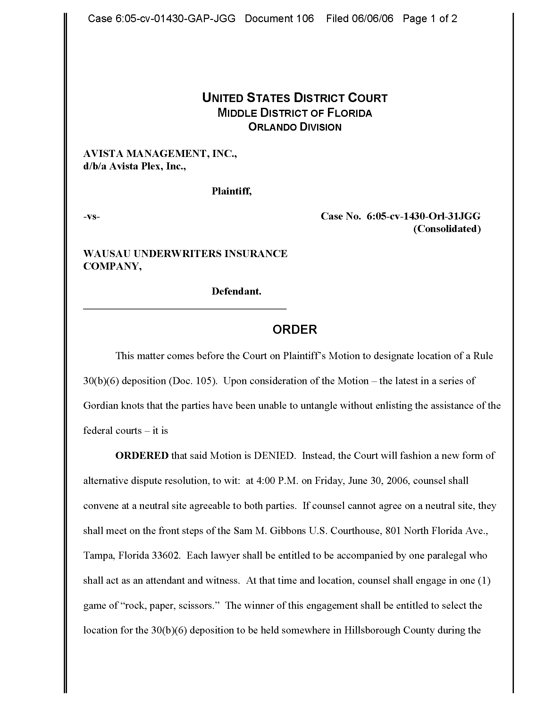
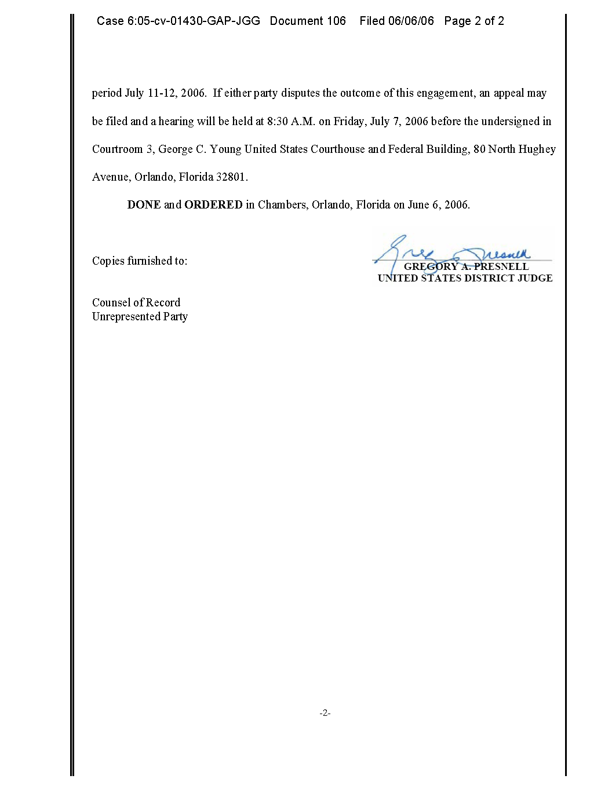
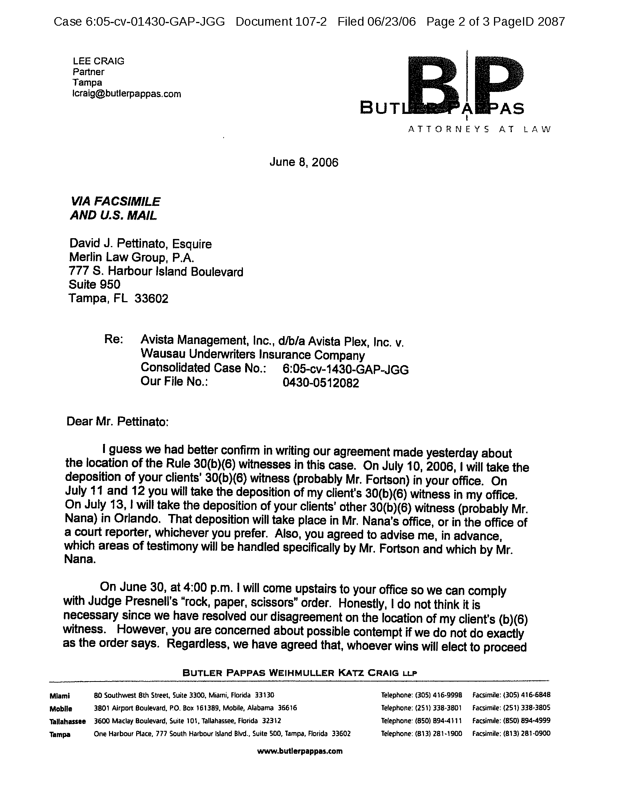
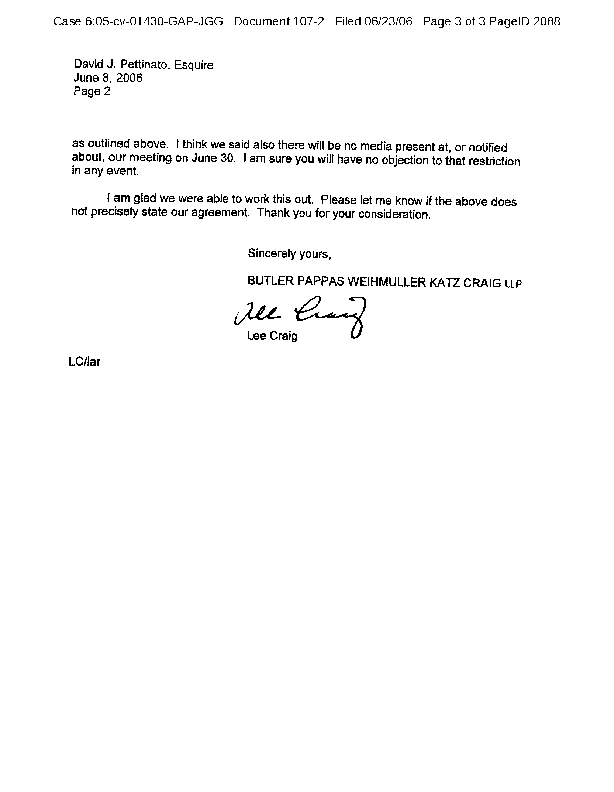
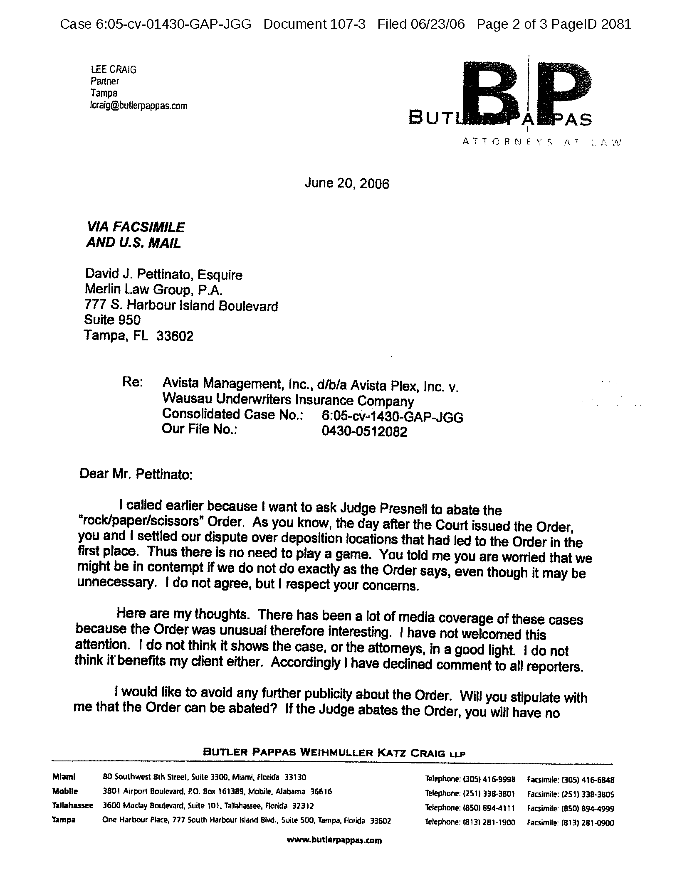
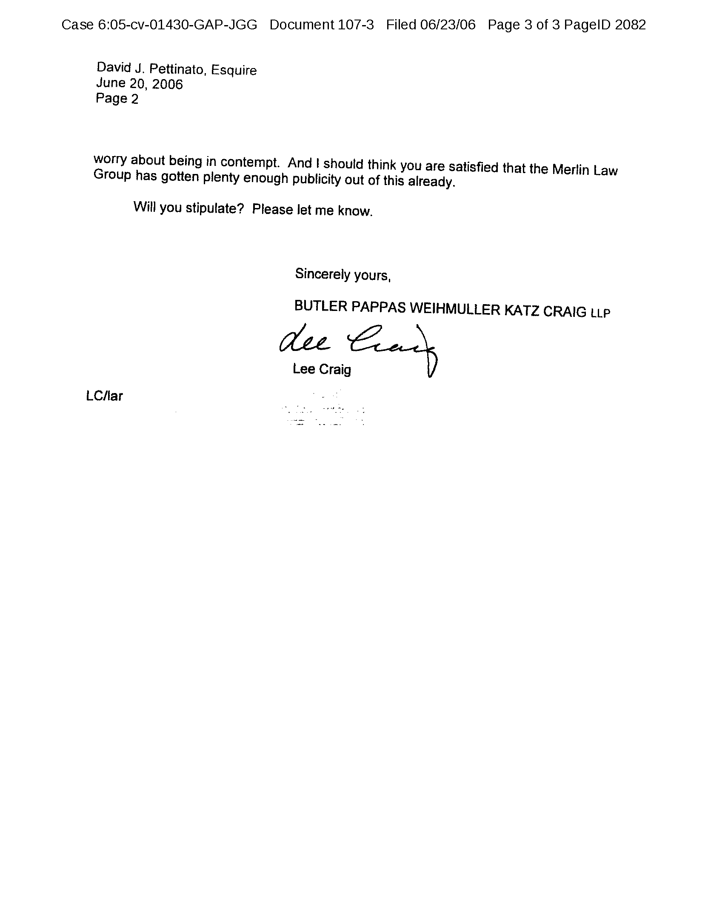
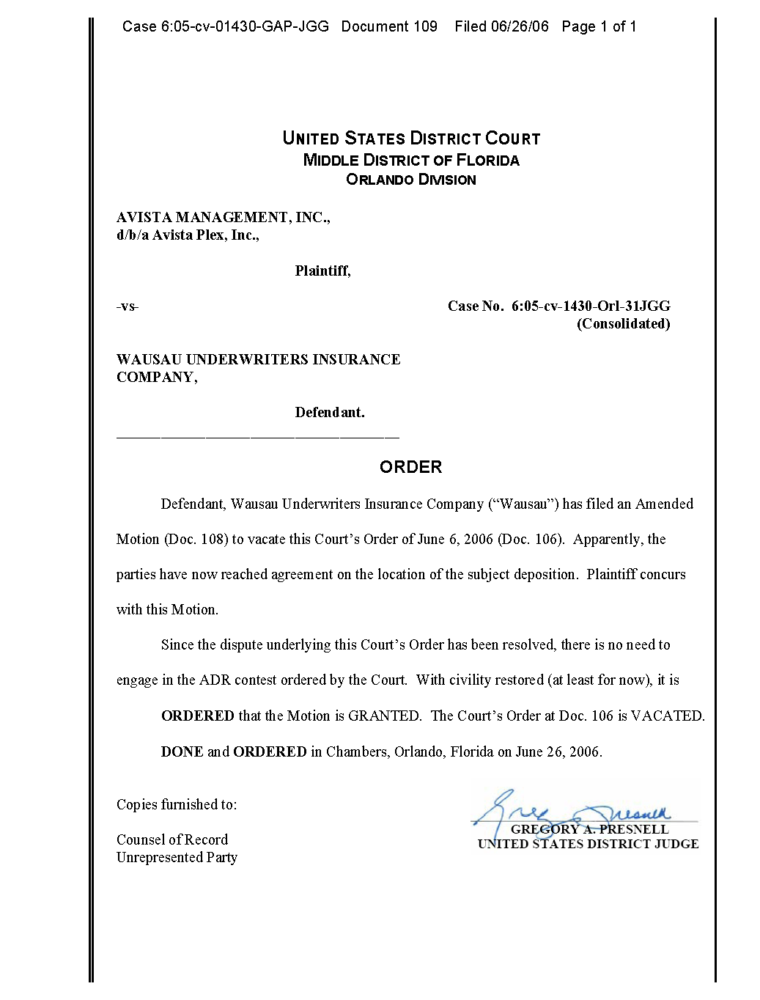
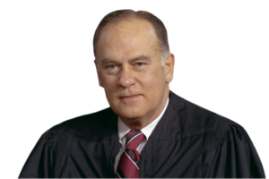
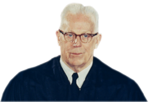
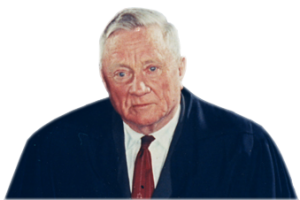

# The Need for Tradeoffs {#sec-tradeoffs}

## Introduction

Procedure sets the rules of litigation in the legal system. The fact that procedure covers such vast ground means it inevitably entails tradeoffs. These tradeoffs are balancing acts between competing values, objectives, and groups of litigants that shape the administration of justice.

This chapter uses case studies to examine how the pursuit of certain procedural goals often requires the compromise of others. Understanding these tradeoffs is crucial for appreciating the rationale behind procedural rules and for critically analyzing their impact on the justice system.

One important tradeoff is embedded in the very first Federal Rule of Civil Procedure. Rule 1 sets forth the basic goals of the procedural system: “to secure the just, speedy, and inexpensive determination of every action and proceeding.” But the three values listed in Rule 1--justice, speed, and cost-efficiency--are often in tension with one another. For example:

* Justice vs. Speed: Ensuring a just outcome often requires thorough fact-finding, comprehensive discovery, and careful deliberation. All that can prolong litigation. Conversely, expediting proceedings may limit the depth of inquiry, potentially compromising the accuracy or fairness of the outcome.
* Speed vs. Cost-Efficiency: Faster case resolution can be achieved with more resources from courts and litigants, but those come at a cost. 
* Cost-Efficiency vs. Justice: Minimizing litigation costs may involve limiting discovery or curtailing procedural steps, which could impede the parties’ ability to fully present their cases, thereby affecting the justness of the outcome.

In the materials that follow, we will look at two real-world disputes. As you read the case materials, see if you can identify the tradeoffs involved in the courts' decisions. What values were served? Which ones were sacrificed? Which litigants gained from those tradeoffs, and which litigants lost out? 

## Case Study No. 1

### Federal Rule of Civil Procedure 1

**Rule 1. Scope and Purpose**

These rules govern the procedure in all civil actions and proceedings in the United States district courts, except as stated in [Rule 81](#sec-frcp81). They should be construed, administered, and employed by the court and the parties to secure the just, speedy, and inexpensive determination of every action and proceeding.

[…]

### The Necessity of Tradeoffs in a Properly Functioning Civil Procedure System

**Alan B.** [90 Or. L. Rev. 993, 993–96 (2012)]{.aside} **Morrison**

[Click here to open the article.](https://scholarship.law.gwu.edu/cgi/viewcontent.cgi?article=1039&context=faculty_publications) Read pages 993--96 before reading the materials that follow.

### Avista Management, Inc. v. Wausau Underwriters Ins. Co.

The following materials discuss a dispute between lawyers about where to hold a deposition. As you follow their dispute, pay attention to the conduct of not only the lawyers but also the judge. Who was in the right here? Who was in the wrong? And which matters more: getting the right answer, or resolving the dispute?

::: {.callout-note}

A "deposition" is a transcribed, under-oath examination of a witness by an attorney. The specific type of deposition at issue in *Avista*---a [Rule 30(b)(6)](#sec-frcp30) deposition---is a special kind used to take the sworn testimony of a corporation or other non-corporeal person. You will learn more about depositions in @sec-discovery, on the discovery process. *See* @sec-timing-types.

:::

### ORDER {#sec-order1}

This matter comes before the Court on Plaintiff’s Motion to designate location of a [Rule 30(b)(6)](#sec-frcp30) deposition (Doc. 105). Upon consideration of the Motion---the latest in a series of Gordian knots that the parties have been unable to untangle without enlisting the assistance of the federal courts---it is

**ORDERED** that said Motion is DENIED. Instead, the Court will fashion a new form of alternative dispute resolution, to wit: at 4:00 P.M. on Friday, June 30, 2006, counsel shall convene at a neutral site agreeable to both parties. If counsel cannot agree on a neutral site, they shall meet on the front steps of the Sam M. Gibbons U.S. Courthouse, 801 North Florida Ave., Tampa, Florida 33602. Each lawyer shall be entitled to be accompanied by one paralegal who shall act as an attendant and witness. At that time and location, counsel shall engage in one (1) game of “rock, paper, scissors.” The winner of this engagement shall be entitled to select the location for the [30(b)(6)](#sec-frcp30) deposition to be held somewhere in Hillsborough County during the period July 11–12, 2006. If either party disputes the outcome of this engagement, an appeal may be filed and a hearing will be held at 8:30 A.M. on Friday, July 7, 2006 before the undersigned in Courtroom 3, George C. Young United States Courthouse and Federal Building, 80 North Hughey Avenue, Orlando, Florida 32801.

**DONE** and **ORDERED** in Chambers, Orlando, Florida on June 6, 2006.

|             ________________________
|	             Gregory A. Presnell
|           United States District Judge

::: {#fig-order-1 layout-ncol=1}
{group="avista-order-1"}

{group="avista-order-1"}

June 6, 2006 Order
:::

### Judge Rules Dispute To Be Settled By “Rock, Paper, Scissors” Match

[Click here to open the article.](https://abcnews.go.com/US/story?id=2050910)

### Correspondence

Two days after Judge Presnell entered the order above (@sec-order1), counsel for defendant Wausau Underwriters Insurance Co. wrote to counsel for plaintiff Avista Management, Inc.

::: {#fig-avista-correspondence layout-ncol=1}

{group="avista-correspondence-1"}

{group="avista-correspondence-1"}

Correspondence of June 8, 2006
:::

Several days later, Mr. Craig again wrote to Mr. Pettinato.

::: {#fig-avista-correspondence2 layout-ncol=1}

{group="avista-correspondence-2"}

{group="avista-correspondence-2"}

Correspondence of June 20, 2006
:::

### ORDER {#sec-order2}

Defendant, Wausau Underwriters Insurance Company (“Wausau”) has filed an Amended Motion (Doc. 108) to vacate this Court’s Order of June 6, 2006 (Doc. 106). Apparently, the parties have now reached agreement on the location of the subject deposition. Plaintiff concurs with this Motion.

Since the dispute underlying this Court’s Order has been resolved, there is no need to engage in the ADR contest ordered by the Court. With civility restored (at least for now), it is

**ORDERED** that the Motion is GRANTED. The Court’s Order at Doc. 106 is VACATED.

**DONE** and **ORDERED** in Chambers, Orlando, Florida on June 26, 2006.

|             ________________________
|	             Gregory A. Presnell
|           United States District Judge

::: {#fig-order-2 layout-ncol=1}
{group="avista-order-2"}

June 26, 2006 Order
:::

## Case Study No. 2

### Walker v. City of Birmingham 

**Mr. Justice Stewart delivered the opinion of the Court.** [388 U.S. 307 (1967)]{.aside}

::: {.column-margin}

{width=150}

:::

On Wednesday, April 10, 1963, officials of Birmingham, Alabama, filed a bill of complaint in a state circuit court asking for injunctive relief against 139 individuals and two organizations. The bill and accompanying affidavits stated that during the preceding seven days:

> “[Respondents [had] sponsored and/or participated in and/or conspired to commit and/or to encourage and/or to participate in certain movements, plans or projects commonly called ‘sit-in’ demonstrations, ‘kneel-in’ demonstrations, mass street parades, trespasses on private property after being warned to leave the premises by the owners of said property, congregating in mobs upon the public streets and other public places, unlawfully picketing private places of business in the City of Birmingham, Alabama; violation of numerous ordinances and statutes of the City of Birmingham and State of Alabama … .”

It was alleged that this conduct was “calculated to provoke breaches of the peace,” “threaten[ed] the safety, peace and tranquility of the City,” and placed “an undue burden and strain upon the manpower of the Police Department.”

The bill stated that these infractions of the law were expected to continue and would “lead to further imminent danger to the lives, safety, peace, tranquility and general welfare of the people of the City of Birmingham,” and that the “remedy by law [was] inadequate.” The circuit judge granted a temporary injunction as prayed in the bill, enjoining the petitioners from, among other things, participating in or encouraging mass street parades or mass- processions without a permit as required by a Birmingham ordinance. 

Five of the eight petitioners were served with copies of the writ early the next morning. Several hours later four of them held a press conference. There a statement was distributed, declaring their intention to disobey the injunction because it was “raw tyranny under the guise of maintaining law and order.”^2^ [ ^2^ The full statement is reproduced as [Appendix B](tradeoffs.qmd#sec-appendix-b) to this opinion.\
]{.aside} At this press conference one of the petitioners stated: “That they had respect for the Federal Courts, or Federal Injunctions, but in the past the State Courts had favored local law enforcement, and if the police couldn’t handle it, the mob would.”

That night a meeting took place at which one of the petitioners announced that “[i]njunction or no injunction we are going to march tomorrow.” The next afternoon, Good Friday, a large crowd gathered in the vicinity of Sixteenth Street and Sixth Avenue North in Birmingham. A group of about 50 or 60 proceeded to parade along the sidewalk while a crowd of 1,000 to 1,500 onlookers stood by, “clapping, and hollering, and [w]hooping.” Some of the crowd followed the marchers and spilled out into the street. At least three of the petitioners participated in this march.

Meetings sponsored by some of the petitioners were held that night and the following night, where calls for volunteers to “walk” and go to jail were made. On Easter Sunday, April 14, a crowd of between 1,500 and 2,000 people congregated in the midafternoon in the vicinity of Seventh Avenue and Eleventh Street North in Birmingham. One of the petitioners was seen organizing members of the crowd in formation. A group of about 50, headed by three other petitioners, started down the sidewalk two abreast. At least one other petitioner was among the marchers. Some 300 or 400 people from among the onlookers followed in a crowd that occupied the entire width of the street and overflowed onto the sidewalks. Violence occurred. Members of the crowd threw rocks that injured a newspaperman and damaged a police motorcycle.

The next day the city officials who had requested the injunction applied to the state circuit court for an order to show cause why the petitioners should not be held in contempt for violating it. At the ensuing hearing the petitioners sought to attack the constitutionality of the injunction on the ground that it was vague and over-broad, and restrained free speech. They also sought to attack the Birmingham parade ordinance upon similar grounds, and upon the further ground that the ordinance had previously been administered in an arbitrary and discriminatory manner.

The circuit judge refused to consider any of these contentions, pointing out that there had been neither a motion to dissolve the injunction, nor an effort to comply with it by applying for a permit from the city commission before engaging in the Good Friday and Easter Sunday parades. Consequently, the court held that the only issues before it were whether it had jurisdiction to issue the temporary injunction, and whether thereafter the petitioners had knowingly violated it. Upon these issues the court found against the petitioners, and imposed upon each of them a sentence of five days in jail and a \$50 fine, in accord with an Alabama statute. 

The Supreme Court of Alabama affirmed. That court, too, declined to consider the petitioners’ constitutional attacks upon the injunction and the underlying Birmingham parade ordinance. […]

Without question the state court that issued the injunction had, as a court of equity, jurisdiction over the petitioners and over the subject matter of the controversy. And this is not a case where the injunction was transparently invalid or had only a frivolous pretense to validity. We have consistently recognized the strong interest of state and local governments in regulating the use of their streets and other public places. When protest takes the form of mass demonstrations, parades, or picketing on public streets and sidewalks, the free passage of traffic and the prevention of public disorder and violence become important objects of legitimate state concern. As the Court stated, in *Cox v. Louisiana*, “We emphatically reject the notion … that the First and Fourteenth Amendments afford the same kind of freedom to those who would communicate ideas by conduct such as patrolling, marching, and picketing on streets and highways, as these amendments afford to those who communicate ideas by pure speech.” 379 U.S. 536, 555. […]

The generality of the language contained in the Birmingham parade ordinance upon which the injunction was based would unquestionably raise substantial constitutional issues concerning some of its provisions. The petitioners, however, did not even attempt to apply to the Alabama courts for an authoritative construction of the ordinance. Had they done so, those courts might have given the licensing authority granted in the ordinance a narrow and precise scope, as did the New Hampshire courts in *Cox v. New Hampshire* and *Poulos v. New Hampshire*. Here, just as in *Cox* and *Poulos*, it could not be assumed that this ordinance was void on its face.

The breadth and vagueness of the injunction itself would also unquestionably be subject to substantial constitutional question. But the way to raise that question was to apply to the Alabama courts to have the injunction modified or dissolved. The injunction in all events clearly prohibited mass parading without a permit, and the evidence shows that the petitioners fully understood that prohibition when they violated it.

The petitioners also claim that they were free to disobey the injunction because the parade ordinance on which it was based had been administered in the past in an arbitrary and discriminatory fashion. In support of this claim they sought to introduce evidence that, a few days before the injunction issued, requests for permits to picket had been made to a member of the city commission. One request had been rudely rebuffed, and this same official had later made clear that he was without power to grant the permit alone, since the issuance of such permits was the responsibility of the entire city commission. Assuming the truth of this proffered evidence, it does not follow that the parade ordinance was void on its face. The petitioners, moreover, did not apply for a permit either to the commission itself or to any commissioner after the injunction issued. Had they done so, and had the permit been refused, it is clear that their claim of arbitrary or discriminatory administration of the ordinance would have been considered by the state circuit court upon a motion to dissolve the injunction. 

This case would arise in quite a different constitutional posture if the petitioners, before disobeying the injunction, had challenged it in the Alabama courts, and had been met with delay or frustration of their constitutional claims. […] It cannot be presumed that the Alabama courts would have ignored the petitioners’ constitutional claims. Indeed, these contentions were accepted in another case by an Alabama appellate court that struck down on direct review the conviction under this very ordinance of one of these same petitioners.^13^ [ ^13^ \[*Ed.*: The Court cited to the pending appeal by Rev. Shuttlesworth of his criminal conviction in Alabama state courts. An excerpt of the Supreme Court’s eventual opinion reversing the Alabama Supreme Court’s decision upholding Rev. Shuttlesworth’s conviction appears *infra* at @sec-shuttlesworth.\]\
]{.aside}

The rule of law that Alabama followed in this case reflects a belief that in the fair administration of justice no man can be judge in his own case, however exalted his station, however righteous his motives, and irrespective of his race, color, politics, or religion. This Court cannot hold that the petitioners were constitutionally free to ignore all the procedures of the law and carry their battle to the streets. One may sympathize with the petitioners’ impatient commitment to their cause. But respect for judicial process is a small price to pay for the civilizing hand of law, which alone can give abiding meaning to constitutional freedom.

*Affirmed.*

**Mr. Chief Justice Warren, whom Mr. Justice Brennan and Mr. Justice Fortas join, dissenting.**

::: {.column-margin}

{width=150}

:::

Petitioners in this case contend that they were convicted under an ordinance that is unconstitutional on its face because it submits their First and Fourteenth Amendment rights to free speech and peaceful assembly to the unfettered discretion of local officials. They further contend that the ordinance was unconstitutionally applied to them because the local officials used their discretion to prohibit peaceful demonstrations by a group whose political viewpoint the officials opposed. The Court does not dispute these contentions, but holds that petitioners may nonetheless be convicted and sent to jail because the patently unconstitutional ordinance was copied into an injunction---issued *ex parte* without prior notice or hearing on the request of the Commissioner of Public Safety---forbidding all persons having notice of the injunction to violate the ordinance without any limitation of time. I dissent because I do not believe that the fundamental protections of the Constitution were meant to be so easily evaded, or that “the civilizing hand of law” would be hampered in the slightest by enforcing the First Amendment in this case. […]

**Mr. Justice Douglas, with whom The Chief Justice, Mr. Justice Brennan, and Mr. Justice Fortas concur, dissenting.**

::: {.column-margin}

{width=150}

:::

We sit as a court of law functioning primarily as a referee in the federal system. Our function in cases coming to us from state courts is to make sure that state tribunals and agencies work within the limits of the Constitution. Since the Alabama courts have flouted the First Amendment, I would reverse the judgment.

Picketing and parading are methods of expression protected by the First Amendment against both state and federal abridgment. […] Since they involve more than speech itself and implicate street traffic, the accommodation of the public and the like, they may be regulated as to the times and places of the demonstrations. […] But a State cannot deny the right to use streets or parks or other public grounds for the purpose of petitioning for the redress of grievances. […]

The right to defy an unconstitutional statute is basic in our scheme. Even when an ordinance requires a permit to make a speech, to deliver a sermon, to picket, to parade, or to assemble, it need not be honored when it is invalid on its face. […]

A court does not have *jurisdiction* to do what a city or other agency of a State lacks *jurisdiction* to do. The command of the Fourteenth Amendment, through which the First Amendment is made applicable to the States, is that no “State” shall deprive any person of “liberty” without due process of law. […] An ordinance—unconstitutional on its face or patently unconstitutional as applied—is not made sacred by an unconstitutional injunction that enforces it. It can and should be flouted in the manner of the ordinance itself. Courts as well as citizens are not free “to ignore all the procedures of the law,” to use the Court’s language. The “constitutional freedom” of which the Court speaks can be won only if judges honor the Constitution. […]

#### APPENDIX B TO OPINION OF THE COURT {#sec-appendix-b}

“In our struggle for freedom we have anchored our faith and hope in the rightness of the Constitution and the moral laws of the universe.

“Again and again the Federal judiciary has made it clear that the privileges guaranteed under the First and the Fourteenth Amendments are too sacred to be trampled upon by the machinery of state government and police power. In the past we have abided by Federal injunctions out of respect for the forthright and consistent leadership that the Federal judiciary has given in establishing the principle of integration as the law of the land.

“However we are now confronted with recalcitrant forces in the Deep South that will use the courts to perpetuate the unjust and illegal system of racial separation.

“Alabama has made clear its determination to defy the law of the land. Most of its public officials, its legislative body and many of its law enforcement agents have openly defied the desegregation decision of the Supreme Court. We would feel morally and legally responsible to obey the injunction if the courts of Alabama applied equal justice to all of its citizens. This would be sameness made legal. However the issuance of this injunction is a blatant of *difference* made *legal*.

“Southern law enforcement agencies have demonstrated now and again that they will utilize the force of law to misuse the judicial process.
“This is raw tyranny under the guise of maintaining law and order. We cannot in all good conscience obey such an injunction which is an unjust, undemocratic and unconstitutional misuse of the legal process.

“We do this not out of any disrespect for the law but out of the highest respect for *the* law. This is not an attempt to evade or defy the law or engage in chaotic anarchy. Just as in all good conscience we cannot obey unjust laws, neither can we respect the unjust use of the courts.

“We believe in a system of law based on justice and morality. Out of our great love for the Constitution of the U.S. and our desire to purify the judicial system of the state of Alabama, we risk this critical move with an awareness of the possible consequences involved.”

#### Notes & Questions

(@)	Separate out the various segregationist policies at issue here. 

    i)	The policies of stores in downtown Birmingham that refused service to Black customers. 
    ii)	The actions of police officers to enforce those businesses’ decision to impose Jim Crow policies.
    iii)	The city ordinance requiring marchers to obtain permits. 
    iv)	The city’s denial of a permit specifically to the SCLC. 
    v)	The injunction against the Good Friday march.
    vi)	The punishment imposed on the marchers for defying the injunction.
    vii)	The ordinance granting broad discretion to the City Commission over whether to issue permits.
    viii)	The Alabama court’s rule allowing the issuance of the injunction even without notice or an opportunity to be heard. 
    ix)	The collateral bar rule imposed by the *Walker* Court requiring the marchers to challenge the injunction before disobeying it. 

Which of these do you think is unjust? Which did the SCLC disobey? 

(@)	Under current law, only rules c and i (above) are permissible; the rest are now recognized as unconstitutional. The collateral bar rule remains good law, and many localities require permits for demonstrations or parades. Importantly, however, the reasons why these policies are now considered unconstitutional have changed since *Walker*. Many of these policies and laws are unconstitutional because they violate the Fourteenth Amendment guarantee of equal protection. Other rules listed above are now deemed unconstitutional on the grounds of due process, which is also guaranteed by the Fourteenth Amendment. Our next module will explore due process in greater depth. 

(@)	The *Walker* Court rejected the constitutional challenge to the punishment in part because it could not “presume that the Alabama courts would have ignored the petitioners’ constitutional claims.” The Court even cited an Alabama appellate court decision vacating Rev. Shuttlesworth’s conviction. In November 1967, the Alabama Supreme Court reversed and reinstated Rev. Shuttlesworth’s conviction. Five months later, Dr. King was shot on the balcony of the Lorraine Motel in Memphis. Seventh months after Dr. King’s death, the Supreme Court heard argument on Rev. Shuttlesworth’s appeal from the Alabama Supreme Court. See if you can detect a change in the way the Court talks about the events of Good Friday 1963.

### Shuttlesworth v. City of Birmingham {#sec-shuttlesworth}

**Mr. JUSTICE STEWART delivered the opinion of the Court.**[394 U.S. 147 (1969)]{.aside}

::: {.column-margin}

{width=150}

:::

The petitioner stands convicted for violating an ordinance of Birmingham, Alabama, making it an offense to participate in any “parade or procession or other public demonstration” without first obtaining a permit from the City Commission. The question before us is whether that conviction can be squared with the Constitution of the United States.

On the afternoon of April 12, Good Friday, 1963, 52 people, all Negroes, were led out of a Birmingham church by three Negro ministers, one of whom was the petitioner, Fred L. Shuttlesworth. They walked in orderly fashion, two abreast for the most part, for four blocks. The purpose of their march was to protest the alleged denial of civil rights to Negroes in the city of Birmingham. The marchers stayed on the sidewalks except at street intersections, and they did not interfere with other pedestrians. No automobiles were obstructed, nor were traffic signals disobeyed. The petitioner was with the group for at least part of this time, walking alongside the others, and once moving from the front to the rear. As the marchers moved along, a crowd of spectators fell in behind them at a distance. The spectators at some points spilled out into the street, but the street was not blocked and vehicles were not obstructed.

At the end of four blocks the marchers were stopped by the Birmingham police, and were arrested for violating § 1159 of the General Code of Birmingham. […] 
The petitioner was convicted for violation of § 1159 and was sentenced to 90 days’ imprisonment at hard labor and an additional 48 days at hard labor in default of payment of a \$75 fine and \$24 costs. The Alabama Court of Appeals reversed the judgment of conviction […]. The Supreme Court of Alabama, however, giving the language of § 1159 an extraordinarily narrow construction, reversed the judgment of the Court of Appeals and reinstated the conviction. […]

There can be no doubt that the Birmingham ordinance, as it was written, conferred upon the City Commission virtually unbridled and absolute power to prohibit any “parade,” “procession,” or “demonstration” on the city’s streets or public ways. For in deciding whether or not to withhold a permit, the members of the Commission were to be guided only by their own ideas of “public welfare, peace, safety, health, decency, good order, morals or convenience.” This ordinance as it was written, therefore, fell squarely within the ambit of the many decisions of this Court over the last 30 years, holding that a law subjecting the exercise of First Amendment freedoms to the prior restraint of a license, without narrow, objective, and definite standards to guide the licensing authority, is unconstitutional.” It is settled by a long line of recent decisions of this Court that an ordinance which, like this one, makes the peaceful enjoyment of freedoms which the Constitution guarantees contingent upon the uncontrolled will of an official---as by requiring a permit or license which may be granted or withheld in the discretion of such official---is an unconstitutional censorship or prior restraint upon the enjoyment of those freedoms.”  And our decisions have made clear that a person faced with such an unconstitutional licensing law may ignore it and engage with impunity in the exercise of the right of free expression for which the law purports to require a license. ”The Constitution can hardly be thought to deny to one subjected to the restraints of such an ordinance the right to attack its constitutionality, because he has not yielded to its demands.”

The judgment is

*Reversed.*

#### Notes & Questions

1.	Among those involved in the Good Friday march—the organizers, the city officials, the police officers—who was most faithful to the law? In this regard, consider that the airport in Birmingham, Alabama is now named the Birmingham-Shuttlesworth International Airport in honor of Rev. Shuttlesworth. Does the fact that history celebrates the marchers and condemns Bull Connor change the calculus? Does it matter that Dr. King was arrested 29 times during his campaigns of nonviolent resistance?

2.	What explains the Court’s change from *Walker* to *Shuttlesworth*? Can doctrines like the collateral bar rule, on their own, account for the different outcomes in the two cases?

