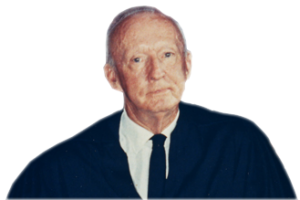
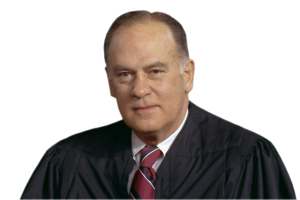
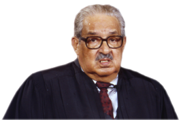
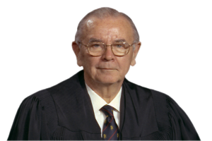
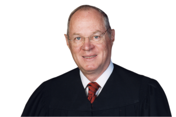
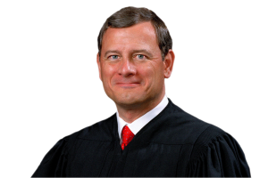
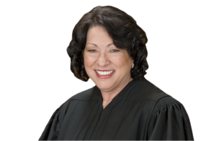
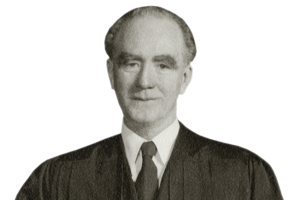
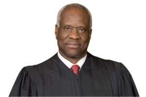

# Trial & Appeal {#sec-trial-appeal}

The [Seventh Amendment](#sec-amend7) to the Constitution guarantees that "the right of trial by jury shall be preserved" "[i]n Suits at common law, where the value in controversy shall exceed twenty dollars." This short text leaves open two major questions: What are the contours of the "right of trial by jury"? And which cases count as "Suits at common law"? This chapter explores the constitutional right to civil jury trials, along with the provisions of the Federal Rules of Civil Procedure that bear on the trial and appellate process. [Rules 38](#sec-frcp38) and [39](#sec-frcp39) cover the jury trial right itself, and how it can be invoked. [Rules 47](#sec-frcp47)--[51](#sec-frcp51) cover jury selection, verdicts, and jury instructions. [Rule 50](#sec-frcp50) covers a later-in-time cousin of summary judgment: judgment as a matter of law. [Rule 52](#sec-frcp52) covers the principal alternative to jury trials: bench trials. Finally, [Rule 59](#sec-frcp59) specifies the procedures for conducting a new trial. 

Against the backdrop of intricate Rules governing jury trials, bear in mind that the jury trial grows rarer by years. *See* Marc Galanter, *The Vanishing Trial*, 1 J. Empirical Legal Stud. 459 (2004) (reporting that from 1962 to 2002, the rate of federal civil cases reaching a jury fell from 11.5% to 1.8%). Today, less than 1% of civil cases in federal court are tried to a jury. *See* Admin. Off. of the U.S. Cts., *[Judicial Business of the United States Courts](https://www.uscourts.gov/sites/default/files/document/jb_c4_0930.2025.pdf)* tbl. C-4 (2025) (reporting that the percentage had fallen from 1.1% in 2015 to 0.4% in 2025).

```{r}
#| label: fig-trial-rate
#| fig-cap: "Federal civil cases reaching trial, fiscal years 1997--2025. The 2007 spike reflects thousands of mass-tort cases recorded as terminated during or after trial. Source: Admin. Off. of the U.S. Cts., *Judicial Business of the United States Courts* tbl. C-4 (1997--2025)."
#| echo: false
#| fig-width: 6.5
#| fig-height: 4.5
library(ggplot2)

trials <- read.csv("data/c4_trial_rates.csv")
panels <- rbind(
  data.frame(year = trials$year, value = trials$pct_trial,
             panel = "Percent of terminated civil cases reaching trial"),
  data.frame(year = trials$year, value = trials$jury,
             panel = "Number of civil jury trials")
)
panels$panel <- factor(panels$panel, levels = unique(panels$panel))

ggplot(panels, aes(year, value)) +
  geom_line(linewidth = 0.7) +
  geom_point(size = 1.4) +
  facet_wrap(~panel, ncol = 1, scales = "free_y") +
  scale_y_continuous(limits = c(0, NA), labels = scales::label_comma()) +
  labs(x = NULL, y = NULL) +
  theme_minimal(base_size = 11) +
  theme(strip.text = element_text(hjust = 0, face = "bold"))
```

Why have jury trials become so rare? Is it because trials are too expensive? Too unpredictable? Too unreliable? Or is it instead because lawyers are better than ever at estimating their clients' chances of prevailing, allowing for efficient settlement of a wider swath of cases?

## The Right to a Jury

The Right to a Jury: section introduction
- The historical test: "Suits at common law" covers cases tried at law in 1791. Parsons v. Bedford, 28 U.S. (3 Pet.) 433 (1830).
- Applies to statutory claims too: Curtis v. Loether, 415 U.S. 189 (1974). It's already cited in the chapter.
- Not binding on the states: the Seventh Amendment has never been incorporated. Minneapolis & St. Louis R. Co. v. Bombolis, 241 U.S. 211 (1916). This sets up Byrd in the Erie chapter.
- Mechanics: Rule 38 makes the jury right a demand that is waived without one, and Rule 39(b) gives the court discretion to grant a late demand.

### Beacon Theatres, Inc. v. Westover

**MR. JUSTICE BLACK delivered the opinion of the Court.** [359 U.S. 500 (1959)]{.aside}

::: {.column-margin}

{width=150}

:::

Petitioner, Beacon Theatres, Inc., sought by mandamus to require a
district judge in the Southern District of California to vacate certain
orders alleged to deprive it of a jury trial of issues arising in a suit
brought against it by Fox West Coast Theatres, Inc. The Court of Appeals
for the Ninth Circuit refused the writ, holding that the trial judge had
acted within his proper discretion in denying petitioner's request for a
jury. We granted certiorari, because "Maintenance of the jury as a
fact-finding body is of such importance and occupies so firm a place in
our history and jurisprudence that any seeming curtailment of the right
to a jury trial should be scrutinized with the utmost care." *Dimick* v.
*Schiedt*, 293 U.S. 474, 486.

Fox had asked for declaratory relief against Beacon alleging a
controversy arising under the Sherman Antitrust Act, as amended, and
under the Clayton Act, which authorizes suits for treble damages against
Sherman Act violators. According to the complaint Fox operates a movie
theatre in San Bernardino, California, and has long been exhibiting films
under contracts with movie distributors. These contracts grant it the
exclusive right to show "first run" pictures in the "San Bernardino
competitive area" and provide for "clearance"---a period of time during
which no other theatre can exhibit the same pictures. After building a
drive-in theatre about 11 miles from San Bernardino, Beacon notified Fox
that it considered contracts barring simultaneous exhibitions of
first-run films in the two theatres to be overt acts in violation of the
antitrust laws. Fox's complaint alleged that this notification, together
with threats of treble damage suits against Fox and its distributors,
gave rise to "duress and coercion" which deprived Fox of a valuable
property right, the right to negotiate for exclusive first-run contracts.
Unless Beacon was restrained, the complaint continued, irreparable harm
would result. Accordingly, while its pleading was styled a "Complaint for
Declaratory Relief," Fox prayed both for a declaration that a grant of
clearance between the Fox and Beacon theatres is reasonable and not in
violation of the antitrust laws, and for an injunction, pending final
resolution of the litigation, to prevent Beacon from instituting any
action under the antitrust laws against Fox and its distributors arising
out of the controversy alleged in the complaint. Beacon filed an answer,
a counterclaim against Fox, and a cross-claim against an exhibitor who
had intervened. These denied the threats and asserted that there was no
substantial competition between the two theatres, that the clearances
granted were therefore unreasonable, and that a conspiracy existed
between Fox and its distributors to manipulate contracts and clearances
so as to restrain trade and monopolize first-run pictures in violation of
the antitrust laws. Treble damages were asked.

Beacon demanded a jury trial of the factual issues in the case as
provided by Federal Rule of Civil Procedure 38 (b). The District Court,
however, viewed the issues raised by the "Complaint for Declaratory
Relief," including the question of competition between the two theatres,
as essentially equitable. Acting under the purported authority of Rules
42 (b) and 57, it directed that these issues be tried to the court before
jury determination of the validity of the charges of antitrust violations
made in the counterclaim and cross-claim.^3^ A common issue of the
"Complaint for Declaratory Relief," the counterclaim, and the cross-claim
was the reasonableness of the clearances granted to Fox, which depended,
in part, on the existence of competition between the two theatres. Thus
the effect of the action of the District Court could be, as the Court of
Appeals believed, "to limit the petitioner's opportunity fully to try to
a jury every issue which has a bearing upon its treble damage suit," for
determination of the issue of clearances by the judge might "operate
either by way of res judicata or collateral estoppel so as to conclude
both parties with respect thereto at the subsequent trial of the treble
damage claim."

::: {.column-margin}

^3^ Fed. Rules Civ. Proc., 42 (b) reads: "The court in furtherance of convenience or to avoid prejudice may order a separate trial of any claim, cross-claim, counterclaim, or third-party claim, or of any separate issue or of any number of claims, cross-claims, counterclaims, third-party claims, or issues," Rule 57 reads in part: "The court may order a speedy hearing of an action for a declaratory judgment and may advance it on the calendar."

:::

The District Court's finding that the Complaint for Declaratory Relief
presented basically equitable issues draws no support from the
Declaratory Judgment Act. That statute, while allowing prospective
defendants to sue to establish their nonliability, specifically preserves
the right to jury trial for both parties. It follows that if Beacon would
have been entitled to a jury trial in a treble damage suit against Fox it
cannot be deprived of that right merely because Fox took advantage of the
availability of declaratory relief to sue Beacon first. Since the right
to trial by jury applies to treble damage suits under the antitrust laws,
and is, in fact, an essential part of the congressional plan for making
competition rather than monopoly the rule of trade, the Sherman and
Clayton Act issues on which Fox sought a declaration were essentially
jury questions.

Nevertheless the Court of Appeals refused to upset the order of the
district judge. It held that the question of whether a right to jury
trial existed was to be judged by Fox's complaint read as a whole. In
addition to seeking a declaratory judgment, the court said, Fox's
complaint can be read as making out a valid plea for injunctive relief,
thus stating a claim traditionally cognizable in equity. A party who is
entitled to maintain a suit in equity for an injunction, said the court,
may have all the issues in his suit determined by the judge without a
jury regardless of whether legal rights are involved. The court then
rejected the argument that equitable relief, traditionally available only
when legal remedies are inadequate, was rendered unnecessary in this case
by the filing of the counterclaim and cross-claim which presented all the
issues necessary to a determination of the right to injunctive relief.
Relying on *American Life Ins. Co.* v. *Stewart*, 300 U.S. 203, 215,
decided before the enactment of the Federal Rules of Civil Procedure, it
invoked the principle that a court sitting in equity could retain
jurisdiction even though later a legal remedy became available. In such
instances the equity court had discretion to enjoin the later lawsuit in
order to allow the whole dispute to be determined in one case in one
court. Reasoning by analogy, the Court of Appeals held it was not an
abuse of discretion for the district judge, acting under Federal Rule of
Civil Procedure 42 (b), to try the equitable cause first even though this
might, through collateral estoppel, prevent a full jury trial of the
counterclaim and cross-claim which were as effectively stopped as by an
equity injunction.

Beacon takes issue with the holding of the Court of Appeals that the
complaint stated a claim upon which equitable relief could be granted.
As initially filed the complaint alleged that threats of lawsuits by
petitioner against Fox and its distributors were causing irreparable
harm to Fox's business relationships. The prayer for relief, however,
made no mention of the threats but asked only that pending litigation of
the claim for declaratory judgment, Beacon be enjoined from beginning
any lawsuits under the antitrust laws against Fox and its distributors
arising out of the controversy alleged in the complaint. Evidently of
the opinion that this prayer did not state a good claim for equitable
relief, the Court of Appeals construed it to include a request for an
injunction against threats of lawsuits. This liberal construction of a
pleading is in line with Rule 8 of the Federal Rules of Civil Procedure.
But this fact does not solve our problem. Assuming that the pleadings
can be construed to support such a request and assuming additionally
that the complaint can be read as alleging the kind of harassment by a
multiplicity of lawsuits which would *traditionally* have justified
equity to take jurisdiction and settle the case in one suit, we are
nevertheless of the opinion that, under the Declaratory Judgment Act and
the Federal Rules of Civil Procedure, neither claim can justify denying
Beacon a trial by jury of all the issues in the antitrust controversy.

The basis of injunctive relief in the federal courts has always been
irreparable harm and inadequacy of legal remedies. At least as much is
required to justify a trial court in using its discretion under the
Federal Rules to allow claims of equitable origins to be tried ahead of
legal ones, since this has the same effect as an equitable injunction of
the legal claims. And it is immaterial, in judging if that discretion is
properly employed, that before the Federal Rules and the Declaratory
Judgment Act were passed, courts of equity, exercising a jurisdiction
separate from courts of law, were, in some cases, allowed to enjoin
subsequent legal actions between the same parties involving the same
controversy. This was because the subsequent legal action, though
providing an opportunity to try the case to a jury, might not protect
the right of the equity plaintiff to a fair and orderly adjudication of
the controversy. Under such circumstances the legal remedy could quite
naturally be deemed inadequate. Inadequacy of remedy and irreparable harm
are practical terms, however. As such their existence today must be
determined, not by precedents decided under discarded procedures, but in
the light of the remedies now made available by the Declaratory Judgment
Act and the Federal Rules.

Viewed in this manner, the use of discretion by the trial court under
Rule 42 (b) to deprive Beacon of a full jury trial on its counterclaim
and cross-claim, as well as on Fox's plea for declaratory relief, cannot
be justified. Under the Federal Rules the same court may try both legal
and equitable causes in the same action. Thus any defenses, equitable or
legal, Fox may have to charges of antitrust violations can be raised
either in its suit for declaratory relief or in answer to Beacon's
counterclaim. On proper showing, harassment by threats of other suits, or
other suits actually brought, involving the issues being tried in this
case, could be temporarily enjoined pending the outcome of this
litigation. Whatever permanent injunctive relief Fox might be entitled to
on the basis of the decision in this case could, of course, be given by
the court after the jury renders its verdict. In this way the issues
between these parties could be settled in one suit giving Beacon a full
jury trial of every antitrust issue. By contrast, the holding of the
court below while granting Fox no additional protection unless the
avoidance of jury trial be considered as such, would compel Beacon to
split his antitrust case, trying part to a judge and part to a
jury.^10^ Such a result, which involves the postponement and
subordination of Fox's own legal claim for declaratory relief as well as
of the counterclaim which Beacon was compelled by the Federal Rules to
bring, is not permissible.

::: {.column-margin}

^10^ Since the issue of violation of the antitrust laws often turns on the reasonableness of a restraint on trade in the light of all the facts, see, *e. g., Standard Oil Co.* v. *United States*, 221 U.S. 1, 60, it is particularly undesirable to have some of the relevant considerations tried by one fact finder and some by another.

:::

Our decision is consistent with the plan of the Federal Rules and the
Declaratory Judgment Act to effect substantial procedural reform while
retaining a distinction between jury and nonjury issues and leaving
substantive rights unchanged. Since in the federal courts equity has
always acted only when legal remedies were inadequate, the expansion of
adequate legal remedies provided by the Declaratory Judgment Act and the
Federal Rules necessarily affects the scope of equity. Thus, the
justification for equity's deciding legal issues once it obtains
jurisdiction, and refusing to dismiss a case, merely because
subsequently a legal remedy becomes available, must be re-evaluated in
the light of the liberal joinder provisions of the Federal Rules which
allow legal and equitable causes to be brought and resolved in one civil
action. Similarly the need for, and therefore, the availability of such
equitable remedies as Bills of Peace, *Quia Timet* and Injunction must
be reconsidered in view of the existence of the Declaratory Judgment Act
as well as the liberal joinder provision of the Rules. This is not only
in accord with the spirit of the Rules and the Act but is required by
the provision in the Rules that "\[t\]he right to trial by jury as
declared by the Seventh Amendment to the Constitution or as given by a
statute of the United States shall be preserved . . . inviolate."

If there should be cases where the availability of declaratory judgment
or joinder in one suit of legal and equitable causes would not, in all
respects protect the plaintiff seeking equitable relief from irreparable
harm while affording a jury trial in the legal cause, the trial court
will necessarily have to use its discretion in deciding whether the legal
or equitable cause should be tried first. Since the right to jury trial
is a constitutional one, however, while no similar requirement protects
trials by the court, that discretion is very narrowly limited and must,
wherever possible, be exercised to preserve jury trial. As this Court
said in *Scott* v. *Neely*, 140 U.S. 106, 109-110: "In the Federal
courts this \[jury\] right cannot be dispensed with, except by the assent
of the parties entitled to it, nor can it be impaired by any blending
with a claim, properly cognizable at law, of a demand for equitable
relief in aid of the legal action or during its pendency." This
longstanding principle of equity dictates that only under the most
imperative circumstances, circumstances which in view of the flexible
procedures of the Federal Rules we cannot now anticipate, can the right
to a jury trial of legal issues be lost through prior determination of
equitable claims. As we have shown, this is far from being such a case.

\[...\] Whatever differences of opinion there may be in other types of
cases, we think the right to grant mandamus to require jury trial where
it has been improperly denied is settled.

The judgment of the Court of Appeals is

*Reversed.*

**MR. JUSTICE STEWART, with whom MR. JUSTICE HARLAN and MR. JUSTICE WHITTAKER concur, dissenting.**

::: {.column-margin}

{width=150}

:::

\[...\] Assuming the existence of a factual issue common both to the
plaintiff's original action and the defendant's counterclaim for
damages, I cannot agree that the District Court must be compelled to try
the counterclaim first. It is, of course, a matter of no great moment in
what order the issues between the parties in the present litigation are
tried. What is disturbing is the process by which the Court arrives at
its decision---a process which appears to disregard the historic
relationship between equity and law.

\[...\]

The Court today sweeps away these basic principles as "precedents
decided under discarded procedures." It suggests that the Federal Rules
of Civil Procedure have somehow worked an "expansion of adequate legal
remedies" so as to oust the District Courts of equitable jurisdiction,
as well as to deprive them of their traditional power to control their
own dockets. But obviously the Federal Rules could not and did not
"expand" the substantive law one whit.

Like the Declaratory Judgment Act, the Federal Rules preserve inviolate
the right to trial by jury in actions historically cognizable at common
law, as under the Constitution they must. They do not create a right of
trial by jury where that right "does not exist under the Constitution or
statutes of the United States." Rule 39 (a). Since Beacon's
counterclaim was compulsory under the Rules, see Rule 13 (a), it is
apparent that by filing it Beacon could not be held to have waived its
jury rights. But neither can the counterclaim be held to have
transformed Fox's original complaint into an action at law.

The Rules make possible the trial of legal and equitable claims in the
same proceeding, but they expressly affirm the power of a trial judge to
determine the order in which claims shall be heard. Rule 42 (b).
Certainly the Federal Rules were not intended to undermine the basic
structure of equity jurisprudence, developed over the centuries and
explicitly recognized in the United States Constitution.

For these reasons I think the petition for a writ of mandamus should
have been dismissed.

#### Notes & Questions

Beacon Theatres: notes
- Dairy Queen, Inc. v. Wood, 369 U.S. 469 (1962). Calling a claim for money "an accounting," or "incidental" to equitable relief, doesn't defeat the jury right.
- Ross v. Bernhard, 396 U.S. 531 (1970). The jury right attaches issue by issue, not to the whole case, and footnote 10's three-factor test is often quoted.
- Lytle v. Household Mfg., Inc., 494 U.S. 545 (1990). When legal claims are wrongly dismissed and the equitable claims are tried to a judge, the judge's findings don't preclude a jury trial of the legal claims.
- Cross-reference: Parklane Hosiery (Judgments chapter). Collateral estoppel from an equitable SEC action can wipe out a later jury trial. Ask students how that squares with Beacon's priority rule.
- Question: what if Fox had sued first for a declaratory judgment? Use this to show how declaratory judgments reverse who sues whom.

### Chauffeurs, Teamsters & Helpers Local No. 391 v. Terry

**JUSTICE MARSHALL delivered the opinion of the Court, except as to Part III-A.** [494 U.S. 558 (1990)]{.aside}

::: {.column-margin}

{width=150}

:::

This case presents the question whether an employee who seeks relief in
the form of backpay for a union's alleged breach of its duty of fair
representation has a right to trial by jury. We hold that the Seventh
Amendment entitles such a plaintiff to a jury trial.

**I**

McLean Trucking Company and the Chauffeurs, Teamsters and Helpers Local
No. 391 (Union) were parties to a collective-bargaining agreement that
governed the terms and conditions of employment at McLean's terminals.
The 27 respondents were employed by McLean as truckdrivers in bargaining
units covered by the agreement, and all were members of the Union. In
1982 McLean implemented a change in operations that resulted in the
elimination of some of its terminals and the reorganization of others.
As part of that change, McLean transferred respondents to the terminal
located in Winston-Salem and agreed to give them special seniority
rights in relation to "inactive" employees in Winston-Salem who had been
laid off temporarily.

After working in Winston-Salem for approximately six weeks, respondents
were alternately laid off and recalled several times. Respondents filed
a grievance with the Union, contesting the order of the layoffs and
recalls. Respondents also challenged McLean's policy of stripping any
driver who was laid off of his special seniority rights. Respondents
claimed that McLean breached the collective-bargaining agreement by
giving inactive drivers preference over respondents. After these
proceedings, the grievance committee ordered McLean to recall any
respondent who was then laid off and to lay off any inactive driver who
had been recalled; in addition, the committee ordered McLean to
recognize respondents' special seniority rights until the inactive
employees were properly recalled.

On the basis of this decision, McLean recalled respondents and laid off
the drivers who had been on the inactive list when respondents
transferred to Winston-Salem. Soon after this, though, McLean recalled
the inactive employees, thereby allowing them to regain seniority rights
over respondents. In the next round of layoffs, then, respondents had
lower priority than inactive drivers and were laid off first.
Accordingly, respondents filed another grievance, alleging that McLean's
actions were designed to circumvent the initial decision of the
grievance committee. The Union representative appeared before the
grievance committee and presented the contentions of respondents and
those of the inactive truckdrivers. At the conclusion of the hearing,
the committee held that McLean had not violated the committee's first
decision.

McLean continued to engage in periodic layoffs and recalls of the
workers at the Winston-Salem terminal. Respondents filed a third
grievance with the Union, but the Union declined to refer the charges to
a grievance committee on the ground that the relevant issues had been
determined in the prior proceedings.

In July 1983, respondents filed an action in District Court, alleging
that McLean had breached the collective-bargaining agreement in
violation of § 301 of the Labor Management Relations Act, 1947, and that
the Union had violated its duty of fair representation. Respondents
requested a permanent injunction requiring the defendants to cease their
illegal acts and to reinstate them to their proper seniority status; in
addition, they sought, *inter alia*, compensatory damages for lost wages
and health benefits. In 1986 McLean filed for bankruptcy; subsequently,
the action against it was voluntarily dismissed, along with all claims
for injunctive relief.

Respondents had requested a jury trial in their pleadings. The Union
moved to strike the jury demand on the ground that no right to a jury
trial exists in a duty of fair representation suit. The District Court
denied the motion to strike. After an interlocutory appeal, the Fourth
Circuit affirmed the trial court, holding that the Seventh Amendment
entitled respondents to a jury trial of their claim for monetary relief.
We granted the petition for certiorari to resolve a Circuit conflict on
this issue, and now affirm the judgment of the Fourth Circuit.

**II**

\[...\] Because most collective-bargaining agreements accord finality to
grievance or arbitration procedures established by the
collective-bargaining agreement, an employee normally cannot bring a
§ 301 action against an employer unless he can show that the union
breached its duty of fair representation in its handling of his
grievance. *DelCostello* v. *Teamsters*, 462 U.S. 151, 163-164 (1983).
Whether the employee sues both the labor union and the
employer or only one of those entities, he must prove the same two facts
to recover money damages: that the employer's action violated the terms
of the collective-bargaining agreement and that the union breached its
duty of fair representation.

**III**

We turn now to the constitutional issue presented in this case---whether
respondents are entitled to a jury trial. The Seventh Amendment provides
that "\[i\]n Suits at common law, where the value in controversy shall
exceed twenty dollars, the right of trial by jury shall be preserved."
The right to a jury trial includes more than the common-law forms of
action recognized in 1791; the phrase "Suits at common law" refers to
"suits in which *legal* rights \[are\] to be ascertained and determined,
in contradistinction to those where equitable rights alone \[are\]
recognized, and equitable remedies \[are\] administered." *Parsons* v.
*Bedford*, 3 Pet. 433, 447 (1830). \[...\] The right extends to causes
of action created by Congress. *Tull* v. *United States*, 481 U.S. 412,
417 (1987). Since the merger of the systems of law and equity, this
Court has carefully preserved the right to trial by jury where legal
rights are at stake. As the Court noted in *Beacon Theatres, Inc.* v.
*Westover*, 359 U.S. 500, 501 (1959), '"Maintenance of the jury as a
fact-finding body is of such importance and occupies so firm a place in
our history and jurisprudence that any seeming curtailment of the right
to a jury trial should be scrutinized with the utmost care'" (quoting
*Dimick* v. *Schiedt*, 293 U.S. 474, 486 (1935)).

To determine whether a particular action will resolve legal rights, we
examine both the nature of the issues involved and the remedy sought.
"First, we compare the statutory action to 18th-century actions brought
in the courts of England prior to the merger of the courts of law and
equity. Second, we examine the remedy sought and determine whether it is
legal or equitable in nature." *Tull*, *supra*, at 417-418 (citations
omitted). The second inquiry is the more important in our analysis.
*Granfinanciera, S. A.* v. *Nordberg*, 492 U.S. 33, 42 (1989).

**A**

An action for breach of a union's duty of fair representation was
unknown in 18th-century England; in fact, collective bargaining was
unlawful. We must therefore look for an analogous cause of action that
existed in the 18th century to determine whether the nature of this duty
of fair representation suit is legal or equitable.

\[...\]

The Union next argues that respondents' duty of fair representation
action is comparable to an action by a trust beneficiary against a
trustee for breach of fiduciary duty. Such actions were within the
exclusive jurisdiction of courts of equity. This analogy is far more
persuasive than the arbitration analogy. Just as a trustee must act in
the best interests of the beneficiaries, a union, as the exclusive
representative of the workers, must exercise its power to act on behalf
of the employees in good faith. Moreover, just as a beneficiary does not
directly control the actions of a trustee, an individual employee lacks
direct control over a union's actions taken on his behalf. \[...\]

Respondents contend that their duty of fair representation suit is less
like a trust action than an attorney malpractice action, which was
historically an action at law. In determining the appropriate statute of
limitations for a hybrid § 301/duty of fair representation action, this
Court in *DelCostello* noted in dictum that an attorney malpractice
action is "the closest state-law analogy for the claim against the
union." The Court in *DelCostello* did not consider the trust analogy,
however. Presented with a more complete range of alternatives, we find
that, in the context of the Seventh Amendment inquiry, the attorney
malpractice analogy does not capture the relationship between the union
and the represented employees as fully as the trust analogy does.

The attorney malpractice analogy is inadequate in several respects.
\[...\] Unlike employees represented by a union, a client controls the
significant decisions concerning his representation. Moreover, a client
can fire his attorney if he is dissatisfied with his attorney's
performance. This option is not available to an individual employee who
is unhappy with a union's representation, unless a majority of the
members of the bargaining unit share his dissatisfaction. Thus, we find
the malpractice analogy less convincing than the trust analogy.

Nevertheless, the trust analogy does not persuade us to characterize
respondents' claim as wholly equitable. The Union's argument
mischaracterizes the nature of our comparison of the action before us to
18th-century forms of action. As we observed in *Ross* v. *Bernhard*,
396 U.S. 531 (1970), "The Seventh Amendment question depends on the
nature of the *issue* to be tried rather than the character of the
overall action." *Id.*, at 538 (emphasis added) (finding a right to jury
trial in a shareholder's derivative suit, a type of suit traditionally
brought in courts of equity, because plaintiffs' case presented legal
issues of breach of contract and negligence). As discussed above, to
recover from the Union here, respondents must prove both that McLean
violated § 301 by breaching the collective-bargaining agreement and that
the Union breached its duty of fair representation. When viewed in
isolation, the duty of fair representation issue is analogous to a claim
against a trustee for breach of fiduciary duty. The § 301 issue,
however, is comparable to a breach of contract claim---a legal issue.

Respondents' action against the Union thus encompasses both equitable
and legal issues. The first part of our Seventh Amendment inquiry, then,
leaves us in equipoise as to whether respondents are entitled to a jury
trial.

**B**

Our determination under the first part of the Seventh Amendment
analysis is only preliminary. In this case, the only remedy sought is a
request for compensatory damages representing backpay and benefits.
Generally, an action for money damages was "the traditional form of
relief offered in the courts of law." *Curtis* v. *Loether*, 415 U.S.
189, 196 (1974). This Court has not, however, held that "any award of
monetary relief must *necessarily* be 'legal' relief." *Ibid.*
(emphasis added). Nonetheless, because we conclude that the remedy
respondents seek has none of the attributes that must be present before
we will find an exception to the general rule and characterize damages
as equitable, we find that the remedy sought by respondents is legal.

First, we have characterized damages as equitable where they are
restitutionary, such as in "action\[s\] for disgorgement of improper
profits," *Tull*, 481 U.S., at 424. The backpay sought by respondents is
not money wrongfully held by the Union, but wages and benefits they
would have received from McLean had the Union processed the employees'
grievances properly. Such relief is not restitutionary.

Second, a monetary award "incidental to or intertwined with injunctive
relief" may be equitable. *Tull*, *supra*, at 424. \[...\] Because
respondents seek only money damages, this characteristic is clearly
absent from the case.^8^

::: {.column-margin}

^8^ Both the Union and the dissent argue that the backpay award sought here is equitable because it is closely analogous to damages awarded to beneficiaries for a trustee's breach of trust. See *post*, at 587. Such damages were available only in courts of equity because those courts had exclusive jurisdiction over actions involving a trustee's breach of his fiduciary duties. \[...\]

The Union's argument, however, conflates the two parts of our Seventh
Amendment inquiry. Under the dissent's approach, if the action at issue
were analogous to an 18th-century action within the exclusive
jurisdiction of the courts of equity, we would necessarily conclude that
the remedy sought was also equitable because it would have been
unavailable in a court of law. This view would, in effect, make the
first part of our inquiry dispositive. We have clearly held, however,
that the second part of the inquiry---the nature of the relief---is more
important to the Seventh Amendment determination. See *supra*, at 565.
The second part of the analysis, therefore, should not replicate the
"abstruse historical" inquiry of the first part, *Ross* v. *Bernhard*,
396 U.S. 531, 538, n. 10 (1970), but requires consideration of the
general types of relief provided by courts of law and equity.

:::

The Union argues that the backpay relief sought here must nonetheless
be considered equitable because this Court has labeled backpay awarded
under Title VII of the Civil Rights Act of 1964 as equitable. \[...\] We
are not convinced.

The Court has never held that a plaintiff seeking backpay under Title
VII has a right to a jury trial. Assuming, without deciding, that such a
Title VII plaintiff has no right to a jury trial, the Union's argument
does not persuade us that respondents are not entitled to a jury trial
here. Congress specifically characterized backpay under Title VII as a
form of "equitable relief." \[...\] Congress made no similar
pronouncement regarding the duty of fair representation. Furthermore,
the Court has noted that backpay sought from an employer under Title VII
would generally be restitutionary in nature, in contrast to the damages
sought here from the Union. Thus, the remedy sought in this duty of fair
representation case is clearly different from backpay sought for
violations of Title VII.

\[...\]

We hold, then, that the remedy of backpay sought in this duty of fair
representation action is legal in nature. Considering both parts of the
Seventh Amendment inquiry, we find that respondents are entitled to a
jury trial on all issues presented in their suit.

**IV**

On balance, our analysis of the nature of respondents' duty of fair
representation action and the remedy they seek convinces us that this
action is a legal one. Although the search for an adequate 18th-century
analog revealed that the claim includes both legal and equitable issues,
the money damages respondents seek are the type of relief traditionally
awarded by courts of law. Thus, the Seventh Amendment entitles
respondents to a jury trial, and we therefore affirm the judgment of the
Court of Appeals.

*It is so ordered.*

**JUSTICE BRENNAN, concurring in part and concurring in the judgment.**

::: {.column-margin}

{width=150}

:::

\[...\] I would decide Seventh Amendment questions on the basis of the
relief sought. If the relief is legal in nature, *i. e.*, if it is the
kind of relief that historically was available from courts of law, I
would hold that the parties have a constitutional right to a trial by
jury---unless Congress has permissibly delegated the particular dispute
to a non-Article III decisionmaker and jury trials would frustrate
Congress' purposes in enacting a particular statutory scheme.

I believe that our insistence that the jury trial right hinges in part
on a comparison of the substantive right at issue to forms of action
used in English courts 200 years ago needlessly convolutes our Seventh
Amendment jurisprudence. For the past decade and a half, this Court has
explained that the two parts of the historical test are not equal in
weight, that the nature of the remedy is more important than the nature
of the right. Since the existence of a right to jury trial therefore
turns on the nature of the remedy, absent congressional delegation to a
specialized decisionmaker, there remains little purpose to our rattling
through dusty attics of ancient writs. The time has come to borrow
William of Occam's razor and sever this portion of our analysis.

\[...\]

**JUSTICE KENNEDY, with whom JUSTICE O'CONNOR and JUSTICE SCALIA join, dissenting.**

::: {.column-margin}

{width=150}

:::

\[...\] I disagree with the analytic innovation of the Court that
identification of the trust action as a model for modern duty of fair
representation actions is insufficient to decide the case. The Seventh
Amendment requires us to determine whether the duty of fair
representation action "is more similar to cases that were tried in
courts of law than to suits tried in courts of equity." *Tull* v.
*United States*, 481 U.S. 412, 417 (1987). Having made this decision in
favor of an equitable action, our inquiry should end. Because the Court
disagrees with this proposition, I dissent.

\[...\]

The Court also rules that, despite the appropriateness of the trust
analogy as a whole, the respondents have a right to a jury trial because
they seek money damages. The nature of the remedy remains a factor of
considerable importance in determining whether a statutory action had a
legal or equitable analog in 1791, but we have not adopted a rule that a
statutory action permitting damages is by definition more analogous to
a legal action than to any equitable suit. In each case, we look to the
remedy to determine whether, taken with other factors, it places an
action within the definition of "Suits at common law."

\[...\] The courts of equity could and did award the kind of damages
sought by the respondents here. The respondents' mere request for
backpay in no way entitles them to a jury under the Seventh Amendment.

#### Notes & Questions

Terry: notes
- Tull v. United States, 481 U.S. 412 (1987). There is a jury right on liability for civil penalties, but not on the amount.
- Feltner v. Columbia Pictures Television, Inc., 523 U.S. 340 (1998). Statutory damages for copyright infringement go to the jury.
- Markman v. Westview Instruments, Inc., 517 U.S. 370 (1996). Patent claim construction is for the judge. It's a good example of the "historical plus functional" approach when history runs out.
- City of Monterey v. Del Monte Dunes, 526 U.S. 687 (1999). § 1983 claims for damages are jury claims.
- Great-West Life & Annuity Ins. Co. v. Knudson, 534 U.S. 204 (2002). It distinguishes legal from equitable restitution, which complicates Terry's remedy prong.
- Title VII coda: back pay was historically treated as equitable, but the Civil Rights Act of 1991 added a jury right for compensatory and punitive damages, 42 U.S.C. § 1981a(c).

### SEC v. Jarkesy

**CHIEF JUSTICE ROBERTS delivered the opinion of the Court.** [603 U.S. 109 (2024)]{.aside}

::: {.column-margin}

{width=150}

:::

In 2013, the Securities and Exchange Commission initiated an enforcement
action against respondents George Jarkesy, Jr., and Patriot28, LLC,
seeking civil penalties for alleged securities fraud. The SEC chose to
adjudicate the matter in-house before one of its administrative law
judges, rather than in federal court where respondents could have
proceeded before a jury. We consider whether the Seventh Amendment
permits the SEC to compel respondents to defend themselves before the
agency rather than before a jury in federal court.

**I**

**A**

In the aftermath of the Wall Street Crash of 1929, Congress passed a
suite of laws designed to combat securities fraud and increase market
transparency. Three such statutes are relevant here: The Securities Act
of 1933, the Securities Exchange Act of 1934, and the Investment
Advisers Act of 1940. These Acts respectively govern the registration of
securities, the trading of securities, and the activities of investment
advisers. Their protections are mutually reinforcing and often overlap.
Although each regulates different aspects of the securities markets,
their pertinent provisions---collectively referred to by regulators as
"the antifraud provisions"---target the same basic behavior:
misrepresenting or concealing material facts.

\[...\]

To enforce these Acts, Congress created the SEC. The SEC may bring an
enforcement action in one of two forums. First, the Commission can
adjudicate the matter itself. Alternatively, it can file a suit in
federal court. The SEC's choice of forum dictates two aspects of the
litigation: The procedural protections enjoyed by the defendant, and the
remedies available to the SEC.

Procedurally, these forums differ in who presides and makes legal
determinations, what evidentiary and discovery rules apply, and who
finds facts. Most pertinently, in federal court a jury finds the facts,
depending on the nature of the claim. In addition, a life-tenured,
salary-protected Article III judge presides, and the litigation is
governed by the Federal Rules of Evidence and the ordinary rules of
discovery.

Conversely, when the SEC adjudicates the matter in-house, there are no
juries. Instead, the Commission presides and finds facts while its
Division of Enforcement prosecutes the case. \[...\]

The remedy at issue in this case, civil penalties, also originally
depended upon the forum chosen by the SEC. Except in cases against
registered entities, the SEC could obtain civil penalties only in
federal court. That is no longer so. In 2010, Congress passed the
Dodd-Frank Wall Street Reform and Consumer Protection Act (Dodd-Frank
Act). That Act "ma\[de\] the SEC's authority in administrative penalty
proceedings coextensive with its authority to seek penalties in Federal
court." In other words, the SEC may now seek civil penalties in federal
court, or it may impose them through its own in-house proceedings.
\[...\]

**B**

Shortly after passage of the Dodd-Frank Act, the SEC began investigating
Jarkesy and Patriot28 for securities fraud. \[...\] According to the
SEC, Jarkesy and Patriot28 misled investors in at least three ways: (1)
by misrepresenting the investment strategies that Jarkesy and Patriot28
employed, (2) by lying about the identity of the funds' auditor and
prime broker, and (3) by inflating the funds' claimed value so that
Jarkesy and Patriot28 could collect larger management fees. The SEC
initiated an enforcement action, contending that these actions violated
the antifraud provisions of the Securities Act, the Securities Exchange
Act, and the Investment Advisers Act, and sought civil penalties and
other remedies.

Relying on the new authority conferred by the Dodd-Frank Act, the SEC
opted to adjudicate the matter itself rather than in federal court.
\[...\] The final order levied a civil penalty of $300,000 against
Jarkesy and Patriot28, directed them to cease and desist committing or
causing violations of the antifraud provisions, ordered Patriot28 to
disgorge earnings, and prohibited Jarkesy from participating in the
securities industry and in offerings of penny stocks.

Jarkesy and Patriot28 petitioned for judicial review. A divided panel of
the Fifth Circuit granted their petition and vacated the final order.
Applying a two-part test from *Granfinanciera, S. A. v. Nordberg*, 492
U. S. 33 (1989), the panel held that the agency's decision to adjudicate
the matter in-house violated Jarkesy's and Patriot28's Seventh Amendment
right to a jury trial. \[...\]

**II**

This case poses a straightforward question: whether the Seventh
Amendment entitles a defendant to a jury trial when the SEC seeks civil
penalties against him for securities fraud. Our analysis of this
question follows the approach set forth in *Granfinanciera* and *Tull v.
United States*, 481 U. S. 412 (1987). The threshold issue is whether
this action implicates the Seventh Amendment. It does. The SEC's
antifraud provisions replicate common law fraud, and it is well
established that common law claims must be heard by a jury.

Since this case does implicate the Seventh Amendment, we next consider
whether the "public rights" exception to Article III jurisdiction
applies. This exception has been held to permit Congress to assign
certain matters to agencies for adjudication even though such
proceedings would not afford the right to a jury trial. The exception
does not apply here because the present action does not fall within any
of the distinctive areas involving governmental prerogatives where the
Court has concluded that a matter may be resolved outside of an Article
III court, without a jury. The Seventh Amendment therefore applies and a
jury is required. Since the answer to the jury trial question resolves
this case, we do not reach the nondelegation or removal issues.

**A**

We first explain why this action implicates the Seventh Amendment.

1

The right to trial by jury is "of such importance and occupies so firm a
place in our history and jurisprudence that any seeming curtailment of
the right" has always been and "should be scrutinized with the utmost
care." *Dimick v. Schiedt*, 293 U. S. 474, 486 (1935). \[...\]

2

By its text, the Seventh Amendment guarantees that in "\[s\]uits at
common law, . . . the right of trial by jury shall be preserved." In
construing this language, we have noted that the right is not limited to
the "common-law forms of action recognized" when the Seventh Amendment
was ratified. *Curtis v. Loether*, 415 U. S. 189, 193 (1974). As Justice
Story explained, the Framers used the term "common law" in the Amendment
"in contradistinction to equity, and admiralty, and maritime
jurisprudence." *Parsons*, 3 Pet., at 446. The Amendment therefore
"embrace\[s\] all suits which are not of equity and admiralty
jurisdiction, whatever may be the peculiar form which they may assume."
*Id.*, at 447.

The Seventh Amendment extends to a particular statutory claim if the
claim is "legal in nature." *Granfinanciera*, 492 U. S., at 53. As we
made clear in *Tull*, whether that claim is statutory is immaterial to
this analysis. In that case, the Government sued a real estate developer
for civil penalties in federal court. The developer responded by
invoking his right to a jury trial. Although the cause of action arose
under the Clean Water Act, the Court surveyed early cases to show that
the statutory nature of the claim was not legally relevant. "Actions by
the Government to recover civil penalties under statutory provisions,"
we explained, "historically ha\[d\] been viewed as \[a\] type of action
in debt requiring trial by jury." To determine whether a suit is legal
in nature, we directed courts to consider the cause of action and the
remedy it provides. Since some causes of action sound in both law and
equity, we concluded that the remedy was the "more important"
consideration.

In this case, the remedy is all but dispositive. For respondents'
alleged fraud, the SEC seeks civil penalties, a form of monetary relief.
While monetary relief can be legal or equitable, money damages are the
prototypical common law remedy. What determines whether a monetary
remedy is legal is if it is designed to punish or deter the wrongdoer,
or, on the other hand, solely to "restore the status quo." *Tull*, 481
U. S., at 422. \[...\] And while courts of equity could order a
defendant to return unjustly obtained funds, only courts of law issued
monetary penalties to "punish culpable individuals." Applying these
principles, we have recognized that "civil penalt\[ies are\] a type of
remedy at common law that could only be enforced in courts of law." The
same is true here.

To start, the Securities Exchange Act and the Investment Advisers Act
condition the availability of civil penalties on six statutory factors:
(1) whether the alleged misconduct involved fraud, deceit, manipulation,
or deliberate or reckless disregard for regulatory requirements, (2)
whether it caused harm, (3) whether it resulted in unjust enrichment,
accounting for any restitution made, (4) whether the defendant had
previously violated securities laws or regulations, or had previously
committed certain crimes, (5) the need for deterrence, and (6) other
"matters as justice may require." Of these, several concern culpability,
deterrence, and recidivism. Because they tie the availability of civil
penalties to the perceived need to punish the defendant rather than to
restore the victim, such considerations are legal rather than equitable.

\[...\]

The final proof that this remedy is punitive is that the SEC is not
obligated to return any money to victims. Although the SEC can choose to
compensate injured shareholders from the civil penalties it collects, it
admits that it is not required to do so. Such a penalty by definition
does not "restore the status quo" and can make no pretense of being
equitable.

In sum, the civil penalties in this case are designed to punish and
deter, not to compensate. They are therefore "a type of remedy at common
law that could only be enforced in courts of law." That conclusion
effectively decides that this suit implicates the Seventh Amendment
right, and that a defendant would be entitled to a jury on these claims.

The close relationship between the causes of action in this case and
common law fraud confirms that conclusion. Both target the same basic
conduct: misrepresenting or concealing material facts. That is no
accident. Congress deliberately used "fraud" and other common law terms
of art in the Securities Act, the Securities Exchange Act, and the
Investment Advisers Act. In so doing, Congress incorporated prohibitions
from common law fraud into federal securities law. \[...\]

Congress's decision to draw upon common law fraud created an enduring
link between federal securities fraud and its common law "ancestor."
"\[W\]hen Congress transplants a common-law term, the old soil comes
with it." *United States v. Hansen*, 599 U. S. 762, 778 (2023). Our
precedents therefore often consider common law fraud principles when
interpreting federal securities law.

That is not to say that federal securities fraud and common law fraud
are identical. \[...\] Nevertheless, the close relationship between
federal securities fraud and common law fraud confirms that this action
is "legal in nature." *Granfinanciera*, 492 U. S., at 53.

**B**

1

Although the claims at issue here implicate the Seventh Amendment, the
Government and the dissent argue that a jury trial is not required
because the "public rights" exception applies. Under this exception,
Congress may assign the matter for decision to an agency without a jury,
consistent with the Seventh Amendment. But this case does not fall
within the exception, so Congress may not avoid a jury trial by
preventing the case from being heard before an Article III tribunal.

The Constitution prohibits Congress from "withdraw\[ing\] from judicial
cognizance any matter which, from its nature, is the subject of a suit
at the common law." *Murray's Lessee v. Hoboken Land & Improvement Co.*,
18 How. 272, 284 (1856). Once such a suit "is brought within the bounds
of federal jurisdiction," an Article III court must decide it, with a
jury if the Seventh Amendment applies. *Stern v. Marshall*, 564 U. S.
462, 484 (2011). \[...\]

On that basis, we have repeatedly explained that matters concerning
private rights may not be removed from Article III courts. A hallmark
that we have looked to in determining if a suit concerns private rights
is whether it "is made of 'the stuff of the traditional actions at
common law tried by the courts at Westminster in 1789.'" If a suit is in
the nature of an action at common law, then the matter presumptively
concerns private rights, and adjudication by an Article III court is
mandatory.

At the same time, our precedent has also recognized a class of cases
concerning what we have called "public rights." Such matters
"historically could have been determined exclusively by \[the executive
and legislative\] branches," even when they were "presented in such form
that the judicial power \[wa\]s capable of acting on them." In contrast
to common law claims, no involvement by an Article III court in the
initial adjudication is necessary in such a case.

The decision that first recognized the public rights exception was
*Murray's Lessee*. In that case, a federal customs collector failed to
deliver public funds to the Treasury, so the Government issued a
"warrant of distress" to compel him to produce the withheld sum.
Pursuant to the warrant, the Government eventually seized and sold a
plot of the collector's land. \[...\]

The Court upheld the sale. It explained that pursuant to its power to
collect revenue, the Government could rely on "summary proceedings" to
compel its officers to "pay such balances of the public money" into the
Treasury "as may be in their hands." \[...\]

This Court has since held that certain other historic categories of
adjudications fall within the exception, including relations with Indian
tribes, the administration of public lands, and the granting of public
benefits such as payments to veterans, pensions, and patent rights.

Our opinions governing the public rights exception have not always
spoken in precise terms. This is an "area of frequently arcane
distinctions and confusing precedents." The Court "has not 'definitively
explained' the distinction between public and private rights," and we do
not claim to do so today.

Nevertheless, since *Murray's Lessee*, this Court has typically
evaluated the legal basis for the assertion of the doctrine with care.
The public rights exception is, after all, an exception. It has no
textual basis in the Constitution and must therefore derive instead from
background legal principles. *Murray's Lessee* itself, for example, took
pains to justify the application of the exception in that particular
instance by explaining that it flowed from centuries-old rules
concerning revenue collection by a sovereign. Without such close
attention to the basis for each asserted application of the doctrine,
the exception would swallow the rule. \[...\]

2

This is not the first time we have considered whether the Seventh
Amendment guarantees the right to a jury trial "in the face of Congress'
decision to allow a non-Article III tribunal to adjudicate" a statutory
"fraud claim." We did so in *Granfinanciera*, and the principles
identified in that case largely resolve this one.

*Granfinanciera* involved a statutory action for fraudulent conveyance.
\[...\] Actions for fraudulent conveyance were well known at common law.
\[...\] In 1984, however, Congress designated fraudulent conveyance
actions "core \[bankruptcy\] proceedings" and authorized non-Article III
bankruptcy judges to hear them without juries.

The issue in *Granfinanciera* was whether this designation was
permissible under the public rights exception. We explained that it was
not. Although Congress had assigned fraudulent conveyance claims to
bankruptcy courts, that assignment was not dispositive. What mattered,
we explained, was the substance of the suit. "\[T\]raditional legal
claims" must be decided by courts, "whether they originate in a newly
fashioned regulatory scheme or possess a long line of common-law
forebears." To determine whether the claim implicated the Seventh
Amendment, the Court applied the principles distilled in *Tull*. \[...\]
Fraudulent conveyance actions were thus "quintessentially suits at
common law."

\[...\] We accordingly concluded that fraudulent conveyance actions were
akin to "suits at common law" and were not inseparable from the
bankruptcy process. The public rights exception therefore did not apply,
and a jury was required.

3

*Granfinanciera* effectively decides this case. Even when an action
"originate\[s\] in a newly fashioned regulatory scheme," what matters is
the substance of the action, not where Congress has assigned it. And in
this case, the substance points in only one direction.

According to the SEC, these are actions under the "antifraud provisions
of the federal securities laws" for "fraudulent conduct." They provide
civil penalties, a punitive remedy that we have recognized "could only
be enforced in courts of law." And they target the same basic conduct as
common law fraud, employ the same terms of art, and operate pursuant to
similar legal principles. In short, this action involves a "matter\[ \]
of private rather than public right." Therefore, "Congress may not
'withdraw'" it "'from judicial cognizance.'"

4

Notwithstanding *Granfinanciera*, the SEC contends the public rights
exception still applies in this case because Congress created "new
statutory obligations, impose\[d\] civil penalties for their violation,
and then commit\[ted\] to an administrative agency the function of
deciding whether a violation ha\[d\] in fact occurred."

The foregoing from *Granfinanciera* already does away with much of the
SEC's argument. Congress cannot "conjure away the Seventh Amendment by
mandating that traditional legal claims be . . . taken to an
administrative tribunal." \[...\]

The SEC's sole remaining basis for distinguishing *Granfinanciera* is
that the Government is the party prosecuting this action. But we have
never held that "the presence of the United States as a proper party to
the proceeding is . . . sufficient" by itself to trigger the exception.
Again, what matters is the substance of the suit, not where it is
brought, who brings it, or how it is labeled. The object of this SEC
action is to regulate transactions between private individuals
interacting in a pre-existing market. To do so, the Government has
created claims whose causes of action are modeled on common law fraud
and that provide a type of remedy available only in law courts. This is
a common law suit in all but name. And such suits typically must be
adjudicated in Article III courts.

5

The principal case on which the SEC and the dissent rely is *Atlas
Roofing Co. v. Occupational Safety and Health Review Commission*, 430 U.
S. 442 (1977). Because the public rights exception as construed in
*Atlas Roofing* does not extend to these civil penalty suits for fraud,
that case does not control. And for that same reason, we need not reach
the suggestion made by Jarkesy and Patriot28 that *Tull* and
*Granfinanciera* effectively overruled *Atlas Roofing* to the extent
that case construed the public rights exception to allow the
adjudication of civil penalty suits in administrative tribunals.^3^

::: {.column-margin}

^3^ The dissent chides us for "leav\[ing\] open the possibility that *Granfinanciera* might have overruled *Atlas Roofing*." But the author of *Atlas Roofing* certainly thought that *Granfinanciera* may have done so. See *Granfinanciera*, 492 U. S., at 79 (White, J., dissenting) ("Perhaps . . . *Atlas Roofing* is no longer good law after today's decision."); see also *id.*, at 71, n. 1 (*Granfinanciera* "can be read as overruling or severely limiting" *Atlas Roofing*).

:::

The litigation in *Atlas Roofing* arose under the Occupational Safety
and Health Act of 1970 (OSH Act), a federal regulatory regime created to
promote safe working conditions. The Act authorized the Secretary of
Labor to promulgate safety regulations, and it empowered the
Occupational Safety and Health Review Commission (OSHRC) to adjudicate
alleged violations. If a party violated the regulations, the agency
could impose civil penalties.

Unlike the claims in *Granfinanciera* and this action, the OSH Act did
not borrow its cause of action from the common law. Rather, it simply
commanded that "\[e\]ach employer . . . shall comply with occupational
safety and health standards promulgated under this chapter." These
standards bring no common law soil with them. Rather than reiterate
common law terms of art, they instead resembled a detailed building
code. \[...\] In both concept and execution, the Act was self-consciously
novel.

Facing enforcement actions, two employers alleged that the adjudicatory
authority of the OSHRC violated the Seventh Amendment. The Court
rejected the challenge, concluding that "when Congress creates new
statutory 'public rights,' it may assign their adjudication to an
administrative agency with which a jury trial would be incompatible,
without violating the Seventh Amendment\[ \]." As the Court explained,
the case involved "a new cause of action, and remedies therefor, unknown
to the common law." The Seventh Amendment, the Court concluded, was
accordingly "no bar to . . . enforcement outside the regular courts of
law."

\[...\]

*Atlas Roofing* concluded that Congress could assign the OSH Act
adjudications to an agency because the claims were "unknown to the
common law." The case therefore does not control here, where the
statutory claim is "'in the nature of'" a common law suit. As we have
explained, Jarkesy and Patriot28 were prosecuted for "fraudulent
conduct," and the pertinent statutory provisions derive from, and are
interpreted in light of, their common law counterparts.

\[...\]

In short, *Atlas Roofing* does not conflict with our conclusion. When a
matter "from its nature, is the subject of a suit at the common law,"
Congress may not "withdraw \[it\] from judicial cognizance."

\* \* \*

A defendant facing a fraud suit has the right to be tried by a jury of
his peers before a neutral adjudicator. Rather than recognize that
right, the dissent would permit Congress to concentrate the roles of
prosecutor, judge, and jury in the hands of the Executive Branch. That
is the very opposite of the separation of powers that the Constitution
demands. Jarkesy and Patriot28 are entitled to a jury trial in an
Article III court. We do not reach the remaining constitutional issues
and affirm the ruling of the Fifth Circuit on the Seventh Amendment
ground alone.

The judgment of the Court of Appeals for the Fifth Circuit is affirmed,
and the case is remanded for further proceedings consistent with this
opinion.

*It is so ordered.*

**JUSTICE SOTOMAYOR, with whom JUSTICE KAGAN and JUSTICE JACKSON join, dissenting.**

::: {.column-margin}

{width=150}

:::

Throughout our Nation's history, Congress has authorized agency
adjudicators to find violations of statutory obligations and award civil
penalties to the Government as an injured sovereign. The Constitution,
this Court has said, does not require these civil-penalty claims
belonging to the Government to be tried before a jury in federal
district court. Congress can instead assign them to an agency for
initial adjudication subject to judicial review. This Court has blessed
that practice repeatedly, declaring it "the 'settled judicial
construction'" all along; indeed, "'from the beginning.'" *Atlas Roofing
Co. v. Occupational Safety and Health Review Comm'n*, 430 U. S. 442, 460
(1977). Unsurprisingly, Congress has taken this Court's word at face
value. It has enacted more than 200 statutes authorizing dozens of
agencies to impose civil penalties for violations of statutory
obligations. Congress had no reason to anticipate the chaos today's
majority would unleash after all these years.

Today, for the very first time, this Court holds that Congress violated
the Constitution by authorizing a federal agency to adjudicate a
statutory right that inheres in the Government in its sovereign
capacity, also known as a public right. According to the majority, the
Constitution requires the Government to seek civil penalties for
federal-securities fraud before a jury in federal court. The nature of
the remedy is, in the majority's view, virtually dispositive. That is
plainly wrong. This Court has held, without exception, that Congress has
broad latitude to create statutory obligations that entitle the
Government to civil penalties, and then to assign their enforcement
outside the regular courts of law where there are no juries.

\[...\]

When a claim belongs to the Government as sovereign, the Constitution
permits Congress to enact new statutory obligations, prescribe
consequences for the breach of those obligations, and then empower
federal agencies to adjudicate such violations and impose the
appropriate penalty. This Court has repeatedly emphasized these unifying
principles through an unbroken series of cases over almost 200 years.

\[...\]

It should be obvious by now how this case should have been resolved
under a faithful and straightforward application of *Atlas Roofing* and
a long line of this Court's precedents. The constitutional question is
indistinguishable. The majority instead wishes away *Atlas Roofing* by
burying it at the end of its opinion and minimizing the unbroken line of
cases on which *Atlas Roofing* relied. That approach to precedent
significantly undermines this Court's commitment to stare decisis and
the rule of law.

\[...\]

Ultimately, both cases arise between the Government and others in
connection with the performance of the Government's constitutional
functions, and involve the Government acting in its sovereign capacity
to bring a statutory claim on behalf of the United States in order to
vindicate the public interest. They both involve, as *Atlas Roofing* put
it, "new cause\[s\] of action, and remedies therefor, unknown to the
common law." Neither Article III nor the Seventh Amendment prohibits
Congress from assigning the enforcement of these new "Governmen\[t\]
rights to civil penalties" to non-Article III adjudicators, and thus
"supplying speedy and expert resolutions of the issues involved." In a
world where precedent means something, this should end the case. Yet
here it does not.

#### Notes & Questions

Jarkesy: notes
- Atlas Roofing Co. v. OSHRC, 430 U.S. 442 (1977). Read it as narrowed by Jarkesy and ask students whether anything survives.
- Granfinanciera, S.A. v. Nordberg, 492 U.S. 33 (1989), and Stern v. Marshall, 564 U.S. 462 (2011). These are the public-rights cases in the bankruptcy context. Stern is already cited in the chapter.
- Oil States Energy Services v. Greene's Energy Group, 584 U.S. 325 (2018). Inter partes review of patents is a public right.
- Questions:
  - Which other agencies impose civil penalties in in-house proceedings? The FTC, FCC, OCC, and others; ask what Jarkesy means for them.
  - What is left of the public-rights exception after Gorsuch's concurrence and Sotomayor's dissent?

## Judgment as a Matter of Law

Judgment as a Matter of Law: section introduction
- Rule 50's structure: a Rule 50(a) motion before the verdict and a renewed Rule 50(b) motion after it. Before 1991 these were called "directed verdict" and "JNOV." Rule 59 (new trial) is the companion motion.
- Same standard as summary judgment: Anderson and Celotex (Avoiding Trial chapter). The JMOL cases can be read back against those.
- Constitutional history:
  - Slocum v. New York Life Ins. Co., 228 U.S. 364 (1913), held that JNOV violated the Seventh Amendment.
  - Baltimore & Carolina Line, Inc. v. Redman, 295 U.S. 654 (1935), approved it if the judge reserved the question before verdict.
  - That history explains why the Rule 50(a) motion matters in Unitherm.

### Galloway v. United States

**MR. JUSTICE RUTLEDGE delivered the opinion of the Court.** [319 U.S. 372 (1943)]{.aside}

::: {.column-margin}

{width=150}

:::

Petitioner seeks benefits for total and permanent disability by reason
of insanity he claims existed May 31, 1919. On that day his policy of
yearly renewable term insurance lapsed for nonpayment of premium.^1^

::: {.column-margin}

^1^ The contract was issued pursuant to the War Risk Insurance Act and insured against death or total permanent disability. \[...\] T. D. 20 W. R., promulgated March 9, 1918, provided: "Any impairment of mind or body which renders it impossible for the disabled person to follow continuously any substantially gainful occupation shall be deemed ... to be total disability." "Total disability shall be deemed to be permanent whenever it is founded upon conditions which render it reasonably certain that it will continue throughout the life of the person suffering from it. . . ."

:::

The suit was filed June 15, 1938. At the close of all the evidence, the
District Court granted the Government's motion for a directed verdict.
Judgment was entered accordingly. The Circuit Court of Appeals
affirmed. Both courts held the evidence legally insufficient to sustain
a verdict for petitioner. He says this was erroneous and, in effect,
deprived him of trial by jury, contrary to the Seventh Amendment.

\[...\]

**I**

Certain facts are undisputed. Petitioner worked as a longshoreman in
Philadelphia and elsewhere prior to enlistment in the Army November 1,
1917. \[...\] His unit arrived in France in April, 1918. He served
actively until September 24. From then to the following January he was
in a hospital with influenza. He then returned to active duty. He came
back to the United States, and received honorable discharge April 29,
1919. He enlisted in the Navy January 15, 1920, and was discharged for
bad conduct in July. The following December he again enlisted in the
Army and served until May 1922, when he deserted. Thereafter he was
carried on the Army records as a deserter.

In 1930 began a series of medical examinations by Veterans' Bureau
physicians. \[...\]

Petitioner concededly is now totally and permanently disabled by reason
of insanity and has been for some time prior to institution of this
suit. It is conceded also that he was sound in mind and body until he
arrived in France in April, 1918.

The theory of his case is that the strain of active service abroad
brought on an immediate change, which was the beginning of a mental
breakdown that has grown worse continuously through all the later
years. Essential in this is the view it had become a total and
permanent disability not later than May 31, 1919.

\[...\]

Dr. Wilder was the key witness. \[...\]

However, the witness knew "nothing whatever except his getting married"
about petitioner's activities between 1925 and 1930, and what he knew
of them between 1922 and 1925 was based entirely on O'Neill's testimony
and a paper not of record here. Dr. Wilder at first regarded knowledge
concerning what petitioner was doing between 1925 and 1930 as not
essential. "We have a continuing disease, quite obviously beginning
during his military service, and quite obviously continuing in 1930,
and *the minor incidents* don't seem to me-" (Emphasis added.) Counsel
for the government interrupted to inquire, "Well, if he was
continuously employed for eight hours a day from 1925 to 1930 would
that have any bearing?" The witness replied, "It would have a great
deal." Upon further questioning, however, he reverted to his first
position, stating it would not be necessary or helpful for him to know
what petitioner was doing from 1925 to 1930: "I testified from the
information I had."

**II**

This, we think, is the crux of the case and distinguishes it from the
cases on which petitioner has relied. His burden was to prove total and
permanent disability as of a date not later than May 31, 1919. \[...\]

\[...\]

We have then the two incidents in France, followed by O'Neill's
testimony of petitioner's changed condition in 1919 and its continuance
to 1922. There is also the testimony of Commander Platt and Lt. Col.
James E. Matthews as to his service in the Navy and the Army,
respectively, during 1920-1922. Neither thought petitioner was insane
or that his conduct indicated insanity. Then follows a chasm of eight
years. The only evidence we have concerning this period is the fact
that petitioner married his present guardian at some time within it, an
act from which in the legal sense no inference of insanity can be
drawn.

This period was eight years of continuous insanity, according to the
inference petitioner would be allowed to have drawn. If so, he should
have no need of inference. Insanity so long and continuously sustained
does not hide itself from the eyes and ears of witnesses. \[...\]

Inference is capable of bridging many gaps. But not, in these
circumstances, one so wide and deep as this. Knowledge of petitioner's
activities and behavior from 1922 or 1925 to 1930 was peculiarly within
his ken and that of his wife, who has litigated this cause in his and
presumably, though indirectly, in her own behalf. His was the burden to
show continuous disability. What he did in this time, or did not do,
was vital to his case. Apart from the mere fact of his marriage, the
record is blank for five years and almost blank for eight. \[...\]

No favorable inference can be drawn from the omission. It was not one
of oversight or inability to secure proof. \[...\] The only reasonable
conclusion is that petitioner, or those who acted for him, deliberately
chose, for reasons no doubt considered sufficient (and which we do not
criticize, since such matters, including tactical ones, are for the
judgment of counsel), to present no evidence or perhaps to withhold
evidence readily available concerning this long interval, and to trust
to the genius of expert medical inference and judicial laxity to bridge
this canyon.

In the circumstances exhibited, the former is not equal to the feat,
and the latter will not permit it. \[...\] This would substitute
speculation for proof. \[...\]

**III**

What has been said disposes of the case as the parties have made it.
For that reason perhaps nothing more need be said. But objection has
been advanced that, in some manner not wholly clear, the directed
verdict practice offends the Seventh Amendment.

\[...\]

If the intention is to claim generally that the Amendment deprives the
federal courts of power to direct a verdict for insufficiency of
evidence, the short answer is the contention has been foreclosed by
repeated decisions made here consistently for nearly a century. More
recently the practice has been approved explicitly in the promulgation
of the Federal Rules of Civil Procedure. \[...\] The objection therefore
comes too late.

Furthermore, the argument from history is not convincing. It is not
that "the rules of the common law" in 1791 deprived trial courts of
power to withdraw cases from the jury, because not made out, or
appellate courts of power to review such determinations. The jury was
not absolute master of fact in 1791. Then as now courts excluded
evidence for irrelevancy and relevant proof for other reasons. The
argument concedes they weighed the evidence, not only piecemeal but *in
toto* for submission to the jury, by at least two procedures, the
demurrer to the evidence and the motion for a new trial. The objection
is not therefore to the basic thing, which is the power of the court to
withhold cases from the jury or set aside the verdict for insufficiency
of the evidence. \[...\]

The Amendment did not bind the federal courts to the exact procedural
incidents or details of jury trial according to the common law in 1791,
any more than it tied them to the common-law system of pleading or the
specific rules of evidence then prevailing. Nor were "the rules of the
common law" then prevalent, including those relating to the procedure
by which the judge regulated the jury's role on questions of fact,
crystallized in a fixed and immutable system. On the contrary, they
were constantly changing and developing during the late eighteenth and
early nineteenth centuries. \[...\]

\[...\] The more logical conclusion, we think, and the one which both
history and the previous decisions here support, is that the Amendment
was designed to preserve the basic institution of jury trial in only
its most fundamental elements, not the great mass of procedural forms
and details, varying even then so widely among common-law
jurisdictions.

\[...\] The first alternative, drawn from the demurrer to the evidence,
attributes to the Amendment the effect of forcing one admission because
another and an entirely different one is made,^28^ and thereby compels
conclusion of the litigation once and for all. The true effect of
imposing such a risk would not be to guarantee the plaintiff a jury
trial. It would be rather to deprive the defendant (or the plaintiff if
he were the challenger) of that right; or, if not that, then of the
right to challenge the legal sufficiency of the opposing case. The
Amendment was not framed or adopted to deprive either party of either
right. It is impartial in its guaranty of both. \[...\]

::: {.column-margin}

^28^ By conceding the full scope of an opponent's evidence and asserting its insufficiency in law, which is one thing, the challenger must be taken, perforce the Amendment, also to admit he has no case, if the other's evidence is found legally sufficient, which is quite another thing. In effect, one must stake his case, not upon its own merit on the facts, but on the chance he may be right in regarding his opponent as wanting in probative content. If he takes the gamble and loses, he pays with his own case, regardless of its merit and without opportunity for the jury to consider it. To force this choice and yet deny that afforded by the directed verdict would be to imbed in the Constitution the hyper-technicality of common-law pleading and procedure in their heyday.

:::

\[...\]

Finally, the objection appears to be directed generally at the
standards of proof judges have required for submission of evidence to
the jury. But standards, contrary to the objection's assumption, cannot
be framed wholesale for the great variety of situations in respect to
which the question arises. Nor is the matter greatly aided by
substituting one general formula for another. It hardly affords help to
insist upon "substantial evidence" rather than "some evidence" or "any
evidence," or vice versa. The matter is essentially one to be worked
out in particular situations and for particular types of cases.
Whatever may be the general formulation, the essential requirement is
that mere speculation be not allowed to do duty for probative facts,
after making due allowance for all reasonably possible inferences
favoring the party whose case is attacked. The mere difference in
labels used to describe this standard, whether it is applied under the
demurrer to the evidence or on motion for a directed verdict, cannot
amount to a departure from "the rules of the common law" which the
Amendment requires to be followed. If there is abuse in this respect,
the obvious remedy is by correction on appellate review.

\[...\] Nothing in the Seventh Amendment requires it should be allowed
to join forces with the jury system to bring about such a result. That
guaranty requires that the jury be allowed to make reasonable
inferences from facts proven in evidence having a reasonable tendency
to sustain them. It permits expert opinion to have the force of fact
when based on facts which sustain it. But it does not require that
experts or the jury be permitted to make inferences from the withholding
of crucial facts, favorable in their effects to the party who has the
evidence of them in his peculiar knowledge and possession, but elects
to keep it so. \[...\]

Accordingly, the judgment is

*Affirmed.*

**MR. JUSTICE BLACK, with whom MR. JUSTICE DOUGLAS and MR. JUSTICE MURPHY concur, dissenting.**

::: {.column-margin}

{width=150}

:::

The Seventh Amendment to the Constitution provides:

> "In suits at common law, where the value in controversy shall exceed
> twenty dollars, the right of trial by jury shall be preserved, and no
> fact tried by a jury shall be otherwise re-examined in any Court of
> the United States, than according to the rules of the common law."

The Court here re-examines testimony offered in a common law suit,
weighs conflicting evidence, and holds that the litigant may never take
this case to a jury. The founders of our government thought that trial
of fact by juries rather than by judges was an essential bulwark of
civil liberty.^1^ For this reason, among others, they adopted Article
III, § 2 of the Constitution, and the Sixth and Seventh Amendments.
Today's decision marks a continuation of the gradual process of
judicial erosion which in one-hundred-fifty years has slowly worn away
a major portion of the essential guarantee of the Seventh Amendment.

::: {.column-margin}

^1^ "I consider trial by jury as the only anchor ever yet imagined by man, by which a government can be held to the principles of its constitution." 3 Writings of Thomas Jefferson (Washington ed.) 71. \[...\]

:::

**I**

\[...\]

In 1789, juries occupied the principal place in the administration of
justice. They were frequently in both criminal and civil cases the
arbiters not only of fact but of law. \[...\]

The principal method by which judges prevented cases from going to the
jury in the Seventeenth and Eighteenth Centuries was by the demurrer to
the evidence, under which the defendant at the end of the trial
admitted all facts shown by the plaintiff as well as all inferences
which might be drawn from the facts, and asked for a ruling of the
Court on the "law of the case." \[...\]

As Hamilton had declared in The Federalist, the basic judicial control
of the jury function was in the court's power to order a new trial.
\[...\]

A long step toward the determination of fact by judges instead of by
juries was the invention of the directed verdict. In 1850, what seems
to have been the first directed verdict case considered by this Court,
*Parks* v. *Ross*, was presented for decision. The Court held that the
directed verdict serves the same purpose as the demurrer to the
evidence, and that since there was "no evidence whatever" on the
critical issue in the case, the directed verdict was approved. The
decision was an innovation, a departure from the traditional rule
restated only fifteen years before in *Greenleaf* v. *Birth* (1835), in
which this Court had said: "Where there is no evidence tending to prove
a particular fact, the court are bound so to instruct the jury, when
requested; but they cannot legally give any instruction which shall
take from the jury the right of weighing the evidence and determining
what effect it shall have."

This new device contained potentialities for judicial control of the
jury which had not existed in the demurrer to the evidence. In the
first place, demurring to the evidence was risky business, for in so
doing the party not only admitted the truth of all the testimony
against him but also all reasonable inferences which might be drawn
from it; and upon joinder in demurrer the case was withdrawn from the
jury while the court proceeded to give final judgment either for or
against the demurrant. \[...\] Imposition of this risk was no mere
technicality; for by making withdrawal of a case from the jury
dangerous to the moving litigant's cause, the early law went far to
assure that facts would never be examined except by a jury. Under the
directed verdict practice, the moving party takes no such chance, for
if his motion is denied, instead of suffering a directed verdict
against him, his case merely continues into the hands of the jury.
\[...\] In the second place, under the directed verdict practice the
courts soon abandoned the "admission of all facts and reasonable
inferences" standard referred to, and created the so-called
"substantial evidence" rule which permitted directed verdicts even
though there was far more evidence in the case than a plaintiff would
have needed to withstand a demurrer.

\[...\] The rule that a case must go to the jury unless there was "no
evidence" was completely repudiated in *Improvement Co.* v. *Munson*
(1871), upon which the Court today relies in part. There the Court
declared that "some" evidence was not enough --- there must be evidence
sufficiently persuasive to the judge so that he thinks "a jury can
properly proceed." The traditional rule was given an ugly name, "the
scintilla rule," to hasten its demise. \[...\] The same transition from
jury supremacy to jury subordination through judicial decisions took
place in state courts.

Later cases permitted the development of added judicial control. New
and totally unwarranted formulas, which should surely be eradicated
from the law at the first opportunity, were added as recently as 1929
in *Gunning* v. *Cooley*, which, by sheerest dictum, made new
encroachments on the jury's constitutional functions. There it was
announced that a judge might weigh the evidence to determine whether
he, and not the jury, thought it was "overwhelming" for either party,
and then direct a verdict. \[...\] With it, and other tools, jury
verdicts on disputed facts have been set aside or directed verdicts
authorized so regularly as to make the practice commonplace, while the
motion for directed verdict itself has become routine. \[...\]

Even *Gunning* v. *Cooley*, at 94, acknowledged that "issues that
depend on the credibility of witnesses . . . are to be decided by the
jury." Today the Court comes dangerously close to weighing the
credibility of a witness and rejecting his testimony because the
majority do not believe it.

The story thus briefly told depicts the constriction of a
constitutional civil right and should not be continued. \[...\]

\[...\]

The call for the true application of the Seventh Amendment is not to
words, but to the spirit of honest desire to see that constitutional
right preserved. Either the judge or the jury must decide facts and, to
the extent that we take this responsibility, we lessen the jury
function. Our duty to preserve this one of the Bill of Rights may be
peculiarly difficult, for here it is our own power which we must
restrain. \[...\] As for myself, I believe that a verdict should be
directed, if at all, only when, without weighing the credibility of the
witnesses, there is in the evidence no room whatever for honest
difference of opinion over the factual issue in controversy. I shall
continue to believe that in all other cases a judge should, in
obedience to the command of the Seventh Amendment, not interfere with
the jury's function. \[...\]

**II**

\[...\]

The fact that there was no direct testimony for a period of five years,
while it might be the basis of fair argument to the jury by the
Government, does not, as the Court seems to believe, create a
presumption against the petitioner so strong that his case must be
excluded from the jury entirely. \[...\]

\[...\]

This case graphically illustrates the injustice resulting from
permitting judges to direct verdicts instead of requiring them to await
a jury decision and then, if necessary, allow a new trial. The chief
reason given for approving a directed verdict against this petitioner
is that no evidence except expert medical testimony was offered for a
five to eight year period. Perhaps, now that the petitioner knows he
has insufficient evidence to satisfy a judge even though he may have
enough to satisfy a jury, he would be able to fill this time gap to
meet any judge's demand. \[...\] If, as the Court believes, insufficient
evidence has been offered to sustain a jury verdict for the petitioner,
we should at least authorize a new trial. \[...\]

I believe that there is a reasonable difference of opinion as to
whether the petitioner was totally and permanently disabled by reason
of insanity on May 31, 1919, and that his case therefore should have
been allowed to go to the jury. The testimony of fellow soldiers,
friends, supervisors, and of a medical expert whose integrity and
ability is not challenged cannot be rejected by any process available
to me as a judge.

#### Notes & Questions

Galloway: notes
- Pennsylvania R.R. Co. v. Chamberlain, 288 U.S. 333 (1933). When the inferences are equally balanced, the case doesn't go to the jury.
- Lavender v. Kurn, 327 U.S. 645 (1946). This FELA case points the other way: the jury may choose among competing inferences.
- Questions:
  - Black's dissent argues the majority is eroding the jury right. Is that fair, given Redman?
  - What evidence would have filled the 1919–1929 gap in Galloway's case?

### Reeves v. Sanderson Plumbing Products, Inc.

**JUSTICE O'CONNOR delivered the opinion of the Court.** [530 U.S. 133 (2000)]{.aside}

::: {.column-margin}

{width=150}

:::

This case concerns the kind and amount of evidence necessary to sustain
a jury's verdict that an employer unlawfully discriminated on the basis
of age. Specifically, we must resolve whether a defendant is entitled
to judgment as a matter of law when the plaintiff's case consists
exclusively of a prima facie case of discrimination and sufficient
evidence for the trier of fact to disbelieve the defendant's
legitimate, nondiscriminatory explanation for its action. We must also
decide whether the employer was entitled to judgment as a matter of law
under the particular circumstances presented here.

**I**

In October 1995, petitioner Roger Reeves was 57 years old and had spent
40 years in the employ of respondent, Sanderson Plumbing Products,
Inc., a manufacturer of toilet seats and covers. Petitioner worked in a
department known as the "Hinge Room," where he supervised the "regular
line." Joe Oswalt, in his mid-thirties, supervised the Hinge Room's
"special line," and Russell Caldwell, the manager of the Hinge Room and
age 45, supervised both petitioner and Oswalt. Petitioner's
responsibilities included recording the attendance and hours of those
under his supervision, and reviewing a weekly report that listed the
hours worked by each employee.

In the summer of 1995, Caldwell informed Powe Chesnut, the director of
manufacturing and the husband of company president Sandra Sanderson,
that "production was down" in the Hinge Room because employees were
often absent and were "coming in late and leaving early." Because the monthly attendance
reports did not indicate a problem, Chesnut ordered an audit of the Hinge Room's timesheets for July,
August, and September of that year. According to Chesnut's testimony,
that investigation revealed "numerous timekeeping errors and
misrepresentations on the part of Caldwell, Reeves, and Oswalt."
Following the audit, Chesnut, along with Dana Jester, vice president of
human resources, and Tom Whitaker, vice president of operations,
recommended to company president Sanderson that petitioner and Caldwell
be fired. In October 1995, Sanderson followed the recommendation and
discharged both petitioner and Caldwell.

In June 1996, petitioner filed suit in the United States District Court
for the Northern District of Mississippi, contending that he had been
fired because of his age in violation of the Age Discrimination in
Employment Act of 1967 (ADEA). At trial, respondent contended that it
had fired petitioner due to his failure to maintain accurate attendance
records, while petitioner attempted to demonstrate that respondent's
explanation was pretext for age discrimination. Petitioner introduced
evidence that he had accurately recorded the attendance and hours of
the employees under his supervision, and that Chesnut, whom Oswalt
described as wielding "absolute power" within the company, had
demonstrated age-based animus in his dealings with petitioner.

During the trial, the District Court twice denied oral motions by
respondent for judgment as a matter of law under Rule 50 of the Federal
Rules of Civil Procedure, and the case went to the jury. \[...\] So
charged, the jury returned a verdict in favor of petitioner, awarding
him $35,000 in compensatory damages, and found that respondent's age
discrimination had been "willfu\[l\]." \[...\] Respondent then renewed
its motion for judgment as a matter of law and alternatively moved for
a new trial, while petitioner moved for front pay. The District Court
denied respondent's motions and granted petitioner's \[...\].

The Court of Appeals for the Fifth Circuit reversed, holding that
petitioner had not introduced sufficient evidence to sustain the jury's
finding of unlawful discrimination. After noting respondent's proffered
justification for petitioner's discharge, the court acknowledged that
petitioner "very well may" have offered sufficient evidence for "a
reasonable jury \[to\] have found that \[respondent's\] explanation for
its employment decision was pretextual." The court explained, however,
that this was "not dispositive" of the ultimate issue --- namely,
"whether Reeves presented sufficient evidence that his age motivated
\[respondent's\] employment decision." Addressing this question, the
court weighed petitioner's additional evidence of discrimination against
other circumstances surrounding his discharge. Specifically, the court
noted that Chesnut's age-based comments "were not made in the direct
context of Reeves's termination"; there was no allegation that the two
other individuals who had recommended that petitioner be fired (Jester
and Whitaker) were motivated by age; two of the decisionmakers involved
in petitioner's discharge (Jester and Sanderson) were over the age of
50; all three of the Hinge Room supervisors were accused of inaccurate
recordkeeping; and several of respondent's management positions were
filled by persons over age 50 when petitioner was fired. On this basis,
the court concluded that petitioner had not introduced sufficient
evidence for a rational jury to conclude that he had been discharged
because of his age.

\[...\]

**II**

\[...\]

Petitioner, however, made a substantial showing that respondent's
explanation was false. First, petitioner offered evidence that he had
properly maintained the attendance records. \[...\]

\[...\]

Based on this evidence, the Court of Appeals concluded that petitioner
"very well may be correct" that "a reasonable jury could have found
that \[respondent's\] explanation for its employment decision was
pretextual." Nonetheless, the court held that this showing, standing
alone, was insufficient to sustain the jury's finding of liability: "We
must, as an essential final step, determine whether Reeves presented
sufficient evidence that his age motivated \[respondent's\] employment
decision." \[...\]

In so reasoning, the Court of Appeals misconceived the evidentiary
burden borne by plaintiffs who attempt to prove intentional
discrimination through indirect evidence. \[...\]

\[...\] Proof that the defendant's explanation is unworthy of credence
is simply one form of circumstantial evidence that is probative of
intentional discrimination, and it may be quite persuasive. \[...\] In
appropriate circumstances, the trier of fact can reasonably infer from
the falsity of the explanation that the employer is dissembling to
cover up a discriminatory purpose. \[...\] Thus, a plaintiff's prima
facie case, combined with sufficient evidence to find that the
employer's asserted justification is false, may permit the trier of
fact to conclude that the employer unlawfully discriminated.

This is not to say that such a showing by the plaintiff will *always*
be adequate to sustain a jury's finding of liability. Certainly there
will be instances where, although the plaintiff has established a prima
facie case and set forth sufficient evidence to reject the defendant's
explanation, no rational factfinder could conclude that the action was
discriminatory. For instance, an employer would be entitled to judgment
as a matter of law if the record conclusively revealed some other,
nondiscriminatory reason for the employer's decision, or if the
plaintiff created only a weak issue of fact as to whether the
employer's reason was untrue and there was abundant and uncontroverted
independent evidence that no discrimination had occurred. \[...\] To
hold otherwise would be effectively to insulate an entire category of
employment discrimination cases from review under Rule 50, and we have
reiterated that trial courts should not "'treat discrimination
differently from other ultimate questions of fact.'"

Whether judgment as a matter of law is appropriate in any particular
case will depend on a number of factors. Those include the strength of
the plaintiff's prima facie case, the probative value of the proof that
the employer's explanation is false, and any other evidence that
supports the employer's case and that properly may be considered on a
motion for judgment as a matter of law. \[...\] It suffices to say
that, because a prima facie case and sufficient evidence to reject the
employer's explanation may permit a finding of liability, the Court of
Appeals erred in proceeding from the premise that a plaintiff must
always introduce additional, independent evidence of discrimination.

**III**

**A**

The remaining question is whether, despite the Court of Appeals'
misconception of petitioner's evidentiary burden, respondent was
nonetheless entitled to judgment as a matter of law. Under Rule 50, a
court should render judgment as a matter of law when "a party has been
fully heard on an issue and there is no legally sufficient evidentiary
basis for a reasonable jury to find for that party on that issue." Fed.
Rule Civ. Proc. 50(a). The Courts of Appeals have articulated differing
formulations as to what evidence a court is to consider in ruling on a
Rule 50 motion. Some decisions have stated that review is limited to
that evidence favorable to the nonmoving party, while most have held
that review extends to the entire record, drawing all reasonable
inferences in favor of the nonmovant.

On closer examination, this conflict seems more semantic than real.
Those decisions holding that review under Rule 50 should be limited to
evidence favorable to the nonmovant appear to have their genesis in
*Wilkerson* v. *McCarthy*, 336 U. S. 53 (1949). In *Wilkerson*, we
stated that "in passing upon whether there is sufficient evidence to
submit an issue to the jury we need look only to the evidence and
reasonable inferences which tend to support the case of" the nonmoving
party. But subsequent decisions have clarified that this passage was
referring to the evidence to which the trial court should *give
credence,* not the evidence that the court should *review.* In the
analogous context of summary judgment under Rule 56, we have stated
that the court must review the record "taken as a whole." *Matsushita
Elec. Industrial Co.* v. *Zenith Radio Corp.*, 475 U. S. 574, 587
(1986). And the standard for granting summary judgment "mirrors" the
standard for judgment as a matter of law, such that "the inquiry under
each is the same." *Anderson* v. *Liberty Lobby, Inc.*, 477 U. S. 242,
250-251 (1986). It therefore follows that, in entertaining a motion for
judgment as a matter of law, the court should review all of the
evidence in the record.

In doing so, however, the court must draw all reasonable inferences in
favor of the nonmoving party, and it may not make credibility
determinations or weigh the evidence. "Credibility determinations, the
weighing of the evidence, and the drawing of legitimate inferences from
the facts are jury functions, not those of a judge." *Liberty Lobby*,
*supra*, at 255. Thus, although the court should review the record as a
whole, it must disregard all evidence favorable to the moving party
that the jury is not required to believe. That is, the court should
give credence to the evidence favoring the nonmovant as well as that
"evidence supporting the moving party that is uncontradicted and
unimpeached, at least to the extent that that evidence comes from
disinterested witnesses."

**B**

Applying this standard here, it is apparent that respondent was not
entitled to judgment as a matter of law. In this case, in addition to
establishing a prima facie case of discrimination and creating a jury
issue as to the falsity of the employer's explanation, petitioner
introduced additional evidence that Chesnut was motivated by age-based
animus and was principally responsible for petitioner's firing.
Petitioner testified that Chesnut had told him that he "was so old
\[he\] must have come over on the Mayflower" and, on one occasion when
petitioner was having difficulty starting a machine, that he "was too
damn old to do \[his\] job." \[...\]

\[...\]

In holding that the record contained insufficient evidence to sustain
the jury's verdict, the Court of Appeals misapplied the standard of
review dictated by Rule 50. Again, the court disregarded critical
evidence favorable to petitioner --- namely, the evidence supporting
petitioner's prima facie case and undermining respondent's
nondiscriminatory explanation. The court also failed to draw all
reasonable inferences in favor of petitioner. For instance, while
acknowledging "the potentially damning nature" of Chesnut's age-related
comments, the court discounted them on the ground that they "were not
made in the direct context of Reeves's termination." And the court
discredited petitioner's evidence that Chesnut was the actual
decisionmaker by giving weight to the fact that there was "no evidence
to suggest that any of the other decision makers were motivated by
age." Moreover, the other evidence on which the court relied --- that
Caldwell and Oswalt were also cited for poor recordkeeping, and that
respondent employed many managers over age 50 --- although relevant, is
certainly not dispositive. \[...\] In concluding that these
circumstances so overwhelmed the evidence favoring petitioner that no
rational trier of fact could have found that petitioner was fired
because of his age, the Court of Appeals impermissibly substituted its
judgment concerning the weight of the evidence for the jury's.

\[...\] Given that petitioner established a prima facie case of
discrimination, introduced enough evidence for the jury to reject
respondent's explanation, and produced additional evidence of age-based
animus, there was sufficient evidence for the jury to find that
respondent had intentionally discriminated. The District Court was
therefore correct to submit the case to the jury, and the Court of
Appeals erred in overturning its verdict.

For these reasons, the judgment of the Court of Appeals is reversed.

*It is so ordered.*

**JUSTICE GINSBURG, concurring.**

::: {.column-margin}

{width=150}

:::

\[...\]

I write separately to note that it may be incumbent on the Court, in an
appropriate case, to define more precisely the circumstances in which
plaintiffs will be required to submit evidence beyond these two
categories in order to survive a motion for judgment as a matter of
law. I anticipate that such circumstances will be uncommon. \[...\]
Whether the defendant was in fact motivated by discrimination is of
course for the finder of fact to decide; that is the lesson of *St.
Mary's Honor Center* v. *Hicks*, 509 U. S. 502 (1993). But the
inference remains --- unless it is conclusively demonstrated, by evidence
the district court is required to credit on a motion for judgment as a
matter of law, see *ante,* at 151, that discrimination could not have
been the defendant's true motivation. If such conclusive demonstrations
are (as I suspect) atypical, it follows that the ultimate question of
liability ordinarily should not be taken from the jury once the
plaintiff has introduced the two categories of evidence described
above. \[...\]

#### Notes & Questions

*\[To come: Notes & Questions.\]*

### Unitherm Food Systems, Inc. v. Swift-Eckrich, Inc.

**JUSTICE THOMAS delivered the opinion of the Court.** [546 U.S. 394 (2006)]{.aside}

::: {.column-margin}

{width=150}

:::

Ordinarily, a party in a civil jury trial that believes the evidence is
legally insufficient to support an adverse jury verdict will seek a
judgment as a matter of law by filing a motion pursuant to Federal Rule
of Civil Procedure 50(a) before submission of the case to the jury, and
then (if the Rule 50(a) motion is not granted and the jury subsequently
decides against that party) a motion pursuant to Rule 50(b). In this
case, however, the respondent filed a Rule 50(a) motion before the
verdict, but did not file a Rule 50(b) motion after the verdict. Nor did
respondent request a new trial under Rule 59. The Court of Appeals
nevertheless proceeded to review the sufficiency of the evidence and,
upon a finding that the evidence was insufficient, remanded the case for
a new trial. Because our cases addressing the requirements of Rule 50
compel a contrary result, we reverse.

**I**

The genesis of the underlying litigation in this case was ConAgra's
attempt to enforce its patent for "A Method for Browning Precooked Whole
Muscle Meat Products," U. S. Patent No. 5,952,027 ('027 patent). \[...\]

Consistent with these determinations, Jennie-O and Unitherm jointly sued
ConAgra in the Western District of Oklahoma. As relevant here, Jennie-O
and Unitherm sought a declaration that the '027 patent was invalid and
unenforceable, and alleged that ConAgra had violated §2 of the Sherman
Act by attempting to enforce a patent that was obtained by committing
fraud on the Patent and Trademark Office (PTO). \[...\] The District
Court construed the '027 patent and determined that it was invalid based
on Unitherm's prior public use and sale of the process described
therein. After dismissing Jennie-O for lack of antitrust standing, the
District Court allowed Unitherm's *Walker Process* claim to proceed to
trial. Prior to the court's submission of the case to the jury, ConAgra
moved for a directed verdict under Rule 50(a) based on legal
insufficiency of the evidence. The District Court denied that motion.
The jury returned a verdict for Unitherm, and ConAgra neither renewed
its motion for judgment as a matter of law pursuant to Rule 50(b), nor
moved for a new trial on antitrust liability pursuant to Rule 59.

On appeal to the Federal Circuit, ConAgra maintained that there was
insufficient evidence to sustain the jury's *Walker Process* verdict.
\[...\] Under Tenth Circuit law, a party that has failed to file a
postverdict motion challenging the sufficiency of the evidence may
nonetheless raise such a claim on appeal, so long as that party filed a
Rule 50(a) motion prior to submission of the case to the jury. Notably,
the only available relief in such a circumstance is a new trial.

Freed to examine the sufficiency of the evidence, the Federal Circuit
concluded that, although Unitherm had presented sufficient evidence to
support a determination that ConAgra had attempted to enforce a patent
that it had obtained through fraud on the PTO, Unitherm had failed to
present evidence sufficient to support the remaining elements of its
antitrust claim. Accordingly, it vacated the jury's judgment in favor of
Unitherm and remanded for a new trial. We granted certiorari, and now
reverse.

**II**

Federal Rule of Civil Procedure 50 sets forth the procedural
requirements for challenging the sufficiency of the evidence in a civil
jury trial and establishes two stages for such challenges --- prior to
submission of the case to the jury, and after the verdict and entry of
judgment. Rule 50(a) allows a party to challenge the sufficiency of the
evidence prior to submission of the case to the jury, and authorizes the
district court to grant such motions at the court's discretion: \[...\]

Rule 50(b), by contrast, sets forth the procedural requirements for
renewing a sufficiency of the evidence challenge after the jury verdict
and entry of judgment. \[...\]

This Court has addressed the implications of a party's failure to file
a postverdict motion under Rule 50(b) on several occasions and in a
variety of procedural contexts. This Court has concluded that, "\[i\]n
the absence of such a motion" an "appellate court \[is\] without power to
direct the District Court to enter judgment contrary to the one it had
permitted to stand." *Cone* v. *West Virginia Pulp & Paper Co.*, 330
U. S. 212, 218 (1947). This Court has similarly concluded that a party's
failure to file a Rule 50(b) motion deprives the appellate court of the
power to order the entry of judgment in favor of that party where the
district court directed the jury's verdict, *Globe Liquor Co.* v. *San
Roman*, 332 U. S. 571 (1948), and where the district court expressly
reserved a party's preverdict motion for a directed verdict and then
denied that motion after the verdict was returned, *Johnson* v. *New
York, N. H. & H. R. Co.*, 344 U. S. 48 (1952). A postverdict motion is
necessary because "\[d\]etermination of whether a new trial should be
granted or a judgment entered under Rule 50(b) calls for the judgment in
the first instance of the judge who saw and heard the witnesses and has
the feel of the case which no appellate printed transcript can
impart."^3^ Moreover, the "requirement of a timely application for
judgment after verdict is not an idle motion" because it "is ... an
essential part of the rule, firmly grounded in principles of fairness."

::: {.column-margin}

^3^ Neither *Neely* v. *Martin K. Eby Constr. Co.*, 386 U. S. 317 (1967), nor *Weisgram* v. *Marley Co.*, 528 U. S. 440 (2000), undermine our judgment about the benefit of postverdict input from the district court. In those cases this Court determined that an appellate court may, in certain circumstances, direct the entry of judgment when it reverses the district court's denial of a Rule 50(b) motion. But in such circumstances the district court will have had an opportunity to consider the propriety of entering judgment or ordering a new trial by virtue of the postverdict motion. Moreover, these cases reiterate the value of the district court's input, cautioning the courts of appeals to be "'constantly alert' to 'the trial judge's first-hand knowledge of witnesses, testimony, and issues.'"

:::

The foregoing authorities lead us to reverse the judgment below.
Respondent correctly points out that these authorities address whether
an appellate court may enter judgment in the absence of a postverdict
motion, as opposed to whether an appellate court may order a new trial
(as the Federal Circuit did here). But this distinction is immaterial.
This Court's observations about the necessity of a postverdict motion
under Rule 50(b), and the benefits of the district court's input at that
stage, apply with equal force whether a party is seeking judgment as a
matter of law or simply a new trial. In *Cone*, this Court concluded
that, because Rule 50(b) permits the district court to exercise its
discretion to choose between ordering a new trial and entering judgment,
its "appraisal of the bona fides of the claims asserted by the litigants
is of great value in reaching a conclusion as to whether *a new trial*
should be granted." \[...\]

\[...\] Accordingly, these outcomes merely underscore our holding today ---
a party is not entitled to pursue a new trial on appeal unless that
party makes an appropriate postverdict motion in the district court.

Our determination that respondent's failure to comply with Rule 50(b)
forecloses its challenge to the sufficiency of the evidence is further
validated by the purported basis of respondent's appeal, namely, the
District Court's denial of respondent's preverdict Rule 50(a) motion. As
an initial matter, *Cone*, *Globe Liquor*, and *Johnson* unequivocally
establish that the precise subject matter of a party's Rule 50(a) motion
--- namely, its entitlement to judgment as a matter of law --- cannot be
appealed unless that motion is renewed pursuant to Rule 50(b). Here,
respondent does not seek to pursue on appeal the precise claim it raised
in its Rule 50(a) motion before the District Court --- namely, its
entitlement to judgment as a matter of law. Rather, it seeks a *new
trial* based on the legal insufficiency of the evidence. But if, as in
*Cone*, *Globe Liquor*, and *Johnson*, a litigant that has failed to
file a Rule 50(b) motion is foreclosed from seeking the relief it sought
in its Rule 50(a) *motion* --- *i. e.*, the entry of judgment --- then
surely respondent is foreclosed from seeking a new trial, relief it did
not and could not seek in its preverdict motion. In short, respondent
never sought a new trial before the District Court, and thus forfeited
its right to do so on appeal. \[...\]

\[...\]

Similarly, the text and application of Rule 50(a) support our
determination that respondent may not challenge the sufficiency of the
evidence on appeal on the basis of the District Court's denial of its
Rule 50(a) motion. The Rule provides that "the court *may* determine"
that "there is no legally sufficient evidentiary basis for a reasonable
jury to find for \[a\] party on \[a given\] issue," and *"may* grant a
motion for judgment as a matter of law against that party ...."
(Emphasis added.) Thus, while a district court is permitted to enter
judgment as a matter of law when it concludes that the evidence is
legally insufficient, it is not required to do so. To the contrary, the
district courts are, if anything, encouraged to submit the case to the
jury, rather than granting such motions. As Wright and Miller explain:

> "Even at the close of all the evidence it may be desirable to refrain
> from granting a motion for judgment as a matter of law despite the
> fact that it would be possible for the district court to do so. If
> judgment as a matter of law is granted and the appellate court holds
> that the evidence in fact was sufficient to go to the jury, an entire
> new trial must be had. If, on the other hand, the trial court submits
> the case to the jury, though it thinks the evidence insufficient,
> final determination of the case is expedited greatly. If the jury
> agrees with the court's appraisal of the evidence, and returns a
> verdict for the party who moved for judgment as a matter of law, the
> case is at an end. If the jury brings in a different verdict, the
> trial court can grant a renewed motion for judgment as a matter of
> law. Then if the appellate court holds that the trial court was in
> error in its appraisal of the evidence, it can reverse and order
> judgment on the verdict of the jury, without any need for a new trial.
> For this reason the appellate courts repeatedly have said that it
> usually is desirable to take a verdict, and then pass on the
> sufficiency of the evidence on a post-verdict motion."

Thus, the District Court's denial of respondent's preverdict motion
cannot form the basis of respondent's appeal, because the denial of that
motion was not error. It was merely an exercise of the District Court's
discretion, in accordance with the text of the Rule and the accepted
practice of permitting the jury to make an initial judgment about the
sufficiency of the evidence. The only error here was counsel's failure
to file a postverdict motion pursuant to Rule 50(b).

\* \* \*

For the foregoing reasons, we hold that since respondent failed to
renew its preverdict motion as specified in Rule 50(b), there was no
basis for review of respondent's sufficiency of the evidence challenge
in the Court of Appeals. The judgment of the Court of Appeals is
reversed.

*It is so ordered.*

**JUSTICE STEVENS, with whom JUSTICE KENNEDY joins, dissenting.**

::: {.column-margin}

{width=150}

:::

Murphy's law applies to trial lawyers as well as pilots. Even an expert
will occasionally blunder. For that reason Congress has preserved the
federal appeals courts' power to correct plain error, even though trial
counsel's omission will ordinarily give rise to a binding waiver. This
is not a case, in my view, in which the authority of the appellate court
is limited by an explicit statute or controlling rule. The spirit of the
Federal Rules of Civil Procedure favors preservation of a court's power
to avoid manifestly unjust results in exceptional cases. \[...\]

\[...\] The majority's holding is inconsistent with a statute enacted
just months after *Globe Liquor* was decided. That statute, which
remains in effect today, provides:

> "The Supreme Court or any other court of appellate jurisdiction may
> affirm, modify, vacate, set aside or reverse any judgment, decree, or
> order of a court lawfully brought before it for review, and may remand
> the cause and direct the entry of such appropriate judgment, decree,
> or order, or require such further proceedings to be had as may be just
> under the circumstances." 28 U. S. C. §2106.

Nothing in Rule 50(b) limits this statutory grant of power to appellate
courts; while a party's failure to make a Rule 50(b) motion precludes
the *district court* from directing a verdict in that party's favor, the
Rule does not purport to strip the courts of appeals of the authority to
review district court judgments or to order such relief as "may be just
under the circumstances." Nor do general principles of waiver or
forfeiture have that effect. It is well settled that a litigant's waiver
or forfeiture of an argument does not, in the absence of a contrary
statutory command, preclude the courts of appeals from considering those
arguments. Arguments raised for the first time on appeal may be
entertained, for example, if their consideration would prevent manifest
injustice.

\[...\]

#### Notes & Questions

Reeves: notes
- The burden-shifting background: McDonnell Douglas Corp. v. Green, 411 U.S. 792 (1973), and St. Mary's Honor Center v. Hicks, 509 U.S. 502 (1993).
- Cross-reference: Tolan v. Cotton (Avoiding Trial chapter). Ask students to compare the two cases on credibility and on viewing the record in the nonmovant's favor.
- Questions:
  - Reeves says the court must "disregard all evidence favorable to the moving party that the jury is not required to believe." What evidence is left after that?
  - Ginsburg's concurrence: when would pretext evidence plus a prima facie case not be enough?

### Dupree v. Younger

**JUSTICE BARRETT delivered the opinion of the Court.** [598 U.S. 729 (2023)]{.aside}

::: {.column-margin}

{width=150}

:::

In *Ortiz* v. *Jordan*, we held that an order denying summary judgment
on sufficiency-of-the-evidence grounds is not reviewable on appeal after
a trial. 562 U. S. 180 (2011). Thus, a party who wants to preserve a
sufficiency challenge for review on appeal must raise it anew in a
post-trial motion. The question presented in this case is whether this
preservation requirement extends to a purely legal issue resolved at
summary judgment. The answer is no.

**I**

\[...\]

**B**

While Kevin Younger was being held as a pretrial detainee in a Maryland
state prison, three corrections officers assaulted him. Younger believed
that Neil Dupree, a former lieutenant in the prison, had ordered the
attack. He sued Dupree and other prison officials for damages under 42
U. S. C. § 1983, alleging that they had used excessive force in
violation of his Fourteenth Amendment due process rights.

Dupree moved for summary judgment, arguing that Younger had failed to
exhaust his administrative remedies as required by the Prison
Litigation Reform Act, 42 U. S. C. § 1997e(a). The District Court denied
the motion. It noted factual disagreements between the parties about
whether Younger had adhered to Maryland's Administrative Remedy
Procedure but concluded that it "need not resolve \[those\] disputes."
Instead, the court observed that there was "no dispute" that the
Maryland prison system had internally investigated Younger's assault.
And it held that this inquiry satisfied Younger's exhaustion obligation.

The case then proceeded to a jury trial. Dupree did not present any
evidence relating to his exhaustion defense, nor did he invoke
exhaustion in his Rule 50(a) motion, which the District Court denied.
The jury found Dupree and four of his codefendants liable and awarded
Younger $700,000 in damages. Dupree did not file a post-trial motion
under Rule 50(b).

Dupree appealed to the Fourth Circuit. He sought review of a single
issue: the District Court's rejection of his exhaustion defense at
summary judgment. Unfortunately for Dupree, the appeal was over before
it began. Fourth Circuit precedent maintains that a claim or defense
rejected at summary judgment is not preserved for appellate review
unless it was renewed in a post-trial motion---even when the issue is a
purely legal one. Bound by this precedent, the panel dismissed the
appeal.

\[...\]

**II**

**A**

The jurisdiction of the Courts of Appeals under 28 U. S. C. § 1291 is
limited to "appeals from . . . final decisions of the district courts."
Interlocutory orders---those that do not dispose of the whole case, like
denials of summary judgment---are typically not immediately appealable
under § 1291.^3^ Instead, the "general rule is that 'a party is entitled
to a single appeal, to be deferred until final judgment has been
entered, in which claims of district court error at any stage of the
litigation may be ventilated.' " *Quackenbush* v. *Allstate Ins. Co.*,
517 U. S. 706, 712 (1996).

::: {.column-margin}

^3^ The collateral-order doctrine recognizes exceptions to this rule. For instance, an interlocutory order denying qualified immunity is sometimes immediately appealable. *Mitchell* v. *Forsyth*, 472 U. S. 511, 530 (1985).

:::

Some interlocutory district-court rulings, however, are unreviewable
after final judgment because they are overcome by later developments in
the litigation. As *Ortiz* explains, one such ruling is the denial of
summary judgment on sufficiency-of-the-evidence grounds. Factual
challenges depend on, well, the facts, which the parties develop and
clarify as the case progresses from summary judgment to a jury verdict.
Thus, "\[o\]nce the case proceeds to trial, the full record developed in
court supersedes the record existing at the time of the
summary-judgment motion." So after trial, a district court's assessment
of the facts based on the summary-judgment record becomes "ancient
history and \[is\] not subject to appeal." Fact-dependent rulings must
be appraised in light of the complete trial record.

It follows, *Ortiz* holds, that a party must raise a
sufficiency-of-the-evidence claim in a post-trial motion to preserve it
for review on appeal. Appellate review, by its nature, requires a lower
court decision to review. This is especially important for factual
challenges based on the trial record, which "cal\[l\] for the judgment
in the first instance of the judge who saw and heard the witnesses and
has the feel of the case which no appellate printed transcript can
impart." *Cone* v. *West Virginia Pulp & Paper Co.*, 330 U. S. 212, 216
(1947). The filing of a post-trial motion under Rule 50 allows the
district court to take first crack at the question that the appellate
court will ultimately face: Was there sufficient evidence in the trial
record to support the jury's verdict? Absent such a motion, "an
appellate court is 'powerless' to review the sufficiency of the evidence
after trial." *Ortiz*, 562 U. S., at 189 (quoting *Unitherm Food
Systems, Inc.* v. *Swift-Eckrich, Inc.*, 546 U. S. 394, 405 (2006)).

**B**

Younger urges us to extend *Ortiz*'s holding to cover pure questions of
law resolved in an order denying summary judgment. We decline the
invitation.

While factual issues addressed in summary-judgment denials are
unreviewable on appeal, the same is not true of purely legal
issues---that is, issues that can be resolved without reference to any
disputed facts. Trials wholly supplant pretrial factual rulings, but
they leave pretrial legal rulings undisturbed. The point of a trial,
after all, is not to hash out the law. Because a district court's
purely legal conclusions at summary judgment are not "supersede\[d\]" by
later developments in the litigation, these rulings follow the "general
rule" and merge into the final judgment, at which point they are
reviewable on appeal.

That difference explains why a summary-judgment motion is sufficient to
preserve legal but not factual claims. As *Ortiz* explains, an appellate
court's review of factual challenges after a trial is rooted in the
complete trial record, which means that a district court's factual
rulings based on the obsolete summary-judgment record are useless. A
district court's resolution of a pure question of law, by contrast, is
unaffected by future developments in the case. From the reviewing
court's perspective, there is no benefit to having a district court
reexamine a purely legal issue after trial, because nothing at trial
will have given the district court any reason to question its prior
analysis. We therefore hold that a post-trial motion under Rule 50 is
not required to preserve for appellate review a purely legal issue
resolved at summary judgment.

**C**

Younger's counterarguments do not persuade us otherwise. First, he
argues that under *Ortiz*, an order denying summary judgment is not a
"final decision" under § 1291 and cannot be appealed, regardless of
whether the motion was decided on legal or factual grounds. We agree
that a denial of summary judgment is "simply a step along the route to
final judgment," and so is typically not immediately reviewable on
appeal. But § 1291 does not insulate interlocutory orders from appellate
scrutiny; it simply delays review until final judgment. \[...\]

Next, Younger complains that Dupree's rule creates a two-track system of
summary judgment, in which factual and legal claims follow different
routes. Summary judgment is summary judgment, Younger insists, so the
claims should all travel the same line. But nothing in Rule 56 demands
such uniformity. On the contrary, the Rule provides that summary
judgment is appropriate when "the movant shows that there is no genuine
dispute as to any material fact *and* the movant is entitled to
judgment as a matter of law." Fed. Rule Civ. Proc. 56(a)
(emphasis added). Rule 56 thus
contemplates that the court will sometimes deny the motion because the
facts are genuinely in dispute and other times because the law does not
support the movant's position. Fitting the preservation rule to the
court's rationale (factual or legal) is therefore consistent with the
text.

It also makes sense. Because a purely legal question is, by definition,
one whose answer is independent of disputed facts, factual development
at trial will not change the district court's answer. (Granted, the
district court might backtrack, but if the question is purely legal,
that is because of law books, not trial exhibits.) So what would a
repeat-motion requirement for legal questions typically amount to? For
litigants, a copy and paste of summary-judgment motions into post-trial
format. For district courts, the tedium of saying no twice. There is no
reason to force litigants and district courts to undertake that empty
exercise.

\[...\]

**III**

The Fourth Circuit was wrong to hold that purely legal issues resolved
at summary judgment must be renewed in a post-trial motion. We need not
decide whether the issue Dupree raised on appeal is purely legal---the
Court of Appeals may evaluate that and any other properly preserved
arguments in the first instance. We therefore vacate the judgment of
the Court of Appeals and remand the case for further proceedings
consistent with this opinion.

*It is so ordered.*

#### Notes & Questions

Dupree: notes
- Ortiz v. Jordan, 562 U.S. 180 (2011). A summary-judgment denial on a factual dispute isn't reviewable after a full trial; Dupree creates an exception for purely legal issues.
- Questions:
  - Where is the line between "purely legal" and "fact-bound"? Have students classify qualified immunity, exhaustion, and contract interpretation.
  - Why might a careful lawyer file a Rule 50 motion anyway?

## Appeal

Appeal: section introduction
- The final judgment rule: 28 U.S.C. § 1291. A final decision "ends the litigation on the merits and leaves nothing for the court to do but execute the judgment." Catlin v. United States, 324 U.S. 229 (1945).
- Exceptions:
  - § 1292(a)(1), orders on injunctions;
  - § 1292(b), questions the district court certifies;
  - Rule 54(b), partial final judgment;
  - Rule 23(f), class certification (Aggregation chapter);
  - mandamus: Cheney v. U.S. District Court, 542 U.S. 367 (2004).
- The notice of appeal: 30 days under FRAP 4, and the deadline is jurisdictional. Bowles v. Russell, 551 U.S. 205 (2007).
- Standards of review:
  - de novo for law;
  - clear error for facts: Rule 52(a)(6) and Anderson v. City of Bessemer City, 470 U.S. 564 (1985);
  - abuse of discretion.

### Mohawk Industries, Inc. v. Carpenter

**JUSTICE SOTOMAYOR delivered the opinion of the Court.** [558 U.S. 100 (2009)]{.aside}

::: {.column-margin}

{width=150}

:::

Section 1291 of the Judicial Code confers on federal courts of appeals
jurisdiction to review "final decisions of the district courts." 28
U. S. C. § 1291. Although "final decisions" typically are ones that
trigger the entry of judgment, they also include a small set of
prejudgment orders that are "collateral to" the merits of an action and
"too important" to be denied immediate review. *Cohen* v. *Beneficial
Industrial Loan Corp.*, 337 U. S. 541, 546 (1949). In this case,
petitioner Mohawk Industries, Inc., attempted to bring a collateral
order appeal after the District Court ordered it to disclose certain
confidential materials on the ground that Mohawk had waived the
attorney-client privilege. The Court of Appeals dismissed the appeal for
want of jurisdiction.

The question before us is whether disclosure orders adverse to the
attorney-client privilege qualify for immediate appeal under the
collateral order doctrine. Agreeing with the Court of Appeals, we hold
that they do not. Postjudgment appeals, together with other review
mechanisms, suffice to protect the rights of litigants and preserve the
vitality of the attorney-client privilege.

**I**

In 2007, respondent Norman Carpenter, a former shift supervisor at a
Mohawk manufacturing facility, filed suit in the United States District
Court for the Northern District of Georgia, alleging that Mohawk had
terminated him in violation of 42 U. S. C. § 1985(2) and various Georgia
laws. According to Carpenter's complaint, his termination came after he
informed a member of Mohawk's human resources department in an e-mail
that the company was employing undocumented immigrants. At the time,
unbeknownst to Carpenter, Mohawk stood accused in a pending class-action
lawsuit of conspiring to drive down the wages of its legal employees by
knowingly hiring undocumented workers in violation of federal and state
racketeering laws. See *Williams* v. *Mohawk Indus., Inc.*, No.
4:04-cv-00003-HLM (ND Ga., Jan. 6, 2004). Company officials directed Carpenter to meet with the
company's retained counsel in the *Williams* case, and counsel allegedly
pressured Carpenter to recant his statements. When he refused, Carpenter
alleges, Mohawk fired him under false pretenses.

\[...\]

As these events were unfolding in the *Williams* case, discovery was
underway in Carpenter's case. Carpenter filed a motion to compel Mohawk
to produce information concerning his meeting with retained counsel and
the company's termination decision. Mohawk maintained that the requested
information was protected by the attorney-client privilege.

The District Court agreed that the privilege applied to the requested
information, but it granted Carpenter's motion to compel disclosure
after concluding that Mohawk had implicitly waived the privilege through
its representations in the *Williams* case. The court declined to
certify its order for interlocutory appeal under 28 U. S. C. § 1292(b).
But, recognizing "the seriousness of its \[waiver\] finding," it stayed
its ruling to allow Mohawk to explore other potential "avenues to appeal
. . . , such as a petition for mandamus or appealing this Order under
the collateral order doctrine."

Mohawk filed a notice of appeal and a petition for a writ of mandamus to
the Eleventh Circuit. The Court of Appeals dismissed the appeal for lack
of jurisdiction under 28 U. S. C. § 1291, holding that the District
Court's ruling did not qualify as an immediately appealable collateral
order within the meaning of *Cohen*. "Under *Cohen*," the Court of
Appeals explained, "an order is appealable if it (1) conclusively
determines the disputed question; (2) resolves an important issue
completely separate from the merits of the action; and (3) is
effectively unreviewable on appeal from a final judgment." According to
the court, the District Court's waiver ruling satisfied the first two of
these requirements but not the third, because "a discovery order that
implicates the attorney-client privilege" can be adequately reviewed "on
appeal from a final judgment." The Court of Appeals also rejected
Mohawk's mandamus petition, finding no "clear usurpation of power or
abuse of discretion" by the District Court. We granted certiorari to
resolve a conflict among the Circuits concerning the availability of
collateral appeals in the attorney-client privilege context.

**II**

**A**

By statute, courts of appeals "have jurisdiction of appeals from all
final decisions of the district courts of the United States, . . .
except where a direct review may be had in the Supreme Court." 28
U. S. C. § 1291. A "final decisio\[n\]" is typically one "by which a
district court disassociates itself from a case." *Swint* v. *Chambers
County Comm'n*, 514 U. S. 35, 42 (1995). This Court, however, "has long
given" § 1291 a "practical rather than a technical construction." As we
held in *Cohen*, the statute encompasses not only judgments that
"terminate an action," but also a "small class" of collateral rulings
that, although they do not end the litigation, are appropriately deemed
"final." "That small category includes only decisions that are
conclusive, that resolve important questions separate from the merits,
and that are effectively unreviewable on appeal from the final judgment
in the underlying action."

In applying *Cohen's* collateral order doctrine, we have stressed that
it must "never be allowed to swallow the general rule that a party is
entitled to a single appeal, to be deferred until final judgment has
been entered." *Digital Equipment Corp.* v. *Desktop Direct, Inc.*, 511
U. S. 863, 868 (1994). Our admonition reflects a healthy respect for the
virtues of the final-judgment rule. Permitting piecemeal, prejudgment
appeals, we have recognized, undermines "efficient judicial
administration" and encroaches upon the prerogatives of district court
judges, who play a "special role" in managing ongoing litigation.

The justification for immediate appeal must therefore be sufficiently
strong to overcome the usual benefits of deferring appeal until
litigation concludes. This requirement finds expression in two of the
three traditional *Cohen* conditions. The second condition insists upon
*"important* questions separate from the merits." *Swint*, 514 U. S., at 42 (emphasis added). More
significantly, "the third *Cohen* question, whether a right is
'adequately vindicable' or 'effectively reviewable,' simply cannot be
answered without a judgment about the value of the interests that would
be lost through rigorous application of a final judgment requirement."
That a ruling "may burden litigants in ways that are only imperfectly
reparable by appellate reversal of a final district court judgment...
has never sufficed." Instead, the decisive consideration is whether
delaying review until the entry of final judgment "would imperil a
substantial public interest" or "some particular value of a high
order." *Will* v. *Hallock*, 546 U. S. 345, 352--353 (2006).

In making this determination, we do not engage in an "individualized
jurisdictional inquiry." Rather, our focus is on "the entire category to
which a claim belongs." As long as the class of claims, taken as a
whole, can be adequately vindicated by other means, "the chance that the
litigation at hand might be speeded, or a 'particular injustic\[e\]'
averted," does not provide a basis for jurisdiction under § 1291.

**B**

In the present case, the Court of Appeals concluded that the District
Court's privilege-waiver order satisfied the first two conditions of the
collateral order doctrine --- conclusiveness and separateness --- but not
the third --- effective unreviewability. Because we agree with the Court
of Appeals that collateral order appeals are not necessary to ensure
effective review of orders adverse to the attorney-client privilege, we
do not decide whether the other *Cohen* requirements are met.

Mohawk does not dispute that "we have generally denied review of
pretrial discovery orders." Mohawk contends, however, that rulings
implicating the attorney-client privilege differ in kind from
run-of-the-mill discovery orders because of the important institutional
interests at stake. According to Mohawk, the right to maintain
attorney-client confidences --- the *sine qua non* of a meaningful
attorney-client relationship --- is "irreparably destroyed absent
immediate appeal" of adverse privilege rulings.

We readily acknowledge the importance of the attorney-client privilege,
which "is one of the oldest recognized privileges for confidential
communications." \[...\]

The crucial question, however, is not whether an interest is important
in the abstract; it is whether deferring review until final judgment so
imperils the interest as to justify the cost of allowing immediate
appeal of the entire class of relevant orders. We routinely require
litigants to wait until after final judgment to vindicate valuable
rights, including rights central to our adversarial system. \[...\]

We reach a similar conclusion here. In our estimation, postjudgment
appeals generally suffice to protect the rights of litigants and ensure
the vitality of the attorney-client privilege. Appellate courts can
remedy the improper disclosure of privileged material in the same way
they remedy a host of other erroneous evidentiary rulings: by vacating
an adverse judgment and remanding for a new trial in which the protected
material and its fruits are excluded from evidence.

Dismissing such relief as inadequate, Mohawk emphasizes that the
attorney-client privilege does not merely "prohibi\[t\] use of protected
information at trial"; it provides a "right not to disclose the
privileged information in the first place." Mohawk is undoubtedly
correct that an order to disclose privileged information intrudes on the
confidentiality of attorney-client communications. But deferring review
until final judgment does not meaningfully reduce the *ex ante*
incentives for full and frank consultations between clients and counsel.

One reason for the lack of a discernible chill is that, in deciding how
freely to speak, clients and counsel are unlikely to focus on the remote
prospect of an erroneous disclosure order, let alone on the timing of a
possible appeal. Whether or not immediate collateral order appeals are
available, clients and counsel must account for the possibility that
they will later be required by law to disclose their communications for
a variety of reasons --- for example, because they misjudged the scope of
the privilege, because they waived the privilege, or because their
communications fell within the privilege's crime-fraud exception. Most
district court rulings on these matters involve the routine application
of settled legal principles. They are unlikely to be reversed on appeal,
particularly when they rest on factual determinations for which
appellate deference is the norm. The breadth of the privilege and the
narrowness of its exceptions will thus tend to exert a much greater
influence on the conduct of clients and counsel than the small risk that
the law will be misapplied.^2^

::: {.column-margin}

^2^ Perhaps the situation would be different if district courts were systematically underenforcing the privilege, but we have no indication that this is the case.

:::

Moreover, were attorneys and clients to reflect upon their appellate
options, they would find that litigants confronted with a particularly
injurious or novel privilege ruling have several potential avenues of
review apart from collateral order appeal. First, a party may ask the
district court to certify, and the court of appeals to accept, an
interlocutory appeal pursuant to 28 U. S. C. § 1292(b). The
preconditions for § 1292(b) review --- "a controlling question of law,"
the prompt resolution of which "may materially advance the ultimate
termination of the litigation" --- are most likely to be satisfied when a
privilege ruling involves a new legal question or is of special
consequence, and district courts should not hesitate to certify an
interlocutory appeal in such cases. Second, in extraordinary
circumstances --- *i. e.*, when a disclosure order "amount\[s\] to a
judicial usurpation of power or a clear abuse of discretion," or
otherwise works a manifest injustice --- a party may petition the court of
appeals for a writ of mandamus. While these discretionary review
mechanisms do not provide relief in every case, they serve as useful
"safety valve\[s\]" for promptly correcting serious errors.

Another long-recognized option is for a party to defy a disclosure order
and incur court-imposed sanctions. District courts have a range of
sanctions from which to choose, including "directing that the matters
embraced in the order or other designated facts be taken as established
for purposes of the action," "prohibiting the disobedient party from
supporting or opposing designated claims or defenses," or "striking
pleadings in whole or in part." Fed. Rules Civ. Proc.
37(b)(2)(A)(i)-(iii). Such sanctions allow a party to obtain postjudgment
review without having to reveal its privileged information.
Alternatively, when the circumstances warrant it, a district court may
hold a noncomplying party in contempt. The party can then appeal
directly from that ruling, at least when the contempt citation can be
characterized as a criminal punishment.

These established mechanisms for appellate review not only provide
assurances to clients and counsel about the security of their
confidential communications; they also go a long way toward addressing
Mohawk's concern that, absent collateral order appeals of adverse
attorney-client privilege rulings, some litigants may experience severe
hardship. Mohawk is no doubt right that an order to disclose privileged
material may, in some situations, have implications beyond the case at
hand. But the same can be said about many categories of pretrial
discovery orders for which collateral order appeals are unavailable. As
with these other orders, rulings adverse to the privilege vary in their
significance; some may be momentous, but others are more mundane.
Section 1292(b) appeals, mandamus, and appeals from contempt citations
facilitate immediate review of some of the more consequential
attorney-client privilege rulings. Moreover, protective orders are
available to limit the spillover effects of disclosing sensitive
information. That a fraction of orders adverse to the attorney-client
privilege may nevertheless harm individual litigants in ways that are
"only imperfectly reparable" does not justify making all such orders
immediately appealable as of right under §1291.

In short, the limited benefits of applying "the blunt, categorical
instrument of §1291 collateral order appeal" to privilege-related
disclosure orders simply cannot justify the likely institutional costs.
Permitting parties to undertake successive, piecemeal appeals of all
adverse attorney-client rulings would unduly delay the resolution of
district court litigation and needlessly burden the courts of appeals.
Attempting to downplay such concerns, Mohawk asserts that the three
Circuits in which the collateral order doctrine currently applies to
adverse privilege rulings have seen only a trickle of appeals. But this
may be due to the fact that the practice in all three Circuits is
relatively new and not yet widely known. Were this Court to approve
collateral order appeals in the attorney-client privilege context, many
more litigants would likely choose that route. They would also likely
seek to extend such a ruling to disclosure orders implicating many other
categories of sensitive information, raising an array of line-drawing
difficulties.

**C**

In concluding that sufficiently effective review of adverse
attorney-client privilege rulings can be had without resort to the
*Cohen* doctrine, we reiterate that the class of collaterally appealable
orders must remain "narrow and selective in its membership." This
admonition has acquired special force in recent years with the
enactment of legislation designating rulemaking, "not expansion by court
decision," as the preferred means for determining whether and when
prejudgment orders should be immediately appealable. Specifically,
Congress in 1990 amended the Rules Enabling Act, 28 U. S. C. § 2071 *et
seq.*, to authorize this Court to adopt rules "defin\[ing\] when a ruling
of a district court is final for the purposes of appeal under section
1291." § 2072(c). Shortly thereafter, and along similar lines, Congress
empowered this Court to "prescribe rules, in accordance with \[§ 2072\],
to provide for an appeal of an interlocutory decision to the courts of
appeals that is not otherwise provided for under \[§ 1292\]." § 1292(e).
These provisions, we have recognized, "warran\[t\] the Judiciary's full
respect."

Indeed, the rulemaking process has important virtues. It draws on the
collective experience of bench and bar, and it facilitates the adoption
of measured, practical solutions. We expect that the combination of
standard postjudgment appeals, § 1292(b) appeals, mandamus, and contempt
appeals will continue to provide adequate protection to litigants
ordered to disclose materials purportedly subject to the attorney-client
privilege. Any further avenue for immediate appeal of such rulings
should be furnished, if at all, through rulemaking, with the opportunity
for full airing it provides.

\* \* \*

In sum, we conclude that the collateral order doctrine does not extend
to disclosure orders adverse to the attorney-client privilege. Effective
appellate review can be had by other means. Accordingly, we affirm the
judgment of the Court of Appeals for the Eleventh Circuit.

*It is so ordered.*

**JUSTICE THOMAS, concurring in part and concurring in the judgment.**

::: {.column-margin}

{width=150}

:::

I concur in the judgment and in Part II-C of the Court's opinion because
I wholeheartedly agree that "Congress's designation of the rulemaking
process as the way to define or refine when a district court ruling is
'final' and when an interlocutory order is appealable warrants the
Judiciary's full respect." It is for that reason that I do not join the
remainder of the Court's analysis.

\[...\]

#### Notes & Questions

Mohawk: notes
- Cross-reference: Cohen v. Beneficial Industrial Loan Corp., the source of the collateral-order doctrine, is already in the Erie chapter.
- Will v. Hallock, 546 U.S. 345 (2006), and Digital Equipment Corp. v. Desktop Direct, Inc., 511 U.S. 863 (1994). The Court keeps the collateral-order class "narrow and selective."
- Class certification: Coopers & Lybrand v. Livesay, 437 U.S. 463 (1978), rejected appeal from a "death knell" class-certification denial. Rule 23(f) followed in 1998. Microsoft Corp. v. Baker, 582 U.S. 23 (2017), blocks plaintiffs from manufacturing finality by voluntarily dismissing.
- Coinbase, Inc. v. Bielski, 599 U.S. 736 (2023). When a motion to compel arbitration is denied, the district court must stay the case while that decision is appealed under 9 U.S.C. § 16(a).
- GEO Group v. Menocal (2026). Whether denial of a "derivative sovereign immunity" defense is immediately appealable. I don't have a reliable record of the holding, so check it before citing.
- Cross-reference: Hickman (Discovery chapter). Ask students whether work-product rulings are any different from the privilege ruling in Mohawk.
*\[To come: Notes & Questions.\]*
