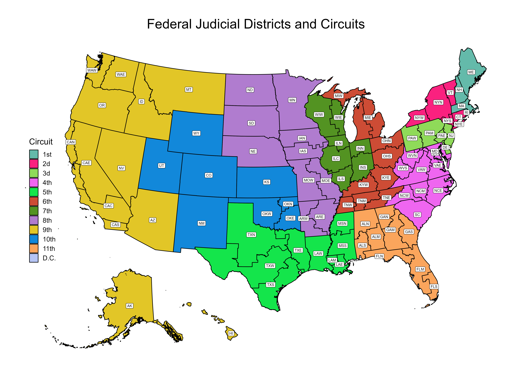
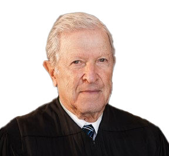
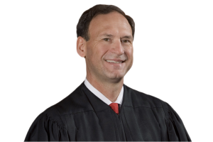

# Venue {#sec-venue}

## Venue & Transfer

Entirely separate from the requirements of personal jurisdiction and subject-matter jurisdiction is the purely statutory (not constitutional) requirement of venue. Each lawsuit filed in federal court must be filed in a proper venue. Venue is defined by reference to federal judicial districts, which are geographically defined territories, each with its own roster of federal trial judges. Each state has between one and four districts. The map below displays the federal judicial districts, and the larger circuits into which they are grouped.

::: {.column-page}

:::

Venue limits which districts may entertain a case. There are many different venue statutes, but the main one is found at 28 U.S.C. § 1391. Read that statute carefully before you proceed to the next case, which explores the venue provision allowing suit to be brought in “a judicial district in which a substantial part of the events or omissions giving rise to the claim occurred.” 28 U.S.C. § 1391(b)(2). 

Once you have a handle on how the venue statute works, the subsequent case---*Atlantic Marine*---will illustrate how venue interacts with forum selection clauses and the related concept of *forum non conveniens*.

### Bates v. C & S Adjusters, Inc.

**Newman, Circuit Judge**[980 F.2d 865 (2d Cir. 1992)]{.aside}

::: {.column-margin}

{width=150}

:::

This appeal concerns venue in an action brought under the Fair Debt Collection Practices Act. Specifically, the issue is whether venue exists in a district in which the debtor resides and to which a bill collector's demand for payment was forwarded. The issue arises on an appeal by Phillip E. Bates from the May 21, 1992, judgment of the District Court for the Western District of New York, dismissing his complaint because of improper venue. We conclude that venue was proper under 28 U.S.C. § 1391(b)(2) and therefore reverse and remand.

Bates commenced this action in the Western District of New York upon receipt of a collection notice from C & S Adjusters, Inc. ("C & S"). Bates alleged violations of the Fair Debt Collection Practices Act, and demanded statutory damages, costs, and attorney's fees. The facts relevant to venue are not in dispute. Bates incurred the debt in question while he was a resident of the Western District of Pennsylvania. The creditor, a corporation with its principal place of business in that District, referred the account to C & S, a local collection agency which transacts no regular business in New York. Bates had meanwhile moved to the Western District of New York. When C & S mailed a collection notice to Bates at his Pennsylvania address, the Postal Service forwarded the notice to Bates' new address in New York.

In its answer, C & S asserted two affirmative defenses and also counterclaimed for costs, alleging that the action was instituted in bad faith and for purposes of harassment. C & S subsequently filed a motion to dismiss for improper venue, which the District Court granted.

**Discussion**

**1.\ Venue and the 1990 amendments to 28 U.S.C. § 1391(b)**

Bates concedes that the only plausible venue provision for this action is 28 U.S.C. § 1391(b)(2), which allows an action to be brought in "a judicial district in which a substantial part of the events or omissions giving rise to the claim occurred." Prior to 1990, section 1391 allowed for venue in "the judicial district ... in which the claim arose." 28 U.S.C. § 1391(b). This case represents our first opportunity to consider the significance of the 1990 amendments.

Prior to 1966, venue was proper in federal question cases, absent a special venue statute, only in the defendant's state of citizenship. If a plaintiff sought to sue multiple defendants who were citizens of different states, there might be no district where the entire action could be brought. Congress closed this "venue gap" by adding a provision allowing suit in the district "in which the claim arose." This phrase gave rise to a variety of conflicting interpretations. Some courts thought it meant that there could be only one such district; others believed there could be several. Different tests developed, with courts looking for "substantial contacts," the "weight of contacts," the place of injury or performance, or even to the boundaries of personal jurisdiction under state law.

The Supreme Court gave detailed attention to section 1391(b) in *Leroy v. Great Western United Corp.*, 443 U.S. 173 (1979). The specific holding of *Leroy* was that Great Western, a Texas corporation, which had attempted to take over an Idaho corporation, could not bring suit in Texas against Idaho officials who sought to enforce a state anti-takeover law. Although the effect of the Idaho officials' action might be felt in Texas, the Court rejected this factor as a basis for venue, since it would allow the Idaho officials to be sued anywhere a shareholder of the target corporation could allege that he wanted to accept Great Western's tender offer. The Court made several further observations: (1) the purpose of the 1966 statute was to close venue gaps and should not be read more broadly than necessary to close those gaps; (2) the general purpose of the venue statute was to protect defendants against an unfair or inconvenient trial location; (3) location of evidence and witnesses was a relevant factor; (4) familiarity of the Idaho federal judges with the Idaho anti-takeover statute was a relevant factor; (5) plaintiff's convenience was not a relevant factor; and (6) in only rare cases should there be more than one district in which a claim can be said to arise.

Subsequent to *Leroy* and prior to the 1990 amendment to section 1391(b), most courts have applied at least a form of the "weight of contacts" test. Courts continued to have difficulty in determining whether more than one district could be proper. 

Against this background, we understand Congress' 1990 amendment to be at most a marginal expansion of the venue provision. The House Report indicates that the new language was first proposed by the American Law Institute in a 1969 Study, and observes:

> The great advantage of referring to the place where things happened ... is that it avoids the litigation breeding phrase "in which the claim arose." It also avoids the problem created by the frequent cases in which substantial parts of the underlying events have occurred in several districts.

H.R.Rep. No. 734, 101st Cong., 2d Sess. 23. Thus it seems clear that *Leroy*'s strong admonition against recognizing multiple venues has been disapproved. Many of the factors in *Leroy*---for instance, the convenience of defendants and the location of evidence and witnesses---are most useful in distinguishing between two or more plausible venues. Since the new statute does not, as a general matter, require the District Court to determine the best venue, these factors will be of less significance. Apart from this point, however, *Leroy* and other precedents remain important sources of guidance. 

**2.\ Fair Debt Collection Practices Act**

Under the version of the venue statute in force from 1966 to 1990, at least three District Courts held that venue was proper under the Fair Debt Collection Practices Act in the plaintiff's home district if a collection agency had mailed a collection notice to an address in that district or placed a phone call to a number in that district. None of these cases involved the unusual fact, present in this case, that the defendant did not  deliberately direct a communication to the plaintiff's district.

We conclude, however, that this difference is inconsequential, at least under the current venue statute. The statutory standard for venue focuses not on whether a defendant has made a deliberate contact---a factor relevant in the analysis of personal [ ^1^ C & S has waived whatever claim it might have had that the District Court lacked personal jurisdiction over it. Waiver resulted from C & S's failure to allege lack of personal jurisdiction in its answer or motion to dismiss. *See* Fed. R. Civ. P. 12(b)(2), (h).\
]{.aside} jurisdiction^1^---but on the location where events occurred. Under the new version of section 1391(b)(2), we must determine only whether a "substantial part of the events ... giving rise to the claim" occurred in the Western District of New York.

In adopting this statute, Congress was concerned about the harmful effect of abusive debt practices on consumers. See 15 U.S.C. § 1692(a) ("Abusive debt collection practices contribute to the number of personal bankruptcies, to marital instability, to the loss of jobs, and to invasions of individual privacy."). This harm does not occur until receipt of the collection notice. Indeed, if the notice were lost in the mail, it is unlikely that a violation of the Act would have occurred. Moreover, a debt collection agency sends its dunning letters so that they will be received. Forwarding such letters to the district to which a debtor has moved is an important step in the collection process. If the bill collector prefers not to be challenged for its collection practices outside the district of a debtor's original residence, the envelope can be marked "do not forward." We conclude that receipt of a collection notice is a substantial part of the events giving rise to a claim under the Fair Debt Collection Practices Act.

The relevant factors identified in *Leroy* add support to our conclusion. Although "bona fide error" can be a defense to liability under the Act, the alleged violations of the Act turn largely not on the collection agency's intent, but on the content of the collection notice. The most relevant evidence---the collection notice---is located in the Western District of New York. Because the collection agency appears not to have marked the notice with instructions not to forward, and has not objected to the assertion of personal jurisdiction, trial in the Western District of New York would not be unfair.

**Conclusion**

The judgment of the District Court is reversed, and the matter is remanded for further proceedings consistent with this decision.

### Atlantic Marine Construction Co. v. U.S. District Court

**Justice ALITO delivered the opinion of the Court.**[571 U.S. 49 (2013)]{.aside}

::: {.column-margin}

{width=150}

:::

The question in this case concerns the procedure that is available for a defendant in a civil case who seeks to enforce a forum-selection clause. We reject petitioner's argument that such a clause may be enforced by a motion to dismiss under 28 U.S.C. § 1406(a) or Rule 12(b)(3) of the Federal Rules of Civil Procedure. Instead, a forum-selection clause may be enforced by a motion to transfer under § 1404(a), which provides that "[f]or the convenience of parties and witnesses, in the interest of justice, a district court may transfer any civil action to any other district or division where it might have been brought or to any district or division to which all parties have consented." When a defendant files such a motion, we conclude, a district court should transfer the case unless extraordinary circumstances unrelated to the convenience of the parties clearly disfavor a transfer. 

**I**

Petitioner Atlantic Marine Construction Co., a Virginia corporation with its principal place of business in Virginia, entered into a contract with the United States Army Corps of Engineers to construct a child-development center at Fort Hood in the Western District of Texas. Atlantic Marine then entered into a subcontract with respondent J-Crew Management, Inc., a Texas corporation, for work on the project. This subcontract included a forum-selection clause, which stated that all disputes between the parties “‘shall be litigated in the Circuit Court for the City of Norfolk, Virginia, or the United States District Court for the Eastern District of Virginia, Norfolk Division.’”

When a dispute about payment under the subcontract arose, however, J-Crew sued Atlantic Marine in the Western District of Texas, invoking that court’s diversity jurisdiction. Atlantic Marine moved to dismiss the suit, arguing that the forum-selection clause rendered venue in the Western District of Texas “wrong” under §1406(a) and “improper” under Federal Rule of Civil Procedure 12(b)(3). In the alternative, Atlantic Marine moved to transfer the case to the Eastern District of Virginia under §1404(a). J-Crew opposed these motions.

The District Court denied both motions [and the Fifth Circuit affirmed]. 
\[...\]

\[...\]

**II**

Atlantic Marine contends that a party may enforce a forum-selection clause by seeking dismissal of the suit under § 1406(a) and Rule 12(b)(3). We disagree. Section 1406(a) and Rule 12(b)(3) allow dismissal only when venue is “wrong” or “improper.” Whether venue is “wrong” or “improper” depends exclusively on whether the court in which the case was brought satisfies the requirements of federal venue laws, and those provisions say nothing about a forum-selection clause.

**A**

Section 1406(a) provides that “[t]he district court of a district in which is filed a case laying venue in the wrong division or district shall dismiss, or if it be in the interest of justice, transfer such case to any district or division in which it could have been brought.” Rule 12(b)(3) states that a party may move to dismiss a case for “improper venue.” These provisions therefore authorize dismissal only when venue is “wrong” or “improper” in the forum in which it was brought.

This question---whether venue is “wrong” or “improper”---is generally governed by 28 U.S.C. § 1391.^2^ [ ^2^ Section 1391 governs "venue generally," that is, in cases where a more specific venue provision does not apply. Cf., e.g., § 1400 (identifying proper venue for copyright and patent suits).\
]{.aside} That provision states that “[e]xcept as otherwise provided by law ... this section *shall* govern the venue of *all civil actions* brought in district courts of the United States.” § 1391(a)(1) (emphasis added).   It further provides that "[a] civil action may be brought in---(1) a judicial district in which any defendant resides, if all defendants are residents of the State in which the district is located; (2) a judicial district in which a substantial part of the events or omissions giving rise to the claim occurred, or a substantial part of property that is the subject of the action is situated; or (3) if there is no district in which an action may otherwise be brought as provided in this section, any judicial district in which any defendant is subject to the court's personal jurisdiction with respect to such action." § 1391(b). When venue is challenged, the court must determine whether the case falls within one of the three categories set out in § 1391(b). If it does, venue is proper; if it does not, venue is improper, and the case must be dismissed or transferred under § 1406(a). Whether the parties entered into a contract containing a forum-selection clause has no bearing on whether a case falls into one of the categories of cases listed in § 1391(b). As a result, a case filed in a district that falls within § 1391 may not be dismissed under § 1406(a) or Rule 12(b)(3).

Petitioner’s contrary view improperly conflates the special statutory term “venue” and the word “forum.” It is certainly true that, in some contexts, the word “venue” is used synonymously with the term “forum,” but §1391 makes clear that venue in “all civil actions” must be determined in accordance with the criteria outlined in that section. That language cannot reasonably be read to allow judicial consideration of other, extrastatutory limitations on the forum in which a case may be brought.

The structure of the federal venue provisions confirms that they alone define whether venue exists in a given forum. In particular, the venue statutes reflect Congress’ intent that venue should always lie in some federal court whenever federal courts have personal jurisdiction over the defendant. The first two paragraphs of § 1391(b) define the preferred judicial districts for venue in a typical case, but the third paragraph provides a fallback option: If no other venue is proper, then venue will lie in "*any judicial district* in which any defendant is subject to the court's personal jurisdiction" (emphasis added). The statute thereby ensures that so long as a federal court has personal jurisdiction over the defendant, venue will always lie somewhere.  As we have previously noted, “Congress does not in general intend to create venue gaps, which take away with one hand what Congress has given by way of jurisdictional grant with the other.” Yet petitioner's approach would mean that in some number of cases---those in which the forum-selection clause points to a state or foreign court---venue would not lie in any federal district. That would not comport with the statute's design, which contemplates that venue will always exist in some federal court.

\[...\]

**B**

Although a forum-selection clause does not render venue in a court “wrong” or “improper” within the meaning of § 1406(a) or Rule 12(b)(3), the clause may be enforced through a motion to transfer under § 1404(a). That provision states that “[f]or the convenience of parties and witnesses, in the interest of justice, a district court may transfer any civil action to any other district or division where it might have been brought or to any district or division to which all parties have consented.” Unlike § 1406(a), § 1404(a) does not condition transfer on the initial forum’s being “wrong.” And it permits transfer to any district where venue is also proper (*i.e.*, “where [the case] might have been brought”) or to any other district to which the parties have agreed by contract or stipulation.

Section 1404(a) therefore provides a mechanism for enforcement of forum-selection clauses that point to a particular federal district. And for the reasons we address in Part III, a proper application of § 1404(a) requires that a forum-selection clause be “given controlling weight in all but the most exceptional cases.”

Atlantic Marine argues that § 1404(a) is not a suitable mechanism to enforce forum-selection clauses because that provision cannot provide for transfer when a forum-selection clause specifies a state or foreign tribunal, and we agree with Atlantic Marine that the Court of Appeals failed to provide a sound answer to this problem. The Court of Appeals opined that a forum-selection clause pointing to a nonfederal forum should be enforced through Rule 12(b)(3), which permits a party to move for dismissal of a case based on “improper venue.” As Atlantic Marine persuasively argues, however, that conclusion cannot be reconciled with our construction of the term “improper venue” in § 1406 to refer only to a forum that does not satisfy federal venue laws. If venue is proper under federal venue rules, it does not matter for the purpose of Rule 12(b)(3) whether the forum-selection clause points to a federal or a nonfederal forum.

Instead, the appropriate way to enforce a forum-selection clause pointing to a state or foreign forum is through the doctrine of *forum non conveniens*. Section 1404(a) is merely a codification of the doctrine of *forum non conveniens* for the subset of cases in which the transferee forum is within the federal court system; in such cases, Congress has replaced the traditional remedy of outright dismissal with transfer. For the remaining set of cases calling for a nonfederal forum, § 1404(a) has no application, but the residual doctrine of *forum non conveniens* “has continuing application in federal courts.” And because both § 1404(a) and the *forum non conveniens* doctrine from which it derives entail the same balancing-of-interests standard, courts should evaluate a forum-selection clause pointing to a nonfederal forum in the same way that they evaluate a forum-selection clause pointing to a federal forum.

\[...\]

**III**

Although the Court of Appeals correctly identified § 1404(a) as the appropriate provision to enforce the forum-selection clause in this case, the Court of Appeals erred in failing to make the adjustments required in a §1404(a) analysis when the transfer motion is premised on a forum-selection clause. When the parties have agreed to a valid forum-selection clause, a district court should ordinarily transfer the case to the forum specified in that clause. Only under extraordinary circumstances unrelated to the convenience of the parties should a §1404(a) motion be denied. And no such exceptional factors appear to be present in this case.

\[...\]

When parties have contracted in advance to litigate disputes in a particular forum, courts should not unnecessarily disrupt the parties’ settled expectations. A forum-selection clause, after all, may have figured centrally in the parties’ negotiations and may have affected how they set monetary and other contractual terms; it may, in fact, have been a critical factor in their agreement to do business together in the first place. In all but the most unusual cases, therefore, “the interest of justice” is served by holding parties to their bargain.

\[...\]

We reverse the judgment of the Court of Appeals for the Fifth Circuit. Although no public-interest factors that might support the denial of Atlantic Marine’s motion to transfer are apparent on the record before us, we remand the case for the courts below to decide that question.

*It is so ordered.*

## *Forum Non Conveniens*

Transferring venue within the federal court system is easy enough, especially in light of cases like *Atlantic Marine*. But a much trickier problem results when a party claims that the appropriate forum for a suit is in an entirely different court system---either a different state court or a court in a foreign country. In that circumstance, the most effective mechanism for a defendant to seek to move a case is a motion to dismiss on grounds of *forum non conveniens.* This common-law doctrine directs courts to weigh the comparative convenience of two alternative forums and to dismiss if the alternate forum is adequate and more convenient. The following two cases provide 1) the Supreme Court’s most authoritative statement on the law of *forum non conveniens*; and 2) a look at how the doctrine is applied in lower courts.

### Piper Aircraft v. Reyno

**JUSTICE MARSHALL delivered the opinion of the Court.**[454 U.S. 235 (1981)]{.aside}

::: {.column-margin}

{width=150}

:::

These cases arise out of an air crash that took place in Scotland. Respondent, acting as representative of the estates of several Scottish citizens killed in the accident, brought wrongful-death actions against petitioners that were ultimately transferred to the United States District Court for the Middle District of Pennsylvania. Petitioners moved to dismiss on the ground of *forum non conveniens*. After noting that an alternative forum existed in Scotland, the District Court granted their motions. The United States Court of Appeals for the Third Circuit reversed. The Court of Appeals based its decision, at least in part, on the ground that dismissal is automatically barred where the law of the alternative forum is less favorable to the plaintiff than the law of the forum chosen by the plaintiff. Because we conclude that the possibility of an unfavorable change in law should not, by itself, bar dismissal, and because we conclude that the District Court did not otherwise abuse its discretion, we reverse.

**I**

**A**

In July 1976, a small commercial aircraft crashed in the Scottish highlands during the course of a charter flight from Blackpool to Perth. The pilot and five passengers were killed instantly. The decedents were all Scottish subjects and residents, as are their heirs and next of kin. There were no eyewitnesses to the accident. At the time of the crash the plane was subject to Scottish air traffic control.

The aircraft, a twin-engine Piper Aztec, was manufactured in Pennsylvania by petitioner Piper Aircraft Co. (Piper). The propellers were manufactured in Ohio by petitioner Hartzell Propeller, Inc. (Hartzell). At the time of the crash the aircraft was registered in Great Britain and was owned and maintained by Air Navigation and Trading Co., Ltd. (Air Navigation). It was operated by McDonald Aviation, Ltd. (McDonald), a Scottish air taxi service. Both Air Navigation and McDonald were organized in the United Kingdom. The wreckage of the plane is now in a hangar in Farnsborough, England.

The British Department of Trade investigated the accident shortly after it occurred. A preliminary report found no evidence of defective equipment and indicated that pilot error may have contributed to the accident. The pilot, who had obtained his commercial pilot’s license only three months earlier, was flying over high ground at an altitude considerably lower than the minimum height required by his company’s operations manual.

In July 1977, a California probate court appointed respondent Gaynell Reyno administratrix of the estates of the five passengers. Reyno is not related to and does not know any of the decedents or their survivors; she was a legal secretary to the attorney who filed this lawsuit. Several days after her appointment, Reyno commenced separate wrongful-death actions against Piper and Hartzell in the Superior Court of California, claiming negligence and strict liability. [...] Reyno candidly admits that the action against Piper and Hartzell was filed in the United States because its laws regarding liability, capacity to sue, and damages are more favorable to her position than are those of Scotland. Scottish law does not recognize strict liability in tort. Moreover, it permits wrongful-death actions only when brought by a decedent’s relatives. The relatives may sue only for “loss of support and society.”

On petitioners' motion, the suit was removed to the United States District Court for the Central District of California. Piper then moved for transfer to the United States District Court for the Middle District of Pennsylvania[, where Hartzell’s business with Piper supported jurisdiction], pursuant to 28 U.S.C. § 1404(a). Hartzell moved to dismiss for lack of personal jurisdiction, or in the alternative, to transfer[, also to the Middle District of Pennsylvania]. In December 1977, the District Court [...] transferred the case to the Middle District of Pennsylvania. [...]

**B**

\[A\]fter the suit had been transferred, both Hartzell and Piper moved to dismiss the action on the ground of *forum non conveniens*. The District Court granted these motions in October 1979. It relied on the balancing test set forth by this Court in *Gulf Oil Corp. v. Gilbert*, 330 U.S. 501 (1947), and its companion case, *Koster v. Lumbermens Mut. Cas. Co.*, 330 U.S. 518 (1947). In those decisions, the Court stated that a plaintiff’s choice of forum should rarely be disturbed. However, when an alternative forum has jurisdiction to hear the case, and when trial in the chosen forum would “establish ... oppressiveness and vexation to a defendant ... out of all proportion to plaintiff’s convenience,” or when the “chosen forum [is] inappropriate because of considerations affecting the court’s own administrative and legal problems,” the court may, in the exercise of its sound discretion, dismiss the case. To guide trial court discretion, the Court provided a list of “private interest factors” affecting the convenience of the litigants, and a list of “public interest factors” affecting the convenience of the forum.^6^ [ ^6^ The factors pertaining to the private interests of the litigants included the "relative ease of access to sources of proof; availability of compulsory process for attendance of unwilling, and the cost of obtaining attendance of willing, witnesses; possibility of view of premises, if view would be appropriate to the action; and all other practical problems that make trial of a case easy, expeditious and inexpensive." The public factors bearing on the question included the administrative difficulties flowing from court congestion; the "local interest in having localized controversies decided at home"; the interest in having the trial of a diversity case in a forum that is at home with the law that must govern the action; the avoidance of unnecessary problems in conflict of laws, or in the application of foreign law; and the unfairness of burdening citizens in an unrelated forum with jury duty.\
]{.aside}

[The Third Circuit reversed, on the ground that dismissal for *forum non conveniens* is never appropriate where the law of the alternative forum is less favorable to the plaintiff.]

**II**

The Court of Appeals erred in holding that plaintiffs may defeat a motion to dismiss on the ground of *forum non conveniens* merely by showing that the substantive law that would be applied in the alternative forum is less favorable to the plaintiffs than that of the present forum. The possibility of a change in substantive law should ordinarily not be given conclusive or even substantial weight in the *forum non conveniens* inquiry.

We expressly rejected the position adopted by the Court of Appeals in our decision in *Canada Malting Co. v. Paterson Steamships, Ltd.*, 285 U.S. 413 (1932). \[...\]

The Court of Appeals’ decision is inconsistent with this Court’s earlier *forum non conveniens* decisions in another respect. Those decisions have repeatedly emphasized the need to retain flexibility. In *Gilbert*, the Court refused to identify specific circumstances "which will justify or require either grant or denial of remedy." Similarly, in *Koster*, the Court rejected the contention that where a trial would involve inquiry into the internal affairs of a foreign corporation, dismissal was always appropriate. "That is one, but only one, factor which may show convenience." And in *Williams v. Green Bay & Western R. Co.*, 326 U.S. 549, 557 (1946), we stated that we would not lay down a rigid rule to govern discretion, and that "[e]ach case turns on its facts." If central emphasis were placed on any one factor, the *forum non conveniens* doctrine would lose much of the very flexibility that makes it so valuable.

In fact, if conclusive or substantial weight were given to the possibility of a change in law, the *forum non conveniens* doctrine would become virtually useless. Jurisdiction and venue requirements are often easily satisfied. As a result, many plaintiffs are able to choose from among several forums. Ordinarily, these plaintiffs will select that forum whose choice-of-law rules are most advantageous. Thus, if the possibility of an unfavorable change in substantive law is given substantial weight in the *forum non conveniens* inquiry, dismissal would rarely be proper.

\[...\]

::: {.column-margin}

^19^ In holding that the possibility of a change in law unfavorable to the plaintiff should not be given substantial weight, we also necessarily hold that the possibility of a change in law favorable to defendant should not be considered. Respondent suggests that Piper and Hartzell filed the motion to dismiss, not simply because trial in the United States would be inconvenient, but also because they believe the laws of Scotland are more favorable. She argues that this should be taken into account in the analysis of the private interests. We recognize, of course, that Piper and Hartzell may be engaged in reverse forum-shopping. However, this possibility ordinarily should not enter into a trial court's analysis of the private interests. If the defendant is able to overcome the presumption in favor of plaintiff by showing that trial in the chosen forum would be unnecessarily burdensome, dismissal is appropriate---regardless of the fact that defendant may also be motivated by a desire to obtain a more favorable forum.

:::

Upholding the decision of the Court of Appeals would result in other practical problems. At least where the foreign plaintiff named an American manufacturer as defendant, a court could not dismiss the case on grounds of *forum non conveniens* where dismissal might lead to an unfavorable change in law. The American courts, which are already extremely attractive to foreign plaintiffs, would become even more attractive. The flow of litigation into the United States would increase and further congest already crowded courts.^19^

\[...\]

We do not hold that the possibility of an unfavorable change in law should never be a relevant consideration in a *forum non conveniens* inquiry. Of course, if the remedy provided by the alternative forum is so clearly inadequate or unsatisfactory that it is no remedy at all, the unfavorable change in law may be given substantial weight; the district court may conclude that dismissal would not be in the interests of justice. In these cases, however, the remedies that would be provided by the Scottish courts do not fall within this category. Although the relatives of the decedents may not be able to rely on a strict liability theory, and although their potential damages award may be smaller, there is no danger that they will be deprived of any remedy or treated unfairly.

**III**

The Court of Appeals also erred in rejecting the District Court’s *Gilbert* analysis. The Court of Appeals stated that more weight should have been given to the plaintiff's choice of forum, and criticized the District Court's analysis of the private and public interests. However, the District Court's decision regarding the deference due plaintiff's choice of forum was appropriate. Furthermore, we do not believe that the District Court abused its discretion in weighing the private and public interests.

**A**

The District Court acknowledged that there is ordinarily a strong presumption in favor of the plaintiff’s choice of forum, which may be overcome only when the private and public interest factors clearly point towards trial in the alternative forum. It held, however, that the presumption applies with less force when the plaintiff or real parties in interest are foreign.

The District Court’s distinction between resident or citizen plaintiffs and foreign plaintiffs is fully justified. In *Koster*, the Court indicated that a plaintiff’s choice of forum is entitled to greater deference when the plaintiff has chosen the home forum. When the home forum has been chosen, it is reasonable to assume that this choice is convenient. When the plaintiff is foreign, however, this assumption is much less reasonable. Because the central purpose of any *forum non conveniens* inquiry is to ensure that the trial is convenient, a foreign plaintiff’s choice deserves less deference.

**B**

The *forum non conveniens* determination is committed to the sound discretion of the trial court. It may be reversed only when there has been a clear abuse of discretion; where the court has considered all relevant public and private interest factors, and where its balancing of these factors is reasonable, its decision deserves substantial deference. \[...\]

**(1)**

In analyzing the private interest factors, the District Court stated that the connections with Scotland are “overwhelming.” This characterization may be somewhat exaggerated. Particularly with respect to the question of relative ease of access to sources of proof, the private interests point in both directions. As respondent emphasizes, records concerning the design, manufacture, and testing of the propeller and plane are located in the United States. She would have greater access to sources of proof relevant to her strict liability and negligence theories if trial were held here.^25^ [ ^25^ In the future, where similar problems are presented, district courts might dismiss subject to the condition that defendant corporations agree to provide the records relevant to the plaintiff’s claims.\
]{.aside} However, the District Court did not act unreasonably in concluding that fewer evidentiary problems would be posed if the trial were held in Scotland. A large proportion of the relevant evidence is located in Great Britain. 

\[...\]

The District Court correctly concluded that the problems posed by the inability to implead potential third-party defendants clearly supported holding the trial in Scotland. Joinder of the pilot’s estate, Air Navigation, and McDonald is crucial to the presentation of petitioners’ defense. If Piper and Hartzell can show that the accident was caused not by a design defect, but rather by the negligence of the pilot, the plane’s owners, or the charter company, they will be relieved of all liability. \[...\]

**(2)**

The District Court’s review of the factors relating to the public interest was also reasonable. On the basis of its choice-of-law analysis, it concluded that if the case were tried in the Middle District of Pennsylvania, Pennsylvania law would apply to Piper and Scottish law to Hartzell. It stated that a trial involving two sets of laws would be confusing to the jury. It also noted its own lack of familiarity with Scottish law. Consideration of these problems was clearly appropriate under *Gilbert*; in that case we explicitly held that the need to apply foreign law pointed towards dismissal. \[...\]

Scotland has a very strong interest in this litigation. The accident occurred in its airspace. All of the decedents were Scottish. Apart from Piper and Hartzell, all potential plaintiffs and defendants are either Scottish or English. As we stated in *Gilbert*, there is “a local interest in having localized controversies decided at home.” Respondent argues that American citizens have an interest in ensuring that American manufacturers are deterred from producing defective products, and that additional deterrence might be obtained if Piper and Hartzell were tried in the United States, where they could be sued on the basis of both negligence and strict liability. However, the incremental deterrence that would be gained if this trial were held in an American court is likely to be insignificant. The American interest in this accident is simply not sufficient to justify the enormous commitment of judicial time and resources that would inevitably be required if the case were to be tried here.

**IV**

The Court of Appeals erred in holding that the possibility of an unfavorable change in law bars dismissal on the ground of *forum non conveniens.* It also erred in rejecting the District Court’s *Gilbert* analysis. The District Court properly decided that the presumption in favor of the respondent’s forum choice applied with less than maximum force because the real parties in interest are foreign. It did not act unreasonably in deciding that the private interests pointed towards trial in Scotland. Nor did it act unreasonably in deciding that the public interests favored trial in Scotland. Thus, the judgment of the Court of Appeals is

*Reversed.*

**[Justices POWELL and O’CONNOR took no part in the decision of these cases. The concurring opinion of Justice White and the dissent of Justices STEVENS and BRENNAN are omitted.]**

### Iragorri v. United Techs. Corp.

**PIERRE N. LEVAL and JOSÉ A. CABRANES, Circuit Judges.**[274 F.3d 65 (2d Cir. 2001) (_en banc_)]{.aside}

::: {.column-margin}

{width=150}
{width=150}

:::

Our court convened this rehearing _en banc_ not out of dissatisfaction with the panel’s disposition, but because we believed that it would be useful for the full court to review the relevance of a plaintiff’s residence in the United States but outside the district in which an action is filed when the defendants seek dismissal for _forum non conveniens_. \[…\] The _en banc_ order states that we convene to answer the question common to those decisions and the instant case, namely, “what degree of deference should the district court accord to a United States plaintiff’s choice of a United States forum where that forum is different from the one in which the plaintiff resides.” \[…\]

**Background**

On October 3, 1992, Mauricio Iragorri—a domiciliary of Florida since 1981 and a naturalized United States citizen since 1989—fell five floors to his death down an open elevator shaft in the apartment building where his mother resided in Cali, Colombia. Mauricio left behind his widow, Haidee, and their two teenaged children, Patricia and Maurice, all of whom are the plaintiffs in this action. The plaintiffs have been domiciliaries of Florida since 1981. At the time of the accident, however, Haidee and the two children were living temporarily in Bogota, Colombia, because the children were attending a Bogota school as part of an educational exchange program sponsored by their Florida high school.

The Iragorris brought suit in the United States District Court for the District of Connecticut (Arterton, _J._) on September 30, 1994. The named defendants were Otis Elevator Company (“Otis”), a New Jersey corporation with its principal place of business in Connecticut; United Technologies Corporation (“United”)—the parent of Otis—a Delaware corporation whose principal place of business is also in Connecticut; and International Elevator, Inc. (“International”), a Maine corporation, which since 1988 had done business solely in South America. It is alleged that prior to the accident, an employee of International had negligently wedged open the elevator door with a screwdriver to perform service on the elevator, thereby leaving the shaft exposed and unprotected.

The complaint alleged two theories of liability against defendants Otis and United: that (a) International acted as an agent for Otis and United so that the negligent acts of its employee should be imputed to them, and (b) Otis and United were liable under Connecticut’s products liability statute for the defective design and manufacture of the elevator which was sold and installed by their affiliate, Otis of Brazil.

On February 12, 1998, the claims against International Elevator were transferred by Judge Arterton to the United States District Court for the District of Maine. That district court then dismissed the case against International Elevator on _forum non conveniens_ grounds, and the First Circuit affirmed.

Defendants Otis and United meanwhile moved to dismiss under _forum non conveniens_, arguing that plaintiffs’ suit should be brought in Cali, Colombia, where the accident occurred. On March 31, 1999, Judge Arterton granted the motion and dismissed the claims against Otis and United on the condition that they agree to appear in the courts of Cali.

A panel of this Court vacated and remanded to the District Court for reconsideration in light of our recent decisions on _forum non conveniens._ Nearly simultaneously, this Court issued the order to hear the case _en banc._

**Discussion**

**I.\ The Degree of Deference Accorded to Plaintiff’s Choice of Forum**

The United States Supreme Court authorities establish various general propositions about _forum non conveniens._ We are told that courts should give deference to a plaintiff’s choice of forum. “\[U\]nless the balance is strongly in favor of the defendant, the plaintiff’s choice of forum should rarely be disturbed.” We understand this to mean that a court reviewing a motion to dismiss for _forum non conveniens_ should begin with the assumption that the plaintiff’s choice of forum will stand unless the defendant meets the burden of demonstrating the points outlined below.

At the same time, we are led to understand that this deference is not dis-positive and that it may be overcome. Notwithstanding the deference, “dismissal should not be automatically barred when a plaintiff has filed suit in his home forum. As always, if the balance of conveniences suggests that trial in the chosen forum would be unnecessarily burdensome for the defendant or the court, dismissal is proper.” _Piper Aircraft Co. v. Reyno_.

We are instructed that the degree of deference given to a plaintiff’s forum choice varies with the circumstances. We are told that plaintiff’s choice of forum is generally entitled to great deference when the plaintiff has sued in the plaintiff’s home forum. But we are also instructed that the choice of a United States forum by a foreign plaintiff is entitled to less deference. _Piper_ (“The District Court’s distinction between resident or citizen plaintiffs and foreign plaintiffs is fully justified. … When the plaintiff is foreign, … \[the\] assumption \[favoring the plaintiff’s choice of forum\] is much less reasonable.”).

In our recent cases on the subject of _forum non conveniens_, our Court has faced situations involving a fact pattern not directly addressed by the Supreme Court: a United States resident plaintiff’s suit in a U.S. district other than that in which the plaintiff resides. As a full court, we now undertake to apply to this general fact pattern the principles that we find implicit in Supreme Court precedents.

We regard the Supreme Court’s instructions that (1) a plaintiff’s choice of her home forum should be given great deference, while (2) a foreign resident’s choice of a U.S. forum should receive less consideration, as representing consistent applications of a broader principle under which the degree of deference to be given to a plaintiff’s choice of forum moves on a sliding scale depending on several relevant considerations.

The Supreme Court explained in _Piper_ that the reason we give deference to a plaintiff’s choice of her home forum is because it is presumed to be convenient. (“When the home forum has been chosen, it is reasonable to assume that this choice is convenient.”) In contrast, when a foreign plaintiff chooses a U.S. forum, it “is much less reasonable” to presume that the choice was made for convenience. In such circumstances, a plausible likelihood exists that the selection was made for forum-shopping reasons, such as the perception that United States courts award higher damages than are common in other countries. Even if the U.S. district was not chosen for such forum-shopping reasons, there is nonetheless little reason to assume that it is convenient for a foreign plaintiff.

Based on the Supreme Court’s guidance, our understanding of how courts should address the degree of deference to be given to a plaintiff’s choice of a U.S. forum is essentially as follows: The more it appears that a domestic or foreign plaintiff’s choice of forum has been dictated by reasons that the law recognizes as valid, the greater the deference that will be given to the plaintiff’s forum choice. Stated differently, the greater the plaintiff’s or the lawsuit’s _bona fide_ connection to the United States and to the forum of choice and the more it appears that considerations of convenience favor the conduct of the lawsuit in the United States, the more difficult it will be for the defendant to gain dismissal for _forum non conveniens._ Thus, factors that argue against _forum non conveniens_ dismissal include the convenience of the plaintiff’s residence in relation to the chosen forum, the availability of witnesses or evidence to the forum district, the defendant’s amenability to suit in the forum district, the availability of appropriate legal assistance, and other reasons relating to convenience or expense. On the other hand, the more it appears that the plaintiff’s choice of a U.S. forum was motivated by forum-shopping reasons—such as attempts to win a tactical advantage resulting from local laws that favor the plaintiff’s case, the habitual generosity of juries in the United States or in the forum district, the plaintiff’s popularity or the defendant’s unpopularity in the region, or the inconvenience and expense to the defendant resulting from litigation in that forum—the less deference the plaintiff’s choice commands and, consequently, the easier it becomes for the defendant to succeed on a _forum non conveniens_ motion by showing that convenience would be better served by litigating in another country’s courts.

The decision to dismiss a case on _forum non conveniens_ grounds “lies wholly within the broad discretion of the district court and may be overturned only when we believe that discretion has been _clearly abused_.” In other words, “\[o\]ur limited review … encompasses the right to determine whether the district court reached an erroneous conclusion on either the facts or the law,” or relied on an incorrect rule of law in reaching its determination. Accordingly, we do not, on appeal, undertake our own _de novo_ review, simply substituting our view of the matter for that of the district court. Nonetheless, the district court must follow the governing legal standards. In our recent cases, we vacated dismissals for _forum non conveniens_ because we believed that the district courts had misapplied the basic rules, apparently assuming that deference is given to the plaintiff’s choice of forum only when the plaintiff sues in the plaintiff’s home district.

The rule is not so abrupt or arbitrary. One of the factors that necessarily affects a plaintiff’s choice of forum is the need to sue in a place where the defendant is amenable to suit. Consider for example a hypothetical plaintiff residing in New Jersey, who brought suit in the Southern District of New York, barely an hour’s drive from the plaintiff’s residence, because the defendant was amenable to suit in the Southern District but not in New Jersey. It would make little sense to withhold deference for the plaintiff’s choice merely because she did not sue in her home district. Where a U.S. resident leaves her home district to sue the defendant where the defendant has established itself and is thus amenable to suit, this would not ordinarily indicate a choice motivated by desire to impose tactical disadvantage on the defendant. This is all the more true where the defendant’s amenability to suit in the plaintiff’s home district is unclear. A plaintiff should not be compelled to mount a suit in a district where she cannot be sure of perfecting jurisdiction over the defendant, if by moving to another district, she can be confident of bringing the defendant before the court. In many circumstances, it will be far more convenient for a U.S. resident plaintiff to sue in a U.S. court than in a foreign country, even though it is not the district in which the plaintiff resides. It is not a correct understanding of the rule to accord deference only when the suit is brought in the plaintiff’s home district. Rather, the court must consider a plaintiff’s likely motivations in light of all the relevant indications. We thus understand the Supreme Court’s teachings on the deference due to plaintiff’s forum choice as instructing that we give greater deference to a plaintiff’s forum choice to the extent that it was motivated by legitimate reasons, including the plaintiff’s convenience and the ability of a U.S. resident plaintiff to obtain jurisdiction over the defendant, and diminishing deference to a plaintiff’s forum choice to the extent that it was motivated by tactical advantage.

**II.\ The Assessment of Conveniences**

The deference given to a plaintiff’s choice of forum does not dispose of a _forum non conveniens_ motion. It is only the first level of inquiry. Even after determining whether the plaintiff’s choice is entitled to more or less deference, a district court must still conduct the analysis set out in _Gilbert_, _Koster_, and _Piper._ Initially, the court must consider whether an adequate alternative forum exists. If so, it must balance two sets of factors to ascertain whether the case should be adjudicated in the plaintiff’s chosen forum or in the alternative forum proposed by the defendant. The first set of factors considered are the private interest factors — the convenience of the litigants. These include “the relative ease of access to sources of proof; availability of compulsory process for attendance of unwilling, and the cost of obtaining attendance of willing, witnesses; possibility of view of premises, if view would be appropriate to the action; and all other practical problems that make trial of a case easy, expeditious and inexpensive.” In considering these factors, the court is necessarily engaged in a comparison between the hardships defendant would suffer through the retention of jurisdiction and the hardships the plaintiff would suffer as the result of dismissal and the obligation to bring suit in another country. Rather than simply characterizing the case as one in negligence, contract, or some other area of law, the court should focus on the precise issues that are likely to be actually tried, taking into consideration the convenience of the parties and the availability of witnesses and the evidence needed for the trial of these issues. In a suit alleging negligence, for example, the court might reach different results depending on whether the alleged negligence lay in the conduct of actors at the scene of the accident, or in the design or manufacture of equipment at a plant distant from the scene of the accident. The court should consider also whether the plaintiff’s damages are genuinely in dispute and where the parties will have better access to the evidence relating to those damages.

The court also considers public interest factors. As the Supreme Court has explained:

> Factors of public interest also have place in applying the doctrine. Administrative difficulties follow for courts when litigation is piled up in congested centers instead of being handled at its origin. Jury duty is a burden that ought not to be imposed upon the people of a community which has no relation to the litigation. In cases which touch the affairs of many persons, there is reason for holding the trial in their view and reach rather than in remote parts of the country where they can learn of it by report only. There is a local interest in having localized controversies decided at home. There is an appropriateness, too, in having the trial of a diversity case in a forum that is at home with the state law that must govern the case, rather than having a court in some other forum untangle problems in conflict of laws, and in law foreign to itself.

_Gilbert_.

Thus, while plaintiff’s citizenship and residence can serve as a proxy for, or indication of, convenience, neither the plaintiff’s citizenship nor residence, nor the degree of deference given to her choice of forum, necessarily controls the outcome. There is no “rigid rule of decision protecting U.S. citizen or resident plaintiffs from dismissal for _forum non conveniens_."

As is implicit in the meaning of “deference,” the greater the degree of deference to which the plaintiff’s choice of forum is entitled, the stronger a showing of inconvenience the defendant must make to prevail in securing _forum non conveniens_ dismissal. At the same time, a lesser degree of deference to the plaintiff’s choice bolsters the defendant’s case but does not guarantee dismissal. A defendant does not carry the day simply by showing the existence of an adequate alternative forum. The action should be dismissed only if the chosen forum is shown to be genuinely inconvenient and the selected forum significantly preferable. In considering this point, the court furthermore must balance the greater convenience to the defendant of litigating in its preferred forum against any greater inconvenience to the plaintiff if the plaintiff is required to institute the suit in the defendant’s preferred foreign jurisdiction.

Courts should be mindful that, just as plaintiffs sometimes choose a forum for forum-shopping reasons, defendants also may move for dismissal under the doctrine of _forum non conveniens_ not because of genuine concern with convenience but because of similar forum-shopping reasons. District courts should therefore arm themselves with an appropriate degree of skepticism in assessing whether the defendant has demonstrated genuine inconvenience and a clear preferability of the foreign forum. And the greater the degree to which the plaintiff has chosen a forum where the defendant’s witnesses and evidence are to be found, the harder it should be for the defendant to demonstrate inconvenience.

**III.\ The Application of the Principles to the Facts of This Case**

We believe that the District Court in the case before us, lacking the benefit of our most recent opinions concerning _forum non conveniens_, did not accord appropriate deference to the plaintiffs’ chosen forum. Although the plaintiffs had resided temporarily in Bogota at the time of Mauricio Iragorri’s accident, it appears that they had returned to their permanent, long-time domicile in Florida by the time the suit was filed. The fact that the children and their mother had spent a few school terms in Colombia on a foreign exchange program seems to us to present little reason for discrediting the bona fides of their choice of the Connecticut forum. Heightened deference to the plaintiffs’ chosen forum usually applies even where a plaintiff has temporarily or intermittently resided in the foreign jurisdiction. So far as the record reveals, there is little indication that the plaintiffs chose the defendants’ principal place of business for forum-shopping reasons. Plaintiffs were apparently unable to obtain jurisdiction in Florida over the original third defendant, International, but could obtain jurisdiction over all three in Connecticut. It appears furthermore that witnesses and documentary evidence relevant to plaintiffs’ defective design theory are to be found at the defendants’ installations in Connecticut. As we have explained, “live testimony of key witnesses is necessary so that the trier of fact can assess the witnesses’ demeanor.” Also, in assessing where the greater convenience lies, the District Court must of course consider how great would be the inconvenience and difficulty imposed on the plaintiffs were they forced to litigate in Cali. Among other factors, plaintiffs claim that they fear for their safety in Cali and that various witnesses on both sides may be unwilling to travel to Cali; if these concerns are warranted, they appear highly relevant to the balancing inquiry that the District Court must conduct.

Accordingly, we remand for reconsideration in light of the principles here discussed. The District Court should determine the degree of deference to which plaintiffs’ choice is entitled, the balance of hardships to the respective parties as between the competing fora, and the public interest factors involved. The District Court’s decision, if appealed, would be reviewable under the clear-abuse-of-discretion standard that we have enunciated.

**Conclusion**

The judgment of the District Court is hereby vacated and the case remanded for further proceedings.

\[…\]
