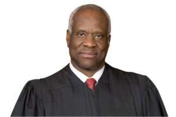

# What Is Procedure? {#sec-what-is-procedure}

## How Much Procedure Is Due?

### U.S. Constitution amend. V

No person shall be held to answer for a capital, or otherwise infamous crime, unless on a presentment or indictment of a grand jury, except in cases arising in the land or naval forces, or in the militia, when in actual service in time of war or public danger; nor shall any person be subject for the same offense to be twice put in jeopardy of life or limb; nor shall be compelled in any criminal case to be a witness against himself, nor be deprived of life, liberty, or property, without due process of law; nor shall private property be taken for public use, without just compensation.

### U.S. Constitution amend XIV

**Section 1.**

All persons born or naturalized in the United States, and subject to the jurisdiction thereof, are citizens of the United States and of the state wherein they reside. No state shall make or enforce any law which shall abridge the privileges or immunities of citizens of the United States; nor shall any state deprive any person of life, liberty, or property, without due process of law; nor deny to any person within its jurisdiction the equal protection of the laws.

\[…\]
 
#### Notes & Questions

1.	The due process clauses of the Fifth and Fourteenth Amendments supply the constitutional tests to determine whether a government procedure is fair. As you will see, most procedures in civil cases in federal courts are governed by the Federal Rules of Civil Procedure, which are generally understood to comply with constitutional due process in nearly all cases. But constitutional due process is an important backdrop, as the following materials illustrate.

2.	The two hallmarks of due process are notice and an opportunity to be heard. In practice, that means the government must inform (or try to inform) individuals affected by a proceeding that might affect their life, liberty, or property and allow them to present arguments and/or evidence in connection with that proceeding. 

3.	At the same time, the requirements of due process are flexible and contextual. In some situations, due process requires more; in other situations, less. In *Mathews v. Eldridge*—a case about how much process the government must provide before terminating a Social Security recipient’s benefits—the Supreme Court formulated a three-factor balancing test to determine the requirements of due process. As you read the case that follows, see if you can write down the three factors and how courts are supposed to balance them.

### Lassiter v. Department of Social Services

**Justice Stewart delivered the opinion of the Court.**[452 U.S. 18 (1981)]{.aside}

::: {.column-margin}

{width=150}

:::

**I**

In the late spring of 1975, after hearing evidence that the petitioner, Abby Gail Lassiter, had not provided her infant son William with proper medical care, the District Court of Durham County, N. C., adjudicated him a neglected child and transferred him to the custody of the Durham County Department of Social Services, the respondent here. A year later, Ms. Lassiter was charged with first-degree murder, was convicted of second-degree murder, and began a sentence of 25 to 40 years of imprisonment. […] In 1978 the Department petitioned the court to terminate Ms. Lassiter’s parental rights because, the Department alleged, she “has not had any contact with the child since December of 1975” and “has willfully left the child in foster care for more than two consecutive years without showing that substantial progress has been made in correcting the conditions which led to the removal of the child, or without showing a positive response to the diligent efforts of the Department of Social Services to strengthen her relationship to the child, or to make and follow through with constructive planning for the future of the child.”

Ms. Lassiter was served with the petition and with notice that a hearing on it would be held. Although her mother had retained counsel for her in connection with an effort to invalidate the murder conviction, Ms. Lassiter never mentioned the forthcoming hearing to him (or, for that matter, to any other person except, she said, to “someone” in the prison). At the behest of the Department of Social Services’ attorney, she was brought from prison to the hearing, which was held August 31, 1978. The hearing opened, apparently at the judge’s instance, with a discussion of whether Ms. Lassiter should have more time in which to find legal assistance. Since the court concluded that she “has had ample opportunity to seek and obtain counsel prior to the hearing of this matter, and [that] her failure to do so is without just cause,” the court did not postpone the proceedings. Ms. Lassiter did not aver that she was indigent, and the court did not appoint counsel for her.

A social worker from the respondent Department was the first witness. She testified that in 1975 the Department “received a complaint from Duke Pediatrics that William had not been followed in the pediatric clinic for medical problems and that they were having difficulty in locating Ms. Lassiter … .” She said that in May 1975 a social worker had taken William to the hospital, where doctors asked that he stay “because of breathing difficulties [and] malnutrition and [because] there was a great deal of scarring that indicated that he had a severe infection that had gone untreated.” The witness further testified that, except for one “prearranged” visit and a chance meeting on the street, Ms. Lassiter had not seen William after he had come into the State’s custody, and that neither Ms. Lassiter nor her mother had “made any contact with the Department of Social Services regarding that child.” When asked whether William should be placed in his grandmother’s custody, the social worker said he should not, since the grandmother “has indicated to me on a number of occasions that she was not able to take responsibility for the child” and since “I have checked with people in the community and from Ms. Lassiter’s church who also feel that this additional responsibility would be more than she can handle.” The social worker added that William “has not seen his grandmother since the chance meeting in July of ‘76 and that was the only time.”

[…]

Ms. Lassiter conducted a cross-examination of the social worker, who firmly reiterated her earlier testimony. The judge explained several times, with varying degrees of clarity, that Ms. Lassiter should only ask questions at this stage; many of her questions were disallowed because they were not really questions, but arguments.

Ms. Lassiter herself then testified, under the judge’s questioning, that she had properly cared for William. Under cross-examination, she said that she had seen William more than five or six times after he had been taken from her custody and that, if William could not be with her, she wanted him to be with her mother since, “He knows us. Children know they family … . They know they people, they know they family and that child knows us anywhere … . I got four more other children. Three girls and a boy and they know they little brother when they see him.”

Ms. Lassiter’s mother was then called as a witness. She denied, under the questioning of the judge, that she had filed the complaint against Ms. Lassiter, and on cross-examination she denied both having failed to visit William when he was in the State’s custody and having said that she could not care for him.

:::{.column-margin}

^2^ The petition had also asked that the parental rights of the putative father, William Boykin, be terminated. Boykin was not married to Ms. Lassiter, he had never contributed to William’s financial support, and indeed he denied that he was William’s father. The court granted the petition to terminate his alleged parental status.

:::

The court found that Ms. Lassiter “has not contacted the Department of Social Services about her child since December, 1975, has not expressed any concern for his care and welfare, and has made no efforts to plan for his future.” Because Ms. Lassiter thus had “wilfully failed to maintain concern or responsibility for the welfare of the minor,” and because it was “in the best interests of the minor,” the court terminated Ms. Lassiter’s status as William’s parent.^2^

On appeal, Ms. Lassiter argued only that, because she was indigent, the Due Process Clause of the Fourteenth Amendment entitled her to the assistance of counsel, and that the trial court had therefore erred in not requiring the State to provide counsel for her. The North Carolina Court of Appeals decided that “[w]hile this State action does invade a protected area of individual privacy, the invasion is not so serious or unreasonable as to compel us to hold that appointment of counsel for indigent parents is constitutionally mandated.” […] The Supreme Court of North Carolina summarily denied Ms. Lassiter’s application for discretionary review, […] and we granted certiorari to consider the petitioner’s claim under the Due Process Clause of the Fourteenth Amendment […].

**II**

For all its consequence, “due process” has never been, and perhaps can never be, precisely defined. “[U]nlike some legal rules,” this Court has said, due process “is not a technical conception with a fixed content unrelated to time, place and circumstances.” […] Rather, the phrase expresses the requirement of “fundamental fairness,” a requirement whose meaning can be as opaque as its importance is lofty. Applying the Due Process Clause is therefore an uncertain enterprise which must discover what “fundamental fairness” consists of in a particular situation by first considering any relevant precedents and then by assessing the several interests that are at stake.

**A**

[…]

The Court’s precedents speak with one voice about what “fundamental fairness” has meant when the Court has considered the right to appointed counsel, and we thus draw from them the presumption that an indigent litigant has a right to appointed counsel only when, if he loses, he may be deprived of his physical liberty. It is against this presumption that all the other elements in the due process decision must be measured.

**B**

The case of *Mathews v. Eldridge*, 424 U.S. 319, 335, propounds three elements to be evaluated in deciding what due process requires, viz., the private interests at stake, the government’s interest, and the risk that the procedures used will lead to erroneous decisions. We must balance these elements against each other, and then set their net weight in the scales against the presumption that there is a right to appointed counsel only where the indigent, if he is unsuccessful, may lose his personal freedom.

This Court's decisions have by now made plain beyond the need for
multiple citation that a parent's desire for and right to "the
companionship, care, custody, and management of his or her children" is
an important interest that "undeniably warrants deference and, absent a
powerful countervailing interest, protection." \[...\] Here the State
has sought not simply to infringe upon that interest, but to end it. If
the State prevails, it will have worked a unique kind of deprivation.
\[...\] A parent's interest in the accuracy and justice of the decision
to terminate his or her parental status is, therefore, a commanding
one.^3^ [ ^3^ Some parents will have an additional interest to protect. Petitions to terminate parental rights are not uncommonly based on alleged criminal activity. Parents so accused may need legal counsel to guide them in understanding the problems such petitions may create.\
]{.aside}

Since the State has an urgent interest in the welfare of the child, it shares the parent’s interest in an accurate and just decision. For this reason, the State may share the indigent parent’s interest in the availability of appointed counsel. If, as our adversary system presupposes, accurate and just results are most likely to be obtained through the equal contest of opposed interests, the State’s interest in the child’s welfare may perhaps best be served by a hearing in which both the parent and the State acting for the child are represented by counsel, without whom the contest of interests may become unwholesomely unequal. […]

The State’s interests, however, clearly diverge from the parent’s insofar as the State wishes the termination decision to be made as economically as possible and thus wants to avoid both the expense of appointed counsel and the cost of the lengthened proceedings his presence may cause. But though the State’s pecuniary interest is legitimate, it is hardly significant enough to overcome private interests as important as those here, particularly in light of the concession in the respondent’s brief that the “potential costs of appointed counsel in termination proceedings … is [sic] admittedly de minimis compared to the costs in all criminal actions.”

Finally, consideration must be given to the risk that a parent will be erroneously deprived of his or her child because the parent is not represented by counsel. North Carolina law now seeks to assure accurate decisions by establishing the following procedures: […] A petition must describe facts sufficient to warrant a finding that one of the grounds for termination exists, […] and the parent must be notified of the petition and given 30 days in which to file a written answer to it […].

::: {.column-margin}

^5^ Both the respondent and the Columbia Journal of Law and Social
Problems, 4 [Colum. J. L. & Soc. Prob.]{.smallcaps} 230 (1968), have
conducted surveys purporting to reveal whether the presence of
counsel reduces the number of erroneous determinations in parental
termination proceedings. Unfortunately, neither survey goes beyond
presenting statistics which, standing alone, are unilluminating. The
Journal note does, however, report that it questioned the New York
Family Court judges who preside over parental termination hearings
and found that 72.2% of them agreed that when a parent is
unrepresented, it becomes more difficult to conduct a fair hearing
(11.1% of the judges disagreed); 66.7% thought it became difficult
to develop the facts (22.2% disagreed).

:::

The respondent argues that the subject of a termination hearing — the parent’s relationship with her child — far from being abstruse, technical, or unfamiliar, is one as to which the parent must be uniquely well informed and to which the parent must have given prolonged thought. The respondent also contends that a termination hearing is not likely to produce difficult points of law.^5^ 

Yet the ultimate issues with which a termination hearing deals are not always simple, however commonplace they may be. Expert medical and psychiatric testimony, which few parents are equipped to understand and fewer still to confute, is sometimes presented. The parents are likely to be people with little education, who have had uncommon difficulty in dealing with life, and who are, at the hearing, thrust into a distressing and disorienting situation. These factors may combine to overwhelm an uncounseled parent […].

**C**

The dispositive question \[...\] is whether the three *Eldridge*
factors, when weighed against the presumption that there is no right to
appointed counsel in the absence of at least a potential deprivation of
physical liberty, suffice to rebut that presumption and thus to lead to
the conclusion that the Due Process Clause requires the appointment of
counsel when a State seeks to terminate an indigent's parental status.
To summarize the above discussion of the *Eldridge* factors: the
parent's interest is an extremely important one (and may be supplemented
by the dangers of criminal liability inherent in some termination
proceedings); the State shares with the parent an interest in a correct
decision, has a relatively weak pecuniary interest, and, in some but not
all cases, has a possibly stronger interest in informal procedures; and
the complexity of the proceeding and the incapacity of the uncounseled
parent could be, but would not always be, great enough to make the risk
of an erroneous deprivation of the parent's rights insupportably high.

If, in a given case, the parent's interests were at their strongest, the
State's interests were at their weakest, and the risks of error were at
their peak, it could not be said that the *Eldridge* factors did not
overcome the presumption against the right to appointed counsel, and
that due process did not therefore require the appointment of counsel.
But since the *Eldridge* factors will not always be so distributed, and
since "due process is not so rigid as to require that the significant
interests in informality, flexibility and economy must always be
sacrificed," \[...\]neither can we say that the Constitution requires
the appointment of counsel in every parental termination proceeding. We
therefore \[...\] leave the decision whether due process calls for the
appointment of counsel for indigent parents in termination proceedings
to be answered in the first instance by the trial court, subject, of
course, to appellate review. \[...\]

**III**

::: {.column-margin}

^7^ According to the respondent's brief, William Lassiter is now
living "in a pre-adoptive home with foster parents committed to
formal adoption to become his legal parents." He cannot be legally
adopted, nor can his status otherwise be finally clarified, until
this litigation ends.
    
:::

\[...\] Nevertheless, because child-custody litigation must be concluded as rapidly as is consistent with fairness,^7^ we  decide today whether the trial judge denied Ms. Lassiter due process of law when he did not
appoint counsel for her.

\[...\] In \[...\] these circumstances, we hold that the trial court did
not err in failing to appoint counsel for Ms. Lassiter.

**IV**

In its Fourteenth Amendment, our Constitution imposes on the States the
standards necessary to ensure that judicial proceedings are
fundamentally fair. A wise public policy, however, may require that
higher standards be adopted than those minimally tolerable under the
Constitution. Informed opinion has clearly come to hold that an indigent
parent is entitled to the assistance of appointed counsel not only in
parental termination proceedings, but in dependency and neglect
proceedings as well. \[...\] Most significantly, 33 States and the
District of Columbia provide statutorily for the appointment of counsel
in termination cases. The Court's opinion today in no way implies that
the standards increasingly urged by informed public opinion and now
widely followed by the States are other than enlightened and wise.

For the reasons stated in this opinion, the judgment is affirmed.

*It is so ordered.*

**Justice Blackmun, with whom Justice Brennan and Justice Marshall join, dissenting.**

::: {.column-margin}

{width=150}

:::

The Court today denies an indigent mother the representation of counsel
in a judicial proceeding initiated by the State of North Carolina to
terminate her parental rights with respect to her youngest child. The
Court most appropriately recognizes that the mother's interest is a
"commanding one," and it finds no countervailing state interest of even
remotely comparable significance. Nonetheless, the Court avoids what
seems to me the obvious conclusion that due process requires the
presence of counsel for a parent threatened with judicial termination of
parental rights \[...\]. Because I believe that the unique importance of
a parent's interest in the care and custody of his or her child cannot
constitutionally be extinguished through formal judicial proceedings
without the benefit of counsel, I dissent.

**I**

\[...\] This Court has recognized that what process is due varies in
relation to the interests at stake and the nature of the governmental
proceedings. Where the individual's liberty interest is of diminished or
less than fundamental stature, or where the prescribed procedure
involves informal decisionmaking without the trappings of an adversarial
trial-type proceeding, counsel has not been a requisite of due process.
Implicit in this analysis is the fact that the contrary conclusion
sometimes may be warranted. Where an individual's liberty interest
assumes sufficiently weighty constitutional significance, and the State
by a formal and adversarial proceeding seeks to curtail that interest,
the right to counsel may be necessary to ensure fundamental fairness.
\[...\] To say this is simply to acknowledge that due process allows for
the adoption of different rules to address different situations or
contexts.

It is not disputed that state intervention to terminate the relationship
between petitioner and her child must be accomplished by procedures
meeting the requisites of the Due Process Clause. Nor is there any doubt
here about the kind of procedure North Carolina has prescribed. North
Carolina law requires notice and a trial-type hearing before the State
on its own initiative may sever the bonds of parenthood. The
decisionmaker is a judge, the rules of evidence are in force, and the
State is represented by counsel. The question, then, is whether
proceedings in this mold, that relate to a subject so vital, can comport
with fundamental fairness when the defendant parent remains
unrepresented by counsel. As the Court today properly acknowledges, our
consideration of the process due in this context, as in others, must
rely on' a balancing of the competing private and public interests, an
approach succinctly described in *Mathews v. Eldridge*, 424 U.S. 319,
335 (1976).
\[...\] As does the majority, I evaluate the “three distinct factors” specified in *Eldridge*: the private interest affected; the risk of error under the procedure employed by the State; and the countervailing governmental interest in support of the challenged procedure.

**A**

\[...\] Rather than opting for the insensitive presumption that
incarceration is the only loss of liberty sufficiently onerous to
justify a right to appointed counsel, I would abide by the Court's
enduring commitment to examine the relationships among the interests on
both sides, and the appropriateness of counsel in the specific type of
proceeding. The fundamental significance of the liberty interests at
stake in a parental termination proceeding is undeniable, and I would
find this first portion of the due process balance weighing heavily in
favor of refined procedural protections. \[...\]

Given the weight of the interests at stake, this risk of error assumes
extraordinary proportions. By intimidation, inarticulateness, or
confusion, a parent can lose forever all contact and involvement with
his or her offspring.

**C**

The final factor to be considered, the interests claimed for the State,
do not tip the scale against providing appointed counsel in this
context. \[...\]

The State may, and does, properly assert a legitimate interest in
promoting the physical and emotional well-being of its minor children.
But this interest is not served by terminating the rights of any
concerned, responsible parent. \[...\]

The State also has an interest in avoiding the cost and administrative
inconvenience that might accompany a right to appointed counsel. But, as
the Court acknowledges, the State's fiscal interest "is hardly
significant enough to overcome private interests as important as those
here." Where, as here, the threatened loss of liberty is severe and
absolute, the State's role is so clearly adversarial and punitive, and
the cost involved is relatively slight, there is no sound basis for
refusing to recognize the right to counsel as a requisite of due process
in a proceeding initiated by the State to terminate parental rights.

**II**

**A**

The Court's analysis is markedly similar to mine; it, too, analyzes the
three factors listed in *Mathews v. Eldridge*, and it, too, finds the
private interest weighty, the procedure devised by the State fraught
with risks of error, and the countervailing governmental interest
insubstantial. Yet, rather than follow this balancing process to its
logical conclusion, the Court abruptly pulls back and announces that a
defendant parent must await a case-by-case determination of his or her
need for counsel. \[...\]

**B**

The problem of inadequate representation is painfully apparent in the
present case. Petitioner, Abby Gail Lassiter, is the mother of five
children. The State moved to remove the fifth child, William, from
petitioner's care on the grounds of parental neglect. Although
petitioner received notice of the removal proceeding, she did not appear
at the hearing and was not represented. In May 1975, the State's
District Court adjudicated William to be neglected under North Carolina
law and placed him in the custody of the Durham County Department of
Social Services. At some point, petitioner evidently arranged for the
other four children to reside with and be cared for by her mother, Mrs.
Lucille Lassiter. They remain under their grandmother's care at the
present time.

As the Court notes, petitioner did not visit William after July 1976.
She was unable to do so, for she was imprisoned as a result of her
conviction for second-degree murder. In December 1977, she was visited
in prison by a Durham County social worker who advised her that the
Department planned to terminate her parental rights with respect to
William. Petitioner immediately expressed strong opposition to that plan
and indicated a desire to place the child with his grandmother. \[...\]
After receiving a summons, a copy of the State's termination petition,
and notice that a termination hearing would be held in August 1978,
petitioner informed her prison guards about the legal proceeding. They
took no steps to assist her in obtaining legal representation, \[...\]
nor was she informed that she had a right to counsel. Under these
circumstances, it scarcely would be appropriate, or fair, to find that
petitioner had knowingly and intelligently waived a right to counsel.
\[...\]

It is perhaps understandable that the District Court Judge experienced
difficulty and exasperation in conducting this hearing. But both the
difficulty and the exasperation are attributable in large measure, if
not entirely, to the lack of counsel. An experienced attorney might have
translated petitioner's reaction and emotion into several substantive
legal arguments. The State charged petitioner with failing to arrange a
"constructive plan" for her child's future or to demonstrate a "positive
response" to the Department's intervention. A defense would have been
that petitioner had arranged for the child to be cared for properly by
his grandmother, and evidence might have been adduced to demonstrate the
adequacy of the grandmother's care of the other children. \[...\] The
Department's own "diligence" in promoting the family's integrity was
never put in issue during the hearing, yet it is surely significant in
light of petitioner's incarceration and lack of access to her child.
\[...\] Finally, the asserted willfulness of petitioner's lack of
concern could obviously have been attacked since she was physically
unable to regain custody or perhaps even to receive meaningful visits
during 21 of the 24 months preceding the action. \[...\]

**III**

Petitioner plainly has not led the life of the exemplary citizen or
model parent. It may well be that if she were accorded competent legal
representation, the ultimate result in this particular case would be the
same. But the issue before the Court is not petitioner's character; it
is whether she was given a meaningful opportunity to be heard when the
State moved to terminate absolutely her parental rights. In light of the
unpursued avenues of defense, and of the experience petitioner underwent
at the hearing, I find virtually incredible the Court's conclusion today
that her termination proceeding was fundamentally fair. To reach that
conclusion, the Court simply ignores the defendant's obvious inability
to speak effectively for herself \[...\]. I am unable to ignore that
factor; instead, I believe that the record, and the norms of fairness
acknowledged by the majority, compel a holding according counsel to
petitioner and persons similarly situated. \[...\]

Ours, supposedly, is "a maturing society," *Trop v. Dulles*, 356 U.S.
86, 101 (1958) (plurality opinion), and our notion of due process is,
"perhaps, the least frozen concept of our law." *Griffin v. Illinois*,
351 U.S. 12, 20 (1956) (opinion concurring in judgment). If the Court in
*Boddie v. Connecticut*, 401 U.S. 371 (1971), was able to perceive as
constitutionally necessary the access to judicial resources required to
dissolve a marriage at the behest of private parties, surely it should
perceive as similarly necessary the requested access to legal resources
when the State itself seeks to dissolve the intimate and personal family
bonds between parent and child. It will not open the "floodgates" that,
I suspect, the Court fears. On the contrary, we cannot constitutionally
afford the closure that the result in this sad case imposes upon us all.

I respectfully dissent.

**Justice Stevens, dissenting.**

::: {.column-margin}

{width=150}

:::

A woman's misconduct may cause the State to take formal steps to deprive
her of her liberty. The State may incarcerate her for a fixed term and
also may permanently deprive her of her freedom to associate with her
child. The former is a pure deprivation of liberty; the latter is a
deprivation of both liberty and property, because statutory rights of
inheritance as well as the natural relationship may be destroyed.
Although both deprivations are serious, often the deprivation of
parental rights will be the more grievous of the two. The plain language
of the Fourteenth Amendment commands that both deprivations must be
accompanied by due process of law. \[...\]

Without so stating explicitly, the Court appears to treat this case as
though it merely involved the deprivation of an interest in property
that is less worthy of protection than a person's liberty. The analysis
employed in *Mathews v. Eldridge*, in which the Court balanced the costs
and benefits of different procedural mechanisms for allocating a finite
quantity of material resources among competing claimants, is an
appropriate method of determining what process is due in property cases.
Meeting the Court on its own terms, Justice Blackmun demonstrates that
the *Mathews v. Eldridge* analysis requires the appointment of counsel
in this type of case. I agree with his conclusion, but I would take one
further step.

In my opinion the reasons supporting the conclusion that the Due Process
Clause of the Fourteenth Amendment entitles the defendant in a criminal
case to representation by counsel apply with equal force to a case of
this kind. The issue is one of fundamental fairness, not of weighing the
pecuniary costs against the societal benefits. Accordingly, even if the
costs to the State were not relatively insignificant but rather were
just as great as the costs of providing prosecutors, judges, and defense
counsel to ensure the fairness of criminal proceedings, I would reach
the same result in this category of cases. For the value of protecting
our liberty from deprivation by the State without due process of law is
priceless. \[...\]

### Brooke D. Coleman, Lassiter v. Department of Social Services*: Why Is It Such a Lousy Case?*

[Click here to view the article](https://scholars.law.unlv.edu/cgi/viewcontent.cgi?article=1511&context=nlj). [12 Nev. L.J. 591 (2012)]{.aside}

### Hamdi v. Rumsfeld

**JUSTICE O'CONNOR** [542 U.S. 507 (2004)]{.aside} **announced the judgment of the Court and delivered an
opinion, in which THE CHIEF JUSTICE, JUSTICE KENNEDY, and JUSTICE BREYER
join.** 

::: {.column-margin}

{width=150}

:::

At this difficult time in our Nation's history, we are called upon to
consider the legality of the Government's detention of a United States
citizen on United States soil as an "enemy combatant" and to address the
process that is constitutionally owed to one who seeks to challenge his
classification as such. The United States Court of Appeals for the
Fourth Circuit held that petitioner Yaser Hamdi's detention was legally
authorized and that he was entitled to no further opportunity to
challenge his enemy-combatant label. We now vacate and remand. We hold
that although Congress authorized the detention of combatants in the
narrow circumstances alleged here, due process demands that a citizen
held in the United States as an enemy combatant be given a meaningful
opportunity to contest the factual basis for that detention before a
neutral decisionmaker.

**I**

On September 11, 2001, the al Qaeda terrorist network used hijacked
commercial airliners to attack prominent targets in the United States.
Approximately 3,000 people were killed in those attacks. One week later,
in response to these "acts of treacherous violence," Congress passed a
resolution authorizing the President to "use all necessary and
appropriate force against those nations, organizations, or persons he
determines planned, authorized, committed, or aided the terrorist
attacks" or "harbored such organizations or persons, in order to prevent
any future acts of international terrorism against the United States by
such nations, organizations or persons." Authorization for Use of
Military Force (AUMF). Soon thereafter, the President ordered United
States Armed Forces to Afghanistan, with a mission to subdue al Qaeda
and quell the Taliban regime that was known to support it.

This case arises out of the detention of a man whom the Government
alleges took up arms with the Taliban during this conflict. His name is
Yaser Esam Hamdi. Born in Louisiana in 1980, Hamdi moved with his family
to Saudi Arabia as a child. By 2001, the parties agree, he resided in
Afghanistan. At some point that year, he was seized by members of the
Northern Alliance, a coalition of military groups opposed to the Taliban
government, and eventually was turned over to the United States
military. The Government asserts that it initially detained and
interrogated Hamdi in Afghanistan before transferring him to the United
States Naval Base in Guantanamo Bay in January 2002. In April 2002, upon
learning that Hamdi is an American citizen, authorities transferred him
to a naval brig in Norfolk, Virginia, where he remained until a recent
transfer to a brig in Charleston, South Carolina. The Government
contends that Hamdi is an "enemy combatant," and that this status
justifies holding him in the United States indefinitely---without formal
charges or proceedings---unless and until it makes the determination
that access to counsel or further process is warranted.

In June 2002, Hamdi's father, Esam Fouad Hamdi, filed the present
petition for a writ of habeas corpus under 28 U.S.C. § 2241 in the
Eastern District of Virginia, naming as petitioners his son and himself
as next friend. The elder Hamdi alleges in the petition that he has had
no contact with his son since the Government took custody of him in
2001, and that the Government has held his son "without access to legal
counsel or notice of any charges pending against him." The petition
contends that Hamdi's detention was not legally authorized. It argues
that, "\[a\]s an American citizen, ... Hamdi enjoys the full protections
of the Constitution," and that Hamdi's detention in the United States
without charges, access to an impartial tribunal, or assistance of
counsel "violated and continue\[s\] to violate the Fifth and Fourteenth
Amendments to the United States Constitution." \[...\] Although his
habeas petition provides no details with regard to the factual
circumstances surrounding his son's capture and detention, Hamdi's
father has asserted in documents found elsewhere in the record that his
son went to Afghanistan to do "relief work," and that he had been in
that country less than two months before September 11, 2001, and could
not have received military training. The 20-year-old was traveling on
his own for the first time, his father says, and "\[b\]ecause of his
lack of experience, he was trapped in Afghanistan once the military
campaign began." \[...\]

\[T\]he Government filed a response and a motion to dismiss the
petition. It attached to its response a declaration from one Michael
Mobbs (hereinafter Mobbs Declaration), who identified himself as Special
Advisor to the Under Secretary of Defense for Policy. \[...\] Mobbs
\[...\] set forth what remains the sole evidentiary support that the
Government has provided to the courts for Hamdi's detention. The
declaration states that Hamdi "traveled to Afghanistan" in July or
August 2001, and that he thereafter "affiliated with a Taliban military
unit and received weapons training." It asserts that Hamdi "remained
with his Taliban unit following the attacks of September 11" and that,
during the time when Northern Alliance forces were "engaged in battle
with the Taliban," "Hamdi's Taliban unit surrendered" to those forces,
after which he "surrender\[ed\] his Kalishnikov assault rifle" to them.
The Mobbs Declaration also states that, because al Qaeda and the Taliban
"were and are hostile forces engaged in armed conflict with the armed
forces of the United States," "individuals associated with" those groups
"were and continue to be enemy combatants." Mobbs states that Hamdi was
labeled an enemy combatant "\[b\]ased upon his interviews and in light
of his association with the Taliban." According to the declaration, a
series of "U.S. military screening team\[s\]" determined that Hamdi met
"the criteria for enemy combatants," and "\[a\] subsequent interview of
Hamdi has confirmed the fact that he surrendered and gave his firearm to
Northern Alliance forces, which supports his classification as an enemy
combatant." \[...\]

\[The district court ruled in Hamdi's favor. The Fourth Circuit reversed
and ruled in favor of the government.\] We now vacate the judgment below
and remand.

**II**

The threshold question before us is whether the Executive has the
authority to detain citizens who qualify as "enemy combatants." \[...\]
\[The plurality concluded that, in enacting the AUMF, Congress
authorized the president to detain enemy combatants for the duration of
the war on terror.\]

**III**

Even in cases in which the detention of enemy combatants is legally
authorized, there remains the question of what process is
constitutionally due to a citizen who disputes his enemy-combatant
status. Hamdi argues that he is owed a meaningful and timely hearing and
that "extra-judicial detention \[that\] begins and ends with the
submission of an affidavit based on third-hand hearsay" does not comport
with the Fifth and Fourteenth Amendments. The Government counters that
any more process than was provided below would be both unworkable and
"constitutionally intolerable." Our resolution of this dispute requires
a careful examination both of the writ of habeas corpus, which Hamdi now
seeks to employ as a mechanism of judicial review, and of the Due
Process Clause, which informs the procedural contours of that mechanism
in this instance.

**A**

Though they reach radically different conclusions on the process that
ought to attend the present proceeding, the parties begin on common
ground. All agree that, absent suspension, the writ of habeas corpus
remains available to every individual detained within the United States.
U.S. Const., Art. I, § 9, cl. 2 ("The Privilege of the Writ of Habeas
Corpus shall not be suspended, unless when in Cases of Rebellion or
Invasion the public Safety may require it"). Only in the rarest of
circumstances has Congress seen fit to suspend the writ. *See, e.g.*,
Act of Mar. 3, 1863; Act of Apr. 20, 1871. At all other times, it has
remained a critical check on the Executive, ensuring that it does not
detain individuals except in accordance with law. All agree suspension
of the writ has not occurred here. Thus, it is undisputed that Hamdi was
properly before an Article III court to challenge his detention under 28
U.S.C. § 2241. Further, all agree that § 2241 and its companion
provisions provide at least a skeletal outline of the procedures to be
afforded a petitioner in federal habeas review. Most notably, § 2243
provides that "the person detained may, under oath, deny any of the
facts set forth in the return or allege any other material facts," and
§ 2246 allows the taking of evidence in habeas proceedings by
deposition, affidavit, or interrogatories.

The simple outline of § 2241 makes clear both that Congress envisioned
that habeas petitioners would have some opportunity to present and rebut
facts and that courts in cases like this retain some ability to vary the
ways in which they do so as mandated by due process. The Government
recognizes the basic procedural protections required by the habeas
statute, but asks us to hold that, given both the flexibility of the
habeas mechanism and the circumstances presented in this case, the
presentation of the Mobbs Declaration to the habeas court completed the
required factual development. It suggests two separate reasons for its
position that no further process is due.

\[...\]

**C**

The Government's \[argues\] that further factual exploration is
unwarranted and inappropriate in light of the extraordinary
constitutional interests at stake. Under the Government's most extreme
rendition of this argument, "\[r\]espect for separation of powers and
the limited institutional capabilities of courts in matters of military
decision-making in connection with an ongoing conflict" ought to
eliminate entirely any individual process, restricting the courts to
investigating only whether legal authorization exists for the broader
detention scheme. At most, the Government argues, courts should review
its determination that a citizen is an enemy combatant under a very
deferential "some evidence" standard. Under this review, a court would
assume the accuracy of the Government's articulated basis for Hamdi's
detention, as set forth in the Mobbs Declaration, and assess only
whether that articulated basis was a legitimate one.

In response, Hamdi emphasizes that this Court consistently has
recognized that an individual challenging his detention may not be held
at the will of the Executive without recourse to some proceeding before
a neutral tribunal to determine whether the Executive's asserted
justifications for that detention have basis in fact and warrant in law.
He argues that the Fourth Circuit inappropriately "ceded power to the
Executive during wartime to define the conduct for which a citizen may
be detained, judge whether that citizen has engaged in the proscribed
conduct, and imprison that citizen indefinitely," and that due process
demands that he receive a hearing in which he may challenge the Mobbs
Declaration and adduce his own counter evidence. The District Court,
agreeing with Hamdi, apparently believed that the appropriate process
would approach the process that accompanies a criminal trial. It
therefore disapproved of the hearsay nature of the Mobbs Declaration and
anticipated quite extensive discovery of various military affairs.
Anything less, it concluded, would not be "meaningful judicial review."

Both of these positions highlight legitimate concerns. And both
emphasize the tension that often exists between the autonomy that the
Government asserts is necessary in order to pursue effectively a
particular goal and the process that a citizen contends he is due before
he is deprived of a constitutional right. The ordinary mechanism that we
use for balancing such serious competing interests, and for determining
the procedures that are necessary to ensure that a citizen is not
"deprived of life, liberty, or property, without due process of law,"
U.S. Const., Amdt. 5, is the test that we articulated in *Mathews v.
Eldridge*. *Mathews* dictates that the process due in any given instance
is determined by weighing "the private interest that will be affected by
the official action" against the Government's asserted interest,
"including the function involved" and the burdens the Government would
face in providing greater process. The *Mathews* calculus then
contemplates a judicious balancing of these concerns, through an
analysis of "the risk of an erroneous deprivation" of the private
interest if the process were reduced and the "probable value, if any, of
additional or substitute procedural safeguards." We take each of these
steps in turn.

**1**

It is beyond question that substantial interests lie on both sides of
the scale in this case. Hamdi's "private interest ... affected by the
official action," is the most elemental of liberty interests---the
interest in being free from physical detention by one's own government.
"In our society liberty is the norm," and detention without trial "is
the carefully limited exception." "We have always been careful not to
'minimize the importance and fundamental nature' of the individual's
right to liberty," and we will not do so today.

Nor is the weight on this side of the *Mathews* scale offset by the
circumstances of war or the accusation of treasonous behavior, for
"\[i\]t is clear that commitment for any purpose constitutes a
significant deprivation of liberty that requires due process
protection," and at this stage in the *Mathews* calculus, we consider
the interest of the erroneously detained individual. Indeed, as amicus
briefs from media and relief organizations emphasize, the risk of
erroneous deprivation of a citizen's liberty in the absence of
sufficient process here is very real. *See* Brief for AmeriCares et al.
as Amici Curiae 13--22 (noting ways in which "\[t\]he nature of
humanitarian relief work and journalism present a significant risk of
mistaken military detentions"). Moreover, as critical as the
Government's interest may be in detaining those who actually pose an
immediate threat to the national security of the United States during
ongoing international conflict, history and common sense teach us that
an unchecked system of detention carries the potential to become a means
for oppression and abuse of others who do not present that sort of
threat. Because we live in a society in which "\[m\]ere public
intolerance or animosity cannot constitutionally justify the deprivation
of a person's physical liberty," our starting point for the *Mathews v.
Eldridge* analysis is unaltered by the allegations surrounding the
particular detainee or the organizations with which he is alleged to
have associated. We reaffirm today the fundamental nature of a citizen's
right to be free from involuntary confinement by his own government
without due process of law, and we weigh the opposing governmental
interests against the curtailment of liberty that such confinement
entails.

**2**

On the other side of the scale are the weighty and sensitive
governmental interests in ensuring that those who have in fact fought
with the enemy during a war do not return to battle against the United
States. As discussed above, the law of war and the realities of combat
may render such detentions both necessary and appropriate, and our due
process analysis need not blink at those realities. Without doubt, our
Constitution recognizes that core strategic matters of warmaking belong
in the hands of those who are best positioned and most politically
accountable for making them.

The Government also argues at some length that its interests in reducing
the process available to alleged enemy combatants are heightened by the
practical difficulties that would accompany a system of trial-like
process. In its view, military officers who are engaged in the serious
work of waging battle would be unnecessarily and dangerously distracted
by litigation half a world away, and discovery into military operations
would both intrude on the sensitive secrets of national defense and
result in a futile search for evidence buried under the rubble of war.
To the extent that these burdens are triggered by heightened procedures,
they are properly taken into account in our due process analysis.

**3**

Striking the proper constitutional balance here is of great importance
to the Nation during this period of ongoing combat. But it is equally
vital that our calculus not give short shrift to the values that this
country holds dear or to the privilege that is American citizenship. It
is during our most challenging and uncertain moments that our Nation's
commitment to due process is most severely tested; and it is in those
times that we must preserve our commitment at home to the principles for
which we fight abroad.

With due recognition of these competing concerns, we believe that
neither the process proposed by the Government nor the process
apparently envisioned by the District Court below strikes the proper
constitutional balance when a United States citizen is detained in the
United States as an enemy combatant. That is, "the risk of an erroneous
deprivation" of a detainee's liberty interest is unacceptably high under
the Government's proposed rule, while some of the "additional or
substitute procedural safeguards" suggested by the District Court are
unwarranted in light of their limited "probable value" and the burdens
they may impose on the military in such cases. *Mathews*.

We therefore hold that a citizen-detainee seeking to challenge his
classification as an enemy combatant must receive notice of the factual
basis for his classification, and a fair opportunity to rebut the
Government's factual assertions before a neutral decisionmaker. "For
more than a century the central meaning of procedural due process has
been clear: 'Parties whose rights are to be affected are entitled to be
heard; and in order that they may enjoy that right they must first be
notified.' It is equally fundamental that the right to notice and an
opportunity to be heard 'must be granted at a meaningful time and in a
meaningful manner.'" These essential constitutional promises may not be
eroded.

At the same time, the exigencies of the circumstances may demand that,
aside from these core elements, enemy-combatant proceedings may be
tailored to alleviate their uncommon potential to burden the Executive
at a time of ongoing military conflict. Hearsay, for example, may need
to be accepted as the most reliable available evidence from the
Government in such a proceeding. Likewise, the Constitution would not be
offended by a presumption in favor of the Government's evidence, so long
as that presumption remained a rebuttable one and fair opportunity for
rebuttal were provided. Thus, once the Government puts forth credible
evidence that the habeas petitioner meets the enemy-combatant criteria,
the onus could shift to the petitioner to rebut that evidence with more
persuasive evidence that he falls outside the criteria. A
burden-shifting scheme of this sort would meet the goal of ensuring that
the errant tourist, embedded journalist, or local aid worker has a
chance to prove military error while giving due regard to the Executive
once it has put forth meaningful support for its conclusion that the
detainee is in fact an enemy combatant. In the words of *Mathews*,
process of this sort would sufficiently address the "risk of an
erroneous deprivation" of a detainee's liberty interest while
eliminating certain procedures that have questionable additional value
in light of the burden on the Government.

We think it unlikely that this basic process will have the dire impact
on the central functions of warmaking that the Government forecasts. The
parties agree that initial captures on the battlefield need not receive
the process we have discussed here; that process is due only when the
determination is made to continue to hold those who have been seized.
The Government has made clear in its briefing that documentation
regarding battlefield detainees already is kept in the ordinary course
of military affairs. Any factfinding imposition created by requiring a
knowledgeable affiant to summarize these records to an independent
tribunal is a minimal one. Likewise, arguments that military officers
ought not have to wage war under the threat of litigation lose much of
their steam when factual disputes at enemy-combatant hearings are
limited to the alleged combatant's acts. This focus meddles little, if
at all, in the strategy or conduct of war, inquiring only into the
appropriateness of continuing to detain an individual claimed to have
taken up arms against the United States. While we accord the greatest
respect and consideration to the judgments of military authorities in
matters relating to the actual prosecution of a war, and recognize that
the scope of that discretion necessarily is wide, it does not infringe
on the core role of the military for the courts to exercise their own
time-honored and constitutionally mandated roles of reviewing and
resolving claims like those presented here.

In sum, while the full protections that accompany challenges to
detentions in other settings may prove unworkable and inappropriate in
the enemy-combatant setting, the threats to military operations posed by
a basic system of independent review are not so weighty as to trump a
citizen's core rights to challenge meaningfully the Government's case
and to be heard by an impartial adjudicator.

**D**

\[...\] Because we conclude that due process demands some system for a
citizen detainee to refute his classification, the proposed "some
evidence" standard is inadequate. Any process in which the Executive's
factual assertions go wholly unchallenged or are simply presumed correct
without any opportunity for the alleged combatant to demonstrate
otherwise falls constitutionally short. As the Government itself has
recognized, we have utilized the "some evidence" standard in the past as
a standard of review, not as a standard of proof. That is, it primarily
has been employed by courts in examining an administrative record
developed after an adversarial proceeding---one with process at least of
the sort that we today hold is constitutionally mandated in the citizen
enemy-combatant setting. This standard therefore is ill suited to the
situation in which a habeas petitioner has received no prior proceedings
before any tribunal and had no prior opportunity to rebut the
Executive's factual assertions before a neutral decisionmaker. \[...\]

There remains the possibility that the standards we have articulated
could be met by an appropriately authorized and properly constituted
military tribunal. Indeed, it is notable that military regulations
already provide for such process in related instances, dictating that
tribunals be made available to determine the status of enemy detainees
who assert prisoner-of-war status under the Geneva Convention. In the
absence of such process, however, a court that receives a petition for a
writ of habeas corpus from an alleged enemy combatant must itself ensure
that the minimum requirements of due process are achieved. \[...\]

**IV**

Hamdi asks us to hold that the Fourth Circuit also erred by denying him
immediate access to counsel upon his detention and by disposing of the
case without permitting him to meet with an attorney. Since our grant of
certiorari in this case, Hamdi has been appointed counsel, with whom he
has met for consultation purposes on several occasions, and with whom he
is now being granted unmonitored meetings. He unquestionably has the
right to access to counsel in connection with the proceedings on remand.
No further consideration of this issue is necessary at this stage of the
case.

**\* \* \***

The judgment of the United States Court of Appeals for the Fourth
Circuit is vacated, and the case is remanded for further proceedings.

*It is so ordered.*

**JUSTICE SOUTER, with whom JUSTICE GINSBURG joins, concurring in part,
dissenting in part, and concurring in the judgment.**

::: {.column-margin}

{width=150}

:::

According to Yaser Hamdi's petition for writ of habeas corpus, brought
on his behalf by his father, the Government of the United States is
detaining him, an American citizen on American soil, with the
explanation that he was seized on the field of battle in Afghanistan,
having been on the enemy side. It is undisputed that the Government has
not charged him with espionage, treason, or any other crime under
domestic law. It is likewise undisputed that for one year and nine
months, on the basis of an Executive designation of Hamdi as an "enemy
combatant," the Government denied him the right to send or receive any
communication beyond the prison where he was held and, in particular,
denied him access to counsel to represent him. The Government asserts a
right to hold Hamdi under these conditions indefinitely, that is, until
the Government determines that the United States is no longer threatened
by the terrorism exemplified in the attacks of September 11, 2001.

In these proceedings on Hamdi's petition, he seeks to challenge the
facts claimed by the Government as the basis for holding him as an enemy
combatant. \[...\]

The Government responds that Hamdi's incommunicado imprisonment as an
enemy combatant seized on the field of battle falls within the
President's power as Commander in Chief under the laws and usages of
war, and is in any event authorized by two statutes. Accordingly, the
Government contends that Hamdi has no basis for any challenge by
petition for habeas except to his own status as an enemy combatant; and
even that challenge may go no further than to enquire whether "some
evidence" supports Hamdi's designation; if there is "some evidence,"
Hamdi should remain locked up at the discretion of the Executive. At the
argument of this case, in fact, the Government went further and
suggested that as long as a prisoner could challenge his enemy combatant
designation when responding to interrogation during incommunicado
detention he was accorded sufficient process to support his designation
as an enemy combatant. Since on either view judicial enquiry so limited
would be virtually worthless as a way to contest detention, the
Government's concession of jurisdiction to hear Hamdi's habeas claim is
more theoretical than practical, leaving the assertion of Executive
authority close to unconditional.

The plurality rejects any such limit on the exercise of habeas
jurisdiction and so far I agree with its opinion. The plurality does,
however, accept the Government's position that if Hamdi's designation as
an enemy combatant is correct, his detention (at least as to some
period) is authorized by an Act of Congress as required by § 4001(a),
that is, by the Authorization for Use of Military Force, 115 Stat. 224
(hereinafter Force Resolution). Ante, at 517--521. Here, I disagree and
respectfully dissent. The Government has failed to demonstrate that the
Force Resolution authorizes the detention complained of here even on the
facts the Government claims. If the Government raises nothing further
than the record now shows, the Non-Detention Act entitles Hamdi to be
released. \[...\]

**IV**

Because I find Hamdi's detention forbidden by § 4001(a) and unauthorized
by the Force Resolution, I would not reach any questions of what process
he may be due in litigating disputed issues in a proceeding under the
habeas statute or prior to the habeas enquiry itself. For me, it
suffices that the Government has failed to justify holding him in the
absence of a further Act of Congress, criminal charges, a showing that
the detention conforms to the laws of war, or a demonstration that
§ 4001(a) is unconstitutional. I would therefore vacate the judgment of
the Court of Appeals and remand for proceedings consistent with this
view.

Since this disposition does not command a majority of the Court,
however, the need to give practical effect to the conclusions of eight
Members of the Court rejecting the Government's position calls for me to
join with the plurality in ordering remand on terms closest to those I
would impose. Although I think litigation of Hamdi's status as an enemy
combatant is unnecessary, the terms of the plurality's remand will allow
Hamdi to offer evidence that he is not an enemy combatant, and he should
at the least have the benefit of that opportunity.

It should go without saying that in joining with the plurality to
produce a judgment, I do not adopt the plurality's resolution of
constitutional issues that I would not reach. It is not that I could
disagree with the plurality's determinations (given the plurality's view
of the Force Resolution) that someone in Hamdi's position is entitled at
a minimum to notice of the Government's claimed factual basis for
holding him, and to a fair chance to rebut it before a neutral
decisionmaker; nor, of course, could I disagree with the plurality's
affirmation of Hamdi's right to counsel. On the other hand, I do not
mean to imply agreement that the Government could claim an evidentiary
presumption casting the burden of rebuttal on Hamdi, or that an
opportunity to litigate before a military tribunal might obviate or
truncate enquiry by a court on habeas.

Subject to these qualifications, I join with the plurality in a judgment
of the Court vacating the Fourth Circuit's judgment and remanding the
case.

**JUSTICE SCALIA, with whom JUSTICE STEVENS joins, dissenting.**

::: {.column-margin}

{width=150}

:::

Petitioner Yaser Hamdi, a presumed American citizen, has been imprisoned
without charge or hearing in the Norfolk and Charleston Naval Brigs for
more than two years, on the allegation that he is an enemy combatant who
bore arms against his country for the Taliban. His father claims to the
contrary, that he is an inexperienced aid worker caught in the wrong
place at the wrong time. This case brings into conflict the competing
demands of national security and our citizens' constitutional right to
personal liberty. Although I share the plurality's evident unease as it
seeks to reconcile the two, I do not agree with its resolution.

Where the Government accuses a citizen of waging war against it, our
constitutional tradition has been to prosecute him in federal court for
treason or some other crime. Where the exigencies of war prevent that,
the Constitution's Suspension Clause, Art. I, § 9, cl. 2, allows
Congress to relax the usual protections temporarily. Absent suspension,
however, the Executive's assertion of military exigency has not been
thought sufficient to permit detention without charge. No one contends
that the congressional Authorization for Use of Military Force, on which
the Government relies to justify its actions here, is an implementation
of the Suspension Clause. Accordingly, I would reverse the judgment
below.

**I**

The very core of liberty secured by our Anglo-Saxon system of separated
powers has been freedom from indefinite imprisonment at the will of the
Executive. \[...\]

The gist of the Due Process Clause, as understood at the founding and
since, was to force the Government to follow those common-law procedures
traditionally deemed necessary before depriving a person of life,
liberty, or property. When a citizen was deprived of liberty because of
alleged criminal conduct, those procedures typically required committal
by a magistrate followed by indictment and trial. The Due Process Clause
"in effect affirms the right of trial according to the process and
proceedings of the common law." \[...\]

These due process rights have historically been vindicated by the writ
of habeas corpus. \[Justice Scalia then discussed the history of habeas
practice in England.\] \[...\] The writ of habeas corpus was preserved
in the Constitution---the only common-law writ to be explicitly
mentioned. *See* Art. I, § 9, cl. 2. \[...\]

**II**

The allegations here, of course, are no ordinary accusations of criminal
activity. Yaser Esam Hamdi has been imprisoned because the Government
believes he participated in the waging of war against the United States.
The relevant question, then, is whether there is a different, special
procedure for imprisonment of a citizen accused of wrongdoing by aiding
the enemy in wartime.

**A**

JUSTICE O'CONNOR, writing for a plurality of this Court, asserts that
captured enemy combatants (other than those suspected of war crimes)
have traditionally been detained until the cessation of hostilities and
then released. That is probably an accurate description of wartime
practice with respect to enemy aliens. The tradition with respect to
American citizens, however, has been quite different. Citizens aiding
the enemy have been treated as traitors subject to the criminal process.
\[...\]

**V**

It follows from what I have said that Hamdi is entitled to a habeas
decree requiring his release unless (1) criminal proceedings are
promptly brought, or (2) Congress has suspended the writ of habeas
corpus. A suspension of the writ could, of course, lay down conditions
for continued detention, similar to those that today's opinion
prescribes under the Due Process Clause. But there is a world of
difference between the people's representatives' determining the need
for that suspension (and prescribing the conditions for it), and this
Court's doing so.

The plurality finds justification for Hamdi's imprisonment in the
Authorization for Use of Military Force, which \[...\] is not remotely a
congressional suspension of the writ, and no one claims that it is.
\[...\]

It should not be thought, however, that the plurality's evisceration of
the Suspension Clause augments, principally, the power of Congress. As
usual, the major effect of its constitutional improvisation is to
increase the power of the Court. Having found a congressional
authorization for detention of citizens where none clearly exists; and
having discarded the categorical procedural protection of the Suspension
Clause; the plurality then proceeds, under the guise of the Due Process
Clause, to prescribe what procedural protections it thinks appropriate.
It "weigh\[s\] the private interest ... against the Government's
asserted interest," and---just as though writing a new
Constitution---comes up with an unheard-of system in which the citizen
rather than the Government bears the burden of proof, testimony is by
hearsay rather than live witnesses, and the presiding officer may well
be a "neutral" military officer rather than judge and jury. It claims
authority to engage in this sort of "judicious balancing" from *Mathews
v. Eldridge*, a case involving ... the withdrawal of disability
benefits! Whatever the merits of this technique when newly recognized
property rights are at issue (and even there they are questionable), it
has no place where the Constitution and the common law already supply an
answer.

Having distorted the Suspension Clause, the plurality finishes up by
transmogrifying the Great Writ---disposing of the present habeas
petition by remanding for the District Court to "engag\[e\] in a
factfinding process that is both prudent and incremental." "In the
absence of \[the Executive's prior provision of procedures that satisfy
due process\], ... a court that receives a petition for a writ of habeas
corpus from an alleged enemy combatant must itself ensure that the
minimum requirements of due process are achieved." This judicial
remediation of executive default is unheard of. The role of habeas
corpus is to determine the legality of executive detention, not to
supply the omitted process necessary to make it legal. It is not the
habeas court's function to make illegal detention legal by supplying a
process that the Government could have provided, but chose not to. If
Hamdi is being imprisoned in violation of the Constitution (because
without due process of law), then his habeas petition should be granted;
the Executive may then hand him over to the criminal authorities, whose
detention for the purpose of prosecution will be lawful, or else must
release him.

There is a certain harmony of approach in the plurality's making up for
Congress's failure to invoke the Suspension Clause and its making up for
the Executive's failure to apply what it says are needed procedures---an
approach that reflects what might be called a Mr. Fix-it Mentality. The
plurality seems to view it as its mission to Make Everything Come Out
Right, rather than merely to decree the consequences, as far as
individual rights are concerned, of the other two branches' actions and
omissions. Has the Legislature failed to suspend the writ in the current
dire emergency? Well, we will remedy that failure by prescribing the
reasonable conditions that a suspension should have included. And has
the Executive failed to live up to those reasonable conditions? Well, we
will ourselves make that failure good, so that this dangerous fellow (if
he is dangerous) need not be set free. The problem with this approach is
not only that it steps out of the courts' modest and limited role in a
democratic society; but that by repeatedly doing what it thinks the
political branches ought to do it encourages their lassitude and saps
the vitality of government by the people.

**VI**

Several limitations give my views in this matter a relatively narrow
compass. They apply only to citizens, accused of being enemy combatants,
who are detained within the territorial jurisdiction of a federal court.
This is not likely to be a numerous group; currently we know of only
two, Hamdi and Jose Padilla. Where the citizen is captured outside and
held outside the United States, the constitutional requirements may be
different. Moreover, even within the United States, the accused
citizen-enemy combatant may lawfully be detained once prosecution is in
progress or in contemplation. The Government has been notably successful
in securing conviction, and hence long-term custody or execution, of
those who have waged war against the state.

I frankly do not know whether these tools are sufficient to meet the
Government's security needs, including the need to obtain intelligence
through interrogation. It is far beyond my competence, or the Court's
competence, to determine that. But it is not beyond Congress's. If the
situation demands it, the Executive can ask Congress to authorize
suspension of the writ---which can be made subject to whatever
conditions Congress deems appropriate, including even the procedural
novelties invented by the plurality today. To be sure, suspension is
limited by the Constitution to cases of rebellion or invasion. But
whether the attacks of September 11, 2001, constitute an "invasion," and
whether those attacks still justify suspension several years later, are
questions for Congress rather than this Court. If civil rights are to be
curtailed during wartime, it must be done openly and democratically, as
the Constitution requires, rather than by silent erosion through an
opinion of this Court.

**\* \* \***

\[...\] Many think it not only inevitable but entirely proper that
liberty give way to security in times of national crisis---that, at the
extremes of military exigency, *inter arma silent leges*. Whatever the
general merits of the view that war silences law or modulates its voice,
that view has no place in the interpretation and application of a
Constitution designed precisely to confront war and, in a manner that
accords with democratic principles, to accommodate it. Because the Court
has proceeded to meet the current emergency in a manner the Constitution
does not envision, I respectfully dissent.

**JUSTICE THOMAS, dissenting.**

::: {.column-margin}

{width=150}

:::

The Executive Branch, acting pursuant to the powers vested in the
President by the Constitution and with explicit congressional approval,
has determined that Yaser Hamdi is an enemy combatant and should be
detained. This detention falls squarely within the Federal Government's
war powers, and we lack the expertise and capacity to second-guess that
decision. As such, petitioners' habeas challenge should fail, and there
is no reason to remand the case. The plurality reaches a contrary
conclusion by failing adequately to consider basic principles of the
constitutional structure as it relates to national security and foreign
affairs and by using the balancing scheme of *Mathews v. Eldridge*. I do
not think that the Federal Government's war powers can be balanced away
by this Court. Arguably, Congress could provide for additional
procedural protections, but until it does, we have no right to insist
upon them. But even if I were to agree with the general approach the
plurality takes, I could not accept the particulars. The plurality
utterly fails to account for the Government's compelling interests and
for our own institutional inability to weigh competing concerns
correctly. I respectfully dissent. \[...\]

#### Notes & Questions

1.  The portions of *Hamdi* reproduced above address a weighty question
    about the conduct of a global war on terror: what legal process must
    be afforded to a U.S.-citizen enemy combatant detained in the United
    States? Does it surprise you, then, to see the Court apply the same
    balancing test to that question as it did to whether a parent has a
    right to legal representation in a hearing about whether to
    terminate their parental rights?

2.  Due process is a vague concept, and one that verges on the circular
    (the process that is due is the process that courts say is due). But
    through case by case elaboration and broad balancing tests (such as
    the one from *Mathews v. Eldridge*), due process has been given more
    definite content.

3.  Balancing tests are frequently criticized because they are prone to
    generate different answers when applied by different judges. But
    more definite rules could not be applied to as many different
    factual contexts as broad balancing tests can be. What do you think
    is the right approach?

4.  Notice in this regard that the plurality's answer to the question of
    how much process is due is neither "none" nor "the same process as
    is due in a federal criminal trial." Perhaps another consequence of
    balancing tests is compromise of this sort.

5.  Note the dissenting opinion by Justice Scalia, joined by Justice
    Stevens. Those two justices decided 2453 cases together. They only
    agreed at all in about two-thirds of those cases. In closely
    divided, 5--4 cases, the two voted together in the majority only
    eight percent of the time. They voted in dissent together, just the
    two of them, no more than eight times (including *Hamdi*). What do
    you think drew them together in this case?

6.  The reasoning of Justice Scalia's dissent turns on the suspension
    clause of the Constitution, which guarantees the right to petition
    for a writ of habeas corpus unless the right has been formally
    suspended by Congress. As you may learn in other classes, the right
    of habeas corpus guarantees certain procedures above and beyond due
    process. It is therefore important to remember that due process is
    but one element of procedural rights enshrined in the constitution.
